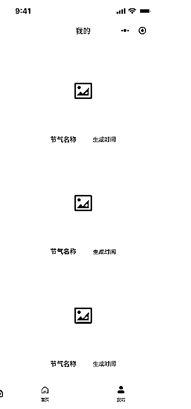

# 用 Coze 打造🛰️小程序 · 收官篇：历史记录存储与小程序上线
作者：龙哥

## 终章：为小程序加上数据持久化并完成发布

作者：陈序员大康  
日期：2025-01-07

如果你还没跟上前两篇的进度，建议先补齐基础：

上回我们把首页和海报生成的核心链路跑通了。本期将把剩下的“我的” Tab 补完整，并讲清楚数据如何落库、最终怎样打包发布到🛰️小程序。

# 一、“我的” Tab 需要实现什么

简单来说，这个入口就是用户的个人档案馆，用来回看以前制作过的海报。

实现回看的前提是能把清单调出来展示，目前清单是空的。

因此必须先做存：每一次海报生成成功，都要把关键信息即时写入后端数据表，之后再从表里读取渲染到页面上。只有这样，“我的” 才能有东西可显示，也有意义可回溯。

* * *

评论区：

mojito : 牛

龙哥 : 可以把几篇汇总合成一篇发布一下，有利于加精华。

陈序员大康 : 好的，我重新整理成一下