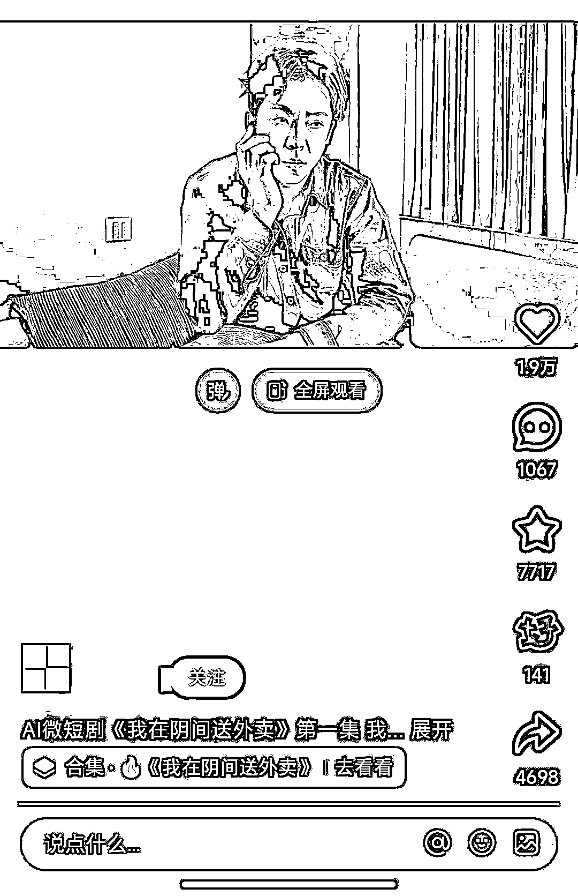
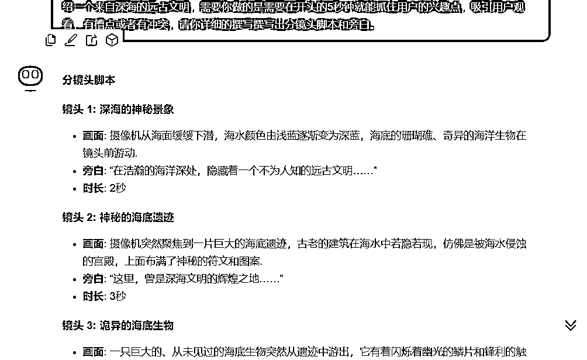
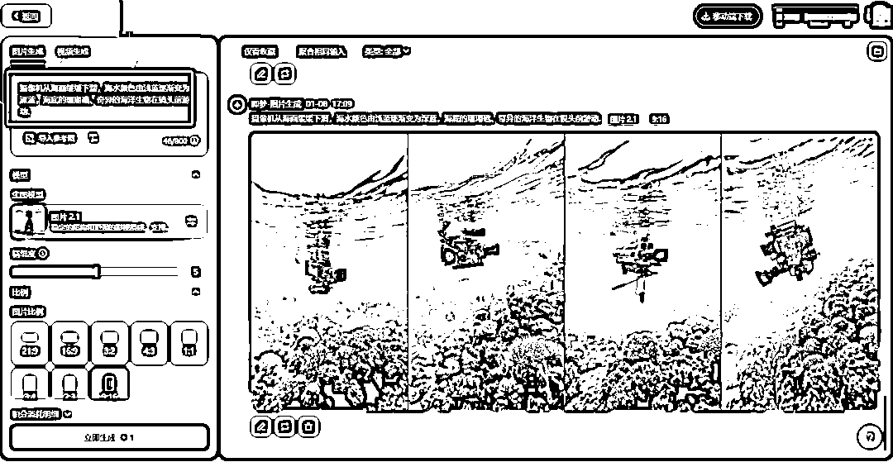
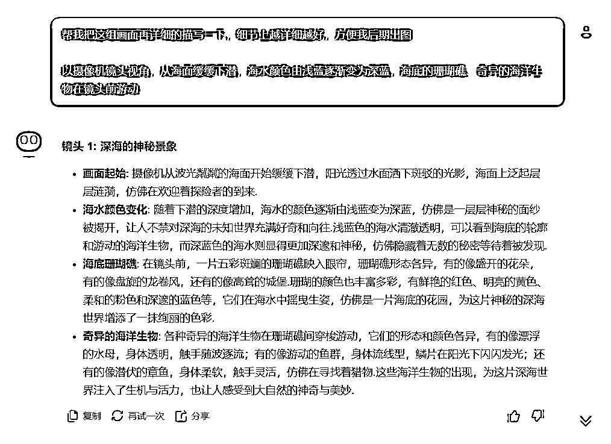
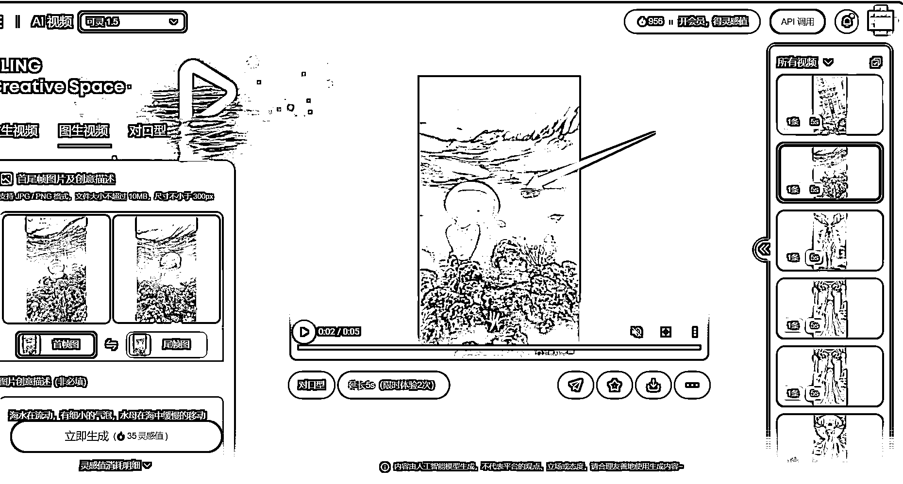
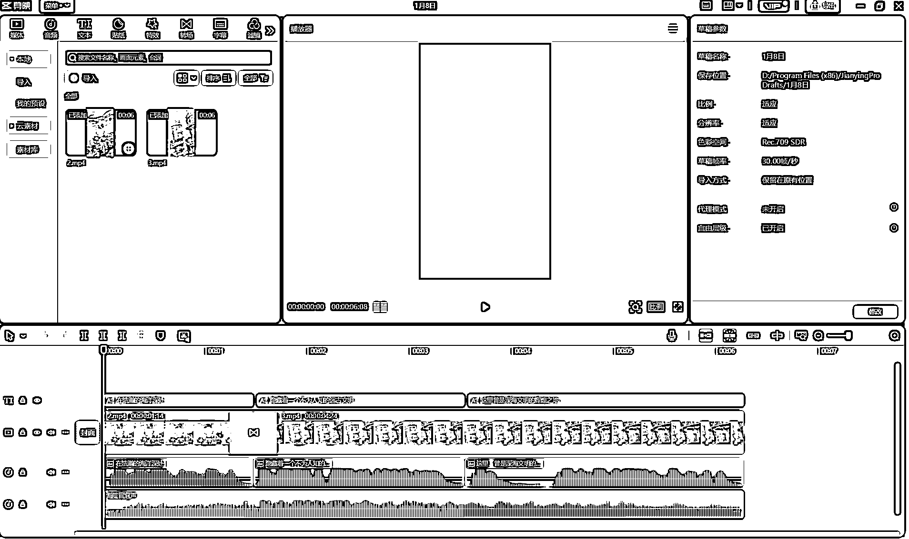

# 用 AI 做微短剧，1 个视频就跑出 100 万的播放量，原来是用好了这 3 款 AI 工具！

最近短剧赛道简直热得发烫，各大平台都在疯狂给短剧导流。不少做自媒体的朋友已经冲进去做“短剧推广”了，也确实有人赚得盆满钵满。但很多人可能没意识到：除了推广别人的剧，我们还能直接拿AI“造”一部原创微短剧——既能吃到平台红利，又彻底告别原创度焦虑。

这个玩法不是我先想出来的，已经有同行跑出了成绩。我刷到过一条作品，时长也就1分钟左右，题材和情节都非常抓人，点赞量直接冲到1.2万，播放量大概已经破了百万。

我把这条视频从头到尾拆了一遍，这短短1分钟里，大约塞了20来个镜头，每个镜头都是AI生成后再拼到一起的。这件事其实说明了一个大机会：市面上那些真人出演的爆款短剧——什么霸道总裁、古装穿越——未来都可以用AI重新翻拍一遍。

为啥用AI做短剧这么香？简单说：不用花大钱请演员，不用找场地，不用扛机器拍摄，每个月几十块的AI工具费就能覆盖全部成本。你看视频评论区就有人说，将来AI虚拟明星或许会真的取代真人明星。仔细想想，AI明星的优势太明显了——不会人设崩塌，不用支付天价片酬，不会扯上经济纠纷，也不会感到疲劳，还能源源不断地产出内容。所以AI影视、AI虚拟明星，绝对是接下来几年的一大趋势。对AI视频感兴趣的朋友，不妨往这个方向多钻研钻研。

那么，具体怎么才能做出一集精彩的AI微短剧？总共分四步：

第一步：让AI帮你写分镜头剧本。打开Kimi，把我们准备好的分镜头提示词丢进去，让它直接开写。一分钟左右，AI就能把每个镜头的画面描述和旁白都列出来，还会按镜头分组，比如一次性给你8组。（完整提示词我放文末了，自取就行。）

第二步：根据分镜头脚本用AI出图。把刚才的提示词喂给AI绘图工具，比如即梦。注意，第一次生成的画面可能跟你想的不一样，这时候需要对基础提示词做扩充，让AI把画面描述得更细。我有个小技巧：把原来的分镜头提示词再发给Kimi，让它把画面细节重新详细写一遍，同时提醒它别偏离原画面。你可以直接对它说：“帮我把这组画面再详细的描写一下，细节上越详细越好，方便我以后出图。”

第三步：用AI把图片变成视频。把生成好的图片按照首尾帧排好顺序，丢进海螺AI、即梦AI或者可灵AI。这里面我更推荐可灵AI，因为设置首尾帧之后，出来的视频更平滑、更真实。

第四步：剪辑和配乐。把所有片段都导进剪映，配上合适的音乐和字幕，导出就行。这样，一集完整的AI微短剧就成型了。

实际操作里，因为每集视频本来就不长，所以分镜头不用太多，20个左右完全够用。只要剧情够精彩，结尾再埋个钩子，涨粉率会特别高。

看到这可能有朋友要问了：做这种账号怎么变现？其实特别简单，你看看短剧制片方都是怎么赚钱的就明白了——无非是后续剧情设置付费观看、演员接广告、视频里插广告、或者接商单。哪怕只是做各大平台的创作者分成计划，收益也相当香。有了平台流量扶持，根本不用愁赚不到钱。

好了，以上就是“AI微短剧”的完整玩法。如果你也想动手试试，我把完整的分镜头提示词整理好放在下面这个文档里了，需要的朋友直接拿去用！
