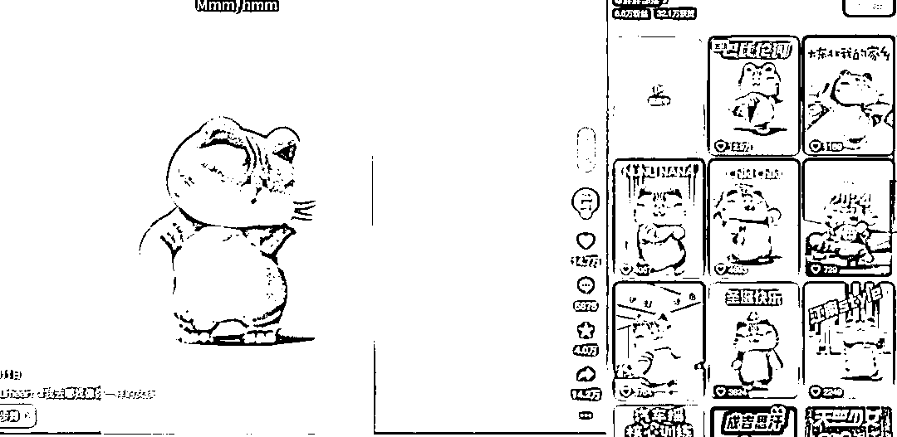
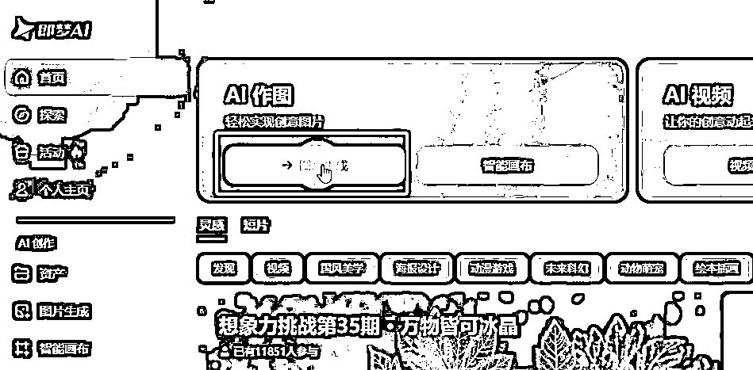
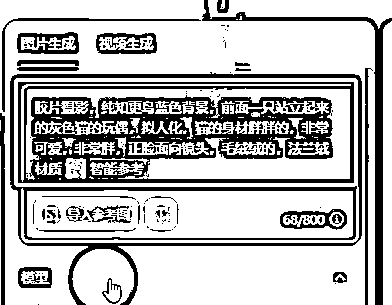
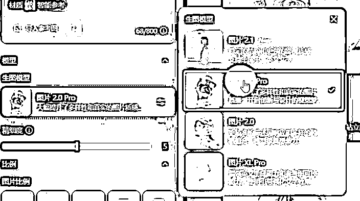
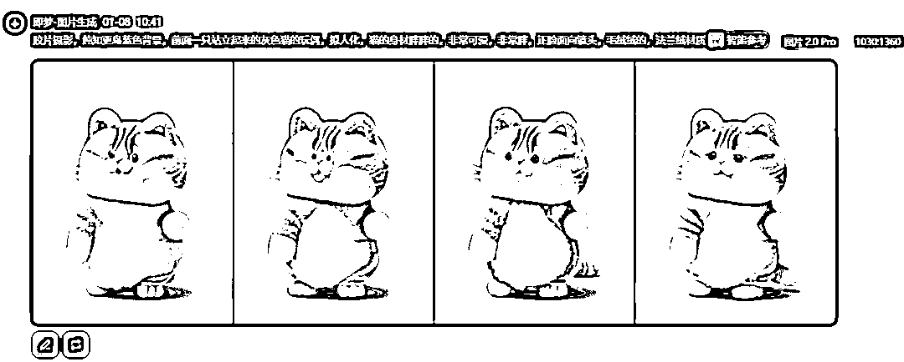
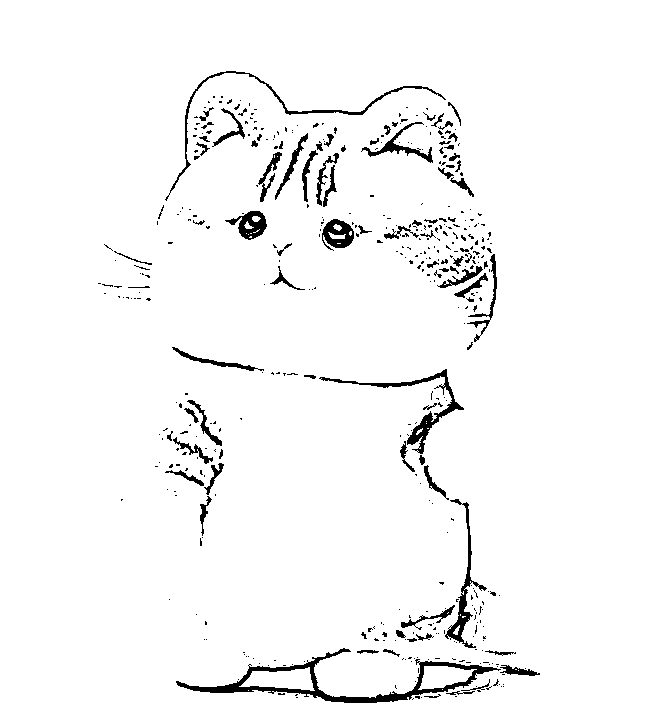
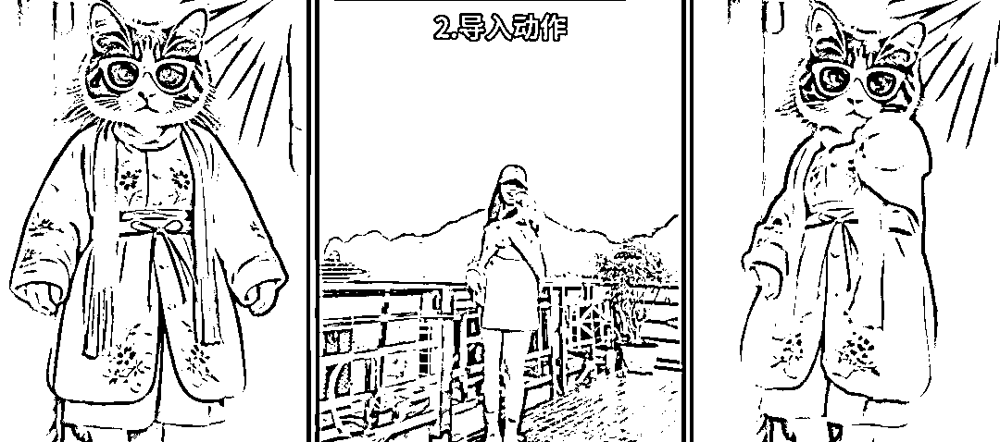
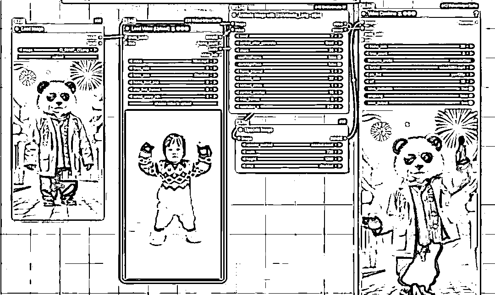
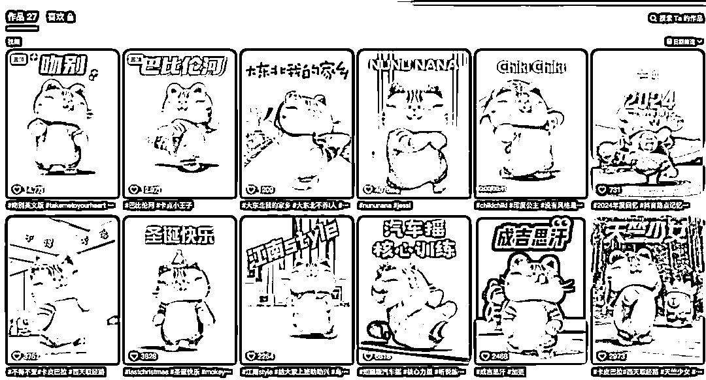
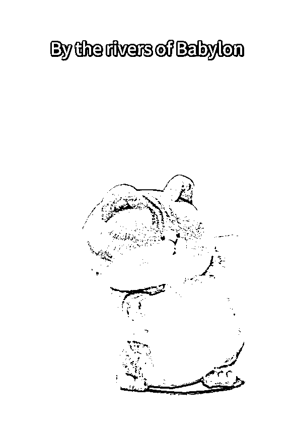

# ('20 条作品涨粉 6 万，AI 猫咪跳舞视频爆火，完整攻略送给你', (2, 34))

最近这种让猫咪跟着音乐扭动跳舞的AI视频，简直火得一塌糊涂。有人就靠20条作品，轻轻松松涨了6万粉丝。你是不是也很好奇，这种魔性又可爱的视频到底是怎么做出来的？今天我就把这个玩法从头到尾拆给你听。

首先，你需要用文字描述加上一张参考图，生成一只呆萌的猫咪形象。打开即梦的首页，找到“图片生成”功能，点进去。

接着，把我给到你的提示词复制进去，再上传一张垫图。垫图去哪儿找？很简单，你可以去翻那些热门视频，截取里面猫咪最完整、正脸对着镜头的那一帧画面，效果最好。

然后在图片生成模型那里，记得选2.0 pro，也就是升级版，出来的图片质量会高很多。

即梦会一下子给你四张图，基本上每一张都挺有感觉的。

比如最后那张，特别有眼缘，直接保存下来备用。

图片搞定之后，重头戏来了——怎么让这只猫动起来跳舞？这里要用到一款工作流，据说是破站的一位大佬做的，相当硬核。你只需要上传一张静态的宠物图片，再上传一段人物跳舞的视频，它就能让图片里的动物，像模像样地模仿视频里的人来跳舞。

打开这个工作流的页面，最左边就是上传图片的位置，中间呢，要你放一段人物跳舞的视频，最右边就会自动生成最终的结果。

因为工作流都是提前配好的，所以操作起来并不复杂，基本傻瓜式。

但有一点要注意，这个工作流对显卡要求不低，显存至少得12个G。要是你的电脑带不动，也别慌，直接去租个云端服务器就行，反而更方便。

想要把这个号做起来，还有几个小门道。你可以看看“胖胖部落”这位大佬，他视频里的动物形象，来来回回基本就是那一只。

前期你可以先模仿他的风格，或者换换猫的颜色、身材和体型，多生成几个不同的形象试试水，后面哪个火了，就重点用哪个。你还会发现，大佬视频里的猫咪，每次跳舞用的背景音乐都不一样。这些音乐基本都是挑的热门神曲，给视频加了不少分。至于跳舞的场景，那更是五花八门，这些全都能在生成图片的时候，通过改描述词来自由控制。

好了，今天这个爆款玩法就分享到这儿。关于AI工具、提示词、垫图素材，还有这类账号到底怎么商业化变现，我都整理在文档里了，需要的自取。

我是高鹏，在网创圈摸爬滚打了9年，目前已经拆解了第708个实操项目。想交流更多玩法，随时来找我聊。