# “AI+视频号”7 个变现关键点想和你聊聊

想在自媒体里搞出点名堂的朋友，你好，我是陈先生。

今天想跟你聊透“AI+视频号”的变现逻辑，不整虚的，全是实打实的经验。我96年的四川人，28岁，做过万人星球嘉宾和训练营导师。从2020年1月开始折腾视频号和线上副业，到2025年1月，变现超过50万。这个过程我梳理成了7个关键点：视频号规则与起号、爆款号对标与兵器库、AI工具与图片剪辑、AI赋能爆款剪辑、AI视频与微信号变现、AI账号十倍放大收益、独家秘诀与提问复盘。今天先把最核心的几个部分彻底讲透，剩下的我找时间继续补。

【一、视频号的规矩与冷启动】

抖音和快手早就验证了视频时代已经全面到来，用户刷短视频的习惯已经被彻底养成。微信带着14亿用户的体量切入这个战场，视频号还打通了👸号、朋友圈、直播和带货，这个富矿远没被挖完。所以，只要你有微信号，我都建议你来视频号占个坑。记住一句话：优质原创，永远是内容的核心。

平台的推荐逻辑先搞清楚。视频号最核心的机制是社交分发，打开默认就是“朋友”板块，小红点来自好友点赞。算法权重里，朋友点赞的社交推荐占55%，热门优质内容只占15%。说白了，想被更多人看到，第一步是让你的朋友先赞起来。

审核是机器+人工双重机制。机器先识别画面和关键词，人工再复核标题、封面和关键帧。一旦踩线，轻则限流删除，重则降权封号。所以原创是底线，搬运是高危动作。

注册很简单：微信-发现-视频号-右上角小人-建立视频号。名字不能重复，好名字要先抢注。一个微信号只能开一个号。定位相当于开店，选一个垂直领域持续深挖，打标签、筛精准用户，平台会根据你的用户画像给你推荐对应流量，形成正向循环。

如果找不到定位，五步法送给你：先做调研，找对标，也找自己的兴趣；再复盘每一次尝试；然后收集身边人的评价；接着多体验、多试错；最后用旁观者视角修正自我感觉，定位会自然浮出来。

账号基础设置也别忽视。头像要有辨识度，个人用形象照，企业用logo；昵称简单好记，有知名度就用真名；简历写清楚你是谁、能提供什么；背景图上半部分可以藏点巧思。认证分个人认证和企业机构认证，个人认证又细分为兴趣、职业等。个人认证的门槛是近30天发布过内容、粉丝100+、已填写简历；兴趣领域自媒体认证，要求对应领域持续原创且视频号+👸号关注10万+，或者外站粉丝100万+。企业认证需要同名👸号管理员扫码确认，每年有两次机会。拿到金V、蓝V后，信任感会大大提升。

内容发布格式也有讲究：每天不限条数，视频最长1分钟、最短3秒，图片最多9张。不能纯发文字，文案超三行会自动折叠，最多1000字。可以加话题、位置、👸号链接。横屏用16:9，竖屏用9:16。

内容发布后，用户可以转发到好友、群聊、朋友圈，也能点赞、收藏、评论。接下来要主动推广：自己点赞、发朋友圈是最基本的；私聊群发现在基本没效果，不推荐；社群可以玩，但一定要找真实用户点赞，机器刷的赞不具备社交关系链，既没传播价值，还容易把号搭进去。

工具方面，给你一份实用清单。文案灵感：梅花网、文案、金句谷。图片素材：Designspiration、Pinterest、Pexels、Unsplash。视频素材：包图网、摄图网。剪辑：剪映、快影。音频：迅捷文字转语音。录屏：录屏王、格式录屏大师。

几个高频问题顺手解答：为什么朋友看不到你的视频号？因为平台不会自动展示，需要主动分享视频或名片。谁能看到你的内容？只要有人点赞，就会推送给TA的朋友。怎么上热门？发布时加话题、配音乐、加位置，点赞量上来自然进热门。平台鼓励什么？鼓励原创拍摄，搬运内容不会推荐还可能被罚。视频号能换微信用吗？不能，只绑定开通时那个微信。视频为什么模糊？多半是被压缩了，导出时选择1080p以上。

【二、爆款号对标与兵器库】

接下来聊对标。之前我讲过“抄题库”和“选题库”，今天再细化一遍，毕竟送上嘴的才是最好的。

爆款视频兵器库：我习惯用微信拉一个三人小群，把自己和两个小号放进去，平时刷到好素材随手一丢，减少行动阻力。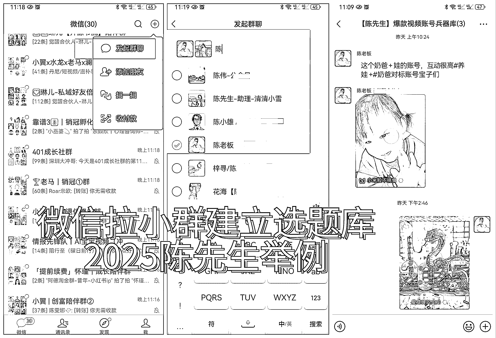

下面按赛道整理一些值得参考的账号，看看有没有你所在的领域：

奶爸+萌娃，互动性极高，关键词：#养娃 #奶爸。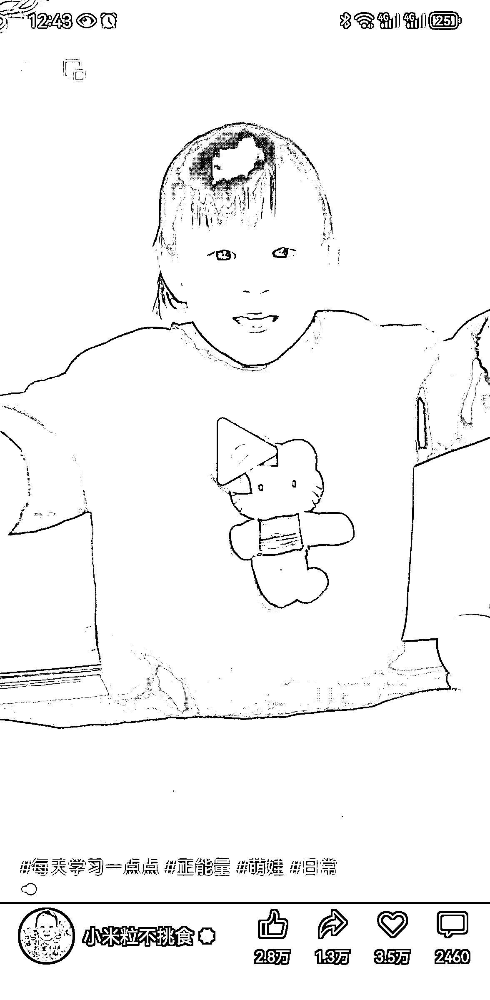

情侣账号，这个异常值很有意思，关键词：#女生 #洗澡 #雾气腾腾。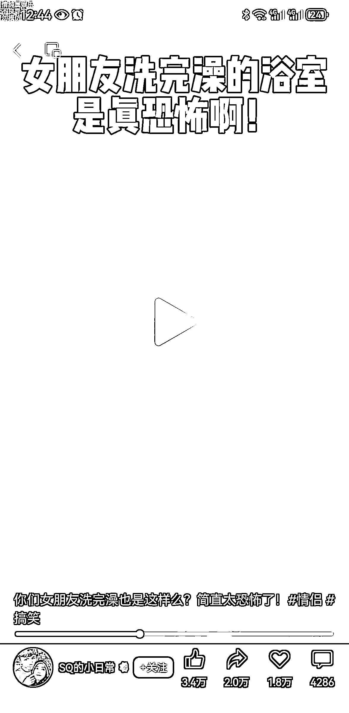

卖房卖车类，这个“扛着跑”的拍法有点东西。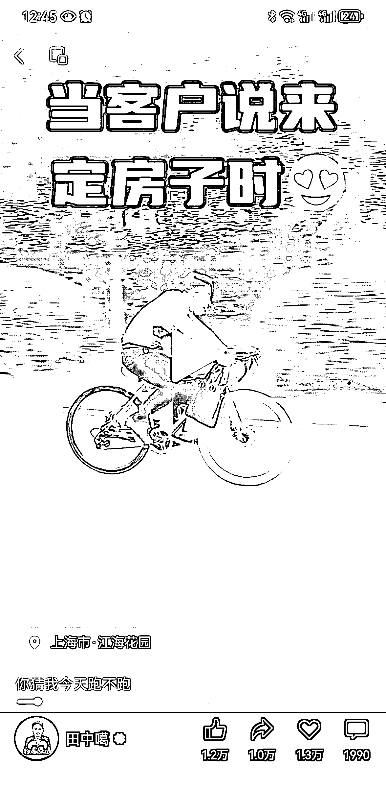

读书类账号。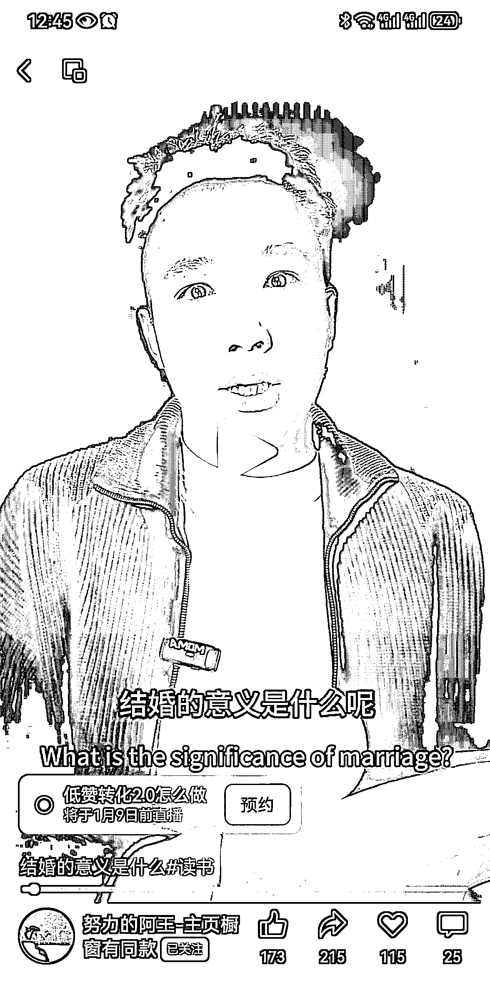

AI婴儿+老年人赛道。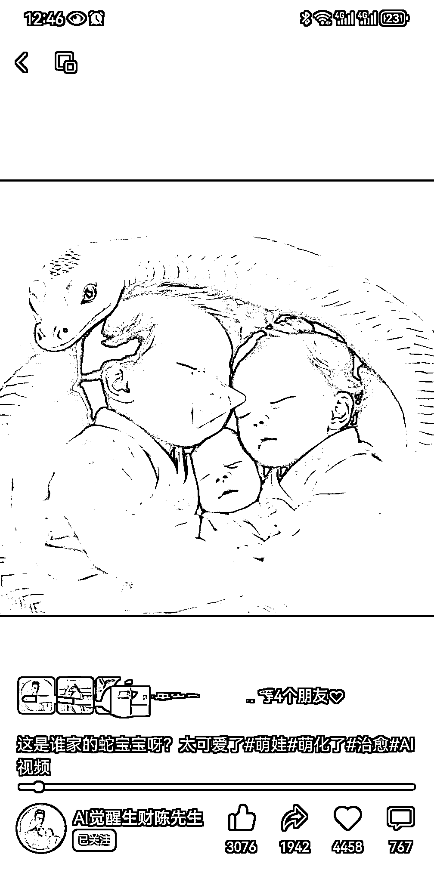

医生IP+自媒体专家类，关键词：#靠谱。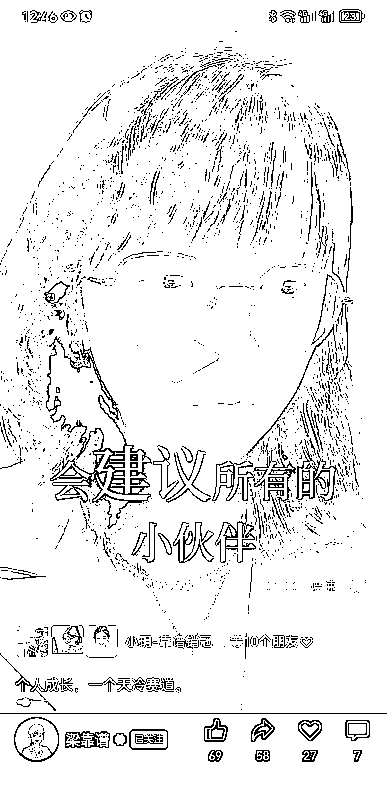

做账号对标、做爆款拆解，是近几年拿正反馈、搞到钱最快的路径之一，没有太多弯弯绕。

经典音乐兵器库：这一点我要单独拎出来说。很多爆款视频什么都能改，唯独音乐不能偷懒。好的BGM一响，情绪立马就位。我早期用飞书+备忘录存音乐，后来改用剪映存，都很方便。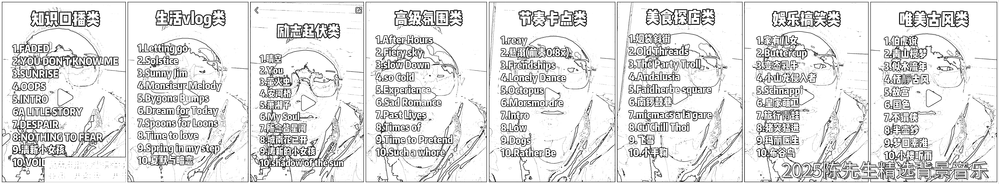

比如这首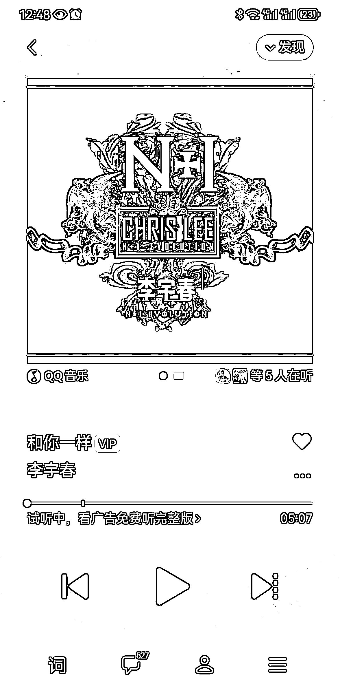，前奏一出来，故事感直接拉满。

爆款选题兵器库：选题最直接的来源是爆款视频本身，也可以对标同赛道的成功账号，标题和选题里往往藏着变现密码。比如我最近实操变现视频时，意外发现了一条神奇赛道。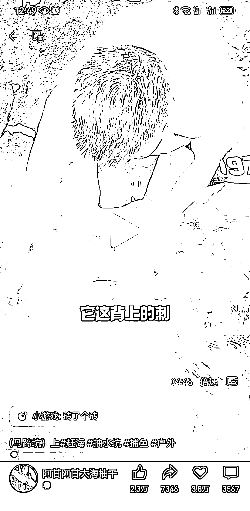

你大概想不到，这条视频光靠小游戏就赚了多少。我以前刷到赶海类视频，也会好奇他们靠什么变现。直到自己亲自做视频号变现任务、去查爆款榜才发现，一条视频能变现7万多。所以别光顾着刷视频，要去研究背后的变现模式。粉丝满1000后，视频号就能开通小游戏变现，完整流程放在下边。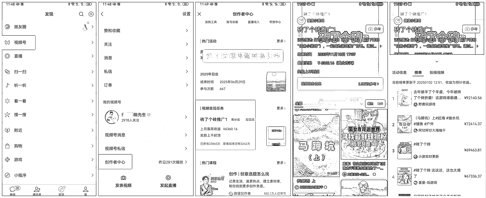

排第一的账号，一条视频变现9万多。把它拆开看，视频本身并不复杂，难的是他矩阵化地发了大量内容。这个模式和内容，我们完全可以复刻，我自己也正在实操。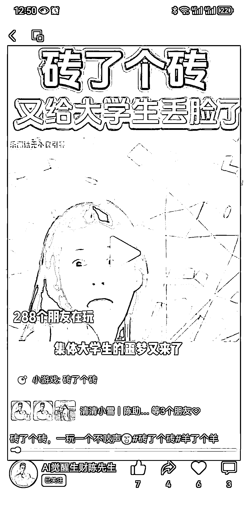

我预感春节前后会爆一波流量，抓住这波红利，单条视频赚一万不是梦。前提是你会做爆款、会拆爆款。如果不是原创，千万别标原创——赚钱可以不分我，但被抓了别说是跟我学的。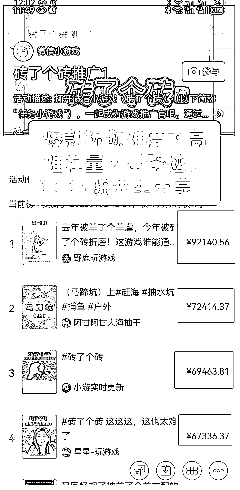

图片视频素材库：素材积累耗时耗力，但一旦沉淀下来，就是最强的竞争壁垒。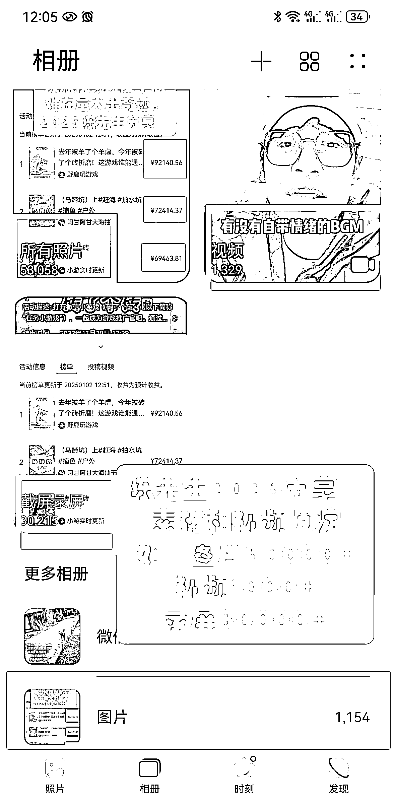

比如我的手机里，图片5万多张，视频1800多个，录屏3万多个。想随手记录，第一步就是把相机放到手机最顺手的快捷键位置。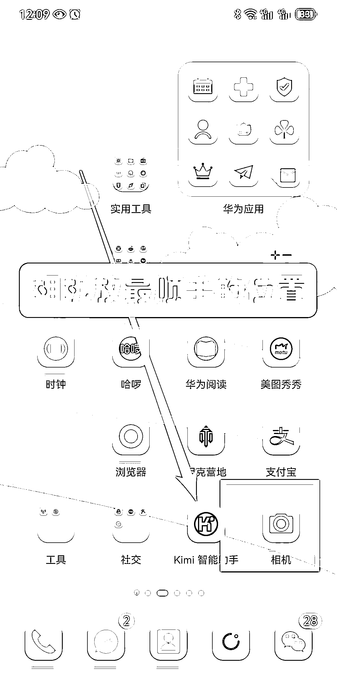

推荐一本摄影书，我20年买的时候还送了本教做抖音的书，拍摄技巧这东西，用多了自然熟练。

再推荐一个教拍摄的视频号，很适合加进对标库。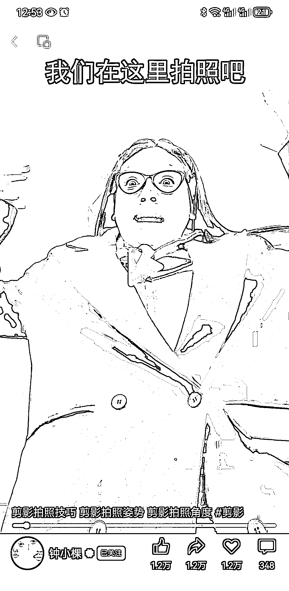 她能在海量教学视频里杀出重围，靠的是：人物情绪强，三秒抓人；人设反差大；有四川“耙耳朵”的独特味道；日更频率高；两个人低成本制作；接相机和手机广告变现。很多账号停更，纯粹是饿死了。

还有个小技巧：手机素材太多容易找不到，可以用QQ相册做存储和分类。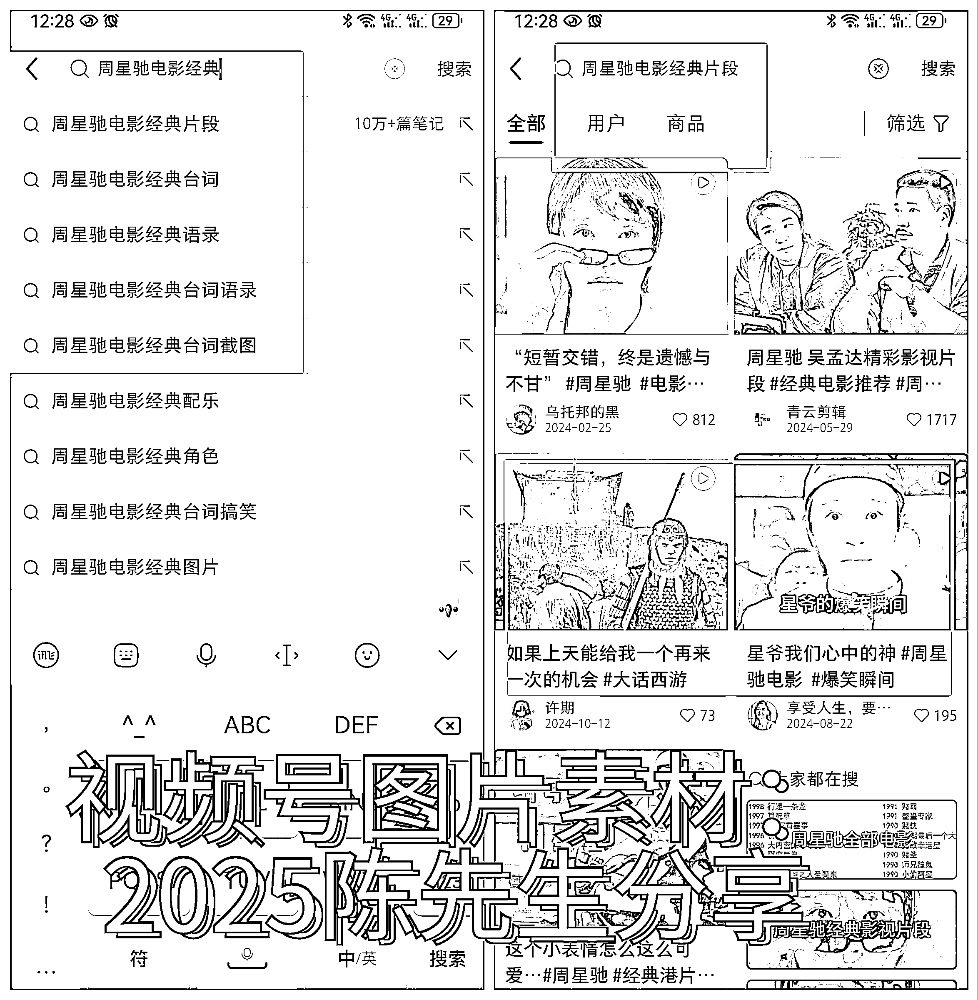

【三、AI工具与图片剪辑】

最后聊聊AI工具在图片和剪辑里的实战玩法。

先说说我的“因果种子”：自己折腾视频号三年，这是打磨期；进内部社群打卡围观近100天，这是学习期；看到一门“视频号赚大钱”的分享后果断入手，白天悄悄看、晚上猛执行，用30天突破卡点。

机会来的时候，正巧赶上央视春晚、视频号红利、大家过年都有空刷手机，再加上合伙人无岸学长，我们一起做出了几万播放的爆款。

前置工具：讯飞输入法App、剪映VIP，还有美图秀秀和稿定，这四个都带AI优化功能。

热点判断很关键。当时“魔术疑似失误，背后可能是炒作”这个话题特别火，我第一时间收集爆款图片，找到最火爆的视频和配音，严格控制剪辑时间和信息密度，按1:1的比例去模仿爆款结构。

图片处理上，我经常从📕选图，再用AI辅助出图。然后用美图秀秀P掉logo，再用AI一键优化，几分钟就省下来了。

剪辑这边，直接开剪映VIP，用AI+剪辑，这步能省半天时间。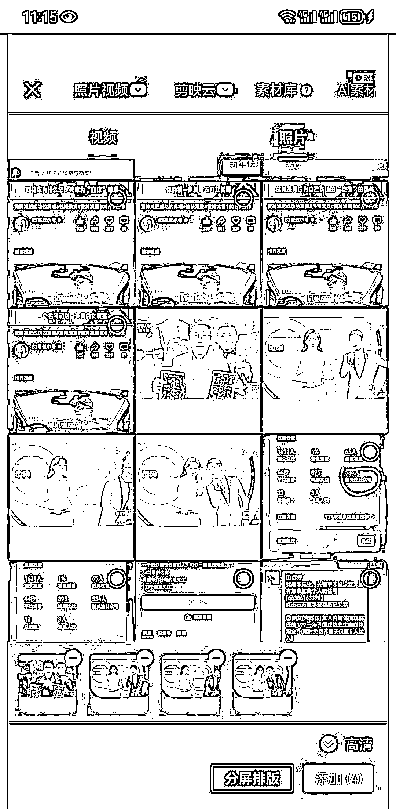

最后，围绕热点人物和事件中心去剪辑，一条爆款的骨架就搭起来了。

今天这篇先聊到这儿，后面4-7个关键点，我会继续更新。想学更多案例和实操细节，咱们评论区见，一起复盘。

我是陈先生，下篇再聊。

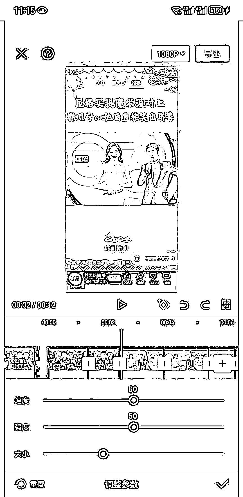

图片素材按既定路径导入后，先做裁剪和抽帧，一步步走完。

然后用剪映的VIP功能，能上AI特效就上AI特效，不走AI也可以纯手动。

特效面板里两组核心参数，统一调到50。

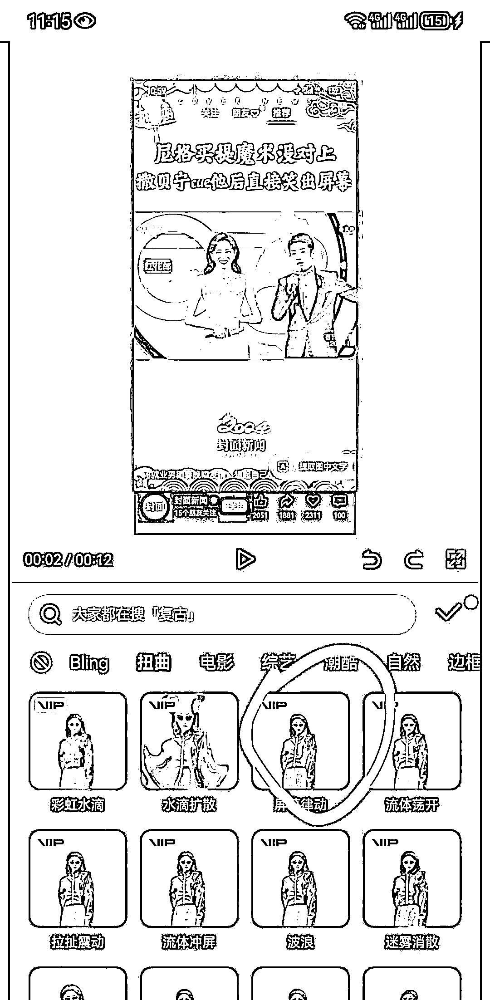

特效本身要拉满，但顺序有讲究：第一层负责把人留住，第二层才是搞笑担当。

模仿阶段先别管原创性——剪完的片子先不配音乐，也不叠任何特效。去陈先生的视频号里挑个数据最好的作品，点进去截个图，后面就照着它做完全复刻。

文案怎么写、@谁、细节在哪，甚至我发视频的时间段，全部自己翻。

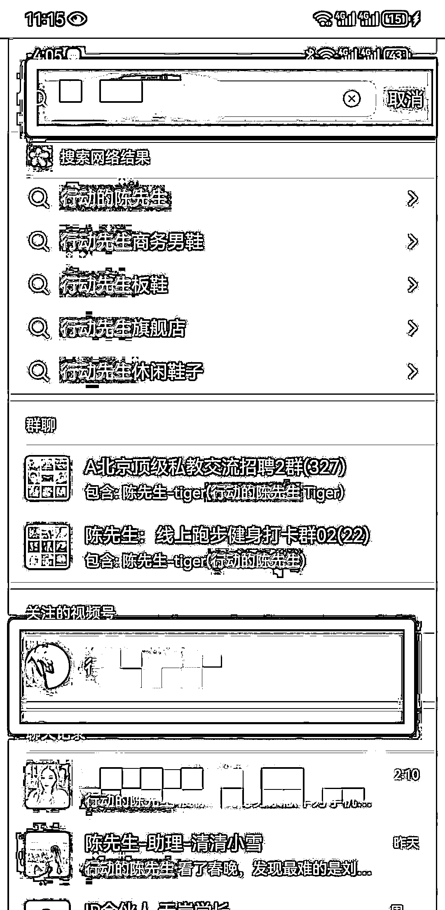

模仿到位后，用我指定的那首嗨音乐发同款，别擅自加东西。

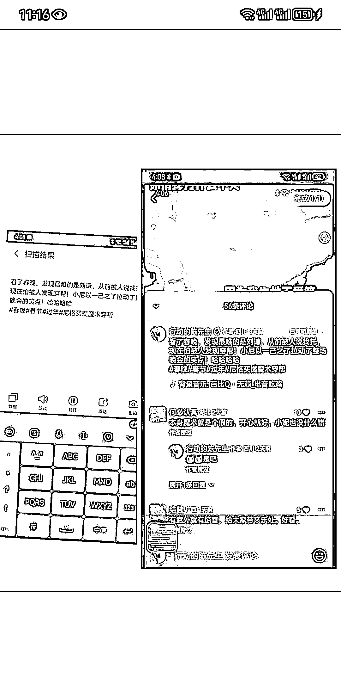

原创入口给的选择其实不少。我那次连发三条，就是为了给账号定赛道，最后炸出来两个方向：明星和新闻。

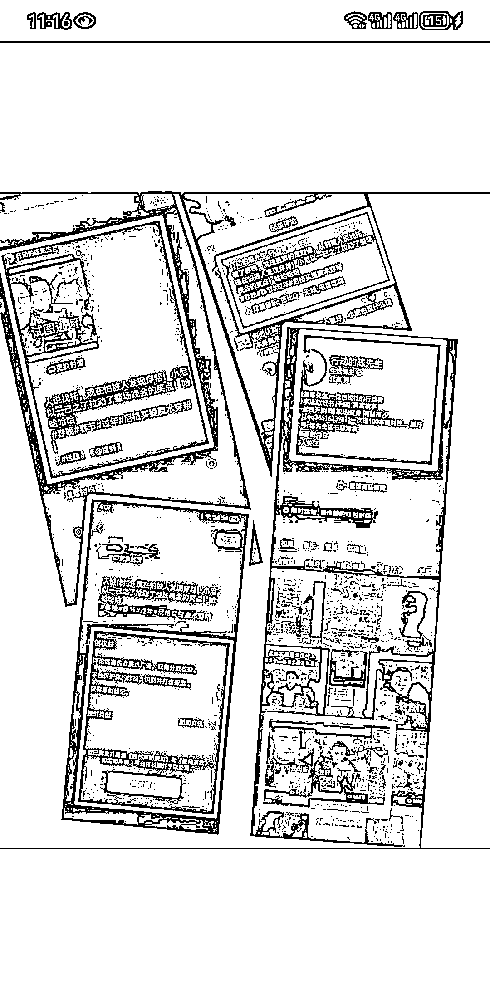

发之前拿出讯飞输入法逐项核对：1:1复刻有没有到位，原创勾没勾、位置选没选，全都确认好再点发送。

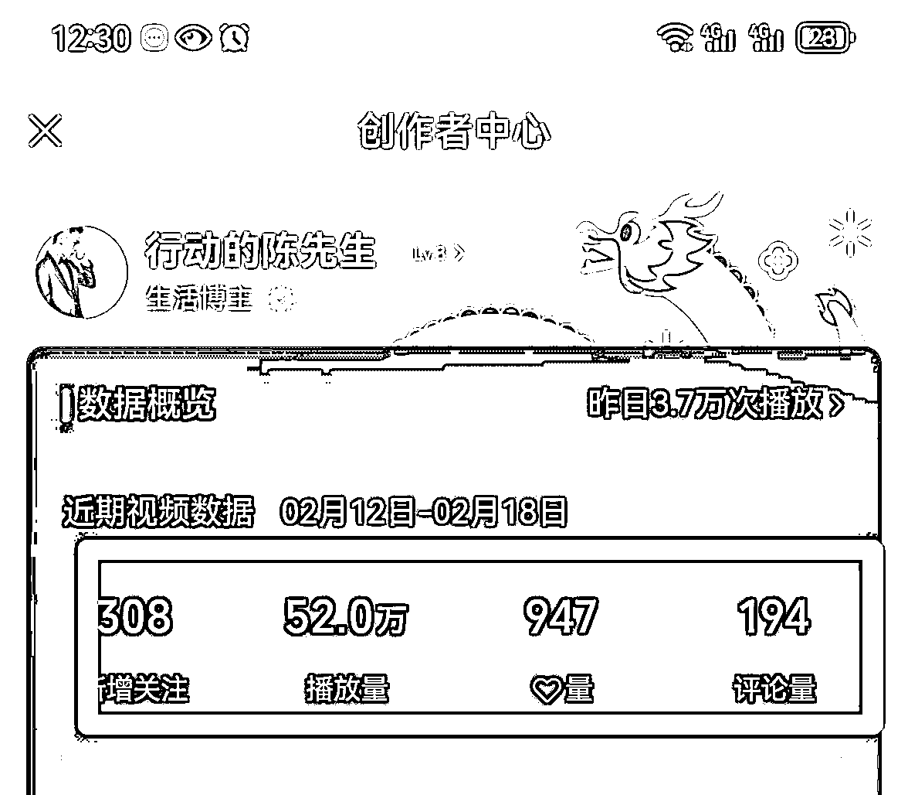

重点再敲一遍：单条时长压到10秒内；必须走洗脑BGM进场；抓眼球那套特效参数定了就不许动；文案、标题、@、原创选项全部照抄。发布时间也排一下——中午一条，傍晚6点饭口一条，晚上8点后一条。三条连着发完，看数据再说。

有朋友问我：今年50了，再学这些是不是太迟了？

我的回答是：不迟。不管你是纯新人还是50+的中年人，有没有所谓的天赋都不重要。方法对路，搞钱闭环一样能转起来。

# 4、AI红利下的爆款剪辑

晚上好，今晚不整虚的，拿一个最新的AI红利小项目当引子，分享几个提效工具。

那阵子刷屏的AI龙年宝宝视频，单条冲到3000万播放，收益3000块。

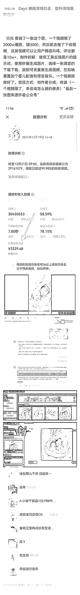

工具链接先摆上来：

1. AI秒画

[`miaohua.sensetime.com/m_get_invited?invite_code=wV2ybQa2D`](https://miaohua.sensetime.com/m_get_invited?invite_code=wV2ybQa2D)

2. 可灵AI

[`klingai.kuaishou.com/image-to-video/60265970`](https://klingai.kuaishou.com/image-to-video/60265970)

新手可能觉得节奏偏快，但多跑几轮就顺了，基本发个十来次就能摸熟，看完顺手点个赞。

这支片赚了3200块，放在哪个维度都是异常值信号。我上一次被这种数据震到，还是看某位觉醒的朋友玩“地区图腾+AI动物”，套路异曲同工。

心得欢迎留在评论区，咱们边聊边干，赶上过年流量，现在就开整：

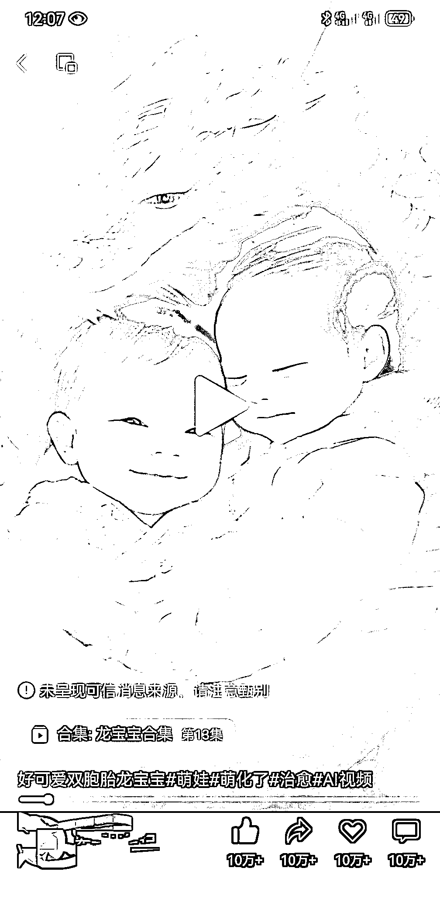

先把爆款的结构倒推一遍。这类AI片的骨架基本相似，所以我不兜圈子，直接拆制作流程，帮你早点做出千万级播放。

封面直接拿爆款的第一帧来用。待会讲怎么从AI秒画进去生成自己的画面；素材照搬也行，反正可灵动图每次出来的结果都不一样，天然带原创属性。

2.1 首帧的做法很简单：截图，丢美图秀秀，再截一下，小P修一修，出来。

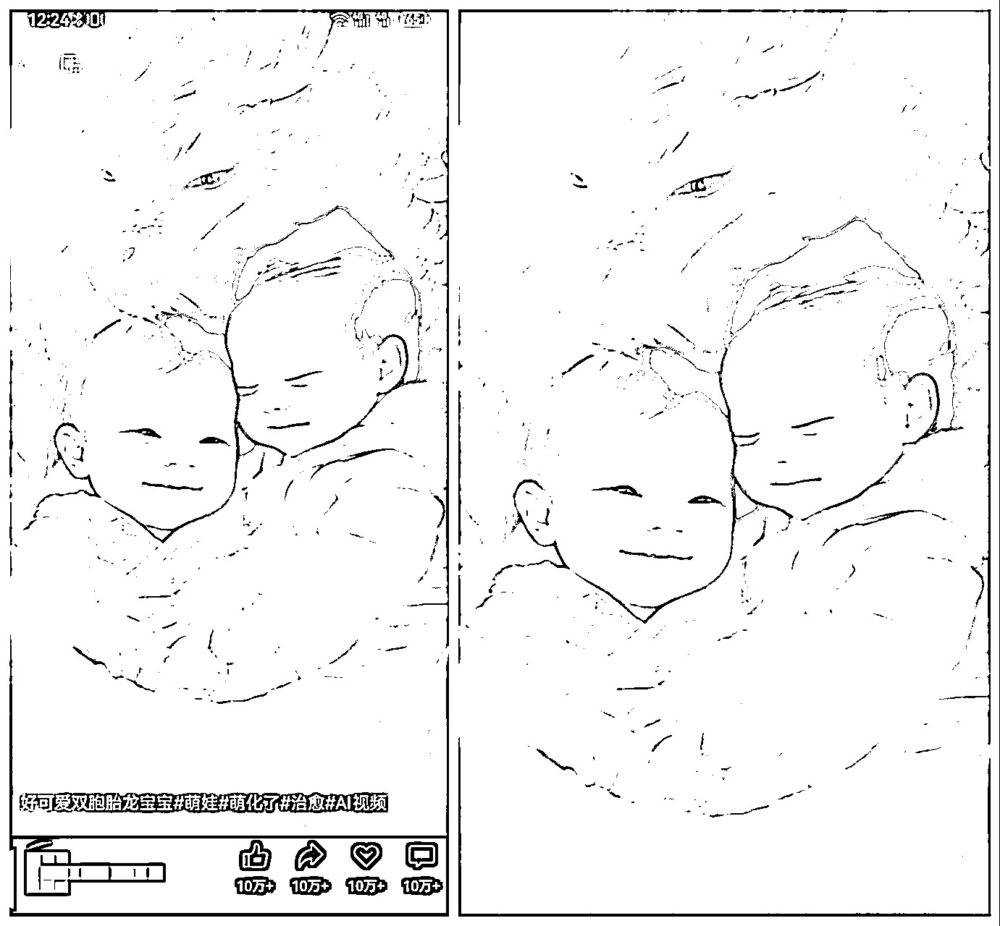

封面和标题是门面，原样搬就行，不动它。

2.2 再回爆款里挑一帧好看的，照上面流程处理成尾帧，等会儿喂给可灵AI用。

（两张图：爆款首图+任意喜欢的图，后面都用得上）

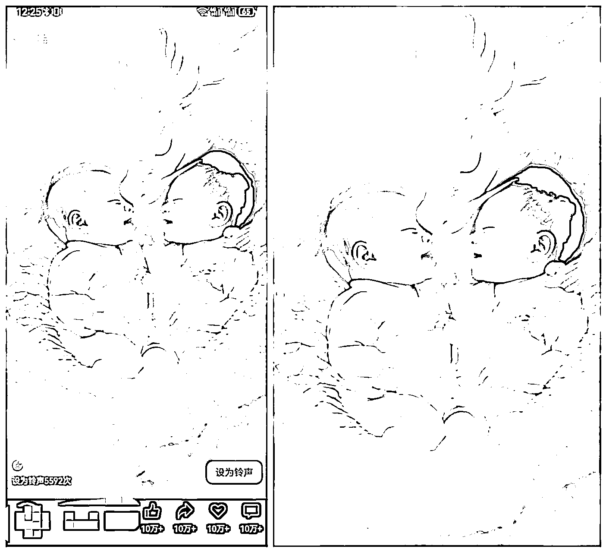

接着用可灵AI出5秒短片：

[`klingai.kuaishou.com/image-to-video/60265970`](https://klingai.kuaishou.com/image-to-video/60265970)

打开可灵，把刚才存的图拖进去，提示词这么写——

粉色的龙用头蹭蹭宝宝的头，两个宝宝睁开眼睛，开心笑着互亲一下，固定镜头。

图片合成5秒片子，建议做2~3段。第一段里必须保留宝宝亲亲的动作，方便后面卡音乐节拍。整体丢进剪映，加速到12秒左右。

成片有两种保存方式：直接下载。

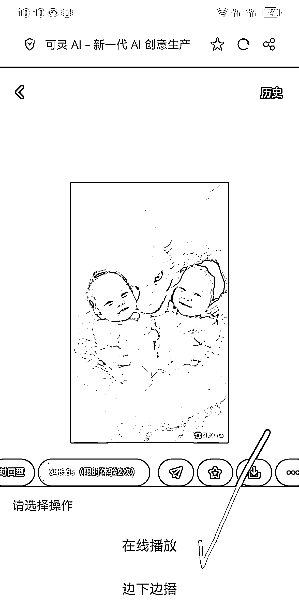

第二种是我没开VIP时常干的：手机录屏，再用剪映裁下来，时长和节奏死死对齐爆款——它12秒，咱也12秒。不加新BGM，就用原片的背景音。后来充了会员，可以直接导出无水印，省事多了。

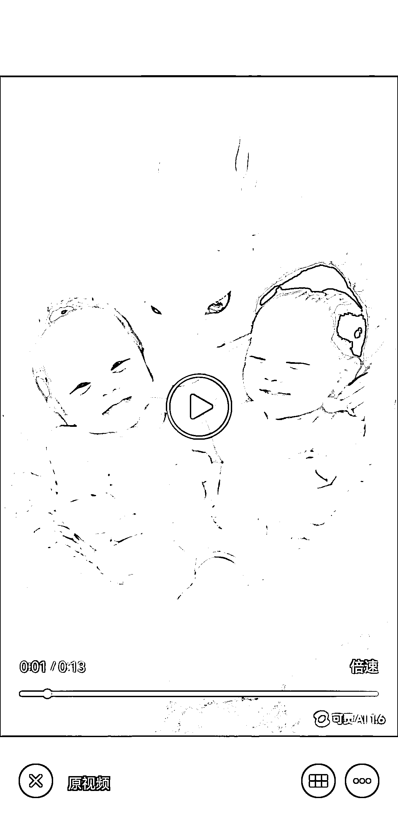

第三个工具是腾讯智影。剪好的片子右下角会带平台标识，用这个APP消掉。

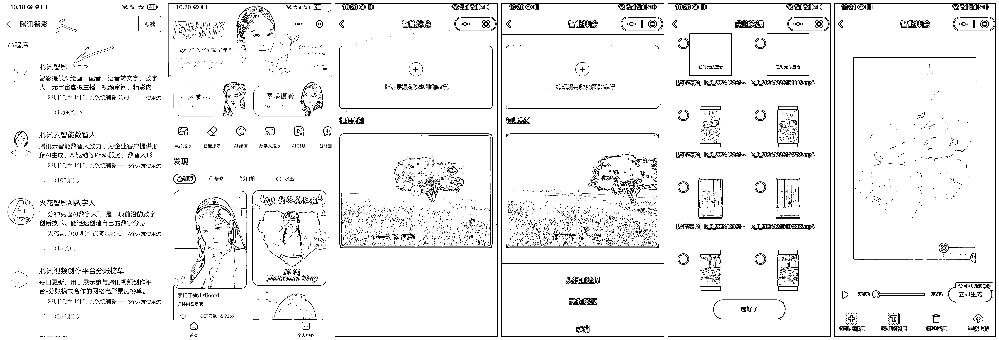

到这一步，3200块的视频只算做完了前半程。剩下半程，拼的是发布细节。

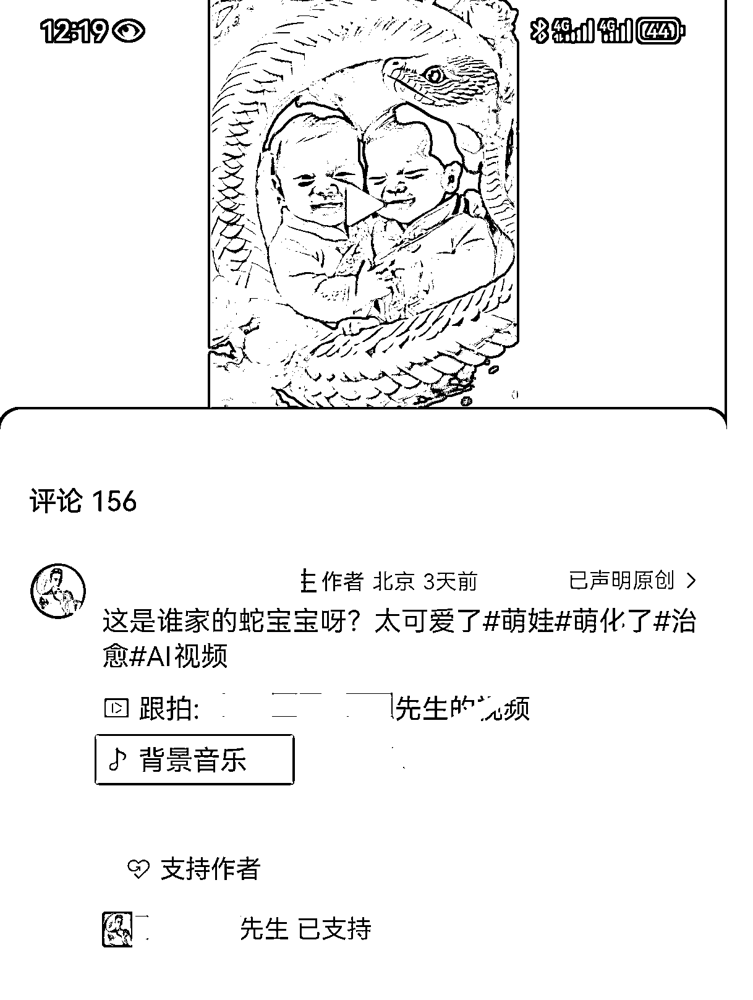

点进爆款，去留言区找背景音乐，让做好的成片跟着这条音乐发，首帧画面也改成和爆款一致。标题直接抄：好可爱双胞胎龙宝宝#萌娃#萌化了#治愈#AI视频

留言也提前埋好：喜欢博主作品的，可以点击评论区广告观看一下。你们的支持，就是我更新的动力[合十][合十]

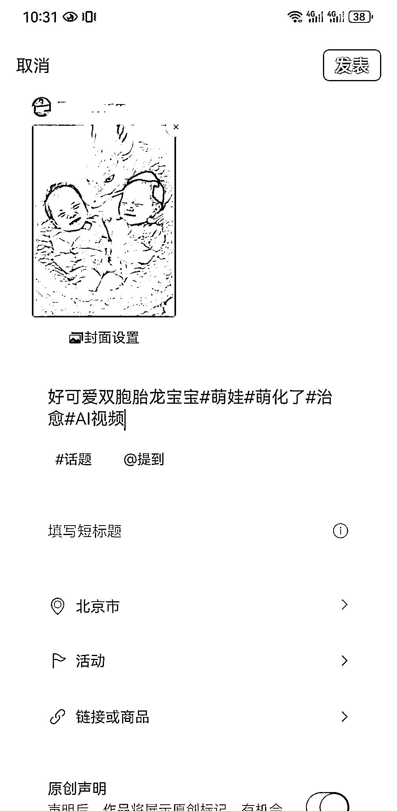

是不是和之前拆的春节爆款打法一个模子？去年就是靠这串细致流程连发十条，砸出好几个10w+。

整个制作流程可以随时回看。和2024年初比，这次多出了三个新AI类应用，出片效率至少翻了一倍。

跑通闭环要准备的东西，四样：可灵AI、腾讯智影、AI秒图、秒剪APP。

最后上手试试AI秒画：

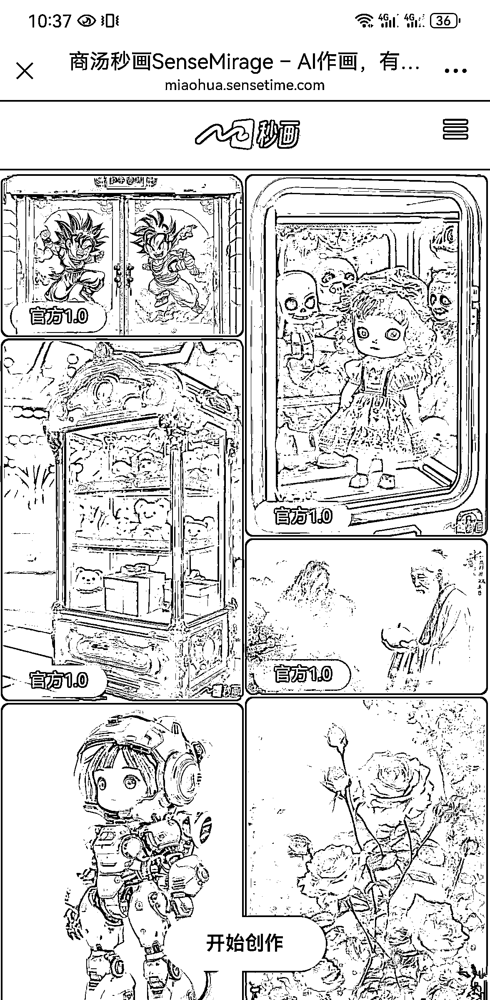

绘画提示词提前备好：

一条温柔的粉色龙，鳞片细腻，环抱着两个穿粉色衣服的婴儿。一个宝宝大眼睛笑着，另一个也在笑，表情安宁，背景是柔和的粉色调，整体氛围温暖。

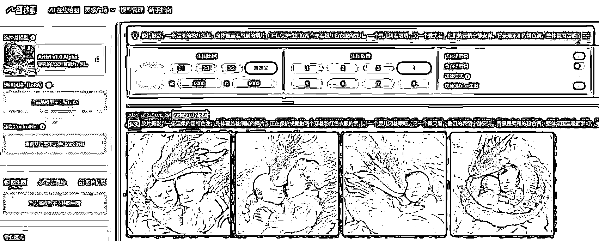

这类图我其实用得少，做出来也不一定就能爆。我更常用的路子是：首图直接找爆款，用AI模仿生成新图。

今晚核心是把这几个APP盘熟。它们在手，AI出片基本无往不利。

行动派看完就去试，跑完写个复盘扔留言区，有问题随手留言，我会看。

#三个AI工具

#AI生成龙年宝宝视频，据悉，一个视频爆了3000万播放，赚了3000块

点我头像或评论区都能交流，欢迎一起复盘。

# 5、AI+视频号搞钱全景

聊一下AI视频搭上视频号，能拼出哪些搞钱闭环。进过我自媒体圈子和星球的朋友，才发现原来路数多得离谱——你猜到了几种？

看到有感觉的地方，随手赞一下。

官方自带的赚钱通道有四条：直播、创作分成、带货中心、视频变现任务，加上一些个人野路子，按粉丝需求难度从低到高捋一遍。

**①先聊直播：下限低、上限高，门槛约等于没有。**

满足两个条件就够，零粉也能直接开播，边囤粉丝边走商业化：

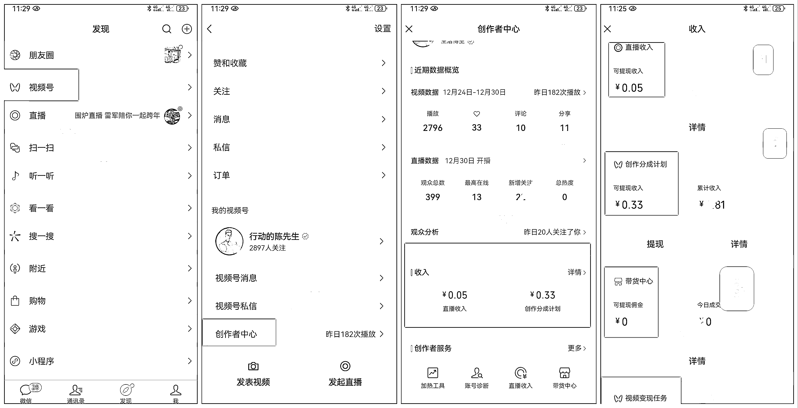

平台结算会扣20到40的个税，剩下的进微信零钱，当成零花。

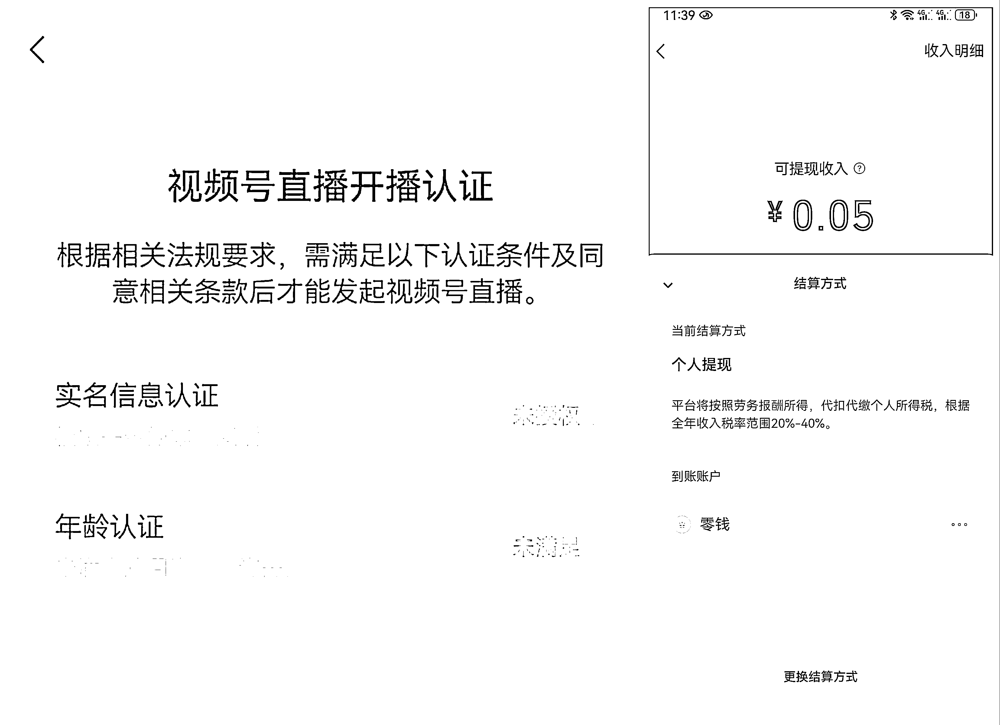

再配上当下最省事的语音无人直播，快速冲到100到1000粉也不是难事。

**②创作分成计划。**

官方逻辑不复杂：视频号生态里，符合要求的优质原创作者，可以在原创片子的留言区挂广告，靠展示赚收益。目前还在内测，平台分批邀请。硬性条件就三条：有效关注破百；内容别踩红线；账号不能是企业号、政务号或媒体号。被选中的会在团队私信里收到入口，或者自己摸去“创作者中心—创作者服务—创作分成计划”申请。没被翻牌就等等。

这也是我小号的主力收入来源。趁这机会，回头看看最近的AI播放异常值，顺便讲点独家心得：

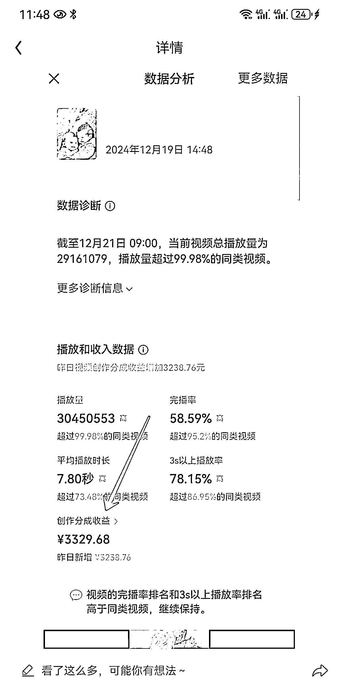

这条AI片子播放3045万，到手收益3329。假设哪天你手里也跑出一条破万的数据，接下来该干嘛？拿我2025年第一条十万加的视频当例子：

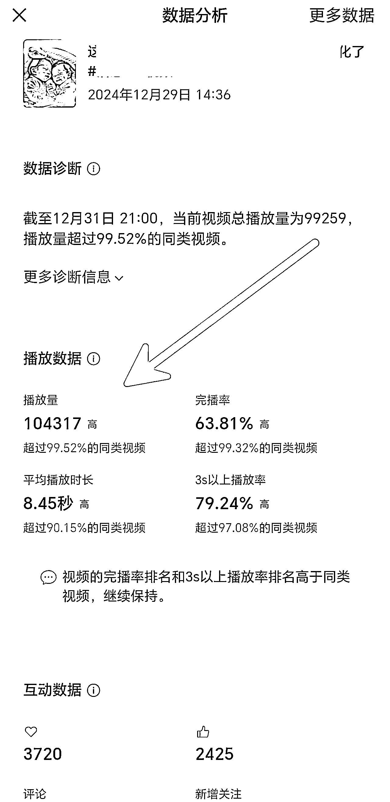

留言区话术备两套。第一套抢点击率，就用前面那句“喜欢博主作品的，可以点击评论区广告观看一下……”原样复制。第二套是抬收益的：我看三楼好久了，烦他丫的。

AI写真可以在留言区截流做单子，一起说了：

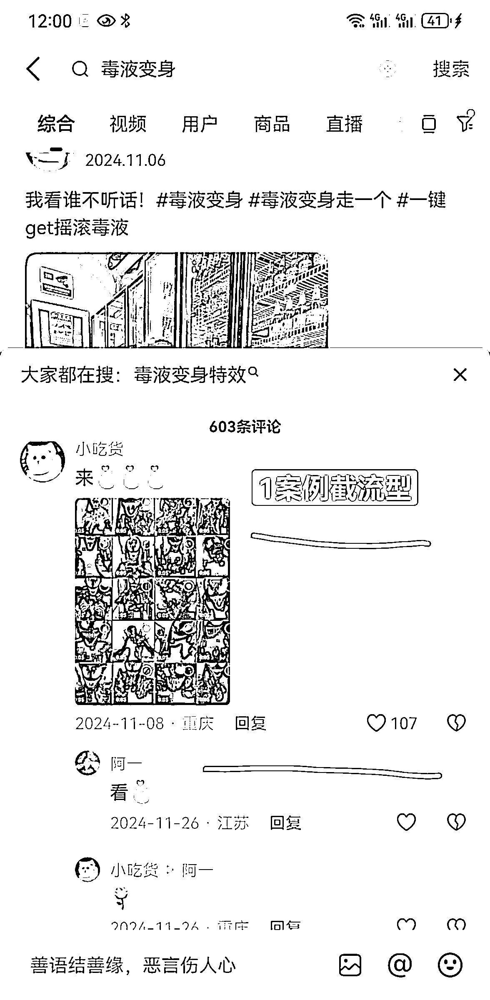

报价格式参考：宝宝，5秒视频5r，8秒视频10r，定制动作+3r。顶配8秒+超清+性能打包20r。想要的直接拍，发照片过来，看到就开工。定制动作提前讲清楚：特效是随机的，你的需求我会编成指令，但不保证完全一致。

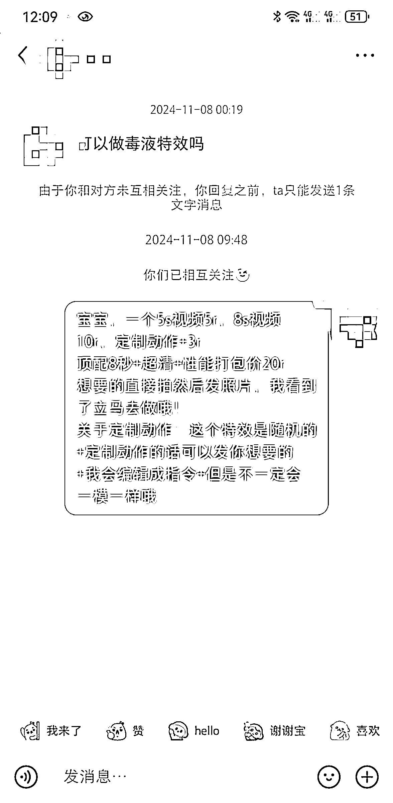

小号换过手机，微信里没留成功案例。📕截流后一定要让对方先发消息，才能百分百安全落到私域付款。到微信里确认完需求，收定金，按前面那套制作方式交片就行。闭环直接跑通。

新报价海报放到最后。等AI出片、抖音截流、📕截流都跑顺了，胆大的群友可以直接私信接单，抖音能变现，视频号同样能私信接单。

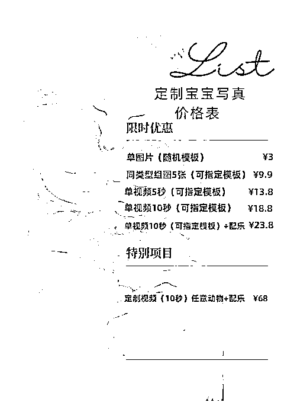

记得某知识星球里，有圈友靠直播挂图引流微信，玩法跟AI头像类似，能多开一条收益线。我们也可以挂图去卖AI制作流程。

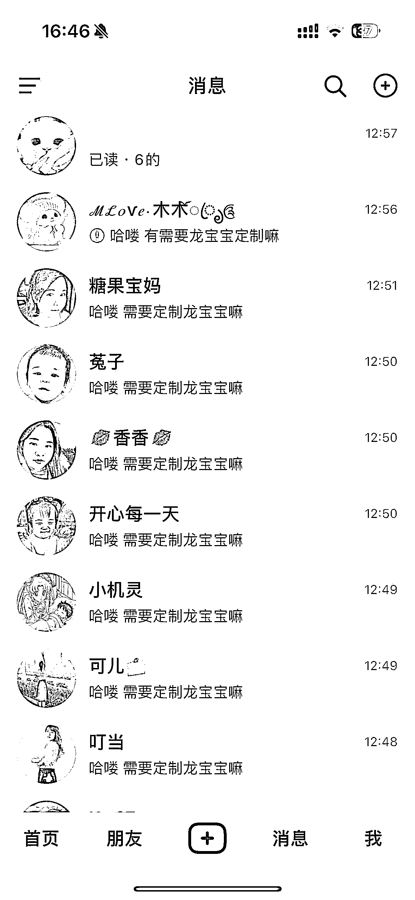

群友案例今晚分享，勿外传，提示词各自按需优化。

**③带货中心。**

分享三个我常用的带货打法：

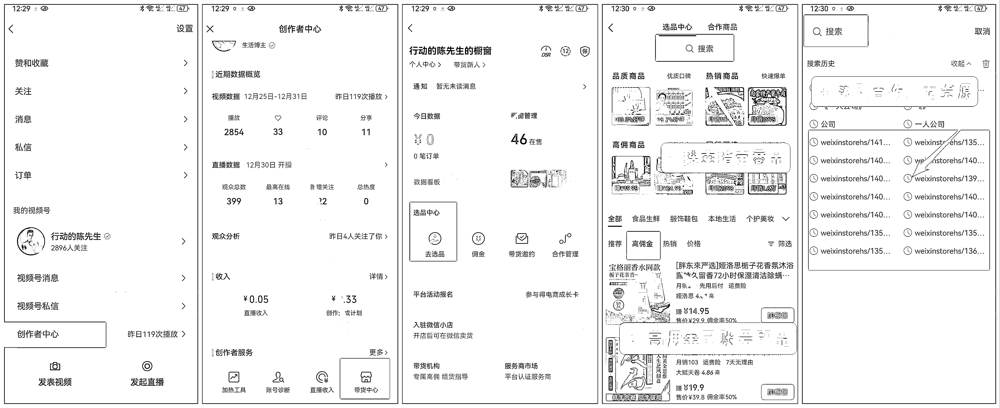

其一，卖自己认可的东西。我2023年初进场就是先卖书，比如《认知觉醒》《打造个人IP》。其二，挑和账号属性匹配、佣金够高的品。大号主打运动/游泳+健康，货盘就选泳帽、泳镜、蛋白粉，顺带出过牙膏、洗面奶、便携泡澡桶。其三，借合伙人渠道。我入了某小绿书/视频号的商人联盟，100人以内每月100块，他们帮选爆款、备文案、辅助发小绿书。现在人满了100，涨到200一个月。

咱群里也有人在做，进场偏晚，好在这波过年流量够猛，早前囤的东西都成了现成的货。

视频号还在红利窗口期。你看身边做📕、做别的平台的，闭环和话术很容易平移过来，现在入局性价比很高，尤其中老年赛道。

我第二个号是AI方向的。每个人能实名2~3个视频号，剩下拿家人的来补。踩过的坑也说一句：之前有个视频号没注销，手机号却先注销了，卡BUG白搭一个名额。所以记得别用手机号做绑定，微信也要提前改绑。

视频变现任务我这里跳过，它要千粉起步，还得靠大量关注和自然流量，更适合明星网红体质。

**⑤独家闭环：接商单。**

前置条件：1000粉+最近7条露脸原创。补充分成计划要发满十条原创+粉丝数达标才能提现。我小号半个月涨到1500粉，最近也一直在补露脸原创，就是为接商单做准备。

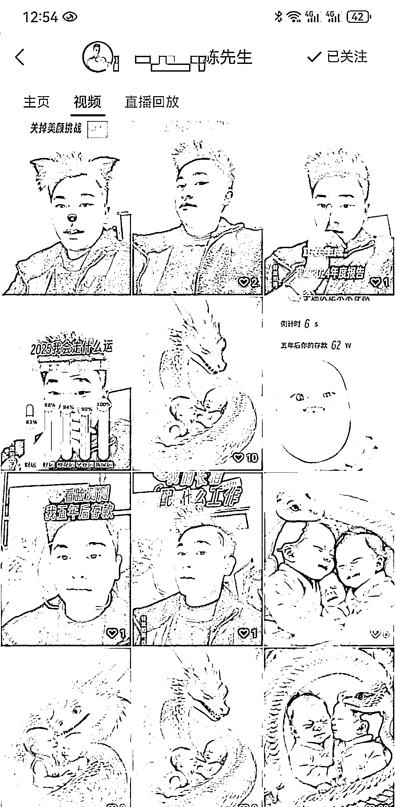

哈哈，今天刷了好几条露脸原创，为了商单也是老脸豁出去了。

上次接商单，甲方要求按这套流程挂链接，直接放出来：

**①先下载原视频；②在视频号上传原片；③视频下方点链接，进合作推广，记得关联刚扫码的商品链接❗；④标题不写；⑦发完后去个人主页，把这条视频的评论区关掉❗；⑧再把视频转发到对接群里。**

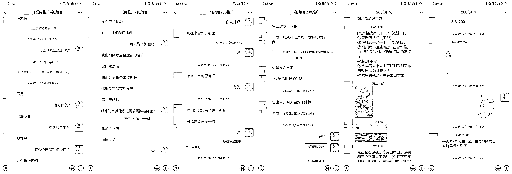

整体就是：商家找上微信、聊需求、报价、拉小群、挂车、发片、等原创推流、等结算——一环扣一环。完整闭环，希望能帮你少走点弯路。

这章先分享到这儿。还剩两块没展开：视频变现任务、游戏直播变现，咱们2025再会。

# 6、收益放大10倍的四种类型

**①账号矩阵收益**

**②账号放量收益**

**③时间累积收益**

**④组织杠杆收益**

详细展开看飞书：[`tx0vqocm3fc.feishu.cn/docx/OhX8dVO3roQPi4x2GDhcXZUHn5C?from=from_copylink`](https://tx0vqocm3fc.feishu.cn/docx/OhX8dVO3roQPi4x2GDhcXZUHn5C?from=from_copylink)

# 7、独家秘诀和提问复盘

同样放在飞书：[`tx0vqocm3fc.feishu.cn/docx/OhX8dVO3roQPi4x2GDhcXZUHn5C?from=from_copylink`](https://tx0vqocm3fc.feishu.cn/docx/OhX8dVO3roQPi4x2GDhcXZUHn5C?from=from_copylink)

* * *

评论区：

心净亦如心镜: 干货！

陈先生: [呲牙][玫瑰][握手]