# 10 条内容涨粉 7 万+！第一人称影视解说怎么玩？从零到成片全流程拆解

## 新号 10 条作品涨粉 7 万+，第一视角影视解说视频怎么做，完整教程攻略来了

作者： 高鹏圈

日期：2025-01-08

大家好，我是高鹏。

今天拆解一个最近在跑量很猛的赛道。

用影视作品里某个角色的亲身口吻来讲这部剧、这部电影，播放和涨粉速度都非常快。

这类内容为什么能爆，总结下来就三点。

第一是形式上新，用第一人称视角讲故事，观众耳目一新。

第二是声音还原，做到了用 AI 克隆剧中原演员的声线来配音，沉浸感直接拉满。

第三也是最核心的，是口述文案本身很戳人。

比如前面演示的猪八戒视角，把原本平铺直叙的西游情节，讲成了尔虞我诈、暗流涌动的职场与人性博弈，完全跳出了原剧框架。

下面我就以《树先生》这部电影为例，用树先生自己的口吻来解说，带大家完整走一遍制作链路。

第一步，也是最关键的，是搞定一篇高质量的口述文案。我的主力工具是豆包。

思路还是投喂法，先把高手的成套文案喂给AI，让它吃透写作逻辑和风格，再让它按这个调性去原创。

先复制目标视频链接，用工具里的文案提取功能把原文抓出来。

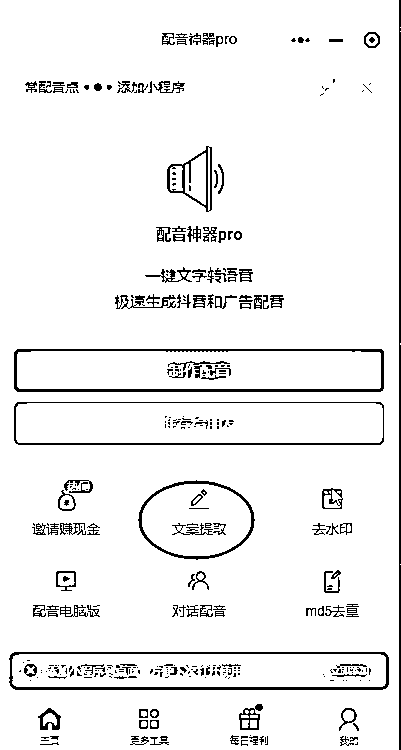

提取完成后，在前面加上学习指令，一并丢进模型，让AI深度模仿这种写法。

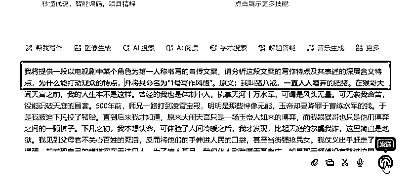

这一步模型会从结构、情绪、措辞等多个角度进行拆解和学习。

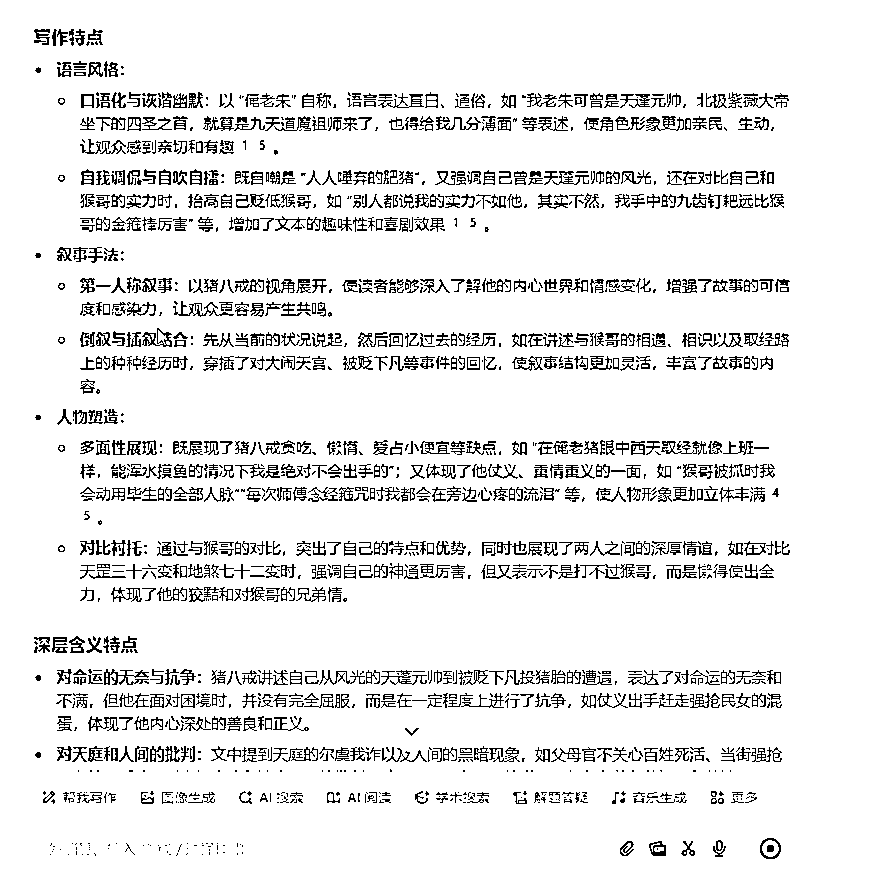

学习结束，就进入创作阶段。

给AI下这样的指令：用树先生第一人称视角写一段解说文案，并限定字数。

这类视频时长普遍在3-5分钟，对应字数大约在1000到1500字之间。

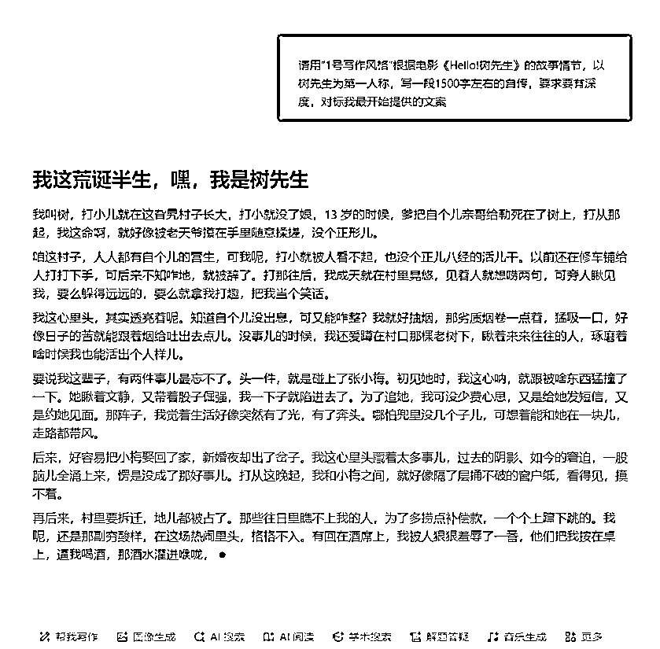

出来的初稿基本就能用，逻辑完整、情绪到位，从树先生口中能明显感受到世态的冷暖和无力的荒诞感，质量大概在80分左右。

如果自己文笔不错，还可以在此基础上润色增色。

文案有了，第二步就是配音。

这一次我演示的是克隆宝强的音色，用的工具是上个月刚上线的海螺 AI 海外版自带的声音克隆功能。

首页提示写着，大概十秒左右的原声样本就能完成一份音色的复制，效率很高。

进入首页后，点顶部菜单的 video。

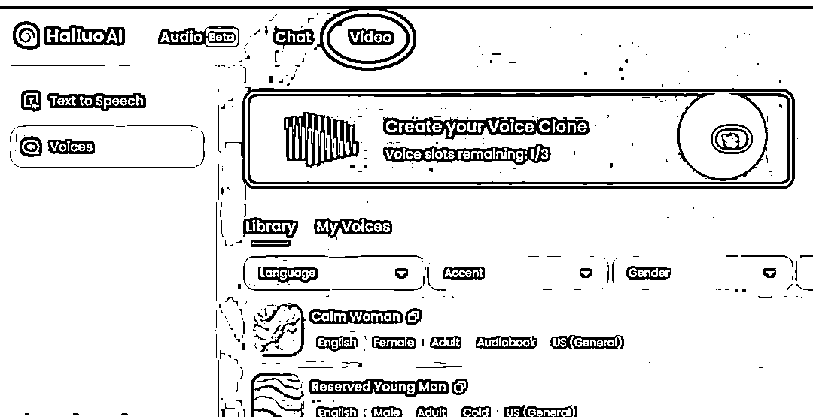

左侧选择 voices。

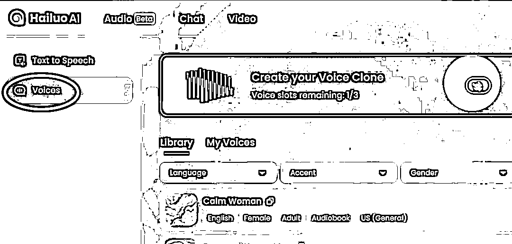

右侧点击 create your voice clone 进入创建页。

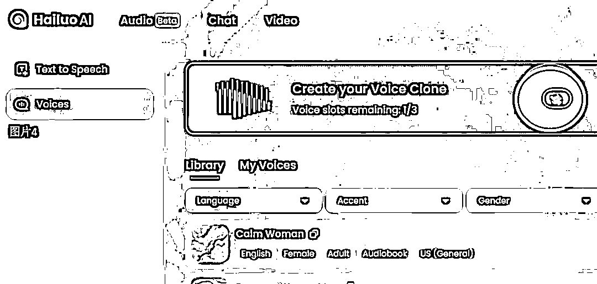

先给这个声音模型起个名字，随便命名即可。

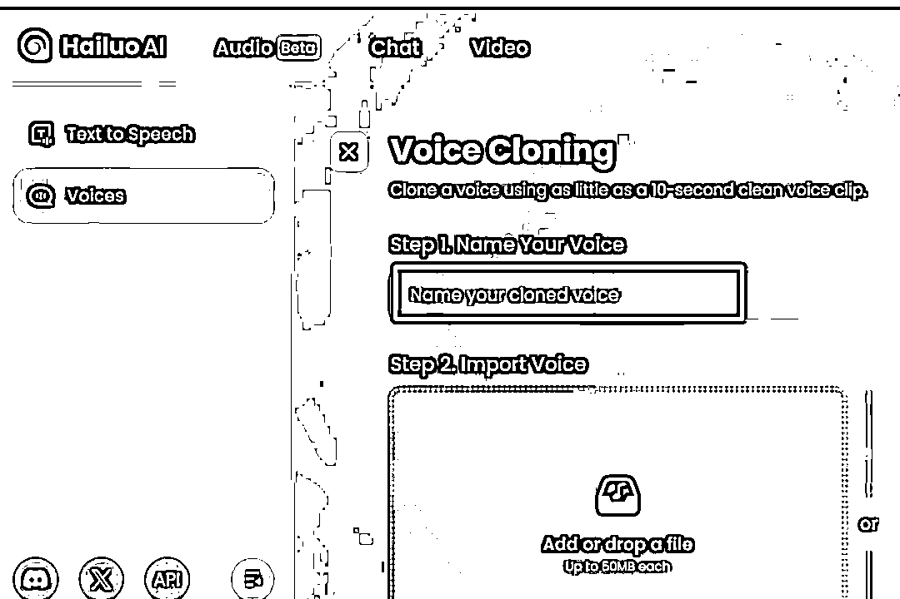

下方上传区，从本地导入提前准备好的宝强原声素材。

素材带背景音的话，可以点这个功能一键降噪。

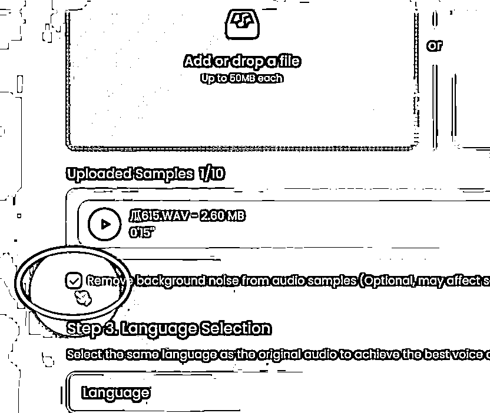

第三个选项里把语言切成中文，右下角点创建。

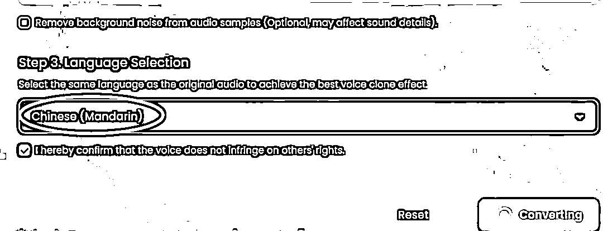

等待片刻，在 my voices 列表里就能看到刚克隆好的声音。

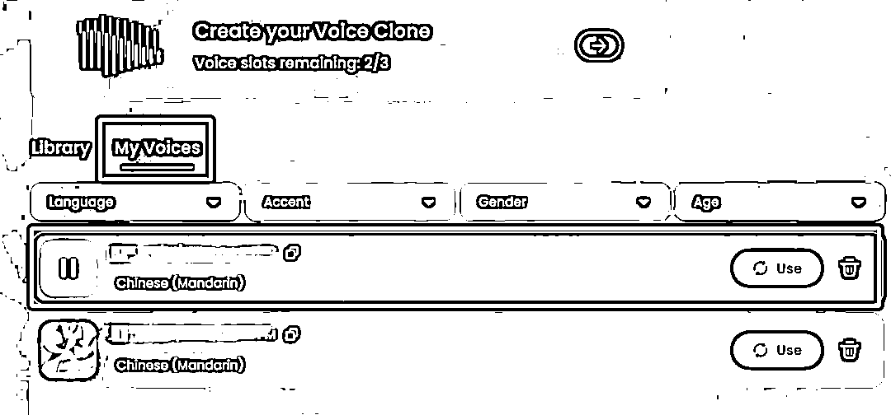

声音准备好后，回到页面点 text to speech，也就是文本转语音。

在右侧输入框里粘贴刚才的解说文案。

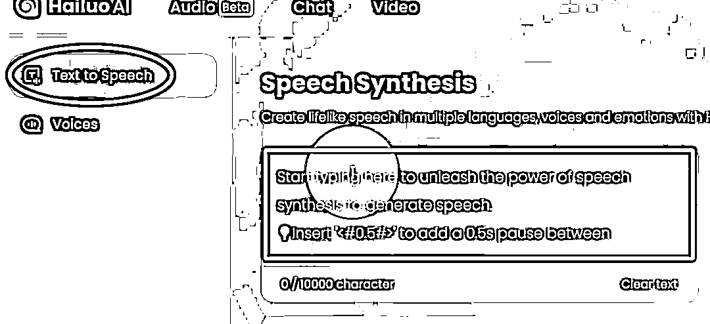

粘贴完成后点右下角 switch voice。

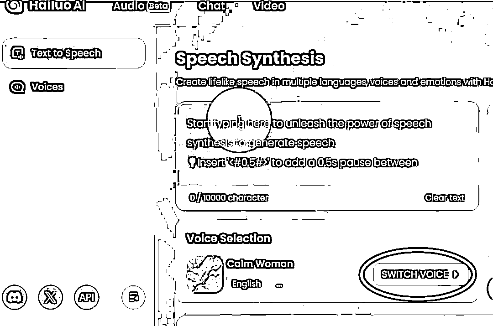

选择刚刚克隆好的音色模型。

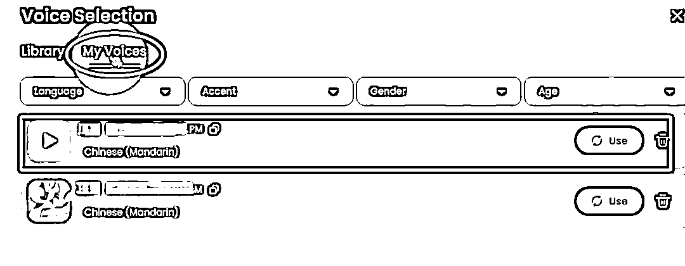

右侧还能做精细设置，比如输出语言、情绪风格、语速语调等，我这里选的是 happy，语调偏轻松，后续可根据文案情绪再调整。确认后点紫色创建按钮，音频就生成了。

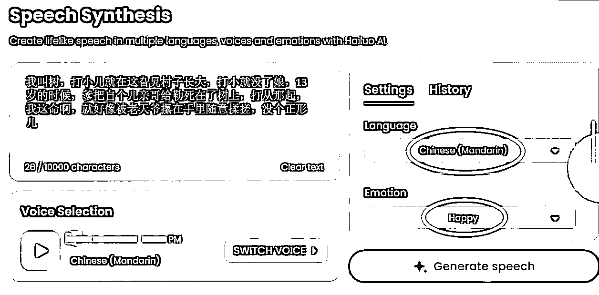

音频搞定，接下来就是画面。

这个环节最省事，可以直接去某宝找整片资源，剪出与旁白匹配的镜头。

或者直接在平台上搜同类解说作品搬运其已剪辑好的经典片段，效率更高。

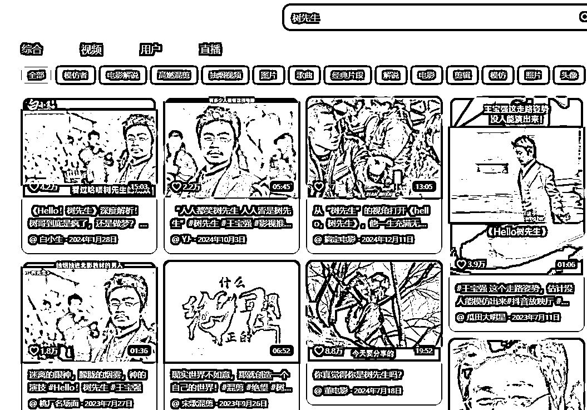

最后把剪好的画面和配音导入剪映，做音画对齐、加背景乐和字幕，一条成片就完成了。

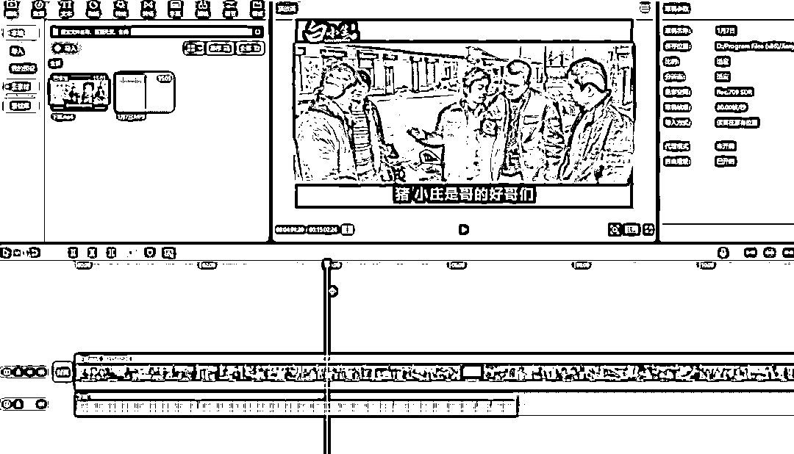

好了，今天的第一人称影视解说玩法就分享到这里。

文案相关的AI工具、具体提示词、以及这个账号的变现路径，我都整理到文档里了：[`svj4gxvm0v3.feishu.cn/docx/QPSJddbPooAz7UxrzdXcClPVnQc?from=from_copylink`](https://svj4gxvm0v3.feishu.cn/docx/QPSJddbPooAz7UxrzdXcClPVnQc?from=from_copylink)

我是高鹏，网创圈深耕 9 年，这是我拆解的第 707 个实操项目，更多干货玩法，欢迎来聊。

* * *

评论区：

11 : 请问为啥根据你提供的海螺 ai 进入，看到的界面和你的界面不一样呢

Ex : 配出来声音怪怪的

Ex : 刚👸号刷到有人盗你赚钱的文章了 把豆包换成文案提取器就成他的原创了