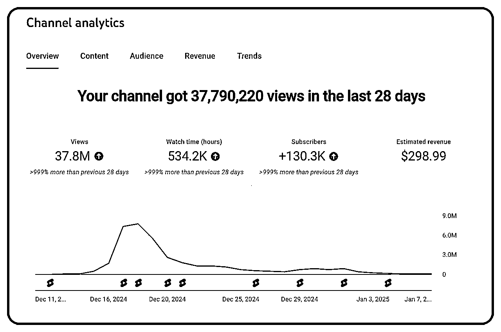

# Youtube Shorts 爆款视频经验分享

先自我介绍一下，我是龙哥。航海结束有一阵子了，今天把成绩和感悟一并摊开来说。

先看数据：最近28天，我的YouTube Shorts频道总播放量突破3000万，订阅涨了13万，广告分成接近300美元。期间跑出了4条百万级播放的爆款，其中一条更是冲到了3000万播放。说实话，这个结果并不差，但之前的我一直处于“永远觉得自己不够好”的状态：成绩来得快，忘得也快，几乎不夸自己，也几乎没有庆祝过。

直到我读到刘小排的《越快乐才越成功》，整个人像被击中了似的，瞬间通透。那篇文章我连着读了两遍，然后花了很长时间复盘自己过去的经历。那一刻我下定决心：从此做个快乐、充满正能量的人，并时刻给自己的大脑“重新框架”——把消极的思维模式换成积极的版本。

也正是因为想通了，才愿意把这些年航海积累的实操经验，以及对赚钱这件事的认知升级，认认真真分享出来。常说万事开头难，今天能把这篇分享开好头，对我自己来说已经是一种进步。

不过话说回来，这波收入其实还能更高。原因在于节奏没踩好：爆款已经跑出来了，我却等到又发了好几条带人头的视频之后才开通YPP，白白错过了前期一部分广告费。这个教训挺实在——内容能变现的时候，千万别拖延。

更完整的复盘和细节，我已经写进飞书文档，想深入了解的朋友可以直接查看：

评论区里有人问“这种达人秀分成收益大概是多少”，也有人提醒文档链接没权限——现在权限已经放开了，感兴趣的可以点开看看。龙哥的评论也让我很有共鸣：航海期间就能实现变现的，已经算少数优秀的人，大多数人可能需要坚持两到三个月才能真正看到收入。这句话值得记在心里，也送给正在路上坚持的你。