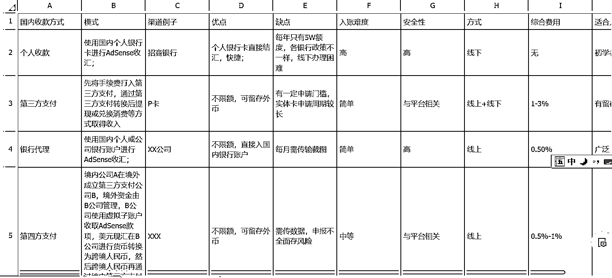

# YouTube 收入变现：当个人 5 万美元结汇额度不够用时有哪些操作思路

## YouTube 赚钱：关于绕开个人 5 万美元便利结汇额度的方案

作者： 书情小跟班

日期：2025-01-07

本文是对此前一篇《YouTube 赚钱，收款细节、方式、税务》的补充说明 [`articles.zsxq.com/id_3exr591bo0gx.html`](https://articles.zsxq.com/id_3exr591bo0gx.html)，聚焦的是银行代理式的收款打法。

随着 YouTube 流水不断上涨，部分创作者已触及个人每年 5 万美元便利结汇的上限，急需寻找可行的续接路径。绕开这个天花板的同时，也就绕不开相应的通道费用。

本篇内容分为两块呈现，一块为文字解读，一块为图文详情。

### 文字解读

服务贸易结汇指引 V.20240217

**银行直连 Google 结汇操作手册**

我方联合银行搭建了面向 Google、Apple 服务贸易的真实性审核与结汇服务平台。依托该平台，从事 Google、Apple 生态服务的客户可以完成贸易真实性核验，并享受合规的无限额结汇通道，没有单笔限制，也没有年度总额封顶。YouTube 创作者、App 开发者、网站运营者等通过 Google、Apple 平台获取收益的个人或企业，是该服务的核心客群。

为保证阅读体验，建议点击飞书文档查看详细说明。需要声明的是，我方不提供任何担保，也不会列出具体服务商名称。市场上从事此类业务的机构不止一家，若自行对接服务商产生纠纷，与本文作者无关，仅作信息参考。

关于如何规避个人 5 万美元便利结汇额度限制的方案

[`rlwxa0zgke.feishu.cn/docx/Old0d6nJLoT9uzxFEjncnksqnLt?from=from_copylink`](https://rlwxa0zgke.feishu.cn/docx/Old0d6nJLoT9uzxFEjncncnksqnLt?from=from_copylink)

* * *

评论区：

暂无评论