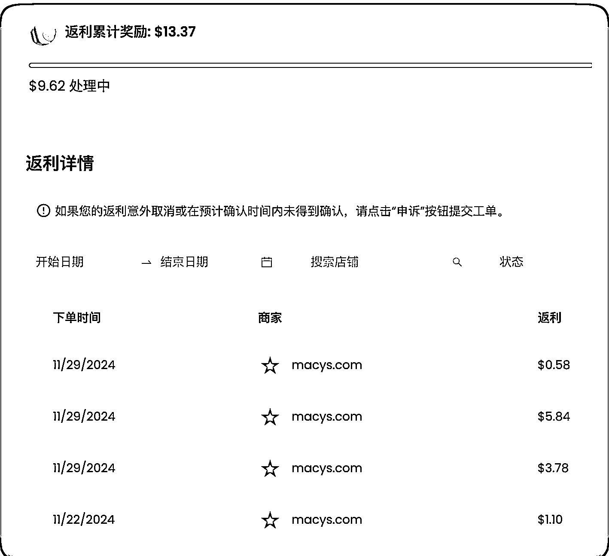
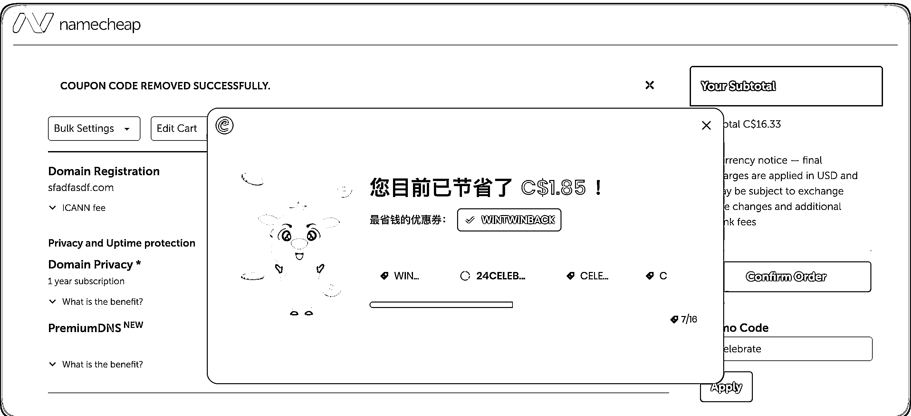
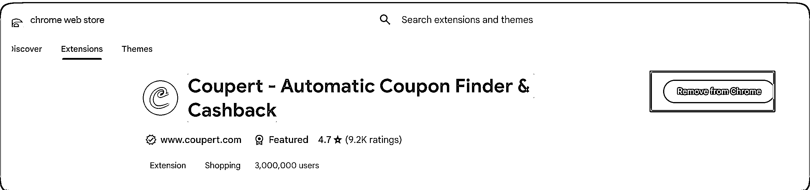
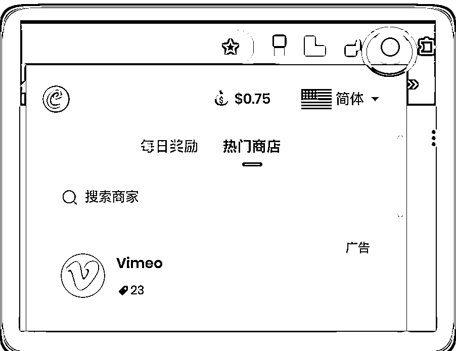

# 海淘党福音：一个免费插件，让你边买边返利，轻松攒下100美金

做跨境电商的老手，尤其是玩OA（Online Arbitrage）的朋友，肯定都有这种感受：平时无论是去各大电商平台找货、自己海淘囤点日用品，还是处理一些需要美金的在线支付，最烦的就是明明知道有优惠，却要花半天时间去找折扣码。有没有什么省心办法？答案是有的。

这个工具最大的亮点，就是能在你结算时自动检测当前页面可用的优惠券，然后一键替你填好，省掉全网搜码的麻烦。其实很多海外平台都藏着折扣券，只是入口隐蔽，平时根本注意不到。有了它，相当于免费多了一个“找券助手”。

更妙的是，它不仅能找券，还自带返利功能。也就是说，你享受折扣价的同时，还能额外获得一笔现金返还，双重实惠。

我自己就遇到过。前阵子要去买个域名，结算前它自动匹配出了一张可用优惠券，账单当场少了4.7美元。钱虽然不多，但这种“白捡”的感觉确实很爽，而且长期用下来，积少成多就是一笔可观的数目。

再说说怎么上手，整个过程非常简单：

先用一个广告浏览器，打开下方链接，直接进入插件主页：
[`www.coupert.com?invite_code=3CD007`](https://www.coupert.com?invite_code=3CD007)

插件名称是：Coupert - Automatic Coupon Finder & Cashback

点击安装，再用邮箱注册一下就大功告成，几乎没有学习成本。

装好以后，你会看到它就在浏览器的工具扩展栏里，随时待命。

实际使用时也很无脑：在你想购物的网站挑好东西，走结算流程时，点一下这个插件，它就会自动扫描并填入最优折扣码，瞬间把付款金额压低。

不过，更高阶的玩法是把它和你的业务结合，把思路稍微打开一下，100美金真的不难凑：

第一，亚马逊下单时记得点它。尤其是做测评、接单或者自己操作多个账号的朋友，这样等于每单都给自己薅一次返利，何乐不为？

第二，别只盯着购物站。任何需要在线付款的场景，比如SaaS订阅、域名续费、服务器账单，都可以先试试这个插件，说不定就有惊喜。

第三，来个“躺赚”思路：如果你在某个平台有自己的专属折扣码，而平台又给推荐奖励，那么你可以把码免费提交给Coupert收录。这样一来，其他用户通过插件使用你这个码时，你就能持续拿到对方带来的奖励，完全算得上被动收入。

只要把这些方法融入日常，日积月累，省下的和赚到的加起来，超过100美金真的不难。

以上，就是这次的省钱利器分享。如果觉得有用，记得收藏起来，下次海淘前拿出来试试。