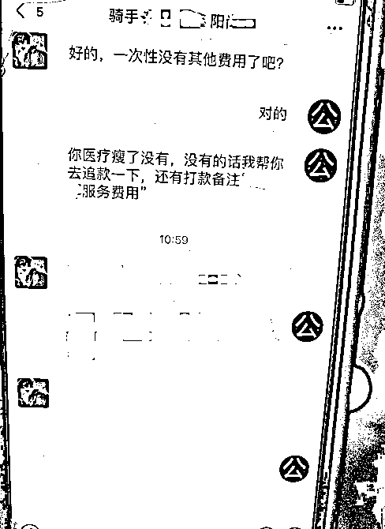

# 低竞争高溢价的蓝海赛道：靠帮外卖骑手讨回权益，我做到了稳定高客单
作者：龙哥

## 高客单冷门赛道分享：助力外卖骑手维权，撬动可观回报

作者：Yc·Jw

日期：2025-01-06

各位同行好，我是 龙哥，人在广州。名下运营着一家日均完成 20 万单外卖配送的公司。

今天以深耕配送行业十年老兵的身份，拆解一个可以做主业也可以做副业的项目。客单价不低，收入稳定，属于投入小、回报高的细分服务。既能真正解决骑手痛点，也能为自己带来一份体面的现金流。

 osH6A)

## 内容较长，为了更好的观看体验请移步飞书，感谢大家耐心观看~

大致框架如下：

## **用骑手维权服务来实现高额收益的操作路径**

一、骑手维权需求产生的根本原因

二、这块业务的收益模型

三、项目从0到1的搭建方式

四、相比同行的差异化优势

五、市场体量与空间判断

六、总结

* * *

评论区：

咕咕不咕咕 : 感谢大佬分享！刚入行的律师我很感兴趣

王厚道 : 感谢分享 感觉很有前景 可以加您联系方式吗[呲牙]江苏的法律从业者

唠唠嗑 : 您好，我是外卖行业的资深运营，期待能跟您建立联系探讨合作，有我的项目规划想跟您交流一下，看到您分享的内容感觉很有联动空间

Yc·Jw : 可以的，欢迎一起交流[呲牙]

Yc·Jw : 没问题，一起聊聊，外卖相关的方向我们都挺在意[呲牙]

Yc·Jw : 可以先试单合作看看[机智]

Yc·Jw : 好的，是联系鱼丸吗？

姚先森 : 没有法律背景的人能上手做吗？