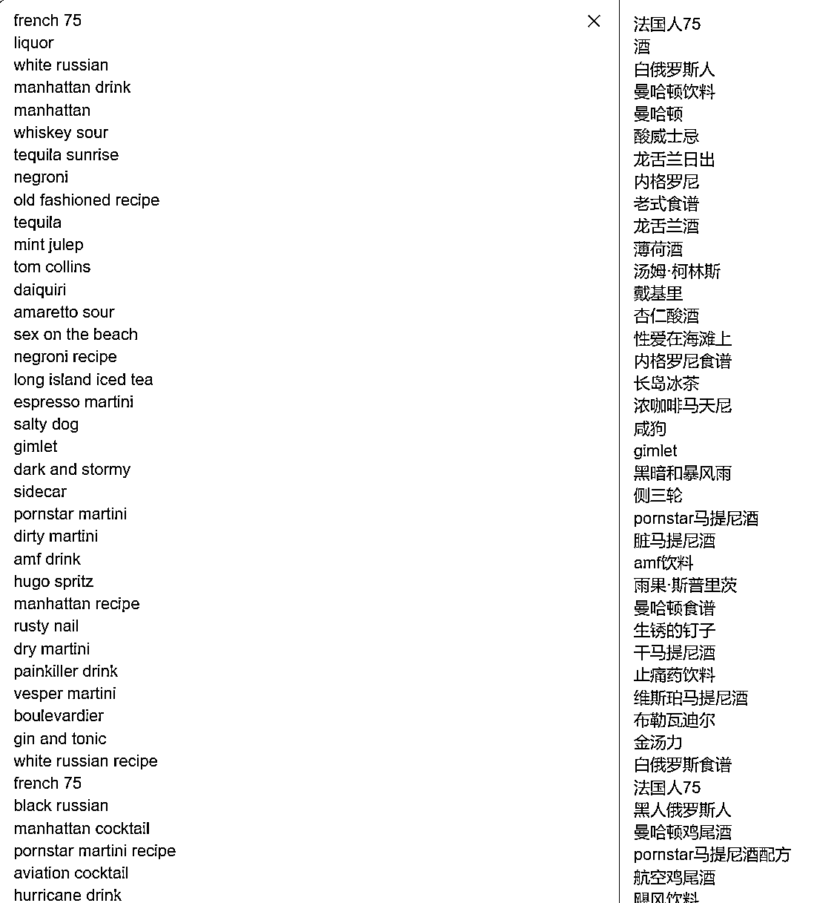
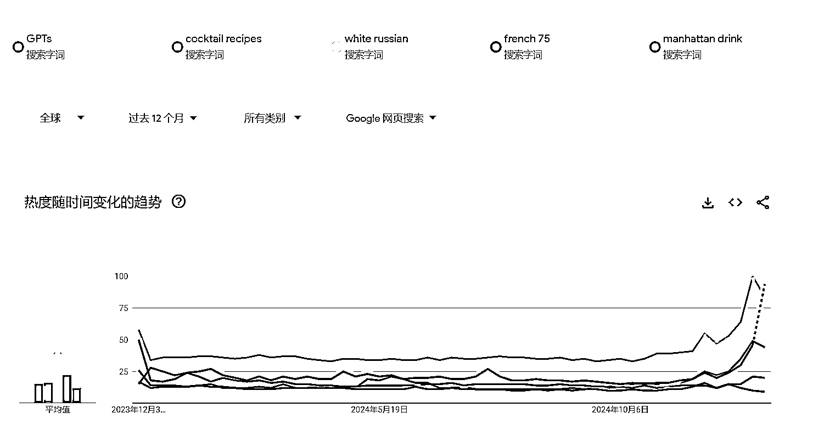
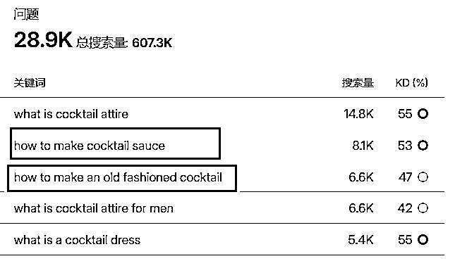
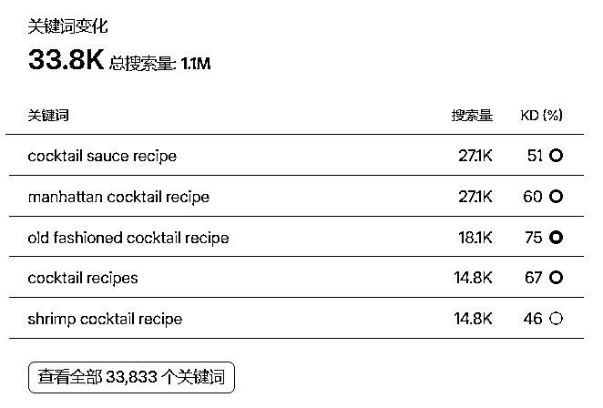
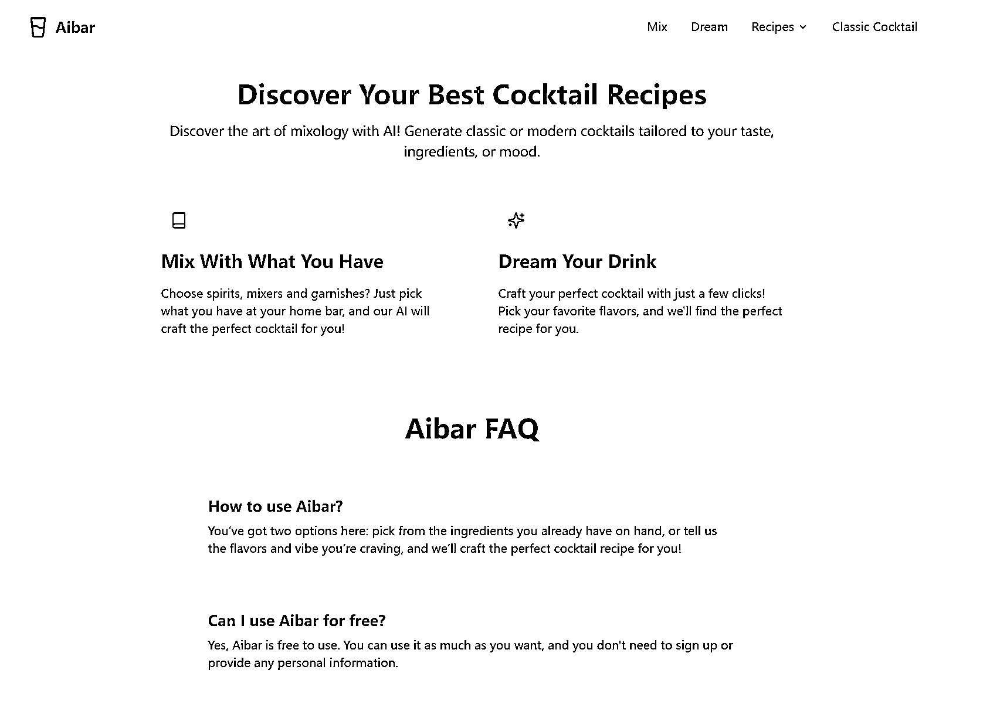

# 龙珠悬赏 03 猎龙计划 1


## 龙珠悬赏 03 猎龙计划 1

作者： 彩笺

日期：2025-01-02

## 前言&概述

整篇文章的脉络如下：

**对手拆解 & 流量盘点** 我挑选了三家要直面交锋的对手进行拆解，他们在**核心卖点、整体体量**上各不相同，但都死死抓住了**围绕用户需求去做**这件事

**用户意图归纳** 结合对手现状，借助工具、搜索引擎的结果以及社媒讨论的指向，提炼出**用户真实的搜索意图** 和相应的**流量关键词**

**最小可行产品 MVP** 明确 MVP 要做的核心功能，以及下一步可能的演进方向

**冷启动打法** 聚焦在**如何撬动免费自然流量**的具体操作思路上。

**补充说明：**

最终的落地产品全程由 bolt + cursor 完成实现，一行代码都是它写的，我只负责改改调调。

调研期间用到了大量工具去爬梳网站与需求，similarweb、semrush、google、google search console、google trends、reddit 等都用上了。部分数据直接放出来，部分判断直接下结论，图就不贴了，保证结论和原始调研完全一致。

工具清单：similarweb、semrush、google、google search console、google trends、reddit 等社交媒体。**变现测算的方法参考自自哥飞的公众号。**

### 竞品拆解

> 变现已经跑通的产品才值得抄，抄作业就抄学霸。

我更喜欢把他们叫做挑战对象，年轻人要有点气势。

### 竞品 1

#### 概览

网站：[liquor](https://www.liquor.com/)

典型的鸡尾酒内容博客，形态是图文资讯。体验很顺滑，内容有意思、专业度在线，还在持续更新，近一年新增了 192 个页面，没有硬弹窗广告。SEO 架构做的都很扎实。

#### 变现表现

变现方式：**广告**

粗略测算：

全站每个页面都挂了 3 个广告位，靠内容做价值承载。按用户地域分布，ECPM 大约在 3-6 美元区间，跳出率来看 PV 与 UV 基本可对等。粗算月收入：

`4000000PV / 1000 * 4 * 3 = 48000 美元`

这个数是靠谱的，我见过月广告收入上万美元级的站点，对应的流量规模就差不多。实际上这站的收入大概率比估算值还高。

#### 流量拆解

流量规模：月均约**400w PV，250w UV,** 平均停留 `1min:41s` , `跳出率 64.82%`

流量结构：**80% 来自发达国家，其中 70% 来自美国**

流量来源：

分类|  |

---|---|---

| 免费流量 `99.87%`| 付费流量 `0.13%`

| 自然搜索 `71.43%`| 直接访问 `22.56%`

| 非品牌流量 `83%`| 品牌流量 `17%`

| 移动端流量 近`80%`| 桌面端流量 近`20%`

数据来自 similarweb。设备分层里移动端直接流量占`86%`，自然搜索流量占`80%`，所以表格按 80% 呈现。semrush 上的表现基本一致。

#### 自然搜索细节

semrush 显示，除了第二条 liquor 与域名重合外，**几乎全部自然流量都来自各类鸡尾酒词，用户意图非常清晰，就是找配方相关信息**，这一点后面会用到。

**下图为该站流量前 50 关键词：**



### 竞品 2

#### 概览

网站：[cocktailbuilder](https://www.cocktailbuilder.com/)

用户先选一部分基酒和材料，系统基于已有数据库匹配出能调出的鸡尾酒，不是用 AI。体验一般，有强制弹窗广告，页面设计平淡，配方库偏少，可选基酒和调味材料也不够自由。

#### 变现表现

变现方式：广告

粗算不含弹窗：`130000PV / 1000 * 4 * 3 = 1560 美元`

实际应该更高，弹窗广告没算进去，而且弹窗单价通常更高。按普通广告口径，**月 1950 美元以上**是保守的。

#### 流量拆解

流量规模：月均约**130K PV，8w UV,** 平均停留 `1min:07s` , `跳出率 48.63%`

流量结构：近 80% 来自发达国家，其中 50% 美国，10% 加拿大，近 20% 欧洲

流量来源：

分类|  |

---|---|---

| 免费流量 `100%`| 付费流量 `0`

| 自然搜索 `68.22%`| 直接访问 `26.31%`

| 非品牌流量 `86%`| 品牌流量 `14%`

| 移动端流量 近`81.47%`| 桌面端流量 近`18.53%`

### 竞品 3

#### 概览

网站：[bargpt](http://bargpt.app)

用 AI 生成鸡尾酒的站点。我一两个月前就盯上了，最初无广告，每账号每天有一次免费额度，订阅是 3.99<card type="inline" name="math" value="data:%7B%22code%22%3A%22%E6%9C%88%2F29.99%22%2C%22id%22%3A%22DQPrJ%22%7D">年。</card>

后来上了广告。体验起初不错，**最近对免费用户加了强制看广告，流量也跟着下滑。**

**补充说明：**

搜 ai cocktail，它排第一，整个赛道能稳定提供 AI 鸡尾酒生成的站点估计不超过个位数。

第二名是个 21 年的老站，也能 AI 生成，但访问量很低。

第四名是综合型老站，内页里有一个 AI 生成鸡尾酒的功能，体验一般。

#### 变现表现

变现方式：广告+订阅

订阅不好估，常见做法是看支付渠道的出站流量来推测，我经验还不够，之前好像看到过专门分析 AI 付费的网站，找不到了。

广告部分：月收入 4 位数美金肯定有，这还不考虑强制观看广告的溢价。

#### 流量拆解

流量规模：当月均约 100K PV，5w UV, 平均停留 `1min:02s` , `跳出率 47.60%`

流量结构：近 80% 来自发达国家，其中 50% 美国，10% 加拿大，近 20% 欧洲

流量来源：

分类|  |

---|---|---

| 免费流量 `100%`| 付费流量 `0`

| 自然搜索 `61.15%`| 直接访问 `28.99%`

| 非品牌流量 `97%`| 品牌流量 `3%`

| 移动端流量 近`76%`| 桌面端流量 近`24%`

### 用户意图总结

综合三个站点的表现，以及关键词拓展和社媒讨论，可以确定用户要的是**信息型内容**，集中在**鸡尾酒配方、怎么做**上。

意图来源： **对鸡尾酒、鸡尾酒配方等关键词在 semrush 上的检索，以及更精细的自然搜索结果与社交媒体的交叉验证。**

#### 核心需求词

**所有站点都能吃到的需求词是：cocktail recipes, 各类具体鸡尾酒名称**，感受一下：



**以及 `cocktail recipes` 相关的延伸问题搜索量：**





### 产品 MVP

有了用户意图和三家的拆解，**我们要做点什么、在哪里切入 AI、在哪里可以把对手做得更好，其实就很清晰了。**

网站：[aibar](https://aibar.app/) 欢迎体验，顺手帮忙增加点流量

直达链接：[`www.aibar.app`](https://www.aibar.app)

首页截图放这镇楼：



#### MVP 功能清单

AI 生成目前走两条路：

提供多种基酒、调味饮料、装饰品的选项【**你手头有什么**】，用户勾选后用 AI 生成配方及相关信息

用户输入风味偏好、视觉效果、饮用场合、酒精度、心境【**你想要什么**】，用 AI 生成配方及相关信息

站点内会补充多篇博客内容，本地用 AI 生成鸡尾酒配方后入库

后续根据冷启动反馈再迭代，比如扩充选择项、增加自定义生成模式等

### 冷启动实操

核心始终是**满足用户需求**，所有冷启动动作都围绕这一点展开。

站内多建**热门搜索的鸡尾酒配方页**，去命中有流量的关键词，让搜索引擎多给曝光

筛选一批**有流量但竞争弱的关键词**，先用这些词拿到初期曝光和用户，同时累积站点权重

cocktail recipes 本身竞争激烈，**我锚定：ai cocktail recipes**。前期会慢，等 Google 认可内容价值后自然会放量。

做外链，手上有些可给 Dofollow 的高权重站点资源，用来做权重传递

研究对手的外链来源，尤其是**自然增长的外链**；去社交媒体的真实用户场景找机会，像是国外的即刻、小红书类平台

基于上面的人工引流，再从用户需求出发写引流博客，例如：

```
 * 帮助手册（我这个网站如何用）

 * 社交媒体分享鸡尾酒榜单类似的帖子（避免拉踩，同时这种类型的文章，一般都会被社交媒体允许）

 * 模拟身份，通过 prompt 模拟身份，通过类似小红书经验帖的形式，做更贴合真实的用户分享
```

我还找了几位调酒师朋友来内测，给专业意见，比如 AI 生成的内容够不够好用

有几个关键点要留意：

页面 SEO 和关键词要做好，更重要的是内容要有价值。借助 AI 生成没问题，但要保持严谨，我这几天还翻了几本国际主流的鸡尾酒书籍来校对准确性。

成长不是一蹴而就的，会有个缓慢爬坡期，不要急功近利。之前第一个有流量的站就被 Google 惩罚过，这就是教训

具体节奏要结合对需求的理解程度，边做边调

冷启动期间，用 google search console 和 google analytics 观察用户行为数据，实时调整。

标题叫猎龙计划 1，是因为过程中又发现了另一个需求，可能会有续集。

最后立个 flag，等这个站拿到流量和收入的那天，我就去云南找那位调酒师朋友，学做调酒师。计划已久。

#龙珠悬赏

* * *

评论区：

柠檬🍋 : 优秀，加油

彩笺 : 多谢[奋斗]~