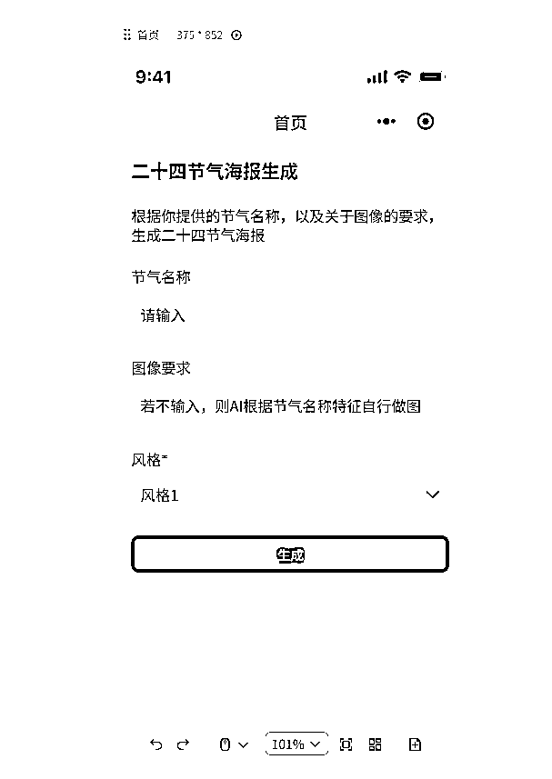
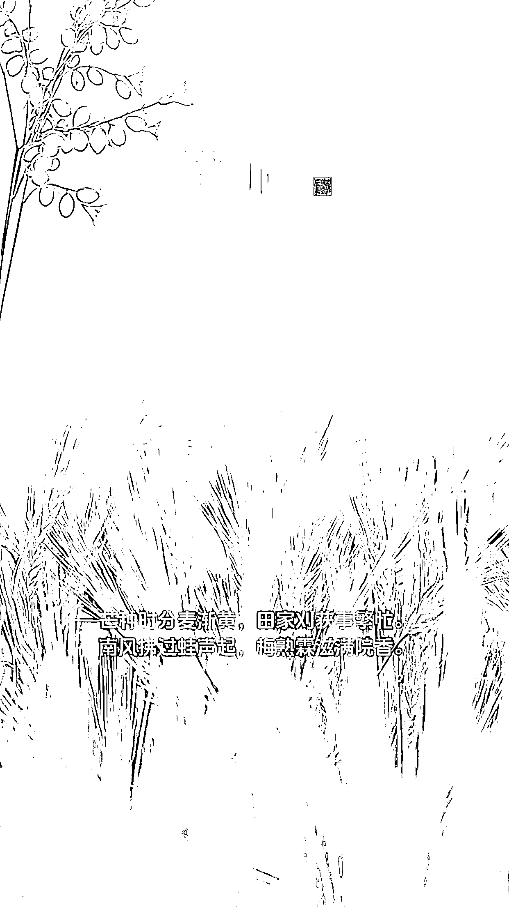

# 喂饭级教程!教你用 coze 做一个微信小程序之二：如何绑定工作流到页面

这期继续带来“保姆级”实操教程：用 Coze 零代码搞定微信小程序（第二弹）——把工作流成功绑定到页面。

先给没接触过的朋友吃颗定心丸：即便你对编程一窍不通，靠简单的拖拽操作，就能搭出称心的 AI 应用。从今往后，小程序想咋做就咋做，彻底告别“求人开发”的日子。

上一回，我们手把手搭出了一个“海报生成”小程序的静态页面，没看过的朋友可以点这里补课：[Coze 应用实战！如何利用 coze 应用功能，开发一个海报生成小程序，并发布到微信（一）](https://b121w2zgwyx.feishu.cn/docx/XevpdRH0JokjJzxtZ71cvnPMngc)。

但光有页面，还称不上“程序”，真正跑起来才是关键。所以今天要搞定的，就是把首页上那个“一键生成海报”的功能逻辑给实现喽。

咱们先来分析下这个海报功能到底需要些啥。这是之前设计好的页面效果：

从图上能清晰看出，我们一共要收集三个输入项：

1. 节气名称
2. 图像要求
3. 风格（先预留好，方便以后扩展更多样式，本期教程只做一种）

再往后看，考虑到之后还要展示历史生成记录，所以最终需要输出的内容也就明确了：

1. 一张海报图片
2. 节气名称
3. 生成时间

为了帮你更直观地理解工作流是怎么运作的，我把海报的成品效果图也放出来：

一步步来，照着操作就行。下一篇我们继续聊怎么把流程串起来，让小程序真正“活”起来。

（评论区：暂无评论）