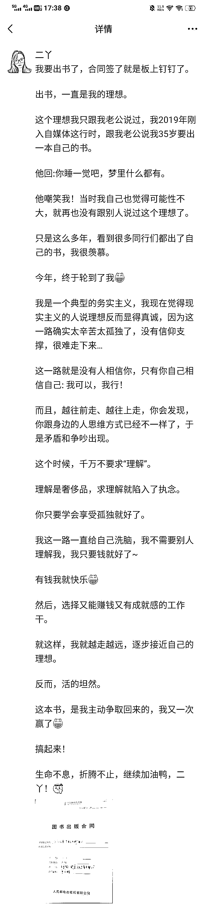

你可能刷到过很多“普通女孩逆袭”的故事，但今天想跟你聊的这个版本，有点不一样。

她起点不高：湖南大山里走出来，大专学历，揣着两千块闯上海。34岁那年，她第一次站上了“年入百万”的台阶。本职是互联网公司的项目经理，副业做自媒体跑出了百万流水，还出了一本书，明年上市。最让人惊讶的是，她把这摊事儿做得游刃有余，工作没丢、娃也带了、钱也赚了。

有人说这是运气，也有人说这是天赋。但她说，不是的。她写作写了6年，前4年都在给大V“打工”，真正做自己的号才两年多。她讲了一个特别实在的路径，也是普通人最值得抄的作业。

**第一件事：把公众号当成“故事会”来写**

很多人起号第一件事就是找选题、列素材库，但她不。她的素材库就是她自己的生活。跟老公吵架、跟老板谈涨薪、跟同事撕需求、跟妈妈赌气……这些生活里鸡飞狗跳的瞬间，全是她的写作原料。

她说自己的定位是一个“生活博主”，核心逻辑就一句话：内容是围绕生活进行的，而不是生活围绕内容进行。这就是“最小阻力原则”，也叫“无痛起号”。

为什么有效？她说了特别实在的一点：一个人只要有野心、不甘于现状，生活里就一定会有冲突。而冲突，就是素材。底层女性往上走，不会被一路顺风地送到高位，真实过程就是磕磕绊绊的。她把这些过程记录下来，情绪最饱满的时候写出来的文字最有“人味儿”，读者看着看着，就把她当成了“电子闺蜜”。

所以她随时都能写：上班写职场，带娃写育儿，参加活动写圈内见闻，输出量大、频率高，内容这块不用愁。

**第二件事：做IP，先学商业，再学内容**

很多人以为做IP的第一步是提升文笔，她恰恰相反：先搞懂商业逻辑，再打磨内容。因为内容比商业容易，先把难的啃下来，容易的就顺了。

她的商业启蒙，是这样“打怪升级”上来的：
一开始给大V投稿，100块一篇；后来当写手，2块钱100字，还得追热点；再后来赶上青云计划，一篇1000块，辞职专心做自己的号；疫情期间又去当写作营助教，三个月的时间把训练营的运营SOP摸得一清二楚……这些经历像拼图一样，把她的商业认知一点点拼齐了。

她总结了一句话：0到1万是一个坎，1到10万是第二个坎，10到100万是第三个坎。卡在哪个收入段，就说明哪个段的认知和行动不到位。赚钱的正确逻辑是：先拿结果验证认知，再拿认知调整行动。

**第三件事：IP不是演出来的，是活出来的**

她特别认同粥左罗的一个定义：个人IP就是“理想人”——你呈现出来的样子，是别人想成为的样子。

但她加了一个最关键的前提：这个“理想人”必须真实。她自己在2021年退出过自媒体，就是因为把自己套在“写作导师”的角色里，天天写“大专学历逆袭”“月入过万”的爆款，结果数据焦虑，抑郁复发，整个人被掏空。

后来她复盘，发现问题的根源是：她一直在用优势跟市场博弈，而不是用真实跟读者连接。2022年再回来时，她换了一种活法：不再立人设，而是坦诚地展示痛苦和困境。

她会写自己怎么跟老公吵架，怎么面对原生家庭的纠结，怎么处理“女儿、妻子、妈妈、员工”多重角色的撕扯。她发现，写痛苦比写成就更容易引发共鸣，因为读者要的从来不是正确的道理，而是“原来有人跟我一样，她走出来了，我也能”。

她说：市面上一堆人讲正确的废话，自己能做成号，凭什么我一个脚踏实地的人做不成？

**第四件事：用“商人思维”做公众号**

她把公众号比作一家线上店铺：文章是装修，内容是吸引人流，但真正赚钱靠的是把流量转化成交易。

“商业是慈善”是她的核心信念：博主能挣到钱，才有动力生产更多优质内容，读者才能持续受益。所以做号不要只盯着爆款和涨粉，要盯转化。

产品选择也很关键。她复盘了这几年知识付费的红利期：2017-2019年录播课是风口，2019-2022年训练营最火，2023-2024年私域社群爆发。她踩中了训练营红利，积累了技能；又踩中了社群红利，推出了自己的合伙人产品，一天进账30万，还因此被出版社注意到，受邀出书。

**最后聊一聊：普通人更适合做“泛IP”**

她特别提醒：刚开始做IP，别急着定职业赛道。有个同行一上来就走职场路径，一开始还行，两年后路越走越窄，最后被“优势”绑死了。

“泛IP”才是普通人的最优解。讲生活里遇到的趣事、看过的书、见过的人，不立“专家”人设，而是立“生活家”人设。因为人都是自恋的，你天然会拥护自己的思考和判断。把这个过程记录下来，就是生活IP了。后面变现时，什么都能卖，市场反而更大。

她现在的两条变现路径——
先IP后经销商：适合会写内容、性格社恐、不太懂商业的人。写出自己认同的内容，吸引同类价值观的读者，再分销别人的产品变现。2023年她还只赚20万，2024年就冲到了100万。
先经销商后IP：适合社交能力强、擅长混圈子的人。靠打卡返现这类低转高策略，先做经销商，再慢慢转型做IP。

两条路都能走通，关键看你是哪种人。而她，选了第一条，靠跟不同的人合作，一步步夯实业务，扩大话语权。

她说，做自媒体这6年，最大的感受不是赚了多少钱，而是自己拥有了更大的舞台，去讲述一个普通女性的奋斗故事，去影响更多和自己一样的基层女性。

**如果你也想开始做自媒体，不必等到万事俱备，从记录今天发生的一件小事开始。**

