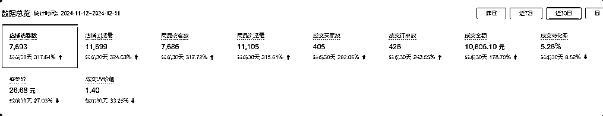
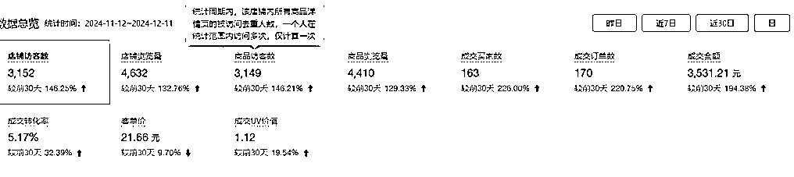
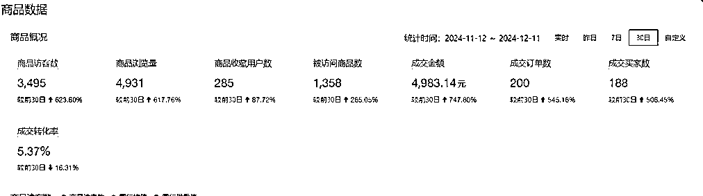

# 3个月从0到二手书头部：我用拼多多店群跑通的实操路径

## 拼多多无货源二手书店群，3个月做成头部，我把过程拆开讲

作者：程序员田同学
发布于：2025-01-03

大家好，我是田二，现在在郑州。之前是程序员，后面开始连续创业，踩过的坑不少。

从2024年5月起我们开始试水二手书，到了10月才all in拼多多无货源二手书模式。现在是我一个人管一个执照旗下20多家专营店。做到现在，顶尖的店铺月流水能过一万多，垫底的店铺也有三四千的月营业额，单店净利润稳定在20%-30%之间。

这篇文章就当是阶段性复盘，如果你也在做二手书，希望这些经验能帮你少走弯路。

想看更详细的流程和数据，我整理在了飞书文档里：
[`q2srbwoeiz.feishu.cn/docx/BnkSdKB7YoK6JLxI6A6c8a0enmh?from=from_copylink`](https://q2srbwoeiz.feishu.cn/docx/BnkSdKB7YoK6JLxI6A6c8a0enmh?from=from_copylink)

* * *

## 读者常问的几个问题

**Q：拼多多一套执照到底能开多少家专营店？**
A：可以。就是一个营业执照+一个出版物经营许可证，就能关联近30家拼多多图书专营店。

**Q：开多家店需要配多条宽带吗？IP会不会被关联？**
A：不用。拼多多对IP关联这块目前不敏感，同一网络操作没问题。

**Q：如何快速上架上万个图书SKU？用什么工具？**
A：去拼多多服务市场搜索图书相关的上货工具，选稳定好用的批量采集上架服务就能搞定。

**Q：不做付费推广也有访客吗？我现在每单都要投几十块流量。**
A：二手书这个品类很特殊，目前同行基本都没投流，靠平台自然搜索和类目流量就能转起来。