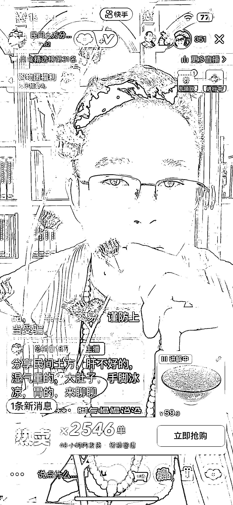

# 把“民间土方”搬进快手直播间，有人悄悄赚到了钱

大家好，我是龙哥，一个80后宝爸。平常不太会说话，但做起项目来绝对实在。我一直相信，真诚才是最管用的“必杀技”。所以这次，我把自己手打的七千字实操复盘全部分享出来，干货管够。觉得有用，就给我点个赞吧。

可能有人会好奇：这个“民间土方分享”直播玩法，到底是怎么被发现的？

说起来也有点巧合。我本来就在做养生方向的口播带货，刷视频是每天的基本功，刷得多了，自然就撞见了这个玩法。但现在平台的推荐算法实在太“聪明”，只会给你推它认为你喜欢的内容。很多藏在深处的宝藏项目，因为咱们不在目标人群里，基本刷不到。后来我想了个土办法：拿家里老人或小孩的手机去刷一刷。嘿，结果常常能刷出让我眼前一亮的东西。

至于这套玩法的完整操作，我特意整理成了“图文+视频”的组合说明，打开下面的文档就能看得明明白白：

【腾讯文档】快手“民间土方分享”直播变现实操教程
[`docs.qq.com/doc/DZGhYVnpncWN6VmJ3`](https://docs.qq.com/doc/DZGhYVnpncWN6VmJ3)

说实话，这个项目原本我是想私藏着的。但上周参加传术师见面会，龙哥老师随口说了一句：“越分享越幸运。”当时我就觉得脸上有点挂不住。回去琢磨了一下，还是决定把这个玩法公开出来。这应该也算是全网第一份系统拆解“民间土方分享”直播实操的内容，希望能给你打开一点新思路。