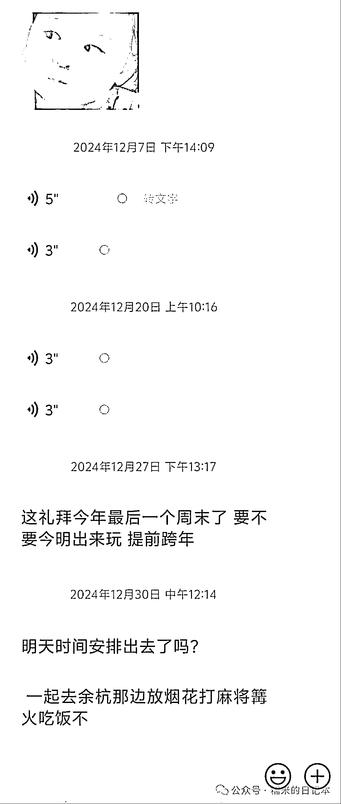
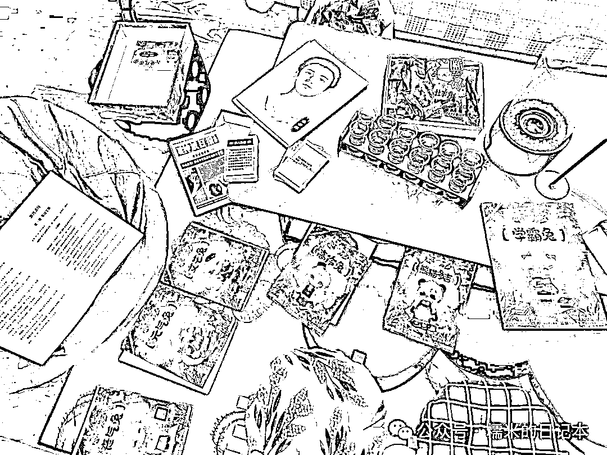
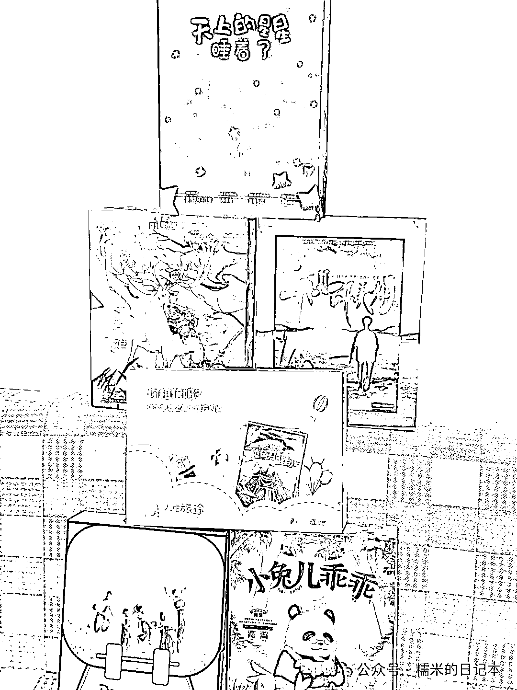
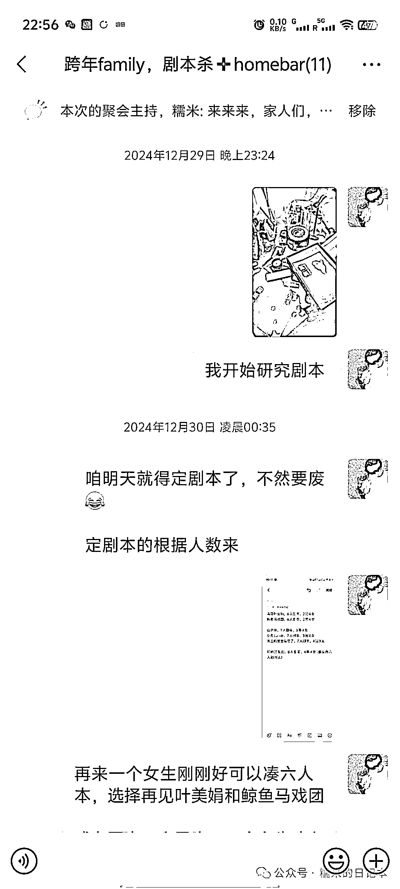
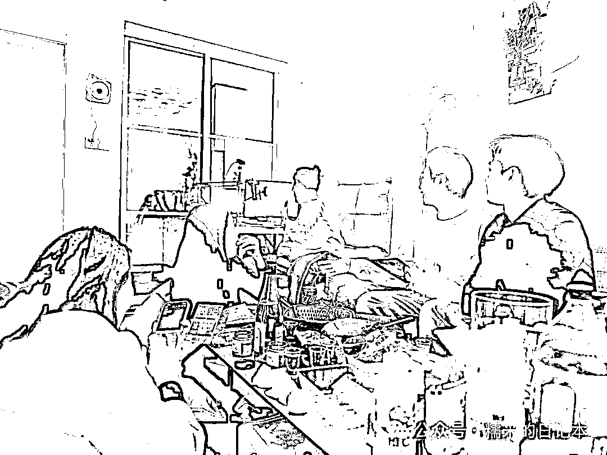
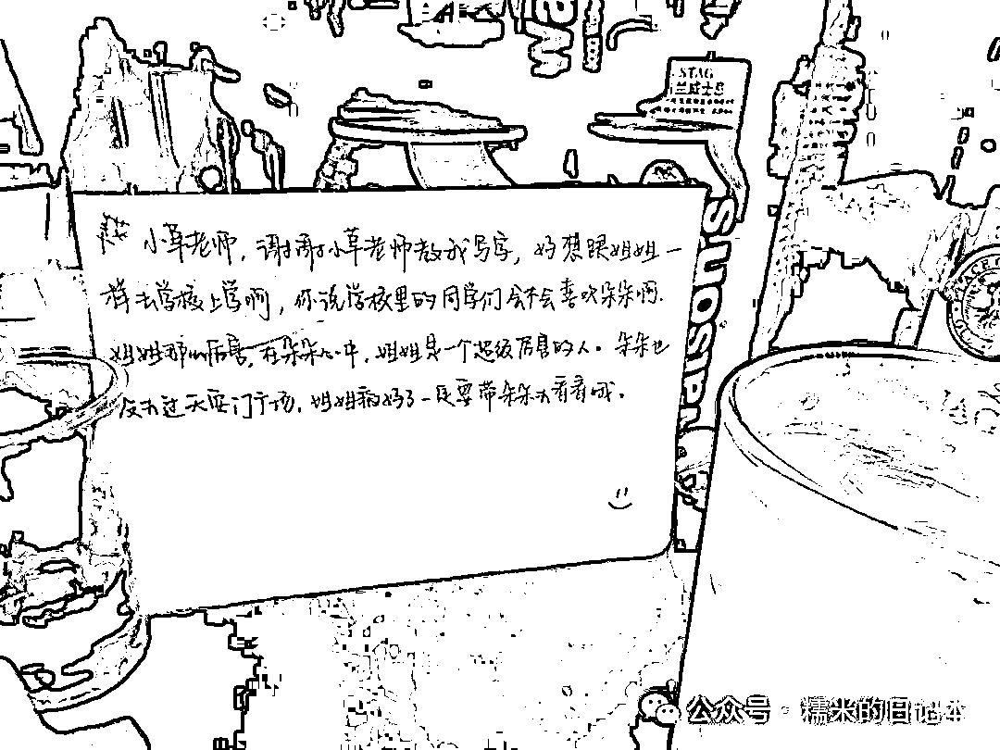
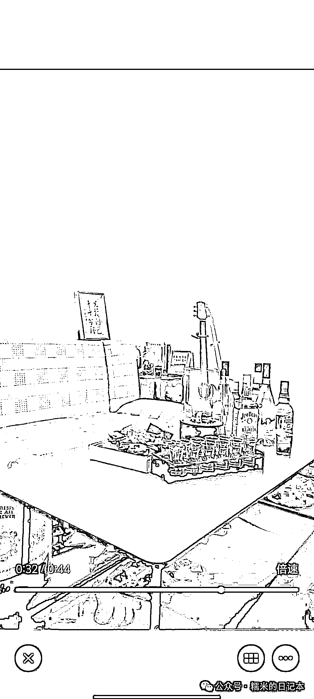
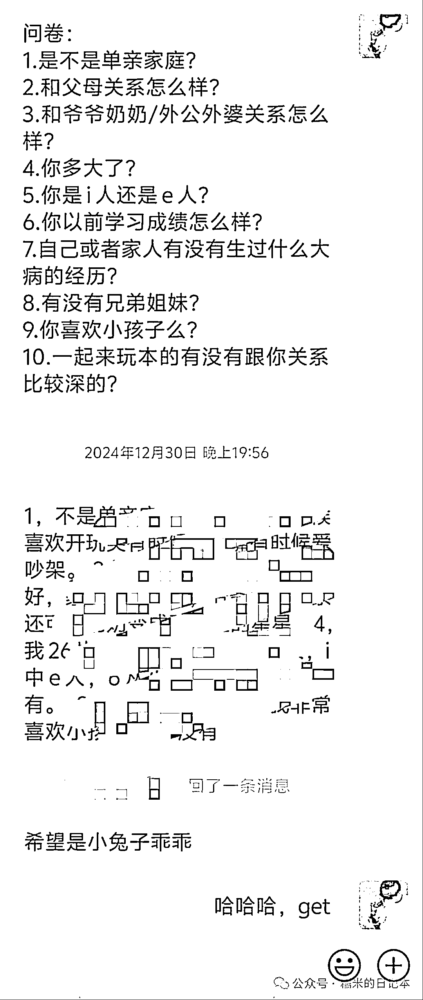
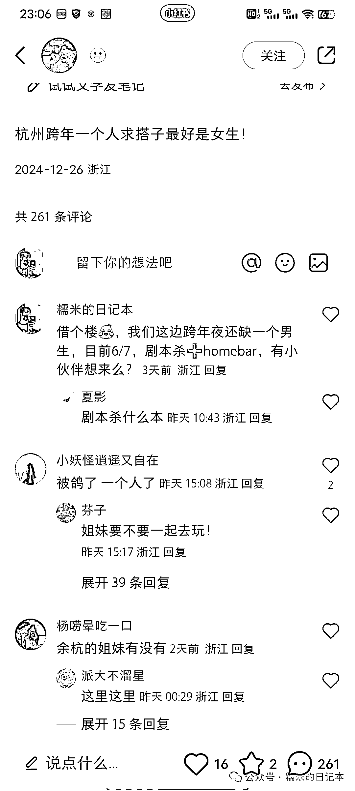
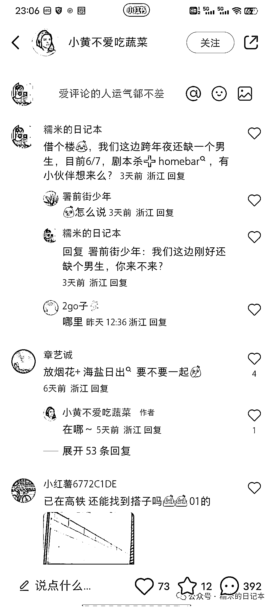

# 同城小项目，一个月多赚个千把两千块钱没问题！

新年好呀！祝大家新的一年平安健康，万事顺意。

前阵子有朋友问我，普通人想在主业之外搞点小钱，有没有什么门槛不高、又可持续的路子？我回顾了自己2024年折腾的各种小尝试，其实可以浓缩成一句话：这个时代，只要你愿意沉下心，稍微做点像样的产品或服务，价格又说得过去，完全可以在别人的行当里分到一杯羹。

你并不需要成为那个领域的顶级高手，只要比多数人更认真、更用心，你就已经能踩过及格线，甚至做出让客户惊喜的交付。为什么这么说？因为很多老手在行业里待久了，初心的那团火早就灭了，满脑子只剩“搞钱”两个字，交付的东西自然越来越敷衍。而你刚入行，姿态低、定价也实在，浑身是劲，心力足，做出来的东西当然更容易让人满意。客户的眼睛是雪亮的，体验过一轮，自然愿意回头找你。

拿我自己来说，最近刚张罗了一次同城年轻人聚会，就是活生生的例子。这次经历让我更确信：把一个事当成爱好来做，每个月只认真交付几次，顺带赚个一千两千块钱，真的不难，而且不会太累。

这件事能成，首先得感谢我的“原始动力”。我自己爱玩，也喜欢热闹，天生抗拒孤单。2022年那会儿，有人提醒我要把理想和赚钱分开来看，可这两年我越来越觉得，一个人做项目如果没有发自内心的热爱，而项目本身又不是暴利，那根本撑不了多久。要是让你去做一件不喜欢的事，还得苦熬一两年才有回报，估计绝大多数人都熬不到天亮。

这次组局，具体原因有两个：第一，我是真想来这么一场；第二，我在社群里发起了邀请，相当于是把自己架到了半路上，已经走了三成路，还买了不少东西，钱都花出去了，不把它办完都对不起自己。这两种力量推着我往前走，反而让事情变得简单了。

再说说我对这类同城社交项目的观察。我在杭州参加过别人组织的年轻人局，对他们的收费、交付和运营模式也算摸过底。玩法不难：在互联网发帖、发视频，把人引到私域，然后通过微信群、朋友圈甚至私聊告诉大家最近的安排，问你要不要来。我加过不少这样的运营者，他们几乎就是一遍遍群发消息，只要你没删他，消息就停不下来。

他们还特别擅长说一些俏皮话，让人感觉好像是在跟你一对一聊天，特别真诚地邀请你来玩。这算得上是职业玩家的优势，但咱们外行人想模仿，也不费劲。

顺便说一句，我在杭州待了这么久，一个很深的感受是：这里很多商业化服务，都是付款前把你当大爷，情绪价值给得足足的；等你付完钱，就会发现交付其实也就那么回事，情绪价值也打了折扣。当然，杭州商家的售后还是很会安抚人的，不会让你气呼呼地离开，这种“兜底”能力我称之为“100%售后”。 但说真的，如果你们想来体验，千万别被售前吹得昏了头，因为人家收完钱，任务就结束了，你后面体验好不好，跟他真没什么关系。

回到正题。在从网上引流到私域之后，杭州的组局团队还会专门做公众号来沉淀流量，而且做得挺精致的，我看了都会觉得：嗯，这个团队应该靠谱。其实组局最核心的一点，就是你把“交付预期”展示得很好。

以我自己这次为例，我是怎么做的呢？我把自己规划的流程、想布置的场景，乃至买好的零食、酒水都拍照晒出来给大家看，随时同步进度。比如我买了多少瓶酒，摆出来拍张照发出去，今天布置到哪一步了，也跟大家说一声。

这样一来，大家的期待值就被慢慢拉高了。 而且别怕期望太高会翻车，只要你真的用心准备、认真对待每个人，结果一定不会差。我真的不是专业玩家，不怎么会带气氛，但最终大家反馈很好，个个都说这是一次超值的体验。

为了保证品质，我也不打算频繁组局。以后大概每个月最多弄一两次，少的时候一次，多的时候三四次封顶。对我来说，这就像个爱好，把大家聚起来，大家开心，我不孤单，还能顺手把房租钱赚了，何乐而不为？

接下来聊点实操，毕竟很多人更想看能落地的步骤。

最开始我在社群发起组局，很快有两个小伙伴报名，活动就算启动了。然后我根据自己的居住环境，去网上搜了一大堆居家小酒馆（homebar）的布置案例，挑了我喜欢的风格，试着去还原。为此我买了长桌、地垫、坐垫、零食、酒水、水果、酒杯，还为了配合跨年主题准备了剧本杀。剧本杀套盒是从二手平台淘来的，挺费工夫；我还给大家做了问卷调研，根据每个人的情况匹配剧本，另外买了香薰蜡烛来营造氛围。

一边筹备，一边还得解决“人从哪里来”。我是借元旦跨年的时间节点，跑到别人的帖子下面疯狂留言，介绍我的局是什么情况，就是到处截流捞人。 我自己发的帖子没什么流量，但我早就料到大概率能凑齐人，因为这几天杭州组局需求很大，光是在别人帖子下留言带来的曝光，就足够让我捞到四五个人了。只要发够几百条评论，效果基本就出来了。

这次组局我也没有精打细算，粗略一算，收到的钱和花出去的钱基本打平，顶多自己倒贴一点点。比如剧本杀虽然是二手的，但也是一笔开销。人拉进群之后，就得反复沟通流程和安排，这些完全可以SOP化，把重复的话术复制粘贴发给每个人，同时不断预告进度，让人感觉很透明、很真诚。这也是我这次能办下来的关键。

细节上，我也尽量多想一步。比如天冷了给大家准备暖宝宝，进门口放个椅子，方便大家坐着换鞋套。开剧本杀之前，我会反复跟每个人沟通，做问卷，判断哪个本子更适合谁。说真的，这次交付挺重的，前前后后准备了将近一个星期。不可能每次都这么辛苦，所以以后我会用经验来给交付减重。比如剧本杀开得多了，哪些环节能省，哪些物料没必要买，垃圾零食别弄得到处都是，什么酒容易踩坑，大家进门之后怎么规范行为（比如抽烟），这些都心里有数了，自然就轻松了。

第一次组局虽然没搞得一片狼藉，但打扫卫生还是花了不少力气，尤其是桌子，有些污渍怎么擦都擦不掉。不过有第一次的经验，第二次肯定会轻松很多——很多布置和家具都能留下来反复用，成本也会更低。

这件事我是愿意持续做下去的，因为对我来说它不算累，反而很快乐。而且说不定做着做着，它还能变成一个更正式的项目，让我在杭州赚更多钱，甚至组个小团队。我目前也不知道它能走到哪一步，但既然已经开了头，它就融进了我的生活，往更高处走也是顺理成章的事。

好了，今天就先聊到这儿。如果大家想看更细致的操作步骤，比如第一步做什么、第二步做什么，我可以再写一篇来拆解。要是没人提，我可能又懒得动了，哈哈，随缘吧。