# 医药代表可尝试的十项兼职方向

> 原文：[`www.yuque.com/for_lazy/zhoubao/wpwzif4osedhz6rv`](https://www.yuque.com/for_lazy/zhoubao/wpwzif4osedhz6rv)

## 医药代表可尝试的十项兼职方向

作者： 糯米

日期：2025-01-02

上段时间受一家医药垂直号邀请，写了一篇关于代表转型与兼职的稿子。反复打磨后上线，我也同步到了生财，期望对同行有点启发。以下为正文：

“副业”
这两年来热度持续走高，仿佛人人都在琢磨额外收入来源。
原因很现实。
近年求职环境、宏观经济、消费意愿都不算理想
大家都在找安全感与第二条路，于是兼职的话题就起来了。

**医药代表能做的 10 大副业** 我选择写这个主题，是因为：

1.我本人就是一名在岗代表

2.我亲自试过不少额外变现路径

3.我了解这个群体对该话题的关注度

4.我与药前程官方达成了约稿

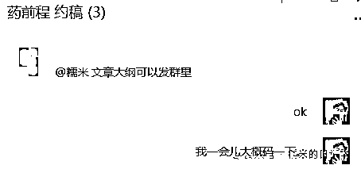

说实话我一直偏好坦诚表达，这篇也不例外。确实存在约稿在先，所以思路才顺畅。
让我空想编故事我真做不到。
正因是约稿，我才特意做了排版与格式，让整体看起来更正式。

若此文被药前程转载，可能不少读者并不认识我，这里简单做个自我介绍，当作一个小故事听。

你好，我是糯米，跟各位一样在做代表工作。
2019 年本科毕业即入行，正好撞上 4+7，艰难中也坚持下来了。
随后在南京待了约两年半的代表岗位。
攒了一些积蓄后心血来潮，选择裸辞，说要去做点自己想做的事。

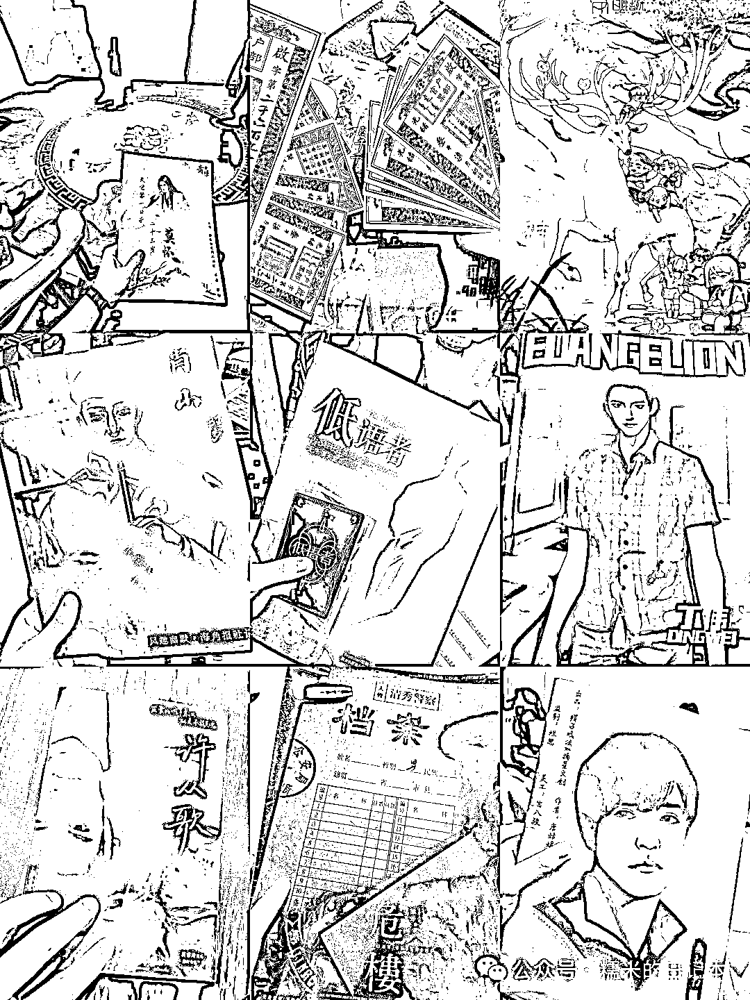

当时对密室体验很着迷，想涉足这个领域。于是南京住处到期前的数月，我整天泡在当地的剧本店里。
离开南京后，我又外出晃荡了一阵，春节回到贵州老家。
过年期间危机感很强，一直在思考剧本杀如何变现。当时零收入又不敢贸然投入开店。
我的设想是把剧本杀与内容自媒体结合起来做号，但始终没找到方法。
大年初二，和一位校友聊自媒体，他建议我去广州看看他们做的直播带货，说很赚钱。
大年初二，全国飘雪，我就踏上路了。

到广州看到他们单日流水几万到几十万，瞬间被打动，于是我在当地滞留了半年。
然而并不轻松，自媒体风向变化极快，很快项目就垮了，场地也没了，无人带无人管，我只能蜗居在小房子里咬牙坚持。

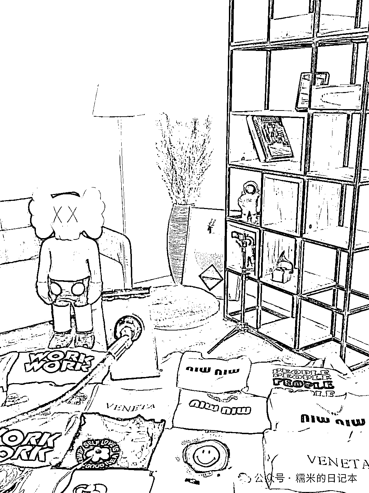

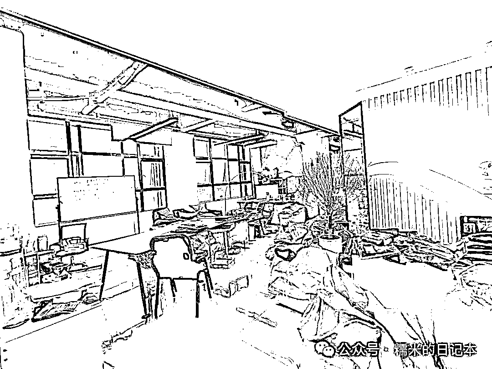

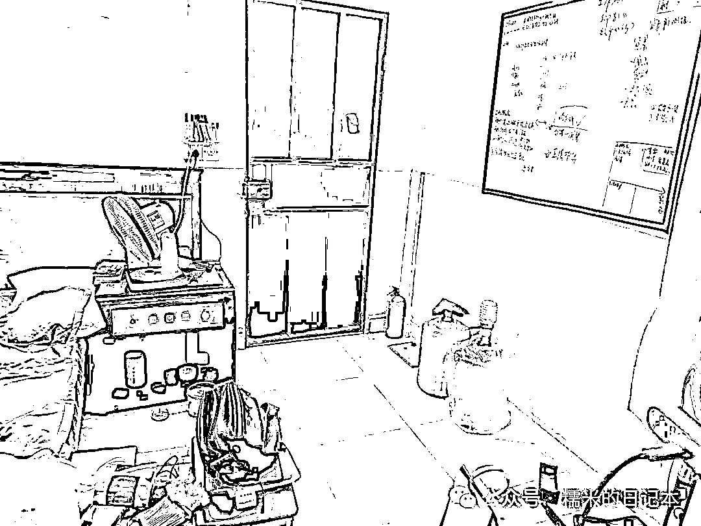

在广州期间我接触过电商直播、社群运营，卖过服装、食品、瘦身品类。
我本人也从抖音迁移到视频号，当时视频号的红利我和朋友一起蹭上了，靠剪辑直播带货赚了点小钱。

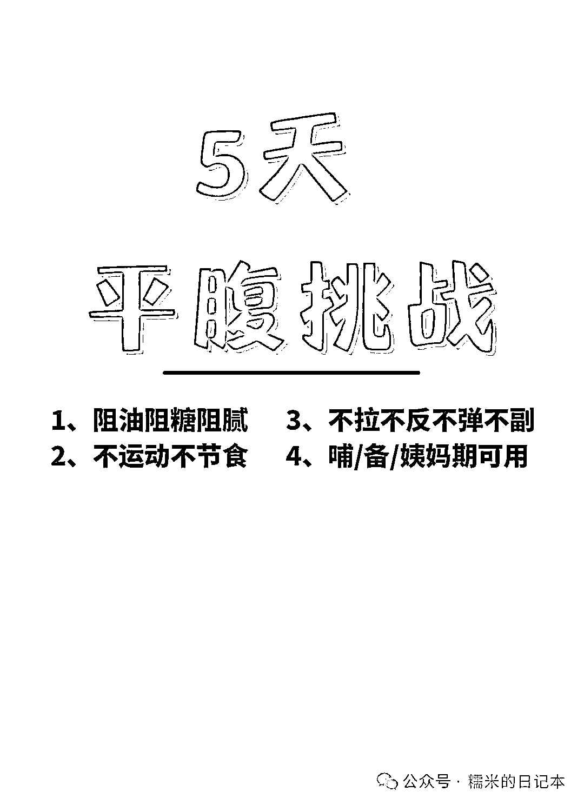

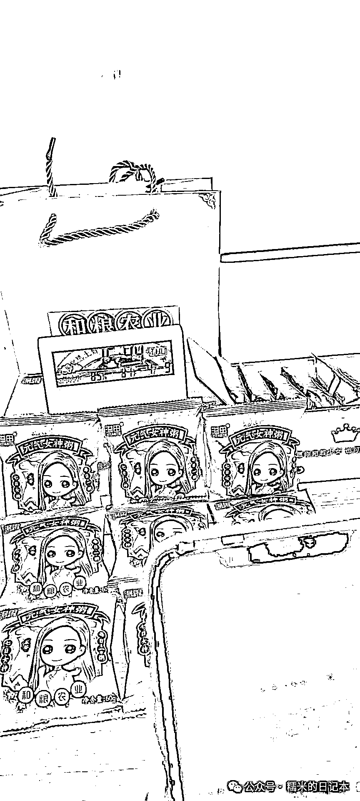

后来回到贵州老家又做了半年游戏创作者，也赚到一点零花。那一年累计下来大概小几万。
可与支出的对比，杯水车薪。
最后我仅剩 1w 资金来到杭州，对自己说，这次要重新开始！
抵达杭州那天是 2023 年 3 月 25 日，记忆很清晰。求职期间碰了很多钉子。
我一度认为回不去医药行业，毕竟中间空窗一年多，没有在职记录。
在该行业中断这么久，竞争优势被削弱，只能靠口才去说服。
那段时间我每天投递简历、面试、复盘面试、迭代简历与话术。
如果你翻那段时间我写的文章，应该能找到不少面试思路类的内容。

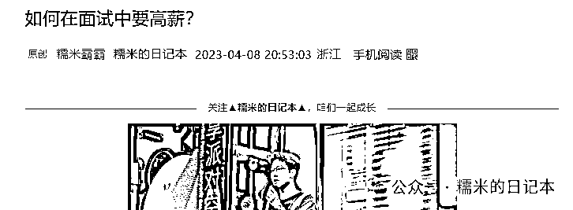

20 天后我入职了现在的公司，当时也不容易。
好在那一年多的自由职业历练，让我变得更坚韧，行动力与思维模式都发生了改变。
用半年时间在杭州站稳，保住了岗位。

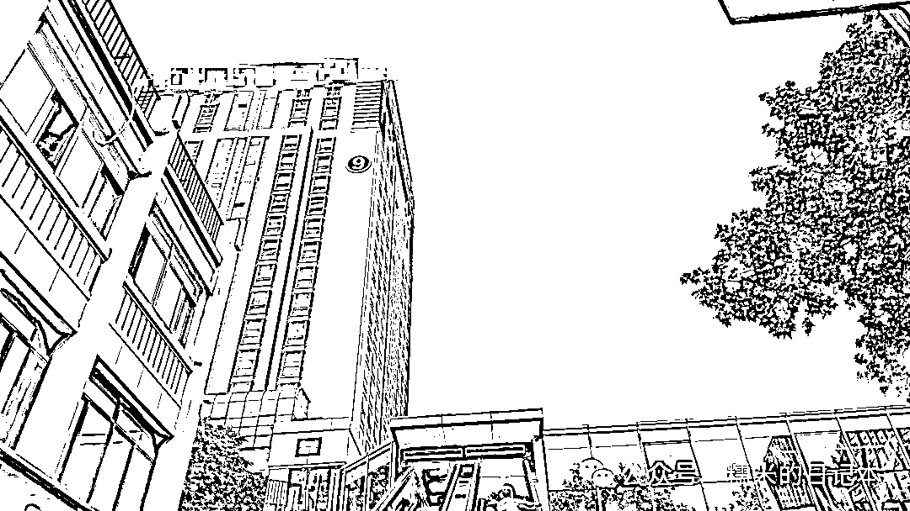

直到 2023 年 8 月，一个转折点出现了。
我启动了“陪诊”作为我的第二职业，也取得了一些成果，在圈子里有点小名气，持续至今。

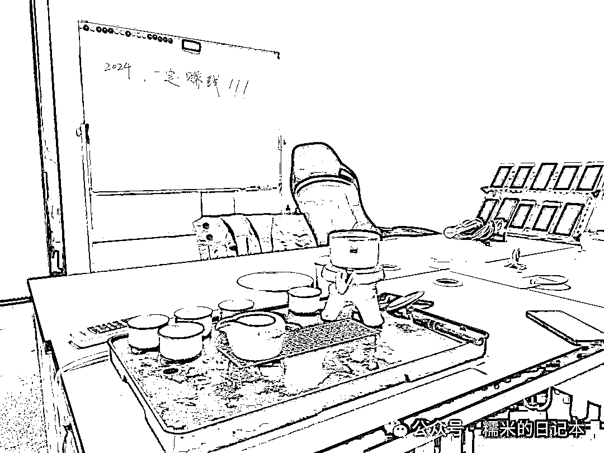

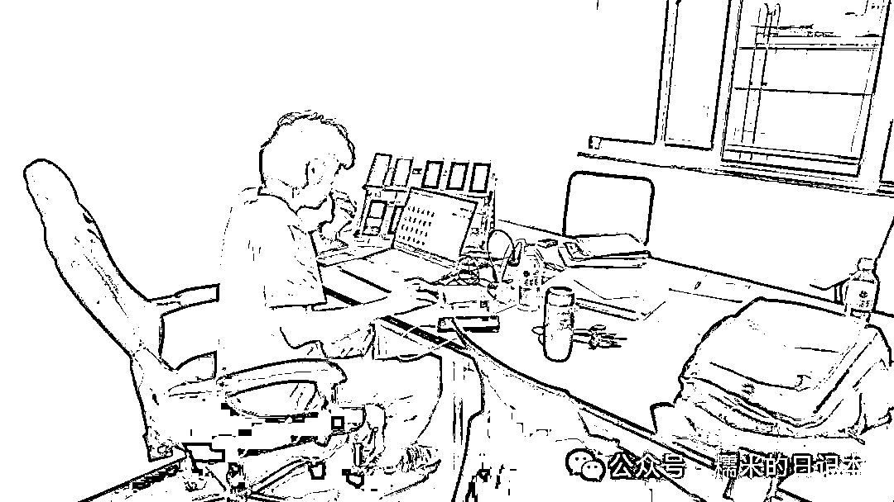

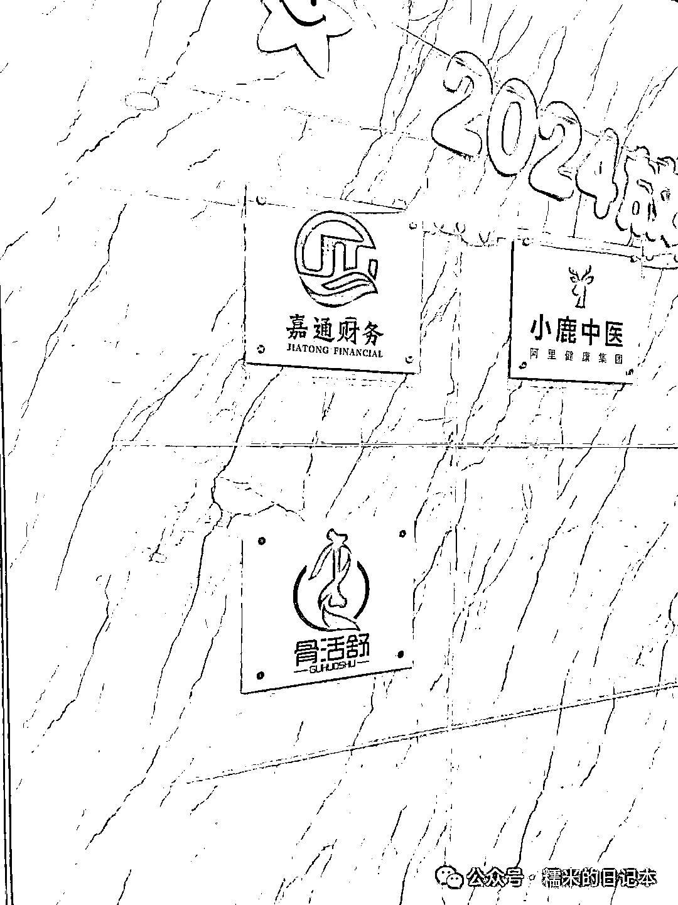

当然我的经历还不少，比如持续两年多公众号写作，做过知识付费课程录制与销售、做过咨询服务等。这里就不展开，大致让大家对我有一个更立体的认知。
既然我今天讲兼职，那我是够资格的。现在进入主题。

**作为医药代表，究竟能做什么兼职？**

先抛个问题：在你心中，兼职是什么形态？你做兼职到底想要什么？
问这个是有原因的。
**你必须先厘清自己的预期，做兼职究竟图什么！**

比如行业里有些前辈，底蕴与积累都很厚，折腾额外项目的投入产出比对他们而言偏低，还有不确定性。
**真的，并不是每个人都需要创业、做兼职。**
你可能花钱学习、费时费力，一年下来也赚不到几个钱。
不否认，能学到东西、看到新赛道，但以你的年龄，学习成本会偏高。
我这话没有恶意，我自己都羡慕在校大学生，学东西快，更懂当下的新事物。
如果我不加紧学习，很快会被年轻人甩开。

今天这篇文章比较真诚，所以啰嗦了一些，大家见谅。回到兼职本身。
OK，先想清楚，你做兼职到底想要什么，预期在哪里？

**如果你只是想体验一下，完全可以。**
医药行业的人思维相对偏内敛，出来看看、打破常规，对你很有价值。

**或者你只想每月多几千块的现金流**
如果只是想补贴生活费、交通费、租金，也是很大概率可实现的。
我在杭州见过太多人做兼职。之前在小红书上请了一个小哥上门帮我拆装电脑换机箱，他业余搞硬件软件，一个月多赚几千很稳，他并非科班出身，就是以前爱玩游戏。

**再或者，你想做成被动收入**
躺着也能有钱进，这就很爽了。

**甚至你想把兼职放大，超过主业**
让你有底气跟那个让人不爽的老板说再见，这就看你的目标高度了。
**但无疑，预期越大，成功率越低，这是规律。**

厘清预期后，再聊具体方向。
一般我不建议在网上随便挑一个兼职就开干。
原因有两点：
1.大概率要从零起步
2.大概率坚持不到一周就放弃了

我更推荐做离自己“近”的兼职，比如我的陪诊项目，就是典型的代表友好型兼职。
**本来就要常去医院，工作时间也灵活，职业素养在线，直接从 50% 的进度开始，很舒服。**

那代表还能做什么兼职呢？

1.科室餐饮
2.礼品销售
3.会议凑数
4.论文代写
5.PPT 美化
6.健康咨询
7.药品代购
8.医学资料/服务销售
9.医生助理
10.xxx

我知道不少人看到这里会失望。
“哎呀，不就是老三样嘛，身边早就有人在搞了！”
但我要说的是
我可以给你讲一堆网上稀奇古怪的兼职，逻辑模式我都能讲，但你大概率会回到上面的结果：从零开始，坚持一周就放弃。

现在希望你静下心来，听我拆解这十条兼职的可行空间。

**1.科室餐饮**

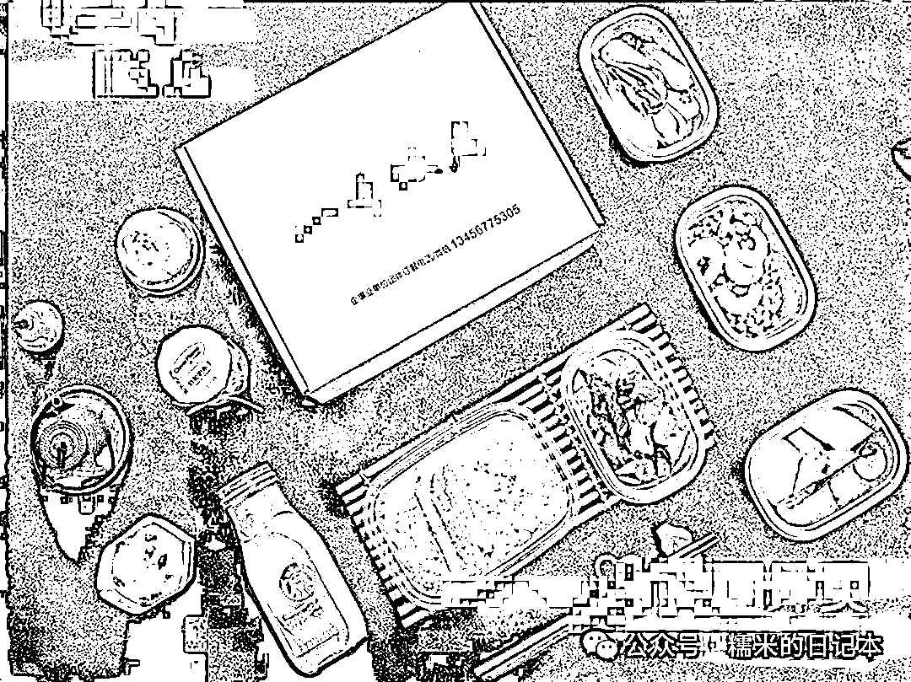

这个你能直接掌控，因为你有代表身份，离代表群体很近。
你很容易积累很多同城代表，代表就能决定在哪下单，获客天然有优势。
你可能会问，那为什么要找你下单？餐从哪来？
想想代表的需求是什么，你最清楚！
要发票？要报销？要特殊处理？只要有利可图，为啥不能找你。

**OK，订单拿下，餐怎么解决？要自己开店吗？**
完全不用！你只需要在医院附近找 20 家餐厅谈合作即可！
你帮商家卖，赚佣金，这是最轻的模式。
20 家慢慢筛选，选好的就推给身边的代表。

想做大做稳，可以延伸一下：
**第一，优化餐食**，懂医生需求，一般是好吃、看起来高级、搭配合理，按当地医生群体需求设计。
**第二，配送问题**，要解决及时送达，很多科室的尴尬就是等餐等到饿。
这些靠筛选店铺就能解决，运气好直接选到靠谱的店。
你只管拿单、安排、盯好不出问题就行。

做好了，医生那边持续口碑好，他们自己就会习惯点你们家外卖。
**人都是懒的，习惯了就不会换，你守住就行。**
客户群体可以从医院扩展到各种 B 端商务团队餐。
等你把逻辑吃透了，自己开店也可以，从中间商过渡到源头供货。
你发现没，到开店这一步之前，你一分钱成本都不用出。
成了之后就是接单、安排、把控质量。

**2.礼品销售**

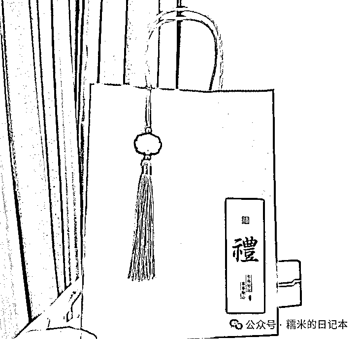

代表经常为礼品头疼，这就是刚需。
一样的逻辑，多加代表人群，多探索礼品供应链。
每天聊几家供应商，每天检索下有什么好礼品，然后在朋友圈卖给代表，不就好了？

如果你加了 1000 个代表，覆盖多个城市，手里有 100 家供应链，能做礼盒也能散卖。
到节日前一周发朋友圈：
**“中秋送客户的绝佳礼品，xxxx，实惠又体面，别再傻乎乎去超市买粽子了，买它，让客户眼前一亮！”**
我估计就那几天，询盘 100 人起步。

算笔账，按 20% 成交，每单 200 元，赚 20%，也就是 100*0.2*200*0.2=800。
看起来不多，但有几个逻辑：
第一，200 元一单很保守
第二，20% 利润能不能提高
第三，订单只发生一次吗？节假日年年有
第四，朋友圈客户永远只有 1000 个吗？能不能做到 5000 个，甚至开第二个微信做到 1w？
第五，能不能把私域运营好，把询单数做上去？

**3.组织凑会**

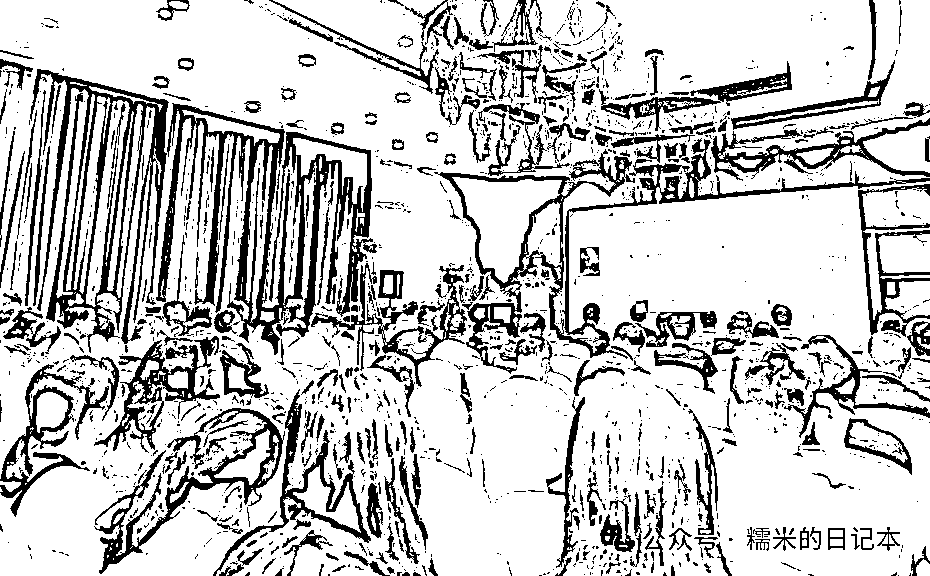

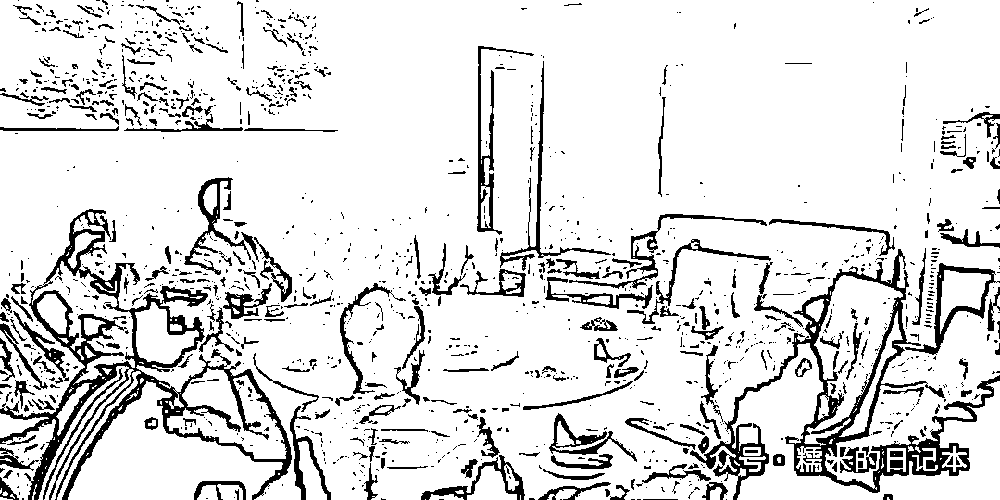

看到这儿有没有感觉，这些项目都是有人在做的，我为什么还要提？
因为它们已经被市场验证过，需求真实，花钱真实，市场真实。你想自己去踩雷创新吗？
我们这个行业经常要参会吧，能不能花钱请人凑数？
能不能不想去的时候花钱找人替你去？
甚至能不能承包一些公司的会务布置？
**哪里有人花钱，哪里就能赚钱。**
你都愿意花钱找人参会，那帮你参会的人不就在赚钱吗？如果在你这形成一个参会人力资源库呢？

**4.代写论文**

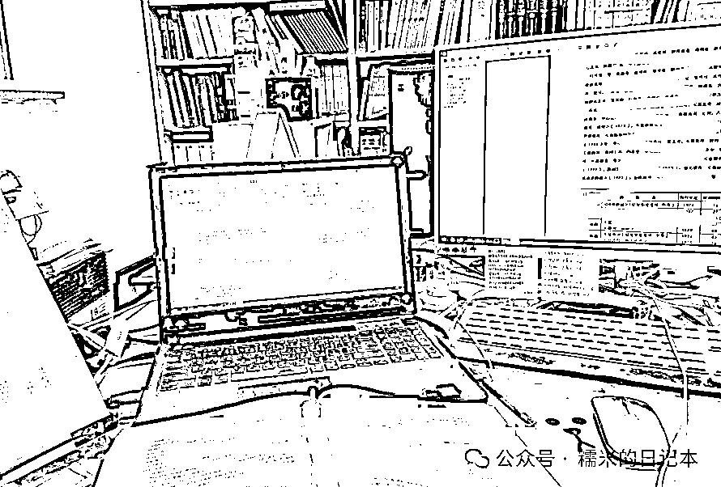

这个面向医生或有论文需求的人群。
咱们医药人学历越来越高，未来本科起步。
毕设做过，实验做过，论文自然也写过。
医生很忙，不想写，没空写。
手工部分能不能我们代劳？比如排版、摘抄、复制粘贴，做成服务商业化。
自己做不了，可以在网上找论文代写机构，你去找医生拿单，赚差价，只要服务靠谱就行。

**这个模式能成立，但难度偏高，复购频率极低。要做大可能需要靠自媒体打全国市场。**
我提这个，一方面逻辑成立，一方面也符合我的思维习惯：在医药行业，尽量往专业度高的方向走。
比如我今年考了执业药师，在药的专业度上又提升了一档。
前阵子我还自己买了动态血糖仪拿自己做实验，连续测了 15 天血糖，对饮食和血糖的关系理解就更专业了。
记住，健康无价，做一个健康专家，以后钱会源源不断。

**5.PPT 美化**

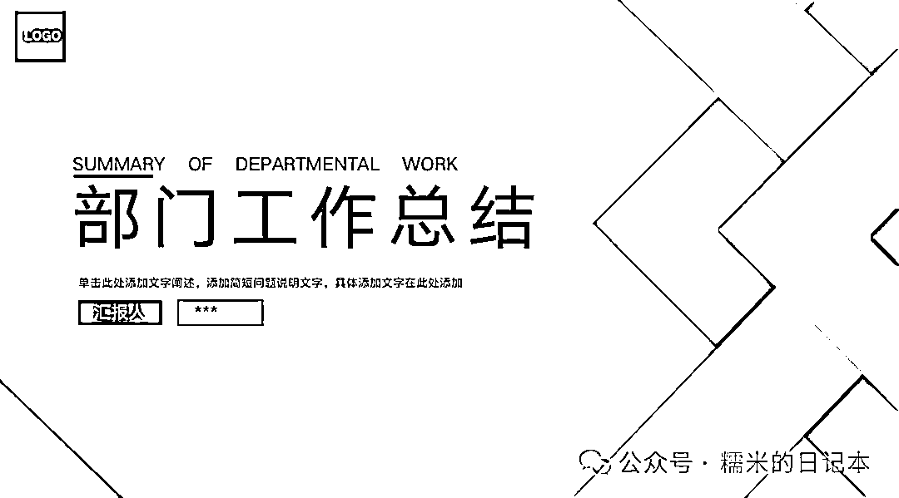

这个兼职的由来是，你在医药行业本来就天天和 PPT 打交道。
**汇报工作、科室会、甚至帮医生做病例 PPT，你都很熟。**
去花钱学一套 PPT 课程，把 PPT 做到极致。
一方面帮你主业晋升，另一方面能用这个技能赚钱，比如卖课、直播、接单。
很多人会做事，但不会表达，10 分的辛苦只表达出 5 分，很吃亏。
**在 PPT 上用点心，真的能帮你升职。**
当然，如果你本身混得很好且 PPT 完全不碰，那你其他方面肯定很强，但对大部分同行来说，这个有广泛复制性。

说回生意，医生、公司领导、同事、同行都有 PPT 需求。
你可能会觉得，我怎么好意思收费？这个口开不了。
那我告诉你，你帮他们做，本来就在收费，只是用人情结算。
如果你能像我一样把人情和生意分开，完全可以正常收费。
给个友情折扣就行，下班后你就是 PPT 写手。

**6.健康咨询**

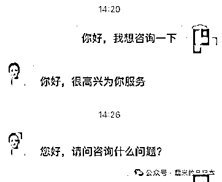

前面提到过了，如果你愿意沉淀在这个遍地是黄金的行业，就多积累专业知识，持续解决问题。
等你专业知识和案例积累够了，哪怕还是代表身份，别人找你咨询也要 1000 起步。
我认识一个北京的姐姐，也是同行，她就做到了，因为她足够专业。

**7.代购药**

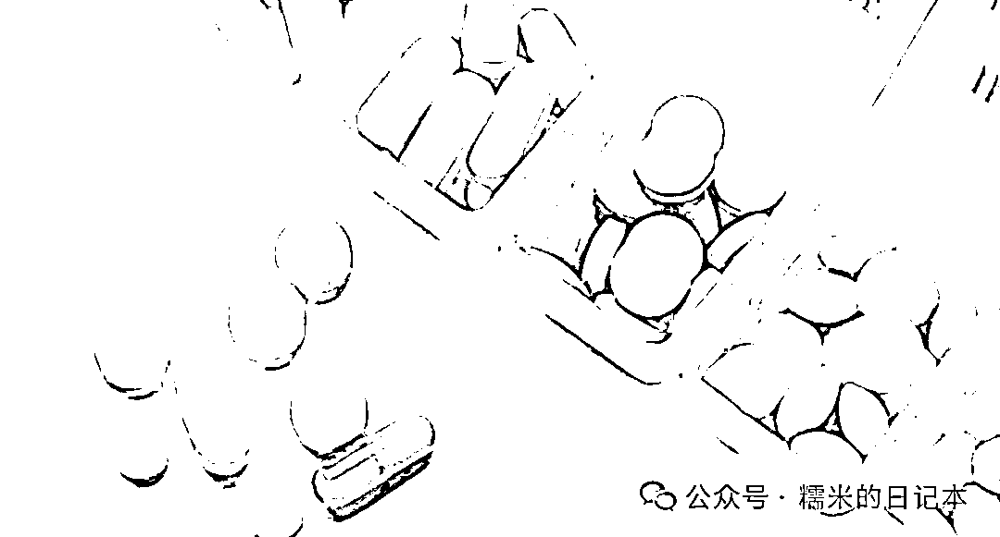

这个和陪诊是交叉的。你懂药，又在行业里，天天跑医院，身边一堆做药的，先天优势。
需要做的不外乎多收集供应链，谁问你你都知道在哪能买，你就是那个能买到的人。
当然，要注意合法合规！
模式和上面类似，积累客户、积累供应链、沉淀口碑、持续宣传。
一个月搞点零花钱没问题，想做大就复杂了，今天不展开。

**8.卖医药学资料/服务**

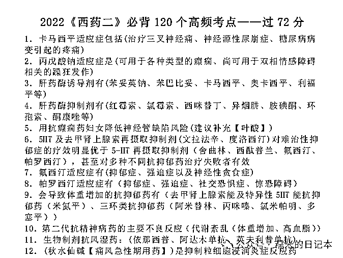

这一条就是我考执业药师的经历。
**我考过了，我就能教别人怎么过，卖服务。**
就算没考过，作为行业人士，卖这个服务也更有说服力。
每年考医考药的考生那么多，你搜罗资料整理好卖出去，不也是个好项目吗？
你的身份和行业背景，天然更容易成交。

可能有人会看不上，但我跟你讲，我认识一个前辈，2023 年我刚来杭州第一天第一次见他，我们几十个人围着他听分享。
他现在在青岛买车买房，车是上百万的越野。前两天看他开车去雪山拍照。他就是靠卖考研资料赚了几百万翻身的。
**所以，别看不起卖资料这件事。**

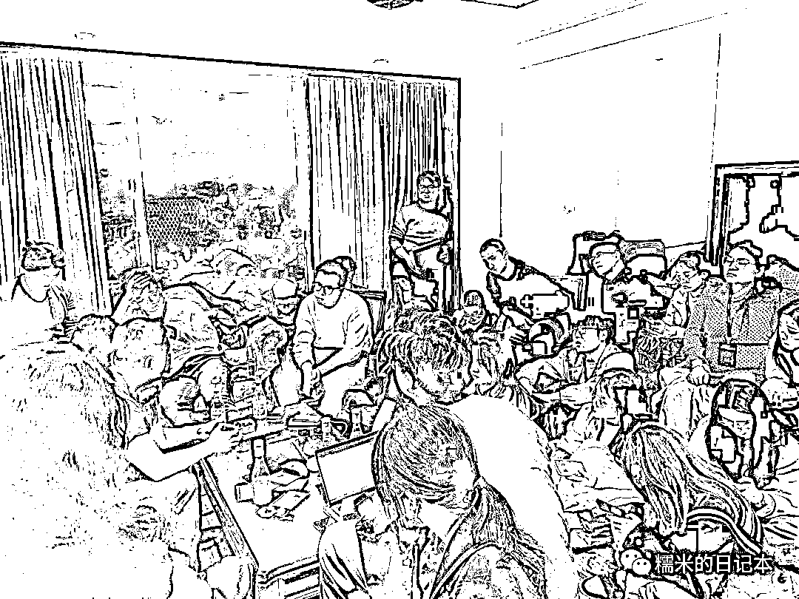

算个账，19.9 一份资料，资料来源一次性成本，整理好后可以无限卖，零成本。
只要能持续获客，就能持续 0 成本赚钱。
而且不用担心复购，考生是源源不断长出来的。
近几年药考人数平均值大概 70w，哪怕你分几千人的蛋糕。
一年获客 2000 人，10% 成交，200*19.9=3980 元。
看起来不多，可能还累，于是很多人看到这里就放弃了。

但我要说的是
**人就是这样，小的看不上，大的够不着，这个事儿你得做了才知道真实数据。**
也许成交率能到 50%，特别是考前几天临时抱佛脚冲动消费，我当年就是。
花一年时间，你的微信里躺着 2000 个垂直用户，都是医药行业的，都是考执业药师的，未来需求高度重合。

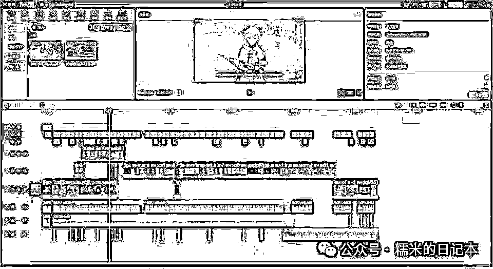

老铁们，咱们换个角度想想——你就非死磕自己手上那点产品吗？打个比方，团队里两千号人，其中五百个是医药代表，那你直接把礼品卖给他们，这不就形成闭环了嘛？

实话实说，我自己没真去做这个，前面跟你们摆的那些数字，纯粹是为了让概念更形象。至于真实情况是不是这样，说实话我也不确定。19块9的东西好不好卖？获客容不容易？这些我真没底。但我确定的是，当时卖我资料那哥们，光靠这个副业，一年能整个好几万外快。而且他不光卖药考资料，医考、考研、但凡跟学习考试沾边的，他全都有货。

**9.医生助理**

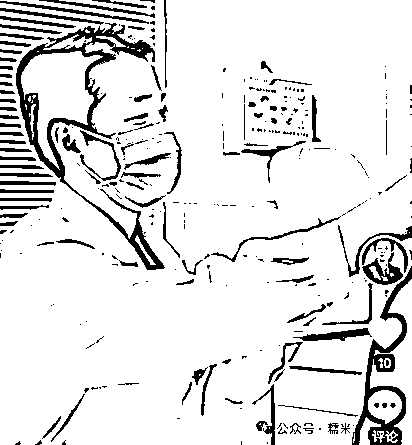

现在医疗自媒体早就火遍全网了，各大医院都在拼命抢患者流量。光靠老套路——小区义诊啥的，一天下来能接触到多少人？掰着手指头都数得清。所以现在医院都在主动打造自己的网红医生、自媒体IP，目的就是抢流量，这已经成了刚需。

我自己就真实遇过这种需求。有一回，同行跟我说，他一个医生客户想找个剪辑助理，因为知道我混过自媒体圈，让我帮忙物色个人过去试试。你要是会剪辑，能搞定医生IP视频，那一个月靠这个副业赚个几千块真不难。要是你天赋爆棚，剪出来的片子流量爆表，有了作品傍身，那完全可以跳出医药圈，专职做医生IP剪辑师。说实话，这个领域的高手太稀缺了，我看过招聘平台，岗位薪资基本都上万。

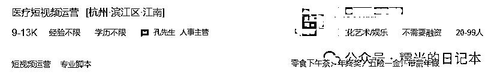

**10.xxx**

第十条我故意没写，因为副业这条路，条条大路通罗马，剩下的留给大家自己琢磨。比如说，你既是医药代表，又是宝妈，那完全可以从宝妈角度开拓点母婴相关的副业。又或者从日常生活出发——我认识一个代表，特别爱穿搭，她就把这个喜好发展成了副业，一个月也能赚上几千。平时推荐推荐衣服、带带货，运气好坚持几年，积累几十万粉丝也不是没可能。到时候变现能力强了，直接辞掉代表工作也不是不行！

好了，写到这儿也差不多该收尾了。全文七千多字，算是糯米掏心窝子系列了。这篇文章我陆陆续续写了好几天，排版前后改了又改，加起来花了十多个小时。

如果你现在对代表这份工作提不起劲、适应不了，尤其是刚入行的新朋友，我太懂你们了。想当年我刚入行那会儿，天天迷茫，不知道干啥，动不动就焦虑，还总觉得自己不被社会认可。这些我都经历过，只能说咱们这代人没赶上好时候。但换个角度想，这个时代的挑战同时也是机会，关键是要审时度势，顺势而为。

别指望靠多吃饭、多套近乎就能攀上前辈大佬的关系。哪怕人家对你有好感，资源和圈子也不是轻易就能给你的。**我们要做的，是差异化竞争。** 他们年纪大了，学新东西慢，执行力也跟不上，我们就得从这些地方下手，用我们的优势去换他们的资源。

像我为什么能给药前程写稿？还不是因为我天天写公众号，坚持了两年多，写了七百多篇（有些没公开发）。写作能力是实打实练出来的。

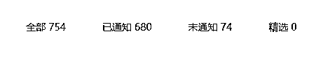

再加上我瞎折腾了好几年，在自媒体、副业这些领域，确实积累了些思维和经验。所以这类主题我写得出来，后面还能再写成一个系列！感兴趣的记得继续关注糯米。

最后想说的是：希望你看完这篇文章，哪怕它没对你的生活产生实际作用，只要能让你心里热一下，也算给未来的改变添了一点点动力。那我就很满足了。愿咱们一起加油，努力往前走，最终活成自己最想要的样子！