# 我把在Reddit里翻帖子的重复劳动，变成了一条自动流程
作者：龙哥

今天想跟大家聊一个让我最近特别上头的实验。

我是龙哥，去年秋季加入赚钱，平时喜欢折腾各种提升效率的思路。这是我在这个社区的头一篇长文，也算对近期研究的复盘。

起因是社区里挂出了一条悬赏，希望大家分享挖掘真实痛点的玩法。恰好我手头有一套从Reddit上寻找用户困扰的流程，就借此机会整理出来，抛砖引玉。

先说说为什么我会对Reddit这么感兴趣。

Reddit的形态，是由成千上万个兴趣分区构成的巨型社区。每个分区里都有大量用户在认真提问、求助、分享踩坑经历。一个人遇到麻烦，往往会在帖子里把自己的处境描述得非常具体，不需要包装，也懒得表演。这些自然流露的内容，恰恰是寻找产品灵感的富矿。

之前有圈友专门整理过Reddit的入门攻略，讲得十分详细，值得一看。更有说服力的案例是，有人就是从一条看起来不着调的需求帖出发，最终做成了一款被不少用户认可的产品。这说明，那些看似离奇的抱怨里，可能真的藏着下一款好产品的线索。

顺着这个思路，我用 n8n 搭起了一条半自动的处理链路，给它起了个名字：Reddit Agent。整个流程不算复杂，拆开来看是六个环节。

第一个环节，预先确定想追踪的线索词，并把它们统一存放在一份清单里，同时指定去哪个分区内检索。我目前维护了3个词，都是我长期关注的领域。

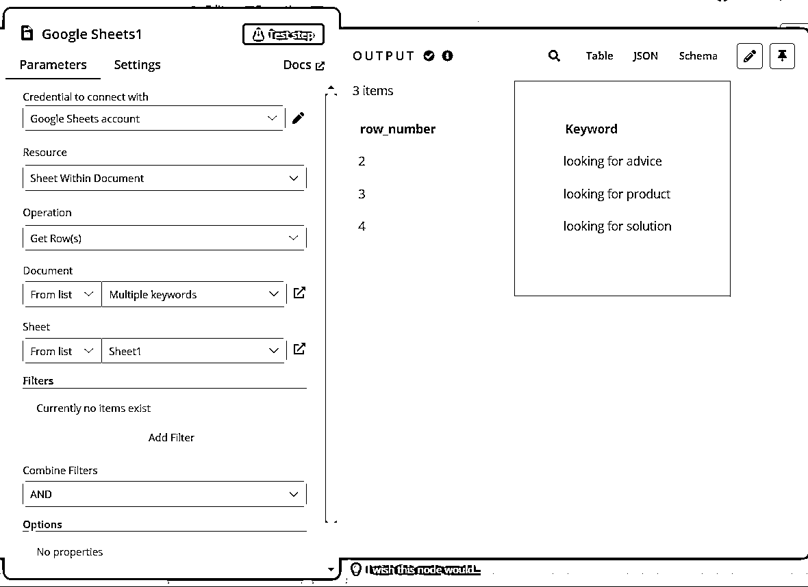
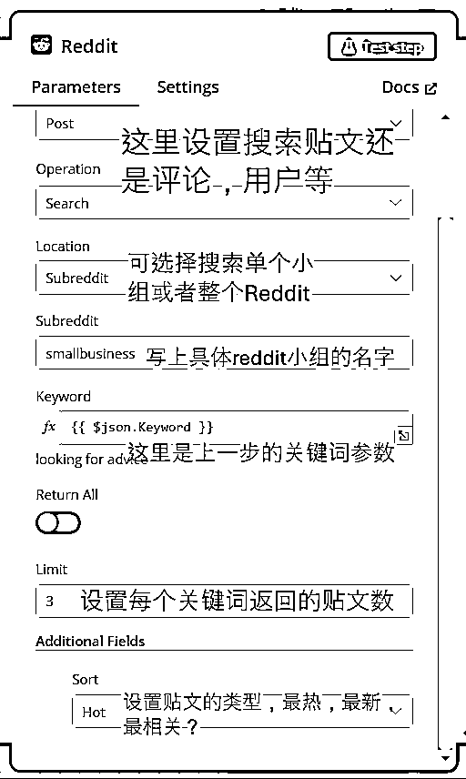

第二个环节，按照事先约定的一套规则，把检索结果先粗筛一轮，明显跑题的直接清掉。

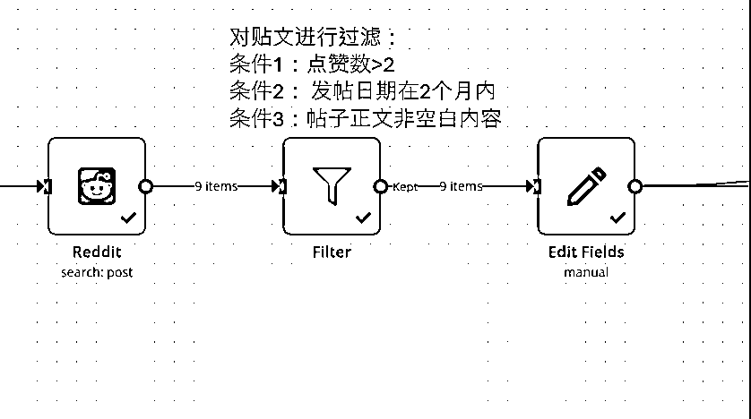

第三个环节，进入最核心的判断阶段。让模型读一遍每一条帖子的正文，然后回答一个简单问题：这个帖子描述的，是不是某类需要商业解法来应对的困境？判断标准可以理解为——它是否提到了某个业务正在想办法解决的具体挑战或诉求。结果只保留“是”或“否”。

第一轮实测，十篇帖子里有九篇得到了“是”，仅有一篇拿到“否”。

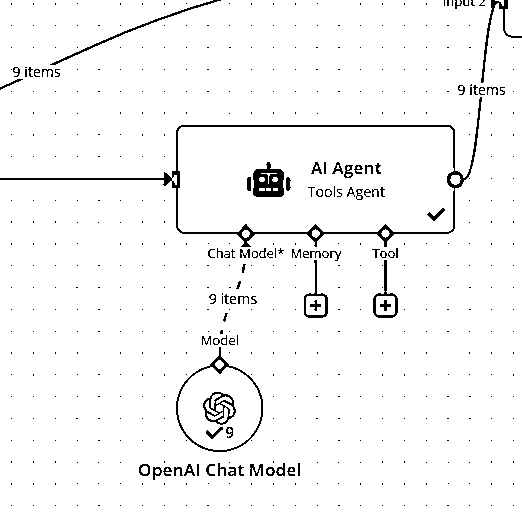
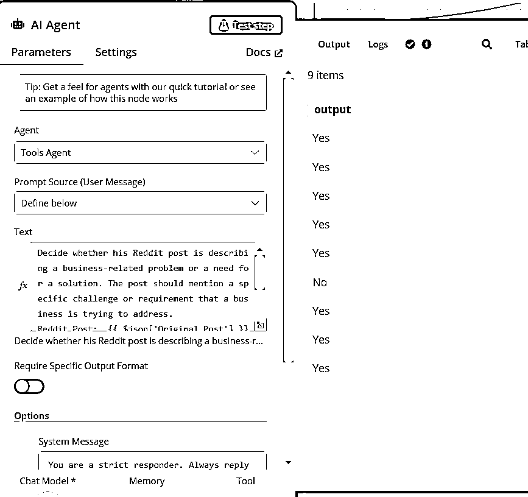

第四个环节，把判定为“否”的直接丢弃，只放行被模型认可的那些，进入下一步处理。接着往下走的共有八篇。

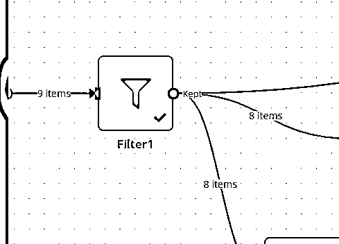

第五个环节，给这些内容再做三项加工：提炼出中心议题，将原文翻译为中文，再结合具体困境给出可行的切入方向。

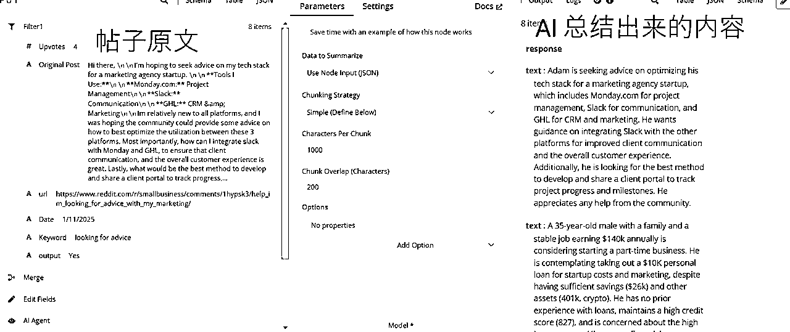
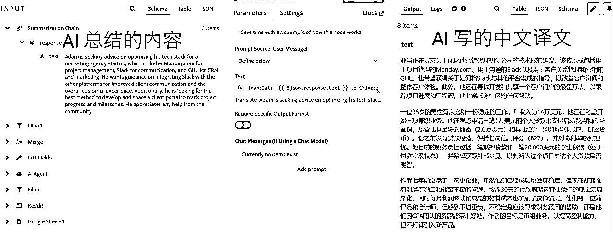

除此之外，每条内容还会额外得到进一步的创意启发，相当于把“这个用户在抱怨什么”升级成“我们可以为此做点什么”。

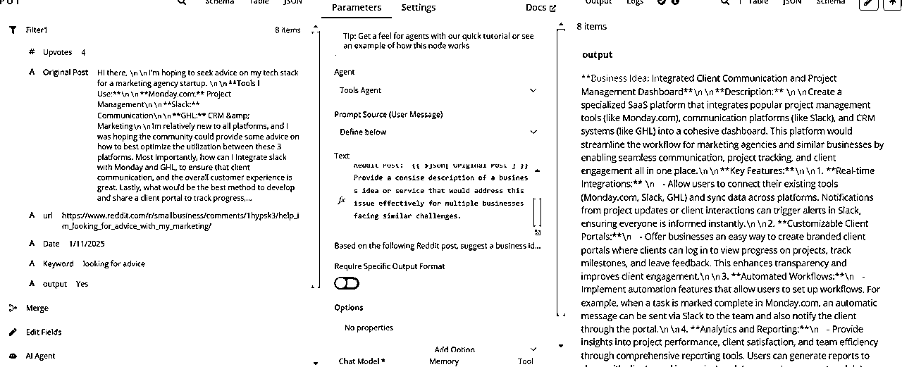
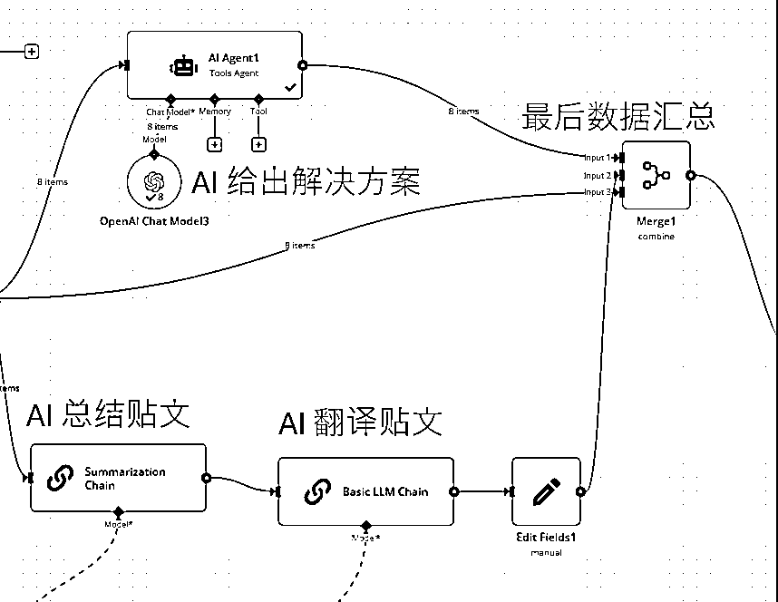

第六个环节，把原始帖、内容摘要、中文译文和构想出的方案统一归档，定时同步到Google表格里。之后打开表格，一切一目了然，不必再回到原帖翻找。

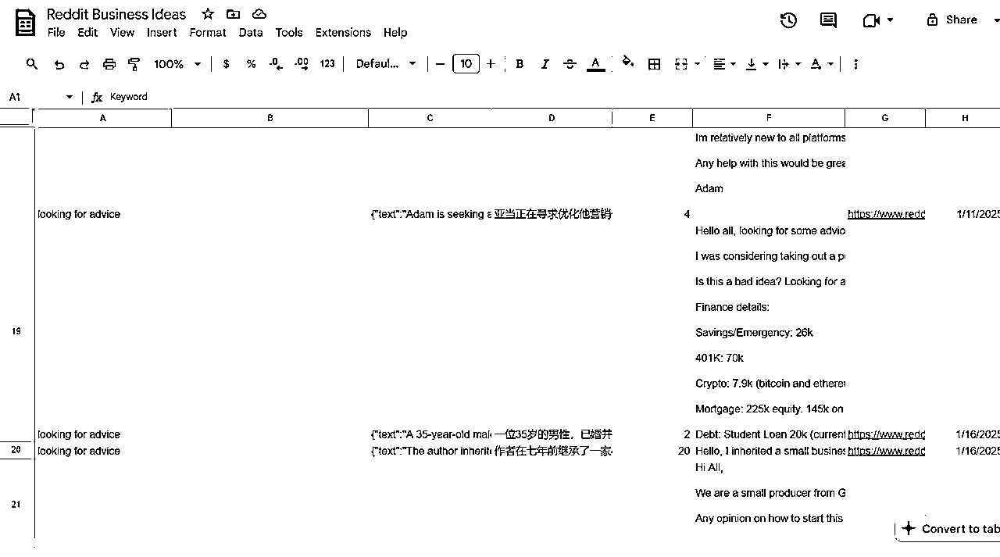

工具层面，我选的是 n8n。它是一个开源偏重逻辑串联的编排平台，核心由 LangChain 支撑，做这类带判断和循环的任务很顺手。如果你用过Make这类集成平台，会发现它处理简单串联还行，一旦牵扯多层判断就不太够用；n8n在这类场景里显得更从容。同时它也能部署在自己的服务器上，数据隐私更有底气。和Dify相比，两者定位有些接近，就看个人操作习惯。

等这条链路完全跑通后，我有一种很深的体会：它的价值不能简单看作一件工具，更像一条可以不断外接功能的需求处理产线。你可以顺着它长出很多玩法。

比如，让流程在处理完内容后随机撰写一段短文，发布到自己的网站；也可以把帖子连同评论区内容一起抓取下来，组成一个可随时查阅的档案库；还可以让工具主动出现在特定帖子里，代为回复，或者在合适的时间点发布新内容。

当然，任何自动流程都受到同一个约束：模型给出的答案有时会飘，不够稳定。想让成品质量可靠，必须把指令模板设计得很清晰，规则写到位，别给它太多自由发挥的空间。这是这次实践里我最想分享的一点。

我是四喜，感谢阅读，欢迎一起来交流更多想法。