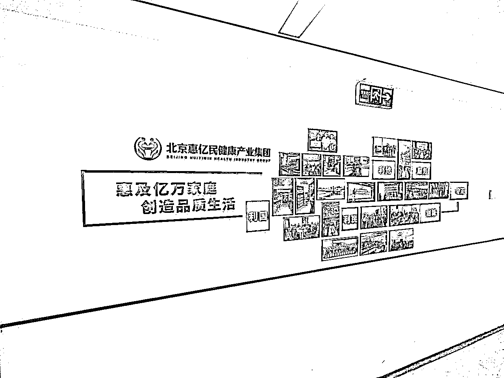
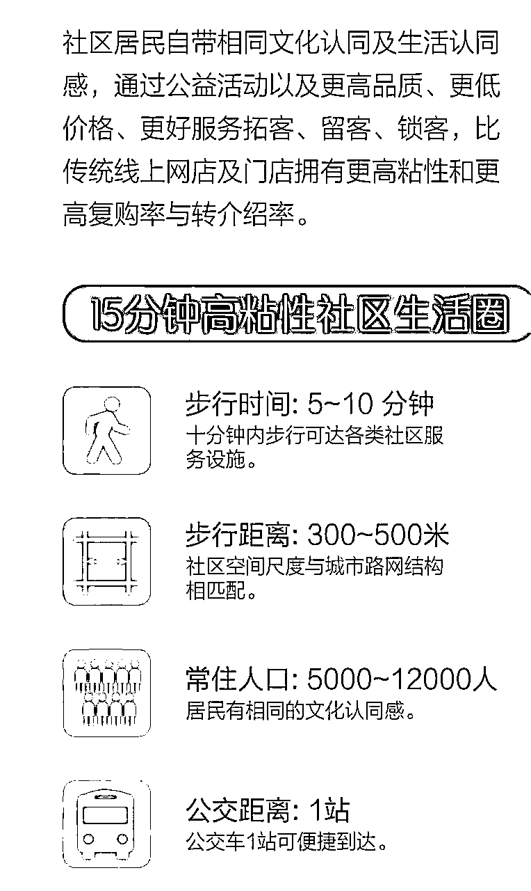
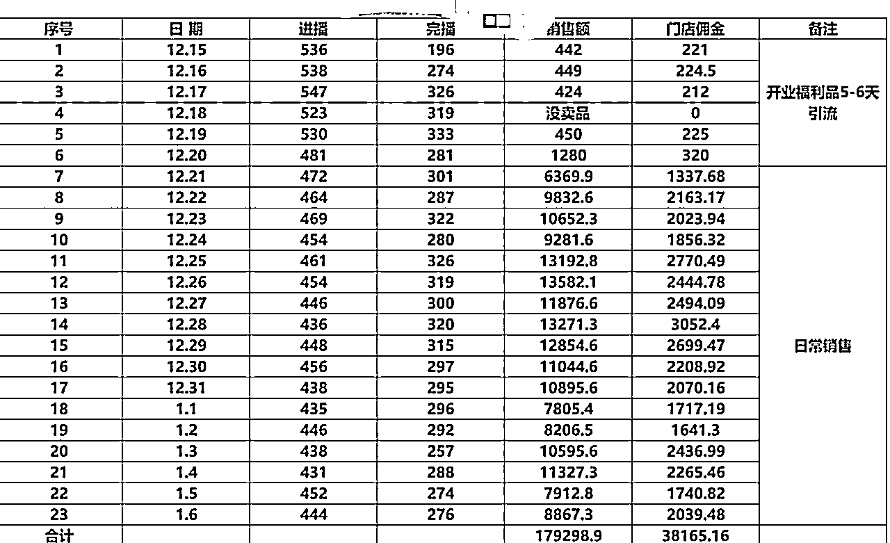
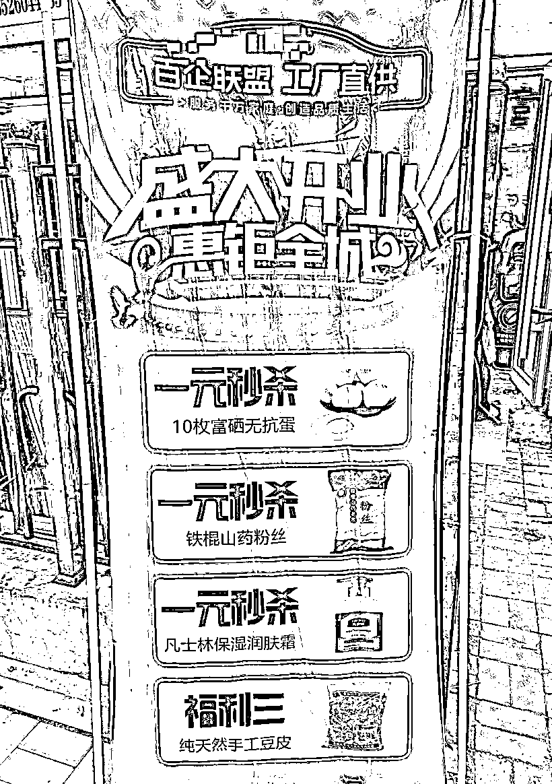

# 热度持续的私域直播，到底在玩什么 
作者：龙哥

近来私域直播的话题在行业内被反复讨论。据业内人士汇总，单年营收破百亿的玩家已出现多家，数十亿体量的有数十家，破亿的更是遍地开花。圈内普遍的判断是，这个赛道的总盘子未来有望突破万亿量级。

与此同时，质疑声也一直存在。有观点认为这是针对中老年人的营销套路，货品质量参差，专门收割银发群体。为了验证真实情况，我实地走访了多家社区门店，也探访了一家头部私域直播平台的总部。实地感受是，商品品质和服务水准普遍在及格线之上，并非外界传言的那么糟糕。归根结底，这本质上是中老年客群的一块流量洼地。行业里既有踏实做事的团队，也有浑水摸鱼的，不宜全盘否定。面对新业态，与其直接站队否定，不如先弄懂逻辑。

换一个视角看，私域直播的核心是在为同城线下实体赋能。也可以理解为“同城社区小店的增值业务”，用直播的方式让社区店的生意盘活起来。

再往下拆，私域直播更接近社区团购的利润增强版、银发专属版。逻辑是先用送鸡蛋、送红枣等低门槛礼品，把社区小店周边三公里内的中老年用户吸纳到私域池里，再把原本线下做会销的那套方法论——先赠礼、再办讲座、最后转化——平移到线上直播间，售卖保健品、康养旅游、地方特产等毛利较高的品类，最后通过到店自提完成履约闭环，单店模型也就闭环了。

为什么这套打法有支撑万亿想象的底气，我从五个维度展开。

**1、团购集采加到店自提，让电商效率被重新定义**

团购是电商历史上的一次关键分岔。美团、拼多多、聚划算以及后来的直播电商，都带团购的基因，这几年也让阿里感到相当压力。

用黄峥的说法理解，传统电商本质是把义乌小商品搬到线上，流通信息透明化后线上卖家竞争白热化，但后端生产的供需脱节问题并未解决。黄峥提出的“倒立资本主义”是思路反转：过去穷人向富人买保险转嫁风险，那么普通人能否把自己的购买需求提前打包卖给生产端，先把一批人的需求汇总成确定订单，再去匹配供给。这样后端资源配置的效率会大幅提升。

团购就是让需求提前确定化，后端工厂可以根据相对确定的订单排产，效率远高于传统货架模式。

拿生鲜链路举例。农户种出西红柿后采摘，中间贩子收走，到批发市场流转，再由另一批小贩进货摆摊或入店销售。链路中每个环节对最终销量都只能估算，经验判断为主，缺乏确定性，资源配置必然次优。

而集采加自提带来了两点质变：一是需求可预测，比如明确要采购多少斤苹果，整条链可以按需协同；二是链路被压缩，产地到供货商到仓储到社区门店，环节减少后物流费、采购价、客单价都下来了。这正是社区团购的创新，也是私域直播能跑通的底层原因。

**2、以社区门店为支点，用信任和服务把获客成本拉低**

章燎原曾说过，中国过去四十年的商业格局由人口流动决定，而接下来五到十年人口流动速度会放缓。城镇化让商圈人口密度提升且更稳定，原本养不起的业态现在能立住，围绕社区的新商业形态会加速涌现。

私域直播就是这一趋势的典型案例，以本地店为抓手服务周边中老年客群，本质上等同于社区团购加银发人群。

本地店获取流量有三大天然优势。

第一，周边人群集中，区域流量具备爆发潜力。只要在一个商圈里渗透到约10%的人群，自然裂变就能启动，而人口密度高让这一比例容易达成。

第二，店主自带信任背书。社区店经营超过三个月，附近的中老年人基本都认识店主。熟人信任带来的转化成本远低于冷流量投放。

第三，自提场景自带服务触点。中老年人对产品使用常有困惑，尤其是独居老人更需要有人指导，服务过程本身就能增强粘性。

综合这三点，送鸡蛋、送红枣这类低成本引流方式就能把附近的中老年用户批量沉淀到私域。一个门店沉淀两千人，直播时千人同时在线，月成交五万到十万是常见区间，因为售卖品类普遍毛利较高。

我曾看到一个杭州样本的数据，400家店的单月GMV约三千万，毛利区间在30%至40%。这个模型的数据表现相当扎实。

**3、银发客群是基本盘，人口基数与支付能力双重充足**

国内60岁以上人口已接近三亿，人均储蓄约26.8万。这是一块被长期低估的市场，且中老年是“更舍得为自己花钱”的群体，在健康、旅游、文娱等方面的消费意愿很强。

同时银发人群的消费心态在升级，从过去的省钱型向价值型转变，更愿意为认可的生活方式买单，这对赛道长期是利好。

**4、线下会销搬上线上，成交效率被放大**

传统的中老年线下会销，核心是通过讲座、品鉴会等形式聚客，再用演示、试用、互动推动现场成交或建立长期关系。

受疫情影响，线下聚会受限，这套打法被迫上云。过去一名讲师一次覆盖几十到上百人，现在线上直播几万人同时在线都能触达。直播工具也不依赖抖音快手视频号的公域流量，更多使用小鹅通等私域直播工具，支持看播领红包、看播积攒积分等激励机制，让中老年用户愿意在直播间停留数十分钟。

线下会销的线上化，是一次效率维度的升级。早期打法成型后，随着产品迭代，现在的商品力显著提升，高客单品类增多，服务体验也在改善。

**5、单店模型标准化程度高，具备全国复制条件**

可复制的前提是边界清晰，单元明确才好规模扩张。

一个社区店的运作逻辑很清晰：门店入驻私域直播平台后，用送鸡蛋、送红枣的方式把周边三公里的中老年用户纳入私域；直播完成转化；店主在日常中持续运营和维护关系。闭环明确，复制难度低。

下一步的竞争会集中在拓店速度、中心化直播能力、供应链整合能力以及店主动销能力上。

**6、普通人怎么切入这条赛道**

拆开来看，主要有以下角色：

- 门店方：加入私域直播平台的实体店主
- 操盘方：负责开店和维护门店的操盘手
- 出镜方：为平台直播的带货主播
- 平台方：搭建私域直播系统的公司主体
- 供应链方：为平台提供货源和整合能力的团队

如果是实体老板，直接选一个靠谱的平台加入即可；如果是有操盘经验的人，可与实体店做联营，自己负责引流和转化；主播单打独斗起盘难度较大；平台和供应链更适合专业公司。

目前来看，以操盘手的身份与大量社区店联营，是个人进入该赛道效率最高的方式。同时运营几十家店，收益可观，关键能力在于拓店能力和为门店造流能力。

我们团队也已开始布局，成立专项小组，先自建门店跑通模型，验证后再叠加原有的赋能体系放大规模。

市场争议始终存在，尤其是关于部分商品质量的讨论。但即便只看规模，产业体量已接近千亿级别。千亿级别的市场能够存续，必然有其内在合理性。与其远观评判，不如近距离看清水深。