# 新人破0-1实录：我用小红书虚拟资料在半个月里拿到第一笔收入

大家好，我叫青城，老家安徽淮南，现居合肥。

24年8月我加入赚钱，9月攻公众号爆文没打响，12月转向小红书虚拟资料。12月11日发了第一条笔记，14日收到第一单10元，到21日考研开考前累计成交53单，收入450多元。对很多老手来说这点钱不算什么，但对我而言，这是从0到1被验证的关键节点。

圈子里还有不少卡在起步阶段的新人，我把自己这段摸索、踩坑、想通的过程整理出来，供参考。跑通一个项目并非遥不可及，只要把研究、执行、优化做扎实，成功概率会很高。希望能给你一些启示。

---

## 一、与赚钱的相识

有次和朋友聊副业，他把我引到知识星球这个平台。我第一次注意到赚钱，就是它在知识星球榜单上长期占据头部。

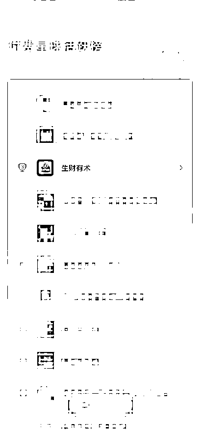
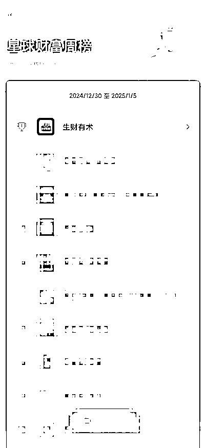
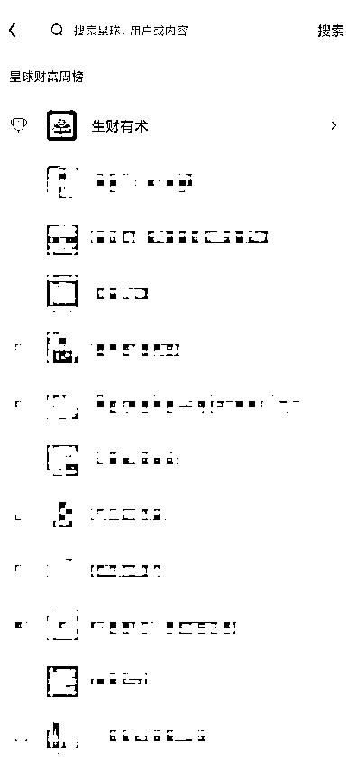

当时心动却没立刻下手。一来刚接触认知不足，二来价格不低。为了避免再被割韭菜，我在网上海搜资料、关注官方号，大概在23年10月左右才搞清楚它的价值。

此前我试过图文带货、短视频带货，均告失败。失败案例较多，文末有链接，不在正文展开。

转折点在24年7月底，赚钱号推送了圈友@辛亥的《00后大学生，加入赚钱3年如何破圈成长？》。读完后脑中冒出一个想法：我想复刻他的成长路径。

文中把一个人的成长拆得很清晰：迷茫、试错、人脉、收获、视野宽度、思考深度。这正是当时我最需要的。

当天报名体验课，一周后2024年8月8日以总积分第二名正式入圈。这个日子也颇有缘分。

入圈后我给自己立了两个目标：半年内把一个项目跑通，一年内写一篇长复盘。很幸运，半年目标提前达成。

## 入圈后的自学路径

### 先从置顶看起，却发现看不完

起初我按部就班刷置顶，包括会员活动、新人引导，感觉应该很快。

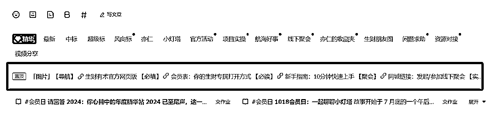
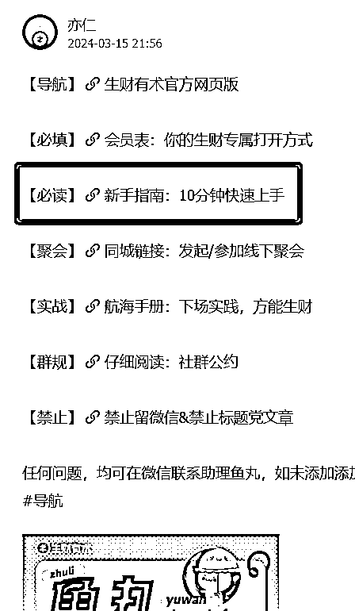
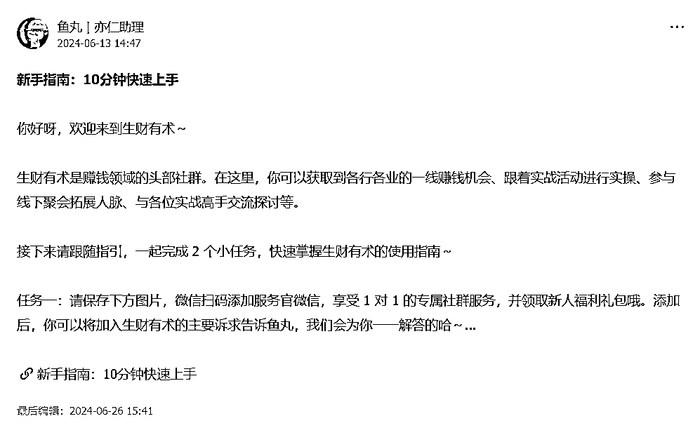

实际点开后才发现，一个链接带出一串文章，后续还有进阶指南，以及@罗卜、@七小整理的资料库，根本无力吃完。于是我选择精简。

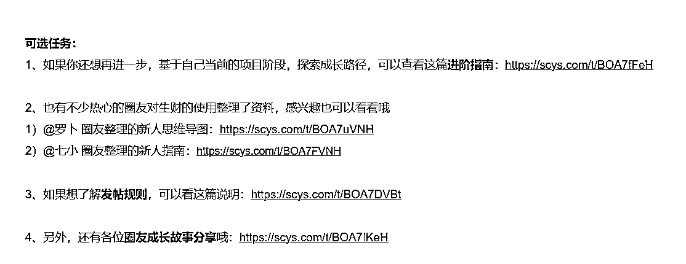

### 聚焦核心板块学习

新人指南啃了半个月，我决定舍弃过于复杂的、当前用不到的信息。先建立全局认知后，主攻精华帖、风向标、航海、聚会这几个板块，准备报名9月航海。

### 信息焦虑的出现

浏览精华帖期间，满屏“月入过万”“年入百万”等标题，久了会产生焦虑，觉得不快点变现就晚了。

所幸9月平台开始整顿标题党，后续这类内容减少。但焦虑期确实干扰了判断，花了段时间才平复。

### 如何走出被动焦虑

我把信息焦虑理解为“害怕错过而造成损失的幻觉”。长期被动接受信息灌输，只会越陷越深，最终导致行动瘫痪。

调整后我只看去标题化的精华内容，并主动控制信息来源与摄入量。焦虑感逐渐下降，由被动接收转为主动检索。

关键转变是停止追求面面俱到。赚钱的信息体量巨大，不可能全吸收。没看到的就让它过去。缓解焦虑的核心是主动搜索一个具体问题，由点及面归纳整理。非当前目标的信息直接过滤，精力有限，无需为未知焦虑。

---

## 二、9月航海，公众号爆文为何失败

### 选择理由

我对自己比较清醒，只能从上手难度低的项目积累经验。当时鱼丸分享的项目库海报里，每个项目都标注了难度。小红书达人变现和公众号爆文是唯二的一星难度。

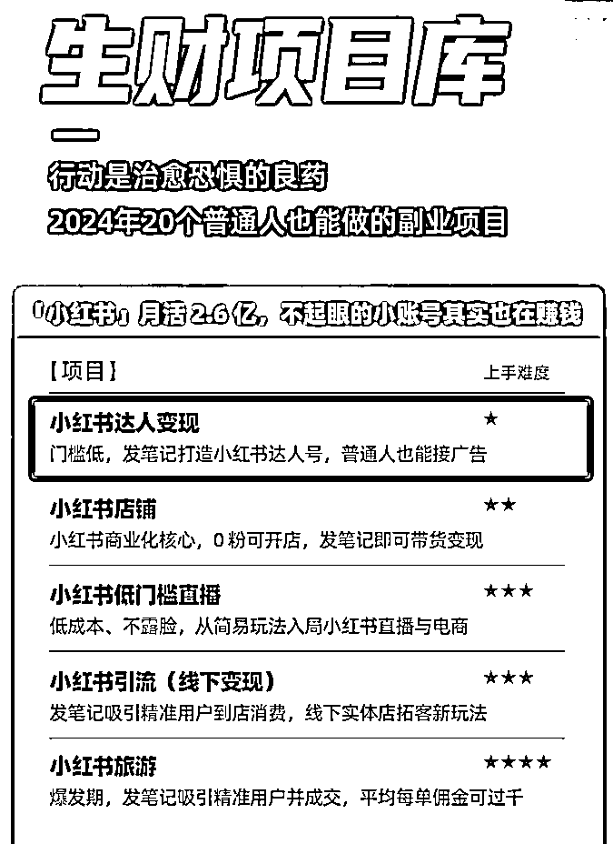
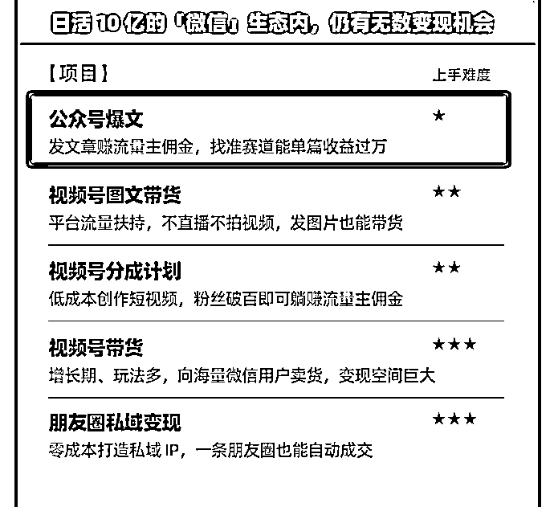

另一个原因，公众号爆文是23年5月就开启的航海项目，存续时间长、门槛低。且我希望借此培养写作能力，于是选择它。

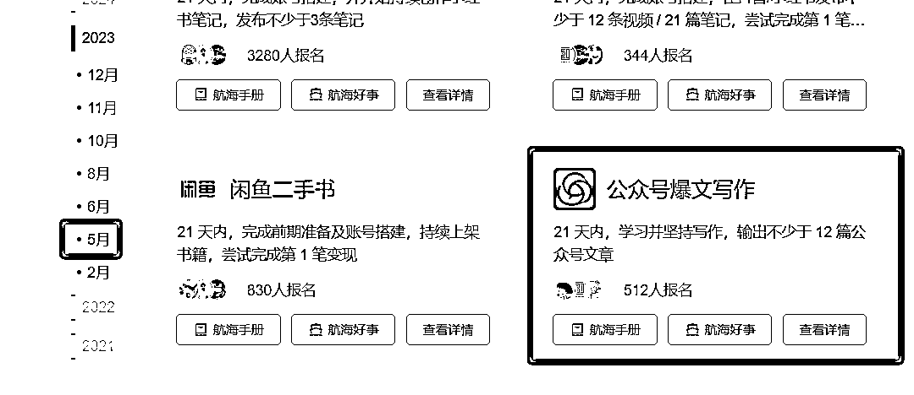

### 实际效果

我先后运营了三个公众号，做了一个半月，净赚不到两块钱。那点钱还是9月18日合肥地震赶热点时获得的。

前两个号初期用AI生成文章还有阅读，后期阅读归零。新号前几篇正常，后来三号一起发又全军覆没。可能是IP问题，也可能是内容问题。是否继续是个难题。

### 选择止损

10月底11月初，我参加了两场合肥线下聚会，听了@张波老师和@阿乐老师的分享。

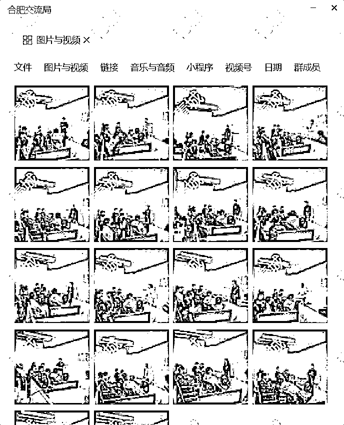

总体判断：公众号爆文赛道竞争激烈。AI写文工具迭代快，不持续尝试新玩法就会被淘汰。也有@西西老师这类日更精细化运营单号的打法。

我反思后发现，这个项目对我有多个黑箱：爆文机制不透明，单篇ecpm不透明，且缺乏转化交付等后端环节。可控点太少。

本质是我读不懂爆款逻辑，无法驾驭。圈内有人做成，但我不能忽视不适配的事实，于是停止。

---

## 三、12月航海，小红书虚拟资料如何跑通

### 项目选择逻辑

安徽圈友群里@小花老师提到，他在6月线下聚会上听@汤不知老师讲她在做的教育类虚拟资料项目，后来小花也上手了，效果不错。

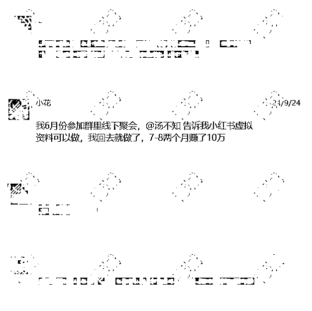

巧的是10月底聚会中两人都有分享。身边有可参考案例，加上小红书用户生态数据不错，我决定报名12月小红书虚拟资料航海。

回头看，选项目其实简单：从简单流程、案例多、自己感兴趣的入手。翻阅往期航海手册就能建立认知。若考虑可操作性，看引流、转化、交付能否自己掌控，跑通对能力提升很大。

### 赛道调研与对标确定

### 最终锁定考研赛道

学习手册时，我在小学和考研间犹豫。手册和@希平教练直播都提到选熟悉领域。若纠结可先做小学。

教练还分享过跑通项目的六步：定赛道-同行研究-确认业务路径-准备产品-拉流量-做转化。

我先想做小学，去小红书看了笔记和对标，发现内容陌生也不感兴趣，想起未来要与家长沟通就退缩了。

转而搜索考研，发现是自己熟悉的领域，有过备考经历也有兴趣。于是决定做考研赛道。用“想不想做、能不能做”作为筛选标准，调研后答案自然清晰。

### 考前一个月还有机会吗

起初我盲目刷对标笔记，直到要包装账号才发现简介无从下笔。这才意识到没做同行调研、没明确业务路径，于是回头补课。

盈利空间要看同行。教练说照做就好，但照做的对象需要验证。我花两天时间找到30多个账号，剔除纯免费分享、引流机构、盈利模式不清的，剩下5-6个，加微信研究私域并估算收益。

最终3个微信属同一团队，有效案例剩3个。分析后现阶段卖英语作文模板和政治大题可行。对标账号近三个月的收益稳定，其中一家店铺售作文模板估算月利润6-8万。汇总成表。

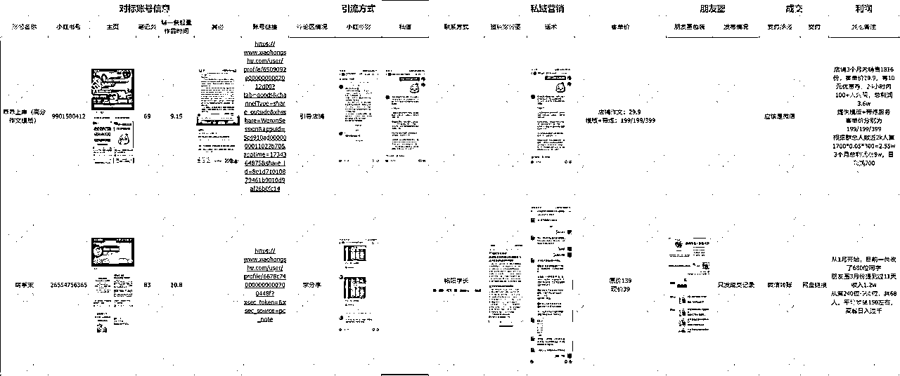

样本不大，但足以判断行情。我没有继续深挖，一是临近考试时间紧，二是想先发笔记，边做边完善。

调研总结：

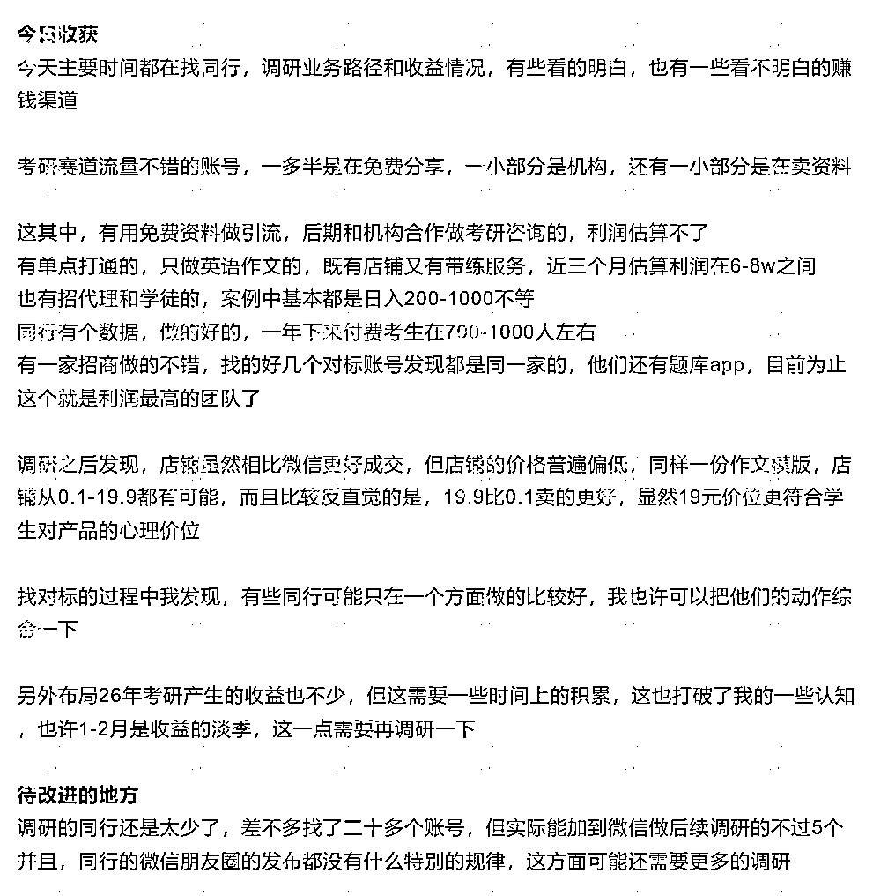
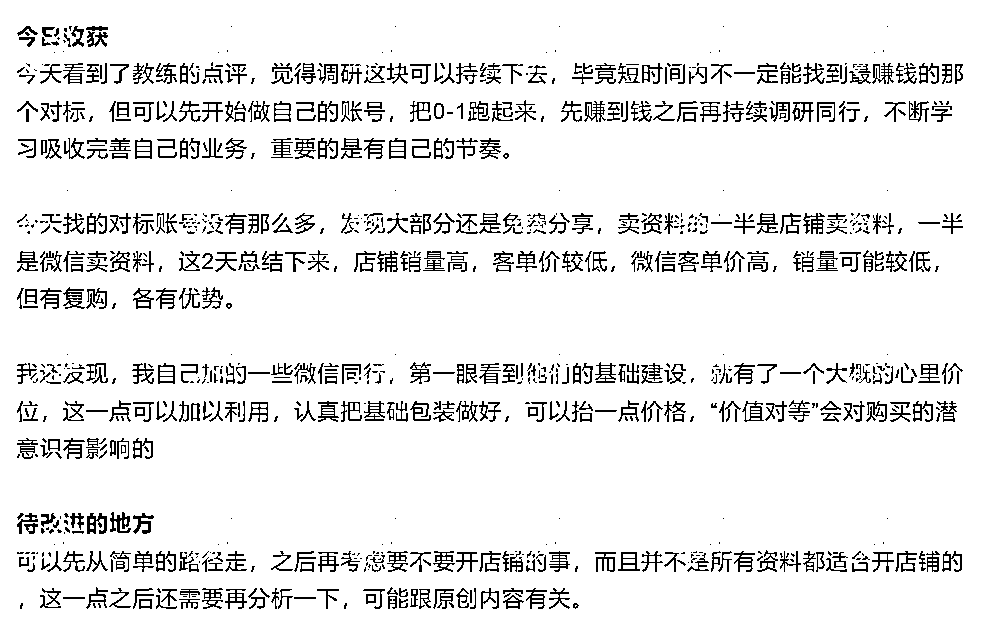

### 对标账号的挑选方式

#### 笔记内容对标

我把刷到的高数据笔记整理成表，从30多个账号里筛选出粉丝一万以下、起量笔记在三个月内、近半月互动>1000的约17个账号，约60篇笔记，按发布时间和账号名排序。

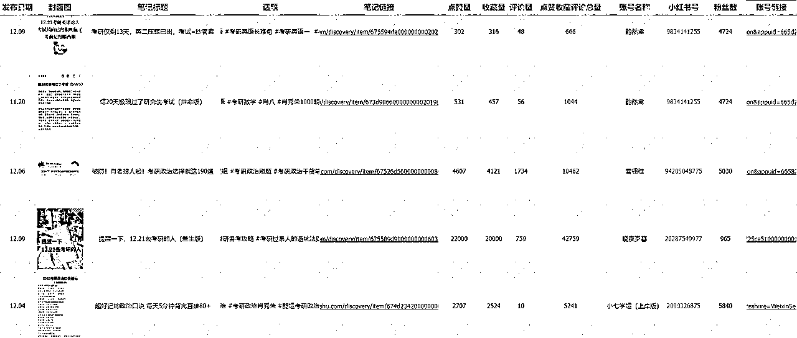

最初设想每次发文前从中找封面类型，模仿做低粉爆款，后来策略改变，后文解释。

#### 引流与包装对标

引流方式参考同团队做法：建群、关联笔记、评论区引导私信、群内发布带微信的短视频。头像、昵称、简介、朋友圈背景也做了参考。对方朋友圈多为成交记录和收徒，规律不强，未重点参考。

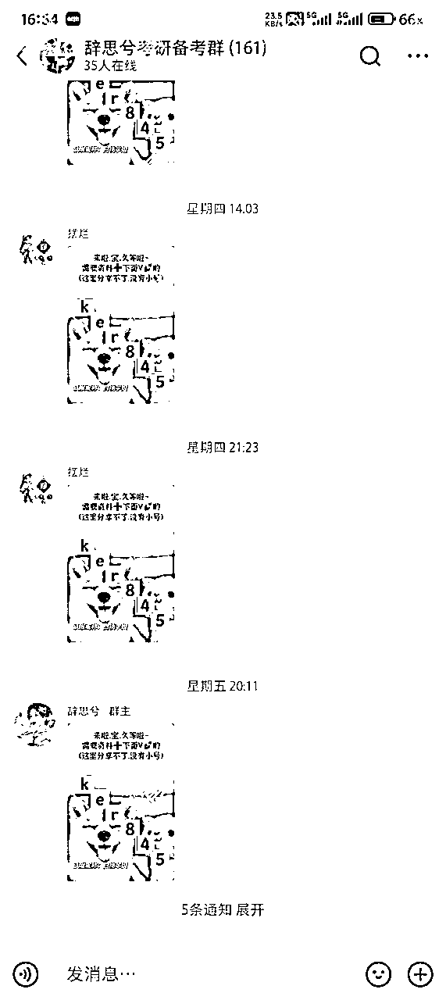
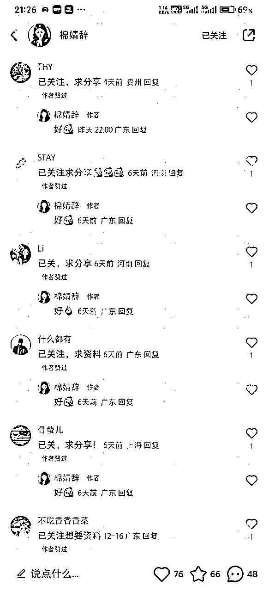
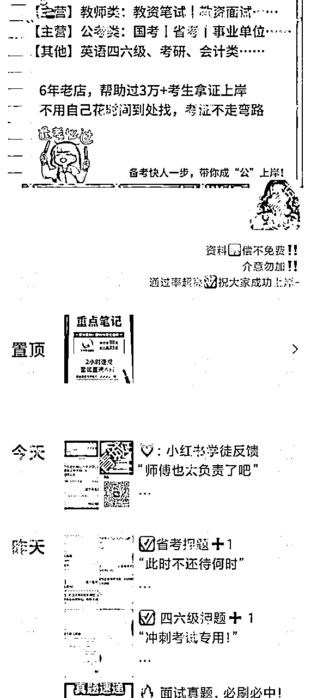

#### 私域话术对标

话术参考加过的几家微信，整体大同小异。草台班子搭建完成，开始实操。

### 实操中的问题与改进

### 笔记发布与流量

起初我二创低粉爆款笔记，发出去数据平平，而对标账号发类似内容却大火。

深入研究发现，对标并非简单搬运，而是提炼爆款底层逻辑做轻度原创。差距立现。但即使模仿几次，流量仍低。

我意识到追低粉爆款不确定性高。

重新分析表格，发现对标账号封面频繁更换，流量波动大。虽然偶有爆款，但我承接不了大流量，除非做店铺，否则无法变现。

我需要稳定持续的流量。

再次筛选，锁定三个封面风格固定、可自行制作、近期流量稳定的账号。运营时长可能超过三个月甚至半年，但只要近期稳定就值得参考。

选定的三种封面及我做的轻原创：

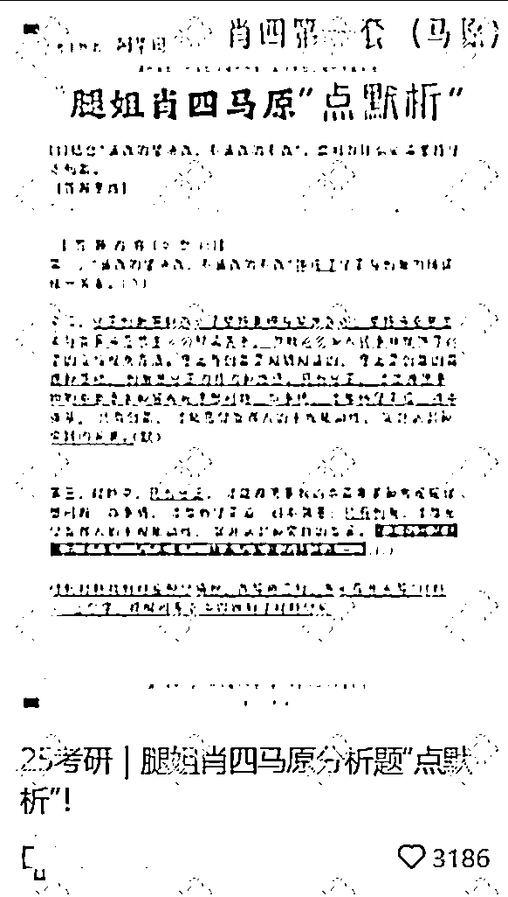
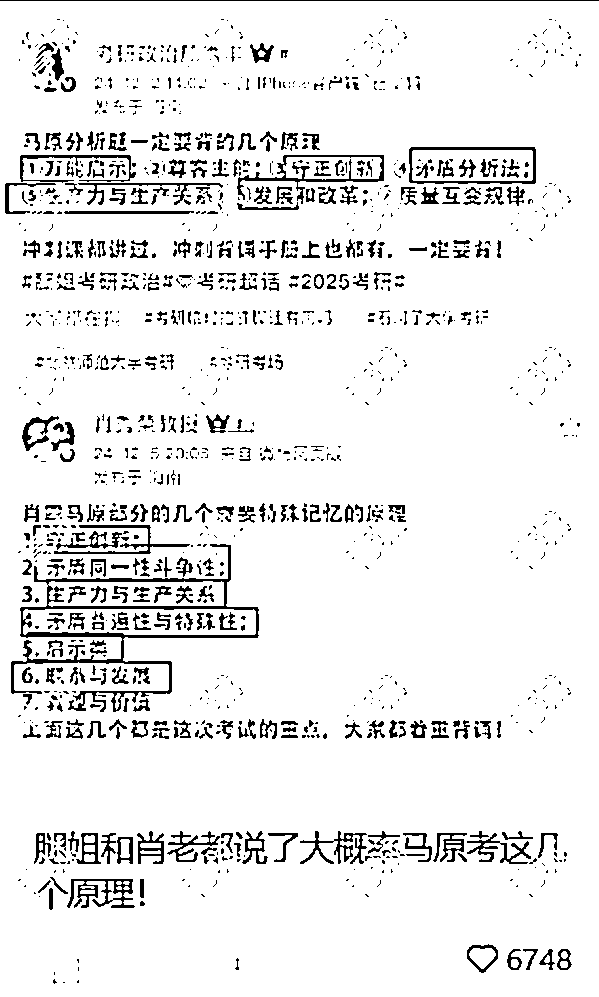
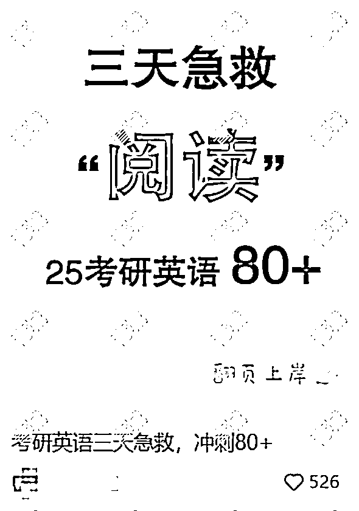
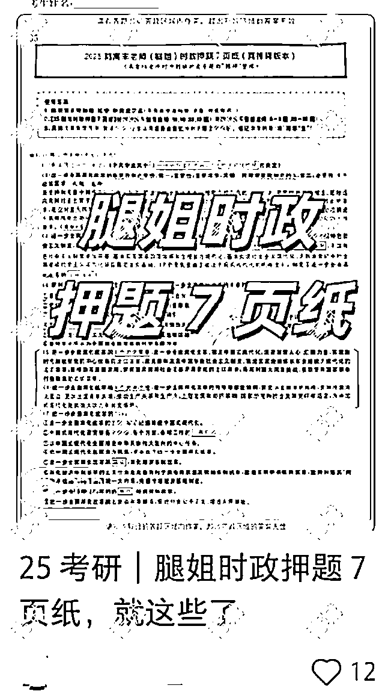
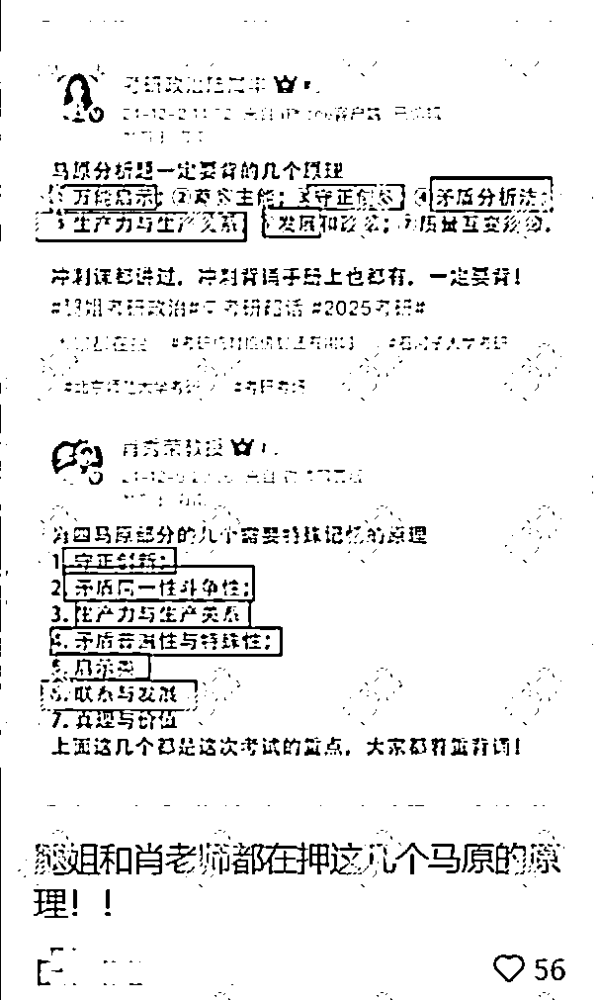
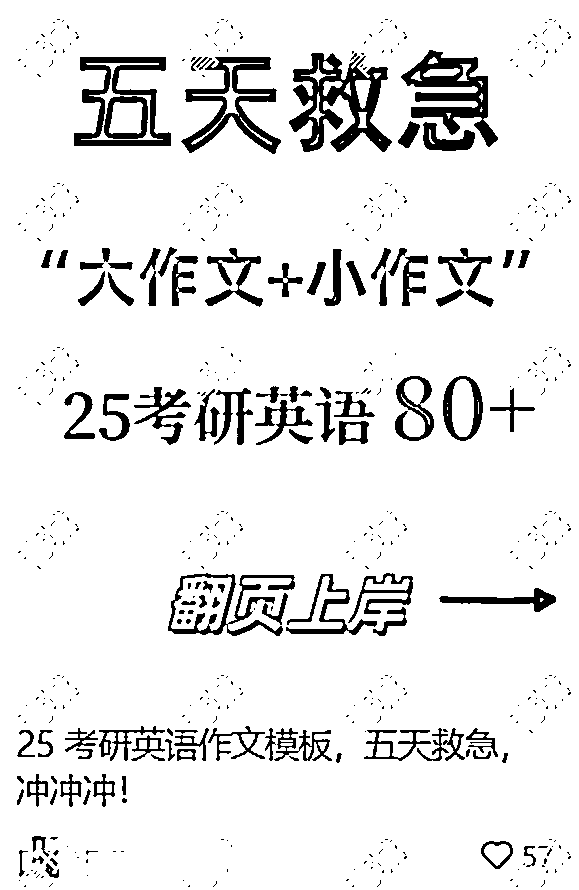

第一种客资稀少；第二种二创流量可观但无客资；第三种客资持续增长，搜索流量一直到考前，发文第二天即成交首单。

判断方向正确后，我放大第三种封面形式，其余账号内容统一换成英语作文，同时测试其他封面。

遗憾的是测试均失败。一个账号停更，部分原因是工作期间频繁换手机不方便；另一个账号后仍回退到第三种封面。

全程笔记未真正爆发，最高阅读6k+。

考前两个账号共发15篇同类封面笔记：1篇超5k，3篇超1k，5篇超500，3篇因违规被隐，正常篇均不低于200。总量1.5万阅读，进群250人，加微信104人，引流率41.6%。

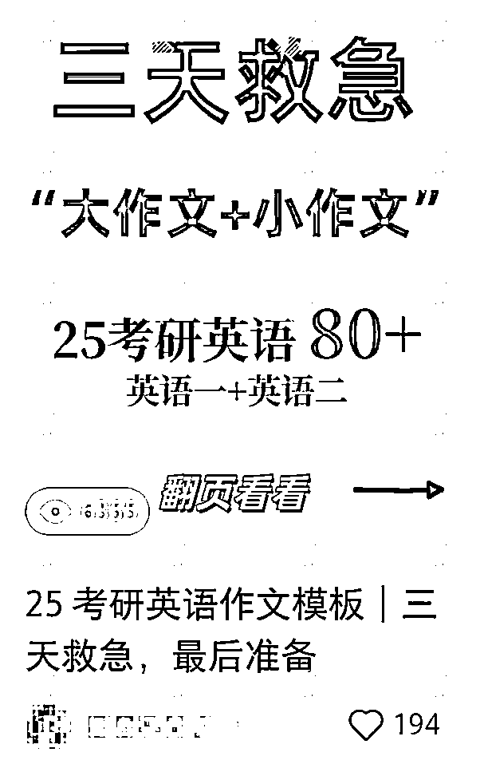

### 引流链路优化

参考对标，我建群命名“25/26考研资料群”，开放加入，可查看历史消息，关闭成员发言。

无引流小号，我自制引流短视频，每1-2天重录一次以防被检测，就是手机录屏。

笔记末页留钩子如“完整pdf，扣上岸”。有评论就回“tt我”，私信发视频或邀进群，笔记点赞达10后关联群。

改进1：评论区直接粘贴群链接，自回“这里这里❤️”。
改进2：用小号自加群，发现加群后显示群介绍，改为“25/26考研资料，祝宝子们考研一战上岸！❤️”。
改进3：修改进群欢迎语“可看置顶视频哦~(¯▽¯~)，英语作文万能模板一二都有，祝大家考研顺利٩(๑^o^๑)۶”。进群者会被@，他人不被打扰。

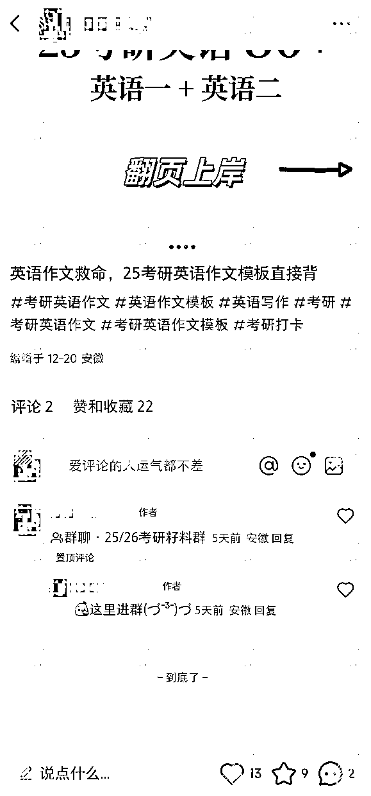
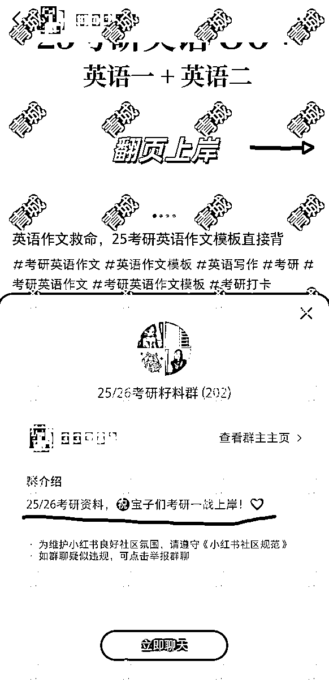
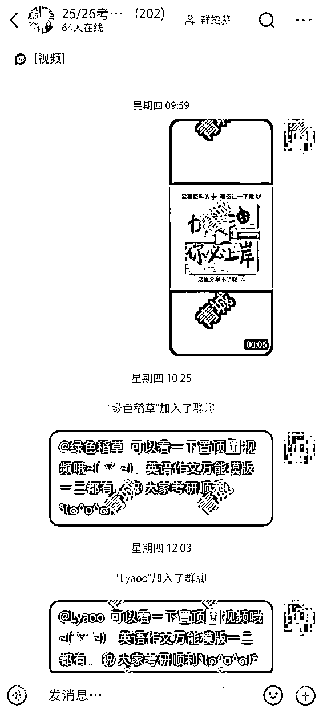

至此形成完整路径：看到笔记→看到钩子→看到群→注意评论链接→加入群→看视频→加微信。效率明显提升，但评论区无法置顶，热度积累有限，需权衡优劣。

改进4：为提升评论区活跃度，笔记刚发时不挂链接，用小号先评论，待评论达到10-20条后再挂链接。搜索用户看到热度更愿意点入。

引流方式各有利弊，需动态调整。

### 微信成交的话术打磨

加微信的多为明确需求用户。我没时间也没必要发朋友圈。

初期毫无话术，直接应答，主打亲切利他。随后梳理开场白、报价、网盘链接、解释话术、鼓励话术。其余随机应变。

工作日白天不便玩手机，利用碎片时间精简对话回合。第3天成交11单，第4天20单。最快两轮成交，多数2-3轮。临近考前改为直接发文件，便于双方。

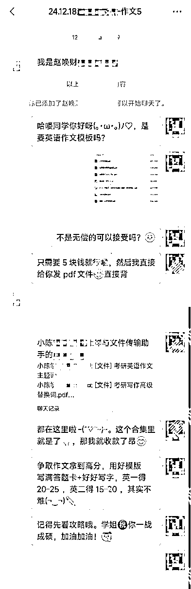
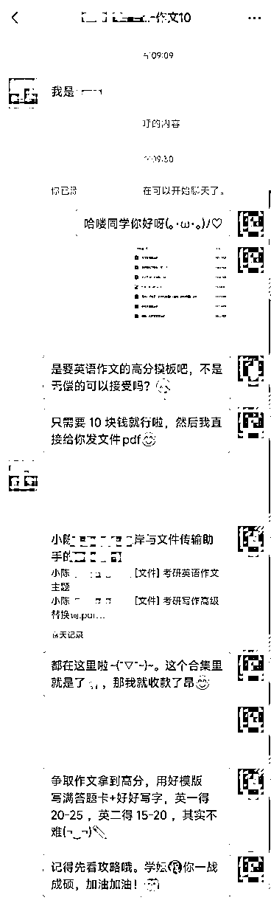
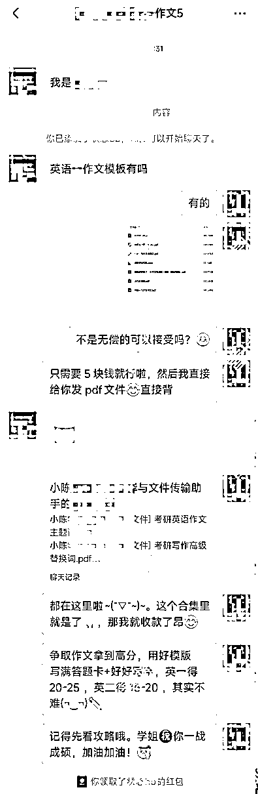

最终104人加微信，成交53单，成交率51%，GMV超450元。

我的体会是：成交的核心是让对方觉得被方便。

小确幸：考前一天及当天仍有人加微信，我直接免费赠送。考后一位同学打赏5.21元，说刚好用上，很暖心。

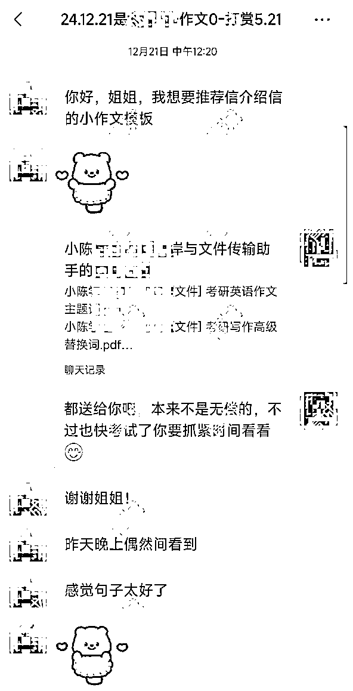

感谢看到这里。希望我的复盘能减少你的焦虑，增加行动。0-1并不轻松，但只要选对赛道、拆解步骤、踏实执行并持续优化，你也能拿到第一单。

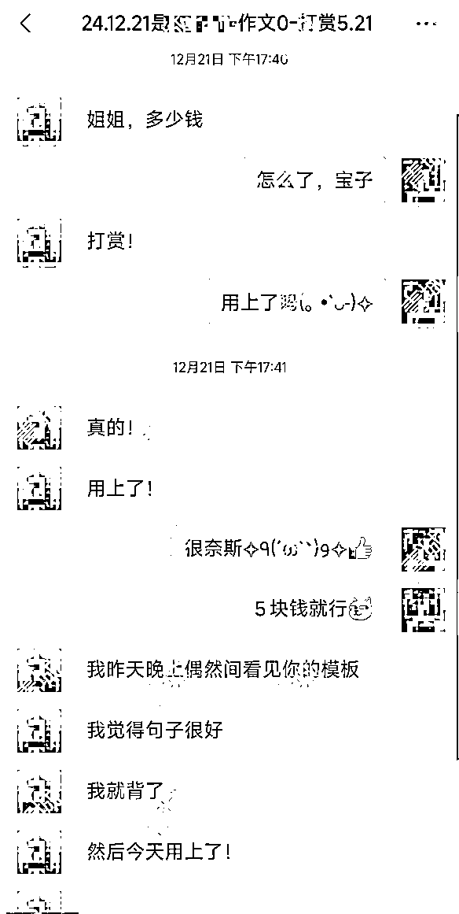

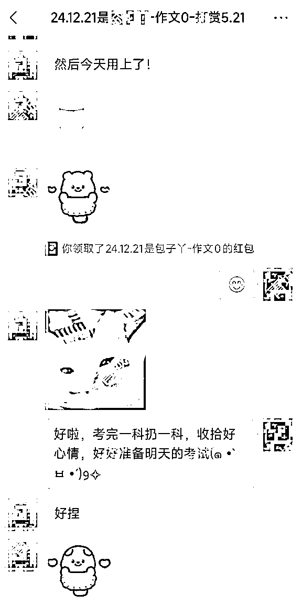

# 从0到1跑通项目后，我复盘了这7个关键发现

很多人问我，做项目到底该复盘什么？总结什么？

我的答案是：把每天遇到的问题、同行的新动作、自己业务的漏洞，全部过一遍。然后第二天去验证，去调整。

这段时间我一直在做这件事——想清楚成交的每一个环节，然后把它们一个个测试、打磨。

## 1. 先跑通闭环，再谈优化

别一上来就想着把每个环节做到极致。先把“从看到笔记到完成付款”这条路走通，哪怕走得磕磕绊绊。跑通之后，你才有资格去谈：怎么让更多人进群？怎么让笔记数据更好看？怎么在不违规的前提下加到微信？怎么让客户掏钱更爽快？怎么把客单价再往上拉一拉？

## 2. 每天盯着数据，别凭感觉做事

我真正开始有成交，也就这一周的事。每天我都在问自己：哪个环节还能提速？哪里还有漏洞？同行在评论区出没了，赶紧维护；自己的笔记踩线了，马上隐藏，发下一条。

我每天固定统计：笔记数据、进群人数、加微人数、引流率、成交数、转化率、GMV。然后分析这些数字背后发生了什么，拉长时间线去看趋势，再倒推策略调整。数据不会骗人，没数据才是最大的风险。

## 3. 我亲手测出来的几个“小规律”

- **发笔记的时间**：我试过早上8点、9点、10点、中午12点、下午2点、4点、晚上8点、10点。实测下来，上午发流量更友好。当然，换个赛道可能结果完全不同。
- **投流有没有用**：我专门测了一个上午，结论是——对搜索流量的带动，几乎可以忽略不计。
- **加微的高峰段**：统计了几天数据后发现，集中在上午9:30-11:30、下午1:30-4:30、晚上6:30-11:30。这三个时间段咨询的人最活跃。

## 4. 为什么考前成交率反而更高？

我把自己和同行的数据摆在一起看，发现一个反常识的现象：离考试越近，成交越猛。因为临时抱佛脚的人会扎堆出现。同行店铺的销量是越来越陡的加速曲线，而我这边成交量往下走。

这说明什么？**越临近考期，成交链路越短，转化越容易。**

于是我意识到：如果能把链路再压缩一点，销量完全有机会爆发。我看对标账号，两周时间店铺卖出3000多份，累计5000多份，客单价29.9元，光这一个单品预估利润就有15万+，还没算上后续的带练服务。

## 5. 这套方法能复制吗？

当然能。

统计同行数据，复盘自己的每一步，分析结论，调整打法，持续优化——然后把跑通的经验迁移到下一个项目上。从0到1，再从1到10。

---

# 给还没跑通项目的你，也给自己

**第一，我的分享只是案例，不是教程。**

我没资格给建议，毕竟我也是失败了很多次之后，才第一次有幸跑通一个项目的0-1。我只是把自己怎么想、怎么做、怎么改的每一步都讲出来，仅此而已。

**第二，1万块太远，100块太近，500块刚刚好。**

刚开跑的时候我立了赚1000块的目标，最后只完成了一半。但对我来说，500块已经是莫大的鼓励。它让我相信这条路走得通，让我有底气继续做下去。从500到1000，再到更多，这中间隔的不是能力，是信心。

**第三，做项目是轻创业，创业是一场无限游戏。**

别把项目当成救命稻草，别想着“一把梭哈”“一战成名”，更别裸辞去干。把做项目当成日常工作的一部分，慢慢来，反而比较快。

**第四，真没什么黑科技。**

之前盗坤老师说过一句话，我印象深刻：做项目最核心的方法论，就是尊重常识，踏实做事，日拱一卒。时间一长，它就是最大的壁垒。

龙哥老大也说过：越急着赚钱，越赚不到；越不急，每天认真解决一个问题，长期积累，反而容易赚到。

以前我半信半疑，现在我信了。

---

以上，就是我在这个圈子里半年做项目的完整经历、跑出来的数据和踩过的坑。

感谢遇到的每一位教练、领队和志愿者，也谢谢读到这里的你。希望我的分享，能给你带来一点点启发。

（文中提到的那段不算丰富的失败经历，写在我的上一篇复盘里了，感兴趣的朋友可以往前翻。）