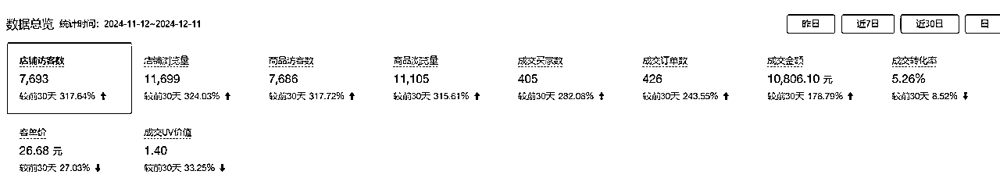
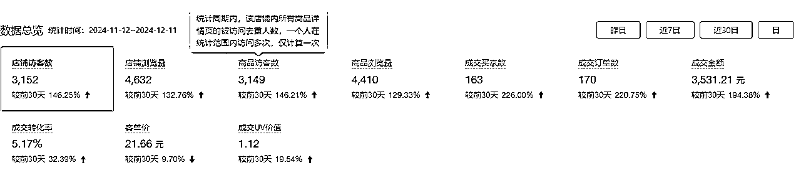
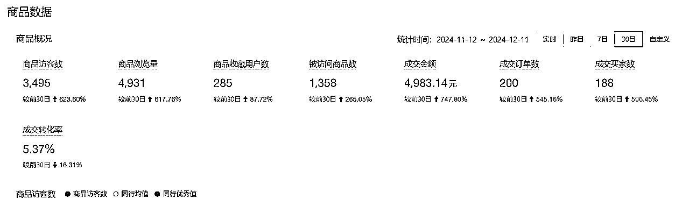
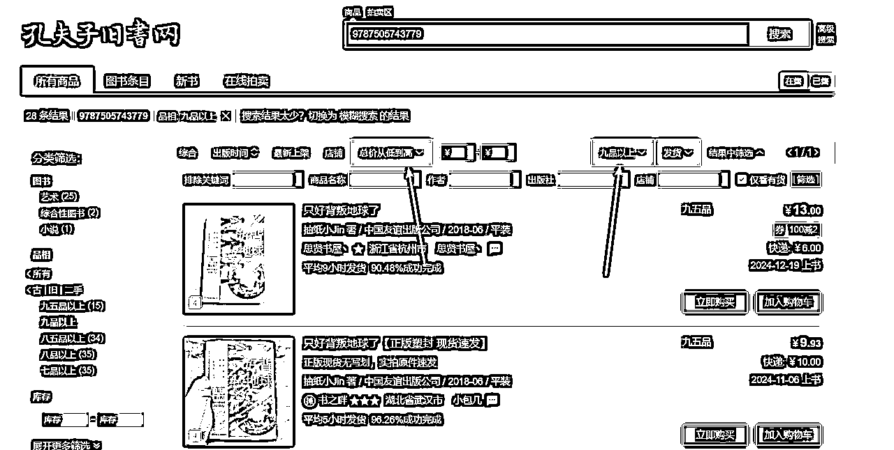
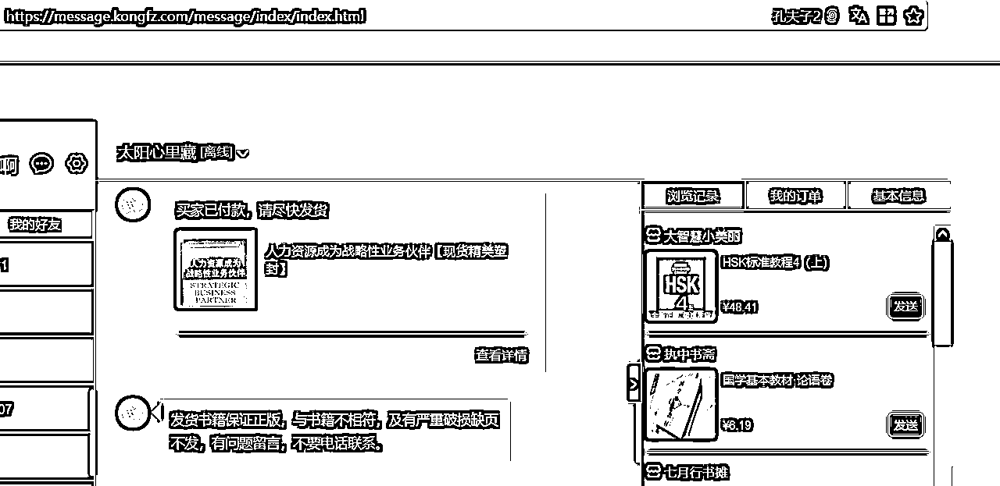
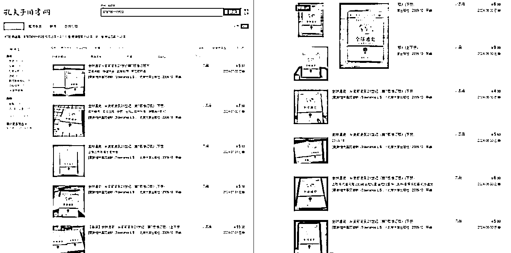
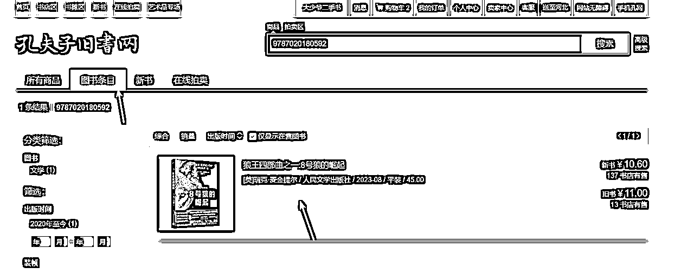
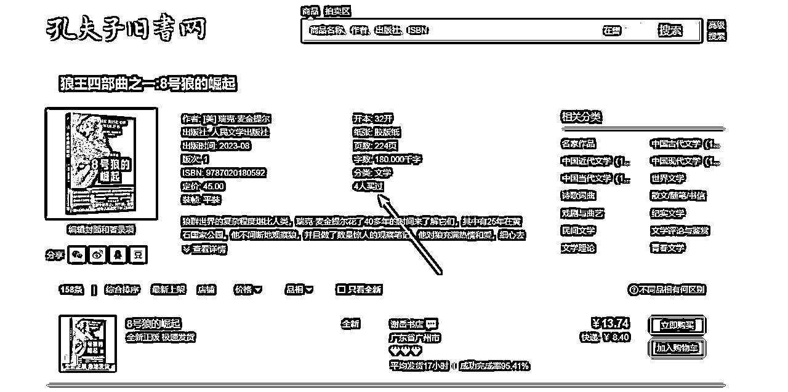
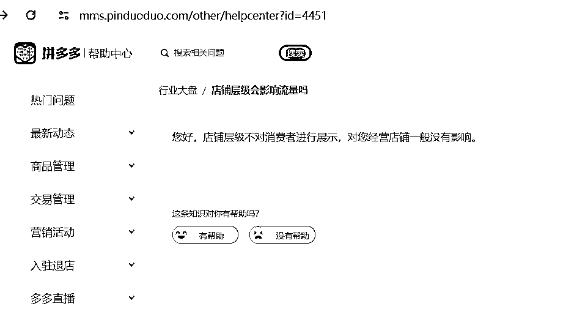
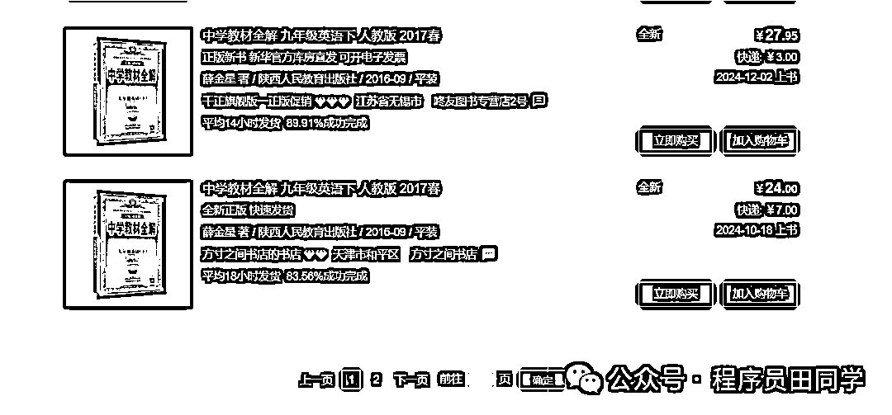

# 拼多多二手书店群实操：三个月冲到头部，我的踩坑笔记

> 来源：[https://q2srbwoeiz.feishu.cn/docx/BnkSdKB7YoK6JLxI6A6c8a0enmh](https://q2srbwoeiz.feishu.cn/docx/BnkSdKB7YoK6JLxI6A6c8a0enmh)

大家好，我是田二，在郑州，程序员出身，做过几轮创业。

现在我们在拼多多做无货源二手书已经跑了三个月了。配置是1个客服带1个执照下的20多家专营店，头部店铺月流水能过1万多，尾部店铺也有三四千的水平，单店净利润大约在20%到30%之间。

最初切入二手书的时候选的是孔夫子旧书网，大概三个月就把孔网同类卖家干掉了。后来把孔网交给全职同事维护，我开始跑平台测试。半年下来，闲鱼、淘宝、拼多多、京东基本都试过一遍。

闲鱼做零售上架量上不去，出单也少，客单低很难放量。批发单价虽高，前期咨询太多很耗精力。淘宝二手书看重店铺权重，门槛高投入大。综合下来，拼多多二手书最符合我们做店群的逻辑。

一个营业执照在拼多多能开将近30家专营店，一家店能承载10万SKU。拼多多的人流和上品容量，完全不是闲鱼二手书能比的。

有人会怀疑二手书的体量到底够不够大。实际上自从教育部明确不能强制学生买教材后，二手教材的需求就一直在线，每年两个学期都有数百万的中大专学生在线上买旧书。

## 一、货源说白了只有一处

不管最终订单是在闲鱼、淘宝、拼多多还是京东成交，二手书的货源都来自同一个地方：孔夫子旧书网https://www.kongfz.com/。

孔网是国内历史最久的二手书交易平台，比淘宝还早。平台内书籍默认按价格由低到高排列，且80%的成交其实是被代购拿走的，也就是我们这类无货源店家。

代购下单时会要求价格排序，并且明确不允许卖家电话骚扰买家。

孔网目前在售图书约1.5亿册，商家超40万，这个池子就是我们所有上架品类的来源。

## 二、选品方法

二手书在任何平台的成交数据都集中在孔网，所以研究孔网就等于研究市场。

我们常用的选品路径有两种。

第一种是看已售。孔网可以查一本书近几年的成交记录。书的背面条形码下方就是ISBN，也就是图书身份证。在孔网首页搜ISBN后点进入已售，就能看到销售曲线，比如《全球通史》。

再把左侧排序改成按售出时间，就能判断最近一年的热度。通过ISBN来判断销量已经形成标准化的SOP，把采集到的交易信息沉淀下来，就能建立自己的在售数据库。

第二种是看图书条目。搜ISBN后点图书条目，能看到累计有多少人购买过。

无论是已售还是条目，显示的都是比例而非绝对销量，但足以判断热度。

我们会把ISBN和价格整理到Excel里，长期沉淀下来就变成自己的选品库。这套库不只用在拼多多，做闲鱼二手书也一样好用，比盲铺强很多。

## 三、开店和运营细节

### 1、开店准备
拼多多卖书需要出版物经营许可证。营业执照建议用个体工商户之上的类型，比如个人独资或有限公司。普通个体户流量差而且最多开3家店，个独和公司一套照可开30家左右，这个坑我们踩过，花钱办了个体户最后没用上。

证照齐全后可直接走拼多多0元开店，上传资料大概3个工作日审核通过。保证金目前是500元，前期可以不交，等回款超过500再自动转为保证金，也能省一笔启动资金。

### 2、上品
上品很简单，去服务市场搜【图书】就能找到大量上货软件。主流的二手书上架工具都靠三个核心字段跑：

ISBN，是选品阶段拿到的；
售价，二手书定价是核心。普遍做法是参照孔网八五品以上的在售价，有人取第一名，有人取第五名，有人取一页平均价。不同定价策略对应不同的缺货率，要按自己的利润和缺货容忍度来调。
库存，一般我们只放1。卖出后去孔网核价，仍有利润就补仓。

定价公式我们常用的是在进价上先加一个固定底数再乘以百分比，比如原价+6再乘0.2。这样便宜的书不会加价过头，贵的书也能保证利润空间。

拼多多二手书有专营店和旗舰店之分，专营店可上10万品。很多同行是直接满仓10万，我们实测每天上1-2万效果更好，走差异化和精细化。

### 3、运营防断流
拼多多最怕断流。昨天几百访客，第二天变个位数的情况很常见。我们几十家店目前都没出现断流，核心是尽量合规降风险。

主要注意点：多用实体卡少用虚拟卡，少用第三方风险工具，上品数据保持精细化运营，店铺IP要干净，一证一网络。

拼多多二手书基本靠自然流量，运营逻辑很清晰：有流量没转化是价格偏高，流量低就补品，重点提升店铺层级。官方说层级不影响流量，但实际影响很大。层级主要看最近一个月销售额，1000以下1级，1000以上2级，1万以上3级，3级以上的自然量明显更好。

### 4、为什么不做投流
二手书SKU极多但单品库存极少，普遍50本就算多的了。自然一个店几十个链接不可能爆一个款，流量模型还没跑热就卖完了。

传统电商爆款可以不断补货加投流，二手书不行。库存限制天然帮我们避开了投流竞争，也给精细化玩法留了生存空间。

## 四、总结

看多了昙花一现的项目，我们更看重能长期做下去的赛道。

### 1、项目稳定性
我们不走跟平台对抗的铺货打流量路线，而是顺着规则做精细化，用心养店。二手书符合循环经济和国家减碳的大方向，只要学生买教材的需求在，电商卖二手书就不会过时。

### 2、有沉淀价值
做二手书最值钱的是数据沉淀。把全品类的销售数据收集完后，下一步我们计划做回收和仓储，从无货源逐步过渡到有仓供应链。

现在闲鱼小红书上有很多上门回收二手书的，回收回来挂到孔网卖给代购，这就是闭环。我们最终想打通平台采购、回收、仓库、销售，形成完整的二手书生态。

以上是我的实操经验，供有兴趣的朋友参考。交流可加微信：270878732