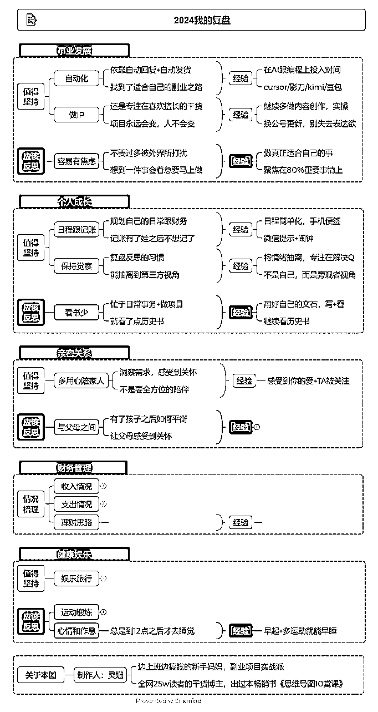
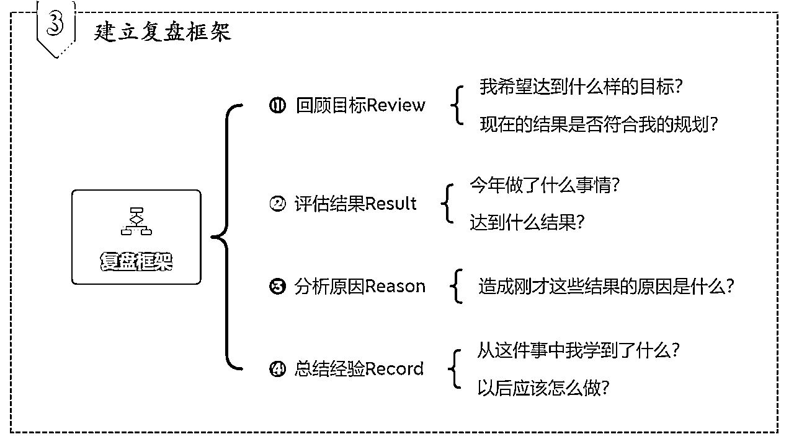
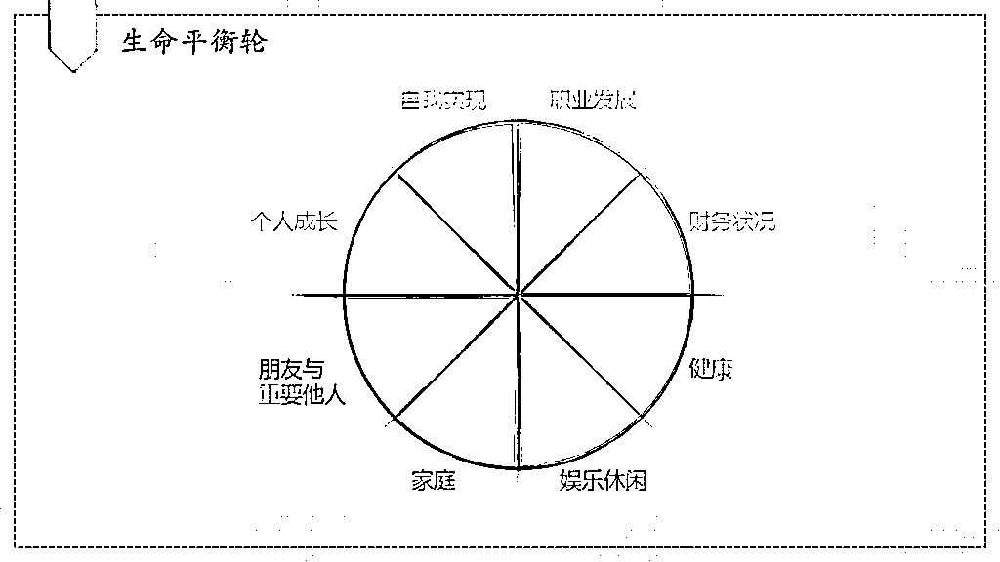
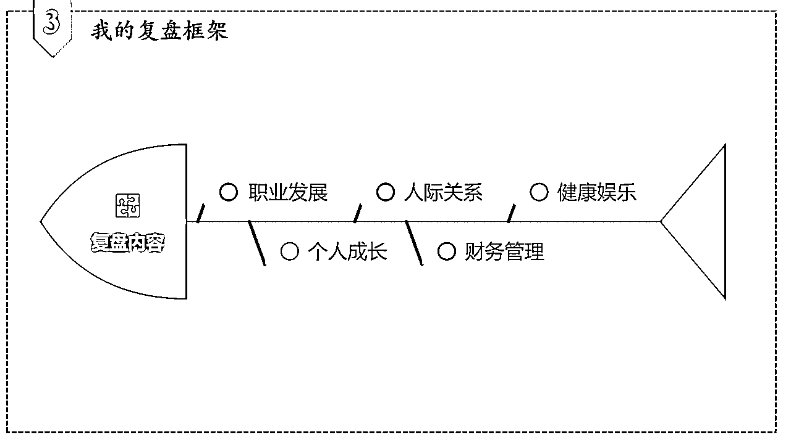

# 新手妈妈灵姗：用一张思维导图，我把2024年六位数的副业年终盘点做完了
作者：龙哥

大家好，我是边打工边赚钱的新手宝妈灵姗。

这一年摊上了太多事：怀胎十月、带娃、重返职场，同时还开起了副业，靠👸号爆款+📕虚拟店，副业流水直接破了六位数。

眼瞅着年底了，照例写年终总结吧，纯文字版的复盘又枯燥又劝退。大脑天生就抗拒大块艰巨的任务，一想到要连写三五千字就直接躺平了。

思维导图就不一样。每个分支就是复盘的一个小模块，模块拼起来就是完整的年度总结。就像先把大楼的预制件做好，再一块块装配起来，搭楼这事就轻多了。

下面是我梳理好的复盘图，隐私信息我都涂掉了，主要想抛一个思路给大家参考一下。

### 先把复盘的骨架搭起来

说白了，复盘就是回头看这段时间的行动，提炼经验教训，并把它们变成未来能用的能力，盘点越多越好。

为什么思维导图特别契合复盘？因为它就是以一个核心为圆心，层层向外发散的工具，天然适合做结构化梳理。

复盘也是，围绕一段时间的生活工作，从不同角度打开来看。下面是我自己在用的复盘骨架：

1.回顾目标 Review

我当时想达成什么？现在的结果离预期有多远？

如果你有年初立的计划，现在就是翻出来对照的好时机。

2.评估结果 Result

这一年到底干了啥，出了啥成绩？

评估时我会盯两件事：一是提升空间，跟预期比，哪些值得继续做，哪些需要调整；二是目标匹配度，今年忙活的事儿，跟短期和长期目标的重合度有多少。

日常琐事很容易把人拽进“被安排的忙碌”里，而不是“我要主动做的事”。年底就是用来校准方向的时刻。

3.分析原因 Reason

结果是怎么来的？好的要复盘，坏的要复盘。

丰田的5 Why法就很管用，对一个问题连问五个为什么，扒到根因。方法简单但很致命，多问几句为什么，才能做到对自己诚实。

4.总结经验 Record

这次学到了什么，下次怎么用？

复盘的终点不是写完，而是用起来。用过去的经验去托住未来，这才算真正复盘了。

### 解决了“写着写着就没词了”的困境

最开始我复盘经常卡壳，就是因为没框架，想到哪写到哪，写着写着就断片了。会锻炼身体、要每日复盘、别乱花钱……全是散点。

后来我借用了生涯教练常用的生命平衡轮。这个模型把生活切成八个维度：个人成长、自我实现、事业发展、资金状况、亲友关系、家庭、休闲娱乐、身体健康，基本把个人管理的版图都覆盖了。

复盘时就按这八个维度走一遍，内容自然就有条理了。

我自己觉得八个有点多，就按当下实际精简成了五个：职业发展、个人成长、人际关系、财务管理、健康娱乐。你也可以增减，看自己更关心哪块就行。

### 我是怎么画这张图的

第一步，定中心：2024年我的复盘。

第二步，向外铺一级分支。结合生命平衡轮，我确定了上面说的五个维度，作为思维导图的一级节点。精简之后思路更集中。

第三步，往外再填细节。复盘其实就两条线：一是经历里哪些是闪光点值得坚持，二是哪些是坑值得反思。

于是我套用复盘框架 review-result-reason-record 做细分。在结果评估里，我单独拎出「值得坚持」和「应该反思」两个对比点，跟预期目标做对照。

达成了，就萃取经验；没达成，就聚焦改进。最后我再加了一个「经验」节点，把前面散的结论整理成规律或可执行的行动。

收尾就是美化一下，调字体、配色、加图标，让图看起来顺眼舒服一点。

### 今年副业给我最大的启发

最大体悟就是要去布局被动收入，多条腿走路。

👸号分成和📕虚拟店今年都给我带来了稳定现金流。👸号现在是团队化批量写文，年底还上线了小程序招募作者投稿，把爆文的运气成分用数量对冲掉了，跑通了就一直有产出。

📕虚拟店更绝，我坐月子发烧躺了一个月，几乎没动，照样成交了九千多，那种躺着钱进来的感觉太爽了。

上周跟朋友聊，她说我现在赚几万块没啥感觉，躺赚几百块反倒更开心。因为那几万是辛苦换来的，天经地义；那几百是被动来的，就觉得意外之喜。

找到自己的发力点太重要了。工作里也是，会做事和蛮干是两回事，找准关键处发力才会越做越轻松。

我挺庆幸去年怀孕后被迫调整了内容创作的重度投入，当时压力巨大，没想到反而打开了更好的局面。年初我只敢想一个月赚几千，现在后面多了个零。

期待2025。

上面就是我用复盘框架+生命平衡轮搭思维导图的整个思路，希望能给你一点启发。

有小伙伴问要模板，我把 XMind 版本放到夸克网盘了，需要的自取。

我用夸克网盘分享了灵姗的思维导图复盘模板

链接：https://pan.quark.cn/s/8b0b30e58138