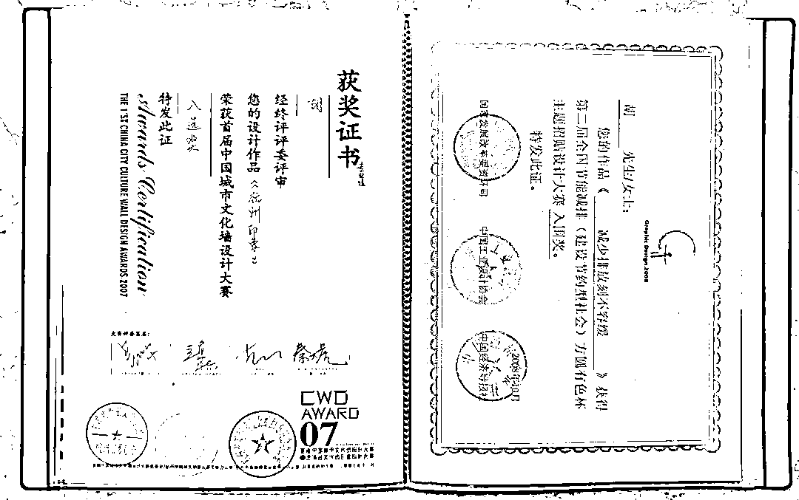
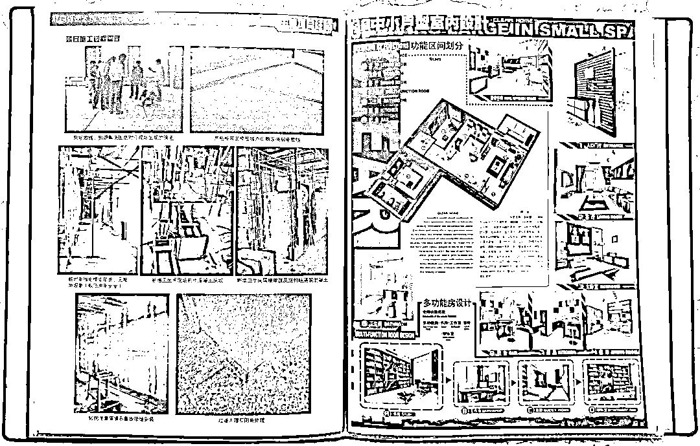
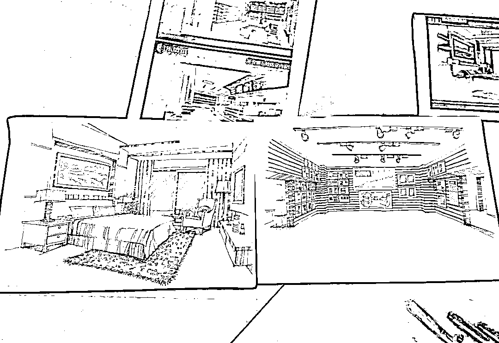
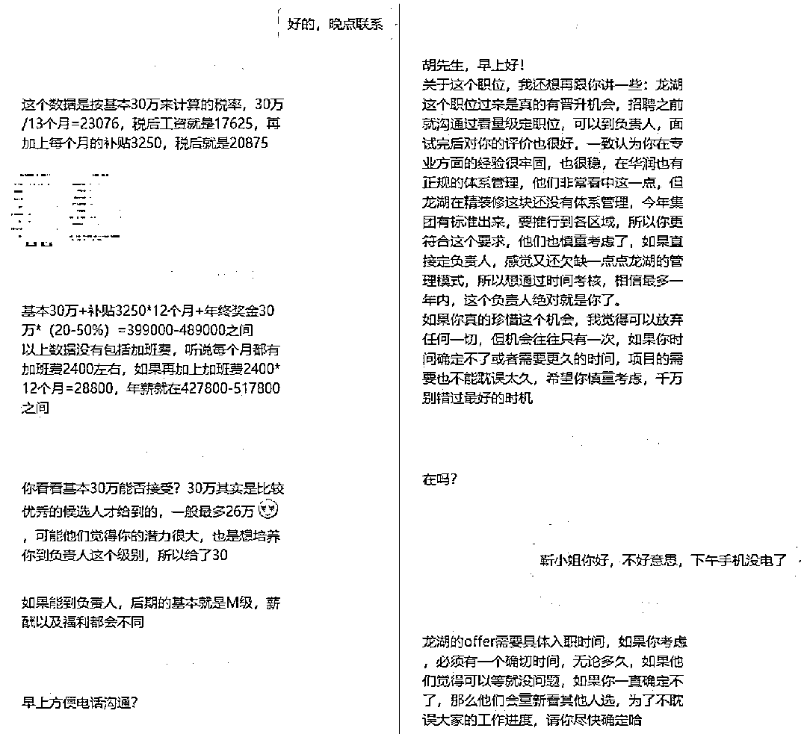
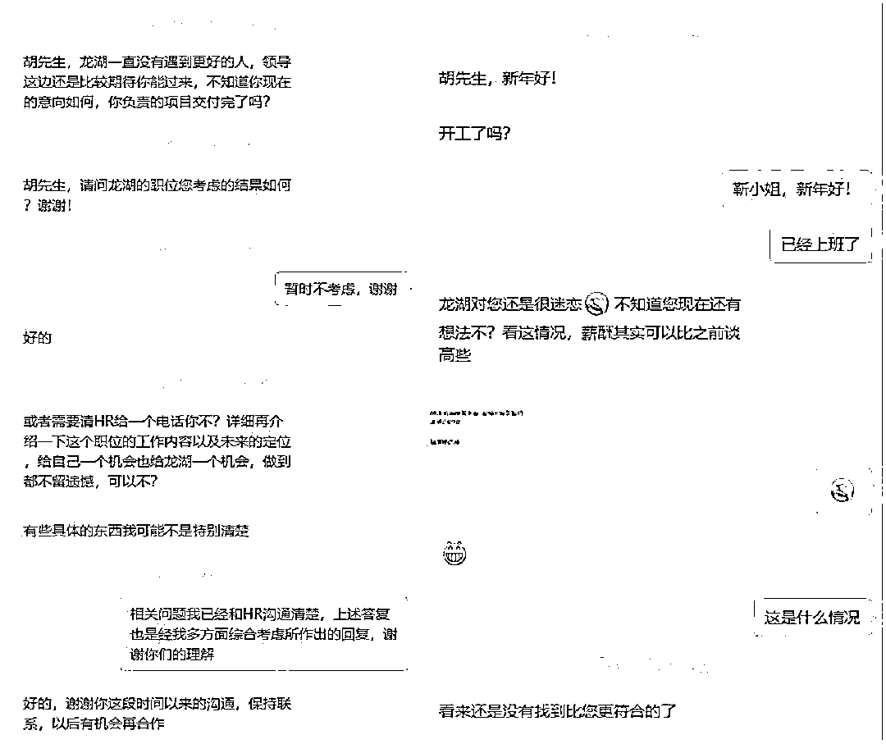
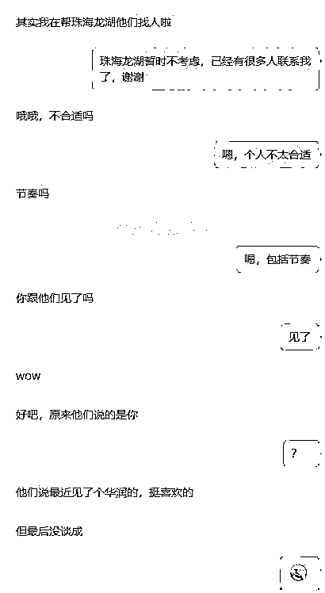
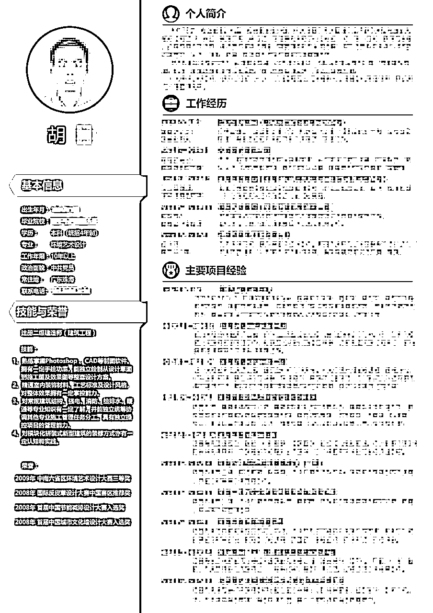

# 一个内向的人，如何把面试变成自己的主场？

在赚钱里，创业者、搞钱高手很多。但对大多数普通人来说，尤其是还在职场打拼的年轻人、大厂员工和斜杠青年，找到一份更好的工作，依然是非常现实且重要的目标。

在没有人脉、没有捷径的情况下，20到30岁之间，面试几乎是普通人改变职业轨迹最重要的方式之一。

面试表现好，你不仅更容易拿到机会，还可能把自己的能力卖出更高的价格。很多时候，面试能力本身，就是一种能够提升人生上限的竞争力。

前段时间，一位做室内设计的朋友来问我面试相关的问题。我们聊了二十多分钟，我从简历制作、面试准备到现场表现，逐一给了建议。

我自己其实是一个典型的I人。

小时候性格内向，见到陌生人容易紧张，公开讲话时甚至会全身发抖。曾经的我，面试时紧张到表达不完整，后来却逐渐变成猎头主动追着联系、拿Offer拿到手软的人。

这中间没有什么神奇秘诀，更多是一次次准备、试错和积累。

## 第一次进入大厂：准备充分，机会才会偏爱你

工作前五年，我经历过两次跳槽。

第一次换工作时，我还在湖南老家一家小装修公司做室内设计，每个月到手工资只有两千元左右。那时候我每天刷本地招聘网站，希望找到一家规模大一点的房地产公司。

但现实非常残酷。

我连续看了一年招聘信息，能看到的基本都是小企业岗位。偶尔出现的本地城投公司招聘，往往还没等普通人竞争，名额就已经被关系户占据了。

如果继续留在当地，我似乎只能在不同的小装修公司之间反复选择，收入也大概率只能维持在几千元的水平。那段时间，我对未来一度非常迷茫。

到了2012年底，我已经在老家市区买了房，也刚结婚不久，但在本地找一份好工作的希望越来越小。于是，我把求职范围扩大到了全省，开始每天在前程无忧上投递简历。

虽然年底通常是跳槽旺季，但我的履历并不突出，因此真正收到的面试通知并不多。

转机发生在12月。

一天，我接到了长沙远大集团HR的电话，邀请我参加面试。那段时间，远大T30酒店在短短48天内建成的视频在网上非常火，远大也是湖南少有的知名企业。

大公司平台的吸引力，让我对这次机会格外重视。

面试前，我做了几件事：

- 仔细搜索公司官网、新闻和公开资料；
- 整理大学期间的获奖证书；
- 把多年积累的设计作品打印出来；
- 制作了一份属于自己的作品集；
- 提前一天抵达远大城，熟悉交通和面试环境。

当时应聘的是可建研发部装修设计工程师，现场一共有三位候选人。

完成常规沟通后，HR又安排了手绘测试：需要在两小时内，从自己的作品中任选一幅，用手绘方式重新表现出来；完成后，还要把现场看到的环境再画出来。

这恰好是我的优势。

大学期间，我长期练习手绘，因此在规定时间结束前顺利完成了任务。之后的面试由远大总裁张跃先生亲自进行，我也得到了他的肯定。

这次面试之所以顺利，一方面是因为准备充分，另一方面是测试内容刚好落在我的擅长领域，而且岗位本身属于基层职位，能力匹配度比较高。

后来我在远大只工作了不到一年，但这段经历却给之后的求职增加了不少分量。

## 第二次跳槽：实力之外，运气也可能决定结果

离开远大后，我再次开始找工作。

这一次，湖南省内已经没有太多合适的选择。因为湖南距离广东较近，加上几个朋友在珠海，我便把简历投向了广州、珠海等城市。

当时房地产行业正处于快速发展期，而地产公司的装修岗位大多偏工程管理。结合未来的职业方向，我决定从设计转向工程，于是重点投递装修工程师岗位。

去广东参加面试，需要从湖南乘高铁，交通成本对当时的我来说并不低，甚至连路费都比较紧张。

幸运的是，那段时间我刚好接了一单装修设计，客户支付的设计费，正好解决了往返交通的问题。

最早收到的是广州长隆附近一家地产公司的邀约。对方开发的项目在当地也比较知名。

虽然我在远大时已经参与过从图纸设计到施工落地的协调工作，但在装修工程的专业技术和管理方面，我的经验仍然不够扎实。面试前我依然认真准备，可面对自己并不熟悉的问题，心里还是没有底。

结果，面试官连续问了几个工程方面的问题，我回答得磕磕绊绊，现场状态也不够理想。仅从对方的表情，我基本就判断出这次机会希望不大。

广州面试结束后，我陆续又收到了几家公司的邀请，其中珠海有两家：

一家是珠海本地的龙头国企H发；

另一家房地产公司恰好也和湖南远大同名，不过在珠海只有一个项目。

我很快坐高铁赶往珠海。

这次真正重视的是H发。出发前，我在网上详细了解了公司背景，还设法找到了HR的邮箱，把自己的作品集和求职意愿整理成一封邮件，提前发送给了对方。

面试过程整体很顺利，从人力面到工程负责人面，一路通过。

到了最后一轮，本应由公司大领导面试，但对方临时有重要会议。等了很久后，领导开完会又准备外出，时间非常紧张。

关键时刻，HR先把我的简历递给了领导。领导看了一眼时间，还是抽出几分钟了解我的经历。

当他得知我既做过设计，又参与过施工管理后，很快便决定录用我。后面原本还有几位候选人，但领导确认之后，后续面试也没有继续进行。

这次成功，说到底有很大一部分是运气。

如果换一家公司，换一位领导，或者换一种面试风格，结果未必一样。我的经历和态度确实起到了一点作用，但真正促成结果的，还有很多偶然因素。

也正是从那时开始，我真正意识到：

**面试不是一次性的运气考验，而是一项需要长期训练的职场技能。**

如果每次只能等运气，主动权永远在别人手里。真正成熟的面试能力，是不断提升自己掌控局面的概率。

## 面试不能只靠天赋，要靠大量实战

在珠海工作一段时间后，我在猎聘上完善了个人信息。

那时，我已经有了一定的行业经验，也参与过一些较大的项目，再加上所在公司的平台知名度，隔一段时间就会接到HR或猎头打来的电话。

工作虽然很忙，但我始终有一种隐约的危机感：

如果当前公司和平台无法一直持续，我还能不能重新找到好工作？

如果下一次离职，我是否有能力通过面试拿到理想Offer？

既然面试能力不足，那能不能通过更多面试，把它练出来？

带着这样的想法，我开始有选择地参加面试。

不过，刚开始的结果并不理想。很多面试没有通过，但每一次失败都让我更清楚地看到了自己的问题：

- 心态不稳定，容易紧张；
- 部分专业知识存在盲区；
- 管理经验仍然不足；
- 面对陌生问题时，表达不够有条理；
- 还没有形成自己的面试节奏。

换句话说，每一次面试都像一次体检，能把自己平时意识不到的短板暴露出来。

到了2017年，我通过正常求职流程，同时拿到了三家行业头部地产公司的Offer，最后选择加入央企地产TOP10的H润。

在H润工作的几年里，我的专业能力、行业视野和管理能力都有了明显提升。与此同时，大央企的经历也让我的职业履历更有含金量，HR和猎头联系我的频率越来越高。

那段时间，我参与并主持过不少会议和公开活动，包括评审会、述标会、培训宣贯、厂家考察等。

这些经历带来的变化，不只是简历更漂亮，更重要的是，我的心态和表达能力发生了转变。

以前参加面试，我总担心自己说错话；后来，我开始能够主动展示优势，控制沟通节奏，甚至在职位级别和薪酬谈判上争取更大的空间。

在地产行业高速发展的那几年，我最多时每周能接到十多个猎头电话。只要是自己真正感兴趣、并且符合能力范围的岗位，参加面试后拿到Offer的概率几乎接近100%。

我也曾得到多家头部房企领导的认可。

后来，我还以专业面试官的身份，参与过公司装修专业管理岗位的招聘，对行业内精装修人才的能力结构和用人标准，也有了更深的理解。

其实在职场里，绝大多数人都只是某个岗位的候选人。

公司招聘的是“装修工程师”“项目经理”或“专业负责人”，HR和猎头寻找的也是某个职位对应的人选，而不是某个具体名字。

如果有一天，猎头打电话告诉我：

“某家公司要找的就是你，非你不可。”

那大概才算真正走到了职业生涯的高阶阶段。到那时候，我也许就能自称是装修行业的王者了。

## 关于面试，我最后总结五点

### 1. 初期不要挑剔机会，要优先积累经验

刚入行时，能力和履历都不突出，能够给你面试机会的公司，往往也不会特别优秀。

但如果有机会进入大公司，一定要认真准备。能力暂时不够，可以用态度弥补；专业暂时不强，可以用作品、经历和准备程度增加信任。

当然，运气也不可忽视。

不要因为一次失败就否定自己。多投简历、多参加面试，才能不断熟悉流程、修正表达、积累经验。

如果本地没有合适的岗位，就扩大求职半径，从市内扩展到全省，再考虑北上广深等机会更多的城市。

### 2. 尽早进入行业头部平台

如果条件允许，尽量争取进入行业TOP公司。

大平台带来的价值，不只是工资和公司名气，还包括：

- 更规范的工作流程；
- 更高强度的专业训练；
- 更丰富的大项目经验；
- 更广的人脉和行业资源；
- 更强的履历背书；
- 更大的未来选择空间。

在小公司和头部企业都工作过的人，通常会更清楚平台差异到底意味着什么。

### 3. 把简历当作自己的第一份作品

简历不是经历堆砌，而是一次自我营销。

无关紧要的信息可以删掉，重点突出个人基本情况、核心能力、代表项目和工作成果。

尽量把最有价值的内容压缩到一页A4纸内，排版清楚、重点突出、视觉整洁，形成一个稳定的个人简历模板。

### 4. 把面试当成可以训练的能力

面试表现不是天生注定的。

它和表达、销售、谈判一样，都可以通过练习提升。多创造面试机会，多接触不同类型的面试官，多复盘每次沟通中的问题，你就会逐渐知道：

- 哪些问题最容易被问到；
- 怎样介绍自己的经历；
- 如何突出与岗位相关的优势；
- 面对不会的问题应该怎样回应；
- 如何在有限时间内展现自己的价值。

当然，面试训练最好建立在专业能力不断提升的基础上。只有真正有东西可讲，表达才会更有底气。

### 5. 不必盲目追求管理路线

并不是所有人都适合做管理。

每个人都有不同的性格、能力和优势，重要的是找到适合自己的发展位置。

在互联网和自媒体时代，技术路线、专业路线同样可以获得很好的发展。只要专业能力足够强，个人品牌和市场价值一样能够不断提升。

做到这些，再加上一点运气，面试的胜率自然会越来越高。

我在2021年加入赚钱，但这是第一次在这里发帖。文章里有很多个人经历和思考，也欢迎大家多多指教。

2025年马上就要到了，祝龙哥和所有赚钱圈友，新的一年工作顺利、事业进步，蛇来运转！