# 21天从零到188万播放的YouTube Shorts复盘

先收藏再慢慢看。

大家好，我是好运。很开心能和一群志同道合的朋友一起，连续21天朝着同一个目标推进。

要特别感谢赚钱平台，以及带队的唐瑞老师和圈友 hulei 的邀请，能让我把这次全程实操的经验整理出来分享。

先说结果：21天里我一共发布了15条以AI达人秀变身为主的短视频，频道订阅来到10362，一条视频破百万，累计播放188.8万，视频号关注也涨到1006。

体感上YouTube对创作者相对友好，内容质量达标后系统会持续推流，长尾效应很明显。但这绝不是速成项目，需要有耐心去养。

接下来按5个维度拆解：起号节奏、数据回升的原因、如何找对标、从零到发布的完整流程、新手常踩的坑。

## 一、起号时间轴

- 12.5-12.9：花5天做赛道调研、频道装修和养号，同时自学Midjourney和Runway的基础用法。
- 12.10：发出首条作品，运气不错首日播放就到了1.5万。
- 12.14：前两天流量回落，我用关键词定位到一个百万级爆款，用同一主题替换元素后做近乎复制级的改写，很快把流量拉回来。这条就是后来的百万作品，目前播放140.75万。
- 12.15至今：作品播放基本稳定在数千到两万多之间，多数可破万。稳定爆款并不容易，还是得靠积累。

## 二、数据上来的三个体会

### 1. 更新要稳
我个人感觉，保持每日更新，推荐量会呈正向增长。频率稳定后平台对你的信任度会提升，推流也会更顺。

### 2. 先模仿再创新
做海外内容，技术不是最大门槛，审美和文化感知才是。自己闭门造车很容易翻车，我就踩过。起号期直接抄近期爆款的选题，是最稳妥的切入方式，对标是最好的老师。

### 3. 真实感和反差感决定上限
AI达人秀变身的核心是反差。早期人和兽的换装很火，现在同质化严重后，能明显感觉到：画面越真实，转变越让人意想不到，表现越好。可以多看AGT的正片来培养感觉。

## 三、找对标的办法

### 1. 关键词筛选
在网页版搜索框输入赛道关键词，用右上角筛选器锁定近一周、播放量过百万的作品。这是我的主力选题方式。

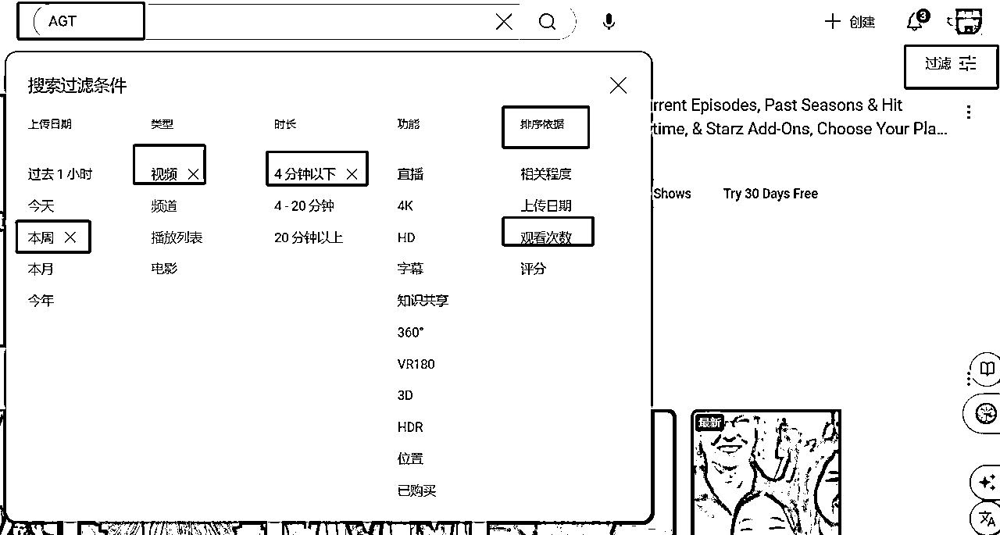

### 2. 账号追踪
刷Shorts广场时注意视频发布时间和数据，若发现近期上线的爆款，就点进主页看整体表现。如果该账号多数作品都在万播以上，且偶尔能出爆款，就立刻关注，后续作品快速跟进创作。注意是借鉴思路，不是搬运。

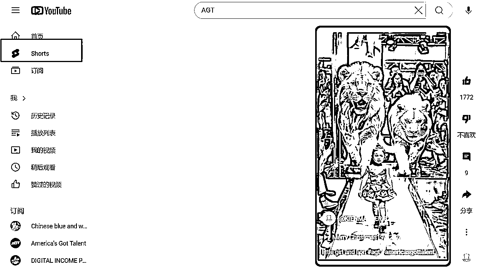

养号的本质是用标签去刷同类内容，天天刷，直到推荐页几乎全是同行作品，就算养成了。

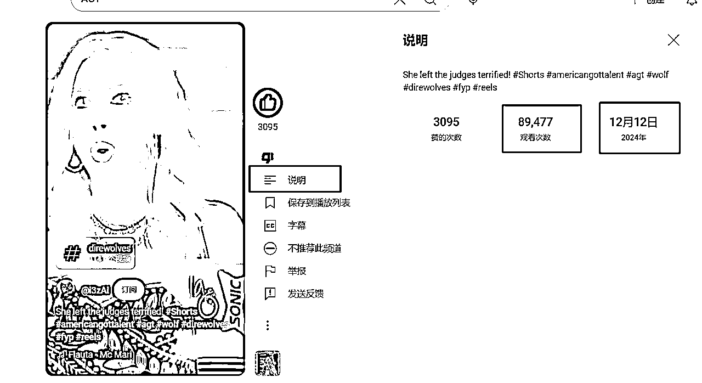

看数据时优先看近期上线时间和播放量在几十万到上百万区间的作品，找到后进入主页做二次拆解。

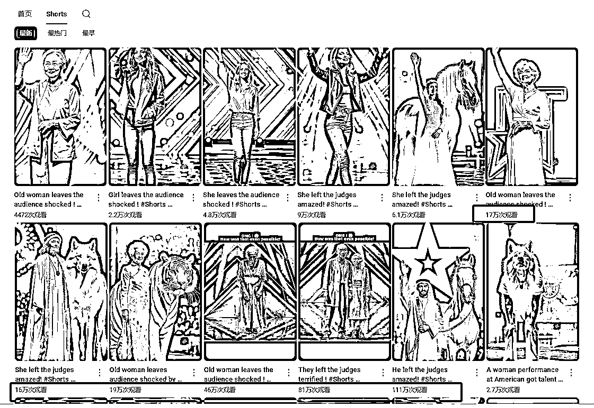

如果发现某个同行近期的十万播放作品较多，就马上关注，以影子模式跟随学习。

## 四、从零到发布的完整路径

### 1. 赛道与定位先想清
这套框架来自赚钱圈友分享：

底层逻辑是需求，需求的底层是目标用户。先锁定受众，再根据受众痛点做垂直内容，最后才匹配产品。

自问三点：
- 服务哪类人群？
- 提供什么服务、解决什么问题？
- 给用户推什么产品？

定位方法：
- 以兴趣为起点，找到需求再做减法。先列兴趣点，再提炼需求，比如如何用AI变现，最后分析供需和竞争。
- 九宫格拆解账号。

注意点：
- 人设要具备传播力、价值感和大众好感。
- 受众要选强需求，不要自嗨。比如钱就是刚需。
- 记忆点要稳定，比如固定口号或每次出镜的统一穿搭。

这套打法我也思考过，但个人觉得不完全适合Shorts，我打算后续用在小红书项目。感兴趣可以一起聊。

我第一次接触Shorts，就是想快速跑通从曝光到关注的闭环，也对变身类内容感兴趣，上手快，最终选择AI达人秀变身方向。

### 2. 热门赛道参考
娱乐、健康、游戏、教育、测评、时事、艺术创意、宠物、运动、商业财经、育儿等。

对标账号筛选标准：
- 基本条件：2024年建号，总播放>2000万，20-100条视频，订阅>1000；2023年建号，总播放>1亿，视频>50，订阅>1000
- 无断更，近期数据平稳
- 不是单条爆款撑起来的账号
- 有变现能力，年收入>2.94万美元
- 不露脸

货币化查询：https://ytlarge.com/youtube/monetization-checker/

### 3. AI达人秀变身的标准流程

简版SOP：
1. 开通账号、养号、频道装修
2. 找到对标视频，用工具截取关键帧
3. 用MJ出底图，也可用即梦、可灵。把截图反向推导提示词，改写后再生成，积累通用词库
4. 用Runway成片。Runway动作幅度不如即梦、可灵，但画面更清晰，人脸不易扭曲，我主要用它
5. 准备评委和观众反应素材。我是截AGT官方视频做表情库，新手可以直接用对标片段，带水印就换源
6. 音乐准备。初期直接用对标音乐，市场已验证；我测试过无版权音乐，效果一般
7. 剪辑。简单拼接即可，想精致就加特效音效。导出建议2K/4K，海外很多用户用电视看
8. 多平台分发

### 4. 制作细节

**截取对标图**
多谢老马教练提供的工具，很好用，具体可看航海手册。

**MJ反写与分镜**
学习资料：Midjourney秘籍 · 语雀

①选图
从对标视频里截3张以上关键帧，如变身前、中、后。

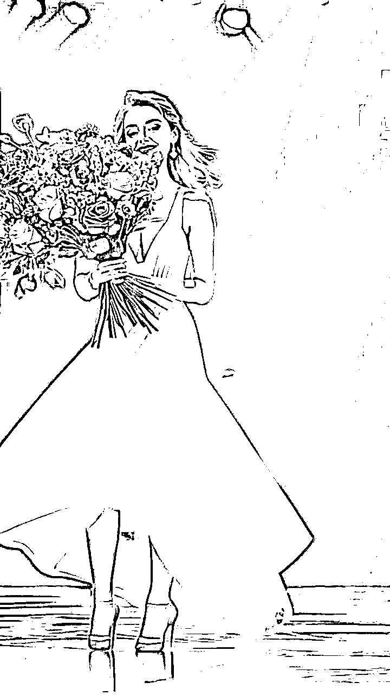
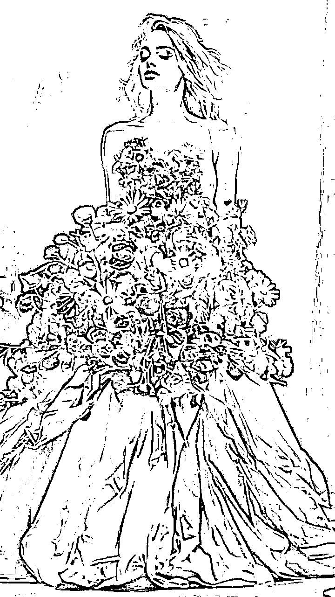
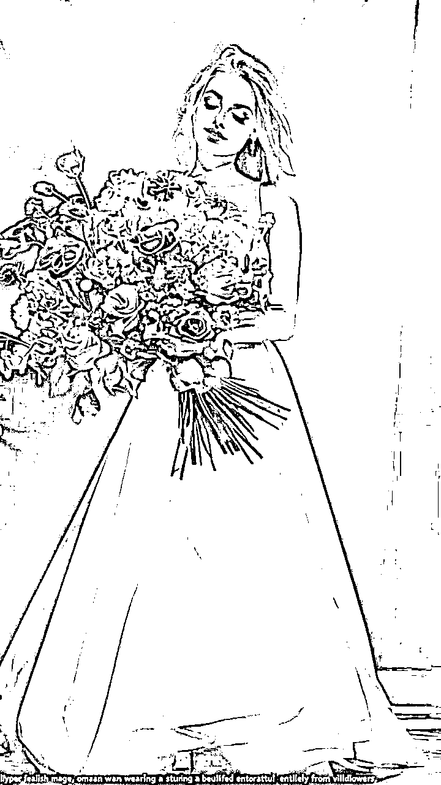

想更自然可截4张：两个主体、变换过程、两个随意动作、最终形态。

②反写提示词
用MJ的/describe功能反推。

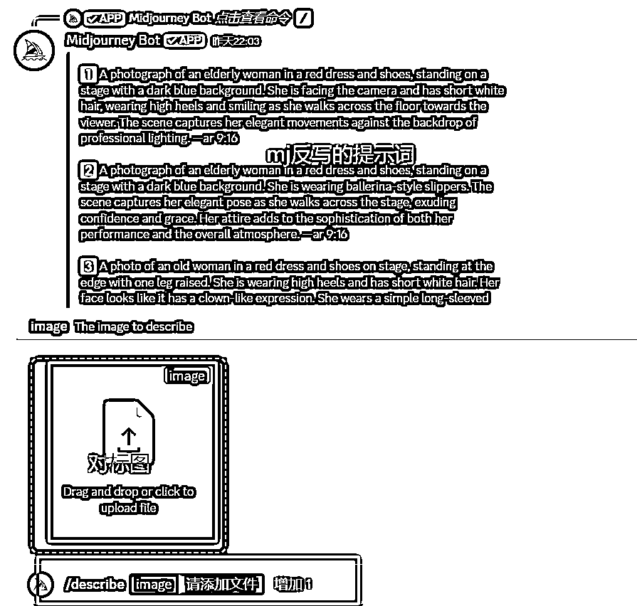

人物一致性做法：
- 垫图法：图链接+提示词
- seed法：提示词+--seed 号码
- 参数法：--cref<链接> --cw 100

常用参数：
--r 批量出图
--sref 链接 --sw 0-1000 数值越大风格越统一
--cref 链接 --cw 0-100

常用指令：/blend 融合2-5张图、/describe 反推、/imagine 文生图

提示词结构建议：全身照+人物描述+场景+画面风格+镜头+参数

③MJ出图要点
图一变身前：把对标图投喂MJ用/describe得到基础词，复制到翻译工具改元素，例如把白裙换黑裙、把花换成玫瑰，再用/imagine生成。

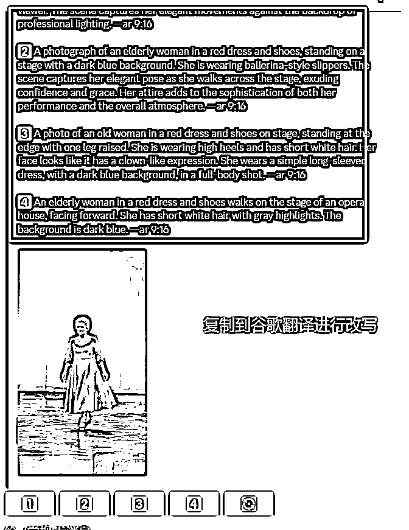
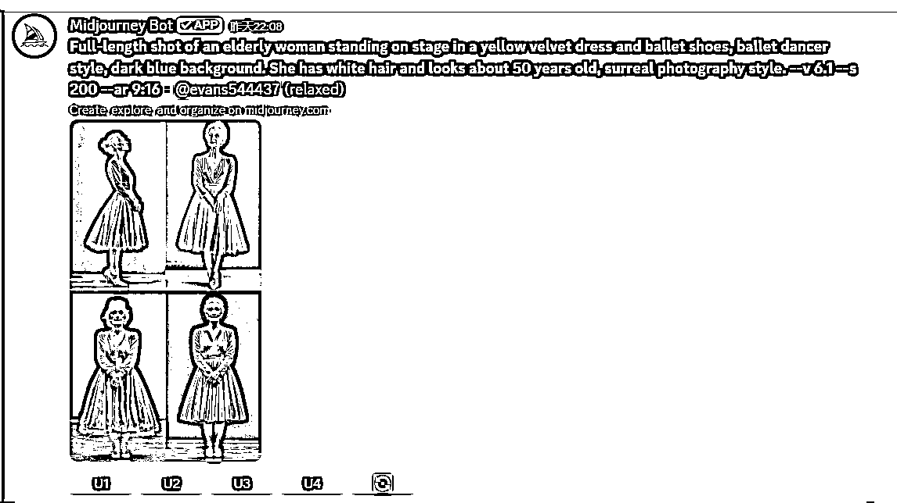

图二变换中：在图一基础上加“4 panels with continuous dancing，” 并微调另一元素关键词，例如玫瑰颜色、年龄等。

图三变身后：继续反写后再修改，可指定v6.1避免掉到niji动漫风格。需要超写实就做细化，细化词以图一为基础只改融合处。

整体链路：反写→改写→抽卡→选V细化→在图一基础上调融合元素→重复

案例参考：
对标反写提示词：full body shot, 4 panels of continuous dancing, Mary blonde in white princess dress hugging Black Panther on stage of Miss Universe pageant, blue background, glitter falling from the sky. Photo style realistic and surreal, with film lighting, smooth skin texture, sharp focus and high resolution, spotlight, depth of field, close-up, full body shot, surreal photography, high resolution, ultra detail, sharp focus and high quality.photos must be very realistic Be as detailed as possible Ultra-high image quality, 4K The background should be on a bright blue stage . --ar 9:16 --v 6.1 --no sexy

改写后：
一位美丽的长发黑发女郎身穿镶满闪亮黑钻的黑色公主裙和红色高跟鞋，手捧一大束蓝玫瑰走上环球小姐大赛的舞台。她对着镜头微笑。照片风格逼真而超现实，具有电影般的灯光、光滑的皮肤纹理、清晰的对焦和高分辨率、聚光灯、景深、特写、全身拍摄、超现实主义摄影、高分辨率、超细节、清晰对焦和高品质。该图像使用索尼 Alpha A7 III 相机和 FE 24-35mm f/2.8 G OSS 镜头拍摄。 --ar 9:16

A beautiful long-haired brunette in a black princess dress with sparkling black diamonds and red high heels walks on the stage of the Miss Universe contest with a large bouquet of blue roses in her hands. She smiles at the camera. Photo style is realistic and surreal with film-like lighting, smooth skin texture, sharp focus and high resolution, spotlight, depth of field, close-up, full-body shot, surreal photography, high resolution, ultra-details, sharp focus and high quality. The image was taken with a Sony Alpha A7 III camera and a FE 24-35mm f/2.8 G OSS lens. --ar 9:16 --v 6.1

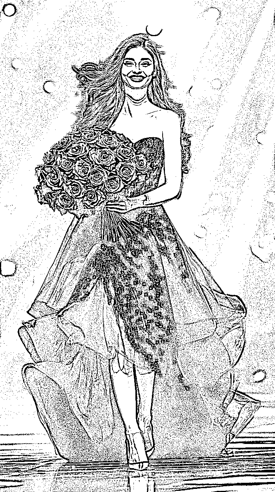

**Runway成片**
官网：https://app.runwayml.com/video-tools/
Gen-3 Alpha turbo支持9:16。

常见问题垫步，解决办法在提示里加入“fashion show”或“walking on the camera”，例如“主体，fashion show”，并可补充镜头运动如跟随拍摄或聚焦模特。

提示词可让GPT或豆包帮忙，先喂官方文档再把首尾图给它，让它产出适配词。MJ同理。

案例：
①单图：The girl takes 3 steps forward holding blue flowers, fashion show, walking on the camera
②首尾帧1：The girl took two small steps and then ran forward with a smile
③首尾帧2：The bouquet turned into flowers covering the hem of her skirt, and the girl ran forward holding the hem of her skirt, fashion show, walking on the camera, zoom out
④旋转展示：Girl spinning in a circle at the center of the stage. slow, fashion show, walking on the camera, zoom:-5

其他参考：
Girl spinning in a circle at the center of the stage. fashion show, walking on the camera, zoom:-6
The girl held up her skirt and turned around, the camera focused on her whole body. fashion show；walking on the camera；zoom:-5

**对标剪辑**
全方位对齐：音乐、封面、节奏、观众反应、选题。

操作：对标视频导入剪映→分离音频→智能分割→替换自己的成片，用变速裁剪对齐节奏→保留评委片段→加特效音效→导出。

Runway可用词参考：
Dynamic motion；zoom out；Static Camera；fashion show；walking on the camera；zoom:-5
The camera slowly pulls back and rotates as [the subject and subject action].
[Do not generate other people in the picture], the atmosphere is [warm and cheerful].
the camera focused on their whole body. Static Camera.
流畅变化：Detailed display of the change process, smooth changes, ultra-high definition
镜头变化：camera rolate, dynamic motion, Static Camera

经验提示：Runway提示自己写容易不准，建议用ChatGPT辅助。先让它学习官方文件，或直接指令：“提供适合Runway的视频提示词，专注于变化过程、动作变化、形态变化等描述，每个提示词注重动作细节和变化过程，确保镜头和动作精确描述。” 再提问具体需求即可。

**工具清单**
AI绘图：Midjourney、即梦、可灵、liblib
AI视频：Runway、可灵、即梦
翻译：Google翻译
剪辑：剪映
视频提取：YouTube Shorts Video Download online – Shorts Downloader，打不开就搜Shorts downloader换站

## 五、新手易踩的坑

1. 不养号直接发
没亲测，但平台需要真实用户是共识。没获得信任就很难拿到推流。

2. 频繁断更
坚持难，尤其制作周期长，但规律更新会带来正向推荐，这是建立信任的过程。

3. 闭门造车
海外内容最忌自嗨，多看跑出来的爆款，先复刻再微创新，补上网感和文化差异才有机会被用户接受。

21天走完最大的体会是，Shorts拼的不是技术炫不炫，而是对用户和平台规则的尊重度。先把爆款吃透，再谈个人风格，YPP自然会跑通。

希望这份复盘能帮你少走弯路，祝我们都能把项目跑通。

在还没真正摸透海外用户口味之前，谁都不敢说自己拍的东西一定能火。说句大实话，我以前觉得自己能打90分的作品，发出去可能也只有三成不到的概率能破万播放。所以在账号刚起步的时候，与其赌观众的耐心，不如老老实实稳着来。

这21天跟着航海项目做YouTube Shorts，方向是AI视频，一路走下来确实有不少感触。最大的体会就是：想开通YPP，真的急不来，它更像一场马拉松，拼的是耐心和心态，也拼谁愿意踏踏实实把基本功做扎实。别高估短期爆发，也别低估长期积累。

在航海结束前，特别想感谢赚钱平台，感谢唐队和hulei给了我们这次机会，也谢谢雪雪老师帮忙认真修订。21天不算长，但足以帮我们养成一个稳定输出的习惯。真正有挑战的是接下来的每一天，能不能继续坚持下去，才是能不能跑通YPP的关键。

希望大家都能沉住气，不松懈，一步步把账号做起来，最后顺利开通YPP，早点实现真正的“睡后收入”。