最近我一直在跑一个特别猛的涨粉玩法，亲测有效，今天直接毫无保留分享出来——就是利用AI生成高颜值美女热舞短视频。说实话，这个赛道和之前的AI美女号套路类似，但涨粉速度真的快得离谱。

给大家看看我实际操作出来的成绩，直接上图：

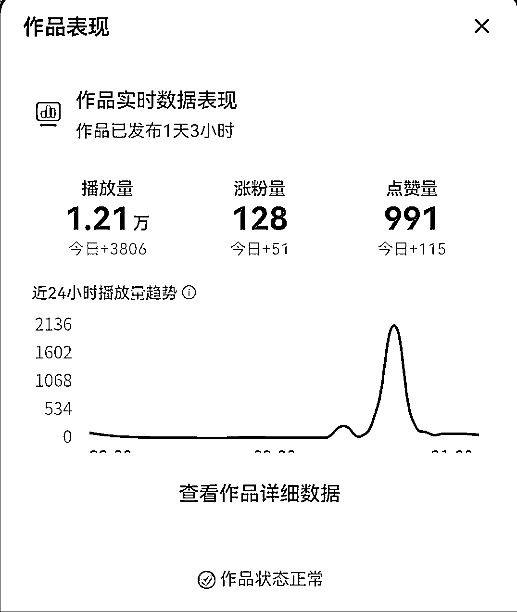

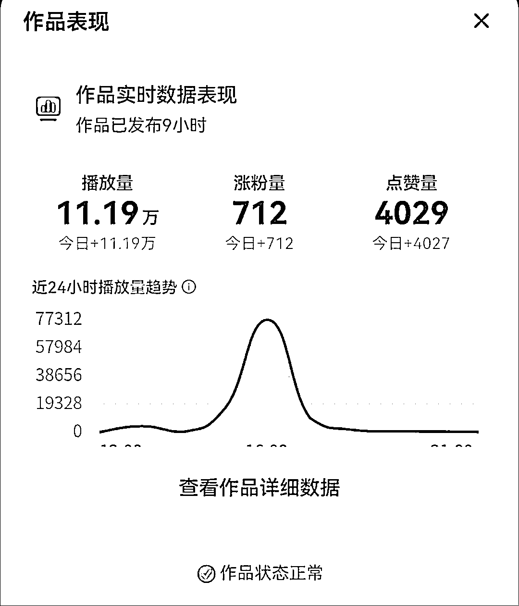

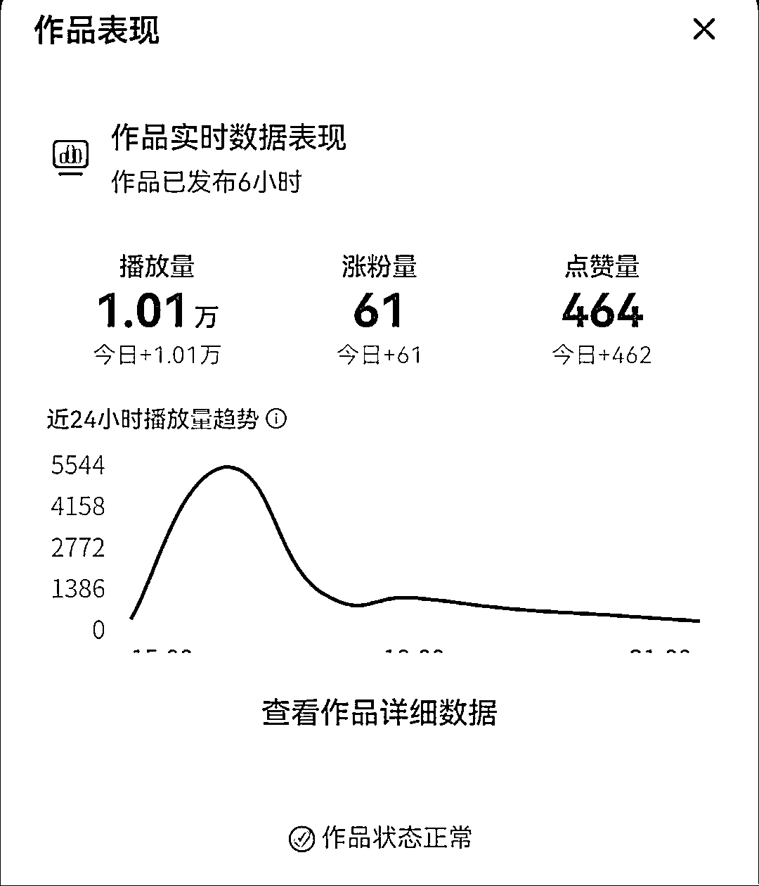

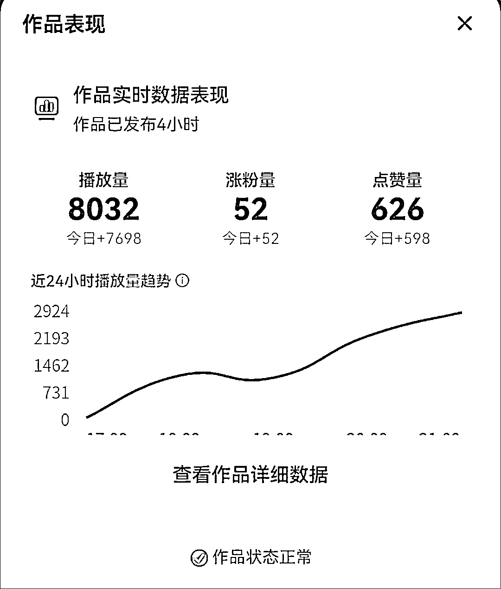

下面这个账号是最近才开始更这种内容的，结果每一条都爆，点赞几千上万根本停不下来，粉丝也是蹭蹭往上涨，看得人非常心动：

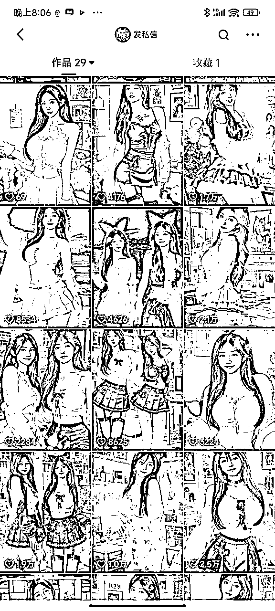

这种视频怎么变现？路子其实很清晰：
- 粉丝涨起来直接卖号
- 或者转型做带货、接短剧推广
- 再或者把精准用户引流到私域慢慢转化

说白了，都能玩。最关键的是，这种视频制作门槛低到超乎想象。

那到底怎么操作？咱们直接进入正题。

## 第一步：生成AI图片

需要用两个平台：**哩布哩布** 和 **星流**（提醒一下：两个网站要用同一个账号登录）。

先打开哩布哩布AI平台（https://www.liblib.art/），把下面4个模型加到你的模型库：

① 搜索“ZOZ_漫梦琉璃”，点进去选“空灵梦幻”，然后点“加入模型库”：

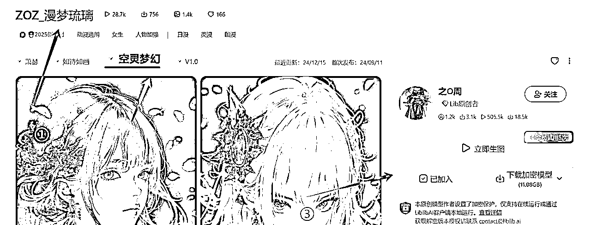

② 搜索“反差女大系列”，点进去直接“加入模型库”：

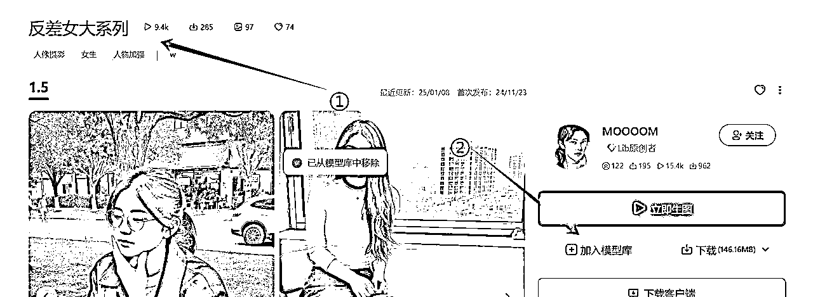

③ 搜索“F.1-小红书照片_最强网感｜时尚穿搭”，同样加入模型库：

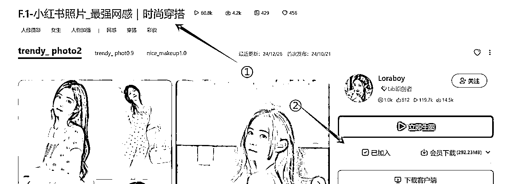

④ 搜索“F1 婚纱二次元动漫 FLUX 女神 _姜立 星辰变”，加入模型库：

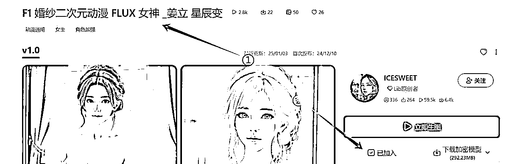

接着打开星流AI（https://www.xingliu.art/pro）：

① 登录后切到“高级模式”，在“基础模型”里找到收藏的“ZOZ_漫梦琉璃”：

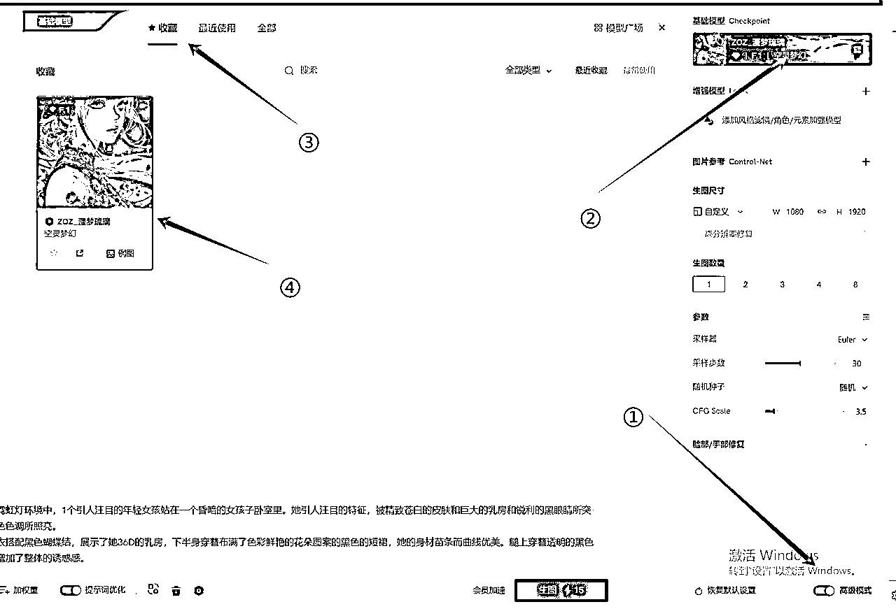

② 在“增强模型”里分别选上“反差女大系列”和“F.1-小红书照片_最强网感｜时尚穿搭”，再把“F1 婚纱二次元动漫 FLUX 女神 _姜立 星辰变”这个模型的权重改成0.4，然后设置生成数量：

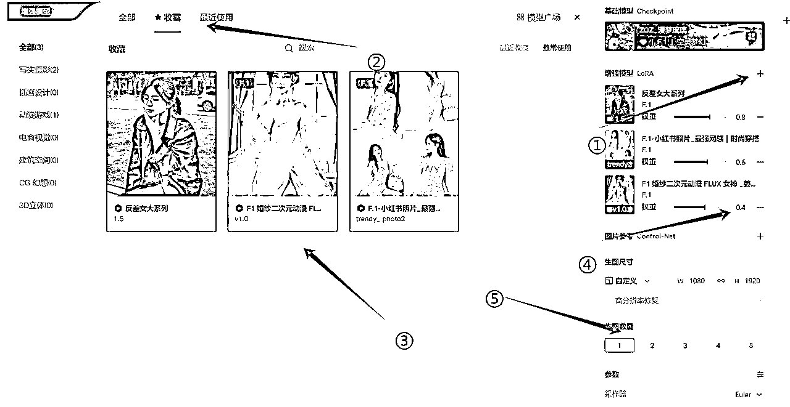

③ 填入准备好的正反提示词，直接点生成就行（提示词在文末自取）：

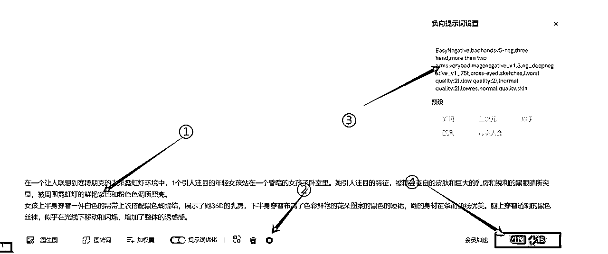

## 第二步：图生视频

打开可灵AI（https://klingai.kuaishou.com/）

选**可灵1.6**，上传刚才生成的图片，加上描述词和反向词。会员大概5分钟就能出片，非会员可能要等3小时左右。所以建议你一次多生成一些图，晚上批量丢进去，第二天早上起来全部搞定：

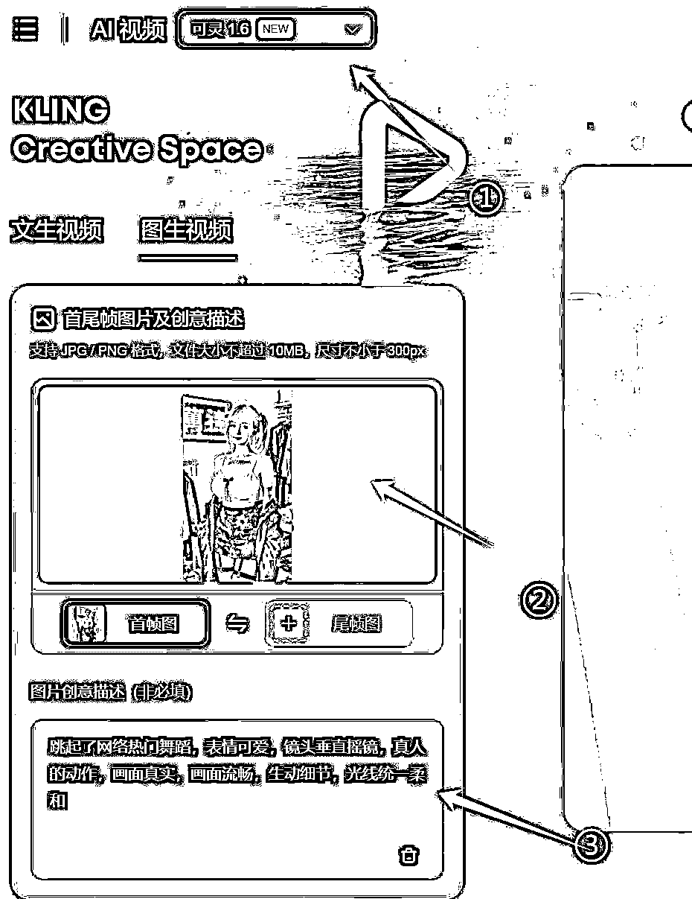

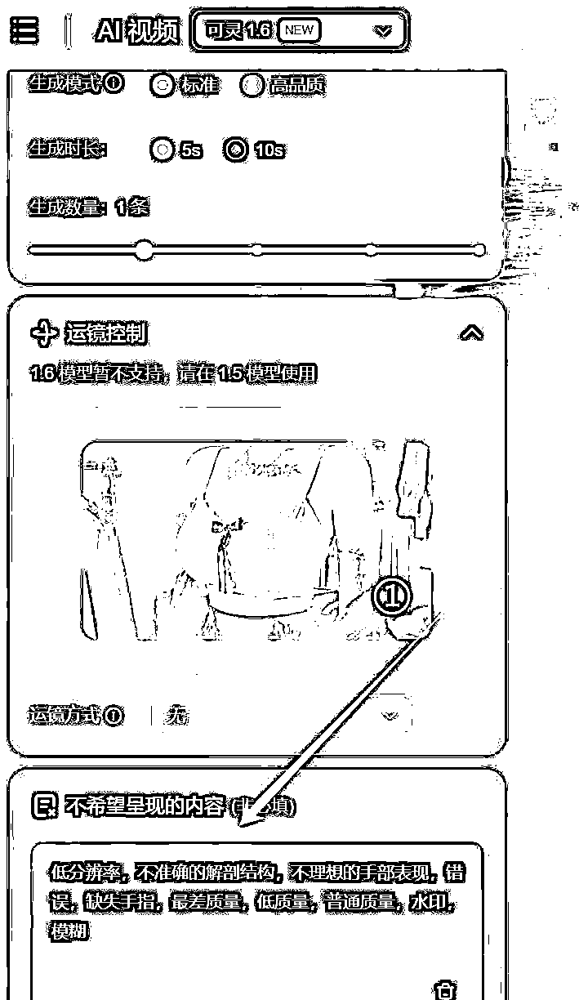

## 第三步：剪辑发布

① 把生成的视频导入剪映，稍微放大、裁掉边缘，顺便去水印（非会员下载的可灵视频自带水印，会员可跳过这步）。

② 配上音频——可以直接用对标账号的爆款音乐，剪映里加或者发布时加都行。

③ 发布的时候记得勾选“内容由AI生成”。

以上就是整个AI美女热舞视频从零到上手的全流程，真的不复杂，照着做就行。

操作过程中要用的提示词，我已经整理好了，有需要直接下载：

链接：xxxxxxx（请自行获取）

第一次写这种实操干货，可能有点啰嗦，大家多包涵，赶紧去试试吧！