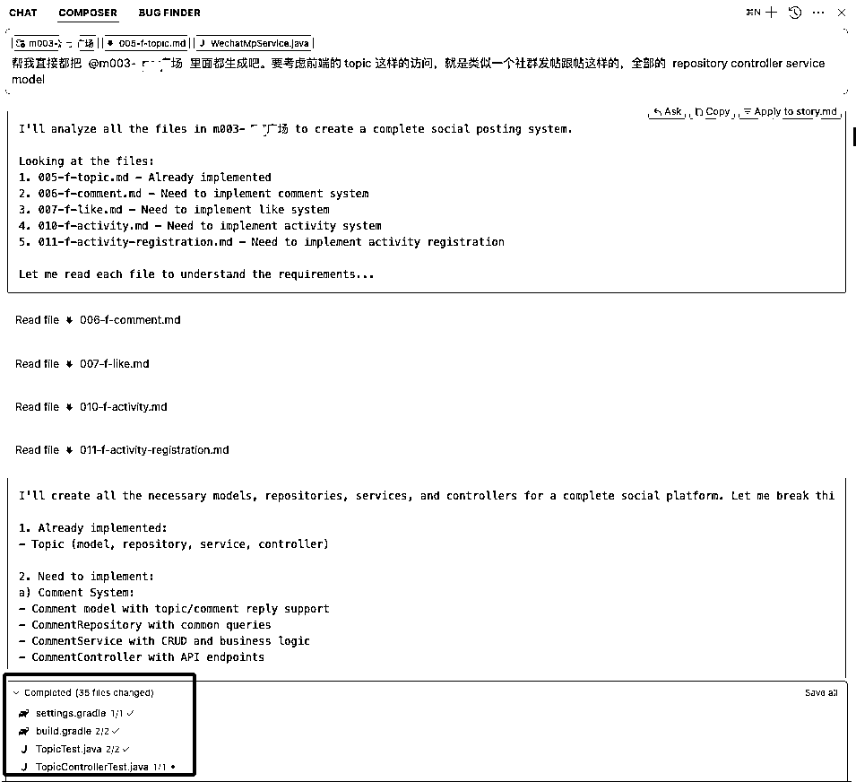
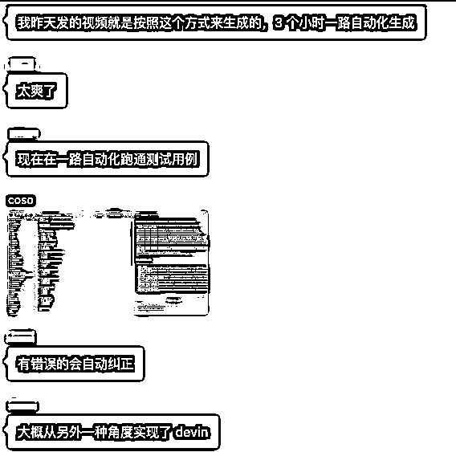
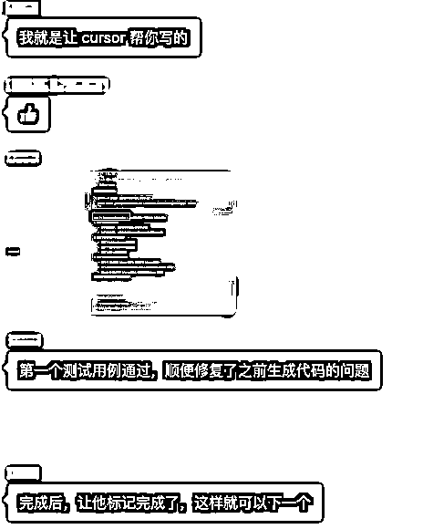
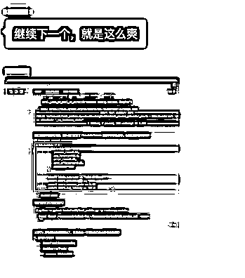
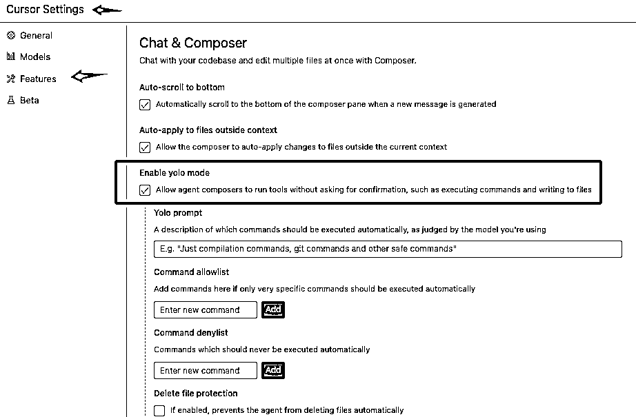
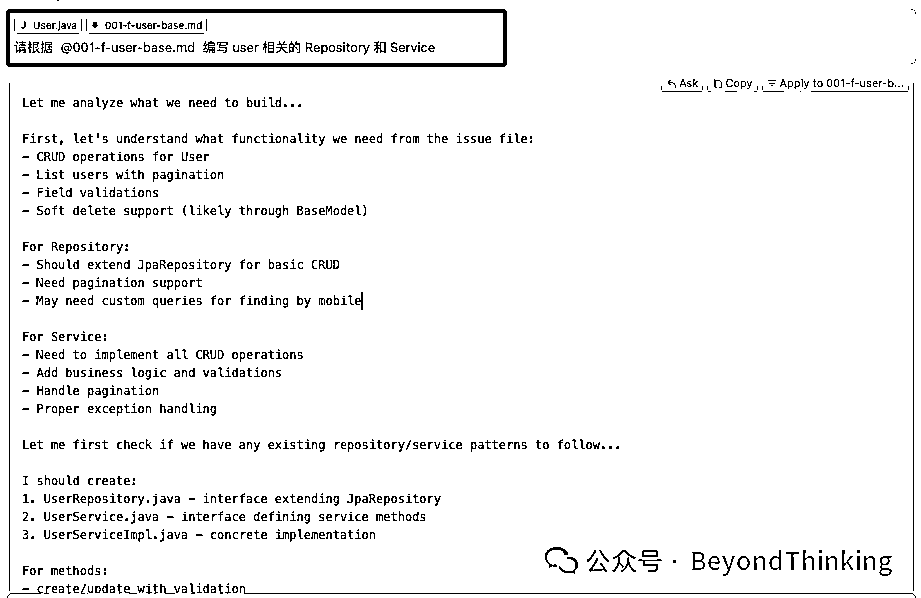
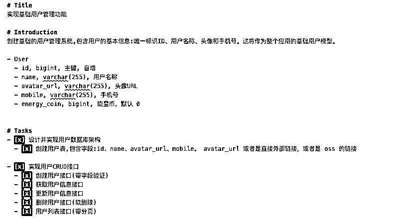
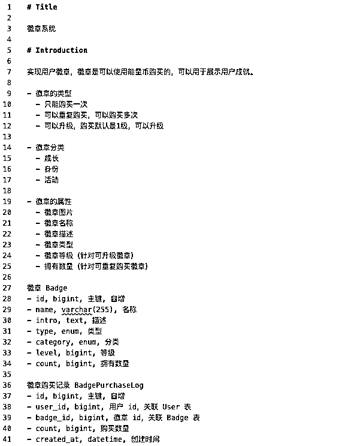
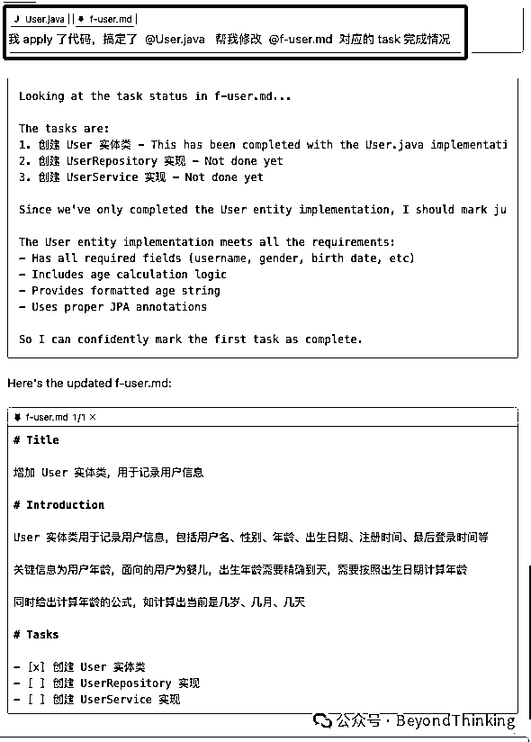
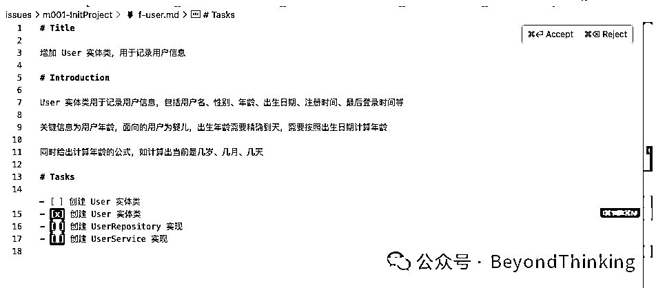

# 用本地 Issue 管理，让 Cursor 真正进入自动驾驶模式
作者：龙哥


12 月那波航海结束后，不少非技术背景的朋友已经能上手 Cursor 写代码了，但用着用着总会卡住。人和 Cursor 怎么配合、怎么让它别瞎跑，是几乎所有人都绕不开的痛点。

我把自己摸索出来的一套做法整理了一下，用本地 Issue 来托管需求，让 Cursor 的自动化程度大幅提升。无论是刚入门的新手，还是已经很熟练的老手，这套方法都能用上。

# 实际使用感受

## 一条对话，撬动 35 个文件的改动

按我自己的实操经验，只要把一个里程碑描述清楚，借助这套流程，一次对话就能让 Cursor 完成 35 个文件的增删改。



## 三小时不停歇，直接一路点下一步

群里就有朋友反馈，用上这个方法后，连续 3 小时代码都在自动生成，几乎只需要一直点继续。







# 怎么立刻开跑

做产品时，我们脑子里总有目标、功能清单，接下来就是把这些想法喂给 Cursor。

大多数人习惯用 Chat 或 Composer 直接下指令，等于在用聊天的方式把意图一点点灌进去。听起来方便，其实坑不少：

*   一个对话窗口撑不了太久，新开会话就得重新拼上下文，需求一多基本等于重来
*   聊天式沟通很难把需求讲全、讲系统
*   真实开发是多任务并行，还彼此依赖
*   用自然语言很难给出完整的、结构化的描述
*   依赖关系在对话里很难清晰表达
*   Bug 描述往往在别处记录，来回复制粘贴很折腾

更稳妥的办法是把需求搬到本地文件里管起来。新建 issue 文件来写需求，然后在 Composer 里切到 Agent 模式，打开 YOLO 模式配合执行

随后通过 @ 指定的 issue，Composer 在 Agent 模式下会基于 @Codebase 直接开工。



## 把规则沉淀到 .cursorrules

### .cursorrules

```
# Issues Management System

## Directory Structure

- `/issues` - Root directory for all issues
  - First level: Milestone folders (e.g., `m001-InitProject`)
  - Second level: Issue files within each milestone

## Issue Types and Naming

Issue files follow the naming pattern: `{id}-{type}-{description}.md`
- `{id}`: Globally unique identifier across all issues
- `{type}`: One of the following:
  - `story` - User story describing complete user value
  - `feat` - New feature implementation
  - `fix` - Bug fix
  - `test` - Test implementation
- `{description}`: Brief kebab-case description

## Issue States

Tasks and issues can have the following states:
- `[ ]` - Not started
- `[x]` - Completed
- `[-]` - In progress
- `[*]` - Skipped
- `[!]` - Abandoned

## Templates

Two types of issue templates are available in `/issues/templates/`:
1\. `story.md` - For user stories
2\. `issue.md` - For features, fixes, and tests

## File Modification Rules

- Only modify task/issue states in existing files
- Do not alter other content without creating a new issue
- Always update Status History when changing states 
```

## 用 /issues 做本地管理

### 目录结构

在项目根目录下建一个 /issues 目录来统一收纳。

```
issues/
├── templates/
│   ├── story.md
│   └── issue.md
├── m001-project-milestone/
│   ├── 001-story-feature-description.md
│   ├── 002-feat-implementation.md
│   ├── 003-test-test-suite.md
│   └── 004-fix-bug-fix.md
└── m002-another-milestone/
    └── ...
```

### 文件命名规范

命名统一为：{id}-{type}-{description}.md

*   id：全局唯一编号
*   type：类型标签 story / feat / fix / test
*   description：简短的 kebab-case 描述

### 模板

#### 故事模板 templates/story.md

```
# 标题
简短的故事标题

# 故事
作为 [角色]
我想要 [目标/行动]
以便 [收益/价值]

# 验收标准
- [ ] 标准 1
- [ ] 标准 2

# 子问题
- [ ] {id} 问题描述

# 依赖关系
- [ ] {id} 依赖描述

# 状态历史
- YYYY-MM-DD: 创建
```

#### 问题模板 templates/issue.md

```
# 标题
简短的问题标题

# 简介
详细的问题描述

# 任务
- [ ] 任务 1
- [ ] 任务 2

# 依赖关系
- [ ] {id} 依赖描述

# 状态历史
- YYYY-MM-DD: 创建
```

## 样例参考





# 为啥这招奏效

每次和 Cursor 交互，本质都是在拼凑上下文，让它有足够的信息去执行。上下文来源包括：

*   Cursor 能主动读取或我们手动指定的内容
*   Codebase 代码库本身
*   各类文档
*   Web 网页
*   等等
*   Cursor 的 Rules
*   全局设置里的规则
*   项目级的 .cursorrules 文件
*   对话框里输入的内容

把以上三类信息拼起来，Cursor 就可以干活。

我们要做的，就是利用本地文件的优势，通过 @ 某个 issue 文件 / @ 某个 issue 文件夹，把整段需求内容注入到对话上下文里。

在 issues 里可以把需求、实现细节、验收标准写得足够细。聪明的人会意识到，在 Composer 的 Agent 模式下，Cursor 既能感知到当前代码库 @Codebase，又能从 issue 文件里读懂我们到底要它做什么，自然就能更顺畅地执行。

完成后再让 Cursor 更新任务状态，就能随时清楚下一步该做啥、不该碰啥。



修改痕迹也能一目了然。



# 再往深处想一点

这套做法的内核，其实就是用本地文件给 Cursor 持续喂养上下文。

*   Markdown 天生有结构，模型解析起来很友好
*   需求之间有依赖时，大模型的关联能力可以直接处理

本地文件能长成一个很强的生态。代码本质上就是在操作本地文件，而 Obsidian 这类笔记工具的成功也证明了这一点。

Cursor 本质上是一个极强的本地文件阅读与处理工具，这正是构建生态的基础。

# 开源项目与后续计划

上面说的完整方案我已经整理成开源项目，直接拿去用就行。

这是我 2025 年的 12 个小产品计划中的一环：

1/12 LocalIssues，目前的文件说明和模板就是这个产品的第一阶段