# 🛥️ 龙哥盟 · 时间管理航海问答精华整理

# 1️⃣ 时间管理航海1群问答集锦

## 桥豆麻袋：求推荐记录时间或做清单的工具

桥豆麻袋：

#举手

教练您好，我是乔豆。昨天的课收获很大，想请教下您平时用来记录时间或列清单的App/工具有哪些推荐？

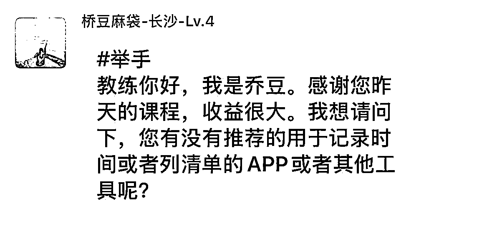

Hello，桥豆麻袋你好，

昵称很有记忆点，感谢你的提问。

我日常在用的App是『滴答清单』。

这款工具我会单独做一次使用讲解，大概今天或最晚下周一会出。

我没有代言它，只是用了很多年，目前用下来最顺手，也最能帮我达成我想要的效果。

所以先请你稍等一下，我今天暂不展开，下周一会出一支完整的小视频，讲清楚我是怎么用、怎么设置的。辛苦等我一下，谢谢。

* * *

## HI张不高：工作和赚钱在价值观里怎么区分？排位靠前就一定要花更多时间吗？

HI张不高-山西- Lv4：

#举手

老师能否再展开讲讲工作和金钱的区别？另外，价值观排位越靠前，是不是就意味着要投入更多时间？

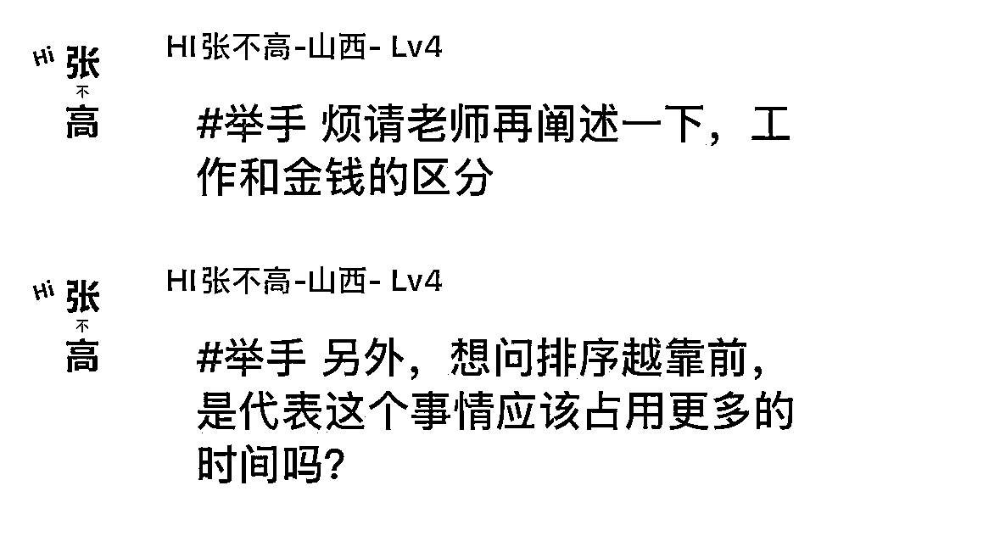

Hello，张不高你好，这名字也很有趣，是因为身高所以取的吗？我挺好奇的。

### 价值观排序里『工作』和『赚钱』的界定

在我这里，这两个概念是分开的。

我见过很多人工作非常卖力，每天忙到精疲力尽，最后月薪也就五六千、七八千。加班两小时，收入几乎没有变化。于我而言，这属于工作很拼，但工作和收入没有很强的关联，因为回报是一个固定不变的薪水。

所以我给『工作』的定义是做事本身，花多少时间在工作的事务上。

而谈到『赚钱』，我会把副业归进去。副业的特点是收入不稳定，不是到了发薪日钱就自动到账，需要自己持续去创造价值。

因此严格区分的话，主业我归为工作，副业我归为赚钱。我的主业形态更像自由职业，所以在我的体系里其实没有工作，只有赚钱，这是基于职业性质做的划分。

如果你既有主业也有副业，那主业对应工作，副业对应赚钱。这个是我个人的定义，仅供参考。

* * *

### 价值观排位靠前，不等于时间占比一定最大

第二个问题，排位靠前就一定要花更多时间吗？不一定。

举个例子，爱情排在我前面，我不可能早上一起床就陪老婆到晚上睡觉，一整天都黏在一起，这不现实。

排位靠前真正的意义在于冲突发生时，我会先选谁。

比如我把家庭排在最前面，我会固定每天18:00-19:00陪孩子吃饭玩耍。万一这时老板说6点到7点要去公司加班，我就有两种选择。

如果工作排位更高，我可能就会去加班。但如果家庭排位更高，我就会拒绝：老板，对不起，这个时段我承诺要陪孩子，这是我对他的承诺。我可以7点后回来继续处理，但这个时段我无法被临时调动。

当冲突出现时，我把家庭放优先，取舍标准就很清晰了。这才是价值排序的核心，而不是用时长来衡量。

### 所以真正的排序关键点
### 在于冲突时优先选择谁，而不是用时间的长短来排序。

以上是针对你的问题，谢谢。

HI张不高-山西- Lv4：

谢谢老师，声音太有亲和力了，我听了两遍很有启发。关于名字，我很喜欢梵高，想用他的一个字，现在还没资格叫张高，打算赚到100万就改名叫张高高。

* * *

## Rosy-北京：现在和未来的价值观冲突时，如何规划当下？

Rosy-北京-Lv.3：

＃举手 教练早安，我看大家的计划都排得很满，我列完今天的工作后感觉几乎没空闲了。

我的价值观目前是自我和工作排第一，但未来希望工作排最后。我不想一辈子只拿一份稳定工资，但现在好像别无选择。基于这种情况，该怎么规划时间，才能慢慢实现未来的价值观排序？

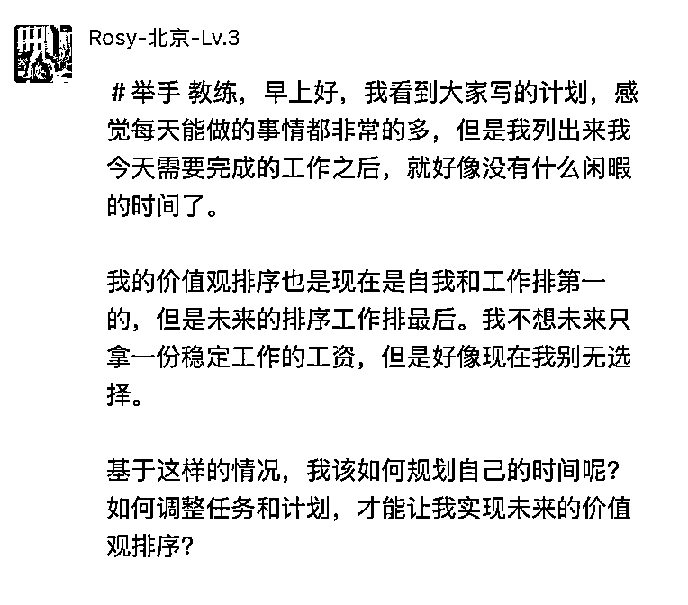

Hello，Rosy你好，发音我没错吧？错了请纠正。

我觉得要分阶段来做。因为你现在才开始尝试行程管理和安排。

可以给自己设一个周期，比如3个月、半年或1年，每月或每季做一点点微调。

现在工作时间是固定的，能否把副业时间加一点点，让副业慢慢变多，工作时间慢慢变少，这是一个互相调节的过程。

你不想只靠上班工资，就必须有副业。我最担心的是很多人做副业初期没有给自己留固定时间。

比如每周日休息，周一到周六每晚20:00-22:00只做副业，不做任何别的事，任何事情都不能打扰。

只要有一个固定时段做固定事，你未来才有可能不单靠上班工资，还能有额外收入，支撑你完成想做的事。

所以现在最好的做法是在便条里专门加一块叫副业学习、副业培养，无论是哪种，都要和副业相关。

### 每天把副业相关事项放在待办里，
### 每天都做，并且固定在同一个时间段做。

坚持至少3个月，就能改变现状。

如果时间不固定，今天6-7点，明天7-8点，后天11点后，浮动就等于不稳定。刚开始增加一个新习惯，必须固定，身体才会形成记忆，告诉自己时间到了要做什么。浮动就会不稳定，目标就会变慢。

这是这个阶段给你的建议，谢谢。

* * *

## 缘溪行-郑州：待办时间预估不准，影响效率怎么办？

缘溪行-郑州：

#举手 教练您好，我是缘溪行

我的问题是：我对时间感知不敏感，无法准确预估每个待办需要多久。经常安排过多或过少，安排过多没完成会挫败，安排过少提前完成又会摆烂。试过记录时间，但像写文章有时1小时有时15分钟，改善不大。

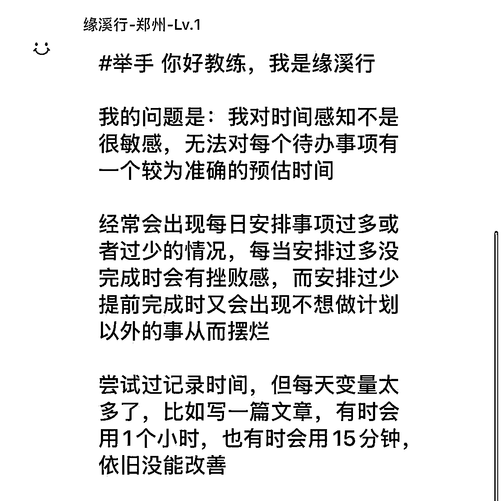

Hello，缘溪行你好，这个昵称很特别。

### 给待办加上截止时间点，保证效率

核心是你没有给每个行程、每条便条加一个时间节点。

比如今天写文章，我要在30分钟内完成，或在1小时内完成。每设定一个节点，大脑就会有完成感。

当你慢慢缩短时间，就能提升效率。

不加进去的话，会感觉每天都在做、都在写，但看不到进步。

举个例子，我刚开始写文章会设定字数，比如今天写3000字，同时要求1.5小时内完成。一周后，我还是写3000字，但要求在1小时10分钟内完成。

在设定时间节点时要给自己留进步空间，才能越做越有效率。

### 深化时间概念，需要后续课程配合

第二点，对时间没概念，也和你现在用的是比较基础的时间管理方式有关，可能是第一代或第二代。

等七代时间管理全部讲完，你对这个问题会有完全不同的理解。

所以先回答到这里，剩余部分等直播全部结束后再讨论，到时你若还有疑问再提问一次即可。

* * *

## Kevin-杭州：如何提升自控力？

Kevin-杭州：

#举手

老师好

我的计划做得很好，想做的事很多，但很难坚持。像下班后一天班累了，工作强度大、加班多，就想放松、看看小说，一看就停不下来。本来计划下班学习、做副业，结果什么也没做成。这样会很焦虑，怕将来失业又没副业收入。

有什么方法能增强自控力吗？

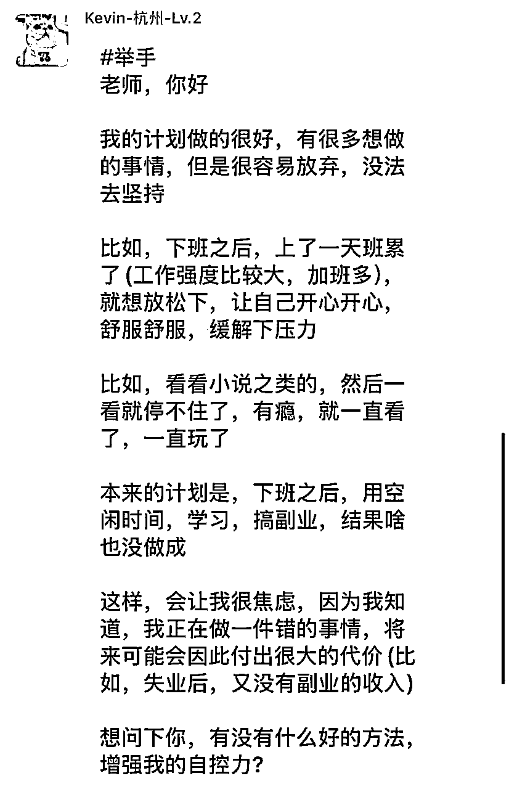

Hello，Kevin你好！

自控力在初期练习时，不要一上来就定太大目标。

想做副业，可以先定今天只做30分钟。因为做副业如果得不到正反馈、没有好感受，就容易不想继续。目标定太高就会做不下去。

起步阶段想坚持，最好的办法是从20分钟、30分钟开始。但要贵在持续，不能今天做明天就不做。

每天先给自己20-30分钟练习手感，手感稳定后，会更上手更熟练。再从20分钟、30分钟逐步加到40分钟，随着时间拉长，你会掌握副业的节奏。

这个方法对初期练习自控力最有效，供你参考，谢谢。

* * *

## 志愿者 七七：常因起床晚导致晨间计划泡汤怎么办？

志愿者 七七：

#举手

教练，我想再问下，现在没找工作的状态，每天写了计划清单，早上设了闹钟，但身体就是起不来（也可能是我盖洛普适应才干太靠前[破涕为笑]），有什么建议吗？晚起的话早上的计划是放弃还是放到下午？这样其他计划的时间要不要也调整？

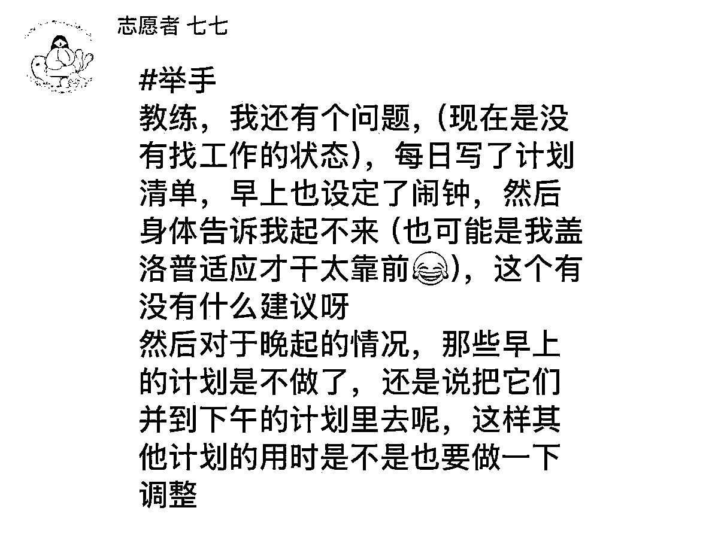

哈喽，七七你好！

这其实不是时间管理问题，是你不想起来的问题，得先问自己为什么要起。

很多人说要早起，但早起没事做干嘛起？

如果真有事做还起不来，最直接的方法是找个人来监督。你可以找我、领队、朋友同学，或建个群。约定7点整没在群里说早安就罚1000块，一天没起罚一天。

看你有多少资产可以承受。用一个会让你很痛的方式，才能在初期养成新习惯。

早起是有目的的，你很清楚早起要干嘛却做不到。如果能用更极端、更强烈的方式制造痛感，你才能在时间一到时准时起床。

这个建议仅供参考，希望有帮助，谢谢！

* * *

## 大猛-广州：教练的待办管理和手写软件分别是什么？

大猛-广州：

#举手，老师用的那款清单软件，就是讲课时手写用的软件是哪个？

Hello，大猛你好，我用的清单软件是『滴答清单』。

苹果和安卓都可用，我用了很久，体验不错。手写软件是iPad的『Goodnotes6』，需要付费。

主要因为这是我的刚需，所以付费问题我不太在意。Goodnotes6是买断制，滴答清单每月也就几十块，可以自行考虑。

下周一我会专门介绍我的滴答清单使用方式。Goodnotes6和本次主题关联不大，你可以私下问我，或我后续加餐时会发个小视频，也可参考小红书教程学习使用。

这是你的问题解答。

* * *

## 逑乐-成都：时间管理能用在爱人和孩子身上吗？

逑乐-成都：

#举手

@教练-根源 根源教练有没有把时间管理应用到自己的爱人和孩子身上？如果有您是如何做的呢？

因为我觉得如果从小培养孩子时间管理对他一生产生益处，我自己也觉得时间管理能让每天更充实有意义。【我之前周末连续刷动漫，上班时又觉得极度颓废无意义[捂脸]，但又逃不出这个怪圈】

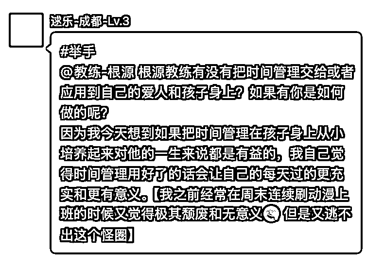

Hello，裘乐你好，这个字是念“求”吧？念错请纠正。

我没有直接把时间管理套在老婆孩子身上，我更多是把时间管理用在自己身上。

比如我们约定周六周日要出门，这两天我会专门留出时间给孩子和老婆。所以是我的行程安排让家人大概率能配合我。

周末老婆也不会特意安排事，孩子还小也没有自己的行程。严格说，不是我在他们身上用时间管理，而是我用在自己身上后，整个家庭的行程配合得更好。

再举个例子，我和老婆每天晚上要睡在一起、抱着睡觉，所以我们有一个共识：不能找需要出差的工作。我们分开最久的是她带孩子回台湾那几天，以及疫情期间。

一般不会因为工作出差分开，所以这也算是我的价值观排序，延伸到时间管理，再延伸到整个家庭的行程安排。

希望这个回答对你有帮助。后续有疑问欢迎再追问，谢谢！

* * *

## 呼哈-南京：做事分心效率低怎么办？

呼哈-南京：

@教练-根源

教练，我做事经常走神。即使做了计划，到具体执行时就去玩手机或刷网页。一旦不紧急，我很难集中，专注时间半小时以内。一天下来效率很低，很苦恼，有什么建议吗？

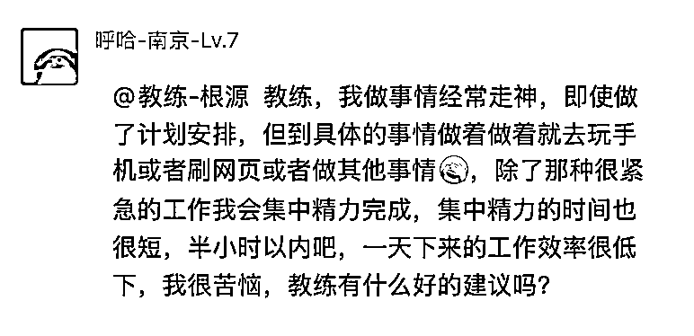

Hello，早安，这个名字真的很特别，谢谢提问。这个问题我上周可能漏掉了，现在补上。

学会技巧后，大多数人还是做不到落地。因为技巧本身并不能把能力变成自己的东西。很多人知道方法，却不知道怎么用，也没有好的自我管理方式。这是掌握技术后的第二阶段，更难的地方。

第一阶段是掌握技巧，知道什么能改善现状。第二阶段是如何找到适合自己、能驾驭的方法。

另外，有了技巧不代表一定要用。就像有人学了时间管理，人生照样过得可以，每个月上班领薪水，生活能自给自足。虽然无法过得更好，但至少能生存。时间管理进来后，如果原本生活已经够用，意义就不大。

### 9.1 如果事情没完成，我要付出多大代价？

问题的背后，你必须先问自己：如果这件事没完成，我要付出多大的代价？

我很喜欢聊代价思维，虽然听起来有点负面，但有些事不做，就要为此付出额外代价。

比如我设定7点起床，8点前把文章打完。如果7点没起，7点半才起，就有两种情况...

总拖到最后一刻的人，多半是还没吃到足够大的苦头。

你答应读者八点更新，结果九点才发。别人嘴上不说什么，心里却给你记下一笔：这人不太可靠。信任被扣掉一分，这就是代价。

职场里更是如此。一年到头做事拖沓，等升职加薪的名单要定下来时，领导翻遍表格，还是略过了你。机会没了，你才后悔当初没有更认真。可懊悔只是短痛，撑不起真正的改变；能把旧习惯磨掉的，往往是长期且具体的代价。

要改变，就给代价加码。

第一，主动加码：找个人监督你。把钱先押在他那里，到点没完成，直接扣。押一万，一次扣五千，这比自我激励有用得多。月薪不到三万的人，先别指望自律，靠外部约束最实在。

第二，把面子也押进去。公开在群里承诺，没做到就发红包。钱固然心疼，但更难受的是被人当成说话不算数、不敢合作的人。刻意挑那些让你真正肉痛的代价，习惯才会松动。

---

## 问题一：情绪崩了，便利贴计划还要不要硬扛？

老师好，今天重新试了一次用彩色便利贴做全天规划。白天一路顺利，下午四点左右遇到一件事，整个人被惹毛了。之后我完全没法照着便利贴继续走，任务越积越多。这时候该咬牙把今天的事项清完，还是直接给自己放假？

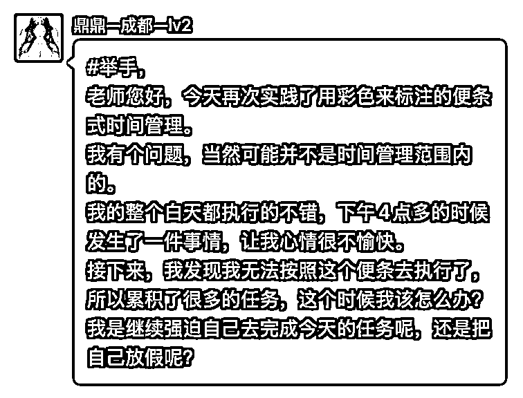

先补一句抱歉，这条消息是几天前发来的，我漏看了。若当晚没等到回复，请再提醒我一次。

刚练时间管理时，计划超时、任务堆积再正常不过。你不是在学技巧，是在重新练“自己管住自己”的肌肉。就算经常做不到，也用不着灰心——我前前后后花了几年，才把“写下的事”和“做完的事”慢慢划上等号。

初期不必求全。从便利贴进阶到排优先级，起码把前六成重要项目做完，你才有资格因为情绪不好而歇工。

管好日程，本质上就是管好情绪。你想象一下，前一天晚上列完二十件事，第二天睡前全部清空，这种能力当然稀缺、高级。所以练习的时候，别给自己那么大压力，把周期定成半年、一年都行。我自己接近三年才敢说“写下来的东西基本都能办完”。

真遇到情绪崩塌，不是不能停。起步期，允许自己今天不做，心情比进度重要。

如果你不想停在起步期，我给自己定的规矩是：心情再差，也要动手做。结果可能不如状态好时完美，但至少我证明了情绪没有接管方向盘。

好比有一次，我安排每天下午一点到两点谈三个客户。那天心情很糟，可到点我还是去谈；过程没那么顺，但该聊的都聊完了。“办完”和“办好”之间，本来就有一段差距。

我目前练到的是：不去理会情绪好坏，只保证排进日程的事情按时收尾。下一关想练：无论能量高低，都能既完成、又做好。

---

## 问题二：重要但不急的事，为什么总是推不动？

老师好，我是桥豆麻袋。我想问的是：一件重要但不紧急的事，到底怎么提升执行力？

说说我的处境：18年本科毕业，22年在职读MBA，为了升认知、拿学历、开眼界。去年11月本该论文开题，恰逢换工作机会，于是先顾工作；今年3、4月又去搞副业，论文一直搁着。到10月新工作稳定了，副业也顺了，我把论文列为头号任务，却发现自己根本无法进入状态。

最开始我每周固定两个晚上去图书馆，靠环境逼自己写；可上个月导师对开题报告评价不高，我彻底泄气，快一个月没碰论文。虽然日程表每天都写着“写半小时论文”，我也照常去图书馆，多数时间只是在发呆或刷手机。

我确定这是“重要不紧急”：课程修完、学费交完，只要写出来就能毕业；最近一个月我甚至拿写论文当理由，推掉娱乐、社交和运动，结果还是没写，这已经影响我的信心；多一个硕士学历总没有坏处；学校给六年期限，我还有三年，看似宽裕，但我怕现在不开始，六年也会被拖完。

除了去图书馆、固定安排时间、深刻认识重要性，我还能做什么？

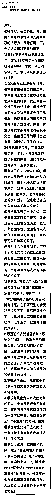

看到你的问题，我当下想到的结论是：还没到痛得受不了的地步。

我承认，自己也懒。凡是“要紧却不急”的事，人天生会往后躲。运动习惯也不稳定，多的时候一周动四次，少的时候一次都不动。明知道体力跟不上，讲课状态会差，但惰性照样赢。这不怪你，多数人天生这样；三两天看不到回报，就不想再投入。正因如此，优秀者才少见——他们每天要和自己打架，逼自己去碰那些重要而不急的事。

既然自己喊不动，就给生活下点猛药，用被动的方式推自己。

我眼下想把读书变成硬指标，一年十二本或二十四本，不能只凭兴趣翻。这同样是重要不急的事，现在不读也不会马上出事，但长期不读，人会没有输出、没有认知增量。于是我准备开个群，收三百或五百，公开讲明白：每个月没交出一篇读书心得，这笔钱就赔给大家。这样我非读不可。

缘由之一是罚款太重，如果群里有100人，一人500，那就是5万；之二是面子，我在培训这行做了几年，攒了点口碑，人设要是塌了，可能连生计都成问题。这些都是我不做不行的理由。

所以，先别急着找技巧，先找那个让你“丢不起脸、赔不起钱”的理由。理由足够硬，执行方案你会自己长出来。

想做很快，也可以抓住钱这个软肋：找一位监督人。把目标切成三个月，比如“开题报告写到某个程度”；到期没完成，给他转5000；或者先押两万，超时一次扣5000。你会立刻认真起来。

所有人都懒，我懒，我老师也懒。所以别为懒自责，想办法让外在机制帮你把懒按住。这些招你挑一个去用，应该比单靠意志力管用。

---

## 问题三：前面任务超时，后面安排全乱怎么办？

老师好，我的困扰是：计划常常被前面的事挤占，后面一长串跟着乱。比如六点到七点想做一件事，七点又要参加直播课；前面拖到六点半才结束，我该继续做原计划，还是改做一件半小时内能完成的事？

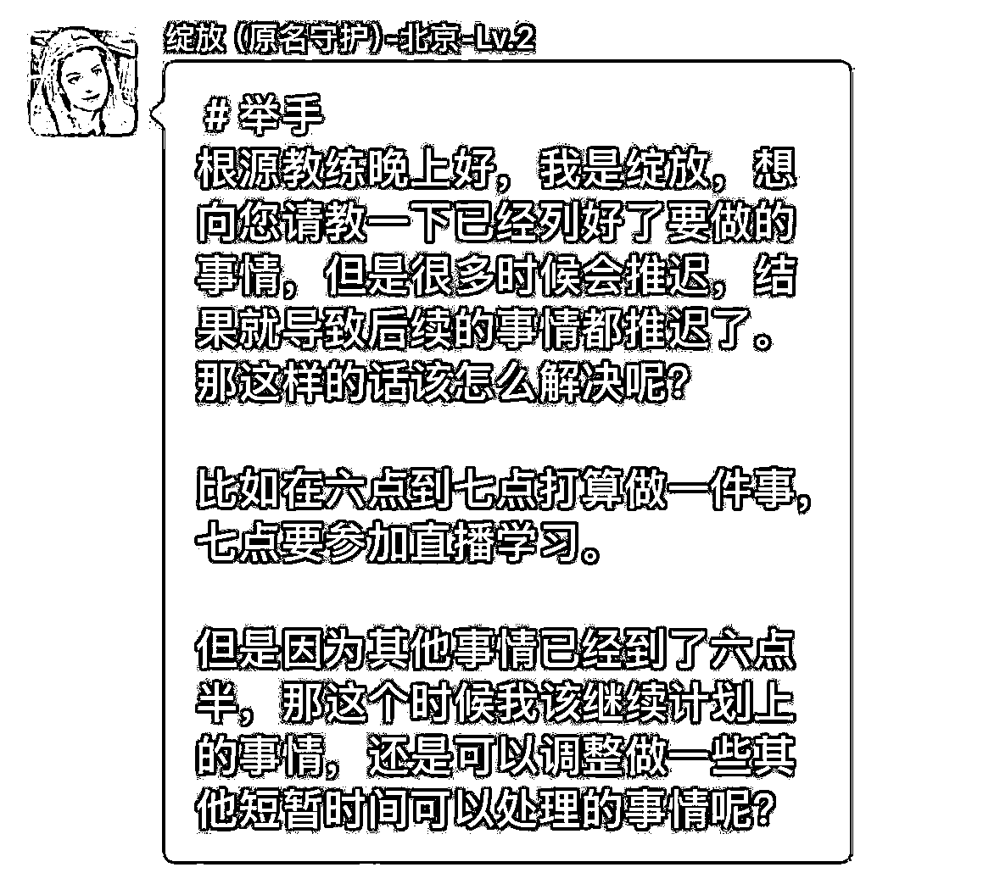

这要看你的练习阶段。如果还在新手期，我建议：宁可前面那件没做完，也别让后面第二项、第三项跟着崩。你七点要上课，原计划六点到六点半已经损失了，那就把六点半到七点这一小段用来缓冲，别再让七点的事也泡汤。

设想三件事：第一项排5点到6点，第二项排6点到7点，第三项排7点到8点。第一项延误了，后面还有两项。换作我，会把损失控制在一次延误以内。第二项做到一半就停手也没关系，因为第三项优先级更高，我要赶回正轨把它完整办完。

练习期最重要的，就是不让拖延连锁反应。上一项耽误了，不代表今天全程报废；从下一项开始准时，局面还能救回来。

追问：离第三项必做任务只剩三十分钟，第二项原本排了一小时，现在可用时间被砍半。这半小时是继续做原任务（预计一小时，中间会中断），还是改做几件三十分钟内能收尾的事？

---

## 问题四：计划外杂事太多，怎么稳住节奏？

看到老师昨天的行程安排，我很佩服，但自知做不到。我总觉得那样的安排需要有很强的能力和经济基础支撑；而我总被计划外的杂事推着跑。怎么才能不让杂事打乱计划？

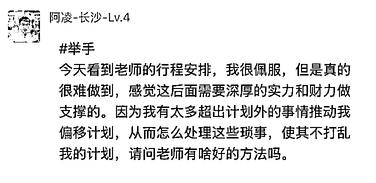

答案有点朴素：多练。

你看到的稳定安排，也不是我第一天就有的。严格说，是最近两三年才慢慢固定的，之后每天的波动不会超过一至两成。我用了11年找到人生方向，再据此设计周计划，中间反复调整：今天工作更多、明天运动更少、后天情感更多。一点点试，才试出现在这个舒服的节奏。

关键不是那张表有多完美，而是我清楚自己未来想走到哪里。有了长远目标，我才知道眼下该排什么、该挪什么。

给你两条路。第一，想清楚自己十年后想成为什么样的人。这个方向最有效，但也最难，需要有人带；这一期时间管理课暂时不讲。第二，找参照系：找某位你欣赏其时间管理方式的人，让你的生活慢慢贴近他的样子。每天改一点，用一两个月调成新版本，别想一天之内复制对方。

---

## 问题五：没有副业，工作和赚钱算同一件事吗？

如果现在没有副业，是不是可以把工作直接等同于赚钱？还是说工作和赚钱并不一样，赚钱专指主业之外的收入？

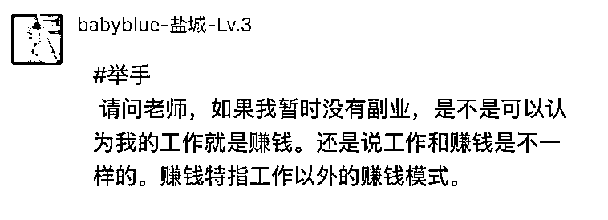

可以归为同一类。你现在没有副业，工作就是你的赚钱来源。

我因为是自由职业者，日程里不设“工作”这一项，只放“赚钱”。怎么分类，取决于你当下的状态。若未来想尝试副业，你可以把看精华帖、刷风向标的时间也算进“赚钱”——这是赚钱的提前准备，是在为未来真正试水一个新项目铺路。分类方式也可以直接反映在颜色标注上。

---

## 问题六：固定时间总被偷走，怎么找回专注节奏？

第三代时间管理的“重要紧急四象限”和第四代“行程表”怎么结合？我排了固定时段，却总先挑简单的事做，不愿碰有长期价值的探索；安排自我成长时间，又会用游戏混过去，不像老师能赋予游戏意义。

另外，你是怎么找到适合自己的做事节奏和高专注时段的？有什么小技巧？我是自由职业者，作息比较乱。

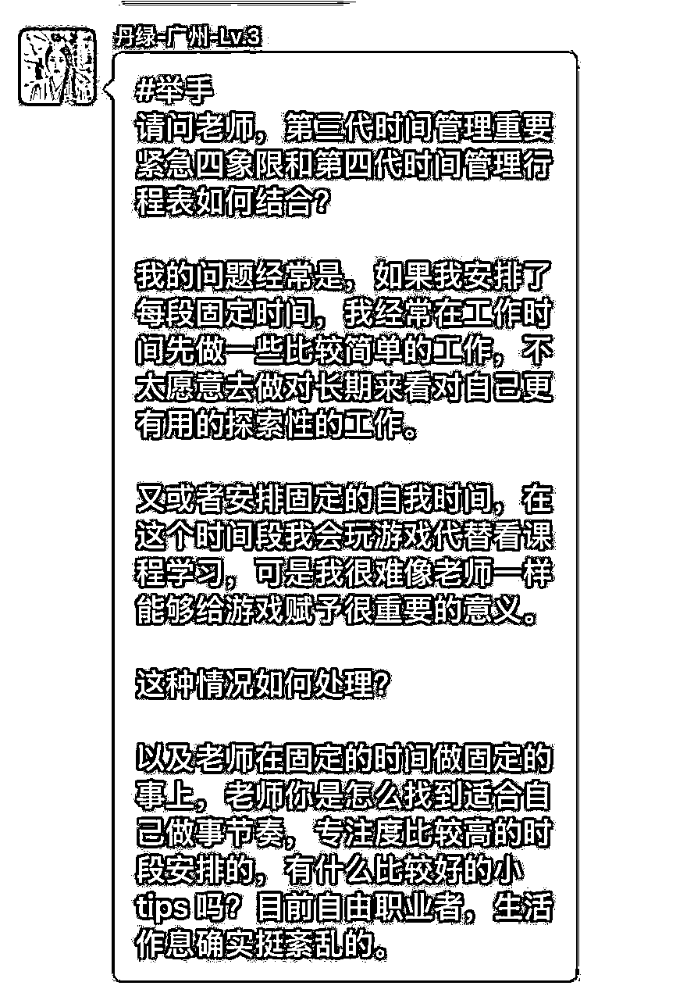

先别急着问方法，先问问自己：这样做，究竟能换来什么真正的好处？

**时间管理问答特辑：想治住“慌张”，先搞懂这件事**

先问自己一个问题：那些每天在固定时间做固定事情的人，到底图什么？

我觉得这个“图什么”特别重要。你要先看到一个习惯背后的好处，才可能愿意坚持。

就拿拖延来说吧。一个人喜欢拖延，也不是没有原因的——拖延的当下确实轻松，可以不用立刻面对那些难搞的事，可以先去做自己更想做的事。毕竟到了某个时间点，你可能就得去工作、去赚钱，而那些事不一定是你喜欢的。说实话，谁爱天天上班赚钱呢？刷短视频、看电影、去做个按摩，这些不香吗？大家都喜欢轻松。

除非一个人家里真的极度有钱，一辈子不需要为钱发愁，那当然可以有大把时间只做自己喜欢的事。可惜，大概率我们都不是那种人。所以只能辛苦一点，去做一些自己不太擅长、甚至不太想做，但又必须做的事：赚钱、养家、照顾孩子。

那固定时间做固定的事，到底有什么好处？以我自己来说，它给了我一份安稳感，也让我的做事效率明显变高。因为时间一到，我就清楚自己该做什么，不会像无头苍蝇一样，早上醒来不知道今天干什么，明天醒来不知道明天干什么，月底了也不知道这个月干了什么。

这种生活我过了好几年，整个人很慌，也很没有安全感。后来我试了很多方法，最后发现，定时定点做事，真的能把这种慌张治住。

你看，大多数上班族，他们很少因为“钱从哪里来”而慌张。为什么？因为只要准时上班、准点下班，中间把老板交代的事情认真做完，到了月底自然有工资。他们的慌张通常只有两种：第一种是钱不够花；第二种是上班摸鱼，担心这个月会不会被扣钱。可是摸鱼，不就是在该做固定事情的时候，没做固定事情吗？

所以，如果你发现一个好习惯能解决你的慌张，为什么不试试？

要养成这个习惯，不是一两天的事。初期没有太多技巧，你得对自己狠一点，把原来的生活模式推翻重来。改变生活模式，是为了让自己变得更好、更稳定。如果你现在觉得生活迷茫、状态不稳，那就把一个你认可的好习惯，放进你的人生里。自己做不到，就找个人逼你。两三个月之后，你会慢慢发现，人生真的可以不一样——这就是时间管理的意义。

还有一点，是要学会给这件事赋予意义。你做完这件事，想得到什么？这个答案只能你自己想。每个人对人生的要求都不一样，比如你期望赚多少钱，和我期望赚多少钱，可能完全不同。所以这个阶段我给不了你答案，但你可以从现在开始认真思考，把想法写下来。先写出一段属于你自己的思考，再去对照、再去请教别人，这样对你帮助更大。

下面是最近收集到的一些问题，我按顺序整理成文字版。

**问题一：朝八晚六的上班族，下班后哪还有精力安排其他事？**

有位读者说，自己每天朝八晚六，剩下的时间本来就不多，回到家还要吃饭、休息、恢复精力，能分给其他事情的时间更少了。想知道这种情况下，到底该怎么安排，还是说工作日下班后做一两件事就够了？

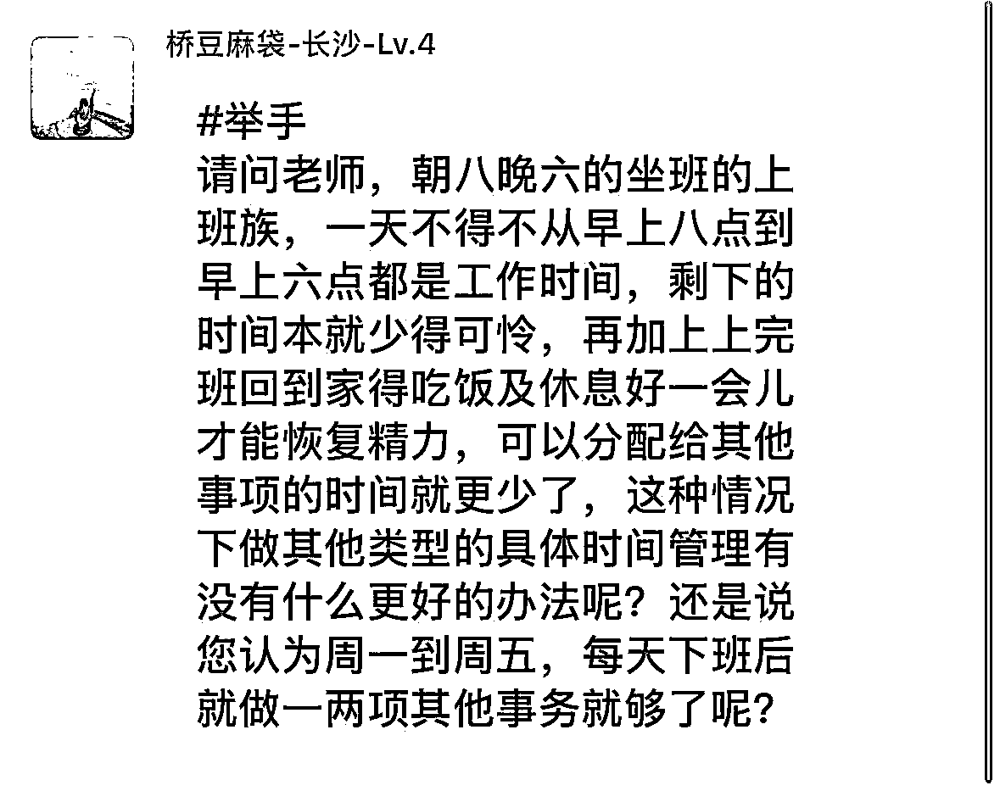

我的回答是：现阶段你要做的不是急着调整整个人生状态。这样的作息你已经过了好一阵子了，虽然可能没什么情绪价值，但生活并没有失控。所以，在调整行程之前，你先问问自己：未来这一年或两年，你想过成什么样子？

如果这个问题没有答案，你不知道该往哪个方向调。所以第一步要想的，是这一年内你想完成什么目标。必须有新目标，你的时间管理才会跟着改变。

如果你实在想不出目标，也可以用另一种方法：把你上一周或者上一个月的所有行程，用颜色标出来。你看完之后就会知道，原来自己每周缺少了什么颜色，哪些事几乎没有做过。你不去关注它，当然就得不到它。

总之，两条路：第一，去找一个未来半年到一年的目标，如果太难，就缩短成月目标，想一想这个月想完成点什么；第二，把过去的行程拉出来看，复盘缺了什么，然后补上。缺自我陪伴会有问题，缺赚钱也会有，缺和孩子的相处还是会有。任何一种缺失，都会让人生失衡。

**问题二：一件事做到一半，信念崩塌了怎么办？**

有位朋友问，她很努力地做一件事，做到一半突然发现意义变了，最初的信念没有了，该怎么办？

遇到这种情况，先问自己：为什么事情做着做着，你自己变了？

说实话，能做到“以终为始”——也就是一开始就清楚自己最终要什么，并且坚定地执行下去——的人，本来就不多。我自己工作了十三年，价值观也换过三次。有些承诺过的事情，做了两年，我也会突然爽约。所以这种情况我经历过。

你可以先试着找回初心：为什么中途调整了一下，意义就不见了？当初那个念头还能不能拿回来？如果试了很久，初心和意义还是找不回来，那就往前看，重新找一件新的事，赋予它一个新的意义。然后告诉自己：在做出某个结果之前，尽量不要中途反悔，也不要随意逃避和改变。

过去的事情如果实在无法调整，那就把未来做好。老是回过头去指责过去的自己，没什么用。把目光放在未来，你会看到更多希望。

**问题三：滴答清单设置了颜色，为什么日程还是不显示？**

一位叫Bingo的朋友问，他按照六类价值分类设置了六个清单和对应颜色，任务也归类到清单里，但按天或按周看的时候，所有任务都变成了灰色，只有设置优先级后才会变成红黄等颜色。翻了教程也没找到办法。

这个问题我记得前几天用我自己的账号发过一个小视频，里面有详细讲怎么用颜色区分。你可以在社群里搜我的名字，找到那条视频。如果还没看，先去看；看完如果还是不明白，再回来问我一次。放心，那个视频我发过两遍，应该找得到。

**问题四：全职妈妈被一堆琐事淹没，怎么分清轻重缓急？**

另一位读者是位全职妈妈。她说自己虽然有日常的弹性工作，但没有收入压力，做多做少也不受影响。问题是家里的事情占了她太多时间：接送孩子、陪读、陪玩、孩子社交、装修、家务、采购、准备旅行、学校活动……每一件看起来都既重要又紧急，把她耗得很累。她也想区分哪些是重要紧急、哪些是重要不紧急，但分不太清。比如洗衣服，不洗就会臭；购物，不买牛奶家里就没得喝；接送孩子，除了她没有别人能送。家庭很重要，但她不想把百分之六七十的精力都耗在里面，这样会影响赚钱和自我成长。

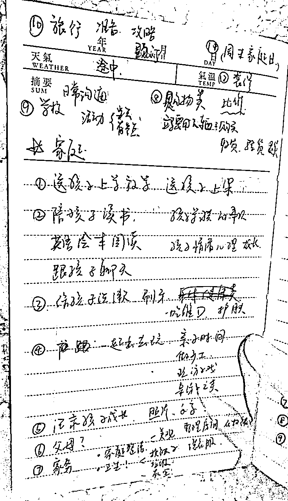
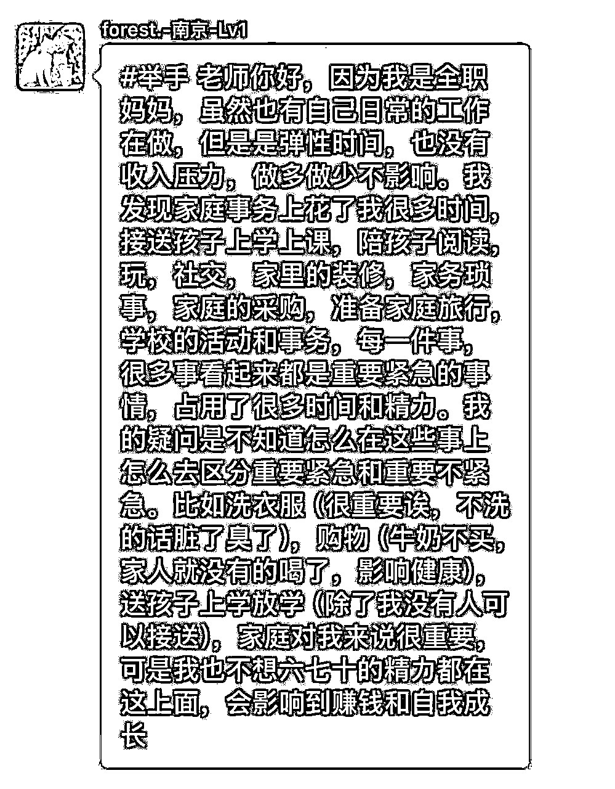

我的想法是，不是所有事情都一定要放进四象限里分类。

就拿洗衣服来说，衣服放一天不洗，它不是重要紧急的事，最多算个待办事项。比如我家孩子的衣服一般两天洗一次，大人的衣服三天洗一次，尤其是冬天，换洗频率比夏天低。也就是说，衣服放两天会变成重要紧急，放一天并不会。生活里的琐事，如果不为了刻意练习分类，该做就顺手做掉。

最怕的是什么呢？你明明知道衣服三天不洗才会变得重要紧急，但你就硬撑着，真等到第三天再去洗，那时候事情就变得很严重了。再比如，前两天我儿子感染了诺如病毒，晚上突然吐了，被单很臭。那个当下我如果因为想睡觉不洗，第二天冷又不洗，那被单不仅臭，还可能长细菌、有病毒感染。这种情况下，洗被单就真的变成了重要紧急的事，我会把它放进待办事项。

所以我想说的第一点是：不是所有事情都非要归类到四象限。第二点是：能预测的事情，尽量提前安排。比如学校需要家长做什么、家里有些什么事，这些往往是可以预测的。既然是能预测的，做起来就不应该慌张。真正重要紧急的事情，做的时候会有一种很慌的感觉。如果一件事你已经熟练到游刃有余，就像我每天讲课一样，早就讲习惯了，那它就没必要被列为重要紧急。

日常琐碎能不能有效率？当然能。比如洗衣服，家里有烘干机和没有烘干机，效率完全不一样。我为了每次晾衣服能省下二十分钟、三十分钟，就会愿意存钱买一台烘干机。每天省下二十分钟，不就能看会儿书、看篇文章，做点别的事了吗？

还有购物。像买牛奶这种事，我基本不会把它放进待办清单，最多提醒自己“今天要记得买”。我有固定的采购时间，比如每周三、周六去一趟大卖场。或者更省事一点，牛奶直接用美团叫附近超市送，或者在淘宝上定期下单。反正牛奶是隔天到或后天到，那就提前两天做准备。当你把能提前的事情都提前安排好，心里的慌张感自然就消失了。

每周哪一天该做什么，清楚之后，处理时间就会很从容。如果你孩子已经上学，那就更要把人生里的事情放到合适的位置。安排得有条有理，处理起来就不会慌乱。省下的时间和精力，可以做副业、学习，甚至做点小兼职。现阶段这些琐事用不上多复杂的工具，便条式提醒、优先次序和简单行程表就够了。

**问题五：工作时间完全不固定，要怎么规划？**

有位读者说，她上班没有规律，比如今天下午一点到八点，明天下午五点到凌晨两点，后天下午三点到十点。上班期间虽然有碎片时间，但不确定，而且随时会被打乱。这种情况下该怎么规划？

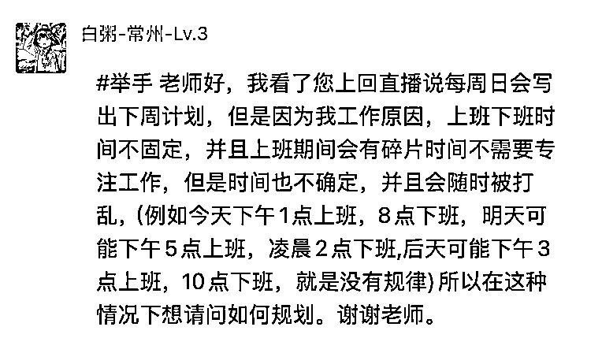

我的建议是，先把你一个月的工作情况拉出来看看，能不能大概预估出上班时间。如果实在抓不出规律，那就计算一下，每周或每月固定工作多少个小时。假设你清楚自己每天固定要上六小时班，那就能反推吃饭几小时、睡觉几小时。如果做不到在固定时间做固定的事，那就换个规则：每天至少固定留出两小时给副业，或者两小时给学习。

万一不管怎么预测，都没办法知道具体上下班时间，那就给自己设一个每天雷打不动的时段，可能两小时、三小时，哪怕一小时也行。这个时段用来学习或做副业。你也许没法固定时间做固定的事，但可以做到“稳定时间做固定的事”——每天都是同一段长度的时间，做固定的事。这算是退而求其次的可用方案。

后来这位读者补充说，她的工作内容是直播，老板就是主播，直播时长完全看老板状态和临时想法，一天一个样，确实抓不住规律。比如下午一点到凌晨两点都是直播时间，但可能播两场老板累了就下班，也可能状态好、开完会突然决定播六场八场。所以她只能把最重要的事安排在上午，每天留出两到四小时做副业，其他学习、感情之类的事全部用碎片时间处理。她真正难受的点，就是在不确定性中寻找确定性。

**问题六：有截止时间的非高优先级事情，总是拖到截止前才做怎么办？**

一位读者说，自己总是拖延那些“非高优先级但有截止时间”的事。在截止之前，他更愿意先去做自己感兴趣的重要不紧急的事，直到快到截止时间，才把原来那件事变成重要紧急来赶工。问有什么办法能解决。

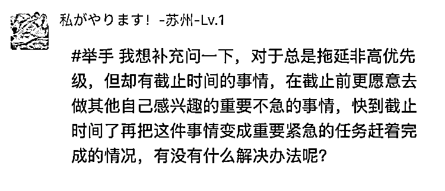

我觉得时间管理在完成目标这件事上，可以分成三个阶段。

第一个阶段：超时了，但还是没完成。那就干脆放着不动，直接摆烂。

第二个阶段：不拖延，但能掐着点完成。比如我设定晚上九点要发一篇文章，可能八点半我还在玩手机，但到了九点整，我一定能把该发的发出去，不会超时。

第三个阶段：提前完成。本来打算九点半发文章，我在八点半或八点五十就已经把文章写好了，提前发出去。

再差也得做到第二种，因为第二种至少不超时。拖延这件事，靠“想解决”很难解决，除非你付出极大的代价，或者做大量刻意练习。比如你原本要一小时打完一篇稿子，你希望效率能提升，那就在未来两个月，刻意把时间从一小时缩短到五十分钟。朝着这个方向练，你就会慢慢摆脱被截止时间追着跑的处境。

以上，就是这几个问题的完整回答。希望你在看完之后，能找一个适合你的好习惯，放进自己的人生里。哪怕每天只改变一点点，两三个月后，你也会发现生活正在往更稳的方向走。

只要你能稳定地在约定时间交出东西，那接下来不妨试着把目标节点再往前提。提到十分钟、十五分钟都可以，每次都用这种刻意的方式去磨合，你的做事节奏自然会加快。等进入第二阶段，你能掌握让产出变好的要领，也会知道怎么调校自己的工作形态与模式。这就是我想给你的思路。

我比较担心的反而是另一种情况——连最后期限都交不上来，那才叫惨。我自己也一样，会偷懒、会摸鱼，甚至可能到截止之前半个钟头还两手空空，就等着在最后那半小时里全力冲刺。我常常把自己丢进那种又急又重的处境。可就算再糟，我至少还能赶在期限前交差——这已经是我最差的底线了。既然我差到这个份上都能做完，你能够交出成果，已经相当不赖。

现在要思考的，是能不能借助行程的排布，让每回的截止时间再早一截，好让自己的产出能力再往上抬一抬。

这情景让我想起小时候念书。我妈妈每天开车送我上课，七点整我必须出现在教室里，迟到就算大事。而我家的挂钟，永远比标准时间快十分钟。换句话说，实际时间才七点，钟面上已经显示七点十分。妈妈只要看一眼钟，就会念“快迟到啦、快迟到啦”。她就是靠这种“假装的紧张”和“故意拨快”的招数，让大家做事变得利索。

这个方法给你作个参考，希望对你有用。还有疑惑的话，欢迎再来问，谢谢你。

* * *

呼哈-南京提问：手上的事做着做着就会走神，计划做着做着就跑偏去刷手机、看网页、碰其他杂事，老耗在那些不打紧又不着急的事上。除了那种又重要又急迫的任务能专注完成，平时一天下来产出很少，很烦恼。想请教怎么办？

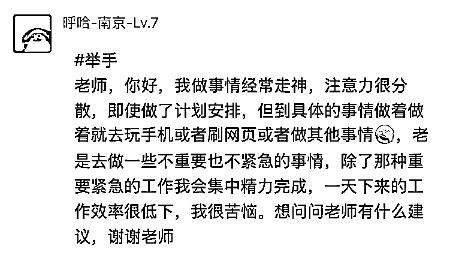

其实这事好解，关键是你得给自己安排一个“输不起”的代价。一个人做某个决定，是因为他认定那个决定能带来某种好处。走神的好处是什么？不过是获得眼下的轻松，短暂逃开不想碰的事。可这点轻松，往往比“工作搞砸后被主管骂”更有诱惑力。

所以最有用的对策，就是设置一个让你肉痛的惩罚条款，逼自己在特定时段里把效率提起来。假设我要求自己两小时以内解决某件事，我就去请一个人监督我，跟人说好：到了时间我没交差，我就给对方五千块钱。

这个罚金必须高到让你一想就心疼。我自己就是靠这招逼出自己的速度，它是目前我试过最快见效的方法，可以借你一用。

我们搞这么多，说到底是想提升做事的速度。这中间有两种走法：一种叫慢慢磨，一种叫猛药催。选择权在你。要是你接受慢慢磨，那就另找辅助工具，一点点纠正。但在我看来，加速是最要紧的事，因为手越快，同样的事情占用的时间就越少。因此我偏向用稍微狠一点的招。

那你也可以说我狠。罚金可以先试试两百块的红包，不行就加码到五百块。如果这样还是管不住自己，那就改成五千块，看看你还敢不敢拖。

当然，要是你家底厚，对金钱不那么敏感，罚一万、五万都没问题，金额是根据个人情况自己定的。我能贡献的，就是我自己用来治拖延、提效率的路子。希望你敢迈出第一步，只要敢试，效率就一定往上涨。

这就是我的回答，希望你有收获，谢谢你。

* * *

信步-青岛提问：每逢期末复习，由于有点完美主义，只要有一天或某一项没按安排完成，后面就想摆烂，结果计划老完不成，天天熬夜焦虑。想知道是不是只能从底层认知改变？

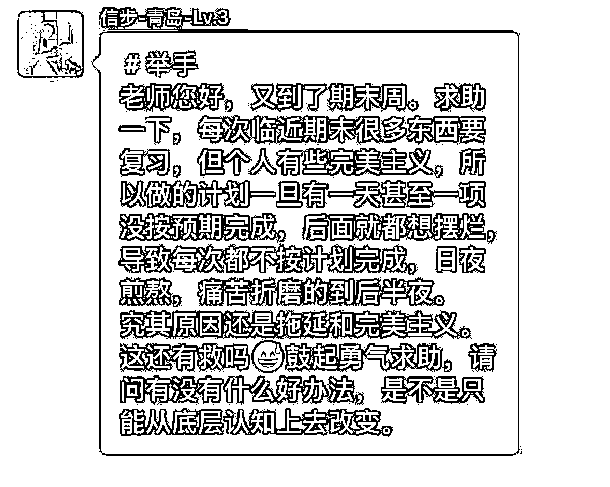

信步，晚上好。抱歉我之前看漏了这条，没回你，现在补上，谢谢。

我倾向于认为这里的关键在于“定义”。你的留言其实可以切成两段——前一段是你自认有完美倾向，后一段则是你经常为了把一件事做到极致，反而不断往后拖。如果真有完美洁癖，那么当天的事没清干净，你是不会去睡的。因为这种人没法容忍自己当天的清单有空项。所以你可以重新掂量一下，“完美主义”这四个字到底贴不贴切。在我看来，至少不适合你。这是第一个想告诉你的。

第二，所有的成长和改变，都得一步一步来。我想把百米成绩从十五秒提升到十四秒，不可能一蹴而就。我得先跑到十五秒，再跑到14秒90，再到14秒80、14秒70，也许折腾大半年，才终于碰到14秒。这就是自然规律。

要是你认可这个规律，那你现在要做的事就要换掉：别再纠结“为什么又没做到”，而是去琢磨“怎么才能做到”。眼睛一直盯着做不到的地方，你就始终困在“做不到”里。可一旦你开始想“怎么做到”，脑子就会自动跑去找对策，而不是陷在坑里。

要清空当日的所有安排，能走的路实在太多了。哪怕今天就是没清完，你也可以顺手想出无数个“完不成就不许睡觉”的鬼主意来逼自己。所以我今天不给你具体方案，我送你的是换个关注点。把那些“我没辙”、“我干不完”、“我心里过不去”的想法统统扔掉，只留一个疑问：我要怎么把今天的任务全部消灭？这个疑问一出来，你的大脑就会立刻给出现阶段能想到的最优解。我们先不谈这个解法能不能用，至少你已经转了个方向去想了。这个思路，希望你先收下。

你还可以试试看在纸上列出来：能有哪三五个办法，让我把今天排的事全部办掉？然后我们再从这些办法里挑一个最适合你的仔细聊。这就是我目前能给你的回应，谢谢。

* * *

是星星呀-厦门提问：明明知道有些重要又紧急的事必须干，可注意力总被不相干的事带走，在一些无用的事上瞎忙半天才反应过来。有时还会骗自己说今天够忙，事情明天再做，但多数时候心里过不去，熬到凌晨两点才结束。第二天靠咖啡续命，想知道怎么改善。

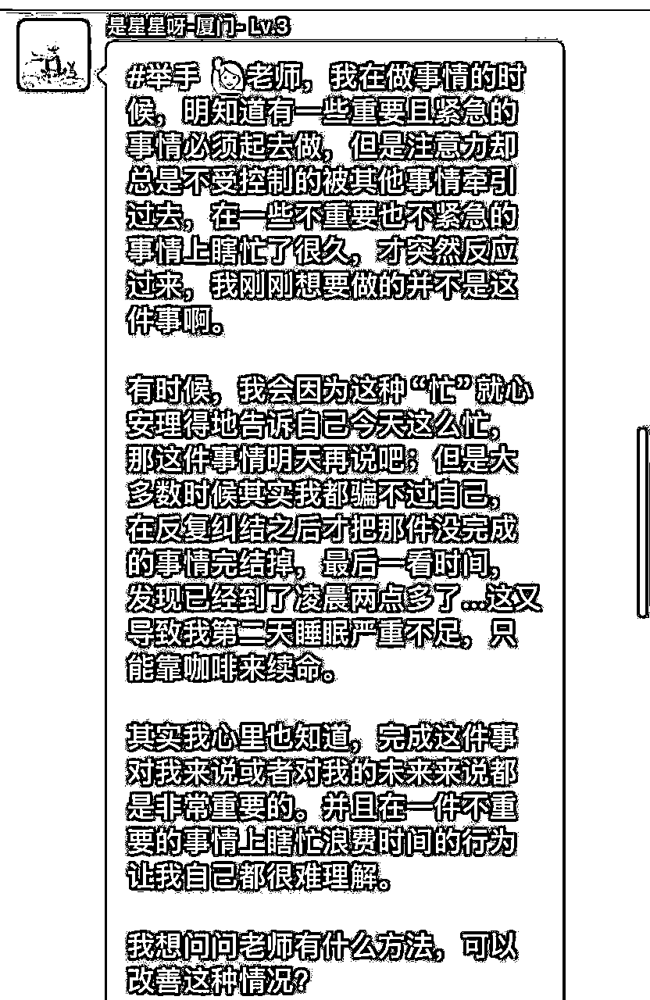

星星，晚上好。时间不早了，我把你的问题答完就收工去休假，谢谢你来问。

你描述的状况其实很普遍，我到现在也一样会犯。原因是那些“要紧但不着急”的事没有那股追赶感，你去做的时候，哪怕拿不出成果、摸一会儿鱼，也不会马上遭到惩罚。所以你会有这种反应，很正常。你要做的，是让自己更有控制力。我给自己立的规矩是：既然说了要干，就算熬夜也要把它干完。至少达到“完工”这条线，超时一点我倒不太在乎。

如果你想要更高的标准，那就试着在预定时间内做完，别拖过点。要是还想更上一层，那就学会提前完工——每天往前推进一小块，只要有进度就行。

我常常碰到那种“要紧却叫不动人”的任务，而且它对我的未来挺关键。这时候我就会想点比较极端的方式来催自己。比如今年在赚钱里写东西，三四月的时候，会员日有位伙伴问“你今年的目标是什么？梦想是什么？在赚钱想完成些什么？”。我回答说，我想在这一年拿下二十篇精华文章。

这目标说实话够难的，有人在这儿混好几年也未必有这个数。写完我又想：万一没拿到会怎样？其实也没怎样，不写也不会有太大后果，撑死就是当年夸下的愿望落空而已。可我不想让自己太难看，于是又给自己加了一条：每周至少保底更新一篇。

从今年九月开始，我按这个频率约束自己，每星期必须写一篇新的出来。可我心里清楚，这是件“要紧但不赶”的事，光靠自律很难启动。于是我跟学生放了话：要是每周五我没把文章传上去，就罚款两千。钱被罚走，真的很心痛——买衣服多好。结果呢，从说好那天起到现在，我每周每月至少能写出四篇，已经拿到差不多十篇精华了。

我说这些，不是为了炫耀自己拿了几篇精华。我只是想表明：要是我判断一件事长期重要，可现在不动手，将来会吃更大的亏，那我就会动用一些猛招去逼自己行动。这招你也能用。假如你身边缺一个能盯住你完成安排的人，欢迎来找我，我私下盯你，没搞定就罚钱。

差不多就是这些，供你参考，谢谢你。

* * *

jenniey-深圳提问：原来重要不急四象限不是用来当下提效，而是拉长到半年、一年来提升人生效率。那这个工具该放什么？她按自己罗盘排序（赚钱>自我>健康>爱情>家庭>工作）和十年后目标，把赚钱类的事放进重要不急，再拆到每周、每天的时间块，问这么用对不对？

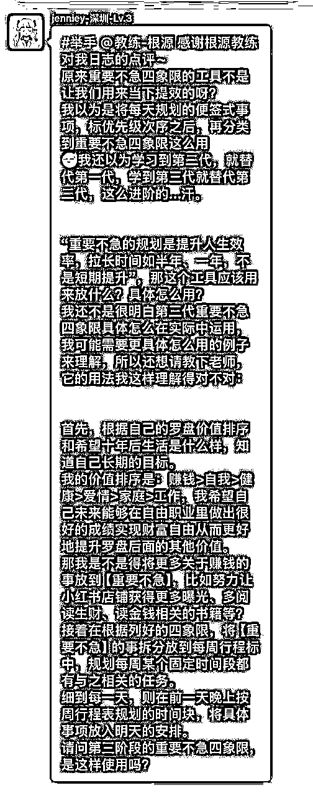

jeniey，晚上好。这会儿也挺晚了，我先回完你这条，再去好好放假。谢谢你的提问。

确实，第三代时间管理工具的本意，不是让你当下立竿见影，而是让你在一段很长的人生跨度里受益。哪怕你把一件事放进“重要但眼下不催”的格子，你此刻能做的也仅仅是把它完成。这个格子天生就给长期事件准备的。如果你只打算用它在短期内提速，那完全不需要建四个象限，把所有事项往优先级上一排就好。

如果你真的想从这个工具里得到实际效果，那你至少得给自己定一个年度目标，或者三年目标。有了这种较长周期的目标，再来用第三代分类，你才会感觉自己没白练。连年度目标都没有的话，第三代时间管理就只是拿来练手的东西。所以你的判断是站得住的。

以上是我补给你的回答，谢谢。

* * *

丹绿-广州提问：第五代时间管理里的角色转换，为什么要写最接近自我的角色和最吃力的角色？如果找出最吃力的角色，应该通过时间管理去缓解吗？她在工作里的角色比较被动，需要主动推进，想不到能立刻变积极的办法，正念只能让情绪平稳，难以变主动，问老师有什么建议。

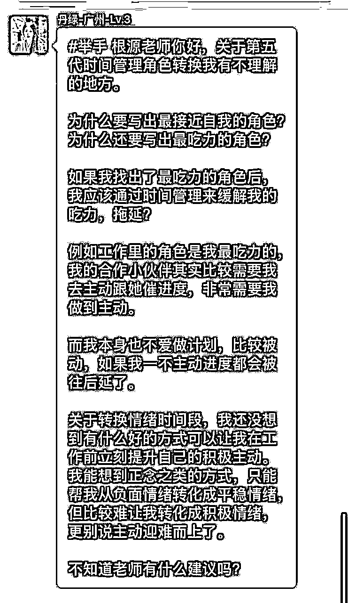

丹绿，晚上好。天不早了，我把你这个问题回完，就去好好休假。

因为你还没交作业，所以我暂时不回应这个问题。你要先试着把作业做完，认真去盘点：哪十件事能让你把情绪调得更亮？等你真正写完了，再回来提问一次，那时候我再给你详细解答。因为这份作业的意义，就是让你自己去体会：这些项目为什么要这样设计。

就算你写完之后还是搞不清它到底有什么用，至少你已经完成了一次思考。所以这个问题我先扣住。等你把作业发上来，再提一次，我再回答，你看行不行？谢谢你。

* * *

妃小二-北京提问：执行计划时总有种被框住的感觉，怎么兼顾自由度和完成度？尤其计划被临时事打乱后，整个人会陷入混乱。比如下班后的学习运动安排，突然加班、朋友临时邀约、健康问题等打破计划后，不知怎么继续。

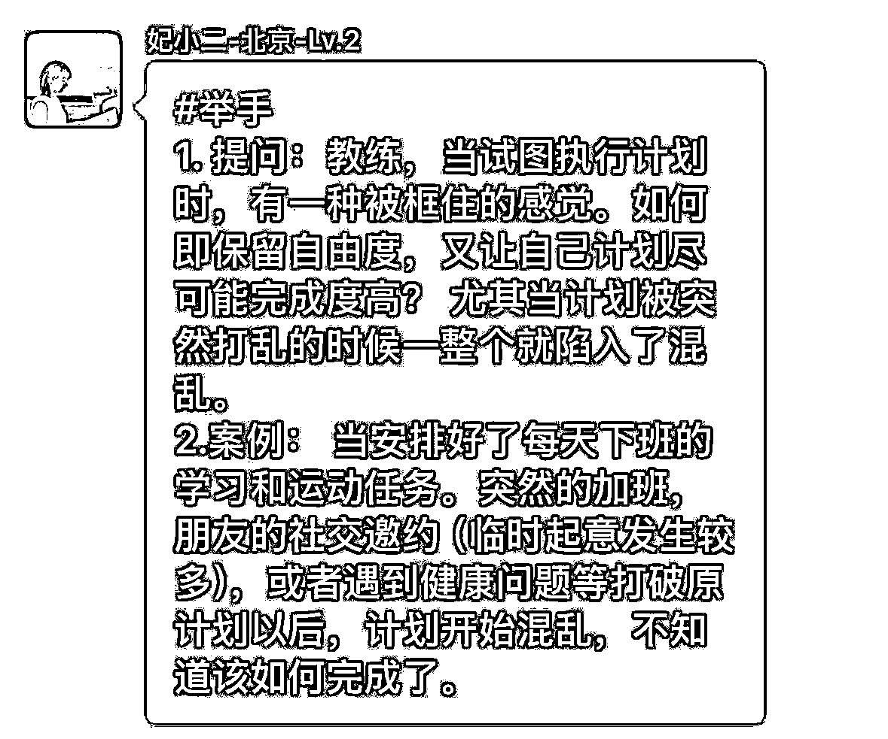

小二，早安，谢谢你来问。

这种困扰我太懂了。我在2022年那阵子，也想重新整顿一下自己的工作模式和时间配比，花了快一年才逐渐调到如今这个自己比较满意的状态。其实在2022年我就那样设定了，可那会儿我还是常常没法在计划内收工。刚转型的阶段，我天真地以为，只要每天给写作、社群运营、陪家人各留出一段时间，就一定办得到。但现实经常打脸。

比如，原计划中午十二点前处理完工作，可我总拖到下午两点。两点才吃饭，然后又要带小孩，晚上有些信息没回，晚饭又顺延，结果晚上的工作全被推后。原本十点之后是要陪太太的，但我每次下完课就得回社群消息，那段时间群里的热度正好，经常等我把消息清完，时钟已经指向十二点。

最开始我也有过这种完全掌控不了时间的窘迫。但我觉得没必要太急，毕竟时间管理本身就是一条渐进的路，慢慢把人带向理想的节奏。如果你发现今天的目标和预期不一样，那也没关系，想着明天好一点，后天再好一点就行。把观察线拉到半年甚至一年，别指望一天就全部达标——那不现实。

当你每天都能攒下一点小进步，慢慢地，你会发现这件事真的能改善你的人生节奏。先别说提高，至少能稳住。你知道自己能说到做到：说一个小时写完文章，就真的写完；说两个小时内解决客户的事，就真的搞定。

因此，这是慢慢变好的过程。发现自己没做到的时候，先别慌，给自己定一个阶段目标，可能是三个月，也可能是半年，然后每天都去关注自己有没有往前走。这才是学好时间管理的关键。

我能分享的，只是我自己趟过这条路的心得和过关的方法。这一个回答，就把你的两个疑问一起解决了。还有不解的地方，欢迎再来追问，谢谢。

* * *

绽放-北京提问：目前按清单管理，但时间把控不好。想完成学习打卡，有时听完课想记下灵感，或有朋友发消息就忍不住回，导致下一项被推迟，睡眠无法保证。怎么解决？怎么判断能进入下一阶段？另外，列行程时有些事项不在七项里，不知道怎么归类，比如和朋友聊天。罗盘内容是怎么定的？

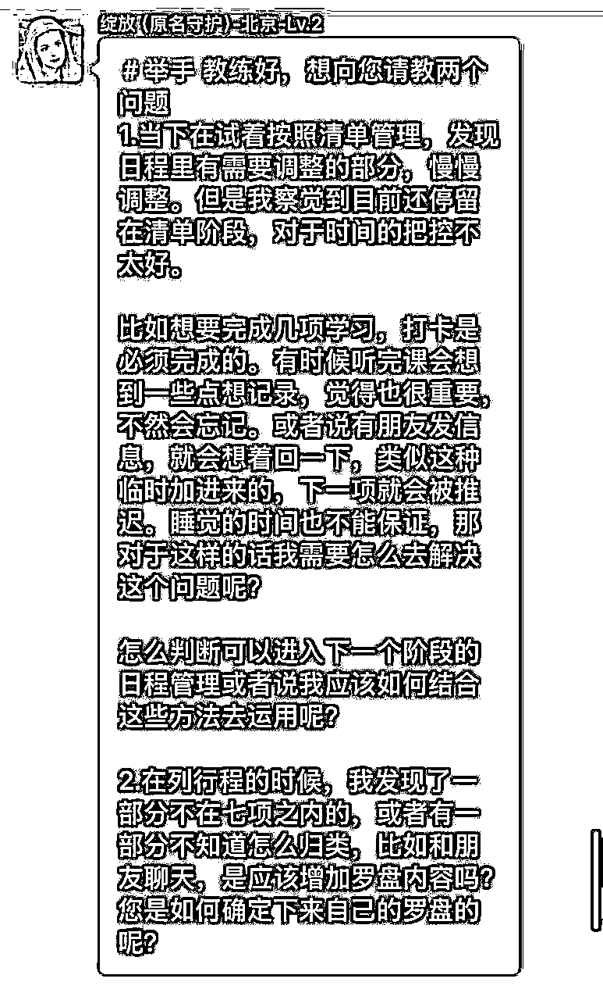

绽放，你好，谢谢你的提问。

第一个问题，我反而觉得挺有意思。你已经在某个时间段安排了某件事，却还想额外把别的事塞进去。我认为初期这样没问题。在时间管理还没做到很完善的时候，穿插一些临时事项是允许的。但换成我，大概只有两种情形，我会愿意插队。

第一种，是我自己的行程规划不够周详。前天晚上排计划时，有些环节没想周全。拿运营社群举例：我原本安排晚上八点到九点上课，九点后关机休息。但每次九点下课，社群里就热闹起来，许多人喜欢在这个点提问、聊天。我原来的群，用户的习惯就是九点以后开始活跃。那这时候我要是不露面，群里的互动和转化可能就会受影响。起初我并不清楚这点，试了几次才明白，九点课后我不能马上消失，得再留出一个小时，从九点工作到十点。这算是额外增补的工作量。

在时间推进与计划落地之间，最常见的卡点往往来自规划的弹性与取舍的原则。

第一种弹性，是承认规划本身会有不周全的时候。上午或下午本该用来处理工作的那一个小时，如果可以挪到晚上补上，就先把这段被挤掉的时间加回去补齐。另一种弹性，则是规划不变的前提下，在既定时段内部做微调。比如晚上8点到9点本来是社群运营，如果发现顺手发一条朋友圈能大幅提升运营效率，就可以在这个1小时内顺带把朋友圈更新做掉，核心原则是绝不超时，9点之后的安排必须完整保留。一种做法是行程被动调整来弥补规划缺陷，另一种做法是行程框架不动，靠内部嵌套提升效率又守住边界。两种做法都可行，前一个月建议先用第一种来校准自己对时间的感知，一个月后再切换到第二种，时间感稳定后，嵌套式执行会更顺。

关于人生罗盘的归类，七大类在现阶段已经足够用了。像维系朋友关系这件事，有人会把它放在固定事项里，因为日常行程里除赚钱外没有额外工作，固定事项就用来承载那些已交付、需要长期维护的人际关系。也有人直接归到朋友关系里，都是合理。罗盘本质上是给你个人参考的工具，并非标准答案，可以用更顺手的方式去归档，只要别频繁更改类别即可。

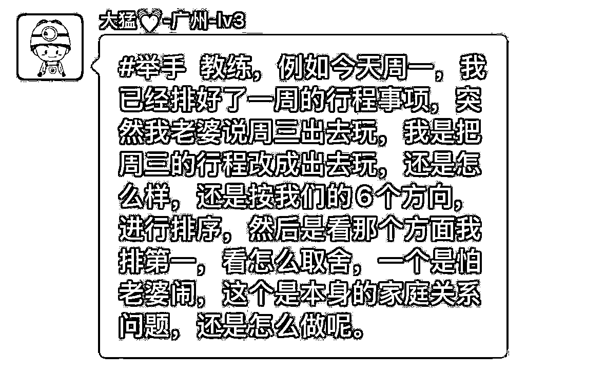

哈喽，大猛，你好，谢谢你的提问。

临时行程的取舍，无法给出统一排序，因为最终要看你罗盘里的人生价值观排位。谈优先级时，重点不是谁占时间更多，而是冲突发生时谁让步。就算工作排在前面，也不意味着一天12小时都要工作；爱情排在前面，也不代表24小时都要陪伴。优先级的意义在于冲突时的决策倾向。

如果你的罗盘里爱情排位靠前，周三老婆临时提出出去玩，这件事本身就具备插队的正当性，该让行程为其让路；如果工作排在前面，老婆临时要求陪玩，你就可以按原计划坚持。每个阶段的价值观排序都要清楚其背后的原因，这样在冲突时才有自己的答案。

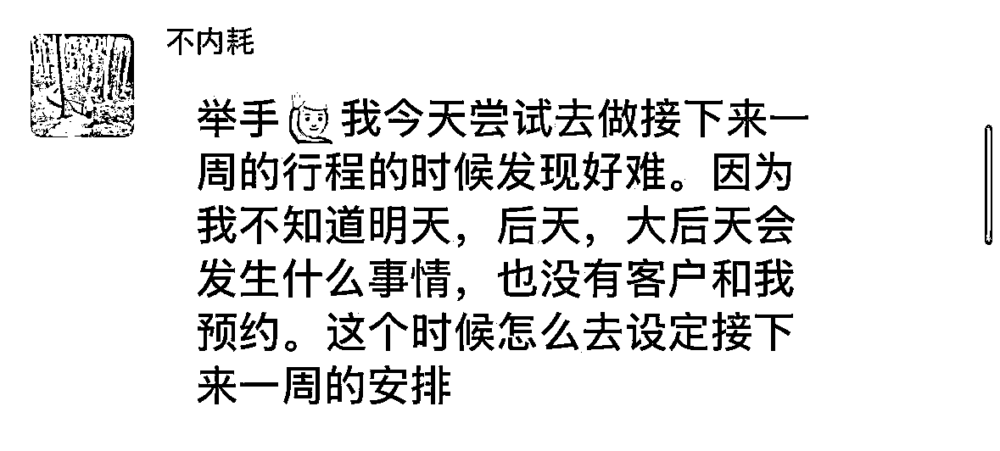

哈喽，不内耗，早安啊，这昵称真特别。

如果暂时无法规划整周，这很正常，说明自我掌控的颗粒度还在提升。做不到周计划，就从每日代办的优先级开始，先只排隔天。每天只做一天的预判，搭配每周一次复盘，看颜色分布与完成的轨迹。

能力不足的阶段，行程表更像是一面镜子，用来回顾过去而不是预测未来。先学会从复盘里校准节奏，再逐步延长规划窗口，不必强求一步到位。

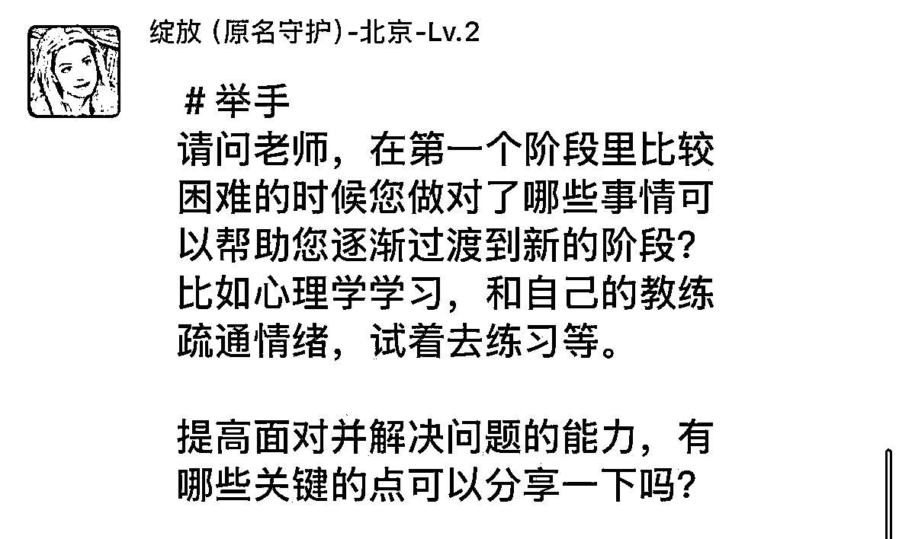

哈喽，绽放，早安，谢谢你的提问。

困难期能挺过来，核心诀窍只有一个：固定时间做固定事情。收入骤降、团队出问题时，我把赚钱放在最优先，即使心情糟糕也照做。因为知道情绪发泄无法解决根本问题，拖延只会让状态更差。

记得有次下午1点要去见客户认识资源，上午跟老婆大吵到12:20，本来想取消，最后还是收拾出门迟到了15分钟但仍把活动完成。带着情绪执行效果可能打折，但关键任务不能因情绪被撤回。正是这种“情绪不拖任务”的坚持，让最核心的问题没有继续恶化。

第二个支撑是长时间的系统学习。从2012年起跟随老师十余年，心理咨询、销售、逻辑、情绪管理等二三十项能力几乎是同时在练。也因为过去有成功经验养成的习惯底座，重来时有方向感。技术本身不是最核心，最关键的是清楚知道：若不先处理优先级最高的事，情绪会让未来更糟，因此更看重未来而非当下感受。

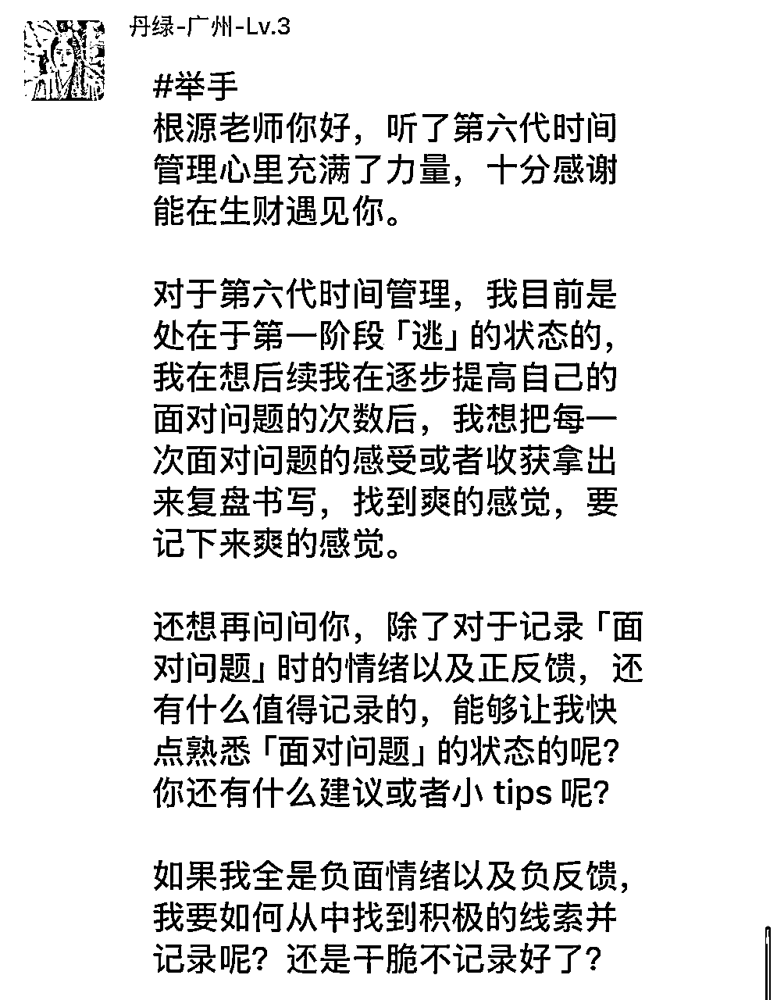

Hello, 丹绿，你好，早安，谢谢你的提问。

找到正面情绪需要刻意练习，因为人天然更容易盯着不足。练习方式很简单：强制每天至少写3项今天做得好的地方，哪怕要硬想也写下来。像今天早起一分钟、挤上原本会错过的地铁，这些看似微小的事都要记录。

坚持一个月，就能积累约90条正向记录。回头复盘时就会发现，原来每天都在发生小突破，并没有像自己以为的那样糟糕。没有捷径，只有硬练。

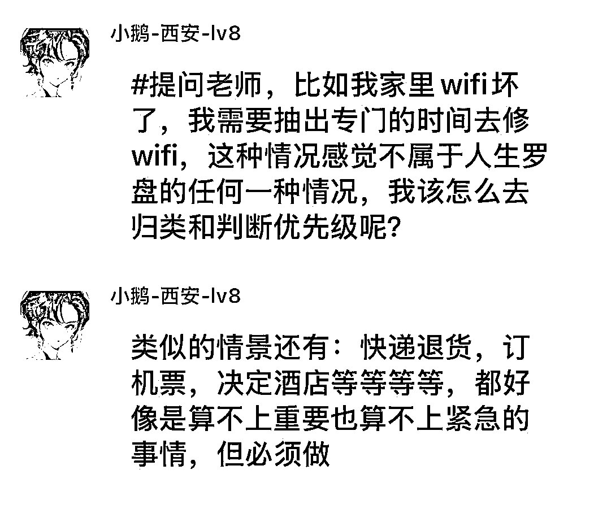

Hello，小鹅，你好，谢谢你的提问。

归类判断要看最终目的。修WiFi不属于罗盘自带类别，就看这件事要达成什么。如果修WiFi是为了支撑在家工作、上传大文件，流量吃不消，必须用网络，那它就属于工作或赚钱类；如果修WiFi是为了下载150G的游戏，想玩《黑悟空》，那它就属于自我娱乐类。分类依据是驱动行为的终极目的。

类似快递退货、订机票、定酒店等看似琐碎的事，初期大多是不重要不紧急。但一旦超过退货期、机票涨价、酒店满房，就会瞬间变成重要紧急。判断标准是截止时间、预算目标与最终后果。能快速完成的事项，即便现在看起来不重要，也建议即时处理，减少未来被动。

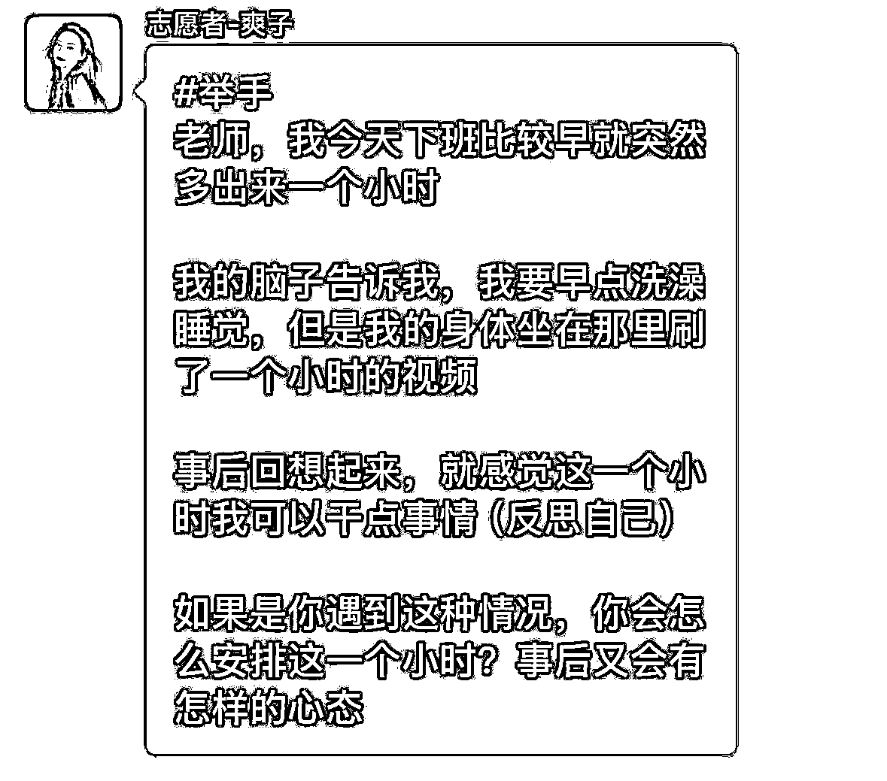

哈喽，爽子你好，谢谢你的提问。

下班提前多出的一小时，如果没有后续安排，刷视频消耗掉也无所谓。时间管理的意义不是把时间塞满，而是让重要事被执行。没有必要对每一分钟都苛求产出。

如果你是有周计划的人，可以把这段空档用来提前完成本周未尽事宜，比如未写完的文章、未改的课件。这样本周提前收口，下一周就能更早松弛。没有周目标时，就好好休息。唯一要注意的是，不要因这段自由时间耽误了下一个既定的行程。

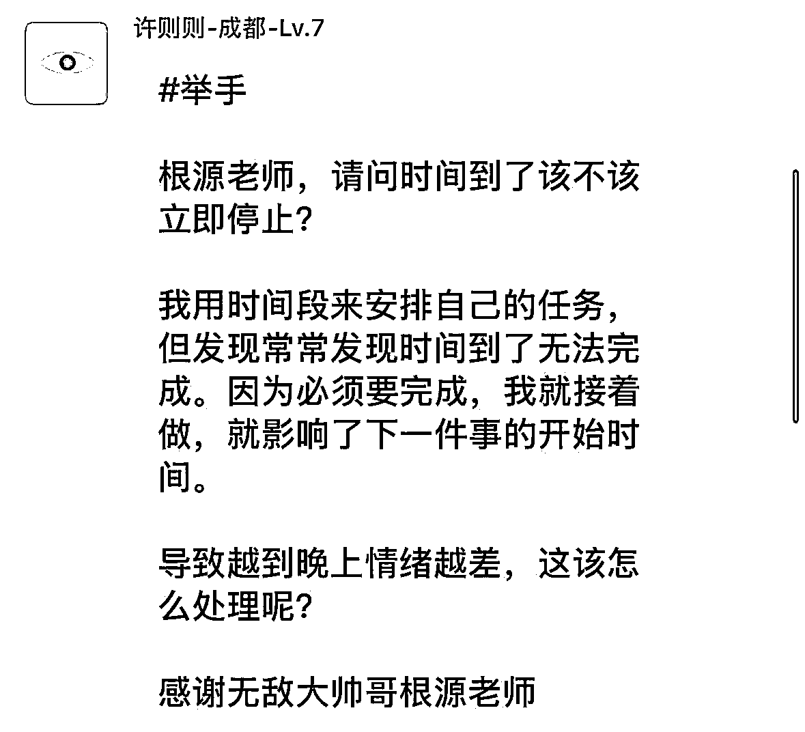

Hello，则则，你好，谢谢你的提问。

老朋友了，咱们真的是老朋友了。

面对行程冲突，通常会有两种不同的局面：

⭕️第一种，核心是看你下一项安排到底紧不紧急。就我自己的习惯来说，我很少把同一类事情连续排在一起。比如工作结束后，我不会马上再安排工作，工作之后通常留给个人时间、家庭时间或者感情时间。当第一项任务还没收尾，却已经把第二项的开始时间挤掉了，关键就变成了你怎么做价值排序。假设下一项是家庭活动，比如需要去接孩子，你还会继续拖吗？你会发现，真到了接孩子的时候，不管之前的事情忙到什么地步，你都会立刻放下手头的事出发。因为那件事分量太重。所以这时候要看下一项行程有多重要。越重要，你越不敢拖延，甚至会主动中断当前的工作。当前的事虽然没做完，但后面那一件更关键，这是第一种情况。

⭕️第二种，是当前手头的事比后面的更重要。那拖延就拖延吧，没办法。因为你在预估时，确实缺少更准确的判断和掌控力。以为一小时能结束，结果总是两小时才做完，每次都超时。如果次次如此，就意味着下次排期时，你不能把时间卡得这么紧，后续安排只能顺延。要是只是偶发，例如一个月出现一两次，那也就算了，当天晚点睡，把事情赶完。可如果已经成了常态，就说明你对时间的掌控存在很大问题。尤其当那件事是重复性很高的任务，你每次给自己两小时，却从来没有在两小时内完成过。这时候要调整的是时间分配：要么把时长改成三小时，要么依然安排两小时，但把本次要完成的目标调低一些。

这几个方法也是我自己在用的，提供给你参考。看看哪一种更贴近你现在的状态，可以立刻上手。谢谢！

* * *

## 暖暖：滴答清单的「习惯」模块，如何设置颜色？

暖暖：
老师好，请问滴答清单的“习惯”模块能不能设置标签？能不能修改颜色？谢谢指点。

暖暖你好，感谢提问。这个问题我得坦白，你用的这个工具，它的“习惯”区块我平常没怎么接触，所以不太确定怎么操作。如果只是日程表上的颜色，那应该是可以调的；但你说的这个具体位置，我不清楚设置入口在哪里。建议你去小红书搜一下相关教程，或者直接问滴答清单的客服，他们应该能给你准确的答案。抱歉这次没能帮上忙，我也去查查看，如果找到方法了再来告诉你。

* * *

## 如人饮水-北京：对于当前阶段的价值观次序很迷茫，不知道该如何正确地排序？

如人饮水-北京：
老师好，我是如人饮水。做时间管理时，价值观排序很重要，但我现在很迷茫。我今年28岁，单身，目前给自己排的顺序是：健康 > 自我 > 金钱 > 爱情 > 家庭 > 工作。可这些只是我想当然排出来的，并没有依据。我知道健康是根本，没了健康就什么都没了；但没有钱的话，健康、自我、爱情这些也很难有保障。现在不工作的话就没有收入，反而排在后面的价值观成了当下不得不做的事。我很想知道，价值观彼此之间是什么关系？在不同阶段的背后，有没有一种相对通用的方法可以帮人判断排序？

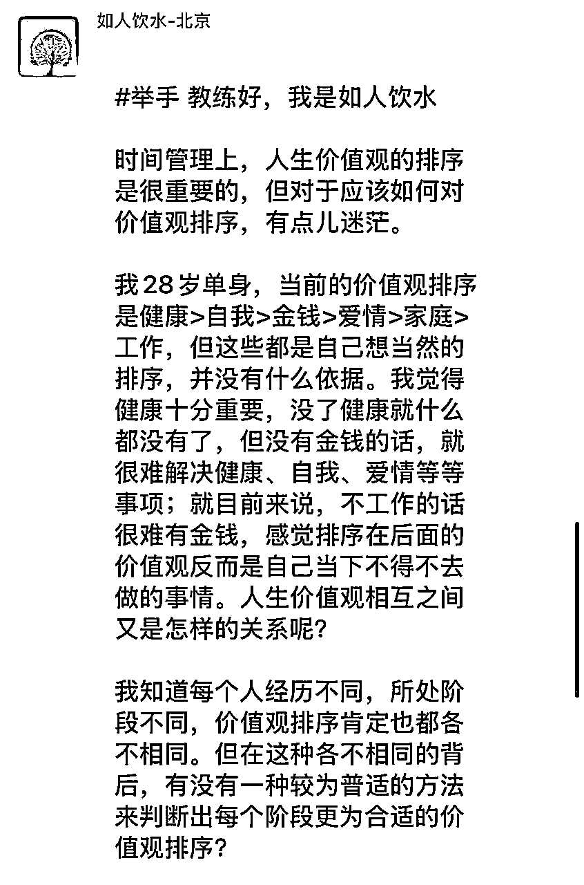

如人饮水你好，你这个昵称真特别，下午好。先给你一个小建议，注意，只是建议。如果你的身体没有什么特殊疾病，我不太建议太年轻的人把健康放在首位。因为过度关注健康，你会发现不能晚睡、不能熬夜、不能加班、不能应酬……好像什么都不能做。所以你可以先观察一下：这个群里大多数人都怎么排序？找找参考，再调试出适合自己的版本。第二种方法，是去推演不同排序会带来什么结果。比如把赚钱排在第一位，把爱情排在第一位，或者把其他选项排在第一位，分别想象一下未来会是什么样的人生。这个可以听完课之后自己去猜。第三种是看书，读一些名人自传，看他们年轻时是怎么打拼的，从那些经历里通常可以读出他们的价值排序。这几个方向是我能给你的参考。

如果回到我这个年纪，我肯定会把赚钱放在第一位。因为钱真的很重要，一个月赚不到两三万，根本谈不上赚钱。我甚至觉得，月收入不到3万，就该把赚钱列为第一优先。钱能解决很多问题：感情问题、情绪问题、家庭问题，都能用钱化解。初期收入上不去，你会一直很辛苦。所以你要问我，我在你这个阶段是这么排的：赚钱第一，爱情第二，健康第三。当时我还没结婚，也没有家庭负担，所以才会这样排。以上供你参考，希望这个回答对你有帮助。

* * *

## 不内耗：时间管理过程中，发现很多事情有冲突，不知道该如何平衡和协调？

不内耗：
老师好，我做时间管理时，很多事互相冲突，不知道怎么平衡。比如工作本身很乱，上午要出门办事，下午又要出门办事，一天就没剩多少时间，事情越堆越多，完全无从下手。而且我执行力不足，有拖延症，看到积压的单据就害怕，带回来了也不想做。还有练车时间安排不出来：工作日要完成工作，周末也想做自己的事，练车一直没空。另外身体调整和工作也很难兼顾，体检报告不达标，医生建议调理身体、多锻炼，但工作又放不下。

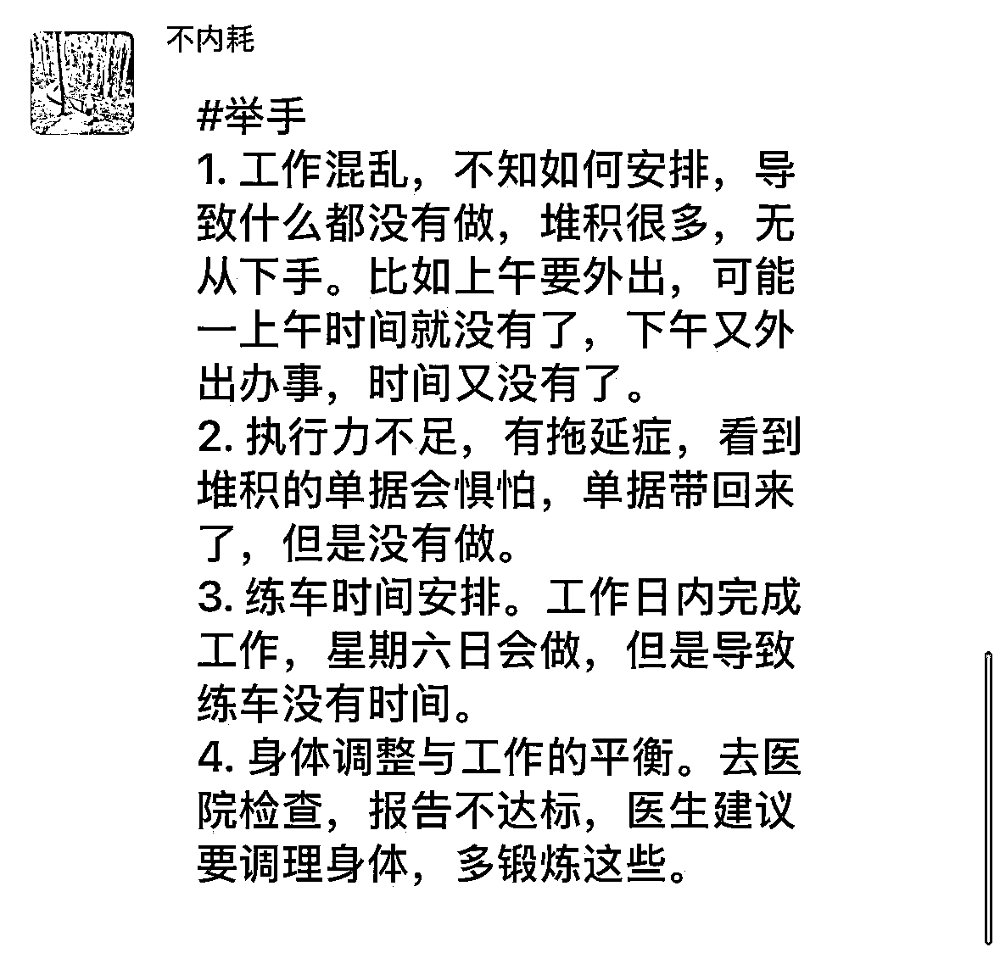

不内耗你好，谢谢提问。你的昵称我印象很深。这个问题有点难，因为你一次性抛出来的困扰太多了。你可以先把自己的问题做一个排序。排完之后，你会发现里面可能有家庭问题、工作问题、健康问题……然后你判断哪一个问题是你目前最迫切、最需要解决的。如果你自己没有排序，我很难给出回答，因为就算我给你答案，你也执行不了。我什么都可以给你建议，但如果你心里没有优先序，就不知道该听哪一条。所以现阶段我没法给你确切的答复。

不过有一个方向可以思考：先把你的罗盘列出来，看清楚以哪个价值观为优先，再拿这个罗盘去想解决方案。罗盘定了，才会进入优先次序；优先次序有了，才能排进行程表。有了优先次序，你才知道现阶段应该先做什么。第二个方向是：想一想，解决哪一个价值观，能够一次性解决大多数问题？这个也可以用来排优先级。我只能给你概念，因为你的很多细节我并不知道；就算知道细节，我把所有建议都倒给你，也只会让你更混乱。所以你先用罗盘把整个流程写一遍：把第一次到第七次直播都看一次，每次直播后的作业都写一次。你先跟上这个进度，问题才可能找到解答的方向。先回答到这里，谢谢！

* * *

## 万万-成都：一些琐碎的事情需要记录到行程表吗？

万万-成都：
老师好，最近用日程表管理时间时遇到一个困惑。像清理厨房餐具、去新房子关窗、回家把耳机放进包里这类琐碎提醒，如果不记下来容易忘记，但写进日程表以后，又显得整个表很碎、很乱。我注意到您的日程表好像没有这种零碎提醒。想请教：1）这类琐事需要排进日程表吗？2）您平时是怎么处理的？感谢！

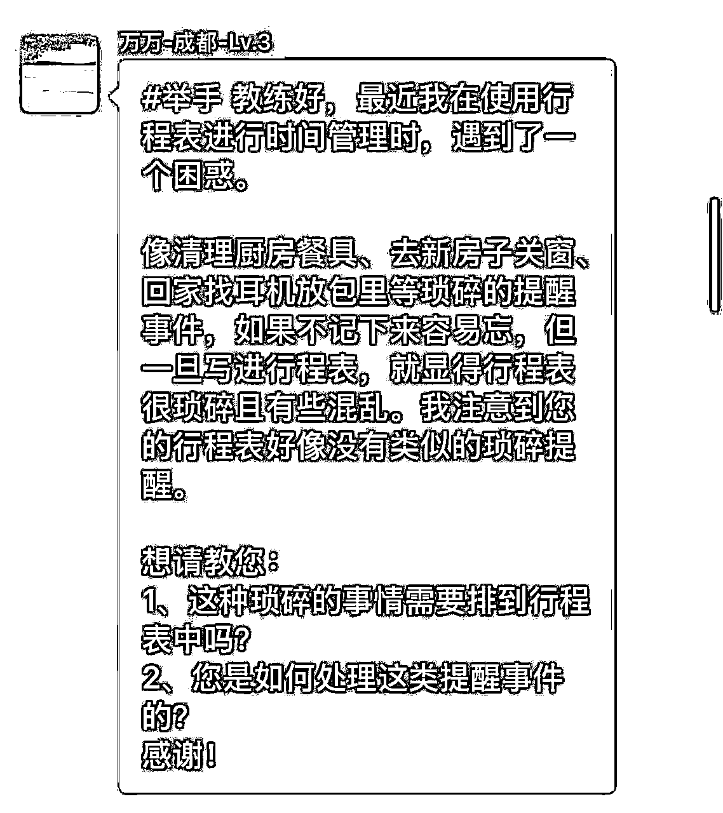

万万早安，谢谢提问。通常我不会把太碎的事情放进行程表，除非是每天固定要做的事。比如送孩子上学，虽然简单，但天天要做，我就会在日程表里专门留一个时段。如果某件事固定每两三天都要做一次，比如整理家里，那也可以放进去，用“处理家事”这种块状时间来安排。零碎事项不放进日程表，是因为便条式管理和日程表管理的功能不一样。日程表管的是大框架，让你清楚某个时间段要干什么；便条式管的是小细节，就像早起、刷牙这种事，你每天都会做，也不会忘，不需要写进去。写进日程表的待办，第一个作用是检视这一周的生活有没有出问题，让大方向不混乱；第二个作用是帮助完成大方向的目标。所以小事情放到便条里就好。日程表一天可能只需要看一次，确认当天安排；便条则要随时拿出来看，完成一件就划掉一件。两者的用途确实不同。希望这个回答能帮到你，谢谢！

* * *

## 逑乐-成都：执行计划的时候总是容易分心，该如何解决这个问题？

逑乐-成都：
老师好，我在执行计划时经常会走神。比如写航海日志，写着写着突然想到明天吃什么，接着又冒出各种念头和想法。这种情况怎么让自己更专注、不分心呢？

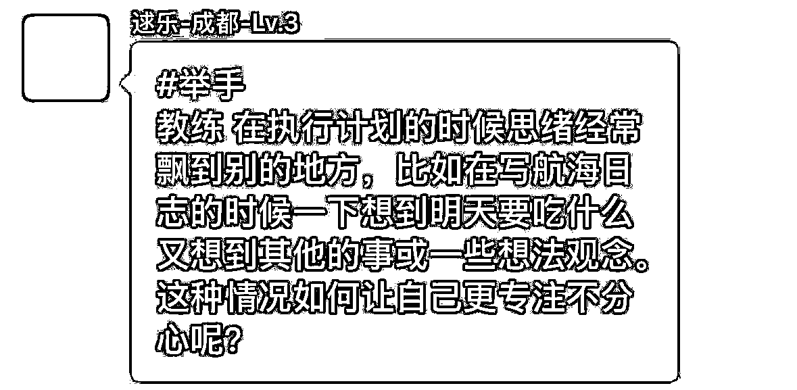

逑乐早安，谢谢提问。这个问题其实不难，关键在于给自己设置一个清晰的时间界限。你想要不分心，但分心的原因，往往是你知道这件事不需要这么快完成。不知道你能不能懂我的意思——就是做这件事的时候，没有限制，也没有压力。比如一件事原本一小时能做完，你却给了自己两小时，那你心里清楚：一小时应该能搞定，时间这么宽裕，不如慢慢磨。所以最好的解法是设定一个时间节点。当事情变得足够紧迫，你根本没机会分心。就像以前考试之前，你可以试试考前一个小时才看书，那会儿你绝对专注，因为不抓紧的话，一小时后就要进考场，尤其如果前一天还没复习。所以设定时间线，是最快见效的方式。供你参考，谢谢！

* * *

## 小乐Lehua-北京：如何更好地增强自己做时间管理的信心？

小乐Lehua-北京：
老师好！非常感谢您精心准备的直播内容，每次听到大家的提问和您的真诚回复，都很有收获。想请您分享一些实践中的例子：您在时间管理过程中是怎么增强信心的？您曾经有没有羡慕过别人具有某种特质或状态，心想“如果自己也是那样，就能更高效地使用时间了”？您觉得自己有哪些特质让您做得比较好？

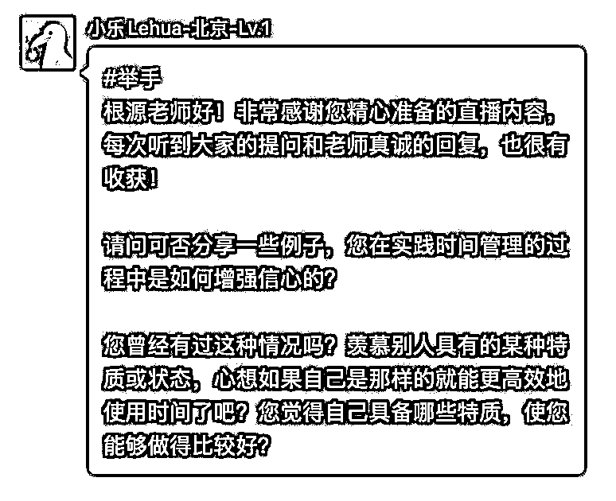

小乐早安，谢谢提问。想增强时间管理的信心，最好的方式只有一个：说到做到。而一个人的信心来源，其实是一次次微小的自我肯定。比如我上午计划一小时写完一篇文章，一小时维护好和5个人的关系，一小时卖出两个产品……一天大概有10个待办事项，睡前发现每件事都完成了。连续3个月，每天都想办法完成当天写下的便条事项。写着写着，你就会开始肯定自己。这种肯定累积到一定程度，就会长出自信。因为你会发现，自己写下来的每件事，都有能力掌控并完成。这也是能量的来源。只是它需要靠日积月累，而这恰恰是最难的。

大多数人都很急躁，我以前也一样，总觉得：写下来的事怎么不如预期？目标还那么远，该怎么办？但随着你的事情越来越丰富，你会慢慢不那么在意别人在做什么。因为你根本没有时间去管别人，自己的事都忙不过来了，哪还有心思去想别人怎么想？时间管理的真正意义，是让你活出自己想要的生活。设定好一个目标，然后按步骤一点点完成它。当你专注完成目标时，你只会关注自己的事，不会去管别人在忙什么、想什么，反而很享受处理自己的事务。

不过我要说，这个状态我大概花了五六年才达到。严格来讲，第一阶段是三年，第二阶段到第六年、第七年，才慢慢变成现在还算可以的样子。所以要有耐心。以上是我对你问题的回复，谢谢！

* * *

## 雅涓：工作效率低，爱拖延，不专注，该如何调整？

雅涓：
老师好，最近总觉得时间不够用，工作效率低，爱拖延，也比较难聚焦，到底怎么调整呢？

雅涓你好，谢谢提问。我先反问你一个问题：从第一次到第七次的直播，我们只谈前三场就好——从便条式到优先次序，再到重要不急，最后到行程表。每一次的打卡作业，你有认真写吗？如果写了，你有没有每天都用这些方法去记录生活？比如完成一个待办就打勾，重新排列价值观顺序，把行程全部放进第四代日程表，你有做吗？我不确定你是否做了。但只要你开始做，至少两个月之后，你做事的认真程度才会有所提升。因为时间管理是实战，不是概念。实战就是你真的把它用进日常生活里。如果你没有认真实战，听再多课也不会有改变。所以这个问题需要时间来解决。最好的方法，是给自己至少三个月，认真把便条式、优先次序、行程表这件事每天做一遍：便条写完转优先次序，每星期都把整周的行程排进日程表。如果你能连续两三个月不间断地写，你的做事效率一定会有明显进步。这是我对这个问题的回复，谢谢！

* * *

# 2️⃣时间管理航海2群问答集锦：

## Jin：没有固定工作内容和时间的人群，如何让自己精力充沛地管理好时间？

Jin-苏州-Lv1：
教练好，我是Jin。我的问题可能比较笼统：我是00后，大学时就没有时间管理习惯，懒散惯了。毕业后开始创业，本质上和自由职业者一样。每次做了计划，想做点创业之外提升自己的事，却从来没完成过。比如客户临时有事要处理，解决好之后半天就没了，再被突发状况一耽搁，一天就过去了。总感觉自己从来没有真正管过时间，也没什么社交，不喜欢锻炼，还经常觉得能量低、心气不足、提不起劲。想问，像我这种没有固定工作内容和时间的自由职业者，怎么让自己重启状态，精力充沛地管理好时间？

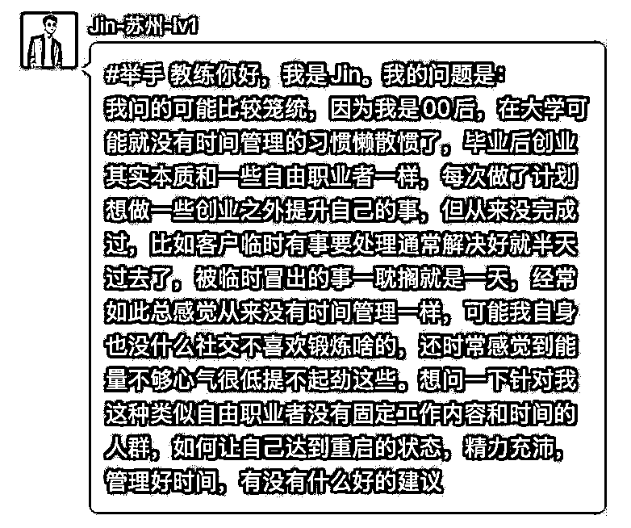

谢谢你的提问。你的名字是念Jun还是Jing？不管了，我英文不太好，知道怎么称呼你就行。因为你年轻，我用第一代时间管理来帮你解决。便条式管理有一个很好的逻辑：我先写什么，就尽量完成什么；或者说，我写上什么，那天睡觉之前就完成什么。第二个好处是，通过重新记录自己要做的事，你会对第二天的安排更有概念。你现在要做的，是想一想每天到底该做什么。

假设你有一份稳定的工作，那每天就是把工作做完。便条里写今天工作要做什么，大概几点完成，目标推进到哪个阶段，做完就好。但如果你没有稳定工作，手里有一点小存款，接下来准备找工作或者做副业：找工作的话，便条里就写今天要投几家公司、几点去面试；如果选择做副业但还没有方向，你可以先通过阅读提升认知，比如一天看十篇精华帖，再花一小时做复盘，这些都可以放进便条。

你的任务，就是每天至少写10件需要做的事，刷牙洗脸那种就不用写了。每天最少写10件，然后到晚上睡觉前尽量全部完成。这是初期没有方向时的做法。现在你参加了航海，其实每天已经有固定任务了：第一，完成航海打卡；第二，晚上把时间空出来，准时听航海直播；第三，给自己定个目标——21天里每天至少提两个问题。这样一来，你一天就多了三件便条待办。所以你可以规定自己每天写10到15件，然后完成它们。

这是我能给你的初步方向。后面还有不同阶段的时间管理方法。如果按这个方式做了三五天，你还是没有找到答案，可以再来追问。先回答到这里，谢谢！

麻辣番茄：
教练，10到15条会不会太多了？我感觉能把四五件做好就已经不错了，甚至3件也挺多的。

对一个刚出社会的年轻人来说，核心是先让自己忙到没时间，因为体力足够。

麻辣番茄：
好的谢谢。

* * *

## Andy：直播回放是否可以直接在APP里边看？

Andy：
回放有没有办法直接在APP里面看呢？

你好，这个是回放链接
https://oee5lr7gsk.feishu.cn/minutes/obcncdt2i8t38vk6367b6l17?from=from_copylink

如果你还要看回放，记得今天现场不在的话就去申请一下，我会去帮你确认

* * *

## Andy：便签里要记时间、估时间，具体怎么落地？

Andy：
每天的便签任务都完不成，要不要记时间、评估时间，应该怎么操作？

Andy你好，感谢提问。

先看你的整体规划，既然已经在聊人生需要时间管理，说明管理本身的重要性你已经认可了。

可以先从预估开始，比如我今天的行程大概要多久，或者某个事项我预计需要多少时间来收尾。

若你每天写下20件待办，算完时间发现24小时根本不够用，这时候要做的就是先把优先级高的那一批啃下来，或是想办法让这20件事压缩进一天里，这才是时间规划要解决的问题，也是时间管理最核心的价值所在。

先用预判的方式去跑，大概五六天后，你就能摸到自己做事的手感，也能更清楚自己的真实效率。

在这个过程中你会慢慢发现，原来我一天承载不了这么多事。当量太大时，就把一部分挪到后天、大后天再处理，这是启动期比较实用的做法，尤其是在你还在熟悉自己节奏和效率的时候，可以参考一下。谢谢你。

* * *

## 行知：长任务怎么预估、怎么拆？

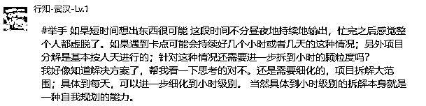

行知-武汉-Lv.1：
短时间产出东西就得不分昼夜地连续输出，做完人就虚了。卡点时可能卡几个小时甚至好几天。另外项目拆解基本按人天来算，这种情况要不要再拆到小时？

我好像找到思路了，帮我确认下对不对。还是要细化，项目层面做大范围拆解，到每天再细化到小时级。具体到小时的拆解也是一种自我规划能力。

行知你好，谢谢提问。

这个问题其实有两个层面——

第一层面是你看的是长时间规划，比如我这个月要完成什么目标，然后细化到每天该做什么，这属于进阶阶段的时间管理技巧。

第二层面是更长的时间尺度，用一年年度视角去看每天要做什么，月度以上都可以算作长时间管理。

在我看来，在做长时间管理之前，先解决好短时间管理，就是我能否把当天写下的事项真的完成。我最担心的是有人连每天的清单都做不完，却急着去规划年度目标，这会非常吃力。

所以现阶段你可以先问自己，我今晚列出明天的便条事项时，能不能判断这些事是否可完成？

如果能完成，就想尽办法把它做完。因为养成“清单写完就关灯睡觉”的习惯，初期一定会累。你可能会高估自己，以为自己很强，结果做下来发现并非如此，没关系。

如果是我，会选择硬撑，想办法把当天写的全部完成。先练时间管理能力，用一个月的时间让自己能稳定完成每天设定的事项，完成后再进入第二阶段，也就是月度、半年度的管理，再去推演。

基于你现在的状况，我觉得最有效的做法就是先确保隔天清单能全部清零，给自己一个硬约束：没做完不许睡觉。先把这项能力练出来，再往下一步走。

以上是针对你当前状态的建议，谢谢。

* * *

## 行知：工作和副业要不要分开规划？

行知-武汉-Lv.1：
#举手 工作和副业是否需要分开进行规划

参考问题4，回复已合并，有疑问可在群里继续追问。

* * *

## 煜嘉：老师的回答能用文字呈现吗？

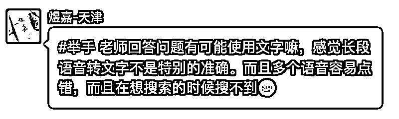

煜嘉-天津：
老师能否用文字回答，感觉长段语音转文字不够准。多个语音也容易点错，搜索时也搜不到。

煜嘉你好，谢谢提问。

所有语音的解答，我们会在两天内整理成文字，会做一些润色和校对，提升准确度，删掉部分语助词后放到飞书里方便查阅。

用语音回复效率更高，所以如果你听起来不方便，我会尽量把话说得更标准一些，方便你直接转文字。

如果你不着急，可以过一两天看飞书的每日总结，所有问题都会有名字和标注，能找到你的提问和对应的文字版本。

可能需要你稍等，但文字答疑是会有的，放心。

* * *

## 大奔哥：晚上工作影响睡眠和身体怎么办？

大奔哥-金华-lv.2：
教练你好，我是大奔。我晚上学习效率比较高，但常十点后还在工作学习，导致半夜脑子里都是工作学习场景，最近开始掉头发才觉得严重。这个习惯估计很难改，该怎么调节？

大奔哥你好，名字很有气场，谢谢提问。

时间管理的初期，首先要找到适合自己的节奏。

有人爱早上学，有人爱晚上学。我自己偏好早上和晚上工作，中午12点后基本不工作。上午9点到12点把重要工作清掉，有没做完的就挪到晚上7点后。下午再多的事我也不会碰，因为我知道下午效率对我来说不高。这就是我的习惯。

所以在便条式管理的起步阶段，先找到自己的模式。有的人是夜行性，有的人早上5点就能高效工作，关键是先找到最匹配自己的工作方式，找到后效率感会明显提升。

如果有人不喜欢晚上工作却只有晚上有时间，也可以尝试把部分工作挪到早上，尽量早起。你会发现原本要4小时的事，可能2小时、甚至1小时就能搞定。

所以现阶段我会建议你，先找到最适合自己的作息带，然后按这个节奏调整工作时段。

以上是现阶段的建议，谢谢。

* * *

## 香港的香呀：回放没声音、不能拖进度条、不能倍速是什么原因？

香港的香呀-合肥：
为什么我这边回放没声音，也拖不了进度条，不能倍速，有没有同样情况的？

香呀你好，昵称很特别。按目前反馈，应该是操作上出了点问题，目前还没听说回放没声音的情况，大多数人回放都是正常的。

你可以先检查一下自己的操作是否需要调整，或是否有误操作。

至于倍速的问题，我自己看视频时习惯不点倍速，所以这里没法替你确认。可能需要群里正在复盘的伙伴，或领队、志愿者帮忙看看技术问题。

我个人操作是没问题的，所以先排查一下操作环节，这是目前能给你的解答。谢谢。

* * *

## 0uTSider：教练一般用什么时间管理工具？

0uTSider-宁波-Lv.2：
教练请问您一般都用哪些时间管理工具？

谢谢提问，我现在用的是滴答清单，也是最顺手的。这几天我会抽时间介绍一下我的使用方式，分享一下实操过程，可能要你稍等几天，最快今天就会讲到工具的使用方法。

* * *

## 霖溪：工具和方法很乱该怎么整理？

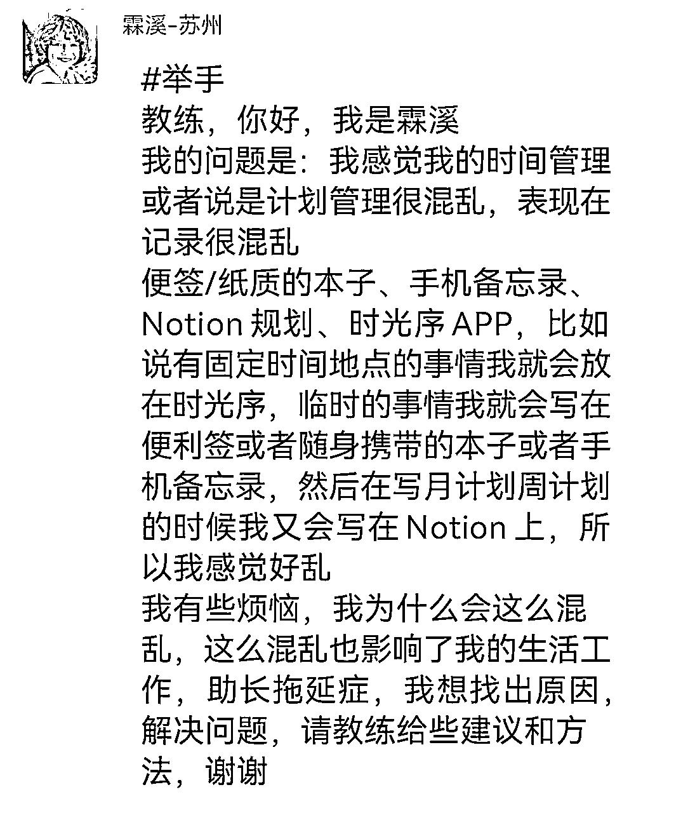

霖溪-苏州：
教练你好，我是霖溪。我的时间管理或计划管理很混乱，体现在记录方式混乱。

便签、纸质本子、手机备忘录、Notion、时光序App，比如固定时间地点的事情放时光序，临时事情写便签或本子或备忘录，写月计划周计划又写在Notion，所以很乱。烦恼为什么这么乱，乱了影响生活工作，还助长拖延，想找出原因和解决方法，请给建议。

霖溪你好。

改变的第一步是觉察。

你已经觉察到混乱，这已经很棒。其次你已经开始做，说明你有了时间管理的雏形，只是顺序可能不对，或只是需要小调整。有了觉察和起点，第二步调整就容易很多。

你现在记录方式很多，我建议尝试更单一。很习惯在一个软件里做很多事，这样能减少来回切换软件的时间成本。

我自己用滴答清单，写文章、管理事务、重要布局、行程安排、灵感全部都在里面。所以现阶段的调整就是让一个软件解决所有问题。

初期会不习惯，不是软件做不到，而是你还没找到它实现你目标的方式。对我而言，滴答清单能完成全部需求，还有一些是我自用的用法。

对你来说，最快的方法就是把软件统一化。统一后效率会提升，然后强迫自己把其他内容迁移到同一个软件里使用，就能走出混乱。

以上是现阶段给你的回复，谢谢。

* * *

## 李渡：容易被打断、想摸鱼怎么办？

李渡：
#提问 每天列清单一直在做，但最影响效率的是专注度。经常刚做一会就摸手机或干别的，番茄钟也不能完全解决，因为很容易被打断。

李渡你好，谢谢提问。我刚开始做时间规划时也有同样问题，后来发现摸鱼的根源是没给每个事项设定代价。

比如我说两个小时写完3000字，没写完就算了，这很致命。没写完明天继续，问题就留下了。

后来我用比较极端的方式治惰性，找人监督，跟老师说如果规定时间内没达到目标标准就罚500块。初期常被罚，明知要罚钱还是做不完。做着做着没钱了，就慢慢改掉惰性。

现在我还是容易不专注，但能做到不超时，会拖延。我习惯把交付时间定在晚7点，理想是6点开始，但可能拖到6:20或6:30。无论怎么拖，大原则是交付时绝不超时。

前期可以用代价比较大的方式逼自己，只要拖延或没在时间内完成就要付出代价。摸鱼可以有，但大原则是：

#### 能拖延、能摸鱼，但不能超时。

做到这一点就算第一关过关。这是我自己的做法，分享给你，希望有帮助。

* * *

## 漫漫：没办法坚持做计划怎么办？

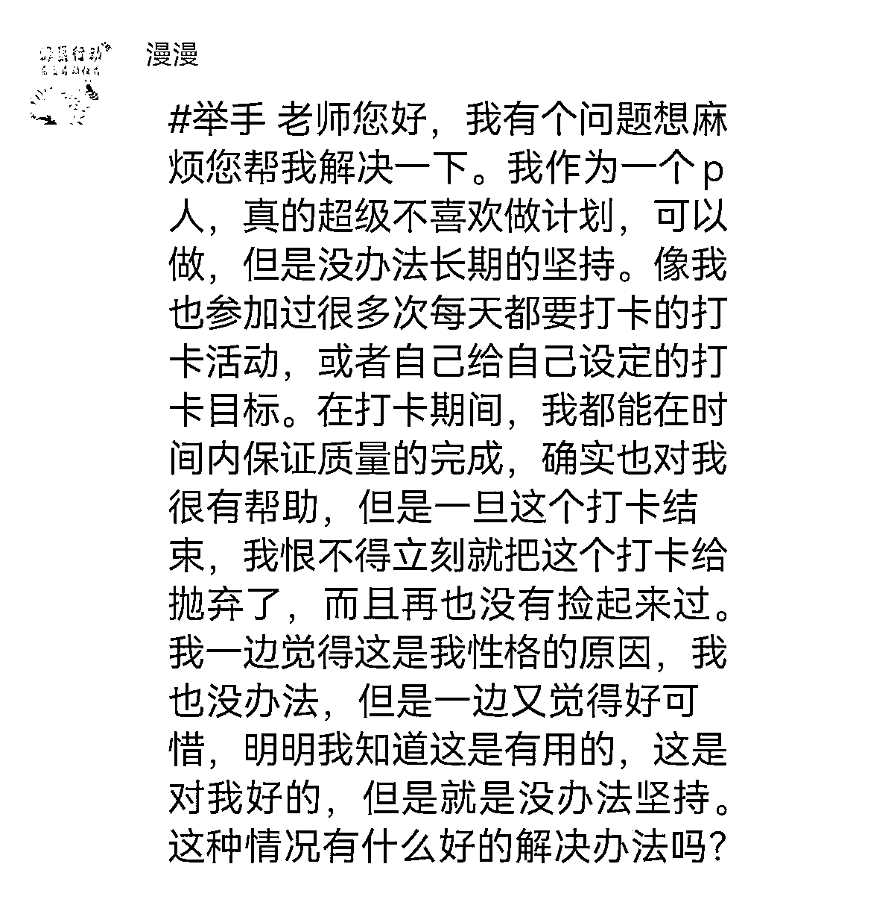

漫漫：
老师您好，我是P人，很不喜欢做计划，虽然能做但坚持不下来。参加过很多打卡活动，打卡期能保证质量完成，打卡结束就立刻抛弃，再也没捡起来过。一边觉得性格使然没办法，一边又觉得可惜，明明知道有用对自己好，却坚持不了，有什么解决办法吗？

漫漫你好，谢谢提问。

先问你一个问题，当你把计划做好并执行，你能得到什么好处？当你没法按计划完成，日程混乱、不知道下一步做什么时，你又得到什么好处？

人都是趋利的，有明显的好处才愿意做。如果把人生规划好、让自己更规律，得到的好远大于不规划的生活。

这时不妨做个小调整，而不是因为测评说自己是P人，就觉得不适合、做起来吃力，这是一种不好的心理暗示。

可以拿张纸写下，如果认真规划人生，我能得到什么好处，能拥有什么优点，能在做事上得到什么帮助。

把好处列清楚后，如果发现收益很多，行为自然会跟上。

要不要养成新习惯，本质是自我辩证和选择。如果辩证后发现确实更好，就做一点转换，说不定能开启另一种人生。

这是一个认知层面的事，也是我做任何新决定时的逻辑。提供给你参考，希望有帮助。谢谢。

* * *

## 檬：目标不清晰时怎么写便条清单？

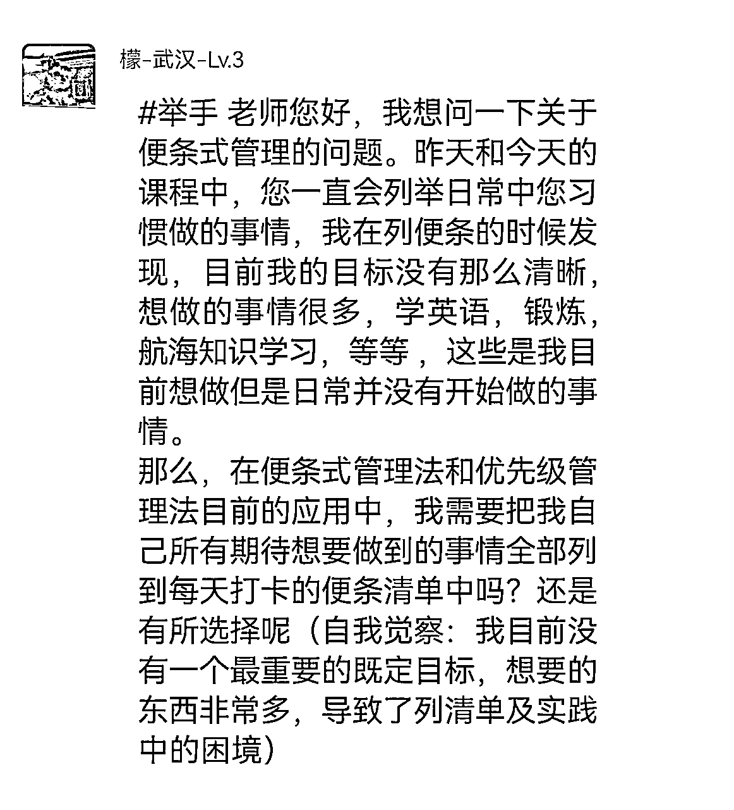

檬-武汉-Lv.3：
老师您好，关于便条式管理的问题。课程里您举了很多日常习惯，我在列便条时发现目标不够清晰，想做的事情很多，比如学英语、锻炼、航海知识学习等，目前都没开始。

在便条式管理和优先级管理中，我需要把所有想做的事情都列进每天打卡的清单吗？还是有所选择？自我觉察是我目前没有最重要的既定目标，想要的东西太多，导致列清单和实践困难。

你好，昵称只有一个檬，不知道怎么称呼。

进入优先级时一定要做取舍。

优先级出现是因为当天事项已经多到做不完，它的目的是先把重要的做完。

如果某件事当天不重要，且离休息时间已近、体力不支，就放到明天再做。

我习惯以3天为一个小循环，每3天把设定的事都做完。即使做了优先级排序，也会想办法在3天内完成，不会拖过3天。

你可以把这个方式融入自己的时间管理——三天为一个小循环，单件事不超过3天，即使排序后也如此。

希望对你有帮助，谢谢。

* * *

## 有一只胖纸出没：排优先级要不要定目标或计划？

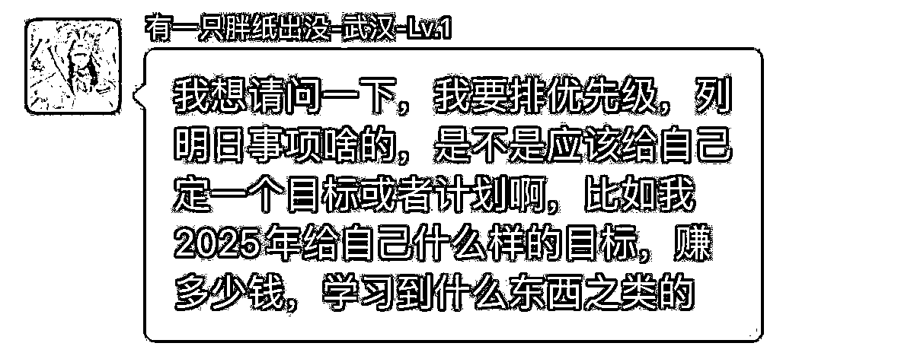

有一只胖纸出没-武汉-Lv.1：
我想请问，我要排优先级、列明日事项之类的，是不是应该先给自己定个目标或计划，比如2025年要赚多少钱、学到什么？

初期先设定月度目标就够了。

未经训练就一次性定年度目标，难度极高。

目标管理课程是这次直播第四天，也是下周三的主题。

这是我常用的软件滴答清单，之前录过一个小视频讲颜色区分的方法，大家可以看看。

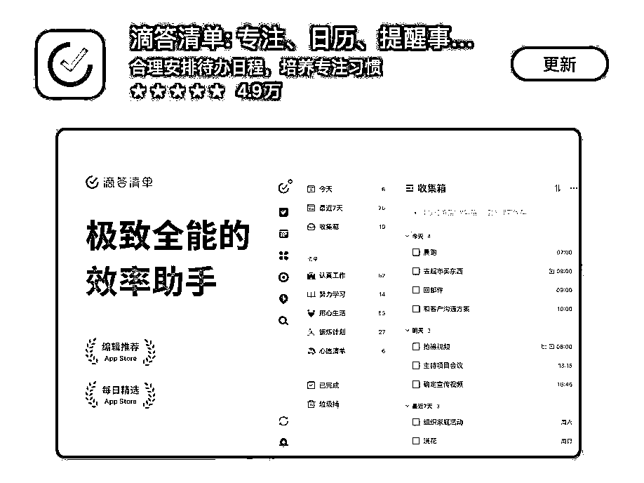

* * *

## 香菜：早上不想起床，上午事做不完，有什么起床好方法？

香菜-广州-Lv.3：
教练，早上经常不想起床，然后上午的事就做不完。请问有没有起床的好方法

### 15.1 你是否有必须早起的理由？

香菜你好，谢谢提问。

我一直觉得，多数人其实不需要时间管理，也没有必须在某个时间完成某事的必要。除非这件事错过时间点会付出很大代价或惩罚，否则并非所有事都必须卡点完成。

回到你的问题，早上不想起床上午事就做不完。我常收到类似提问，关于起不来怎么办。

我会反问，早上起床干嘛？踏实睡不好吗？

我一般7点起，因为孩子7:40必须出门上学，不起床孩子就迟到，老师会打电话，这件事我不想犯错。所以我必须7点整起床，这样才能在7:40前准备好出门。孩子迟到在我看来是个硬红线。

如果真的很赶，睡到7:30能不能行？10分钟也能收拾好出门。

所以，是否早起，关键看你是否有必须早起的理由。

早起这件事，先别急着去找技巧，先弄清楚它对你是不是真正致命。

我这边家里有人专门负责早上唤醒孩子、准备早餐，我完全不用插手。所以七点半起床在我这里是可以接受的范围。但一旦拖过七点半，对我来说就是失控的信号，会直接撞上当天最核心的第一场安排。

因此我的判断标准很简单：如果你起不来，但现有的所有事情都能照常运转、没有连锁牺牲，那你就安心睡，不必自找罪受。

可如果你现在因为晚起，真的会把第一件关键行程压垮，而这件事被压垮会让你丢钱、丢信任。比如你答应早上来讲课，结果睡过头爽约，信誉直接破产。这种代价你都扛得住还起不来，我只能说你更适合做常规的朝九晚五工作，不适合接额外项目。

### 15.2 先厘清你起床的驱动力是什么

与其堆砌起床套路，不如先自问：为何要起。

当清晨起床这件事对你来说是极度紧迫、若不起就会有一件你绝对做不到、不能丢的事项，你的身体会自动把你拽起来。

很多人起不来会归因于“状态差、缺乏竞争力、比别人慢、有愧疚感”。这些都只是感受，不是会让生活炸掉的真实后果。

感受是靠不住的，用感受逼自己，基本起不来，也不需要你起。

关键是意愿强度。你明天早上非起不可的目的到底是什么。

目的越具体、越痛，你越不会睡过头。你就清楚自己为何要睁眼。

我自己因要带娃，所以平时必须早起。周末若没事，我可能八点半才醒，多睡一个半小时完全OK。因为我心里清楚，双休日不起床也没行程。但如果周六早上九点要和朋友碰头，车程要一小时，我就会七点起来，因为那天有明确必须达成的事。

所以别纠结怎么起，先想清楚什么事逼着你必须起。事情一旦明确，起床自然发生。

万一你发现条件都齐了还是起不来，甚至连已约好的见面都放鸽子。那我会直接说，你可能更适合安稳的体制内工作，不适合额外项目。好在你大概率不是这样的人。

### 15.3 用代价倒逼自己早起

如果你现在还没到非起不可的地步，但想刻意练早起，那也可以。

找个人盯着你。找我也行。你先在我这里押五千块，约定每天七点起床，七点整没给我发早安，就扣一千。那五千块只够你挥霍五天，五天内懒一次钱就没了。

想练就用极端一点的方式。要么自律盯自己，要么找外部监督。自己盯很难，被人盯才有效。被扣钱的那种肉痛感，会让你舍不得赖床。

当然，如果你连钱都不在乎，那我也只能佩服你。

总之要么用无法承受的代价来反向推动自己，要么就别硬撑。以上就是我对早起这件事的看法，谢谢。

## D•欢：下班后没精力做副业怎么办？

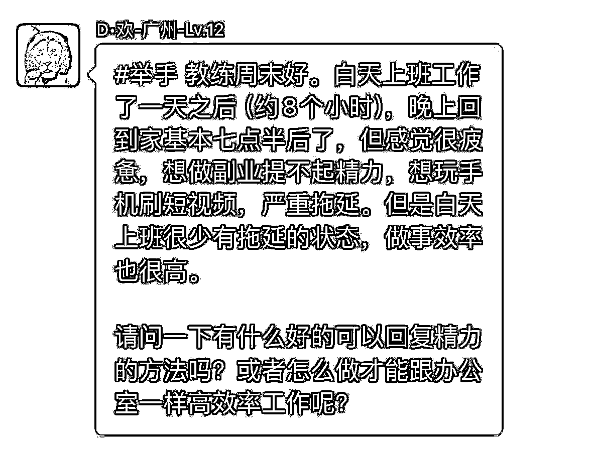

D•欢-广州-Lv.12：

教练周末好。白天上班工作了一天之后（约8个小时），晚上回到家基本七点半后了，但感觉很疲惫，想做副业提不起精力，想玩手机刷短视频，严重拖延。但是白天上班很少有拖延的状态，做事效率也很高。

请问一下有什么好的可以回复精力的方法吗？或者怎么做才能跟办公室一样高效率工作呢？

### 16.1 先找一件让你开心的事把电量充回来

你好，你的名字我有点难念，D•欢，我看到D开头的就想到海贼王的路飞，名字都有个性。谢谢提问，我直接说。

恢复精力最直接的做法，就是去做一件你做起来会觉得开心的小事。刷手机也行，玩游戏也行，去逛街也行，吃顿好吃的也行。时间不用长，只要能让心情变好就行。

能找到这种给你回血的方式，你就持续用它。因为只要情绪被恢复，精力自然会回来。

### 16.2 想让副业像主业一样高效，先看你是否真的需要副业

不过要把副业做到跟主业同样高效，这个我没法给你技术上的标准答案。

因为很多人的副业其实只是“别人都在做，我不做好像会落后”的从众心态。主业已经能cover生活开销了，为什么还要额外折腾。

比如你一个月生活费七千，主业稳定九千，每月还能存两千。在没有迫切需求的情况下，很难把副业做到高效。因为你调不动自己。

如果不到四十岁就想拥有自我驱动的能力，那基本天生自带，这种人少之又少。

叫自己起床、工作，靠意志力是不可靠的。

第一种靠得住的叫法是被动式的。生存被逼到墙角了，或者没有副业这笔钱生活就过不下去了。这种压力下你自然会动起来。如果这种情况下你还叫不动自己，那穷也是活该。

没有迫切的理由，你做事效率一定上不去。

那为什么办公室效率高？因为不做完就加班，加班就没时间陪人、玩乐。做不完老板扣钱，钱和尊严都受损，所以你才拼。

副业想高效，早已不是时间管理技巧的问题。时间管理只是方法，你内心没有意愿、没有清晰的目标，你的罗盘方向就不准，再好的方法也白搭。

与其学技巧，不如回到我们第一堂课说的罗盘。把价值观放大到十年、二十年，这份副业能给你带来什么？如果想清楚了，你的行动自然会跟上，效率自然会提升。

这就是我的回答，谢谢。

## Helen：怎么把优先级划分得更清楚？

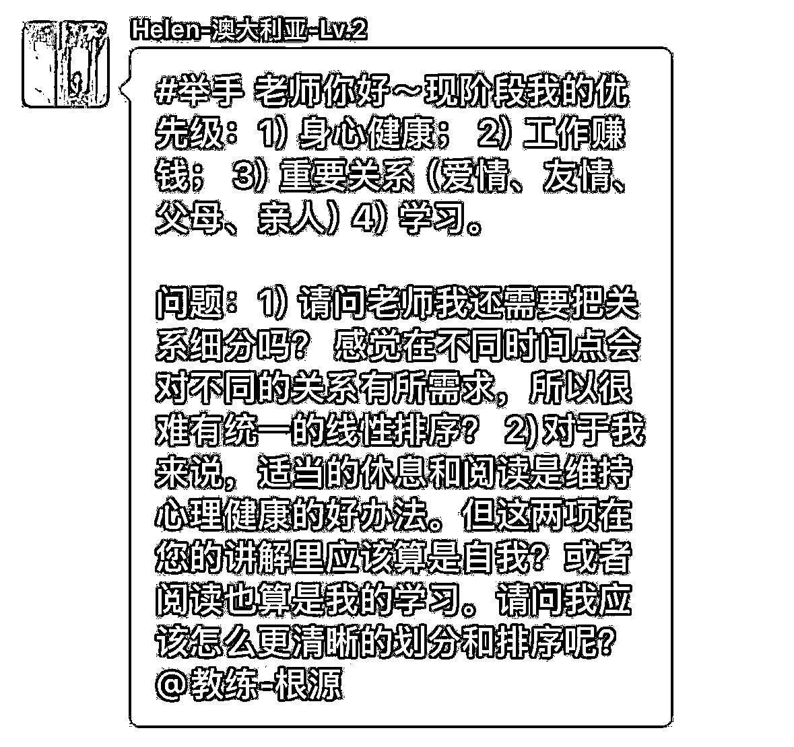

Helen-澳大利亚-Lv.2：老师你好～现阶段我的优先级：1）身心健康； 2）工作赚钱； 3） 重要关系 （爱情、友情、父母、亲人） 4）学习。

问题：1）请问老师我还需要把关系细分吗？ 感觉在不同时间点会对不同的关系有所需求，所以很难有统一的线性排序？ 2)对于我来说，适当的休息和阅读是维持心理健康的好办法。但这两项在您的讲解里应该算是自我？或者阅读也算是我的学习。请问我应该怎么更清晰的划分和排序呢？ @教练-根源

Helen你好，谢谢你的提问。

细分这件事我没法替你做，你只能自己去定义这件事到底属于哪个价值观。

你觉得休息和阅读能维持心理健康。但在我这里，休息我会归到健康，阅读我通常会放在自我学习或自我成长里。这是我的分法。

你可以试试把自己一天或一个月的真实行程全部列出来，每一项都做归类。比如运动算健康，读书算学习，和朋友吃饭算关系维护，和伴侣聊天算爱情。等你能把每个小模块清晰地放到固定区块里，定义自然就清楚了。

这个定义必须自己来。

另外周一直播会讲重要不急的事，那段内容可能正好能帮到你。第三天直播可以去听听，说不定就解开了。

补充一点，划分和排序是时间管理里最难的部分。很多人就是定义不清。比如跟朋友聊天，到底是赚钱还是关系维护。如果定义成赚钱，你聊天时就会想怎么切入业务、怎么成交。如果定义成关系维护，你就纯粹聊得开心就好。

你的定义决定了你要怎么执行行程。

所以这是反推的逻辑。你要先知道这件事的最终目的，想要得到什么，再反过来给它贴标签，归到哪个价值观里。

以上就是我的回复，欢迎追问。

## Queenie：怎么掌控下班后的生活？

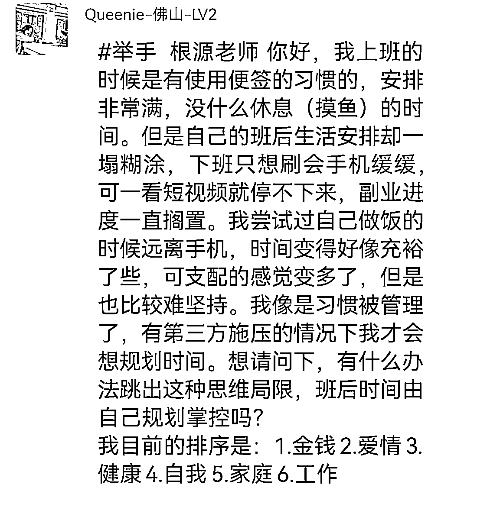

Queenie-佛山-LV2：

根源老师 你好，我上班的时候是有使用便签的习惯的，安排非常满，没什么休息（摸鱼）的时间。但是自己的班后生活安排却一塌糊涂，下班只想刷会手机缓缓，可一看短视频就停不下来，副业进度一直搁置。我尝试过自己做饭的时候远离手机，时间变得好像充裕了些，可支配的感觉变多了，但是也比较难坚持。我像是习惯被管理了，有第三方施压的情况下我才会想规划时间。想请问下，有什么办法跳出这种思维局限，班后时间由自己规划掌控吗？

我目前的排序是：1.金钱2.爱情3.健康4.自我5.家庭6.工作

你好，Queenie，应该这样念吧？念错你提醒我。谢谢提问。

你有没有发现，你上班会认真用便签，是因为不用的话工作会乱，乱了可能被开除、被扣钱、被当众批评，面子挂不住，有明确的代价。

但下班后不做副业，也不会立刻少钱。主业够用，为什么要逼自己做副业？

在意愿还没建立前，先创造一个场景：如果今天不做副业，缺少这笔现金流，我会失去什么？要付出什么代价？如果没有代价，你就主动给自己制造一个痛的代价，让你痛到不得不做。

人性就是这样，代价不够大、事情不必要，你就不想做。

我们很多人状态不稳、没有大成功经验，都是叫不动自己的，很正常。连我自己有时都叫不动自己，但我会用极端的方式逼自己前进。

想想看，如果你真的想做副业，有没有一种方式会让你不做的话付出的代价比做更大？这点值得思考。

最后还是回到人生优先级的选择。是要先苦后甜，还是先甜后苦？你选清楚了，再去设一个不做就要付出的代价，就能掌控自己的时间了。

以上是我的一点经验，不懂就追问。

## 柚子：裸辞后收入不稳定，要不要回去上班？

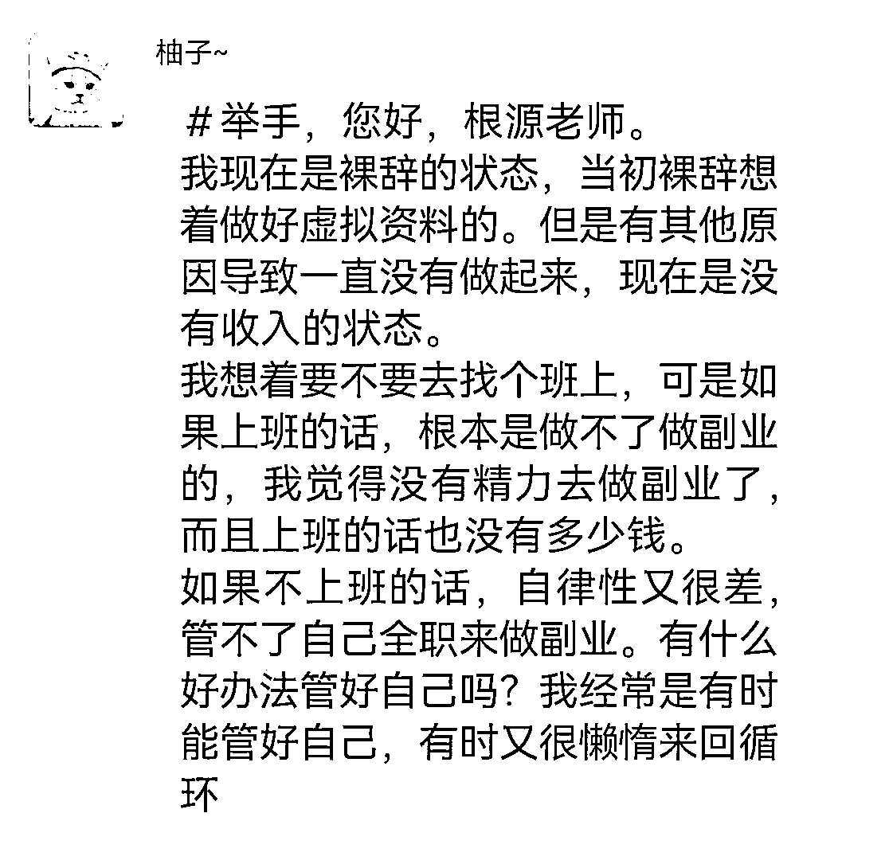

柚子：您好，根源老师。

我现在是裸辞的状态，当初裸辞想着做好虚拟资料的。但是有其他原因导致一直没有做起来，现在是没有收入的状态。

我想着要不要去找个班上，可是如果上班的话，根本是做不了做副业的，我觉得没有精力去做副业了，而且上班的话也没有多少钱。

如果不上班的话，自律性又很差，管不了自己全职来做副业。有什么好办法管好自己吗？我经常是有时能管好自己，有时又很懒惰来回循环

柚子你好，谢谢提问。

这个问题用优先次序就能解。

优先次序第二代不仅能帮你排行程，也能帮你排人生状态。

如果现在你把赚钱放在第一，你要想什么行为能最快、最稳地拿到钱。副业在你手里目前做不出稳定现金流，甚至现金流为零。上班虽然辛苦、工资不高，但能提供稳定的月收入。

在赚钱优先的前提下，找工作比做副业更优先，是合理的用法。

所以按照目前讲的内容，我会建议你先去找工作。不好意思用了建议这个词，但这更符合你的现状。副业不是谁都能做，短期内带来现金流的概率很低。

这是针对你的回复，希望有帮助。

## 十一：副业怎么保持效率和质量？

十一：根源老师好，我目前情况是一边工作一边在手机上做微商副业，常常工作一天下来会觉得比较累，回家再洗漱收拾一下就什么都不想干，想做到坚持更新朋友圈，并且是有数量、有质量的朋友圈。

但我只有在工作不怎么忙整个人状态好一点的时候才能达到这个目标，想问问我应该如何去整理安排自己的时间管理？是不是循序渐进，不要设置要求那么高比较好一点？

（我目前的排序是：1.金钱 2.自我 3.健康 4.爱情 5.工作 6.家庭）

十一你好，谢谢提问。

我一直很疑惑：工作做得好好的，下班后明明可以按摩、看电影、陪伴侣、刷短视频刷到睡着，第二天照样上班。日子这么舒服，为什么还要给自己加苦做副业？

先想清楚背后原因。如果你想清楚了，不做副业两年三年后会更自由、抗风险能力更强，那就去做。

想清楚后，第二步是你得用特殊甚至偏激的方式，让自己下班后还能认真做副业。

再说个现实点的问题：想获得什么就得付出代价。你只有状态好、工作不忙时才做副业，不合理。

副业本就是在主业之外让你更充实、收入更高的事。用第二堂课的优先次序来看，你是先享乐后受苦，还是先受苦后享乐。

如果你选择先享乐后受苦，下班就去玩，几年后你会发现没副业、没第二专长，竞争力更差，到时想赚钱更难。

如果你选择先受苦后享乐，现在下班后就必须比别人多花两三个小时做有成长的事。坚持两三年，你会比同龄人更优秀、更稳定、抗风险更强。

选择在于你。

想恢复状态的方法很多，泡个澡、刷二十分钟手机、听一首工作启动歌，信号一出来就开工。也可以更狠一点，找个人盯着你，七点必须开始干，发不出工作照就罚一千。最快的方法就是最痛的方法，但如果你不怕罚钱，那金钱损耗会很大。

总之，方法很多，最终都是优先次序的选择。想清楚了，行动自然跟上。

这是我的回复，谢谢。

## 猫叔有招：如何赋予社交意义？

猫叔有招：

根源老师您好，我的问题是怎么赋予社交意义，把他放到重要不急象限。

【背景】：我今年40，大概在38岁前都不觉得社交有必要，我一直比较独来独往，并且独处的时候要比跟朋友在一起感觉要好，虽然有时候也会想见朋友，但是频率很低，比如一年一次我知道的想见我的并且我也想见的朋友也就2、3个，有的混的跟我差不多的我没什么心理负担，但如果是跟混的比我好的接触，我总担心对方很忙给人添麻烦，所以也很少聊。

因为做副业的关系，我的观念有所转变，我发觉如果打算把副业做成主业，只有技术没那么重要，有人支持和信任更重要，也就是发觉人际关系的重要性远比我几十年的认识到的重要性重要的多。（我是做剪辑的，简单来讲在职场生存技术优于公司70%以上没问题，副业的话技术占10%也有可能发展的很好）

我的表达模式比较像这样子：聊天的功夫不如把任务完成得漂亮。能让我打开话匣子的其实就两种场面，一种是完全在我的专业范畴内，以前一天能接十几二十个咨询，每个咨询都能给到五八条具体的建议，反馈回来也挺好。另一种是聊到兴头上，能把全场的注意力都吸过来，可一旦我用第三人称的视角发现自己好像很吃香了，反而就不知道怎么说了。所以客观来说，我的社交能力是有的，只是用得不太顺手。

现在我也很清楚社交的分量，但我就是不喜欢那种看似无用的寒暄。要是只是纯粹去经营关系，我总觉得初心不干净，有点功利的味道。明明心里知道社交重要，却因为怕初心不纯、怕被误会，一直把这件事卡在重要不急的位置上动不了。

【所以我的问题是】：怎么让自己真心在意对方的频率变高一点，从陌生人慢慢变成真正的朋友。我为什么对谁都没有特别想交朋友的冲动？为什么我不会羡慕那种无话不谈的友谊？我心里的朋友定义是：不掺利益、彼此关心、可以各自安好，也能在关键时刻真心付出。可能是初心问题，但我又真的很排斥功利性的交往……这种矛盾让我很困。

我可能没把问题讲得太清楚，但很希望能得到你对我当下状态的理解和建议，万分感谢。

Hello，猫叔，早安，谢谢你的提问。你的问题描述得很完整，我分享一下我的看法。

### 21.1 人生的定义，叫做关系

我一直都觉得关系是核心，只是我花了挺久才真正落到实处。今年我三十七，比你小四岁。三十岁之前我的工作基本都跟销售和带团队有关，也带过一个相当大的团队。回头看那段时期，我其实并不在乎关系，有的事情我不愿意碰，有的环境我不刻意去营造，让某个人和我的关系更近一点。直到现在我才明白，关系真的是决定体验感的东西。

第一个原因是我们对生命的排序不够清晰，这其实就是时间管理第二代优先次序的问题。我们对每件事的权重往往是模糊的。

如果把时间线拉到五十、六十年去看，很多人当下觉得无效的社交，放到长线里就变得很不一样。我们必须先回答一个问题：时间管理能不能解决这个问题？答案是可以的。

我会有这样的体会，很大程度上来自我的爷爷。爷爷不到八十岁就走了。小时候小学前我跟爷爷奶奶住。爷爷开了个小卖部，就在路口拐角，生意很好。前面就是出租车站，车来车往。那些出租车司机，几乎都不爱跟我爷爷说话。

长大后我才懂原因。爷爷说话不好听，不讨人喜欢。所以年纪大了以后很孤独，没人愿意跟他相处，也没人来陪他，一开口就是骂。倒也不是说他对家人不好，只是我现在回想，才明白如果不重视人际关系，老了真的会像他那样。

你去公园就能看到两种极端。一种老人一个人慢慢走，一句话不说，气色看起来都很差。另一种是三三两两跳舞聊天，聊孙子孙女、聊儿媳，声音大、情绪也饱满，但有伴、有回应，人就显得活。

我不知道这个画面你能不能感同身受。

#### 我们回到一个核心判断，我对人生的定义就是关系。

当你的排序里把关系放在最前面，人生整体的幸福感会大幅提升。这是一个排序的问题。

如果你能把关系的重要性调到最高，我刚说的那些画面就很容易被你预演出来。

第二个验证方法，可以去问问身边的朋友，或是比你优秀的人，问他们晚年过得开不开心。你会发现：

* 大多开心的，人脉网络都很稳。
* 大多数不开心的人，几乎没有朋友。

到这一步就变成一个选择，你愿意为未来的自己换取哪一种状态。

### 21.2 如何让关系变好？

如果想变好，现阶段就得真的投入时间在关系上。那怎么让关系维护更顺手？就一个关键，你能不能真心对别人产生好奇，对别人的生活产生好奇。

你为什么会这么做？
你为什么会做这个决定？
你为什么会问这个问题？
是什么样的家庭背景造就了你现在这么好的性格？

当你有了不错的沟通能力，同时再加上对每一个人、每一句话的浓烈好奇，这两件事一起发生，你的关系网络就会慢慢变好。与人聊天时，抗拒和烦躁也会自然减少。

这是我结合时间管理给你的小小分享，我自己就是这样走过来的。希望对你有帮助，有不懂的地方欢迎继续追问，谢谢你。

* * *

## 香菜：为什么有的人有很多技能，但仍然工资低？

香菜：

想请老师展开讲讲，为什么有些人技能很多工资却低？这能延伸到生活的哪些例子？

比如我现在最急的是钱，是不是就该做跟钱挂钩的事？
如果优先级是自我，是不是就去做自我提升的事？

Hello，香菜，你好，谢谢你的提问。

我觉得你先观察一下身边有没有这样的人：证照一堆，会英文会法语，会好几种语言，还花了不少钱买知识付费，好像什么都会，但一个月收入就那样。

如果有，我们要先弄清楚为什么？

按理说能力越强收入越高，但现在能力强的人太多了，收入高的人却很少，这是第一个现象。

延伸到生活也有同样的例子。有人学了沟通技巧，也学了爱情经营，可爱情依旧一塌糊涂，沟通依旧糟糕。

背后的原因往往是罗盘排序出了问题。

他可能学了沟通，但从没用在真实的关系里。
他可能学了爱情，但真到跟伴侣说话时还是恶言相向，故意作对。

会有这样的情况：

* 一部分是因为优先次序乱了。
* 第二部分是他不明白学这个对将来有什么用。
* 第三部分是学完后从未把它写进待办事项、便条式或优先清单里。

学了不用就会忘，技能会慢慢消失。那怎么让技能学了之后真的有用呢？

就像你说的：“老师我想赚钱，该怎么做？”

这时候要先把人生往后推，可能推到五十岁、六十岁，先定义我要赚多少钱。

还记得之前讲便条式时有人问为什么没效果？因为没给便条后面加一个目标。如果你的目标是赚钱，就要给赚钱定目标。比如这个月每天都要有赚钱的事情，收入来自业绩。你可以设定到五十岁想赚一千万、两千万，往前推算，你现在这个年纪一年至少要赚一百萬，平摊到每天、每周要赚多少。

当目标放进去后，你就得思考什么技能能让自己越老越值钱、赚得越多？什么技能是现在就能换取收入、让生活稳定的？

拿我举例，我是心理咨询师。以前我的老师说，她爷爷学心理咨询时六七十岁了，还是有人开好车来接送，晚上送回去，还给一包大红包。老师就发现，心理咨询师是可以随着年龄增长越有价值的职业。当然我不是让你去学心理咨询，而是让你思考手边有没有这样的长期技能，能随时间增值、收费越来越高。

如果有，你愿不愿意花时间去学？学了之后会不会把它放进每天的事项里去实践？这就是长期技能。

那短期技能呢？也有。

* 比如写作，
* 比如AI能帮你把现在的事做得更高效，
* 比如经营关系，短期就能让很多人愿意帮你，觉得你靠谱。

当你把便条式变成优先次序，把事情分成长期和短期，再结合重要布局，你会发现时间管理从第一代延伸到第三代，判断就清晰了：我知道我缺什么，所以我学什么。

另一种情况是排序往下：我知道我要学什么，但不知道为什么要学。

所以先把未来的人生想清楚，你对学习的种类、学习的能力、该跟谁学，就会变得非常精准。因为你的优先次序是先想我的人生要什么，而不是我先想我要学什么。

最后补充一点，提升自我不是单纯地学东西。很多人学了很多，我以前也是，什么都懂一点。但现在年纪大了，学得少了，却更准了，能真正用在人生里。

因为以前我只是为了学，现在我会先问自己为什么要学这个？我知道我要什么，所以这东西我必须学。

思维转变后，学的东西才真的能用、有效果。这是我的一点分享，希望对你有帮助，谢谢。

* * *

## 香菜：感觉大多都是重要的事，没有什么不重要的事。

香菜：

今天听完老师的四象限，现在感觉什么都是重要的事，没有什么不重要的事。要是硬要填不重要的事，可能只有吃饭喝水。

健身也重要，和男朋友视频也重要，读书背单词也重要。

Hello，香菜，谢谢你的提问。

确实，如果对人生长轴没概念，你会发现每天都在处理紧急又重要的事。回信息、处理业务、弄项目、引流，全都显得很重要紧急。

但换个角度想，你做的业务里有没有哪个环节可以变成重要不紧急？比如引流。

引流一定是重要紧急吗？我觉得不一定。

一种引流是为了完成当月目标，不然生活费不够。你设定的目标是本月引流一千人，做到了，就代表重要紧急的事情完成了。

这时候你可以每天多花半小时，多引流五到十个人。这五到十个人你不谈业务，只是认识他、了解他为什么成功、为什么做得比大多数人顺畅。跟你的业务没关系。

你会发现同样的引流可以分两个阶段。第一阶段是为了完成目标，重要紧急。第二阶段是为了认识更多圈外的人，重要不急。

当你开始重新赋予意义，很多事情都能变成重要不急。当你人生里重要不急的事情越来越多，未来你会发现重要紧急的事情自然变少。

举个例子，你每天多认识几个人，其中有一个可能是某个行业的大佬，他很欣赏你。一年后他给你一个机会，或者一个人就给你引流两万人。你一个月才引一千人，他一次带来二十个月的量，你不就能歇二十个月吗？

有意识地做重要不急的事，未来能产生的产值非常大。

这是针对你的问题的一点分享。谢谢，希望有帮助。

* * *

## 又又：感觉恋爱进展太快，下一步应该如何走？

又又：

根源老师您好，我是又又。看到今天作业是写出一个你之前认为不是“重要不紧急”现在认为是“重要不紧急”的事情并说明理由。

事情：在感情中的亲密关系建设与维护
背景：我今年23岁，之前没谈过恋爱，最近喜欢一个28岁的男生，我们聊了两周，见第一面感觉很有缘分，就确认了男女朋友关系。晚上我发现节奏太快了，第二天晚上跟他沟通，他也觉得太快。我们现在都很迷茫。（当时他表白我脑子空白，懵就答应了）

问题：目前我们说慢慢来，先从朋友做起，但我很矛盾，想慢慢推进，又想确认双方是否有进一步可能。

又又你好，这个问题很有意思。

### 24.1让爱情顺其自然地发生，重要的是共同去体验这个过程

我觉得恋爱没有所谓太快的问题，因为当你把它放到重要不急的长轴里看，就不怕快慢了。假设你觉得他不错，希望两年后结婚，那两年内可能会有牵手、接吻、一起睡觉、更亲密的关系。这些过程快一点又怎样，只要不影响沟通，其实没关系。

这段关系如果要维持，就代表重要不急的项目里你要写清楚：我决定在这两年跟他有段深刻的恋爱。这是终极目标。快慢都不影响大方向，只要大原则不犯错，比如吵架就说分手这种话不要说，否则就违背了承诺。

我觉得大方向不变，细节快慢都不重要。

再一个点是你才23岁，很年轻，恋爱就是体验。我跟我老婆，我是第三任女朋友。我们在一起一个月，孩子就一个月大了。我们就想那就结婚吧。很自然地走了这个顺序。一段感情，快慢都会发生该发生的事，不会因为时间短就不发生，也不会因为时间长就不发生，所以顺其自然就好，不用刻意讨论我们是不是太快太慢，更要享受过程里的学习、看见、经历。

### 24.2 先确定关系再来相处，会更好

补充一点，你提到想慢慢推进关系，我觉得重点是能不能快速确定关系。快速确定关系，你们才知道下一步怎么走。

如果一直慢慢确认，就会一直矛盾犹豫：下一步怎么办？这一步怎么办？

所以确认关系在优先次序上，比慢慢相处更重要。先确认再相处，比先相处再确认要好得多。

这是我的经验分享，谢谢你。

* * *

## Karen：怎么改善群信息太多带来的焦虑？

Karen：

🙋教练您好，我是Karen。

背景：现在主业加上探索副业，还有一些学习群，微信群消息爆炸。隔一会没看手机就几百条未读，一年多了，我的消息一直读不完。也捡到一些觉得有用的会看，但大多没章法，每天很多消息不看。同时也不理解同一个群主一下开好几个群拉我进去，内容还重复。

我的问题是：“群消息太多”让我有一定焦虑，该怎么改善？有没有微信群管理的办法？

Hello，Karen，你好，谢谢你的提问。这个问题我会用时间管理的第二代优先次序来处理。

### 25.1找到做事情的背后原因，会更有动力

先问自己，我为什么要看信息？做这件事的背后原因是什么？又能是什么？

当你清楚原因，动力自然会起来，也知道自己为什么要这么做。这是问题出现时我的思维逻辑。

### 25.2 把计划分阶段地完成，建立自己的分流方式

有了这个想法后，我会问自己，如果我是今日事今日毕的人，我不想被信息焦虑困住，我会给自己每天安排两到三个时段，比如早上一次、下午一次、晚上一次。每个时段把该看的、该回的全部清掉。

今天不聊大道理，聊聊几个我被问了无数遍的问题：消息回不完怎么办？关系不敢深交怎么办？自律坚持不了怎么办？事情全都紧急怎么办？这些问题看着散，其实都指向同一个答案——建立自己的节奏。下面每一个方法，都是我自己长期用下来真正有效的。

一、消息太多看不完？分三个时段清一次

我的习惯是，每天固定三个时间点，集中处理积压的消息。为什么不攒到晚上一起看？因为量太大，看着就累，累到尽头就是烦躁。这和分期付款一个道理：总价吓人的东西，分成几个月，压力就散了。消息也一样，一天分几次消化，人就不会被淹没。

你可以把自己的安排写进清单或便签：这个时间段做什么，那个时间段做什么，提前规划好，心情就有了出口。

我现在的习惯是，周五晚上到周日，我基本不怎么回消息，也不担心积压，因为我知道周一一早起来，花很短的时间就能全部处理完。前提是，我有把握能清完。

我的原则很明确：如果当下没空看，那个小红点我碰都不碰。点开了又不回，对方看到已读却没回应，反而比没读更失礼。

当你把每件事都放进合适的日程里，你会发现做事开始有章法、有节奏。最怕的不是事情多，而是做了很多计划，却没有顺序，没有流程，全凭心情打乱仗。

我给自己定的规矩很简单：一日三清，临睡前让未读归零。养成这个习惯后，你打开手机，没有数字等着你，心自然不慌。别急着一步到位，每天清一点，一周、两周下来，总能清完。习惯养成了，焦虑自然会慢慢退出你的生活。

别忘记，手机是让生活轻松的，不是让你焦虑的。

二、经营关系是必修课，不是选修课

有朋友说：我也知道关系重要，但我被信任的朋友深深伤过，现在不敢深交了。

我的看法是：受过伤，和“关系不重要”，是两回事。别把过去的伤带到现在，给未来判刑。

为什么我一直把经营关系放在时间管理的重要位置？因为在这个时代，大多事情都得通过关系完成。你可能需要有人搭把手，可能需要某个资源，而那种一个电话就能找到的人，本身就是底气。

所以关键问题从来不是“我要不要经营关系”，而是“我怎么学会经营关系”。

经营关系跟学技能很像。学编程，代码跑不通，就改到通；沟通让人不舒服，就调整到顺。你会从一次次的磨合里发现：原来这句话不该这么说，原来那个反应是我理解偏了。能力提高了，关系自然会改善。

但这个过程里，受伤一定免不了。不习惯就会做错，做错就会被提醒，这都是必经的代价。

什么样的人际关系算好？我的答案很朴素：想吃饭的时候，能想到几个人；想聊天的时候，能想到几个人；真需要帮助的时候，还能想到几个人。不需要多，但每个名字都有它的用途。最怕的是，有需要时不知道找谁，或者找到了，对方也不愿意帮忙。

现在就可以做一件事：理一份名单，想一想哪些人值得你每周花时间聊一次、两次。焦虑怎么破？靠次数破。大量尝试、练习、复盘，允许自己犯错，慢慢就熟练了。

最后再说一句：过了18岁，尽量别把原生家庭当成一切问题的话柄。过去的影响可以承认，但别让它一直延续到今天。总盯着过去，路就难往未来走。你选择做一个看过去的人，还是看未来的人？这个排序，会悄悄决定你的人生走向。

三、与其猜测别人怎么想，不如先把自己做好

另一位朋友问：我不知道对方是不是真心，也不知道该信任到什么程度。怕误解、怕背叛，却渴望有人分享好东西，也渴望有需要时有人能拉一把。

这个问题，我的回答只有四个字：先做好自己。

当你开始琢磨别人怎么想你，你的脑子里会出现无数种猜测，每一种猜测都会变成恐惧。与其盯着那些你控制不了的东西，不如把注意力放回自己身上——靠谱，事事有回应，答应的事有下落，别人把事情交给你，总能得到一个不错的回报。当你变成这样的人，身边自然会聚起同样欣赏你的人。

所以第一阶段别急着“搞关系”，先“练自己”。不看别人的眼色，不管别人的议论，只把眼前该做的事做到极致。当你有了重量，同频的人会主动来靠近你。别嫌慢，光是“把自己做好”，就够你认真花上一整年。

四、自律不是硬扛，是慢慢换习惯

有朋友说：我最多自律两三天，然后彻底摆烂；摆完了又后悔，反复循环。

这我太懂了。我刚开始学时间管理时也一样：努力三天，摆烂三天；再后来努力一天，摆烂一周。但这不就是练习吗？

想改变，别指望一步到位。你可以把“学三天、摆烂三天”，改成“学四天、摆烂两天”，再改成“学五天、休息两天”。每往前走一步，行动都会重塑你的认知。

为什么很多新技能坚持不下来？因为好处还没出现。现在的“摆烂”，好处是轻松，不用离开舒适区，谁不想要？但如果你能坚持“五天专注、两天休息”，你会发现状态更稳、收入更稳——我就是这么过来的。当然，好处不会第一天就出现，你可能要花三个月、半年，认真逼自己养成新习惯。等好处真的到手那天，不用任何人催，你自己就会想继续。

写待办、写便签，不是为了把生活填满，而是为了照见自己的模式：我为什么会摆烂？哪个环节能调整？看见问题，改变才有入口。慢慢来，但一定要有进度。

五、一件事属于什么，取决于你的定义

有人问：吃饭，是“自我”还是“健康”？

这题没有标准答案。有人会把三餐列入计划，有人根本不规划，都行。

如果是我，我会把吃饭放进“健康”那一栏，而且排在很靠前的位置。年轻的时候我也觉得，晚点吃、快点吃没关系。年纪上来才明白，三餐不定、狼吞虎咽，身体都替你记着账。所以我现在尽量按时吃饭，再忙也不轻易跳过一餐。

如果你还年轻，觉得无所谓，那可以按自己的方式来；但如果你开始在乎身体，就把吃饭当成正经事。时间、速度、内容，三样都调整好，健康的回报是肉眼可见的。

六、事情全是“重要紧急”？试着提前一点

还有人问：我把事情捋了一遍，怎么全都又重要又紧急？连刷牙、出门都像在打仗；工作上的每件小事我都认真对待，却分不清主次；最理想的排序是工作靠后，可刚入职又不得不把它放第一；想做副业，精力却不够……是我分类分错了吗？

不是。没有专门练过的人，本来就很少做“重要不急”的事。90%的人，每天都在救火现场。这很正常。

想破局，核心就两个字：提前。

拿刷牙来说，八点出门、七点半起床，你一定会忙乱；但你提前一小时起床，洗漱完还有余量，刷牙就从“重要紧急”变成了“重要不急”。真正的“重要紧急”，是现在不做马上有代价的事：银行三点半关门，你赶不上就要等明天；你带着口气见客户，客户对你的印象立刻打折。这类事才值得你动用“紧急”的标签。

副业也一样。你现在的收入能维持生活，副业当然算不上“紧急”。但如果哪天公司降薪，收入一下子紧张了，副业就会变成“重要且紧急”。聪明人会在它还“不急”的时候，提前练好基本功：沟通、销售、写作、时间管理。等机会真的来了，他才能一把接住。

把能提前的事，提前做完，你就不会天天被“紧急”追着跑。

说到底，时间管理的终点不是“忙完”，而是“不慌”。消息有固定处理的时间，关系有稳定的经营方式，习惯按阶段慢慢换，重要的事早做准备——你的节奏一旦建立起来，生活自然会从混乱走向从容。

如果你也在这些问题上卡过壳，不妨从最小的一步开始：今晚睡前，先把未读消息清一次。评论区聊聊，你的“清空方式”是什么？

每天醒来第一件事，是不是先摸手机？晚上到了某个点，明明不困，也要刷到那个时间才睡？上班摸鱼、下午喝咖啡、晚上不想睡……其实你每天都在“到点就做”，而且执行得一丝不苟。那为什么一提到时间管理，你还是觉得自己做不到？

最近在一位老师的答疑记录里，看到几个特别有共鸣的案例，越看越发现：时间管理真正的卡点，不是自律，而是目标。

先看第一个提问。他说自己上过不少时间管理课，各种方法都懂，但日常要么毫无计划，要么把日程排到爆炸，最后连一半都做不完。老师反问他：你有没有试着把过去三周的行程都列出来，涂上颜色对比一下？你会发现，大多数日子其实非常相似，今天和上周、上上周，了不起上下浮动一点。也就是说，你早就在固定时段重复同一件事了：准时起床、准时刷手机、准时喝咖啡、准时不想睡。你缺的从来不是执行能力，而是一个值得你改变现状的新目标。

老师举了个例子：篮球运动员为什么突然去学游泳？不是想转行，而是因为游泳能改善协调性、放松肌肉，让他把篮球打得更久。新目标冒出来，新的固定安排才有着力点。所以别急着推翻原有的节奏，先问自己：我究竟想实现一个什么新目标？为了它，我可以往每天的日程里加哪一件固定的事？

第二位提问者，状态让人羡慕：生活没压力，感情稳定，物欲极低，不用上班也不缺钱，但就是什么都提不起劲，看别人搞副业、搞项目，自己也没兴趣。老师的建议很反直觉：别硬找动力，也别急着给每件事赋予意义，更不用管学完能不能变现。你可以按三个层次选方向：学技能、选环境、选人。学技能很简单，剪辑、销售、手工，哪个勾起好奇就去碰；选环境，是找一个能带动你的圈子，环境里大家在学什么，你就跟着学什么；最高级的选人，是找到一位你真心欣赏的人，喜欢他的生活方式、思考逻辑，就靠近他，他开什么课你上什么课，他怎么做事你照做。哪怕头两年没什么方向感，但只要一直跟着，你的眼界和格局会慢慢变大，某一天，一个全新的目标就会自己冒出来。

第三位提问者是一位创业妈妈，一边打理工厂一边带两个孩子，和先生几乎碰不到面，更别说爱情时刻。她问：怎么改变现状？老师没有直接给恋爱技巧，反而让她先去复盘过去一个月的行程：把四周的时间都涂上颜色，看看哪些颜色长期缺失。人生每一阶段都需要几种底色：自我时间帮你恢复能量，学习让你更新认知，工作让你保持外部连接和正反馈。如果这些几乎都让位给了孩子和生意，那感情变淡只是表象，真正的问题是“你”已经很久没有被好好照顾了。先给自己补上缺失的颜色，爱自己这件事越早开始，关系里的能量就越足。

第四位提问者刚经历裁员、颓废和焦虑，想发展副业又觉得能力跟不上，特别“迫切”地想找到第二曲线。老师一针见血：副业做不起来，卡点往往不是能力，而是习惯。主业的思路是老板派活、你执行，确认做完就收工；但副业没有人在后面兜底，从选题到落地都要独立完成，思考习惯和执行顺序完全不一样。更要紧的是，先分清你的“迫切”是现实还是想象。如果只是看着别人都在做副业，自己不行动就焦虑，那这种焦虑撑不了太久；如果是真切感到主业有风险，那就要认真对待这个“重要但不紧急”的象限。但要记住，能力从来不是准备好的，而是边做边补的。意愿足够强，就先迈出第一步，把一件具体的小事写进清单，比如每天读十篇行业精华、找一个人讨论想法。行动一旦启动，焦虑就让位给了进度。

最后一个提问很实用：每天需要把所有待办列出来，再按四象限划分吗？老师建议，想快速上手时间管理，最好的练法就是每天睡前把四步流程完整走一遍：先列出所有要做的事，再排优先次序，然后放进重要紧急、重要不紧急的象限，最后排进明天的日程。刚开始会觉得繁琐，但这是把方法内化成直觉的最短路径。练成习惯后，你不需要再刻意分象限，脑子里自然就有了一张清晰的地图。

说到底，时间管理从来不是把每一分钟都塞满，而是让每个固定时段，都通向你想去的方向。先找到那个目标，其他的，都会慢慢归位。

这些回应按提问整理而成，供你慢慢看。愿其中的某些思路，恰好能解决你的卡点。

* * *

## 霖溪：把两件“要紧但不赶”的事，重新放进清单

霖溪：

#举手 +完成作业

以前，这两个方向都被我归入“不赶也不太重要”；如今回顾，它们应当算作“要紧但尚不紧迫”：

1. 掌握销售能力，也懂得把自己推荐出去；
2. 建立持续的金钱观念。

为什么会有这个转变？第一条源于我的观察：过去我总想隐身于人海，觉得不曝光最安全。可越躲，与外界产生的链接越稀薄，机会和资源也一并流失，连收入都受到影响，焦虑、恐慌和抑郁随之而来。最近大家常谈“表达者红利”，我看过不少口播视频，心想自己也能讲；真正面对镜头时，却讲得支离破碎。因此我意识到，学习销售、练习“卖出自己”，可能是我人生需要补上的关键功课。

第二条则来自一次扎心经历。我对钱一直抱着“够用就好”的态度，既不规划开销，也没有储蓄习惯；可当一笔较大的支出摆在眼前，我发现自己根本没有积蓄，那一刻的无力感让我警觉。这件事目前不急，但往后一定会变急，所以我把它放在“要紧但不赶”的抽屉里。

我已经看见问题，却还不知道从哪里下手。请教练给些建议，也欢迎圈友们说说你们的做法。

霖溪，感谢你愿意把这几层觉察摊开来讲。

我向来觉得，时间安排的本质，不是把清单填满，而是让优先级替你掌舵。你可以把这套优先级想象成一副罗盘，它指引你：哪件事该往前放，哪件事可以稍后再动。如果一项任务被放进待办后，你却说不清它通向哪里，那么它多半不会被真的执行。

因此，先不谈技能，先谈方向。你希望在未来几个月里拿到什么结果？这个结果又要服务于你人生中的哪一段？举个例子，你设想自己月入三万。紧接着要问：这三万是为了什么？若答案是“反正想多赚点”，那它只是一个模糊的冲动。真正的答案往往更具体：它能让我的家庭更稳、能让我获得某方面的自主、能让我有底气做下一个选择。当这个理由清晰起来，要学什么、每天练什么，自然也清晰起来。

否则，你只是在为焦虑找一个出口，而不是在为自己修一条路。倘若当前的主业已能支撑你的生活，其实不必为了突破而突破，成长本身是耗能的。就像老师提到的“没苦硬吃”——明明没有需求，非要制造需求，反而空耗自己。

以后再往清单里放任何一项，先问三句：我为什么需要它？做到了会怎样？如果不做，我又会失去什么？想明白这三点，行动才不会悬空。

这一课，我也曾在练习中反复经历。

* * *

## Helen：让心流和日常彼此兼容

Helen：

按照价值观排完顺序后，我很希望能有某件事既重要、又能让我进入心流。这种感觉太珍贵了，一旦出现，我会想一直待在里面，结果其他事情都被搁置了。我想请教老师：怎样才能这样既保持效率，又不会失衡？或者，在需要休息时，怎么让大脑心甘情愿地从那种专注中退场？

Helen，早上好，你提出的这个平衡点，很有代表性。

要知道，管理日程的核心目的是增强掌控感，而不是鼓励你永远泡在专注里不问其他。心流并不神秘，它有出现的规律。你观察自己的状态：通常能维持多久？会不会总在某个时间段更容易进入？一旦摸清规律，就把最重要、最费脑的任务放在那个时段。我过去常在清晨五点左右写作，那段无人打扰，效率非常高；晚间十一点后也类似。

怕自己出不来？技术手段足以解决。给任务定好时间边界，快结束前设闹钟，响铃即收尾。预约、见面、处理事务，节奏都能保住，不会出现“写着写着错过了约定”的荒唐状况。

再给一条增效心得：别让相邻的两个时段承载同一类任务。连续三小时做同一样功课，我的状态会下降，心情也容易烦躁。把一天切成两三小时的区块，区块之间安排完全不同的动作，比如吃饭、散步、浏览消息。这样再回到原任务，会因为换了频道而保有新鲜感。

这些做法帮我维持了长期的高效状态，也送给你试试。

* * *

## 香菜：出差打乱节奏，不妨备好两套剧本

香菜：

辞职后我不再打卡上下班，以为能松口气，实际上边界感消失了。除了工作外也没什么安排，晚上还在公司耗着。生活一下子变得很窄，也越来越乱。过去，我还能在固定时段做固定的事；如今睁眼就是任务，看不到终点。我不喜欢社交和娱乐，男朋友在异地。目前唯一稳定的安排是中午去健身，但出差一来，这个节奏就断掉，回家后也难恢复。遇到出差或频繁的突发情况，该怎么办？

香菜，感谢你把这种失序说给我听。

你首先要问自己：出差的频率可以估算吗？如果可以，那就别只用一套时间表。出差日和非出差日，应当是两个不同的剧本。提前为它们分别设计节奏，你就不必每次都临时重来。

如果出差已经严重影响你的能量，我会试着从源头调整工作结构。我自己的工作就刻意排除了差旅：需要见面时，要么我优秀到对方愿意来，要么现阶段还不够强，就多跑几步。后来我调整了客户组合和合作方式，出差几乎从我日程里消失。当初我也经历过频繁飞行的阶段，但我给自己设了一条期限：几年后要让工作形态按我想要的轨道走。这个盼头很管用。

万一眼下确实很难绕开出差，那就采用角色扮演：出差时的你是“外勤版”，日常在家的是“常驻版”。两个版本各有各的情绪预案和作息框架，切换时便不会把混乱带回家。

* * *

## 熊文平：上班和副业，先分筐再排序

壮壮熊：老师好，我是壮壮熊。目前白天上班，晚上做视频号带货，时间很紧张：下班后能留给副业的只有两小时左右，还要抽空学习。我舍不得放弃副业，也不可能辞职，因为稳定的工资要养家。问题在于，做周计划时，是不是不应该把上班和副业都简单算作“赚钱”？优先排序上该偏向哪一边？两边能一起稳步推进吗？还是必须有一个先后？这个疑惑缠了我很久，希望老师指点。

文平，你这名字起得好，我以后也能对外说“我朋友是有文凭的人”。

既然你有一份带底薪的工作，我的答案很直接：把上班和搞钱放进两个不同的抽屉。上班是有确定报酬的职务，副业才是用来创造增量收入的部分。可能有人会觉得，这样划分不够聚焦；但你想想，若是把两者合在一起，日程上会显示你一天有十几个小时都在“赚钱”，复盘时却看不到多少收获，这种挫败感会非常明显。

把你每天八小时的工作视为基本盘，它是你稳定生活的支撑；副业则代表机会盘，它决定你未来能扩张多少。两个盘子分开管理，你才能判断哪边值得投入更多，而不是被“赚钱”这个标签绑在一起。

现阶段，我建议你按这个框架来排计划，也许会让你的选择清晰很多。

* * *

## Gail：吃力的角色，或许正推着你长大

Gail：

老师好，今天做作业时我忽然发现：最轻松的角色，是我无论做什么，对方都不会改变态度；最吃力的角色，是只有我不断进步，对方才会肯定我。从直觉上看，轻松应该更好，但吃力的那个角色却逼着我成长。所以我在想，轻松真的就意味着好吗？吃力是不是也有它的价值？

Gail，这次我确认自己没念错名字——你观察得很准确。

轻松确实舒服，可如果收入还没达到你的预期，多做轻松的事，只会让改变无从发生。你一直都在舒适区里打转，这不能叫成长。吃力则不同：它说明角色正在向你提要求，逼你扩展能力，逼你重新理解自己。这样的功课，往往比轻车熟路更能带来突破。

所以不用急于逃离吃力。真正值得警惕的，是你每一个和收入有关的角色都“太容易了”。那听起来安全，看起来安稳，却也意味着你很久没有真正增长了。

愿你珍惜那份吃力带来的张力。

* * *

## Min：感情、金钱、主动性，先做一张彩色行程表

Min：

老师，先说一个好消息，再讲两个烦恼。好消息是，过去我躺平过很长一段时间，每天刷手机七八个小时，不追短视频，只看文章，研究香槟体系，到处捡漏，玩得入迷。可夜里总是空落落的，想改变又没力气。后来跟着这次的时间管理活动，我也开始了一份和新经历相关的工作，并照着计划，把锻炼、陪家人、搞事业、赚钱一件件排进日常。前几天有位粉丝可能被我的真诚打动，买了几瓶酒，虽然利润不多，但它是我的第一笔收入，按航海的说法，算是跑通了最小闭环。这个小小的突破让我重新拾起了一点自信——只要认知转变了，行动真的会跟上。

烦恼也和感情有关。我的行程板块几乎涵盖了所有方面，唯独没有爱情。女朋友因为我长期躺平而失望，再加上她自己对人生有期待、压力很大，自然而然把一部分情绪转移到我身上；这也是我愿意出来工作的原因之一。现在我们异地，平时各忙各的，我心里也有阴影，所以很少主动提供情绪价值。她以前很依赖我，现在却越来越独立。我很想知道，这种情形下要如何增进感情？努力赚钱能不能解决？另外，我目前搞钱的动力也不够，过去我物欲低，更看重精神满足；现在爱买酒、爱买贵酒，却没有很强的赚钱欲望。女朋友很早推荐我关注“赚钱”，我当时不感兴趣；现在回头看，才觉得它是宝藏，但我依然很被动。我打算多给自己一些正反馈，让习惯慢慢成形。也期待老师给我一些赚钱和感情上的新启发。噢对了，女朋友和老师还是同乡。

Min，感谢你给出了这样一个信息量丰富的提问。

你可以把时间规划当作一面镜子，也可以把它当作体检报告。报告会明确告诉你缺了什么维生素；日程表也一样，用颜色区分不同板块，就是在帮你查看人生里“缺色”的部分。比如，某段时间你时常感到低价值，可能是因为收入板块长期没被照顾；回家总觉得沉闷，则可能是陪伴与爱情的板块过于空白。

所以第一件事，就是画一张月度行程表，把各个板块涂上颜色，然后观察哪一种颜色最少。少的那一块，往往就是你焦虑的源头。

这两年我有个体会：任何一项太多，都会让人烦躁。工作太多、运动太多、甚至和恋人相处太多，都会形成压力。真正舒服的状态，不是让某一块无比鲜艳，而是让各种颜色都出现，彼此制衡。

把缺掉的颜色补上，主动的劲头自然会回来。

你也许有这样的体验：连着刷七八个小时短视频，根本不觉得累，更不会烦。可要是让一个人真的什么都不干，只盯着手机刷满三个月，他多半会抓狂。那种烦躁，并不是视频没意思，而是内心深处冒出一句话：我的人生好像空了。每天过得像复读机，这种单调感一出现，往往就是走下坡路的开头。

所以，解决问题的第一步，不是逼自己“别刷了”，而是把日程表摊开，给每一件事标上色彩，然后认真看一看：

### 透过日程表，

### 盘点你的人生到底缺了哪一块？

是缺了营养，还是缺了维生素？缺什么，就补什么，这是第二步。

理想的状态，是让一天里的各个板块相对均衡：有工作、有运动、有感情、有独处、有学习、有收入。这些板块越接近平衡，你的心情就越稳定，生活也越有滋味。因为每个时段、每种颜色提供的养分完全不同——有的给你情绪出口，有的给你成就感，有的给你自由，有的让你在社群互动里被欣赏：“你写得太棒了，我想跟你学。”每一种颜色都该有它的位置。所以，涂完颜色之后，别让某一色块独占一天，也别让某个色块完全消失。这就是给时间上色最根本的意义。

先聊到这儿，希望这份分享能帮你打开一点思路。如果听完还有疑问，欢迎继续留言，谢谢。

* * *

## 汪汪结：没有自己的时间，又想做点新的事，怎么调整？

汪汪结：

老师，是我。上次您说得特别准，我的日程里几乎没有“自我”这一项。我和老公的姐姐合伙开工厂，厂子是24小时运转，我们平时从早上8点忙到晚上9点，回到家零碎时间都给了孩子，然后洗漱、学习、睡觉。以前忙的时候加班到十一二点，一个月休一天，下半年旺季直接没假。工厂是制造业，生产总会有突发情况，一出问题我们就要冲上去救火。我也想改，可姐姐他们都这么干，我不好意思提休息或陪孩子。现在收入还可以，养一家六口还能有点存余。老公前年开始做直播，时好时坏，不算稳定。家里不缺钱，可我真不高兴，总想开一条自己的路，又怕未知。老师，希望您能给我点建议。

汪汪结，晚上好。这么晚回你，是因为想先把你的问题解决掉，再去休息。

你的情况在我看来没什么可担心的：固定生活费有着落，而且还有结余，这已经很稳了。既然这一点已经成立，你要做的就是在日程里每天多加两小时或三小时——具体看你能承受多少。先按两小时算。

如果你是周一到周五每天加这两小时，可以用它来启动一个副业。在赚钱里挑一个你觉得不错的项目，直接上手做。也可以把这两小时给学习。如果你现在还不知道该学什么，就去翻文章、看风向标、读精华帖，或者研究任何跟赚钱方向有关的信息。不用急着要成果。先让自己泡在这个氛围里，慢慢吸收。可能一两个月后，你会发现因为多了这项安排，你的认知、你的思维、你的视野都不一样了。那时候再选赛道，你就知道怎么判断，方向也会清晰很多。

现阶段，你只要在日程里固定出一个时间段——比如晚上8点到10点——把这个时间段锁住，至少这一整周或这一整月都别变。具体放什么内容进去，我不好替你定，因为我不知道你想做副业、投资还是其他。当你把内容放进去，固定做完三个月，你会开始有稳定感。稳定了，方向自然就出来了。有了方向，下一步该往哪走，也就清楚了。

以上是我的回复，希望帮到你。

* * *

## Mr.sano

Mr.sano：

老师好，我的问题有两个分支。第一，昨天那位同学说的困扰我也有共鸣。过去两年多，我为了做副业赚钱，几乎砍掉了所有自我娱乐和运动时间，专挑自以为最有价值的事做。最近一个月，我总在十一二点入睡时被楼下噪音惊醒，之后就一直担心噪音还会来，半夜反复醒。虽然睡眠时间够，但大脑在休息，眼睛没有，早上醒来眼睛发烫、抽搐，根本没力气工作。看到老师您说“无效社交不一定没有意义”，我才意识到自己忽略了自爱和娱乐。我的失眠也许跟噪音有关，但更可能跟内心一直紧绷有关——我太急着在短时间内赚钱，结果没赚到多少，心态反而更急了。您说要找5-10个能让自己瞬间调整情绪的方法，可我现在想想，早就忘了该怎么让自己开心，年少时的快乐好像找不回来了。能请您帮我梳理一下，怎么从思维层面调整这种状态吗？第二，我之所以急，是因为某些原因确实需要钱，现在收入不理想，40岁想换个收入更高的工作，也试过小红书之类的副业。说白了，就是想用短期时间赚到别人好几年甚至十几年的钱，这样硬压当然更困难。我现在明白了，心态和身体都撑不住。请问老师，该怎么规划时间，把学习、赚钱、工作、健康都安排好？

### 43.1 找不到哄自己开心的方法？那就先用别人的10个方法。

Mr.sano，早安，谢谢提问。

第一个问题，我可能没法给你一个完整答案。上周五的课程里，我提到过：你得找出5-10个能让自己开心或恢复能量的办法。每个人的办法都不同，与其一个人琢磨，不如先去收集别人在用的方法。你可以问领队怎么查看其他人的打卡，也可以直接问他们平时用什么方式。那些方法不一定适合你，但你必须先找到一批看起来能用的，然后拿来试试。如果试了发现“这个我也能行”，那就直接抄过来。这时候不存在模仿，因为你对自身的了解还不够清楚。所以，这5-10个方法，需要你自己去翻小红书、刷视频号、看群里的船员打卡，找到之后立刻用。如果10个都不行，就再找10个。这个过程本身就是自我梳理，是找出能让你真正安稳下来的路径。我给你的方法不一定对你有用，所以你得靠多找、多试，才能知道什么能让你真正平静。

### 43.2 怎样安排时间，才能让赚钱更有效率？

第二个问题就更长期。提高收入，谁不想啊？你现在去外面随便问一个人：“想不想换个高薪工作？想不想做副业多赚钱？”我敢说九成都会举手。但收入不是喊出来的，光在心里想“我要赚更多”，老板也不会主动给你升职加薪。所以你要思考的是：什么样的内容、什么样的安排能让我有机会变值钱？这并不能保证，毕竟经济环境摆在那儿，学任何东西都不等于马上变现。那现阶段，你愿不愿意每天拿出1-2小时，专门做能提升竞争力的事？比如阅读——阅读能提升认知，虽然慢，但不读就更没可能。比如付费学习、找人请教、刷精华帖、持续优化简历和作品、多试几类副业来扩展认知。这些都属于重要但非紧急的事。你唯一能做的，就是给自己半年到一年的时间，每天至少留出1-2小时，做这些事。不做，你就会一直在焦虑里打转。做了，至少你在积累。就拿我的学员来说，无论是沟通、销售还是时间管理，没有半年一年，根本不可能学会并用到生活里，更不可能靠它赚钱。所以，这就是时间管理第三阶段里的“重要但非紧急”项，把它放进每天的日程，主题很明确：提升我的竞争力。这是唯一的解法，只是需要时间。

感谢你的提问。

* * *

## 罗素：记账软件求推荐

罗素：

有比较好用的记账软件推荐吗？

罗素，感谢提问。这个问题我不能直接给答案，因为你的使用场景和审美偏向我猜不到。有人喜欢五颜六色的界面，有人喜欢极简风。我自己就属于后者，用的苹果手机上的iCost。此前也试过鲨鱼记账，功能没问题，就是界面不合胃口。所以，如果你用苹果且喜欢干净的设计，就试试iCost；如果你需要更多功能，或者用的是安卓，那就选鲨鱼记账，因为iCost没有安卓版。我通常只推荐这两个。

但我想多说一句：记账软件的核心不在于“好用”，而在于你用不用、能不能养成习惯。如果你能坚持使用，一个软件至少要用满半个月，然后再判断它是否适合长期用。如果只用一天就说“不习惯”，大概率是时间太短。半个月后还是觉得难上手，那时候再换也来得及。不然你换来换去，最后会发现没有工具能用——因为在不习惯的状态下，什么软件都觉得别扭。

谢谢你的提问。

* * *

## 漫漫：想改变自己，该从哪里下手？

漫漫：

今天看到您聊原生家庭，说18岁以后就不该再拿原生家庭做借口。您说，如果一直把过去的事装进脑子里，对未来没有帮助；与其反复想过去，不如想想现在能做点什么改变。我听完课后，把“自我认知”列到了重要但非紧急的项目里。我一开始的计划是先读几本认识自己的书，再通过挖掘内心的创伤来加深对自己的了解，然后再改变。但听您这么一说，我是不是要把顺序换一下，直接从“改变”做起？如果是的话，您有推荐的书单吗？

漫漫，感谢提问。

这个问题我有点难回答，因为它不够具体。想改变，必须有个目标——你想变成什么样子？不管是阶段性的还是整体性的，你要先有一个清晰的图像。比如，半年后希望自己改掉某个习惯；或者半年后希望自己每天至少有两三个小时能开心；或者半年后能对自己说“我现在不能心情不好”，并且真的做到。你得有一个具体的“未来版本”，我才能帮你指方向。目标不清晰，我没法推荐书。

另外，我自己的成长方式不是靠看书。我更建议你把买书的钱，拿去报名一个你欣赏的人的知识付费课程。学习需要环境，你现在一个人看书，效果通常不好，因为没有同伴陪着，也没有氛围。如果你问我，在目标还没稳定之前，最好的做法是找一个你喜欢的老师，报他的课，跟着他的节奏走。这比独自琢磨更有效。

谢谢你。

* * *

## K：角色扮演到底有什么用？

K：

根源教练，我想了很久，角色扮演的意义在哪里？

K，感谢提问。抱歉，这条消息刚才没看到，现在补上。它当然有意义。时间管理的目的是提高做事效率。我观察过，很多人的效率差，是因为在角色切换上浪费了太多时间。比如，我从公司的领导回到家，要切换到爸爸的身份，可能需要花一个小时，才能让情绪从“管人”变成“好好跟儿子说话”。又比如，我在辅导儿子时，他做不好，我发了火，这时候老婆来找我，我得切回丈夫角色。很多人就是因为带着儿子的火气去面对老婆，天天吵架。老婆心里委屈：“我什么都没做，你凭什么发火？”可你的怒火不是冲她，而是冲孩子。所以，如果能有一套方法，让你在角色切换时迅速调整情绪，从暴躁变平静、从生气变柔和，做事效率自然就高了。角色扮演是时间管理后期才会讲的东西，因为大多数人根本没想到角色转换这么重要。这是我对它的理解，供你参考。

* * *

## 行知：重要但非紧急的事，拆解后为何变紧急了？

行知：

老师，我有疑问。把重要但非紧急的任务拆开后，放进每日计划里，它们怎么一下子都成了紧急事项？比如每日复盘、每日规划，列出来之后就变成了紧急任务。从不同角度看，重要和紧急好像会变化。是我理解错了吗？

行知，感谢提问。你的理解没有大问题，但这其实是个定义问题。我判断“紧急”有一个很严的标准：只要我现在不做，就一定得付出代价。比如今天迟到，最多扣点钱；明天再迟到，还是扣点钱。但如果你连续迟到半个月或一个月，每天迟三五分钟，某一天公司要优化，你很可能就被裁了。因为老板会觉得你不够重视规则。所以，并不是每天有固定安排的事，到了时间点就算紧急。如果你安排8点前完成，但到了7:50还剩一半，那么这一刻它才真的从“该做的事”变成“紧急事项”。在变成紧急之前，其实还有一个小缓冲区域：只要你现在不做，等时间逼近还是不做，它才会变成真紧急。如果你能从容地掌控进度，清楚知道再过5分钟或10分钟就能完成，那它就不能算紧急。这是我给出的定义。不知道你能否听明白，如果还是模糊，欢迎追问。

* * *

## K：遇困难时，该参考别人的解法还是走自己的路？

K：

老师，想请教一下，遇到困难时，是去看别人或者前辈的解决办法更好，还是有其他更好的方式？

K，感谢提问。两种都可以。如果你自己想到了可行的方法，可以先用你自己的方式去试。有些路只有自己走过，才能学到最多。但如果你自己的方式试了一个月没效果，那就去看别人怎么做的，试着用他们的办法。只是在借用别人的方法时，有一点要特别注意。就拿用我的方法来说，前提是你得会压制情绪，按计划来，这普通人学不来。我最担心的是，你用了别人的方法却坚持不下来。如果用自己想的方法坚持不了，那就算了。但如果已经找到了一个你想学习的对标人物，决定用他的方法过关，这时候你还是不坚持，这关恐怕就过不去了。因为别人的方法，一定在你的舒适区之外。所以，一旦你决定学别人的方法，就要给自己立一个规矩：至少用一个月，而不是试三四次没效果就放弃。我的回复就是这样，谢谢你。

* * *

## Gail：精力总是恢复不过来怎么办？

Gail：

根源教练您好，昨天连麦结束后我又把自己的状态捋了一遍。前两年我明显处于一种能量枯竭的模式，考研接连失利，加上家里一连串糟糕的事，让我习惯性地给自己做心理安慰——反正世界上有更不幸的人，我已经很好了。这样一边逃避，一边也在不知不觉里砍掉了对未来的想象力。今年某个时刻我忽然清醒，意识到这样一直躲下去不行，就像您直播里说的，逃避永远解决不了问题，只会让人生越堆越糟。所以今年我开始有了计划，有了行动。可现在新的困扰出现了，我的体力跟不上，特别是白天社交应酬多了，晚上回到家就彻底空了，哪怕只是坐在电脑前，脑子也转不动，还会头疼，然后就放纵自己去做那些不用动脑的事。针对精力恢复和精力管理，您能给一些可操作的建议吗？非常期待您的回复[抱拳]

Hello Gail，你好，谢谢你的分享。

怎么回血这个问题，其实在第五次直播的角色扮演里已经聊到过。恢复精力的第一步，是先盘点出哪些事能让你情绪回暖、能量回升。你要先摸清自己。比如说某个小动作做十分钟能让你平静，做半小时会不会让你情绪高涨？

所以这件事一定得自己去试。因为别人的经验不一定适用你，你要从大量的尝试里找到属于你的触发点。

我举个我自己的例子——

昨天我其实很满，送完孩子回家是四点，我原本定了要去运动。但白天去跑了几个事，午觉也没睡，晚上七点到十点又要连上三小时直播。

我心里清楚，如果不给自己安排一点缓冲，晚上一定会垮掉。最近天气也在反复，我感觉自己要感冒了，既想休息又要工作，还有没做完的事。怎么办？

我当时就临时改了节奏。回到家四点半，我先去出了一身汗跑了几圈。回来大概五点，马上开煮。五点半左右，全家就开饭了，我吃得很快，二十分钟吃完。

六点整，我已经坐在书房，把直播前的准备在五分钟内收尾。

六点十分，距离开播还有四十分钟，我给自己一个指令，必须眯一会儿。可我不敢躺床上，一躺就起不来了。我就坐在椅子上，定了三个闹钟，六点四十三、四十五、四十七。然后发微信告诉老婆，如果六点五十发现我没起来，一定要把我叫醒，因为七点要直播。

结果闹钟还没响我自己就醒了，大概只眯了三十分钟，但能量明显回来了。

核心就是在真正进入状态前，想办法先把自己调上状态。办法就是挤时间去做。我也知道那一刻其实不想做，但又不得不做。航线已经开了，江湖上还等着，钱也要赚。所以这些做法，都是我自己试出来、能让我持续运转的模式。

所以现阶段我不太建议你一定要找到完美的恢复情绪的方法，我更倾向于用高阶的做法去练习——不管当下情绪好与坏，时间到了该练就练，时间到了该做就做，行程到了就照做，硬逼着自己在既定时间里把事做完，这才是真正有效的训练。

供你参考，谢谢。

* * *

霖溪：和父母在一起，能量会变低，该如何应对与父母间的关系？

林溪：

教练您好，我是林溪。

我有一个很矛盾又有点说不清的问题。

之前您提过您爷爷，不太好相处，朋友也不多。我爸就有点像这样，他说话总让人不舒服，也几乎没有朋友，他常说朋友都是假的，没用。对家人也常是压制式的，我们一提想做点事，他第一反应就是“你做不成，没帮手肯定不行”，我妈很多想拓展生意的想法都被他否了，他们一起经营个小店，他特别保守，不肯往前走。我喜欢交朋友、出去玩，他就会说“跟朋友玩有什么用”。类似的话很多，我气得要炸，有时说着说着他一句话下来我哭了，他反而更说我没用。您昨天说哭是逃避，可面对他我真的委屈，我还没强大到能把这事看得很淡。

我感觉我妈已经被他磨掉了棱角，我妹直接选择不理他。可我做不到充耳不闻，也不愿被他说的话压垮。

说到第四代角色管理，作为女儿这个角色，我怎么面对他那种语气和思维模式？之前看过一本书提到“有毒的父母”，现在我觉得我爸就是有毒，我想远离。

到第五代能量情绪管理，又说要远离有毒的人。但矛盾的是，我也听过疗愈老师说，要疗愈原生家庭尤其是父母的关系，才能走得更远。

所以我卡在这里：当女儿这个角色的时候，我能量就被吸干了找不到平衡。我想缓和关系，可做不到。

意识到角色管理和能量的关联，想请教练给点建议，谢谢！

### 50.1 当家庭带给自己压力的时候，家庭优先还是自我优先？

哈喽霖溪你好，谢谢你的提问。

我先给“长大”下个定义，我个人认为，长大就是从这一刻起，你能为自己负起百分之百的责任。

你整段描述里，谈的几乎都是家庭、父亲、母亲相关。但很多事其实是你自己可以做决定的。

举个例子——

如果你搬出去住，发现父母带来的影响会严重干扰你的工作节奏、情绪和心情，甚至让你崩溃。

如果是我，在现阶段我没能力承受这种情绪冲击，我会直接选择暂时切断联系，给自己出去独立一年甚至两年，好好把生活过稳。

只有你自己先过好，你才有余力去处理再难的事情。

最怕的是你从不关注自己的内在情绪，也不去正视人生现阶段该处理的问题，反而先去处理那些暂时无解的事。顺序一旦调错，你就会用错的能量去解决该解决的事，最后得到一个坏结果。

关键点要回到：我现在能用什么方法让自己的能量状态更好。

有时暂时不面对、暂时割舍某些关系，并不是坏事。

最怕的是你今天逃避了家庭，明天也逃避工作，后天也逃避爱情。暂时的不面对，是策略，不是全面逃避。

我可以暂时少跟父母亲沟通，但正因为暂时割舍，我才有更多能力把工作做好，把跟另一半的关系经营好，这才合理。

这其实涉及时间管理第二代的优先顺序，优先顺序又结合罗盘。

现在你要问自己，是把家庭放第一，还是把自我放第一？

家庭又分两种，小家和大家。

*   小家是你和伴侣、孩子。

*   大家是你的父母、对方的父母。

如果是现阶段，你发现处理家庭会大量消耗能量，那我不建议你把家庭尤其是大家庭放优先，因为那样解决不了问题。

能不能先暂时放下，先不沟通，等你的能量慢慢回升，等你状态变好时——

*   你觉得你可以了

*   你掌握了更好的情绪控制能力

*   你更独立了

*   你有勇气直接跟爸爸表达你内心真正想说的话

等你准备好了再去面对也不迟，这才是重点。

很多人描述的问题都是：我过去怎样，原生家庭怎样，现在被拖垮了。

但拖垮往往是因为你明知没能力还要去面对，难怪会被拖垮。

如果你有足够的能力和认知，现阶段知道自己做不到，你自然不会去硬扛。

因为你知道，一旦去处理大家庭的问题，你的工作情绪会受更大影响，进而影响收入，老板也会找你麻烦。这是连锁反应。

### 50.2 解决方法

真正解决这个问题的路径有几个。

第一个是，你有没有勇气暂时不面对那个最消耗你情绪的问题，并诚实地告诉父母：

“对不起，这半年或者这一年，因为家里的影响，也因为我还没长大、没勇气面对，我的工作受到了很大影响。

所以，接下来的半年或一年，我会减少跟家里的联系。我想先把自己过好，进展和状况我会每个月发一段文字给你们看。”

说完之后，不管父母怎么回应，你的决定就是决定。你不能因为他们的挽留或生气就妥协。

这段话的核心是把自我的罗盘放最前面。自我也包含能量管理。你没把自己活好，其他永远不会好，你就会陷入死循环。

所以我问你，你有没有勇气暂时放下那些暂时不面对也无伤大雅的事？

最怕的是你把原生家庭当成现阶段所有不好的借口。

*   情绪不好是因为家庭

*   工作不好是因为家庭

*   感情不好是因为家庭

成年后不该为自己负责吗？为什么所有结果都归因到别人？

也许真相是，我没有能力面对，所以做得不够好。我会继续加油，接下来我会做不一样。

同样的话，产生的内在力量完全不同。

*   一种说法是，都是家庭导致我现在不好

*   另一种说法是我确实没能力应对，所以误判了自己。现在能量不够，是因为我应该慢一点处理家庭，而不是现在。现在我有更重要的事，我给自己两个月或三个月的时间，等我可以面对时，我会长得更大。

你会发现这两种表达带来的感受完全不一样。

一个是责怪原生家庭，只会停留在抱怨。

一个是承认自己还不够强大，然后激励自己变得更强大。

所以在优先顺序里，你要先解决自我还是先解决家庭？

暂时放下没关系，我怕的是你放下一件事，然后所有事都放下、都逃避，那才严重。

以上是我对你的回复，希望有帮助。有不明白的欢迎追问，谢谢你。

* * *

大奔哥：只要不在工作或者学习上，我就会恐慌该怎么办？

大奔哥：

根源教练你好，时间管理能量管理课给我很多触动。我想问的是，从人生整体时间规划来看，我总觉得自己没扮演好很多重要角色，比如兄长、儿子、爱人，这几个角色我几乎没投入时间，我的人生几乎被工作占据。在上课前我可能觉得生活方式问题不大，现在看，长期来看我的生活方式可能有点失衡了。我现在的状况跟原生家庭毁灭性的那十年关系很大，眼睁睁看着家庭从富裕到落魄，所以从20岁开始我就把希望全部押在自己身上，每天高强度工作，十年下来也算小有成绩，但恐慌感一直很强，还是不停高强度工作。请问我的价值观有问题吗？我常觉得自己冷漠，晚年会不会很悲哀？我能继续保持现状吗？因为只要一脱离工作或学习，我就会心慌焦虑。

哈喽大奔哥，你好，谢谢你的提问。

在回答前我想先确认一件事，第四代时间管理里有周行程的颜色配比打卡作业，不知你是否已经做了？

如果你做了，你就能从中看出每周哪些颜色偏多、哪些偏少。失衡的颜色，就是你人生目前所缺的。

我做咨询时也有心理咨询师的身份。我发现很多人问我赚钱的问题，我给了方法后他们依然赚不到钱，根本原因往往是爱情关系没处理好、家庭关系不和谐。

回到家应该是能充电的地方，家庭能帮你恢复能量、保持状态。但如果家里脏乱，孩子不理你，老婆见面就数落，你根本没有好的环境去处理工作。

赚不到钱最终不是能力问题，而是你从来没给另一半时间，没给孩子时间，甚至没给朋友时间。当你想推销产品时，朋友都拒绝你。

失衡的价值观或失衡的板块，往往才是解决现阶段人生问题最关键的点。所以我建议你先把第四代时间管理的打卡作业补一次。

如果你不知道怎么填，可以再回听一次那天的直播，然后客观分析你人生的真实情况，这叫客观分析。

我最怕的是“老师我感觉生活怪怪的”，这叫主观分析。靠感觉。

而有表格在手，就能很客观地说：“原来我这一周根本没有桃红色，我从没跟伴侣约会、聊天、一起做事。”所以天天吵架就很正常。

先归类，再解决。期待你先回听第四堂课，把周行程做出来，再把图片发来群里，我们再一起细解。

这是我现阶段能给你的回复，谢谢你。

大奔哥：

根源教练你好，我是大奔哥，这是我调整后那几天的日历，空白的部分是学习或工作，

哈喽大奔哥，谢谢你再次提问。

我想了解下，你日历里标的学习时间、陪老婆的时间，具体都在做什么？

从你的行程看，工作时间段不算特别爆满。认真赚钱是必须的，时段长度我觉得是可以接受的范围，如果主业副业都在里面。

我想知道你的运动时间、学习时间、陪老婆时间，实际内容是什么，以及你听书的方式是什么。

我最怕的是行程写进去了，但执行时心不在焉。

*   听书时同时干别的

*   学习时顺手处理工作

*   陪老婆时刷手机，不听她说话

类似情况。

我觉得你的行程已经相对平衡了，看起来还行。但为什么在表面的平衡下，你内心仍有异样感。

我举例我自己的情况：我有经营关系的时间，分线上线下，每周都会跟一群好朋友出去玩。

我跟老婆的相处有很多形式，可能是看电影、看剧、按摩、去民宿约会，或者互相做卡片。

我的学习时间也很丰富，可能是讲课、见客户、跟学生做咨询，这些都在工作之外。

所以你是否愿意把一些有趣的、从未尝试过的事放进行程？

另外，如果你有一个想成为的模样，你能否找到一个对标的人？

大奔哥：

是的，这是我听完课后调整后的几日安排，但常态下我经常加班到11点。

有一个人我很欣赏，想让自己的人生更像他，他的收入我能接受，他的生活状态我也向往，他的整体是我的理想模样。

如果有对标对象，我们就能更好地解答这个问题。现在我最怕的是你不知道自己的人生要活成什么样。

如果把行程往后拉20年、30年，我有将近12年，每年做两次从现在到80岁的时间规划，最少做过24次，我对未来的画像比你清晰。

如果你的行程看起来很固定，生活看似平衡。

*   第一种猜测，这个行程表不是你真实的生活

*   第二种猜测，你虽然有学习、运动、陪伴时间，但心思不在上面，只是写上去应付。你老婆在旁边，你却没把心放在她身上

*   第三种猜测，你没有一个清晰的长期目标，不知道现在做的每件事为了什么

### 我称之为为何而战，你的人生到底为了什么而战。

如果收入已经够稳定，是不是应该把更多时间挪到别处？

*   学一个新能力

*   交一个新圈子

*   跟老婆体验不同的人生

这是我目前感受到的建议方向。你听完如果仍有困惑，可以用不同描述再提问。

这个问题可能一聊就要一两个小时，无法通过简短提问完整解答。

你的状态其实可以，表述逻辑清晰，收入结构也看起来不错。

你要做的是更进一步规划长期人生，10年、20年、30年，有人带着你做，你的时间管理才能找到真正的问题点。

群里不好细问，比如你跟老婆都在干嘛，这就不方便问了。

所以我暂时先回答到这里，OK吧，谢谢你。

* * *

大奔哥：日常时间安排、人生愿景与现实的情况

大奔哥：根源教练您好。回答一下您的问题：

经常被问到的几类时间整理困惑，这次基本都聚齐了：有人卡在事业与生活的缝隙里，有人在自我责备里停工，有人被社群规则反噬，也有人迟迟不肯触碰那件“该做的事”。逐条拆开来看。

第一位来者给出了很真实的生活切面。每天早上八点睁眼，他就打开有声内容，一直听到跨进公司门为止。陪伴伴侣时，魂还在工作的盘面上绕，自己承认这点，也在听课后逐步做出调整。算是创业状态，主业和副业没有清晰分界，公司尚未越过震荡期，管理与业务都有漏洞，他选择用持续学习去补漏。运动安排得很固定，饭后立刻动身，一边让身体消化一边穿插处理公务。谈到眼下的阶段目标，直说不讳：想多赚些钱。而他心中对“伟大公司”的定义却很特别——并非追求账面惊人，而是做成一家“超稳态”的组织，能够长期留在竞争牌桌上，持续具备生存韧性。现实是琐碎事项永远处理不完，业务量相比去年明显缩水，熬夜渐成习惯，发际线也开始后撤。

我给他的回应，核心只有一步：先把现阶段最重要的一件事摘出来。

假设那件事是工作，就把工作单独摆到台面上。想清楚要在工作里拿到什么结果，哪些动作是加分项，哪些环节在漏分。若工作已经达到相对稳定的状态，只是放大无门，那适合找一位业务顾问，专注处理商业层面的问题。若你想同时把工作以外的生活、关系和自我状态也理顺，那对应的是一位生活顾问，或者直接理解成心理咨询。两者处理的是不同的命题。如果遇到一個人两种能力兼备，那最好不过，可以请他双线兼顾，因为业务问题和状态问题本来就彼此牵连。

只盯着工作而把生活过散，最后钱可能是赚到了，人却谈不上开心；反过来，完全不管工作只经营生活，经济又会塌陷，整日为钱奔走，感情也很难有安乐的时刻。尤其是“需要陪另一半”和“有赚钱的事冒出来”同时出现时，人必定会被撕扯。

所以次序怎么排，要看你自己的底子。收入尚稳，或者存款足够让你至少半年不为钱焦虑，那我建议优先处理工作以外的课题，去找适合的顾问。收入还在摇摆、存款撑不起太长的空窗期，那就先以工作为重，把业务稳住。我自己的习惯是同步推进两条线，因为帮人拆解业务和做心理疏导，都是我具备的能力。

这里要澄清一下，这段内容并不是要你来找我做咨询。而是希望你在现实中找到一个信得过的人，认认真真花一两个小时，把真实情况完整摆出来。像样的咨询，结束后会提供一个行动方案，告诉你接下来做什么、怎么调、朝哪个方向改。如果只局限在群里的你问我答，确实难以给你带来实质突破，因为这中间牵涉太多细节：工作的、亲密关系的、生活习惯的。我在群里问得太深，你答起来也难免尴尬。所以，目前我只能给出这一层的回应。

如果这题要往深里做，我需要了解公司的规模、当前业务内容、业务的推进状况、哪些地方还有优化空间、你处理事务时的先后顺序、你的思考路径，以及公司到底是想扩张还是维持现有体量。涉及感情的部分，甚至会问到你们夫妻之间的亲密频率、家中由谁掌握财务、多久安排一次共同出行。这类问题放到社群里，多少有些不合时宜。所以我确实给不出特别具体、可立刻落地的方案，希望你能理解。

* * *

## 霖溪：如何判断自己正在长出应对家事的能力？

霖溪：
我目前独自生活。上半年和家人闹过矛盾，将近三个多月没有联系，中途靠妹妹充当传话人。后来我以为自己能面对了，开始偶尔回家，但冲突仍然存在。现在的反思是，我内在的能量与成熟度还不足以扛起整个大家庭的课题。所以，我其实可以放下隔断，先专注经营自己。
追问：如果我在慢慢准备，有什么迹象能让我确认，自己正在积攒应对家庭问题的能力？

判断的标尺不止一种。

第一，看收入。收入的抬升，往往意味着你在处理事务时的逻辑能力与情绪掌控力都在变强。第二，看你的人际网络。以前略显局促的关系，现在变得舒展、流动，说明你与外界的连接正在改善。第三，是你对自己情绪的感知。过去遇到会立刻炸毛的事，某一天发现自己只是平静地看完，不再被卷进去。第四，也是最直接的——重新回到父母身边时，随便一句话还能否轻易牵动你？如果依然会被搅动，那就说明时机还没到，可以继续退后一步。

这些检视标准都不会短期见效，没有大几个月的积累，很难看到明显变化。把它们当作一个方向就好。

* * *

## 地球人：打卡群里有人不愿兑现红包，该怎么办？

地球人：
教练，我建了一个互相监督的打卡小组，与您强调的“支付代价”理念很像：谁没完成当天的计划，就往公益组织发一个红包，借助损失感来约束自己。可问题在于，总有人没完成也不愿发红包，用自欺欺人的方式混过去。这种情况该怎么处理？

巧了，这昵称我一眼就看到——地球人同志，你好，咱们算老乡。

这个问题，可以套用时间管理第二代里的优先次序来拆解。一个群里大致会有两类人：一种认可规则，没完成也愿意接受代价；另一种同样认可规则，但真到了要兑现的时候，就开始装看不见。这时候，要先问你自己更在意哪群人。

如果你更看重的是守约且愿意承担代价的成员，那就把不发红包的人请出群，让社群的规矩保持完整。如果你更偏好宽松的氛围，觉得不发红包也可以留下，那也未尝不可——有人愿意交惩罚金就交，不愿交的也不必较真。你到底想运营什么样的社群，规则就照那个方向长。

这个问题的症结并不在于某个人诚信缺失，而是社群的规则不够硬。你没有提前设立一个明确的后果。比如写明“未完成且不缴红包的，直接移出群”，当规则真正落地，人自然会沿着规则给出的路径走。

另外我自己的习惯是：凡是涉及押金或罚款，尽量不在事后追收，而是在事前就把钱收好。以一个周期为单位，7天或14天一结算，到点总结算。这个方法可以从流程上规避掉大量拉扯。

地球人：
教练，还有一个难点：群友基本都是陌生人，对方到底有没有完成，其实无从考证，全靠自觉申报。

如果你是群主，那就更需要把规则写到足够细。目前群里的章程明显处于模糊区，以致成员不确定自己要面对什么后果、该怎么执行、又该在群里如何反馈。

试着重新表述一遍规则，写到你自己看了都会觉得：“这已经清楚到不需要任何解释。”让规则自己会说话，群里的人自然就知道该往哪儿走。

* * *

## 孙大圣：滴答清单是计划工具，还是记录工具？

孙大圣：
我最近开始用滴答清单做行程安排。想请教：实际执行时，计划常常被意外打乱，对应的待办没有完成，这时候应该怎么处理？老师会固定安排时间做周复盘吗？我一般是周一排出整周计划，但实际跑下来常有出入，是直接在原计划上面改吗？滴答清单到底更适合用来做计划，还是记录做过的事？还有，行程表最后的颜色占比是怎么来的？

如果我的行程发生变动，会在滴答清单里同步修改，同时也会调整手写行程。滴答清单需要整体替换，而手写本的我习惯直接划掉旧内容，在旁边补上新内容，不会把它完全擦除。保留划痕，是为了让我看见这一周里自己经历过哪些调整。

行程不是写上去就不能变的，但关键在于变动频率不能太高。现在我整周的临时变动比例大致压在一成左右。这说明我每星期日晚上，把下一周预演得足够准确。对自己计划的掌控感越高，执行时的流畅度就越好，情绪也会更平稳。很多时候，人的烦躁恰恰来自“原本安排好的事被临时打断”。

如果一份计划走到周末，你已经改了八成，那这份计划实际上已经失去了意义——它没有成为你的指引，只是变成了一张废纸。

至于最后那个颜色占比，我的看法很简单：不用特别精准地分析爱情占多少、工作占多少。我自己不会把时间管理做成那样细的数据报表，最多大致看一眼颜色分布是否丰富。只要不同的板块都有出现，就说明初期的结构没有太大偏离。过度纠数据，反而会让整个时间管理变得僵硬。

* * *

## 张焱萍畅乐：热情不足时，怎么用能量管理稳住执行力？

张焱萍畅乐：
老师，基于生命价值去做自我成长规划，其中的逻辑是什么？我想在这个规划中增加自己的天赋、保持热爱，也在考虑规划是应该递增还是递减。如果某段时期热情和能量不够，行动力明显变弱，我能否借助价值规划重新点燃驱动力、进入心流？这中间到底有什么可行的方法？

这个问题，对应的是第六代时间管理的核心：能量管理。

能量管理有一个很重要的原则——无论我对眼前这件事有没有热情，只要它足够重要，我依然可以把它做到至少六十分以上的水准。这确实不容易，毕竟没有热情的时候，还要让自己的产出相对完整。但它是可以练出来的。多练几次之后，身体自然明白：如果我因为情绪而摆烂，客户不会买单，老板不会接受，甚至可能被淘汰。到那时，行动力和执行力就不再押在情绪这匹马身上。

大多数人习惯把情绪和行动力捆绑在一起，但实际上，这二者可以分开。情绪是情绪，行动力是行动力。不能因为今天心情低落，就允许自己完全停下来。不然，当你坐到谈判桌上，难道要对合作方说“不好意思，我今天情绪不好，不谈了”吗？当然不可能。所以这项能力越早拆开练，收益越大。

最直接的练习方式，就是每天列出行程并设定优先次序，然后想办法完成它。连续三十天，中间一定会遇到几天心情特别差、情绪过不去的时刻。可如果你在那些日子里仍然能把该做完的事做完，身体便记住了这种“不受情绪拖累”的步调。这个练习需要时间，也最好有人盯着，因为单靠自驱，难度相当高。同时，你需要有人帮你复盘。自己看自己，难免不够客观，容易漏掉许多真实的反馈。

* * *

## 龚婷：如何提升心力，去做不想做但该做的事？

龚婷：
老师，我经常在计划列好之后，遇到某件不想执行的安排，于是就一直拖着。若硬逼自己按计划走，抵抗情绪很重，效率反而更低；若跳过它，那件事又会一直悬在心里，让我不断内耗，觉得自己订的计划永远完不成。遇到这种情况，我该怎么办？如何增强自己做那些“不想做却有必要”的事情的心力？

这个问题让我想起很多年前的自己。那时候我把“记账”这件事写进待办，每天都写，每天都提醒自己，但始终没有打开账本。整整三年，它就在清单里躺着，从不被真正执行。直到第三年，财务问题突然浮出水面——买房计划差了头几十万，而那笔钱流向哪里，我毫无头绪。从那时候起，我明白了一个道理：

一件事的代价足够大，你自然就会去做。

另一种情况是，不愿意做，是因为这件事存在一些难度。就像突然接到要求，每天固定写五千字文章，或者连续更新三条视频号，你大概率不会马上执行，因为不熟悉。时间管理在某些维度上，其实是一种反人性的练习——逼着你去触碰那些不擅长、不习惯，但做了才能成长的区域。你把某件事写进计划，背后的目的本身就是为了让自己拓展能力。如果发现人生或收入卡在某个关口，而计划里恰好有一项你一直逃避的任务，那它往往正是症结所在。

处理办法很简单：把任务拆小。原本目标是每天两小时写五千字，能不能先降到两小时写五百字？接着再到七百、九百、两千、三千，一点一点往前推进，手感就会慢慢长出来。如果目标实在太大，那就切得更细。

万一这些还不够，就用更极端的外力：找一个能盯住你的人，没完成就交罚款。金钱对多数人而言，是最直接也最痛的代价。或者设计一个让自己丢脸的约定——比如在小区里大喊一百次“我是王八蛋”。听上去荒唐，但它的作用是实实在在的。当你不做这件事的代价足够沉重时，你才能撬动那个赖在舒适区里的自己。因为我自己也试过，光靠意志力，连自己都叫不动。

* * *

## 行知：具体日程表到底怎么运转？

行知：
老师，我想问具体行程操作的方式。我用了一段后发现：工作日可以排得比较清晰，即使有偏差，也能在头一天做次日计划时顺手修正。但休息日弹性很大，计划很容易变形。我现在的理解是：周计划和月计划应该更宏观一些，先把更大的目标定下，再在每日计划里做拆解和精细化。不知道对不对。

初期如果还没有养成精细管理所有事项的习惯，行程出现大量调整是很正常的，我也经历过那个阶段。因为你还不习惯被规划好的节奏。一旦慢慢适应清晰规划，效率感会明显浮上来。

所以在起步阶段，微调一定会发生。但无论怎么调，大方向不能变。做周行程时，你背后必须有月计划、季度计划甚至半年度计划作为坐标。每次微调时，先问自己：这个改动和我的周计划有关吗？和月计划有关吗？如果它和这些主目标完全没有关联，那这个微调很可能已经跑偏。每次做调整，都要先核对该周、该月的坐标有没有偏离。这是我特别想提醒你的一点。

* * *

## Lucky：两个方向同时起步，该不该放弃其中一个？

Lucky：
老师，我是自由职业者，现在面临两个方向的选择，差不多同时开始。时间上我可以两边都分配一些，但两个方向跨度很大，经常是我刚在这个方向找到状态，马上又要切换到另一种节奏。结果就是，哪一边都觉得没做到全力以赴。我可不可以放弃其中一个，只做我判断更有发展潜力的那个？但同时又怕如果被放弃的那个以后做起来了，我会后悔。这到底是一种什么心理？

如果你过去没有长期做副业的经验，现在觉得吃力，是很正常的事。

这就像从前没下过水的人突然学游泳，最初那一两个月，你只要下水就会觉得难受，蛙泳也难，自由泳也难。又像从没打过篮球的人，突然要求你拿球上篮、投篮，每天都会累得不行。两条线之间反复横跳，更要消耗双倍的心力。这不一定意味着你的选择是错的，更像是在进入一个陌生领域时，必然会遇到的磨合期。你要先允许自己有一段手忙脚乱的适应过程。

但是，开动之前最好先自问：把副业的节奏提上来，或者正式切入一个副业赛道，对你未来的版图究竟有什么增益，这个才是出发点。

若你说不清做了之后未来能拿到什么，你做的过程里就会不断被自己说服放弃。

以我的体感来看，能同时经营两条乃至多条收入线，对未来抵御波动的能力加成非常大。

### 当下的不适感，多数是因陌生感与重复量不足。

### 等重复的频次达到阈值，

### 你会慢慢摸清门道，

### 然后这件事就不再玄乎，会开始进入可操作的状态。

所以别轻易撤。既然已经落到日程表里，就别随意撤回。别因为疲惫、吃力、烦躁、情绪上冲就把事情砍掉。

方向本身是成立的。每天只挪出一点点沉淀的时间即可，可从每日六十分钟起步，六十分钟、六十分钟、六十分钟，一个月后再平滑加到九十分钟，时长逐步上调，手感就会自然形成。

这套做法是我实践后觉得可用，也是我长期在用的参考路径，供你借鉴。

* * *

## Phoebe：在家不自律想上班，但是不想上班一辈子，很焦虑纠结、该怎么办？

Phoebe：

#举手，请问根源老师，我自由职业两年了，现在宝宝上幼儿园了，我经营的民宿也基本进入自动化运营阶段了，有固定的阿姨和管家。因为我在家自律性比较差，前段时间想做赚钱的副业，但是总是拖延、刷剧，也可能是畏难，就没坚持。我这两天也面试了一个新工作，我想着工作可以被动自律，可以提升下我最近颓废的低沉能量，但是又纠结过几年可能还会再次面临自由职业的自律情况，我不可能上班一辈子，这个焦虑纠结的情况怎么破？请老师指导[咖啡][咖啡]

Hello, Phoebe你好，谢谢你的提问。

当下局面大致有两条改良路径。

其一先去入职。因为现阶段你的诉求更多是想要被占据，而不是要做一次重大的生活重塑。

就职是最快让你换场域、结识新人的通道。进入组织后，每天打卡、按时上下班的被动约束会迅速把状态拉回来，见效最快。

代价是自主性会压缩。工时固定、收工时间固定，偶尔还要加班。这是取舍，不是对错。

其二，若现在现金流无明显压力，可找一个能牵着走的场域或导师。

我不太清楚你现在想要新刺激是因空虚，还是真想在营收上做突破。

若是冲增长，可花钱请导师带跑副业，跟随导师的节拍走，会更顺滑。

若经济上无强渴求，只想先填补空档，那可先纯粹研习。研习能拓宽视野，刷新认知，升级思维框架。

学习圈也会带来新的人脉，陌生感本身就能点燃行动力。

环境换了，成长感有了，执行状态也会跟着改变，懒散的倾向就会降低。

因为在新面孔面前，你不愿暴露自己很松懈的样子。

所以方案要么是纯输入，要么是付费跟导师做副业，由导师排计划。你要掏钱，因为付费是最快的代价机制，人一旦付出成本就会更珍惜。

第三种更直接的做法，是先明确一个结果目标，再去找匹配的导师对齐诉求。

比如我希望一年内达成怎样的结果，你能否帮我落地？若能，你是否愿意帮我排期？我付一笔费用。

这笔费用可作押金，未达标则扣除；也可作学费，达标率高则视为报酬。

这种一对一定制陪跑也可行，缺点是花费会更高，不同导师的方法论差异明显。

以上几条供你挑选，适用即可，谢谢你。

* * *

## Helen：如何提升和伴侣or父母之间的沟通？

Helen：

#举手 想请教一下老师如何提升和伴侣 or 父母之间的沟通呐？ 我在亲近的人面前有时候性子比较急，容易情绪化🥲🙏 我一般说话也直接，不喜欢拐弯抹角觉得麻烦[皱眉]

哈喽，Helen你好，谢谢你的提问。

按时间管理的七个维度看，这属于第二层级的议题。

它既牵动亲密关系与家庭的对话，也牵动自我体验，因为你渴望自己更自在、更愉悦。

但当你与伴侣、父母对话时，对方的逻辑未必与你契合，你就会流露出负面情绪。那究竟谁对谁错？很多时候可以先把自我往后挪一点。

我也算有年纪了，发现大家都想活出自我，可自我与伴侣、家庭、社会总会摩擦，这正是修行的场域。

自我有太多表达面。说话直率、不绕弯，和朋友这样聊，朋友也不一定完全买账。只是伴侣与家人会更直接地反馈你这样不妥。

自我是否被接纳，关键不在你想说什么，而在于表达的方式给对方带来怎样的回响。

伴侣与家庭的回馈，通常比朋友更赤裸。因为人在最亲密的关系里，更容易卸防。

若你发现自己在他们面前情绪化很重，可先降低与某类角色的沟通频次，或暂时拉开距离。

父母这块相对好操作，不同住接触就有限。伴侣就难，因为你们日日相处，你要想清楚，这是会陪你走一生的对象。

若关系走向婚姻，婚姻会延续很久，你就要自问：我要怎样调整相处模式，才能让这段关系继续减少冲突？

最后本质是取舍，是自我优先还是关系优先。

我有时也会沉默，不接话，那也许才是更真实的我。但我的妻子偏好聊天，我就会告知她：“我此刻不方便回应，但我愿意聆听，你可以继续说，别误会我不愿听你说话。”

说话直接不等于咄咄逼人，性子急也不等于讨人嫌。或许你只是缺少一种让对方更舒服的表达形态。

同样是直率，你可以用哪种表达让伴侣或父母更容易接收？

情绪化导致用词激烈，问题回到根上就是情绪掌控力，本来就是要修炼的。

为什么面对父母与伴侣你就管不住情绪？这属于自我修养的范畴，与对方无关。若你能在伴侣与父母面前都守住情绪，至少不再随意宣泄不满或情绪勒索，你的职场与友情也会随之提升。

想练技能，最有效的是学沟通。

沟通能帮你找到更好的表达逻辑与表达形态。同样是直接，同样带情绪，你换一种呈现，对方接受度就会提升。

所以若想快速改善现状，找一个老师系统学沟通，会是一个清晰的解法。

回到本质，可思考自我、伴侣、家庭，在不同阶段哪个更重要，做一个排序。供你参考，谢谢你。

* * *

## 62.龚婷：如何提高专注力，从而提高做事的效率？

龚婷：

#举手根源老师，您好。我想请问如何提高专注力，从而提高做事的效率？大多数情况下，我在做事时，能保持专注的时间很短，这导致我做事的效率比较低，您课上有提到您的专注时长，我感觉很长，请问有什么方法能通过刻意练习来慢慢提高专注的时长吗？

Hello, 龚婷，早安，谢谢你的提问。

多数习惯的养成，我一直提到两种驱动，一种是内源，一种是外源。

提升效率对你的紧迫程度有多高，会决定你选哪种方式。

比如你即将当母亲，家庭收入必须靠你提升，效率不上去生活就会受影响，那就是一种极强的紧迫感。内源动力自然就起来了，因为现实所迫。

若无这种紧迫情境，只想提升效率，内源动力会很弱，因为你不清楚提升效率要达成什么具体目标。

但如果你能意识到，两三年后若效率依旧如此，你会付出很大的代价。那就可以用外源的方法，先培养一点相关习惯。

* 先意识到效率的重要性
* 先去了解有什么方法能提升效率
* 先体验提升效率能带来什么好处

有了意识后，自主练习的方法是先把时间线钉死，几点完成什么就几点完成，不要拖延。稳定后再把时间往前压缩。

举个例子，写一篇文章。目标三千字，起初给自己两小时，一周后压缩到一小时五十分，再一周后压缩到一小时四十分。循序渐进，让你处理一件事的速度慢慢加快。这是成本小、见效慢但稳妥的方式。

如果你想极端一点，就用惩罚机制。刚开始我也不懂效率的重要性，是被老师用惩罚训练出来的。惩罚可以是金钱，可以是动作，总之是你觉得痛、绝对不想承受的代价。

这种方式能更快让你体会到，提高效率的收益有多大。

以上方式供你参考，谢谢你。

* * *

## 63:壹壹：练习新习惯的时候，该如何坚持？

壹壹：

#举手 你好，根源老师[握手]

最近也在练习一个习惯，但是会整个影响自身的能量

知道自己需要锻炼和适当减重，来让自己的能量恢复的更快

但是当自己做了这两件事情之后，个人的能量就会降得很低，直接就会影响晚上干活的效率。

要么就是注意分神，要么就是身体缺少能量，到处想觅食。

这个是最近遇到的最大问题。

我看到最新的直播，讲情绪的控制是由10次失败到8次失败到7次失败这样逐渐递升的，

但是自己看到的和想的是要一次而成，如果破了一道缝，就会逐步破出一个大口子，有第一次破戒，就会有第二次破戒。

关于这一块的方向和解决问题的办法是怎么样的呢？

Hello, 壹壹，你好，谢谢你的提问。

我练新能力的方式是周期化训练。

比如我想开始健身，想要好身材，第一个月就每周固定运动两到三天。一个月后给自己休息半个月到一个月。

第三个月再启动一个新周期，这次每周运动三天。第三个周期再加到每周四天。

这样循序渐进，能把新习惯刻意养成。虽然一开始没法很轻易上手，但会慢慢形成体感。

难点在于自驱的时候很难叫得动自己。所以我一直建议找教练。教练可以是健身教练、情绪教练，任何能推动你做一点突破的人。

靠自己难度会高很多。

你说的运动后能量下降我很有共鸣。之前我也停了很久再恢复，第一周累得要死，很正常。

身体需要适应期。第一周会累，第二三周会慢慢不累，一个月后你会发现运动开始带来好处，这时候就愿意坚持了。

这个阶段不可避免，只能熬过去。熬要么靠人带，要么靠环境和同伴陪着熬。

如果熬不过去，习惯还没起势就放弃了，还不如不开始。所以要有认知：初期必然会累。

就像我刚开始健身，第一周酸得不行，第二周就想停了。教练说第二周不坚持，第一周就白练了。

第一个周期没坚持住，第二个周期我明白了，不熬过去第一周的重量就白费了，所以会多撑一点。

现在我去健身房，找教练付费带我，第一个月会非常认真。因为我知道第一个月熬过去后面就轻松了，不想浪费时间。

所以关键是提升认知，让自己愿意坚持。供你参考，谢谢你。

回答完毕

* * *

## 64:Lucky：玩完放松后一想到还有上班工作，面对人际关系，心情就不好，该怎么办？

Lucky：#举手 请问根源老师，本来是为了放松去海边玩，当时玩的时候很开心很放松，可是回来后就很烦，因为很享受海边时候的感觉，但回来后一想到还要上班工作，还要努力干副业，和面对人际关系等，心情就不好，这种情况怎么办，能排除这种负面心理?

Hello, lucky, 下午好，谢谢你的提问。

我试着模拟一下这个感受。一周一到周五要工作，讲课、运营社群，工作时间长的时候也会烦躁。

但五一、十一这种长假，每天不处理工作，只陪孩子、老婆、家人，有自己的时间。假期的第一天回到工作，会特别有期待。

期待的是今天会有什么新信息、群里有什么新鲜事、做某件事会得到什么反馈。

我放假放太久了，所以回到工作反而有期待。

如果让你每天都在海边玩，每天度假，一个月你就会觉得无聊，是不是该做点别的？

那时候我就明白，行程里不能只堆一种事。

只工作会烦，只玩会烦，只陪家人会烦。

所以玩一阵子、工作一阵子、再去玩的节奏要珍惜，代表你还有事情能产生价值。

每个角色都有不同的价值。工作能赚钱，给你情绪价值是另一半给不了的。爱情里另一半的夸奖，是家庭给不了的。家庭的归属感，是朋友圈给不了的。

每个行程都有它对应的反馈点。

回到工作后的烦躁，缓解不了，只能重新定义。为什么要工作？为什么工作辛苦还要出去玩？

我认识一些家庭，老婆规划出去玩，老公根本不想去。每种行程都有意义。

当你把意义想清楚，工作也会变好，因为一直玩你也会烦。

只能用认知来调节情绪，这就是唯一的方式。

我现在也不会安排太长时间的连续假期，一部分是没时间，第二部分是连续玩五六天就烦了，会想换一件事情做、换一个环境待。

这个是我自己过关的方法，供你参考。如果听完还是没解，再追问我，我再给你不同角度的反馈，谢谢你。

* * *

## 65:天然手打：每天会有很多事情要做，而且会新增很多紧急重要的事情，这种情况该如何优化？

天然手打：

常有人问我：计划做了一堆，执行却总卡壳。翻看最近的提问记录，有几个典型故事值得拿出来聊聊。

**01 清单永远清不完，怎么办？**

有位任职于国企的朋友，实际承担的活儿相当于两个人的量。他每天按优先级列好待办，可计划总被突发事项和跨科室沟通打得七零八落。原本预计一小时能完成的步骤，由于要和其他人反复确认，往往拖上几天仍没有结果。清单越积越长，最后只能看运气完成其中几项。白天不断被临时任务插入，晚上耗到八点才能收工，回家后想自学充电，早已精疲力尽。休息日也经常被叫回去整理材料、写周报。

这种困局的根子，在于进度不由自己掌控。进度的主动权在别人手里，对方不动，你只能干等。破解的思路有三条。

首先，填满等待的空档。假如知道某个步骤要等别人三天，这三天就别干坐着，主动安排别的事务。反正焦虑也改变不了进度，不如把碎片时间变成产出时间。

其次，提前储备下一步需要的素材。别人推进的节奏左右不了，但可以预估事情回到自己手上时要用到什么。把资料、思路、模板提前备好，真正接手时就能省下不少时间。

最后，花心思维护好与协作方的交情。平时关系到位，催问进度时不会尴尬，对方也会因为不想连累你而加快速度。流程中的不可控因素，接受即可，能利用的空隙别浪费。

**02 突然没劲了，只想躺平怎么办？**

网友K说，某天早上醒来，突然对一切失去劲头，做什么都提不起精神。

这种事不在日程规划范畴内，但可以讲点个人经历。我做了十多年业务，也带过团队，同样会定期经历士气低谷。被客户回绝的一瞬，也会质疑过去所学是否作废。后来想通了：多数事情拼的是概率，把高概率的动作做足，结果自然会朝有利的方向倾斜。成功带来的能量，足以抵消失败造成的损耗。总账为正，状态就垮不了。

所谓信心崩塌，底色其实是电量不足。能量饱满时，一点挫折算不了什么；电量见底时，小小波折也会被放大成过不去的坎。所以不如先放下事，去做能帮自己回血的事。散步、听歌、睡觉、吃点好的，都算数。等电量回升，再看原来的烦恼，角度截然不同。

**03 项目太多，该做精还是做全？**

Lucky的困扰是选择太多。她同时做升学规划和职业证书培训，细分下有数不清的学校和专业，证书又来自不同部门、对应各种岗位，感觉哪个都能做，又理不清主次。

这类问题没有标准答案，但可以用排序法找到优先项。先列出来，再从三个维度评估：客户群中对哪个品类的需求最集中？你讲哪类内容最不费力？哪个赛道让你最有热情？三者能重合最好；若不能，优先选择客户需求最大的品类，哪怕眼下生疏，练熟就能补上。

重点不在于“全”，而在于“取舍”。暂时放下的项目不等于永远丢掉，只是把资源集中到最先突破的位置。少做几件事，才不会处处浅尝辄止。

**04 怎样练成随时开讲的能力？**

十一很向往这种状态，于是追问：那些拿起镜头就能讲、不需要准备也能表达的人，究竟做过哪些训练？

没有捷径，核心是硬练。每天固定时段，到点就打开镜头开始说。不列提纲，不用工具，强迫自己面对空白。卡顿、冷场都正常，硬着头皮说完。坚持60到90天，你会对“无准备上场”这件事脱敏。之后再打磨准确性，把内容讲得更清晰、更凝练。

若拆解底层能力，无非是沟通、销售、日程规划、写作、情绪修复这几项。地基越牢，学新技能越快。有条件的话，也可以请一位自己认可的教练在身后推一把，比独自摸索效率更高。

**05 不善于提问，怎么办？**

丁洁担心自己只顾执行、不擅长提问，会影响成长速度。

先想清楚靶心：想通过反思达成什么？目标不明确，问题就没有抓手。若只是笼统地提升能力，最可靠的方式就是多学习、多实战、多复盘。每完成一项任务，回头看看哪里顺、哪里卡，下次调整。听到批评也别急着辩解，把反馈当作校准方向的信号，心态会稳很多。

下次提问时，不妨把目标写具体：想达到什么结果？卡在哪一步？这种问法精准有力，别人也更容易给出有效建议。

**06 明知重要却总是拖延，怎么破？**

Helen长期被贴票、报销流程这类琐事困扰。事情重要又繁琐，没有硬性最后期限，于是总想拖到最后。

解法不复杂：把不做的代价抬高。内在驱动不够，就引入外部压力。比如和人约定，当晚报账没完成，就转给对方五百块。当损失足够肉疼时，身体会比理智更快行动。

至于精力旺盛时段，建议优先清理优先级高却比较枯燥的事项。晚做不如早做，做完一件少一件，越拖越消耗心力。

说到底，日程规划不是为了把清单画满，而是在有限的精力里做聪明的取舍。能把握的，尽量握住；握不住的，先放在一边。愿这些思路，能帮你从具体的困局里探出头来。

说实话，我自己也常拖，说不定比你更严重。问题的关键不在拖不拖，而在于我清楚怎么把自己“叫醒”。碰上那些极端重要、但眼下手边就是提不起劲、甚至整周都不想碰的事，我不会干坐着等动力降临，而是直接上那套百试百灵的狠招：把承诺丢出去——告诉学生、告诉另一半、告诉老师，同时给自己压上一个足够肉痛的违约代价。除了这套，我试过别的，坦白讲，都没用。

* * *

## 71.Brenda：按计划做事总忍不住自我怀疑，怎么破？

Brenda：
每次按计划推进日程时，总会不由自主地怀疑自己，这种惯性自我否定该怎么破？

嗨，Brenda，谢谢你的问题。这个能力绝对练得出来，只是要有足够的耐心。我推荐你试试“便签法”——把便签用作两个用途：一是记录你的时间流向，二是记录情绪变化。具体的做法是：每天手写5条“今天我做得不错的地方”“今天我值得为自己骄傲的瞬间”，不要用电脑、不要用手机，就用笔写在纸上。每天都写，周末也不能停，持续三个月。三个月后，你会看到自己状态的转变。这是目前性价比最高的练习，见效虽慢，效果却能扎得很深。我自己就是靠它一点点把自信写回来的。

## 72.霖溪：开始前就给自己设阻力，怎么办？

霖溪：
我常在真正动手前就给自己设障碍，越没人监督的事越不想开始，比如周末做周复盘，明明知道该做，却总要拖半天。怎么破？

这个问题和前面 Helen 的解法一致：找个人在背后盯着你。内在驱动力叫不动的时候，就直接借助外部压力——这是我实测下来最灵的一招。很多人听完都点头，却始终不敢用，因为下狠手需要勇气。我自己也一样。有段时间我规定自己每周必须产出一篇文章，否则就转2000块给学生。拍板之前，我反复纠结“要不要对自己这么狠”；但就在犹豫冒出来的瞬间，我立刻把消息发给了学生，告诉他：这周没写，钱直接转你。既然这件事非做不可，就不能只靠当下硬逼。最怕的是你明明知道它重要，还是一天天拖下去。所以，这既是唯一的路，也是最快的路。早一点用上这份狠劲，你就不必等到被生活逼到墙角。

## 73.张焱萍畅乐：精力管理怎么做？

张焱萍畅乐：
精力管理具体该怎么做？

你的问题其实有点大，真要展开我能讲上一小时。这里只划重点：在所有影响精力的变量——注意力、习惯、能力——里，我认为决定性的那个是习惯。习惯的好坏，基本预判了一件事能不能成、做得快不快。我刚开始练时间管理时，也是从手写便签起步：先把待办列出来，再排优先级，最后落成每日行程表；每项任务都会写在表上，用不同颜色标注。那时没有手机App，本子必须随身带。这样练最大的收益是，我每天都会重新审视行程：在脑子里过一遍每件事怎么处理，看要不要调整顺序。比如我过去一天要见三个客户，如果三个地点相隔太远，我会重新组合：把杭州的挪到同一天、湖州的集中到一天、阜阳的归到另一天，整周安排立刻顺很多。这就是习惯带来的效率。所以我认为，行程表里最该先练透的就是习惯。怎么练？三个方向：第一，每天坚持写；第二，找人定期帮你复盘；第三，持续进修。自己练最省钱，只要每天动笔就行。之前航海七次直播已经把框架讲得很清楚，反复看、反复听，你自然会有新体会。预算够的话，请人带或报更深入的课也可以——我也有自己的时间管理进阶课。总之，紧迫感有多大，就值得付出多大代价。

## 74.行知：刷社媒短视频会焦虑，怎么办？

行知：
我刷社交媒体和短视频，一是怕脱节，二是想练商业嗅觉，但每次刷完都会莫名焦虑，该如何调整？

说到底，这是你把时间分配的主动权交了出去。一个很常见的原因，是你生活里根本没有一段真正属于自己的放松时段。我自己有固定的打游戏时间、看剧时间，所以休闲对我而言不是偷来的奢侈。很多人一刷就停不下来，是因为工作把休息压到几乎不存在，越稀缺的东西，人就越想一次抓个够。另外，你也可以观察一下：如果刷完视频后的下一件事是可做可不做的琐事，你当然容易沉溺；可如果接下来是考试或重要会议，你还会放任自己一直刷吗？大概率不会。因为下一件事的分量够重，你会主动喊停。所以我会建议：休闲就是休闲，工作就是工作，别把两者搅在一起，否则你什么都分不清。控制注意力是一种需要练的能力，练好了，收益远超想象。我自己刷视频时也会顺手把有价值的内容截图丢进小群，方便回看。如果你真想把刷视频和学东西绑定，那就别太紧绷——人越放松，吸收越快。

## 75.Helen：在角色与自我之间怎么选？

Helen：
杨天真说做事第一原则是“让自己爽”，其次才让别人爽。但第五代时间管理强调角色扮演，如果一直扮演各种角色，好像总在满足别人的期待，自己的感受却被放到最后。要怎么平衡？

杨天真的话我当然认同：自己不爽，撑不久。但我先请你想象两个画面。画面一：公司规定早上8点必须人脸打卡，而你只有睡到8点半才觉得畅快，代价是天天迟到一小时。你怎么选？画面二：你在朋友面前完全放开做自己，可每次你一开口，大家就不想接话。你是继续做自己，还是适当收一收？这两个选择没有标准答案。我想说的是，“做自己”从来不止一种姿势。同样骄傲的人，A会毫不客气地评价朋友：“你这想法不行，这产品谁会买？”B也骄傲，但他会说：“思路挺好的，如果第三段加一个小设计，可能更贴合市场，当然这只是我的看法。”两种都带着骄傲，但第二种更容易被世界接受。所以，你完全可以找到一种既忠于自己、又不让别人难受的表达方式，只是这需要反复试。一个很有效的实验是：做自己的时候，抽离出来，假装自己是你的朋友，看到这个人，你会不会也不舒服？如果会，那就需要微调甚至大改。我们想开心，但开心也分层次。愿意为自己做一点调整，这种满足感可能更高——你不止开心，你身边的人也跟着轻松。回到最初的问题：让自己爽固然重要，但真正的“做自己”往往要走到某个阶段才可能出现。杨天真是经历过无数次改变、被市场验证过之后，才敢那么松弛地做自己。这不是一蹴而就，而是一个“看山是山，看山不是山，看山又是山”的过程。我以前也执念于“做自己就好”，结果钱没多赚，关系也没变好。后来我明白，做自己不是不管不顾地爽，而是去读社会需要什么、身边人需要什么，然后一点一点调整。每次调整我都问自己：这样改还是不是我？问久了，答案一直是“是”。最后长成的样子，既让我自己喜欢，也让大家不讨厌。

## 76.黑色石头：习惯遇到难处就放弃，怎么调？

黑色石头：
自由职业一年，没赚到钱，尝试项目都浅尝辄止，道理都懂但做不到。现在必须先找份稳定收入，但还是想以后做自由职业。想问：想坚持的习惯一遇困难就放弃，该怎么调？

你把情况讲得很具体，我也就直说了：空窗一年，现在最该做的不是马上翻盘，而是先让身体和大脑重新习惯“做事”的节奏，所以别把目标焊得太高。很多人停在那里，不是没有方向，是目标太猛。比如刚回职场就想月入两万，光想想就不想动了。我当年跟着的老师月入几十万甚至上百万，身边的人都说：你天天跟着他，应该也快了吧。但我知道，自己当时一个月才三四千，这个差距让我连追的念头都不敢有，只剩绝望。所以，要把目标降下来：今天挣300块，这个月挣5000块，把步骤拆细，每天只做一点点，再慢慢往上加。这就像做俯卧撑，多年不运动的人一上来就逼自己做100个，大概率到点就放弃；从10个开始，第二天10个，第三天12个，反而能坚持。也像饿了很久的人，不能直接大鱼大肉，先喝粥、喝汤，让肠胃慢慢适应，能量才会回来。这个过程需要耐心。如果你手里有预算，第二条路是找一个你欣赏的老师，认真跟着学——销售、沟通、时间管理都行。刚开始不必纠结学完能干什么，作业照做、课照听，给自己两三个月让脑子重新转起来。环境里的人都在互相督促，你自然会被带起来，新想法也会冒出来。到那时再去推进真正的目标，速度会快很多，也不至于一上来就把自己否定掉。

## 77.绿：为什么是月入三万？

绿：
老师提到过自己驱动自己，月收入要到三万以上，能具体说说吗？这正好也是我的目标。

先谢谢你的问题，“绿”这个昵称很有意思。你问的点其实算不上一个精确的问题，我很难给出标准答案。之所以会提三万，是因为我带过不少人、做过不少咨询，也一直在复盘自己的成长路径。我发现，人在没钱时的抱怨，本质上是不敢面对现实——赚钱太难了，与其逼自己，不如骂两句别人。你看很多热播剧的评论区，骂得最凶的往往是最闲的那批人。但人很难承认自己不行，更习惯把问题推给外界。后来我统计出一个大概的数字：一个月能稳定做到三万，一年差不多四十万，生活基本就从容了。一旦收入稳到三万，你的关注点才有可能真正回到自己身上；而只有把目光放在自己身上时，那些情绪才算是真的。在三万之前，很多情绪说白了就是无能感、是赚不到钱的焦虑。这话有点难听，但不想面对自己人生的人，日子只会更难过。至于这个数字怎么来的，我没办法给你看什么精密报表，它只是我在大量咨询经验里得出的一个大致区间，你可以当作参考。

最近收到不少提问，发现大家关心的东西其实很相似：工具使用、体能状态、自律问题、人生排序，还有那些让人疲惫又不好拒绝的活儿。今天干脆一次性拿出来聊一聊。我给的都不是标准答案，只是自己真实踩过、试过的路，但希望至少能给你一个参考。

**关于待办清单：“定了每天重复，日历里却看不到明天的任务”**

有朋友问，自己在滴答清单里设置了一个每天重复的任务，结果翻开日历，明天和后天全是空的。说实话，这个功能我没法给出官方解释，只能说说自己踩过的坑：这类软件里的“重复”，往往不是提前把每一天都占好位置，它更像是“完成今天，才有明天”。要是你今天偷懒了，明天那个任务也许会冒出来。所以，你看到空白，未必是设置错了。最靠谱的办法是两条：要么自己多试几次，摸清它的脾气；要么直接问客服。如果是我，急着用的话，就手动按周把任务一天一天敲进去。方法虽笨，但保证不会丢。

**关于睡眠：“半夜盯着天花板，白天整个人都废了”**

这位朋友说得很让人心疼。我的答案其实就一句：动起来，狠狠地动起来。睡眠质量，说到底跟身体状态挂钩。人的累分成两种：脑子的累和身体的累。脑子的累，会让你躺着也清醒；身体的累，却能让你一沾枕头就睡死过去。想改善睡眠，每天至少要让自己连续出汗半小时以上，跑步也行，撸铁也行，或者做一次一小时以上的力量课。如果你本来就在练，但还是睡不好，说明强度还不够，继续往上加，只是记住一天别超过两小时。我老婆以前也爱失眠，后来跟着我一起健身，到家挨着枕头就没动静了。先让身体累透，大脑自然会安静下来。要是还不行，把你的运动和生活习惯发我，我再帮你细看。

**关于行动：“间歇性努力，持续性摆烂，怎么办？”**

这个问题我太有共鸣了。但我想先泼一盆冷水：你一个月有上万的收入，每天工作四五个小时，这已经强过不少人。目标完成以后，摆一会儿烂怎么了？这不是罪。可如果你不甘心，那就两条路。第一条，把目标抬上去，比如从一万改成两万，让自己够一够。光定目标没用，你还要找个人盯你，最好是那种有震慑力的，给你定计划、设惩罚，偷懒就付出代价。第二条，反过来做：增加你的必要支出。很多人觉得钱要等赚够了才能花，但真相是：会花的人才会赚。我一个月房贷车贷加上家庭生活费，固定支出五万起步，早上眼睛一睁，钱就已经欠出去了。这种压力会推着你往前走。肩上有了责任，你自然知道为什么而战，想懒都懒不下来。

**关于时间管理：“按天看的紧急重要，和按周看的紧急重要，怎么分清？”**

遇到这种问题，我一般会先问：你具体想处理的是哪件事？没有具体事件做靶子，分类就是纸上的道理。我习惯这么定义：重要紧急，是这件事拖不得，今晚不做就会有大麻烦，心会慌，情绪会顶上来；重要不急，是它对你长期有用，但今天不做，日子也照样过。同一件事，放在不同场景里，可能同时具备两种属性。比如我今天有约好的课，收了钱就得兑现，不然就是自毁招牌，这一刻它重要又紧急；可要是放到个人成长的轨道里，它就成了重要的长期练习，拖一天也没关系。所以，先别急着套象限，把具体事情写出来，再问自己：它今天会引起什么后果？

**关于选择：“搞钱为主，还是恋爱为先？”**

很多人问过我这个排序。我的看法是，关键不在谁先谁后，而在于你有没有把“爱情”当成一件正经事来对待。如果你只是周末出门转一圈，没有带着“观察、筛选、复盘”的心态，那这就不算分配在爱情上。比如，今天认识的人里，谁让我愿意多聊几句？谁对我释放了好感？这些心里都要过一遍。更重要的是，你心里得有一幅理想伴侣的画像：身高、性格、收入底线，写得越具体越好。如果你连想要什么样的人都说不出来，那再多的相亲也只是碰运气。想快一点进入状态，干脆就去恋爱，恋爱本来就是婚姻最好的训练场。想认真经营，就去找几对过得好的夫妻聊聊天，去读相关的书，去上课长见识。还有，记得检查一下你身边的环境：如果朋友圈里都是单身，或者都是爱吐槽婚姻的人，你的期待也会被拉低。人都需要长期陪伴，把爱情放前面，没什么不好意思的。

**关于工作：“总有人来找我，精力全被切碎了怎么办？”**

这种烦心事，我也遇到过。动手解决前，先判断一下：你的工作量是不是已经排满，腾不出一点空隙？如果真的很满，那就学会拒绝，直接告诉对方“现在没有空，暂时帮不上”。很多人不敢拒绝，是怕面子挂不住。但只要你给出真诚的“没空”，对方一般不会纠缠。反过来，如果你手头确实有余力，那就帮一把。那些看似被切碎的时间，其实是在帮你维护关系。我老师说过一句特别有力量的话：“别人的事，练自己的功。”你每多做一件事，最后长本事的还是自己。而且做多了，大家觉得你靠谱，你自己的做事速度也会被逼着提上来。这么一算，你还是赚到的那个。

**关于负债：“欠着钱的朋友，该把副业和学习当紧急事吗？”**

这个问题要拆开想。第一，副业不等于赚外快，多少人做副业反而亏掉本金。所以它没那么急，我把它归到“重要不急”那一栏。第二，重要的东西又最容易被拖延，所以你得给它安排一个固定时间，每天一到两个小时，到了点就坐在那儿，学也好，练也好，别让琐事把它挤掉。你既然最怕的是五年后负债还在原地等你，那现在就不该整天陷在焦虑里打转。每天往那个方向蹭一点，行动长了，路自然就出来了。

好了，以上就是这一期对所有问题的回应。如果哪一条正好戳中你，欢迎继续把细节抛过来，我们接着聊。

### 85 | 乖小孩：计划总被突发事打乱，下班后还心烦，怎么办？

乖小孩-天津-LV3 的提问：她所在的职场环境里，临时状况特别多，刚排好的日程经常被冲散，只好拿下班后的时间补进度，结果事情越积越多，人也变得焦躁，连私生活都被坏情绪渗透。她想知道，如果暂时不跳槽，该怎么调整自己，或者重新规划日程。

---

乖小孩，你提的这件事，我先从前提说起。你不想换工作，可以理解。但目前这份工作承担着你最重要的生存需求，既然要靠它养活自己，就不可能绕开它。真把工作放在一边，生活只会更难，所以这个念头要转过来。

接着就要看优先级：眼下是工作更急，还是生活更急？如果工作的紧迫程度更高，那你能做的只有一件事——把效率提上去。哪怕中途不断有杂事插进来，只要产出速度够快，你依然能在原本的时段内解决掉该做的事，私人空间也就保住了。效率一旦上去，生活就不会被无限侵占。

我自己的做法也是如此。我身边常有临时冒出来的协助事项，比如这次航海活动，我本来有课要讲、有社群消息要回，航海还会额外耗掉一些精力。但我不会因此把工时拉长。原因是我长期保持高效运转，我思考的从来不是“被占用了怎么办”，而是“在额外事项之外，怎么继续在正常时段内收尾全部任务”。这是一种更上层的解决思路，供你参考。希望这番话能给你一点方向，有疑问随时再来聊。

* * *

### 86 | 霖溪：总把男生处成哥们，还能找到爱情吗？

霖溪 的提问：她觉得自己很容易和男生变成兄弟式的关系，明明是为了恋爱去认识人，最后却处成了男闺蜜，担心有一天连真正的缘分都认不出来。也有人提醒她，能量太强、太活泼会让男生有压力，不如内敛些。她不确定问题到底出在社交方式、性格特点，还是内心深处并没有真的把爱情放在前面。同时她也希望了解，复盘人际交往可以从哪些维度入手。

---

霖溪，这个事我这样回应。你有没有认真列过一张“理想伴侣清单”？比如什么样的男生是你愿意深度交往的类型。如果已经有，那就照这个方向去寻找。

按我的观察，你现在的困境，更像是可选择的范围太窄，没遇到让你觉得“这个可以试试”的对象。所以第一步，是扩大异性的接触面。增加见面次数，增加相处场景，而且尽量和不同的人互动，不要只盯着同一个人。异性之间和同性之间的相处逻辑，本来就不一样。很多人觉得恋爱很难、面对异性不自在，说到底就是经验太少，练得多了，自然就松弛了。

先别纠结那个男生。你要做的是创造更多元、更丰富的异性接触机会，一边互动，一边筛选。我再送你一个补充建议：你心里有没有关于未来伴侣的具体想象？把这些想象想得越清晰越好。有了方向，再配合足够多的接触量，这个问题就会慢慢松动。

你完全不必觉得是自己太热情、太主动。真相往往很直接：对方没兴趣而已。既然没打算硬追，那就换下一个人继续。恋爱本来就是一场双向筛选，不必把自己困在一段没有回应的关系里。

* * *

### 87 | 樱桃小高兴：换个环境就受影响，如何稳住生活节奏？

樱桃小高兴 的提问：她目前是自由职业，发现只要换一个地方，状态就会跟着身边的人跑。比如住在朋友家，朋友每天下班回来，十点左右就睡了，她也会不知不觉跟着对方的节奏走，晚上不再阅读，而是一起聊天、看剧，直到朋友休息后才开始做自己的事。她想找到一种平衡，让自己不轻易被外界带跑。

---

樱桃，要处理这个问题，先得确认你的内在罗盘。换句话说，你的人生价值观里，是关系经营排在前面，还是属于自己的时间排在前面？

如果你的答案是后者，那就把每天的学习时段固定下来，比如晚上8点到10点是雷打不动的自我成长时间。一旦和朋友相处撞上这个时段，冲突就出现了：是提前离开，还是继续陪坐？这时候必须做一个选择。

时间安排的真相，就是取舍。当A和B冲突，先做哪一项？如果不小心重叠，你愿意牺牲哪一边？比如你7点半到朋友家，才聊了半小时，8点的学习时间就到了。你可以明说“抱歉，我得先回去了”，也可以为了朋友留下来，把学习缩短。选择本身没有错，关键是它由你的优先级决定。

如果你把关系放在第一位，那就安心留下，别一边聊天一边惦记没做完的事；如果你把自我成长放在第一位，时间一到就要坦然告诉朋友：这个时段对我很重要，今天只能聊到这里。拒绝不等于冷漠，而是说明你的排序是认真的。

很多人迟迟不敢做决定，是因为目标模糊，价值观排序混乱。举个例子，假设你一周里有一天因为公司聚会而打乱计划，那完全没关系，因为另外六天你都稳稳走在轨道上。我自己也一样，晚上10点后是陪伴家人的时段，但每周总有一两晚要处理咨询到11点。偶尔越界不影响大局，整体可控就好。

所以唯一的解法，是先建立优先次序。次序清晰了，选择自然会浮现，行动也会跟上。

* * *

### 88 | Hujo：怎么戒掉“破罐子破摔”的心态？

Hujo 的提问：她给自己设了周三、周六晚上作为休息日，只有那两天可以追剧、看视频。但经常刹不住车，一看就到凌晨两三点，然后索性想：反正时间已经浪费了，不如把其他想看的也看完，结果通宵到天亮。第二天任务完不成，又继续摆烂，每次都要两三天才能恢复正常节奏。

---

Hujo，这个问题我昨天其实回答过，今天换个角度再说一次。我也有追剧的习惯，每隔一两周就会和太太一起刷完一部新剧。最怕遇上三四十集的长剧，一追起来必然熬夜。常常看到凌晨一点，发现下一集更精彩，心里痒痒的：“再看一集就好。”

今年年中的时候，我太太一直推荐《甄嬛传》，我的老师也说，做心理咨询的人怎么能没看过。我一直不敢点开，就是怕七十多集太上头。最后我还是花了一周看完了，平均每晚看十集，而且全程不加速。虽然睡眠被压缩了，但我有一条铁打的原则：晚上可以少睡，早上7点起床、7点半送孩子、8点开始工作的节奏绝不能乱。这些核心事项，一步都不让。

所以你想破罐子破摔，随便你。但底线是：不能因为一件事失控，就连累下一个关键安排。如果一年之中只偶尔放纵一两个月，我觉得可以接受。怕的是把失控当成习惯，还拉着最重要的事一起陪葬。就拿我说，赚钱是很重要的。晚上追剧，既陪伴了家人，又满足了自己，顶多牺牲一点睡眠和健康。而且这只是全年很小的一部分，一两周，最多一个月，不影响大局。

只要不触碰最优先的行程，就没问题。如果你真的完全管不住自己，我也给不出别的办法。毕竟往后怎么过，决定权在你手上。而决定怎么做的依据，来自你的优先级和罗盘。我绝不会让重要的开工时段被侵占，比如早上8点要进入工作状态，我连电视都不会开，这是最基本的自控。

* * *

### 89 | 钟钟：理性想恋爱，感性想逃避，怎么办？

钟钟 的提问：她在理性上认同爱情和婚姻很重要，不愿人生缺这一块；但感性上却很排斥，一方面觉得婚姻里不快乐的记忆多过快乐，另一方面单身太久，生活方式已经定型，一想到改变就有很多心理压力。她甚至遇到过有点好感的异性，对方也释放了善意，她还是会主动切断联系，退回单身轨道。她想知道，面对这种理性和感性长期拉扯、自己又突破不了的状态，教练有什么建议。

---

钟钟，感谢你愿意把这个困惑摊开来讲。日程安排本质上，是一份记录你注意力去向的地图。我们第四次直播提到过“行程表上色”的方法。如果你把整月的安排都涂上颜色，一眼就能看出来，哪种颜色是缺失的。

以你目前的状态，我可以大胆推断，代表爱情的那块颜色，几乎一片空白。接下来你要思考的，不是“我该不该恋爱”，而是“我可以加入哪些和爱情相关的行程，让自己对这个领域慢慢有感觉”。

你现在的卡点，不是不知道怎么面对爱情，而是太不熟悉了。就像一位全职主妇，在家煮饭、打扫、带娃三年，突然让她出门投简历上班，她一定会手足无措。她不是没有能力，而是太久没有接触职场，也没关注过工作相关的事情。要恢复敏锐度，只能靠时间慢慢累积。

你也一样。试着每天在生活里放进一点点与爱情相关的内容：会不会花半小时读两性沟通的书？会不会报一门感情相关的课程？会不会找一个信得过的人，做每日复盘——比如今天认识了一个不错的异性，自己哪里回应得好、哪里又僵硬了，但其实心里有好感？也可以写爱情日记，哪怕眼下没有恋爱，也可以记录那些让你心动又不敢表达的瞬间。

你面对工作的态度，肯定比面对感情轻松，因为工作每天都在练。所以关键问题是：我每天的行程表里，有没有任何一项是留给爱情的？一点点加，慢慢地，你对感情的敏感度就会回来。这就像有些父母在孩子读书时严防死守禁止恋爱，一毕业却催着结婚。孩子从来没练习过，怎么可能一下子就进入好的关系？

亲爱的，你需要的，是从今天开始，有意识地在每天的生活里加入半小时到一小时的爱情相关事项。看书、上课、找人交流都好。只有先熟悉，才可能习惯；只有习惯，再加上实战，问题才算真正解开。你已经33岁了，如果再拖下去，思维只会越来越僵化，接受新事物的能力也会下降。这个方法虽然慢，却是最踏实的路径。希望对你有帮助，欢迎继续追问。

* * *

### 90 | Gail：没及时回消息，心里过意不去，怎么调节？

Gail 的提问：她正在练习“固定时间做固定的事”，但时不时会有人发来消息。她想先不管，等手头事忙完再统一回复，可心里总有一丝歉意，担心对方一直等着她回。她想问，这种歉意该怎么化解。

---

Gail，你怎么会产生歉意呢？你的时段早就安排好了，是对方突然闯进来打扰。要说抱歉，也该是打扰你的人，怎么反而轮到你不安？

我刚开始固定行程的时候，也有过类似的心理。你看我的回复节奏就知道：一般早上7点到8点半处理举手提问，下午5点后或7点后处理另一批问题。如果有人在晚上九十点提问，我通常不会立刻回，而是等到我设定的处理时间再统一回复。起初我也会想：对方提问了，我一直不回，会不会让他等着急？但行程越固定，这种念头就越淡。因为其他时段我有更重要的事要处理。既然行程是我自己定的，我又何必对自己产生愧疚？这不是很奇怪吗？

当你越来越清楚生活里什么最重要，歉意就会慢慢消散。你不是不回复，只是延后回复；既没有绝交，也没有拉黑。反过来想，假如那个时段你本来打算专心看书，却因为一条消息分心，书没读透，回得也很敷衍，那才真的该过意不去——因为你没有认真完成当下的任何一件事。

固定时间做固定的事，最大的意义，是透过取舍把主动权拿回自己手里。日子久了，别人也会熟悉你的规律，知道这个时段不该打扰你，有事就先留言。就像我下午不答复提问，也没人觉得奇怪，因为大家都知道我晚上一定会出现，下午需要专注处理其他事情。

这样做的收获有两层：对内，歉意消失，专注力增强；对外，人设清晰，身边人也愿意配合你。我大概花了一年半，才把行程表调到现在的样子，家人、学员和学生也渐渐同步了我的节奏，形成一个良性循环。你也可以做到。

最近被问到很多和“状态管理”有关的问题，索性把一批比较有代表性的对话整理了出来。里面有不少观点，或许能给你带来一些启发。

---

**能量，能否一直满格？**

有位朋友提出：怎么样才能让自身的能量长期维持在高水位？

最直接的做法，是从今日开始给自己立下一份“时间契约”：每天把要做的事列出来，并且给每项任务一个截止时刻；接着，想尽办法在那个时刻前完成。短则六个月，长则十二个月，这问题就会自行化解。

原因并不玄妙。每次说话算话，都等于给自身信用账户充值；自信开始积累，能量值自然跟着上涨。这需要一些耐心，但确实是在慢慢发生的。

为什么人在很多时候会显得没劲？根本原因是手中缺少掌控感。一旦未来无法预估，人会本能地感到恐慌。反过来，假设明天你给自己规定了：60分钟写完三千字，30分钟把晚间讲课材料准备完毕，180分钟处理主业，120分钟留给伴侣。每一件事都踩着时间点落地，半年后再回头看，你会为自己的执行力感到吃惊。你承诺过的既然全部如约兑现，朋友也会视你为可靠之人，放心托付要事。

所谓的好能量，说到底，就藏在每一次“言出必行”里。这既是答复，也是我这些年攒下底气的方法。

---

**老师的角色**

有位朋友好奇：老听你聊起一位带了自己近十年的老师，她在你生命中究竟扮演怎样的角色？

你可以说她是一位“生命教练”，也可以视作人生样本。这段关系有些像在厉害前辈身旁做助理，所学所做都由他带。

教练这种身份分野很广，有人做体能陪练，有人做商业顾问，有人专管情绪疏导，也有人领你走完整个人生。我2012年前后碰到的这位老师，属于综合能力很强的那一类。我们没有任何戏剧性的机缘，只是家里亲戚结识，看到对方厉害，我开始每周前去听课；半年后，我开始给她打下手。那时候的我并无技巧，唯一的原则：无条件照办。她让读的，我读；她让做的，我做。时间拉长，很多看问题的角度就在这种跟随中沉淀下来。

我至今仍然认为，身边若能常驻一位随时可咨询又可全然信赖的引路人，等于获得最省力的加速器。因为信任，你会认真对待他讲的每句话；因为足够熟悉，你听得出话语里的真心。你想想，当你卡进死胡同，随时能拨通某位熟人的号码，心里那种踏实，胜过很多方法论。

---

**引路人，怎么找？**

另外一位朋友也问：寻常人寻找人生前辈的路径是什么？是不是多认识一些年长朋友，机遇会更多？

我有一套私人标准，未必绝对，却相当实用。

起点是明确分类：你需要的是商业向、身体向，还是阅读向的引路人？如果可以，尽可能挑一个“杂家”——他不该只有单点优势。只跟着纯商业专家学，你至多驯熟商业技巧，但他终局的生活状态未必是理想中的活法。我更偏爱“全人型”的前辈：商业有积累，日常生活也过成了我欣赏的风景。

第二个门槛是收入。金钱可以充当某种成色证明。收入太单薄，你很可能过上一年半载就必须另寻目标，换人意味着价值系统又要重装，代价太高。我自己的参考线是年入百万上下，这已经足够筛掉绝大多数噪音。

第三个条件是找得到。这里说的找得到，不只是能约到线下见面，线上能及时回应也算。假设你撞大运拜入雷军门下，他自然极其优秀，可当你需要临时参谋时，他多半在忙自己的大事；你的提问只能排队等候。理想的引路人，是你提出困惑，他能较快回应，这才是理想状态。

最后一条，他得把自己的人生过成你憧憬的版本。不少人把赚钱招式学了一身，回头却把日子过得稀碎。初衷是改善日子，结果日子反而更难，那就是买椟还珠。跟着单维度模板，你大概率会变成模板的模样。

定下之后，不要频繁跳转。我见过的坑，就是每隔几个月换个师父；每个师父各有亮点，但把所有亮点攥在手里，最后只会得到一团混搭的线头。优点背后常捆着代价，单纯拼凑难以自洽。

另外，提供一条低成本的试探路径：先花一两百块报个小课，或者混进社群里看口碑，观察这个人的品行和学员反馈，再决定是否长期跟随。这样踩雷概率会小很多。

---

**日程工具，到底要不要换？**

一位做独立工作的朋友常年旅居，平时靠excel构建个人计划，但离开电脑就束手束脚；换用手机自带记事App，又无法顺滑调整优先级，最终还得回到电脑端汇总。他想问：应不应该另起炉灶？调整成本会不会很高？

我的看法是：工具只是载体，习惯才是核心。如果你觉得当下的表格还算趁手，就继续用下去；如果它已经卡住了你的流程，那就主动升级。我自己长期用滴答这款应用管理行程，所有线上安排都在这里面。之后我会专门分享自己的操作方式，听完再决定要不要跟随。至于适应速度，完全不必担心——新工具只要每天多打开几次，不到一周就能掌握。很多“不习惯”，无非是接触次数不够多而已。

---

**金钱与工作的次序，要临时调整吗？**

有位听友坦诚，多年的排序一直是工作在前，挣钱在后；他很难进入“为了金钱不惜代价”的处境，也因此拉长了变现周期。他想知道，如果设定了一个具体的金额目标，是不是该短期互换一下位置？

如果描述属实，我认为应该换。做事的终极意义是改善生活质量，赚钱则是中间桥梁。于是次序应当如此：生活质量排首位，赚钱跟在其后，工作垫底。

要是眼下的工作始终换不回钱，就该考虑换赛道；要是收入上来了，舒适度却没了，那也远离了初心。不过，若你明确知道现阶段忍一两年委屈，能换来更长时间的从容，这笔账也可以先记下。

给自己两年时间，找到一种既能产出成绩、又保住生活节律的模式。如果工作与回报始终对不上号，最好的选择是换到更懂你价值的东家；或者冷静复盘，也许是自己的溢价还没那么高。再退一步，可以开辟第二收入曲线，每天多投入两三小时，把总量拉起来。

有了清晰的金额标的，你自然知道该向哪里发力。从这个角度看，挣钱的位置一定排在做事之前。

---

**钱感太钝，怎么练？**

又一位听友留言：进入职场十几年，一直把岗位放在首位，对“钱”比较钝，想问问怎么把这种嗅觉养出来。

要练敏锐，得先让生活提需求。许多人收入能保持稳定或爬升，并不是因为天生爱拼，而是生活开支在后面推着走。

如果每月个人花销只需三千，照我看，月收入很难突破六千——反正够用就好，谁愿意多费劲？如果家里七七八八的开支加起来要八千，收入大概会落在万元出头。人往往是赚到比实际需求多一小块，就会收手。

因此，想要敏锐起来，要主动抬高日常标准：旅行不将就、买东西讲究、穿着有品位、对下一代的教育投入加倍。花销一旦变大，企图心就会被点燃；在追逐进账的过程里，钱感会变得清晰。这是条直达本质的路，没有之一。

---

**躺下后久久不能入睡，怎么破？**

有位听友提到，自己往往要二十分钟到一小时才能睡着，试过白噪音、提前熄灯、腹式呼吸，效果时好时坏；过了午夜，入睡难度更是直线上升。她更担心的是，若昨夜没睡踏实，次日状态跳水，又该如何救场？

疲惫可以分为两类：脑子累和身子累。如今的上班族，多数只有前者——白天一直想事，四肢几乎没有消耗；这导致身体不困，脑子却停不下来，睡下去也容易多梦。若天生容易失眠，光靠脑力劳动带来的困倦，反而帮倒忙。

对策是主动把身体搞累。我每周会留出三天锻炼；发现连续失眠时，就去慢跑六十分钟、做力量训练六十分钟，或者游几圈泳。哪怕只是泡在水里，也能让身体得到不同维度的消耗。身体累了而没有心事，自然睡得沉；身体与精神双双疲劳，睡眠质量会格外好。反过来，光靠精神耗竭，睡眠肯定会浮于表面。

睡不着的终极解法，就是让身体先投降。六十分钟无感，就把时长拉到九十分钟；还可以请专业教练安排训练，把耗能拉到更高。当手脚都酸软时，躺下便是深眠。这是我验证过许多次的办法，分享给同样在夜里数羊的人。

---

**正职和副业，时间怎么切？**

有位朋友正为两类工作分配发愁：副业占据大量精力，导致正职业绩走低；副业进账虽有时高于工资，却无法稳定复现，也不足以支撑全职转型。眼下怎么办？

我习惯从“单位时间产值”入手。算清每天八小时的正职能累积多少收益，两小时副业又能带来多少价值。要是副业单价明显占优，当周就多给副业排一两小时，正职时间相应缩水。副业越做越好，主业效率也会被带起来，原先得花四小时完成，如今也许两小时就收工。

最稳的打法，先盘点单位产出，再决定每天分配给赚钱的时长。比如限定一天八小时，按六比二、七比三、八比一去切分，怎么顺手怎么来。关键要找到一种配比：既让副业继续生长，又不让老板挑出毛病，还能按时完成指标。更进阶的玩法留到后面再聊，眼下这些是初级的配速参考。

---

**我的分类清单，能只留五项吗？**

最后有位独立接案的朋友发问：在ta的清单里，工作与收入其实是同一件事，这种情况下，可不可以只保留五项？

我想，答案并不在数字多少，而在分类是否服务真实。当两个条目完全重叠，合并本来就是自然动作。分类的作用是帮你看清自己，不是完成某个固定格式。既然工作等于赚钱，刚好把它们压成一项，完全合理。最重要的是，这张清单能不能转化为日后的决策依据。能，五条也不算少；不能，写二十条也是摆设。

小喵，五类完全可以。我自己也把谋生和金钱放在同一档，我的个人价值排序只有五项：家人、爱情、自己与金钱、身体。当时说的六类只是一种框架，你按自己舒适度来。

* * *

## 苗小喵：高随机任务怎么放进便条清单？

根源老师您好，我是苗苗，现在靠AI写作接案，时间很自由。工作方式是在几个群里找活干，什么时候有单不确定。早上吃饭或写稿休息时，我都会瞄一眼群。这种随机的任务，写进清单要怎么做？

小喵你好。既然是随机任务，便条式管理不需要为它排钟点，只要保证“没做完的事被记下来”就行。你遇到新项目、新单子，就认真地写在便条上。如果当天效率高，当晚就能清掉；不然就排到后面一两天内交付。便条的本质是怕忘，不是讲效率。完成、记住，就够了。想进阶，就给自己设两三个固定检查点：比如早、中、晚各看一次群，避免漏单。固定时间检查，做事更容易有节奏。我本人回群消息也用这招：上午、下午、晚上各看一次，并把上午和晚上定为专属答疑时段，集中处理，这样不会打断其他工作。一点个人经验，供你参考。

* * *

## 花小芳：清单太满，每天只能完成1/3，焦虑怎么破？

根源老师好，我是花小芳。目前用清单管理，但事情一多，就算定了优先级，还是觉得每件都急。一旦没做完，就焦虑。比如列了10项，通常只能完成3-5项，剩下堆到第二天。该如何缓解这种焦虑？

小芳，刚开始练便条时，我还没学优先级，也不会分重要紧急。我的想法很简单：当天没做完，就不睡觉。这么做有两个好处：一是便条本来就是为了不遗忘；二是用“不完成不休息”当作自我训练，效率会不知不觉变高。当然需要付出精力和决心。一旦你抱着“必须想办法做完”的态度，焦虑自然减少。因为做不完就不能睡，你担心的不再是“完不成怎么办”，而是“今天又少睡了两小时”。这个阶段的关键是意志力和承诺。如果你是个信守承诺的人，便条管理会让你只担心睡眠不足，不担心任务堆积。先把这步走稳，以后学优先级时你会轻松很多。你关注什么，就会得到什么。盯着时间不够，时间永远不够；盯着怎么把事做完，办法就会冒出来。所以不如换个关注点：别问能不能做完，要问怎么让今天的完成率更高。最后送你一句：注意力放哪里，结果就在哪里。这也是我认为时间管理里最重要的一点。后面的六天课听完，你可能会有新解法。先答这些。

* * *

## 大瑜：当下没有爱情，“自我”提前就等于发展爱好吗？

根源老师好，我是大瑜，之前排序金钱第一、爱情垫底。我还有一个问题：现在没有合适的恋爱对象，如果把“自我”往前放，是不是可以理解为去发展个人兴趣、享受生活？

大瑜，谢谢你的追问。就算现在没有伴侣，但如果你想在接下来一两年内有一段好感情，爱情这个位置还是得单独留出来。你可以用这段时间做准备：学爱情课、读相关书籍、看爱情剧、固定跟相亲对象交流，或者主动认识异性。要把它放在心上，因为人不可能一辈子没有爱情，也不可能一辈子不渴望爱情。多留一份注意力，等它真来了，你的心态和认知会更完整，不会措手不及。所以，就算暂时空着，也值得保留位置。

* * *

## 一楠：午休1点到3点怎么安排？怎样睡得有效？

根源老师好，我是一楠，在家备考。中午1点到3点不知道做什么，精力也一般，所以想睡一会儿。可我睡前总刷手机，刷完更难入睡，下午效率很低。想问您有午睡习惯吗？睡前能不能看手机？怎样午睡质量更高？

一楠，谢谢你的问题。我先说习惯：我每天都午睡，不然晚上没精神。一般下午2点到3点半，偶尔提前到1点，只要有空就睡。在家就在床上睡，在外就在车上补一觉，因为晚间安排比较满，有午休撑腰才更有劲。睡前刷不刷手机，要看时间多不多。比如1点睡，可以刷20分钟；如果2点半才睡，3点半还要接孩子，只剩一小时，我就逼自己别刷，上床就闭眼。怎么睡得好？核心是想清楚“为什么睡”。我午睡是为了晚上讲课有体力，不睡会很累。有目的，睡起来才踏实。如果你只是因为“该睡了”而睡，当然睡不着。另外，可以试试趴着睡。学生时代都趴着睡，时间不会太长，又能解乏，醒来精神够用。你换换姿势和模式，再问自己：午睡是为了什么？能不能用来做别的事？想明白了，自然就睡得好。欢迎追问。

* * *

## 时间的朋友：全职妈妈怎么腾时间搞钱，给自己和家庭托底？

根源老师好，我是时间的朋友。目前全职带两个娃，一个5岁、一个4个多月，离开职场六七年了。现在家庭排第一，金钱和工作垫底。我很想把工作和收入提到前面，但被孩子拴住，动不了。我内心想提升生活品质、给孩子更好的保障，可没时间也没职场优势。先生是负责的爸爸、还不错的老公，但他对赚钱没什么欲望，更享受家庭陪伴，物质要求也低，现在的收入刚好过日子。我的问题是：大部分时间都在孩子的琐事里（奶奶有帮忙，可很依赖我），怎么调整才能突围，以赚钱为中心重建经济基础？或者怎么激发先生对金钱的渴望？谢谢老师。

时间的朋友，你好，这名字和这趟航海很呼应。我说说自家的情况：我们家也两个娃，从出生起就一直请人帮忙带，以前是阿姨，现在是一个姐姐。孩子一个5岁一个7岁，分别念一年级和幼儿园。虽然每月多一笔开支，但换来我和太太都能拥有自己的时间，去做想做的事。有了帮手，多数琐事就能外包。我不太建议让父母或公婆来顶这个位置，因为代际差异、价值观不同，容易产生矛盾，而且有矛盾还不方便说，怕说了对方就不带了，自己更被动。所以，比较实际的解法是花钱请一个能照顾孩子的人，阿姨也好，年轻保姆也好，家里有这个角色，你才抽得开身。另外，比起“脱身”，我更想说：整天带孩子其实很耗人，又不能领薪水，容易越带越没盼头。等孩子能上学后，你就利用他上学的空档做点外快或小副业，最好选那种放学后不用做、上学时能完成的事。你的生活就不只有孩子了。关于先生的部分，我没有办法给建议，因为不了解他，给了也未必合适。最后总结两点：第一，家里找个阿姨或保姆；第二，孩子上学后，自己去找点事做。家务真没多到做不完，叫个钟点工两小时就解决，也就一百来块。很多时候，花钱买时间能换更大的价值，别为了省钱把自己的价值磨没了。希望有帮助。

* * *

## Jen：太想搞钱，休息失衡怎么办？

根源老师好，我是Jen。我的排序是金钱、工作、自我、健康、家庭、爱情。我有三年规划，现在每天下班就去自习室学到10点甚至12点，主要为了主业和副业。到家已经很晚，还常报复性熬夜到一两点，早上起不来，踩点上班。周末上午休息，下午到晚上继续学，偶尔出去玩。一周前几天的状态还行，后几天就萎靡，精神差，容易自我怀疑。怎么调节？我对金钱的渴望让我没法安心休息。

Jen，你好，我应该没念错名字吧？看了你的问题。很多人觉得，一旦把工作或金钱设为优先，全天就该扑在上面。我过去也这样想，好像哪一天没做满，就对不起自己的排序。但这么理解不对。我们做事的目的是提效，提效的前提是能量。回想学生时代，每节课50分钟后有10到20分钟课间，我就是靠着那点休息，下一节课前30分钟能集中精神。你提到的报复性熬夜，根源是没“讨好自己”。你的时间全给了主业、副业、学习，没有一段是留给自己的。玩手机、刷视频、看剧、逛街、买点喜欢的东西、吃顿好的，这些都应该有位置。当你先让自己爽了，报复性熬夜的冲动就会变小。人做这一切不就是为了开心吗？如果做了一堆事却不开心，那方式一定有问题。人不开心，能量就低；能量低，原本两小时能做完的事，可能要四小时，效率反而更差。所以，真正需要提高优先级的是“自我”，不是把一天塞满金钱和工作。另外，你到家就已经很晚了，副业做到十点十二点也够久了，回家就只剩休息。可以定个固定就寝时间，比如11点半或12点。如果睡不着，就强制自己不带手机，躺着也行，先“关掉”信息。你可能会觉得没自由，但没自由恰恰是因为你从不给自己留白。对自己宽松一点，效率才会回来。先答到这。

* * *

## 桂林南锁：创业初期焦虑内耗，心态和时间怎么救？

根源老师好，我是南锁。目前排序是金钱、健康、爱情、家庭、自我、工作。说实话，现在感觉只有钱能解决90%的问题。我为此租了个工作室，一个人干，请不起人，也让长辈接送孩子。其实我不喜欢同住，但为了有时间只能忍。现在项目没什么起色，还在起步阶段，技术学不完，内容逼着自己输出，感觉纯粹为赚钱而不是真心分享，心态有点崩。我想赚钱改变现状、帮到家里，也知道应该聚焦一个项目，但一看别的感兴趣的、或者觉得自己没学够，就忍不住去碰，结果一天下来真正赚钱的时间没多少。还要焦虑创业、孩子教育、身体气血差、还贷款……各种事堆在一起，内耗严重，能量很低。这种心态要怎么调整？时间该怎么排？

南锁，这名字很特别。今天讲的内容正好对治你的问题。我们给价值观排序，是为了在安排顺序时有清晰的方向。你把金钱放第一、健康放第二，可是你的心情却这么烦躁，这说不通。健康包括身体和心理：身体上要运动、吃清淡、别暴饮暴食；心理上是能否让自己开心。你重视健康，却没给自己安排开心的方式。把金钱放第一，不代表一天12小时都要想着赚钱。现实吗？不合理吧。你能不能先给工作设一个固定时长？比如每天6小时，到点就不碰工作。我自己是早晚各3小时：8点到11点工作，19点到22点工作。从11点到19点之间，即使有消息，我一般不回。那段时间我可以午睡、逛街、看电影、接孩子、玩手机、打游戏，做什么都行，但不是工作。当你把时间切成一段一段，就有了尺度。到什么时候做什么事，不会无限透支，情绪也能分配。所以你现在最需要的是把时间彻底切割：这个时段干这件事，那个时段干那件事。切清楚之后，你自然知道该在什么时间用什么心情。先到这里。

把一天划成几块专属时段，分别留给家庭、工作和进账，边界守住，状态自然稳。例如午后一点到三点被你规定为不工作的时段，那就真的别在这两个钟头里碰活。这种切分不是限制，而是给自己一个简单的承诺：到点只做该做的，其余事情一概让路。坚持一两个月，你对自己的掌控感会明显提升，精力也会比原先饱满。以上算是给你的一份回应，感谢提问。

* * *

## 行程颜色分类，用哪款App更顺？

南宁萱萱：

教练好，我用的iPhone，自带备忘录能把事项按颜色分开吗？或者有其他好用的App可以推荐？

我用得比较顺手的是『滴答清单』，之前拍过一个小短片，专门讲如何给各项事务标色，感兴趣的可以看一看。

* * *

## 家里断电，但工作又必须靠电脑完成，有什么出路？

张某提问：今天家里意外断电，本来这段该用来干活，可我所有工作都离不开电脑。这种情况我能采取什么办法？

先确认一件事：手头这项任务是不是真的非做不可。如果答案是“必须”，那能用的办法远比想象中多——向同事借一台手提；和隔壁邻居打个招呼，用他家里的电脑应急；再不行就找一家网吧，花两个来小时把事情处理清。反倒是我自己的习惯可以分享一下：重要档案九成以上都存在云端，住处除了台式机，还另有一台笔记本，所以即使断电，工作也能无缝接上。真让我出方案，二十种都不难。这里只讲我最常用的思路，若你试完仍不凑效，再回来告诉我。

* * *

## 坐不住、容易分心，怎么训练专注力？

萱萱提问：我在执行待办清单时遇到一个状况：今天9点到11点安排的是看闲鱼航海，但坐下半小时就走神，思绪老跳开。MBTI测出来属于很容易被新鲜事带走的类型。举例：看闲鱼半小时，觉得渴，去倒水，看到昨天的鞋有点脏，想到中午要出门，就把鞋刷了，刷完才回来看闲鱼。这种没法长时间专注于一件事的状态要怎么解？

能察觉自己坐不住，本身就是好转的信号。方法上，不妨把“一次专心投入”的单元缩短：投入20分钟，休息5分钟；或者投入30分钟，休息10分钟。不要硬撑两小时，用短回合换高质量专心。

至于MBTI这个标签，先拿掉。测试结果可以帮你看清特质，但不必用来解释“我就是会分心”。我自己虽然是心理咨询师，也见过很多性格标签变成自我设限的例子。狗都能对着玩具玩上40分钟不挪窝，人又何必用一个测评结果困住自己？

接下来把目光从“什么让我分心”转向“什么能让我专心”。口渴的话，提前在桌上放一杯水，省去走动的机会；想进入状态，可以点一支精油、放一段纯音乐，用气味和声音给大脑发信号。把这类能帮助你进入心流的小机关写下来，每次多安排几个，你自然能慢慢坐得住。归根到底，这不是日程规划的问题，而是注意力的方向问题。

* * *

## 取快递也算一件事吗？该给它涂什么颜色？

Jen提问：想请教一个关于轻重缓急和标色的问题：之前说待办事项要尽量全列出来，然后按照人生罗盘涂颜色。可有些事很小，比如“9点起床”“拿快递”，这类也要涂吗？是不是可以不列，或者干脆不标色？另一个困惑是：标色时我应该按照人生罗盘上的重要程度，还是按照一天从早到晚的时间顺序？

标色这件事，其实从写下待办的第一笔就该一起做。因为每条事项背后，都藏着一个价值判断。把颜色涂上去，一方面是替你长期检查：今天是不是工作塞满、完全没有留给关系和学习？另一方面也是在练习你对每个价值类别的感受。

拿“9点起床去取快递”来说，在我眼里它属于“自我”这个类别。取到包裹、拆开的过程会让人开心，这也是在滋养自己。你能快速把每件事装进对应的颜色格子里，证明你对自己的需求判断相当清楚，这样的人做事很难混乱。

第二问更关键：排序不是按时间先后，也不是按耗时长短。早上起床确实重要，但不一定是你一天里最重大的事。排名的真正意义，是帮你决定冲突时该让谁先走。比如8点到9点你本打算工作，结果起床晚了，那就要保证最晚8点前起来；再比如上午10点到11点你要送太太出门，这时朋友突然要你帮忙，如果你认定亲密关系优先，就该和朋友商量改约。所以回答你：按价值观的轻重来排，不是按钟表上的顺序。这个问题，之前课程专门讲过，建议你回听一次。

* * *

## 任务耗时要怎么估，才能越估越准？

Jen提问：关于估时的疑问：我列待办时会给重要事项写一个预计完成时间，可真做起来又不会盯着表，超时了也就超了。有时是任务本身重要，我低估了耗时，后面的事只能顺延；有时是任务没那么重要，我却舍不得停下来，结果挤掉了更重要的事项。这两种情况都让我觉得对日程没有掌控感。我也试过严格记录开始和结束时间，可过段时间就忘了，再翻记录又麻烦。有没有办法能练出准确估时？

估时不准，几乎是所有人的起点。手写待办的一个核心作用，就是每天校准你的能力边界：能做多少事，一件事大概吃掉多少时间，心里要有数。

讲个我自己的经历。有次我要把一堂课的内容整理成逐字稿，第一次做，没经验，给自己排了两小时。结果课程原始音频是一个半小时，而我打一小时的稿竟然要花两小时。经历过那一次，以后凡接逐字稿，我排时间心里就特别有底。

想提升准确度，唯一的路是重复记录、重复对照。如果今天睡觉前写下“明早9点到10点完成一篇3000字文章，10点到11点剪好三条短视频”，第二天都能按这个框完成，说明你对时间的掌握已经上了一个台阶。这个能力我练了快三年才相对稳定。现在偶尔超时，别当作失败，把它当成下一次预估的校准依据就好。

* * *

## 学了很多却没能大量实践，这次该怎么学？

一楠提问：我总觉得这次航海的输入够多，群里的问答和两场直播都听完了，笔记和作业也做了，可心里还是没底。是不是因为内容一次性吸收太多，压根没到生活里反复用？又或者只是因为我还在入门阶段？

学到的内容和马上能用出来，本来就是两码事。学习阶段不必逼自己立刻应用，有些方法放在那里，等你某天真正需要时，自然会想起来。

我见过不少人说“我下了很多时间管理软件却用不好”，聊到后面才发现，他的生活节奏根本不需要额外管理。早上起床去上班，晚上下班吃饭，剩下的时间刷手机、聊天，日程固定又简单，当然不需要工具去介入。所以先别急着责怪自己实践不够。

如果你实在想把这个能力练起来，也有办法：每天刻意把生活拆碎，要求自己至少写出10条待办。哪怕只剩8条，也要再挤两条出来，把模糊的小事变成清晰的任务。更狠的做法是规定自己——不写满10条便签就不睡。这种刻意练习能让你对“任务感”越来越敏锐。

* * *

## 副业只能晚上做，排行榜上还能排第一吗？

文杰提问：我在职上班，白天的时段没法完全自己掌控。列清单时，我发现时间上的排位会出现矛盾：如果目前最重要的目标是做副业，而副业只能下班后启动，那它还能排在清单第一位吗？我左想右想，觉得还是该排第一，因为放前面会不断提醒自己别落下。请问这样操作合理吗？

你的想法没问题。排序第一，不等于要第一个动手，也不等于要占用最长时段。

举个例：白天九点到傍晚六点是上班，这段时间主业是你最重的事，如果有人喊你翘班去玩，你自然不肯。下班后如果副业才是你真正想突破的方向，那就把每晚9点到12点设为雷打不动的“副业档”。这时朋友喊你去吃宵夜，你可以谢绝，因为那不是当前最重要的事。排序的价值不是满足仪式感，而是在那个特殊时段里，你能真的拒绝其他干扰。只要能做到这一点，第一位给副业完全成立。

* * *

## 活动结束就松掉，怎样才能迅速切回下半场？

Jen继续问：感谢之前的回答，很有启发。又碰到一个小问题，关于放松后收心自律：我安排好一天行程，下午参加一个活动，晚上还排了别的计划。可活动一结束，按道理应该收心去完成晚上的任务，我却常常因为晚上那件事不算紧急而松懈下来。比如半小时能吃完的饭，我悠悠哉哉吃一两个小时，一边吃一边回味下午的活动，后面的事就越拖越晚。但有时候，同样的任务放在别的时间，我是能按时做完的。想问这种“临时放松后收不了心”的状况该怎么破？还有，如果活动本身超时，比如晚上临时多出一项安排，导致后面做不完，又该怎么办？

看你写到的现象，问题多半不出在“会不会安排”，而出在“愿不愿意启动”。各种技巧我们都学了不少，可到了真正要做的那一刻，心情跟不上，技术就失灵。所以做任何操作前，先和自己确认一句：这件事对我为什么重要？

同时，把问题反过来问。不要总问“我为什么松下来”，而是问“在任务不紧急的时候，我可以怎样让自己准时归位”。答案通常很具体：回家先放空15分钟；设一个启动闹钟；请一个人到点提醒你；把晚上的任务改成与人协作，逼自己按时出现。

我自己的做法是给不紧急但重要的事配一个“惊动点”。比如读书，它不紧迫，但一年两年不读就会落后。那你可以发起一个读书会，或者和学生约定：我每月读一本，读完发心得，做不到就发红包。有代价，就有动力。多找几个这样的钩子，你就不再靠意志力硬扛收心这件事。尽力先想5个能叫醒自己的方法，这个局就解了一半。

* * *

## 副业做了三年，压缩睡眠却不见效果，怎么重新分配？

鑫浩提问：副业已经坚持三年，也把主业时段做了调整，还压缩了睡眠，可效果不达预期，不知道时间分配还能怎么改？

有一位做汽修电路的师傅，说自己叫鑫浩。他这三年的经历，听起来挺拧巴的：修车收入只能养活家里，两个孩子一个随父姓一个随母姓，太太带娃的方式不太一样，他担心大儿子成绩下滑。三年前，他特意把晚上和清早的接单停掉，想趁这段时间学电商、做视频、开直播。结果客户嫌他响应慢走了不少，副业也没赚到钱，睡眠被砍到五小时，失眠、感冒全冒出来。他也学过怎么安排日程，却始终找不到入手点：白天被工作占满，晚上被家务孩子拖住，试过凌晨四点半起床，又怕吵到邻居，最后发现做电商的大多数都在夜间活跃。他很纠结，问我该怎么破。

我的回应是：这件事的钥匙不在“怎么排表”，而在“让谁帮你排表”。你现在的每个决定都是自己拍板，身边缺少一个段位比你高的人。我早年很幸运，遇到一位前辈带了我十年。从那以后，无论做什么选择，我都会先讲一遍自己的方案，再问他：“换成你，你会怎么推进？”然后按照他给的路线去走。就算走岔了，也能很快绕回来。

落回你的处境：在保住主业的前提下，每天挖出两小时给副业。副业选定一个方向，做个人IP也好、带货也好、AI也好，先扎根半年。再找一个你认可的人，付费请他把半年任务拆好，你照着执行。能做到百分之百最好，做不到一半也认，但别加太多自己的“我觉得”。让他的判断压过你的判断。你现在的日程不是不能用，但它只代表了“过去你是怎么活的”，不代表“你想变成什么样子”。这话可能有点绕，但值得细品。

* * *

星星：小红书发布和客户咨询撞车，怎么选？

星星说，她前一天把第二天下午的时间做了分配，主要给小红书发布。可计划赶不上变化，突然有客户来咨询包装设计，她必须马上回复，结果后面的计划也连带受影响。她给这两件事都标了“最要紧的赚钱事项”，不知道优先处理哪一个。

在我看来，这是销售环节没有分开造成的。小红书是出去找顾客，咨询是跟顾客谈单，付款后的交流是维护关系。这三件事可以被放在同一个时间段里并行。如今沟通多靠文字，你完全可以一边回复售后一边对接新客人。如果真的要比，老客的维护比新客开发更值得投入。老客信任你，会替你传名；新客没成，最多是丢一笔生意。但如果你擅长转化新客，而且新客单笔产值更高，那就先把新客谈下来收钱；如果你有靠谱的复购产品，手里又缺现金，那老客优先。简单说，一个是看能力，一个是看回报，回报更大的往往更该先做。我是能在同一小时里一边写东西一边服务好几位客户的，这要练，不是天生就会。

* * *

银河小铁骑：我的生活排序和伴侣相反，怎么调和？

小铁骑说，他把爱情排在第一，可另一半把赚钱排第一，爱情放最后。他还想知道，过多久就该重新审视一次这些排序。

说真的，这个冲突未必成立。对方在意工作，你就陪他把钱赚了。两个人成了家，手头没钱才是灾难。他能把工作放第一，其实也是在为这个小家庭打算。你不需要逼他把爱情拔到首位，而是可以改变自己“爱情”的含义：不是占有，不是命令，而是愿意陪伴、尊重、给彼此空间。你这样理解，他工作第一，你爱情第一，两边完全不打架。

* * *

Cooper：要紧而不赶时间的事，靠定期规划吗？多久回顾一次？

Cooper问，那些要紧但不用马上处理的事情，是不是主要靠定期规划才能完成？以及隔多久总结调整一次比较好？

其实，这类事情的布局不是“定期”两个字能概括的，它需要的是“长期眼光”。以运动为例，我一直有练，可没有外部力量催促，照样会断掉。为什么？因为人只会对手头的事上心。要是我晚上有课，就绝不会偷懒，因为收了钱不交付，名声会坏。于是，对眼下紧急的我们都抢着做，对要等好几年才见效的，我们却一拖再拖。越能看清长远走向，就越能坚持做这些重要布局。回顾的节奏上，我习惯一年两回：年初定案，年底翻账。新手刚开始练，可以按月、按季、按半年、按整年来做回顾。每月总结做12次，如果某个月已经做了季度总结，那个月的月度就可以免了，加上年头的计划和年尾的收尾，一年差不多14次，至少连着做两年。

* * *

小太阳：做要紧但不赶时间的事，启动很难，怎么办？

小太阳说，她在面对要紧但不迫切的赚钱任务时，总是拖到不能再拖才开工，自己也试过“先干五分钟”，依然不见效。虽然最后事情也能办完，但中间会耽误她去试别的路子，内心非常消耗。

我的观察是：你先要分清它到底是不是真的“不急”。如果它关系到生存，那就是又重要又紧急，不可能拖；如果它真的不急，放下不做也不会损失太多，那又何必自责？真正的问题是，你怎么让自己行动起来。这时候最有效的不是学习新招，而是给“不动”设置代价。比如押金，不做就扣钱，做完才退。又比如找一个人来督管你，别自己监督自己。我自己的办法是，跟学生约好每周在赚钱发一篇文章，没发就给他们3000块。那笔钱是我生活费的一部分，所以无论如何都会发。你也可以去找两三个这样的“自虐”方案，做之前把后果写清楚，行动力自然会被逼出来。

* * *

鑫浩：我付费一两万，自认做到六成听话照做，还是浪费了一年多，怎么办？

鑫浩说，他听我上次回复后，自己总结了三个词：放下自己、找对人、百分之百照做。但他回想这三年，报过演讲班和短视频直播班，总共花了一两万，自认为已经完成了六成照做，却仍觉得自己浪费了一年多，现在什么头绪都没有。

我要纠正一个点：那段时间不能算白费，只是你还没把它变成养分。更要紧的是，你怎么定义“六成”？如果听话照做只是老师说什么你就做什么，那就把这件事想浅了。真正的照做，要连“他为什么这么做”一起学。只看课件、跟步骤，就算全做一遍，实际完成度也许只有三成。而且，照做是看结果，不是看动作。老师让你一周发十个视频号，你发了，未必算完成；他还指望着你涨五百个关注。你发十篇没动静，可能得发五十篇才够。你要拆解结果，用结果去反推过程。如果你只做了过程，拿到零结果，那跟“完成”有什么关系？

* * *

桂林南锁：学得杂、收费低，怎么破局？

南锁说她学了艺术、养生和心理疗愈，还为了心理学考出自考本科，但没有拿到行业证书。她做过低价咨询，后来为了生活转做养生电商，却总觉得自己技术不够硬，每天花四到六个小时思考、写日记、写规划，甚至超过赚钱花的时间。她列举了盖洛普前五：理念、个性、体谅、思维、完美，想知道这些是不是让她焦虑的根源。

我觉得，日程管理的真正难点，是给每件事配一个“要换回什么”的指标。你喜欢的方向很多，但它们各自通向哪里，你没有说出来。比如学心理咨询，如果定了“一年学费三万，学成后赚六万到十万”的回报，你就知道该怎么学了。现在的问题是，你只想学，却没有想过学会了换什么。所以，拿起下一件事之前，先写下“我准备花三个月，用它换一个什么样的结果”。当结果清晰，行动的抓手也就清晰了。你现在的困境，不是排序乱，而是期待太模糊。

* * *

小石头：计划总被临时事打乱，要不要重新排？没赚到钱的项目算什么？洗衣洗澡算哪类？

小石头说，前一天晚上会把第二天的计划排好，可生活中总会冒出计划外的事，把这套顺序搅乱。她想知道，这种时候要不要重新排序？还有一个问题是，某件事做了还没赚到钱，它算学习还是算赚钱？另外，洗澡洗衣服这些事，不属于家庭、爱情、自我、工作、金钱、健康六个类别，是否需要再设一类固定事项？

我先回应第一个：如果你是新手，我的建议是重新排。因为你还不知道这件新事如果不理会，会不会被老板骂。所以把它插进第三和第四件事之间，或者第五和第六件事之间都可以。如果你已经把日程练得很熟，那突然冒出来的事通常都不是真正要紧的，因为要紧的事前一天已经排好了。它可做可不做，直接忽略也不影响大局。后两个问题，以后有机会我们再展开聊。

时间管理进入第二阶段后，一个人对生活的掌控感会强很多。拿我自己来说，现在几乎不会有临时插进来的事，晚上排好的优先级，第二天也不会被更紧急的任务推翻。因为我对本周、下周乃至这个月要处理的事项有明确预判，突发状况基本都能提前预料。这种能力没法速成，得先在初级阶段积累一定经验，才能慢慢进阶。

接着聊第二个问题：做一件事到底是学习还是赚钱？我的判断标准很简单——看最终目标怎么设定。如果你只是打算七天完成航海打卡、二十一天保持全勤写作业，那充其量算学习；但如果你学完技能后，愿意把心得分享出去，并尝试用内容换回报，那就叫赚钱。所以学习与赚钱的分界线，不在于过程，而在于你给这件事定下的目标：一天要达成什么、两天要达成什么、五天或一周要达成什么。目标一明确，分类自然清楚。

第三个问题，像洗澡、洗衣服这类事，我全部归入“自我”这个类别。洗澡的时候可以思考，洗衣服、晾衣服时手在动但脑子也能想事情，所以这些行为在我看来都算自我时间。目前我的经验没有多丰富，但我认为不需要额外增设分类，现有的六大类已经能装下人生所有事。真正该练的，是怎样把每件小事准确地放进相应的定义里。只要会归类，这些框架完全够用——我自己就这么用的。

以上是对那三个问题的回复，希望能给你一点启发。如果还有不清楚的地方，欢迎继续问我。

---

## 大文：奶茶店员工自驱力差，怎么帮他们做时间管理？

#举手 根源老师，我是大文，有几个问题想请教。

我开了一家奶茶店，一共13个员工，管理组有1位店长和4位值班主管，剩下8个人是一线员工，分三个班次。店里生意还可以，但店长和值班主管经常跟我抱怨时间不够用，像品控巡检、表格登记这些重要工作，总是被拖到最后或者直接漏掉。我想问：

1. 店里琐碎事特别多，还总有突发情况。如果按四象限法来分，我该怎么帮员工和管理组做事件分类？
2. 有没有什么工具或方法，能让员工不用只在做饮品时才有效率，还能快速完成大众点评、社群拉新、发朋友圈/小红书这些日常任务？
3. 普通员工自驱力很差，不忙的时候不是闲聊就是站在吧台发呆。怎么提高他们的积极性？我要不要在不忙时给他们安排一些“重要但不紧急”的任务？

---

## 子曰：大三学生课业爆炸，时间不够用怎么办？

#举手 根源老师，我叫子曰，英语专业大三。临近十二月，期末考试、没上完的课、四六级、后半学期的一堆作业全部撞在一起，我每天都非常焦虑。任务一个接一个，完成一个又来一个，只有早起或者中午下课去健身那半小时能缓一缓，但效果也不持久。在固定上课时间没法改变的前提下，我几乎把所有时间都用于写作业和复习，可还是觉得不够用。我意识到自己一直在应付“重要且紧急”的事，而那些“重要但不紧急”的——比如系统整理《语言学教程》、准备韩语中高级考试、积累语言学考研背景的活动——根本没有时间碰。

还有一件事让我很困扰：我有个同班同学，她也面对同样的考试和作业，她的考研方向是翻译，可她请假去做志愿者翻译了。我看到她这样，就会忍不住想，自己是不是在喜欢的领域缺了很多实践？我又很难在学校里找到语言学方向的实践活动，这让我既焦虑又沮丧，不知道该怎么调整。

另外，因为我当天的事情总是做不完，我会选择熬夜赶工，或者熬夜刷手机，第二天早上又起不来，形成恶性循环。

子曰，你好。这名字很有味道，让我想起中学语文课。你这两个问题是连在一起的，我一起说。

想要提升做事效率，必须刻意练习。最有效的练习方式之一，就是给便条记录加上时间段。比如你规定自己早上7点到8点完成某件事，并且要达到某个进度。这个安排坚持一周后，下一周就给自己留一点压缩空间：同样是这件事，争取在7点50分就完成。

这个过程不会太快，因为提升效率本质上是在改变习惯、改变认知，跟健身长肌肉是一个道理。我以前请健身教练时，教练告诉我，练一年才能长出明显的肌肉，但停两个月可能就掉光了。提升认知、改变习惯也一样，得靠大量重复动作形成“肌肉记忆”，之后效率才会自然提高。

提高效率有两类路径。第一类是自我驱动，自己给自己定不同的进度。优点是成本低、操作简单，缺点是你未必叫得动自己。第二类是借助外部压力，找一个人盯着你，要求你每天在某个时间点前必须提前完成。

我经常推荐的方法，是给自己设计一个想起来就心疼的代价。比如以前都是8点前完成，这周要提前到7点50分，你可以跟朋友说好：如果没做到，就在街上随机找10个人说“我爱你”，这种丢脸的事最能逼人动起来。如果觉得不够狠，就押钱：放5000元在朋友那里，当天要是没提前完成，其中2500元就当送他的红包。用这种制造急迫感的方式，推动自己去改变。

你可以看看那些综艺节目——《喜剧大会》《中国好声音》《中国有嘻哈》《脱口秀大会》，选手们必须在三个月内把比赛跑完。淘汰一轮接一轮，他们在那种高压节奏下产出的作品，往往比平时多得多。比如一个喜剧选手，可能之前三个月只写得出一个5分钟的短剧，但为了冲过淘汰赛，三个月能磨出六七个作品。这就是外部压力带来的效果。

所以我建议你，如果真的想快速提升效率，可以采用“被动法”：找个靠谱的人督促你、盯着你。辛苦是辛苦了点，但效果通常超出预期。这套思路我自己也在用，希望对你有帮助。谢谢。

---

## 桂林南锁：该选择养生赛道还是心理疗愈IP？

#举手 根源老师您好，先谢谢您之前的回答。我重新整理了您的建议：我的兴趣爱好需要设定明确的结果目标，比如三个月找到多少客户、赚多少钱。按照时间管理的思路，心理领域属于“重要但不紧急”的事，应该每天安排一定时间去做，即便我现在主要做电商带货。我给它赋予的意义是：通过这个行业去了解人的性格、做事原因，也更懂自己；帮到别人时我会有成就感，可以把它当作终身事业。

我目前的目标是：用8个月进入心理咨询市场，找到15个高客单客户，每个客户收费3000元，目标收入至少5万元；再用3年时间，在本地小城市成为一个有影响力的心理咨询IP。

具体想追问三件事：

1. 我打算同时专注“养生”和“心理疗愈”两个方向，现在做的又是养生类电商。怎么判断哪个IP能更快产生收入？在我眼里，电商来钱可能比心理快——这背后有生存压力。之前试过心理咨询，以我现在的技术和学习（包括督导）还不够成熟。两个方向同时做会不会显得很杂？我是不是该放弃电商，专心做心理？但我的本能在说：如果只看赚钱，我根本没法做好心理领域。所以我想把养生和心理一起做，又担心太杂。您怎么看方向选择的标准？

2. 我明白心理疗愈IP值得做，也想实现高客单价。但具体怎么把目标量化？又该通过什么渠道去接触高客单圈子？老师能不能给一些评估方法或方向？

3. 关于内耗：我考证也学了挺久，可总觉得自己技术不够厉害，会否定自己、很焦虑。这算不算不自信？您遇到这种自我怀疑时，通常怎么应对？

问题有点多，辛苦老师了。

南锁，你好。老熟人了，因为你往期问过不少问题，我印象很深。

如果是用时间管理来解决项目选择，一定绕不开第二代工具：优先次序。

先看你的表达逻辑和最终问题是否匹配。你说想做好心理咨询，但实际问的是“做养生还是做心理疗愈”。严格说，这两个不在同一个赛道。养生更像是电商卖产品，心理疗愈是拿知识和技术做服务，再用销售能力把咨询卖出去。一个是实体产品，一个是虚拟产品，虽然本质都是销售，但赛道不同，钻研内容和进步方向也有差别。

所以你要重新排序：卖产品，还是卖IP？卖课程，还是卖咨询？这个排序的依据是你的生活现状。如果你现在极度缺钱，主业又撑不起稳定生活费，那我的建议是：卖产品优先于卖知识。因为按照你目前的生活状态，卖产品能更快带来现金，也能让现金流更稳。按生活状况重新排完优先次序，你自然知道该选咨询师路线，还是做养生电商。

如果你想走心理疗愈方向，还可以分两种：实战型和概念型。概念型是学了很多知识后持续分享；实战型是学一点就敢拿去卖。如果走实战型，销售能力是必修课，因为知识类产品没有销售能力根本卖不出去。我做了13年心理咨询师，销售能力不错，时间管理也擅长，所以咨询和课程都卖得掉。如果你只想做理论型讲师或咨询师，那不需要学销售，单纯分享知识就够了。所以你先要定：实战优先，还是理论优先？如果实战优先，就要补充销售、沟通能力和专业知识，这样在客户面前才不容易被问倒。

你第二个问题其实和第一个相关：如果你真觉得心理疗愈IP值得做，那就必须接受一个前提——得先学沟通和销售。没有这项能力，客户来咨询时，你只能靠专业解决问题，却没法说服对方认可你、付费。咨询能力是解决客户问题，销售能力是让别人信任你。这又回到了优先次序：如果顺序排错，以为先闷头学专业知识就够了，那接到案子时只会靠运气。这部分我先不展开，因为今天讲的是时间管理，不是销售沟通——虽然那也是我的强项，但这里先不细谈，你有个概念就行。

关于内耗：国内心理咨询证书现在基本没什么用，因为2017年国家级证书就取消了。真想入行，关键不是证多，而是实战和沟通能力。证再多，接不到个案也没用。最直接的办法，是找一个好老师，老老实实按他的步骤走。学费可能贵一些，需要多付费，但这是最快解决你一堆问题的路。

以上是我对你几个问题的回应，希望对你有帮助，谢谢。

---

## 小赵同学：如何判断哪一代时间管理方法适合自己？

#举手 根源教练好，我想请教时间管理的实践问题：怎么判断哪一代方法适合自己？这些方法是不是要按顺序进阶？我需要从第一代一路试到第七代，等第一代用熟了再换第二代，第二代熟了再换第三代吗？还是可以根据自己的使用习惯，选一套顺手、能坚持的，不用管它是第几代？

小赵，你好，咱们是老熟人了。

其实第一代、第二代、第三代可以放在一起练，不需要迭代。同一天里，你练第一代的时候，可以直接延伸出第二代和第三代。因为事情是同一批，差别只在于归类方式。你只需要多花10分钟或20分钟，就能把三种表格都排出来。

所以不用过度纠结要练哪一个，最好的做法是同时练这三代，这样反而能节省大量时间。如果这三个你连续练超过三个月，方法就是：每天晚上写完便条后，先转成优先次序，再转成“重要不紧急”的四象限表。三个月之后，你可以简化成只写优先次序，四象限暂时不写——因为“重要不紧急”属于长期规划，不需要天天做。

但初期要养成习惯，就必须用三个月时间每天练习，一天都不能断。三个月后，再转成更简洁的版本，每天只写便条加优先次序。所以没有“过渡”的问题，而是需要什么就练什么。只是起步阶段，我建议三个一起练，把它固定成习惯。

这是我对你问题的回复，谢谢。

---

## 时间的朋友：怎么理清内心的人生罗盘？

#举手 根源老师你好，我是时间的朋友。跟您学习后，我知道人生罗盘很重要，但实际给它们排序时，我卡住了。金钱、工作、健康、家庭、自我、爱情——我觉得每一个都重要，总是把自己搞得很混乱，没法专注。

举个例子：我认为金钱很重要，于是很努力做副业，认真回客户消息、维护关系。但过程中经常头晕眼花、身体不舒服，这时候我又会想，好像赚到的钱也不多，还把身体搞垮了，是不是得不偿失？于是信念开始动摇。

再比如，副业里维护客户需要随时盯着手机，我常常很投入。这时候孩子来找我，我可能因为正忙着处理客户问题而没法耐心回应，心里又会冒出“是不是应该以家庭和孩子为重”的念头。

我知道孩子的陪伴和教育非常重要，也听过“小时候的投资回报率最高”这种说法。可我又不甘心只当全职妈妈，长时间没工作和收入会让我恐慌。而且我担心自己的见识和能力会限制孩子的成长，于是又觉得是不是该放下孩子先去拼事业。这些声音反复拉扯，我根本无法判断现阶段什么最重要，更不知道该怎么做。

请问老师，我该如何理清内心的罗盘、排除干扰，更专注地安排人生路线？您在想人生罗盘时是怎么思考的？

时间的朋友，你好。如果我没记错，这是你第二次提问，谢谢。

我认为时间管理最难的一步是“定义”——你得先弄清这件事属于哪一类：家庭、赚钱、自我，还是健康。定义清楚后，第二步才是“排序”：当下哪一个最重要。

举个常见的例子：有孩子且收入不稳定时，家庭重要还是金钱重要？按我的排序，孩子的教育和陪伴当然重要，但如果没钱，陪伴时你会一直慌张、没有安全感，这时候金钱的重要性就大于家庭。这不等于不做家庭相关的事，而是调整比例，比如原来每天陪孩子6小时，可以缩成4小时或3小时。

如果两年后工作稳定了，每月有固定收入，那时再调整：缩短工作时间，拉长家庭时间，家庭在排序里就会前移。因为“当下的价值观排序”和“未来的价值观排序”不一样。

再往下，第三阶段是把排序放进每天的时段里。这个阶段更难，因为你必须学会切分时间：这段时间我定义为赚钱，那就只做和赚钱相关的事；到了家庭时间，就不要想赚钱的事，孩子来找你，就认真陪他。

这部分正是我今天准备重点讲的内容，所以这里先不回答。等今晚直播讲完，如果还有不明白的地方，欢迎再来提问。目前先答到这里，谢谢。

---

## 为小样：情绪波动时，怎么保证每日计划照常完成？

#举手 根源老师您好，我的困惑是：怎样才能不受外界因素干扰，确保每日计划完成？我学了几天时间管理，每天都按您教的写计划。但偶尔会因为情绪波动毁掉一整天，比如辅导孩子写作业后，我很久都没法平复情绪。这种时候该怎么继续按时完成计划？

小样，你好，早安，谢谢提问。

我给你一个比较狠但有效的招：找个人盯着你。把目标拆到具体时间段和具体结果。比如今天要经营客户，就设定一个小时内经营三个客户，每个客户至少聊10分钟。目标定下来后，对外宣布，告诉别人你会在什么时间点完成。如果没做到，就接受惩罚。

惩罚最好是罚钱，最直接；也可以在朋友那儿押一笔钱，没完成就扣掉。或者约好“没完成就做一件丢脸的事”，再或者请对方吃饭、喝饮料。

为什么？因为初期如果不用这类方式逼自己，你很难靠自觉改变习惯，也很难快速变优秀或上手新技能。至少到现在，我几乎没见过能自己叫动自己的人。尤其是一个月赚不到3万块的人，基本没有这种“自我叫动”能力——这是我观察统计出来的一个挺准的规律。

道理很简单：如果做一件事不需要付出代价，你会把大把时间消耗在情绪上；反过来，当你的人生变得急迫，你就没时间整天照顾情绪。说白了，人太闲了，才会花时间琢磨自己开不开心、压不压抑。

我现在就没时间处理不开心的事。每个月要赚够生活费，要提升自己、要运动，如果分太多精力去哄情绪，赚钱和进步的时间就会被挤压。我很清楚一件事耗掉太多时间要付出什么代价，所以会刻意做改变。

你可以先想一想：如果拖延了，你付出什么代价？如果想不到，就人为创造代价。然后问自己：我的人生到底需要什么改变？为了这个改变，我要怎么调整？为什么这样调整？

这是我现阶段能给的一些想法，希望对你有帮助。还有疑问随时追问，谢谢。

## Jen：想从现有职业路径切到知识付费赛道，该怎么定规划？

#举手

根源老师好，我是Jen。另外有个问题想请教：在现有的职业发展轨迹上，若打算转向知识付费领域，全局规划该怎么画？平时又能怎样有意识地做储备？

Hello Jen，这话题涉及的面挺广。在我展开之前，想先给你看一篇我过去在赚钱发布的文章。那篇文章算是我真正转轨前的准备记录——转轨前一年包括正式启动那年我具体执行了哪些事项，而那一年我拿到的结果也比较理想。建议你先通读一遍，如果有模糊处我们再继续交流。这个问题虽然也能放到日程安排的框架里聊，但日程安排更像执行层面的工具，并不能覆盖全部答案，单聊它容易绕远。为了更高效，我先把文章放在这里，你读完后我们再回头看你的疑问会比较顺。

《9年传统行业 1 年时间，从一无所有，到年入 200 万》-知识星球

* * *

## Jen：日程排满却被临时事项塞进，全天节奏崩了怎么处理？

#举手

根源老师好，我是Jen。想了解的是，当临时插队的事项占据了大量时间，后面的安排全部往后推，这种场面该怎么收拾？我应该把当天真实做过的事先更新下来，用作未来复盘依据对吗？我坚持认为临时任务也应该被留档，否则周复盘的时候会说不清自己做了哪些事、又为什么落下进度。再延伸一层：是不是我的排程方法、优先级判断或四象限应用本来就有疏漏，才让外来的插队事项如此轻易打乱整盘？

Hello Jen，谢谢你的再次提问，早安。

初期若想减少被打断，最直接的做法是强迫自己不去响应。举个例子，我和朋友或某位业务搭档碰面时，对方突然接到一通电话，还要跟我道歉说失陪一下。我当时心想，你人是来和我谈事的，怎么轻易就被电话牵走了。这类电话通常符合“紧急但不重要”的特征。一旦纵容自己总是接下这类插曲，人生的方向盘就等于交到别人手里。

我也经历过这种阶段，但后来专门练习过“无视突发行程”：试着不去处理、不去回应，结果发现并没有付出什么代价，效率既不升也不降。练习久了，我养成了一个习惯——当某个小时已经设定好执行目标，就算有额外事项插入，也能管住自己不去碰它。

电话可以搁着不接；消息可以放着不回。先把眼下手头的事处理完，再去顾其他。因为拉长观察周期后，我发现那些“顺手处理”的临时事务，最终只会让原定安排往后拖，收益却没有增加。

所以初始阶段，就得用刻意的方式逼自己：对所有闯入的临时事项一律不行动。撑上一周或一个月，再回头看自己的生活有没有变化。结果会有两种：第一种，如果每次都选择处理插队事项，效率反而更高，那说明你本来该放进日程计划的内容被遗漏了，对第二天的判断不够精细。第二种，如果选择不处理，效率照样提升，那就表明这些事的紧急度被过度放大，当时的判断有误。

先通过这种逼迫自己的方式去验证，才能知道下一步怎么转化和调节。这是我自己摸索出来的思路，供你参考。

* * *

## 时间的朋友：兼职做销售，客户随时抛来问题，怎么避免时间被切碎？

#举手

根源老师好，我是时间的朋友，有个卡点想问：在家做售货类的副业，为了维护客户不得不即时答复各种问题，再加上售后服务，一天的时间被拆得零零散散，真正该推进的事反而排不上。我心里清楚这样低效，可又停不下来。这和之前提到的分段处理工作法似乎冲突，因为客户不会等你方便，随时随地都可能有新消息进来。目前的收入也不算高，投入和回报不成比例，但我也没太多选项，想着总比闲着强。

想请教根源老师，从哪个角度切入思考和解决这件事？

时间的朋友，早安，谢谢你的提问。严格说，这个困扰属于优先次序的调配。

销售这条线本来就有两段：一段是新客户的开拓与成交，另一段是老客户的维护与售后。这两者并不在同一层级上，也不矛盾，都是要做的。若只守老客不拓新客，新订单又从何而来？

所以要在日常里切出两个明确的时间块。举例来说，每天上午8点到11点是工作时段，其中留给老客户的时间是多少，留给新客户的时间又是多少，可以是2:1、5:1、4:2，总之你得找到自己运转顺手的比例。

关键是先把过去的行程拉出来看：处理老客户事务平均会用多久，经营新客户又用多久，以及从老客户情绪里抽身要花多久。把这些数据整理出来，才能算出真正属于你的节奏和速度——调整才有依据。我最怕的是凭感觉去分时间，那样根本得不到有效答案。

先按照昨天课尾提到的打卡任务，把过往的时间块拆开，将老客户维护与新客户经营分别记录，看清楚每类工作各占了多大的体量。我的方法不一定能套用在你身上，我能同时运转两类客户是后天练出来的能力，你现在直接模仿只会更乱。

先摸清你原有的做事步调，才能测出相对准确的耗时，也才知道怎么配置时间才是合理的。这是我目前能给到你的回复，等表格完成后我们再接着讨论。谢谢。

* * *

## 海波：用滴答清单给全天每个时段的记录做标注，能发现时间消耗在哪儿吗？

#举手

我试过很多种计划方式，真正落地的却不多。回头检查时，该学的、该做的仍然没动静。那我是否可以利用滴答清单的颜色标记功能，把每天从早到晚每个时间段做的事都登记下来，攒一个星期后回看，找出浪费的缝隙？再把那些处理琐事和放空想东想西的时间抽出来，搬到学习或行动上，用这种刻意的控制来提升产出，可以吗？

海波，你好，感谢你抛出这个问题。

你提出的方向是对的，滴答清单的运用场景很多元，有人用它记录自己少做的事，有人用它记录多做的事，选择哪条路径都成立。

如果是我，大概会尝试另一种分阶段的笔记方式：先设定这个月要拿下的目标是什么，再反推回来——如果月底必须达成，那每个星期要推进哪些事项，才能撑起这个结果。这是往前看的思维。

纯做诊断的话，把前一两周的既有记录翻出来，问题就已经浮现出来了。你不必再耗费一个新周期去测试会有什么状况发生。新的一周是用来进步的，不是用来验证旧问题的。

想走得更深，可以用复盘的方式处理。昨天直播课上提出的办法已经完全够用：把之前一两周的时间流水调出来，就能看出自己的安排在哪里出了偏差，通过复盘锁定源头。这比重新开一周去“考古”高效得多，后者等于把时间重复消耗了一遍。

与其现在花力气找问题，不如把力气用来设定新目标，再拆解达成目标的最小步骤。这么做效率会高出不少。以上方法供你参考，你原本的设想也不是不行，但我个人觉得有些绕。先试试，试完再讨论也可以。谢谢。

* * *

## 香雅：价值序位里的“自我”“金钱”“工作”，分别代表什么？

#举手

根源教练好[太阳][太阳]我想厘清一下“自我”“金钱”“工作”三个词的含义。最近想把价值排序重新调整，我当前的排序和理想排序都把“自我”放在首位，我理解的自我是调动并发挥自己全部的可能性，其中一部分透过工作展现，一部分透过副业或金钱收益表现，同时也和学习成长相连。这些年来我确实以“自我”为优先去行动，取得了一些独特的经验和成绩。现阶段我想调整时间配比，把其他价值往前挪。

具体想问：1、这次航海手册中的“自我”是什么界定？2、金钱是否可以理解为一切能带来收入的事务？3、工作的定义是否涵盖职业与事业？我目前既在上班，也在创业，是否该额外增设一个“事业”类别？4、工作、事业和金钱一旦交叠，怎么判断哪边更优先？

前几天比较忙，这几日在补课，不知道手册里有没有写这些定义，如果有也麻烦您再说一次[抱拳]

香雅，早安，谢谢你的提问。你问到的内容有一部分课程里已经讲过了，我这边简单补充。

“自我”这类词没有标准答案，自我也好、金钱也好、工作也好，我的定义未必能照搬到你的生活里。

以我为例，“自我”代表的是能让自己感受到快乐和轻松的状态。我是自由职业者，在我这里金钱和工作是同一件事，所以我的排序里并没有“工作”这个条目，只有“赚钱”这个条目。

但如果你同时有上班和副业，那可以把固定岗位定义为“工作”，把副业定义为“赚钱”，不同人生阶段可以有不同的排法。反过来，如果把两者都归为“工作”，也完全成立。做排序的价值，就是帮助你更清楚地定位出某段时间该投入到哪类事项上。

所以针对定义的细节，我只能给出一个大致的方向，最终要依据你的现实处境和对人生的理解来落定。时间管理的框架内，定义本身就是需要花时间反复摸索的功课，我当初也花费了大量时间重新梳理自己的人生安排。

你可以先参考我的归类方式，再结合直播里的说法，以及身边其他人的做法，先给自己做第一轮定义。过程中有任何卡顿，欢迎再提。所有的定义最终指向一个目的：让你做事更顺手。谢谢。

* * *

## 云：两个孩子的家长，如何统筹孩子陪伴与自己的时间？

#举手 根源老师好，我跟着您学习时间管理已经有一段时间了，收获不小。目前有个困惑想请教：看完第四节课列出的时间规划表，我作为两个孩子的妈妈，最头疼的是怎么应对孩子学习的陪伴问题。我们家现在的常态是，晚上到家吃完饭到睡前都耗在孩子身上，陪写作业、照应起居，我快撑不住了[苦涩]。孩子刚上一年级，学习习惯的养成又格外重要，再叠加国内教育环境的压力，几乎不可能甩手不管。晚上作业盯一个多小时起步，按我原来的习惯，这个时段本是散步消食的时间，现在全赔进去，更别提属于自己的时刻了。我看您的规划表里好像没有提到子女教育这件事。

想请问：有没有办法更好地安排我和孩子各自的学习与生活时间？

云，你好，谢谢你的提问。

我们家的情况是请了一位姐姐帮忙照看两个孩子。孩子刚出生的时候，家里就一直有阿姨，每个月的开销大致在7000-8000元。当初这样安排，是因为我和太太都需要外出工作。倒不是说没有工作感情就会出问题，而是我见过太多案例——夫妻双方只要有一方全职待在家里带娃，亲密关系里很容易积累矛盾。

我作为咨询师接触过不少家庭，很少见到太太不工作而夫妻关系还能长期维持得很好的例子。所以家里始终雇佣帮手，后来孩子三四岁时又换成了一位1999年出生的年轻姐姐，她同时也是我的学生。

孩子的作业我基本不插手。即便哪天必须由我负责，我也不会像现在大多数家长那样坐在旁边盯着写。升学压力确实客观存在，但我跟我太太的想法和多数家庭不太一样，我们俩过去也都不是成绩拔尖的学生。如果孩子考不好要归因于遗传，那我们可担不起这个责任。

而且我们很清楚，孩子未来能否成材，跟他当下的分数、排名并不强相关。我们对孩子的唯一要求是：放学回家先把作业完成，后面才能看电视或者玩玩具，这是学校定的规矩。至于作业是否写得全对，我们不审查；考试分数高不高，也不过分焦虑——那是孩子自己需要面对的事。

唯一会让我们动气的，是孩子写作业时态度敷衍、为了玩而赶工。除此之外的作业问题，我们不会太较真。

我们现在住富阳，算是杭州周边地带，学校氛围没那么高压。我家老大也才一年级，任务量不大。如果照看姐姐恰好休假，由我接管老大的作业，我大概率会在旁边看自己的书或整理笔记，等孩子主动来问，不守着盯着。

我的基本理念是，父母把自己过好、活成示范，孩子通常不会差到哪里去。这也是我教育观里最核心的一条原则。

放到优先序里来看，我把自己放在家庭前面。因为把自身活成榜样，比反复要求、期待孩子做到什么更重要。

所以这一套做法在你身上可能不太适用，你没有我这么放得开，会觉得孩子的成绩是他自己的事、与我无关。我更相信把自己做好，孩子看在眼里跟着学，结果无论如何不会太差。这就是我在陪孩子这件事上的真实操作与态度，不知道能否给你带来一点参考。细节问题欢迎继续来问。谢谢。

* * *

## 桂林南锁：经营人际关系应该归入哪一类价值？

#举手 想问一下根源老师，人际关系的投入与经营，在价值分类里算哪一类[破涕为笑]

南锁，你好，谢谢你的提问。

这个问题要看阶段来回答。假设你的年龄已经超过45岁，工作与赚钱就不再是人生最优先的事项。那时我会建议把人际经营单独列为一项，它既不归入赚钱，也不归入爱情或家庭，应该独立存在。

可放到我自己当下的处境里，我所经营的关系里很大比例都和收入来源相关。所以现阶段我的人际关系安排放在两处：一处是固定事项，我用蓝色标注的那些固定安排中就有它；另一处则挂在赚钱类目里，因为有些关系是为准备成交的客户，有些则面向已经成交、正在做售后维护的客户。

我本人对关系的归类方式，会根据交往对象的性质来做区分。这是我提供给你的一种参考。

* * *

## 小石头：客户需求来得毫无规律，怎么让固定时段做固定事成立？

#举手 根源老师下午好，我是小石头。我平常工作时间是早8:30到傍晚18:00，中午12点到13:30午休。我的工作内容是对接商务，拿到客户需求后再转化成对应的解决方案，所以时间是流动的——只要有需求过来，我才必须行动。空闲时段我一般都拿来自学。昨天听老师在课程里提到，行程表的逻辑是固定时间做固定的事，那我这样需求无法预判的工作，应该怎样套用这套方法？

小石头，你好。

我觉得要先看你有没有目标。如果眼下没有明确目标，只是觉得“没事就先学习”，那也可以固定一个学习时段，比如每天排3小时专注学习。但学习真正有效，必须搭配一个动作：明确今天要推进到哪个进度。最危险的学习方式是没有方向的乱学。

就像我晚上的销售课和咨询课，我要求学生课后必须交作业。如果上完课不交作业，那堂课就等于白上了。而且他们每天睡前需要利用当晚剩余时间把作业清掉，也就是今日事今日毕。这背后的意义就是给学习设定清晰的终点。

所以如果你现在的目标感还不足，只是单纯空下来就学习，那么每次学完之后，至少要交代清楚自己今天学到什么位置、完成了多少、或者写多少字的复盘。这样一来，当你把学习放进时间表里，变成固定时段内的固定任务，它才真正有效。这是我想和你分享的内容，谢谢。

* * *

## 小石头：不紧急的事情能否统一设置处理时段，避开重要事项的注意力干扰？

#举手 根源老师下午好，我是小石头。还有一个追问：不是特别紧急的事项，比如微信里朋友或家人随机的聊天消息，是否可以设置一个固定时段去统一处理？这样在做重要工作时就不容易被它们穿插打断。

小石头，你好，再次感谢你的提问。

你理解得很到位，我自己也是这么执行的，通常会把回消息安排在固定的几个时间点。线下碰面容易处理，因为会提前约好时间。但线上微信这类，你可以观察我回复的规律，我基本会在三个时段集中处理。

第一段是早上11点之前；第二段是下午4点到5点，因为那会儿我刚好接完小孩回到家准备做晚饭，我做饭只需要半小时到40分钟，如果6点开饭，5点下锅就行，所以4点到5点这段空隙可以处理消息；第三段是晚上7点之后，如果那阵子有航海直播，我会把这个时段挪到6点，因为直播只持续7天，我一般6点先吃饭，7点坐到电脑前，接下来就集中回消息。

下午1点、2点、3点，或者早上11点后又有新消息进来，我基本不碰，等到了晚间工作时段再统一应对。这样能有效降低“我是不是漏回了别人”的焦虑感。工作时段就该有工作的边界，我是自由职业者，如果边界不清晰，整天捧着手机来回消息，那种生活状态并不是我想要的。

所以我确实把回复信息做成了固定环节，很少会临时去回。唯一的例外是太太发来的消息，或者关系紧密的学生有急事来找，又或者是他们提前打过招呼说有要事商量，让我接个电话——这种非常规的情况我才会暂缓手头的事去处理。只要当下没有不可挪动的任务，我都会马上回应。

这样安排的好处在于，我的工作时间是恒定且受保护的，做其他事情时不会一直被工作消息切碎。这就是我配置日程的方法，供你参考。

* * *

## 涛：主业是程序员，每天都被重要又紧急的任务追着走，时间管理还有出路吗？

#举手 根源老师下午好，我是涛。我是程序员，日常主要做开发。开发工作里常常会遇到新的问题，这类问题都算重要又紧急，有时候一个周期能拖上一周甚至一个月。这样的状态下，日程基本没法提前排，只能被动跟着任务走。我该怎么改善时间管理？是只规划上班以外的时间，还是说换一个赛道才比较实际？

涛，你好，不知道你是涛弟还是涛哥呀。

按我的定义，这件事属于工作属性。如果你的收入高度依赖这份工作，没有它生活就会陷入窘迫，那你能做的确实就是跟随公司的安排。因为你是在为别人创造价值，主导权握在公司手里，不在你这边。

你可以做一件事：把加班和临时会议都算进去，估算出一个星期下来实际投入的总时长。这样你就能知道自己还有多少自由余量，再拿这些余量去做其他安排。

我不建议你现在动换工作的念头，尤其今年和明年，就业市场并不乐观。如果当前职位还算稳定，就算忙一些，也先别急着跳。除非副业收入已经非常稳健，或者手里有确定的录用通知，否则现阶段配合公司节奏才是最稳的选择。

无论工作节奏多快，你总能匀出一段真正属于自己的时间，留作恋爱、副业或学习，差别只是长短。现阶段我更建议先把主业做扎实，其他事项再慢慢落位。以上是我对你问题的回复，谢谢。

* * *

## 如意：如何把性格与爱好融入赚钱和事业方向？又该如何突破人生效率？

#举手 老师好，我是如意，自由职业，想请教您：

我钟爱三件事：安静读书、固定时间做固定事并研究效率、在股市里用复利让钱生钱。我性格安静沉稳，擅长分析，对学习成长类内容很有兴趣，但不属于创造型。请问我怎样才能把性格和兴趣结合起来，让它们转化为赚钱和事业发展的方向？或者说，如何用来突破人生效率？

如意你好，谢谢提问。

要做出真正的转变，先得有一个启动的理由。如果连为什么要转变都说不清楚，我建议先别急着动，否则没多大意义。转变过程中，惰性会不断冒出来，新领域又陌生，很容易做着做着就停下来。

我觉得最稳妥的办法，是进入一个高质量环境，或者找到一位你欣赏的人，付费靠近他，告诉他想进入哪个方向、想跟着他一起做。有人领路，效率会高很多。靠单打独斗的自我突破，除非人生发生重大事件，否则大多数时候，人是很难逼自己走下去的。

所以，要么给自己找一个好圈子，要么找一位好引路人。如果这两样都还没有，那我不建议把“求突破”放进待办清单；与其做低效的事，不如多花时间读书，更有价值。

这是我对你的答复，谢谢。

* * *

## 小铭同学：总觉得时间不够用，主业之外的事务占用太多，副业被挤压，该如何安排？

#举手 老师好，我是小铭。

我最近一直困在“时间不够用”的状态里：每天用便条手写待办，却常常熬夜才做得完；每天的目标包括主业、副业、身体锻炼和家庭育儿。我既想在职场上做出成绩，又觉得副业要提前打算，还想要健康身体和美满家庭。结果只能熬到半夜，第二天红着眼睛没精神。其实本职工作本身不多，真正占时间的是领导安排的大量额外事务；副业时间被切得很碎，根本找不到大块空白去摸索。

请问老师，我这种情况到底该怎么处理？

小铭，你好，谢谢提问。

这个问题，大概八成的人都碰到过，我也曾是其中之一。安排时间最难的一点，是你能不能把所有事情压进可控的时长里。如果某件事已经持续超过半年，那它的规律通常是可以被找到的。

比如老板要求加班，你把过去半年的记录翻出来，多半能看出他大约在什么节点会突然安排；提前把这段加班放入日程，你会从容很多。如果跟了老板半年甚至一年，还是找不到规律，可能是你观察得不够上心；当然，如果你确定自己已经很用心，那这句话当我没说。只要轨迹清晰可见，你对时间的掌控力就还在。

但我想先问一句：主业已经这么辛苦，为什么还要做副业？如果放弃副业，对人生并没有实质影响，那副业多半难有起色，因为它并非刚需。我经常想，主业稳定，下班回家好好休息，刷刷手机、玩玩游戏，难道不轻松吗？何必再背一个副业把自己拖垮。不过，重要但不紧急的事，眼下不做确实没关系；可三五年后，如果还没有规划，人生就可能出现大缺口。

所以，你要先想清楚副业对自己的意义，判断现阶段是否真到了非做不可的时机。

如果答案是“要靠副业多赚钱”，那我年轻时也走过同样的路：待办太多，只能熬夜完成。年轻还能扛，年纪大了就扛不动了。正因如此，我在年轻时选择让自己尽量忙起来——能力不足、经验不够，唯一能做的就是多付出，让别人觉得我可靠。等大家看见我，机会自然变多，五六年后的收入也往往高于同期的人。

但最怕的是，你一年、两年、三年都在熬夜。长期如此，说明人生规划和时间规划出了问题：每个阶段该做什么、做到什么程度、怎么完成，本可以提前设计，这也是时间安排里最难的部分。

我建议你先做一次检视，像昨天直播里说的打卡作业那样，用两到三周记录自己的生活轨迹，才能看出哪里需要调整。你目前更多是凭感觉在过日子。如果打了卡，就认真翻一翻，看缺少什么颜色；缺的那种颜色，往往代表你人生里缺了技能、价值观或方向。

先检视现状，再问自己想过成什么样，然后找一位想对标的人，看看他的每日行程如何运转，再每天微调五分钟、十分钟。半年下来，节奏就会慢慢改变。

这是现阶段我能给你的回应，希望对你有帮助。如果还有问题，欢迎继续追问。谢谢你。

* * *

## 没名字：拖延严重，想进步却三分钟热度、执行力差，如何改变心态、获得自我掌控感？

#举手 老师您好，我有几个问题想请教：

1. 昨天看了您的行程规划，我一下想起学生时代：放假第一天就用漂亮信纸写满作业计划，之后却一天也没执行，最后几天才赶完。所以我担心自己用您的方法也会白费，变成无效行动。

2. 现在工作，我心里大概有一个每日规划，也一直坚持便条式记录，因为工作内容碎，怕遗漏，这个方法很方便。主业除了年底较忙，平时算轻松，所以想做一些感兴趣的副业，但不知如何平衡两者的时间与任务安排。

3. 最让我头疼的是拖延：除了主业，凡是自我提升的事，我都想进步却又迟迟不动，总是三分钟热度，执行力很弱。比如买了一堆想读的书，却迟迟翻不开第一页；又总报名付费课，学一阵就放下，心里知道钱不该白花，行动却再也启动不了。请问我该怎么调整心态、点燃动力，做到真正掌控自己？

明明子，早安，你的昵称让人过目不忘。我先回答第一个问题。

我不是先学会时间管理，才去安排人生的；顺序正好相反。你在我直播第四天看到的那张行程表，是我反复试验、不断调整、亲自体验生活后，才定下来的近两年稳定模式。

这里有一个前提：你同不同意“被规划过的人生，更容易高效地靠近目标”？如果你不同意，觉得不规划也能达成所愿，那你其实没有学习时间管理的必要——既然都能成功，何必多规划一层。

我是认同的。我相信规划能让生活更安定、情绪更稳定，也能让日子朝着我向往的方向走。所以我才去找方法，最后发现，把时间安排研究透，就是那把钥匙。

你能理解这个顺序上的差别吗？你有自己的人生方向，不一定非要照搬我。但如果你现在既没有固定时间做固定事，也没有建立起稳定习惯，日子还过得有些吃力，那么你要考虑的就不是“要不要改变”，而是“怎么开始改变”。

不要只担心新方法会不会失效。旧方法如果已经让你疲惫、低效，改变反而是合理的。改变的过程当然会麻烦，会累，但调整生活习惯，本来就是为了让生活换一种活法。

接着看第二、第三个问题。它们常常同时出现，根源在于目标不清晰：不知道学习是为了什么，也不知道把眼前的事做完是为了什么。

我每天把工作收尾，就能去做喜欢的事，比如玩手机。如果当天的任务没完成，那份奖励就没有了，多可惜。所以我总觉得，尽快完成工作是时间安排里最令人开心的事；下课后去按摩、陪家人看电影，都是这些安排带来的甜头。

你对生活有这种期待感吗？我有，而且始终知道自己在期待什么。

有些人学习是因为恐慌，看到别人都在学就跟着报课；我不是，我是因为下一步的事情中缺了某个技能，才去付费学习，这叫有方向地学习。没有方向地学习，报了课又不认真，花了钱也搁置，其实一点也不奇怪，因为推动你的不是目标，而是焦虑。

所以第二、第三个问题的关键，是帮自己找出一个清楚的目标，可以分成人生目标、年度目标、月度目标；至少，你要知道今年到底想要什么，日程才不至于乱走。

说到底，你缺的是中长期规划。这期内容我不会展开讲细节，因为中长期规划需要大量时间，最好有人带着做，方向才会越来越清晰。我先把这个概念留给你，不深入操作层面。

如果你感兴趣，可以自己去找一些别人做中长期规划的案例来看。规划成形之后，人生方向会清楚，每日行程不会乱，知识付费的钱也不会浪费。

这是我的一点想法，供你参考，谢谢。

* * *

## 时间的朋友：客户信息不定时且紧急，无法掌控时间，该如何做好时间管理？

#举手

老师好，我是时间的朋友，非常感谢您解答上一个问题。我已经明白，可以用行程表把售前、售后的时间分配好，这让我很受启发。

我真正困惑的，不只是分配比例，而是有些客户消息必须不定时、准时回复，这让我很被动。比如晚上八点本来计划陪孩子写作业，客户突然来咨询一些零碎的售前问题；不回怕客户流失，回又会让孩子失望，还会因为没陪好孩子而自责。类似的情况经常打断我看书、社交和做家务的计划。

请问面对这种无法完全掌控的突发信息，我该怎么做好时间管理？

时间的朋友早安，上次回答时我就说过，某些事情是可以提前预期的。

你提到售后和陪孩子，其实这属于优先次序问题。核心在于，你的“罗盘”如何定义生活：是把赚钱放第一位，还是把家庭放第一位。这个排序会决定，当两件事同时压过来时，你优先处理谁。

解决办法并不复杂。如果罗盘以赚钱为先，陪孩子做作业时遇到客户咨询，你自然先回应客户；如果罗盘以家庭为先，那辅导孩子时被打扰，就应该先安置好孩子，再去处理工作。

所以，这背后是价值观排序。排定之后，取舍就不难。最麻烦的情况，是你定的罗盘明明以赚钱为先，却在陪孩子时心不在焉，又想要孩子满意，又想要业绩不丢；这说明你的日常安排和罗盘不一致，其实是在自欺欺人。

先把罗盘定下来，冲突来临时才有取舍依据。这是唯一解法：把优先顺序当作指南针，随时拿出来对照，自然知道下一步该做什么。

这是我给你的回复，谢谢。

* * *

## 时间的朋友：性格挑剔、追求完美，总看到缺点，如何调整心态自信销售赚钱？

#举手

老师好，我是时间的朋友，又有一个新问题。上次您帮我明确，赚钱是我人生罗盘里最重要的事；可现在卡在“怎么赚到钱”上。

我觉得最适合自己的切入点是销售类兼职。但我有一个心结：性格挑剔，追求完美，总习惯先看到事物不好的一面。卖产品时，我第一眼看到的是产品缺点，导致没有底气推荐，总担心对不住客户，所以卖不好。和人相处也一样，我会不自觉地注意到别人的不足。这个问题让我既困惑又痛苦。

我该怎么调整这种心理，放下完美执念，更自信地做销售，实现赚钱目标呢？

时间的朋友早安，我们又见面了。

上次我们讨论的是次序。你的目标是赚钱，可如果你一开始就紧盯着产品的短板，销售动作就会卡住，赚钱也就变慢了。目标定下来之后，必须有先后取舍：先做推进目标的事，不做阻碍目标的事。

这是一种主动的自我调整。你越注意缺点，越不敢开口；但这世上没有一样产品是完美无缺的。按你的逻辑，几乎没有什么东西能卖得出去。

我们学任何技能，都是为了提高某件事的效率。如果效率没有提升，又不肯按建议调整自己，那学和不学有什么区别？

所以，你只能先带自己做一个动作：承认产品确实有缺点，但试一试把注意力转移到它的优点上。先迈出这一步，再去谈其它。

我至今没见过没有任何缺点的产品。习惯性盯着缺点，只会拖慢你启动的速度，也拖低你做事的效果。如果你已经意识到这是障碍，却不试着去掉它，那销售可能真的不适合你。

如果对你来说，“维持自我”比“赚钱”更重要，那么在罗盘排序下，销售也不是一个合适的选择；可如果赚钱比自我感受更重要，你就必须清理掉那些妨碍快速见效的习惯。这在操作层面没有捷径，只有认知层面的调整。

这是我的回复，谢谢。

* * *

## Jen：明年的计划希望落地，该如何用时间管理来规划和记录？

#举手

老师好，我是Jen，有个问题想请教：有些将来的事项，不知道该放在哪里保存。

最近总有明年想尝试的念头浮现，但它们既放不进周计划，也不知道该怎么记录。像这种希望落地的“明年计划”，我应该如何用时间管理的方式规划下来呢？

Jen你好，早安，谢谢提问。

这个问题不复杂。如果有一件明年或半年后要做的事，你要做的，就是把便条式管理的时间轴往后拉，把时间表也顺延到那一天。想启动一件新事，第一步本来就是定计划。

比如现在是12月，你计划明年3月开始学心理咨询师技能。用滴答清单这类工具，把节点设在明年2月，比如2月10日或2月15日开始找老师、准备资料；等到3月，再正式进入学习。时间一到，待办会自动跳出来提醒你。

如果用纸笔，就买一本厚一点的笔记本，选带月度待办栏的，把12月、1月、2月、3月分开放。未来的事项，直接写进对应月份。用软件也一样，翻开明年3月那一页，设定开始时间和要做的准备工作。具体学什么，我就不替你设定了，因为你比谁都清楚，开始一件事情的第一步该做什么。

我最怕的是，你计划好两三个月后要做的事，时间到了、提醒也响了，却还是不去做。那问题就出在行动，而不是记录了。

所以，把时间轴往后拉到你想开始的那一刻，做好记录，让它提醒你，这件事就能落地。

回答完毕，谢谢。

* * *

## 王嘟嘟：健康排第一、赚钱排第二，两者都重要但精力兼顾不了，如何调节？

#举手

老师好，我想问精力管理跟不上时间管理怎么办。我有些基础疾病，确实比一般人容易累，还有点气血不足，每天精力非常有限。眼下每天上完班，回家还要做饭、洗碗，偶尔打理家务，这些都是固定任务。最近又报了两个航海项目，一个是时间管理，一个是咸鱼，同时还想把小红书项目捡起来。可是，只有下班后才能正经研究副业，忙完家务后已经非常疲惫；本想先躺一会儿，休息着休息着就更不想动了。以前双休还撑得住，这个月临时改成单休，愈发力不从心。我的价值排序里健康第一位、赚钱第二位，两个都重要，但精力实在不足，请问该怎么调节？谢谢老师！

王嘟嘟你好，谢谢提问。

我不太清楚你说的基础疾病具体属于哪一种，因为有些病可以通过后天调养改善，有些则很难，所以我很好奇是哪方面。

我见过很多来访者，因为身体有状况，就自动把“积极做事”划掉了。这不是说他们的病不真实，而是当一个人反复告诉自己“我有病，所以我做不了，我比别人容易累”，那份企图心就会被悄悄抽走。这是题外话，但情绪确实会影响效率和投入程度。

有一个方法可以试试：把自己当成一个普通人，当作身上没有特殊情况。当你不再强调“我不能”，身体反而可能被主动性带动起来。

如果真要用时间管理来解决，休息时间是能被算出来的。我始终相信，只要把时间拉长，很多东西都会显出规律。比如这一周工作节奏很乱，但连续记录一个月，你大概能算出这周总工作时长是30小时还是40小时；休息时间看似没定数，也总能找出这周有几天能睡午觉、午睡几小时、晚上睡几小时。

找到这些规律点，再安排节奏：周一晚上8点到10点可以做副业；周日晚8点到10点常常要加班，就把副业移到晚上10点到12点；周三晚上经常开会，那就改成早上7点到9点处理副业。规律清晰后，身体和习惯就能慢慢调整，去配合现实和生存的要求。

我们做时间安排，最终是为了提升效率；效率不只是工作，休息效率、赚钱效率、生活效率都可以一起提升。

这是我的回答，谢谢。

真正要提高效率，第一步并不是学技巧，而是先把生活节奏稳定下来。怎么稳定？把过去一个月、至少前两周的时间流水调出来，用不同颜色的色块标记出每个时段都在做什么。等这块表画完，就算表面乱成一团，也能看出自己的行为规律。

体质偏弱的人，午休要睡上九十分钟才缓得过来。别的人睡一个钟头就能接着干两小时，你多休息半小时，工作时长少半小时，这笔账算清楚，也就坦然了——不是不努力，是身体条件如此。关键不在于和别人比，而在于能不能持续。最可怕的事不是没有开始，而是开始两天就放弃，那才真的什么都没留下。

所以我的建议是：先找规律，再定目标。只有规律没有目标，空出来的时间还是会虚耗；有了目标和规律，什么时间干什么就一清二楚，剩下的就是自己愿不愿意调动自己的问题，而不是方法问题。

下面几位同学的提问，恰好把这件事拆得更具体了。

* * *

## 小铭：总是被各种琐事拉扯，什么都做不成，怎么破？

#举手 谢谢根源老师，关于昨天的问题，我补充几点，追问一下：

1.我是属于体/制工作，目前本职工作其实不忙，主要是领导安排各类创新性工作比较多，加班业常常是发生在该类工作截止之前赶工

2.的确如你所说，需要检视自己，说到底，其实我们这种工作性质，真的没有很大难度性，尤其是现在自动化，AI，RPA 都有我也会的情况下，只要不在截止前赶，都可以很轻松……

3.副业这块也确如老师所说，眼下没有很大必要性去做，也就很懒散，但是我又不得不考虑未来长远布局（孩子教育，父母养老等），就挺割裂的

4.最后我困扰的就是我常常东做一点西搞一下，结果就会各种撕裂拉扯感，啥也搞不好[叹气]

小铭，感谢提问。上次漏答了，这次补上。

时间安排其实要分成近处和远处。近处就是今天、明天或者一周以内要做的事；远处是超过一周，可能是三十天、一个季度、半年，甚至十年、五十年后的事。

大部分人只盯着近处，有些人连近处都不管，所以会对未来感到迷茫，这一点都不奇怪。未来的画面从来没在脑子里出现过，加上眼下工作能带来稳定收入，没什么赚钱压力，迷茫反而是一种正常反应。

要是真想打破这个状态，两条路可以参考。

一条是跟着这七天的直播课程走，每次布置的作业都好好写，逼自己去想。先定一个“三十天后想完成什么”的方向，然后看看自己能否推动自己往前。方向定了，再把大目标拆进对应的时间块里，变成一件件具体的小事。

另一条是花钱找人带。学时间管理也好，学其他完全陌生的技能也好，当你近距离看到一个更厉害的人，他的想法会打开你以前没有的视角。你会觉得“这样的人生也不错”，于是冒出新的方向，长线安排也会跟着变。甚至可以直接付费请人帮你定目标，和他讨论后，他会给你一条更快的路，前提是你照着做。这些方式我都试过，花钱的做法虽然成本高，见效却最快。

* * *

## Jen：在“同事”这个角色里消耗很大，怎么让自己更放松？

#举手

根源老师好，我是Jen。我发现我在角色扮演中，同事角色最让我吃力，因为同事角色和自我、朋友角色产生了冲突，该如何扮演好同事的角色，让自己感觉不吃力，减少能量消耗呢。感觉这可能不是时间管理范畴了。

关系好的同事，会很自然。但和一些关系一般，磁场没那么搭的同事或者领导，我觉得处理起来很麻烦，连碰面的时候，我都不确定是否需要打招呼，可能当做玩手机没看到，如果假装热情的打招呼，或者勉强自己找话题，都觉得和自我的角色冲突了。

同事关系里让我感觉最不和谐的地方在于，虽然每天早上开会见面，汇报工作，正常沟通。但私下没有任何交集。一起在电梯碰面了我也会觉得尴尬。主动搭话也不想，不搭话也尴尬。可能我是属于不习惯空气静下来太久的那类人。我该怎么看待和处理同事关系，从而让自己peace些呢

Jen，感谢提问。

先分清这件事是不是非做不可。副业里需要对接客户，我其实不拿手，每次都觉得很费劲，那我可以选择不做，因为不靠副业过日子也还行，这属于“可做可不做”。

但和同事、领导相处，在我看来就是“必须做”。你不处理，升职加薪会受影响，再严重点可能连工作都保不住。换位思考一下，老板也不喜欢一个和团队拧巴的员工。

必须做的事情做起来吃力，那就不是躲的问题，只能练。方法就是找人学，学怎么在职场上沟通，怎么让交流更自然。这件事没有巧劲，练多了才会顺手。

所以你现在不用去“调整心态”，而是去想“怎么提升”。生活里大部分角色吃力，其实是正常的——能力跟欲望之间还有差距，人才会觉得累。真正危险的反而是每个角色都很轻松：那可能代表你活在幻觉里，待在安逸地带，收入和状态都没有长进。

我自己也照样有吃力的角色，因为离理想中的自己还有距离。那份评估作业里有一个关键思路：吃力的角色不是越少越好，越多反而说明成长的方向越清楚。

* * *

## Jen：行程表一改再改，执行总走样，问题出在哪？

#举手

根源老师好，我是Jen。我发现我在执行今日行程表的过程中。

列了计划，但是执行的时候是不断修改计划，往下调整的过程。我在执行的过程中有哪些可以优化让我更好的执行呢？或者我继续按照我目前的节奏，让自己慢慢养成固定时间做固定的事，更精确的估时，继续这么做就好了。

我现在的情况是，要么任务开始的时候拖延了一下，开始得晚，要么估时有误，花了更多的时间。一整天都在不断的往下调整自己的行程表。然后有些优先级或重要性不高的任务可能午休睡过了，或者没时间做了，就放弃了。或者挤占我的自我、睡觉时间，把任务完成。一边在列今日计划，一边在不断的变动调整今日计划

Jen，感谢提问。直说：没有秘诀。时间管理的目的是提效，提效本身就意味着打破旧的舒服，不习惯才正常。

我自己把练习分成了三段。第一段，排了时间却总是做不到，超时是常态。这时候不用自责，先承认现状。第二段，不再追求完美，只管按时间点交付。中间可以拖延、可以分心，但只要到了那个节点，像是八点或九点，就必须给出当初承诺的进展。第三段，才是想办法提早完成。

你眼下正处于第二段往第三段走的区间。这一段的任务很单纯——完成今天排好的事项。唯一的技巧是宁可把时间估宽一点，如果觉得一个钟头不够，就按两个钟头来排。因为你还不了解自己的能力边界，只有多留余地，才可能守住不超时的底线。中间哪怕刷手机、走神，都不重要，关键是截止时间前必须收尾。

练这一件事，至少得花大半年甚至更久。我自己练了三年，才做到安排得下、完得成。所以别急着要结果，先把“不超时”打扎实。

* * *

## 小溪：每天都累，还是觉得时间不够用，到底该怎么办？

#举手 老师好🙋‍♀️，我其实最近一直很困扰，学习咱们这个时间管理的方法，但是我感觉我是一个时间不够用的问题，我周一到周五10点到19点是在工作，包括通勤时间是9:30-19:30，我一般晚上除了正常洗漱，其他所有时间都用来赚钱了（做自媒体，还是感觉这个做赚钱的时间不够用，我几乎没有其他时间去安排别的人生部分。然后这个时间也是不确定的，剪视频我没有办法确定一个时间我就一定可以剪完，已经如果直播直播的时间我也是没有办法确定的。导致我现在每一天都很累，但是还是感觉时间不够用，真的不知道该怎么办了

小溪，感谢提问。看下来，问题的表象是时间少，内核却是效率低。所有人的时间都一样，不会因为报了时间管理课就多出两小时，这不合理。所以“增加时间”这个方向不成立。

真正要问的是：为什么同样一项任务，你要花这么久？上周我提过角色切换，这对效率影响很大。下班回到家里，身份要从员工切成妈妈，可脑子里还惦记着老板的那顿骂，情绪没切过来，做事就慢。每一次顺利切换，其实都能省下十几二十分钟，一天多切换几次，一个钟头就空出来了。

你可以按那次直播里布置的练习，先把切换速度提上来。另外，效率问题最怕自己摸索，花点钱请一位视频剪辑的专业人士，让他帮你检查流程、调整步骤，会比一个人死磕快很多。

这部分其实已经超出时间管理的范围，我也没法替你解决具体技能。但结论还是那句：先解决效率，而不是继续盯着“不够用”。效率提高以后，剩下的时间自然变多。

拿我自己举例，回答群里每天十五到二十个提问，我一个多钟头就能弄完，换个人可能要花四五个小时。差别不在于我有多快，而在于我用了什么方法。你现在最需要的，是把那件最耗时的事找出来，让专业的人带你走一遍。

* * *

## 鑫浩：每次想做点事，慢性病就拖后腿，健康与事业怎么取舍？

#举手，根源老师我12号发起了一个项目，结果晚上打沙包做剧烈运动，第二天怎么引起了慢性胃窦炎发作，痛的连背部神经都牵扯的痛。第二天我去医院看医生，医生说本来就有胃窦炎，你这一剧烈运动伤到神经影响到胃了，建议暂停运动，开了点药。

同时，我的口腔溃疡又换了，上火口干舌燥，抱着水杯都没法解决，也只有买药介入。

我说这些不是说要根源老师帮我看病。

我发现我每次做一个项目的时候，我这20几年的慢性乙肝小三阳（医生说不能熬夜，要睡眠够），10几年的慢性胃窦炎（就是这一次出现的比较严重），特别是二三十年的口腔溃疡反反复复（所有的项目又是跟嘴巴打交道）

按照时间管理，健康第一，赚钱第二，这些都会阻碍我的进程。

经过:12号有想法立项，40天的时间。13号去医院，也开始上火。14号上火，舌头底下的口腔溃疡，还有嘴角也溃疡了，抱着水杯一杯一杯的喝都解决不了，买药介入。15号同样的动作，稍微缓和。

同时昨天晚上不知是身体原因，还是兴奋，还是压力，还是忧郁，还是烦恼，还是紧张，反正失眠一个通宵，今天早上起来实在撑不起，睡了一个上午，幸好主业没来客户，今天一天昏昏沉沉。

每次规划一件事情，在实践的过程中，反正有这些慢性病总来干扰我意志力，拖延我的进程，停下前进的脚步，最后使想法，项目消磨殆尽。

根源老师求帮脱离苦海！！

第二，我总在问自己，这些有钱人，富豪们都是怎么这么有精力，难道我想成为富豪就要拼命吗？前段时间有个很火的事情，云南阿奎唐三妹老公32岁脑干出血突然意外死亡（相信大家都知道），这只是一个代表的例子，我妹夫45岁今年6月突感不适，去医院检查肝癌晚期[大哭]，现在大病年轻化（基本上45→55岁），这两个案例纠结到一起，总是让我在健康和赚钱，事业难以取舍，都很重要，是我解不开的结。

谢谢，我的问题完毕

鑫浩，感谢提问。给你一个我自己很受用的视角，我把它叫做“天道的考验机制”。

当年我给自己定下每天七点准时到公司开晨会。头两天很顺利，第三日却感冒了，我开始挣扎还要不要去；到了第四日又扭了脚，请假的心思更重了。

这个机制说的是：你越认真想做成一件事，困难越会提前出现。它要验证你的决心是否经得起推敲。如果你真的想要，就算身体欠佳也照样会去。撑过一段时间，阻力会慢慢消散，支持你的力量反而会聚过来。听起来似乎神秘，但这就是我面对大事的底层判断。

遇到困难时，先要练的并非一路顺风，而是带着阻碍继续前行。

再回到你的情况。你平时做要紧却不急迫的事太少了，健康就是第一件。我把我平日里的作息列给你看，不一定适合所有人，但可以参考。

我七点起床，七点四十送孩子，回来吃早饭。工作到快十一点，去运动，一周三次。下午吃完饭一定午睡，能睡半个钟头到一个钟头。醒来后看看手机、电视，把自己哄开心。三点多去接孩子，回来陪他们，有时去小区散步。一周自己做饭三四次，每次吃完都觉得身体舒服很多。晚上七点开始工作，到十点收工。陪老婆追剧或泡澡，十一点半到十二点之间入睡。加上午睡，每天能睡七到八小时。

这套作息不算轻松，但很稳定。体质差不是突然掉下来的，通常是不好的生活习气长期累积出来的。三十七岁那年，我发现自己腰上多了一圈赘肉，完全不能接受，立刻拉着老婆去办健身卡。第一周全身上下都疼，想过放弃，但一想到肚子会越养越大，还是咬牙坚持了。

所以你现在真正要解决的，不是“这次怎么办”，而是有没有把规律生活、情绪稳定、身体锻炼排进每天必做清单。有人靠冥想，有人靠运动，方式不限，总能挑到一样合身的做法。

健康这件事，需要花时间去验证，不是几堂课能立刻改变的。但无论如何，它值得你优先去投资。

* * *

## 甜熊：怎么找人生导师？又怎么判断对方合不合适？

＃举手 根源教练您好，我是甜熊，您在课程中分享您一直都有人生教练，我的问题是怎样可以找到自己的人生教练/人生导师？还有怎么判断这个人是否能做自己的人生教练/人生导师呢？

甜熊，感谢提问。你问得虽然有点超出主题，我还是分享下我的路径。

机缘不错，我早早遇到了一位老师。当时给自己定了一个目标：至少跟学十二个月。学着学着发现他确实厉害，一晃好多年就过去了。

找导师大致有三条路，对应的投入也不一样。

第一条是“按技能找”。你要是想掌握心理咨询，或者想拿下销售，那就往这个技能方向找公认教得好的人。好处是见效快，方向明确；坏处是对方可能只在某个阶段适配你。

第二条是“按环境找”。进入一个有质量的圈子，像“龙哥盟”这样的平台，在里面观察大家认可谁、对谁的评价高，让环境帮你筛选出值得跟的人。

第三条是“付费找”。直接花钱请你看中的老师带你一段，让他帮你定目标、给反馈。这条最贵，但确定性最高，节省的是你自己摸索的时间。

你可以先判断自己最缺的是技能、圈子还是方向，再决定走哪条路。能遇到好导师也需要缘分，但前提是你主动去寻找、去靠近。希望你能遇到那个让你觉得“我也想成为这样”的人。

很多人问我关于成长、时间管理、拖延和找老师的问题，今天我把一些高价值的问答整理出来，希望对你有启发。

**关于找榜样和找教练**
关于找老师，我分享过三种方式，其中第三种是“找榜样”——找到一个你特别欣赏的人，羡慕他的状态、能力和生活方式，然后想尽办法靠近他。你可以请他当教练，或者直接问他有什么课，在预算允许的情况下付费跟他学。

这种方法通常最贵，但最值得。因为当你自身能力不足、认知有限时，只靠自己的判断去选学习内容，往往选不准。而跟着一个你想成为的人，他学什么你学什么，他能带你看到更高维度的世界。所以，如果经济条件允许，找一个你喜欢的人、想成为的人，跟他学，是最好的路径。

我当时就是因为“人”而找到一位教练，直接选择了这种最贵的方式。事实证明，确实省了不少弯路。我会很认真地学，也推荐你参考。

还有，找教练这件事真的有必要。想提升人生效率，找教练是最快的捷径。但在找之前，先问问自己：我为什么找？这个教练能给我的人生带来什么好处？想清楚了，这条路才走得又稳又快。

有伙伴问：每天列出所有事项后，再排优先级，再写行程表，其中的“排优先级”是不是多余的？

其实这两个东西完全不同。我习惯每天晚上安排第二天的待办事项，每周日晚上制定下一周的行程表。行程表是中期时间管理，待办事项是短期和隔天时间管理，它们独立存在，内容也不一样。

做行程表时，我并不会把所有优先次序都放上去，因为有些优先级没必要出现在行程表里。就算有重复也正常，多写两三次反而能加深印象，每写一次我都会想：怎样做这件事更有效率。

我一般不会做“每日行程表”，而是周日晚上一口气列出一整周。如果是大项目，就按项目列；如果是细项，就写今天和谁见面、主要聊什么，明天和谁见面、聊什么。行程表上可能只写人名，不写细节；而具体要完成什么目的，会放在优先次序和便条式记录里。

简单说：行程表管大方向，待办事项、便条和优先次序管细项。两者分工不同，不冲突。

有伙伴说：自己总被临时消息和电话打断，工作流程断裂，效率很低，怎么办？

我的第一个方法是“主动阻断”。手机有勿扰模式，开启后任何电话和信息都传不进来。我甚至会把手机直接静音。这不是天生就会的，需要刻意练习。

我们做所有事都是为了高效达成目标。可如果经常接临时插入的行程，往往既没做好临时事，也没做好当下事，两边都没好处。

你可以试着想3到5个办法，让临时来电和消息不影响自己。比如我晚上和朋友见面时，手机不会放在桌上，而是放口袋或包里，甚至可以放在脚下用大腿压住。有震动就顺手按掉，不停下手头的事。如果电话连打三次，我会跟朋友说声抱歉，接起来问对方是谁。如果事情重要但不急，我会说“抱歉，我在忙，麻烦几小时后再打”；如果是快递，就说“放门口，你自己处理”，然后快速挂掉。

其实几秒到十几秒的小电话，根本不至于打乱行程。如果连这种电话都会打断你，那就干脆别带手机、别开微信，用电脑工作。这是我自己的做法，你也可以设计一套属于你的方法。

有伙伴问：想战胜惰性，但早上起不来、总想先做舒适的事，重要不紧急的工作就是没有输出，怎么办？

说实话，你的提问里有个麻烦点：你说想战胜惰性，但又列了很多理由，说明你不想改变，或至少还在犹豫。这种矛盾会让改变变得特别难。所以第一个问题不是“怎么战胜”，而是“你到底是不是真想战胜惰性”。

如果你真想，单靠内驱力很难，除非人生遇到重大变动。那么只能用外驱力——比如押金，找个人盯着你。外驱力的大原则是：要让你感到“痛”，或者觉得代价承担不起。那种进群、没完成发50块100块红包的方式，在我看来没用。要改就快改，越痛越好。

但你说你不喜欢押金和监督。而且你提到支出一直大于收入，对解决收入问题很迫切，可当我把最佳方案摆出来时，你又不想用。这时候你需要理清：你的目标到底是真的还是假的？坦白讲，我没感觉到你对做副业或自由职业有多大的热情。真想做的话，你的提问不会那么拖沓，而是会直接问“老师，我现在状况是什么，告诉我最快出结果的方法”。

坦白讲，我辅导过很多人做副业，也有13年心理咨询经验。以你现在连自己都叫不动的状态，我不建议你把副业当全职。更稳妥的做法是：先有一份稳定的工作和收入，再在业余时间发展副业。如果你真的下定决心非做不可，那找个人盯你是最快的。你可以试试想象一下：你给某个人转5000块，说好今天8点前要给他一个结果。到8点没给，这5000块就是他的。你想想，你早上起床会不会战战兢兢地拼命完成？我见过用这种方法的人，没有一个不成长的。

有伙伴问：限制性思维、配得感不足、控制能力弱，怎么加强？

我的答案是：先集中提升“掌控能力”。因为只要你掌控感变强，配得感等能力都会跟上。

具体做法是：每周日晚上，规划好下周整整一周的行程；每天晚上，把第二天的待办事项写得清清楚楚，包括便条和优先次序。注意，行程是隔天规划的，比如周一规划周二、周二规划周三。每周再做一次复盘，如果行程完成率能达到80%，并且“不修改率”也能达到80%，说明你已经有很好的掌控力。

写便条时，还要给每个行程加上目标：要完成什么、达到什么成果。比如周一写文章，你可以写“8点前完成，字数至少3000字”。每周复盘时，如果一周行程和待办完成度都在80%以上，掌控力就会很强。等掌控力变强了，再去提升其他能力。

一个人能说到做到，就会越来越自信；自信积累多了，配得感自然就来了。

有伙伴列出了自己三个低效习惯：手上的任务没做完就超时继续做，不管后面的事；面对困难的事拖着，先做其他事，最后重要的事没做；每次任务开始都拖延十分钟。问怎么优化。

这三个习惯如果不改，拖半年、一年，总有一天会让你付出超大代价。比如所有事都拖延10分钟，赶上飞机高铁，或者公司有大项目，就因为你拖延，最后一定出大问题。很多人在当下只看到拖延的好处，看不到未来的损失。

你可以拿一张纸，标题写：“如果所有事我都习惯拖延10分钟，未来可能要付出什么代价”，然后随便写一二十条。写到后面发现都是可怕的后果，你可能会说：“算了，还是不拖了。”这是一种慢改变方式。

另一种方式就是外驱力。外在驱动力能让你在一两天或一两周内，因为“不改变就会痛苦”而逼自己改变。很多人在这个过程中会第一次体会到：原来不拖延得到的，比拖延多得多。只要体验过这种好处，你就会主动选择不拖延。我以前也爱哭、爱逃避，但当我决定不再逃避，我发现得到的东西远超过逃避时，于是它就成了习惯。

内在驱动力和外驱力，你可以选一个。区别只是时间长短。

有伙伴问：原本的计划被打乱了，要不要呈现在行程表上？还有，在做与不做之间犹豫，是不是最好不做？

我的建议是：年轻时如果有实战机会，而且有人愿意给你机会，大概率你就接受。因为年轻的时候，除了勤奋、认真、上进，你很难拿别的让人记住。我刚进职场做销售时，有个老师带我，我就是靠听话让他对我印象深刻。老师让我整理档案，我就整理，不拒绝，直接答应。

因为当你开始想“我不想做”，你会一直关注做这件事失去的时间、休闲；可你若换个角度，想“做这件事能获得什么”，获得的越多，你就越想试试。别只盯着缺点。比如做副业，你光想“没休闲时间、不能看电视”，能想出几百条缺点，越想越不想干；但如果你想“一年后更有竞争力、能赚更多钱、买喜欢的东西”，就会觉得人生有盼头。

遇到犹豫时，不妨问自己：这件事的好处是什么？多往好处想，答案会清楚很多。

# 根源老师答疑精选：时间管理的核心，是把人生主动权拿回来

当你开始把注意力转向“做成这件事能得到什么”时，心里很容易冒出“要不我试试”的念头。所以，遇到纠结的难题，不妨先别急着执行，而是认真问自己：做它到底有什么好处？这个思考顺序，比埋头硬闯有用得多。与你共勉。

* * *

### 01 行程总超时？或许你缺的不是表格，而是动力

老师好，我是 Jen。我一直有个关于日程表的困扰：到现在也做不到在规定时间内完成排程，不是晚点开始，就是拖到超时。每次乱了，我就会去调整日程表。可我用的“朝暮计划”好像不太方便，要一项一项往下挪，特别花时间。我也想过干脆不调了，但不调的话，我又完全找不到“哪个时间段该做什么、该花多久”的节奏感。这是我太依赖日程表了吗？还是说，遇到这种情况就应该放着不管，只看每日待办就好？想听老师聊聊您的做法。

根源老师说，我们练时间管理，不就是想让人生多一点掌控感吗？但在练之前，一定要先问自己：过去的几十年，你都没能真正掌控过自己，那么学会掌控到底能带给你什么？如果这个问题没想明白，甚至觉得练了也白练，那不如不练。你可以试着想象：如果三个月或半年后，你确实能把行程排得妥妥当当，也能在规定时间内完成，那样的生活，你喜欢吗？工作时就一头扎进去，玩耍时就彻底放开，休息时安心休息，陪另一半时心无旁骛。时间如果不被切成一个个区块，就会变得模糊不清；对年轻人来说，模糊的人生只会让人越来越焦虑。既然原来那种不做规划的日子，并没有把你带到想去的地方，那换一种活得清楚的活法，也算是一次值得的尝试。但关键是：你得先想清楚为什么要练，而不是头脑一热跟风做两天就放弃。至于具体方法，根源老师建议慢慢来。假设你每周有100个行程，其中90个都完不成，那下周能不能进步一点，让“不准时”的次数从90降到85？哪怕你只是做到了按时睡觉、按时起床，也是一次实打实的进步。所以，最好做一份完整的记录，看看这周你有几个事项是准时完成的，下周又完成几个，下下周再接再厉，争取每周都比上周多完成一点点。只有记录和复盘，你才会知道哪里能改、该怎么改。

* * *

### 02 同事是朋友，工作任务怎么推进才不伤感情？

老师好，我是 Miley，做项目经理，平时要跟进展、协调项目。我手上有几个同事，工作习惯真的不太行：不爱主动推进，任务状态也不及时更新，提醒好多次还是会忘，或者提醒完这一回好了，下一回又回到老样子。问题是，我们工作之外关系很好，算是朋友+同事。这种身份下，我不想把话说得太难听，可问题又必须解决。该怎么平衡？有没有合适的方式来处理这种职场难题？

根源老师说，时间管理有个很大的原则：你把自己管好就够了，别人的事是别人的事，别总想着去管。第二个原则是排序。工作和朋友关系有时真的很难分，有人工作合拍，私交不行；有人私交很好，工作却合不来。这里不展开，但你需要问自己一个问题：这段关系里，是工作关系更重要，还是朋友关系更重要？商业上常讲“在商言商”，再好的朋友，合约和钱都要谈清楚；亲兄弟还得明算账。所以，工作是工作，朋友是朋友。如果实在分不清，那就先选一个：要么认定交情比工作重要，要么认定工作比交情重要。如果工作更重要，那么公司交代的事，就得认真去说，要求对方在规定时间内完成，该开口就开口。如果朋友更重要，有些话不敢讲就算了，因为你越讲，交情越容易受影响。根源老师自己也有过教训：他带团队时，身边核心干部很多都是好友，他曾因为工作标准太严，搞得私下交情很别扭。后来他找到一个办法：如果你在工作里是主管，可以真诚地跟同事说，因为上边有领导压着，工作排程会比较严格，但这不是针对谁；不严格的话，自己会被上面骂，而且大家也希望能一起把进度搞定。咱们依然是朋友，如果我说话太直、太严肃，请你多包涵。万一哪里真的冒犯了你，私下我一定好好赔罪，把话说个明白；而且每发生一次，我就解释一次，多说几遍，直到大家没有心结。

* * *

### 03 孩子一遇困难就哭，这算不算逃避？

老师好，我是 Cooper。您在第六代能量管理课程中说过，哭是一种逃避。我家孩子刚上高中，每次遇到困难、挫折或者情绪不好时，就习惯性哭；如果我开导她、帮她分析，一旦说到问题在她身上，她就听不进去，干脆不跟家长说话了。比如联考前压力大、和同学发生争执、考试没考好，都是这样。请问这种情况算逃避吗？如果是，我该怎么让她知道自己在逃避？怎么帮她直面困难、管理情绪？

根源老师听完说，这确实挺难，坦白讲不太容易引导。你可以先去回顾一下：小时候在教导她、陪伴她的过程中，你的哪些做法，可能导致她一遇到事情就想躲、想哭？因为这种模式靠外力很难撼动。在她的认知里，选择面对并不会让她得到什么，而哭一场却能得到一些东西。所以现阶段，想让她彻底不哭、不逃避，甚至做出很大改变，难度相当高。你可以说这是逃避，也可以说，她只是还不知道有什么更好的应对方式。根源老师还自曝，他快30岁了还会哭，当时的哭，就是因为他不知道还有哪个办法能比哭得到更多好处。后来是试过了，也有人反复告诉他，他才明白。所以家长现在能做的，就是在每一次这种时刻出现时，多和她聊一聊：不哭的话，可能会有什么好处；如果爸爸遇到这件事，也许会用另一种方式处理。但只能沟通，绝对不能指责。根源老师也说，这个问题牵扯到你们家的教育习惯和生活习惯，他没办法用几条语音就给出完美答案。他也不清楚你对孩子的成绩是不是特别紧张，比如她考不好，你们会不会骂她，或者用比较偏激的方式逼她达到你们想要的标准。所以大原则很简单：父母至少先把自己做好，学会和孩子说话时保持情绪稳定。根源老师说自己在这方面也做得不算好，但他一直在努力。

* * *

### 04 躲不掉的无效会议，怎么把它变成表现机会？

老师好，我是花小芳。我们单位经常有一些无效会议和无效沟通，占时间、耗精力，效率很低。不去又不行，因为基本都是领导一言堂，坐那儿听他讲真的很煎熬。有时候和主管的沟通也一样，没说几句话，情绪就被带偏，能量直线下降。我曾主动跟领导提议，能不能少开点会、或者非必要不单独聊太久，但该开的会还是躲不掉。想问老师，这种情况有什么建议吗？

根源老师先给了一个不一样的视角：他当过员工、也当过小主管，后来带团队。角色不同，看事情的角度真的不一样。有时候你觉得没意义的事，等你坐到那个位置，就会发现它有特别的用意。他讲了一个例子：以前带团队时，每周都会聚会，有时候有主题，有时候没主题。新人参加这种聚会，因为不熟、融入不进去，就会觉得浪费时间。但对根源老师来说，如果不每周花一点时间去维系大家的关系，一旦工作停下来，团队之间的联结一定会慢慢变淡。所以很多人眼中的无用举动，在他眼里反而很重要。这就是第三代时间管理里说的“重要但不紧急”——你没看到它背后真正要达成什么。所以，面对所谓的无效会议或无效沟通，重点不应该是“它到底有没有用”，而是：既然这件事我控制不了，又一定会占用这段时间，那我可不可以让这段既定的时间产生一点更好的意义？比如每次开会时提出一个好问题，每次沟通时给出一个好反馈，每次活动时想办法证明自己的价值。让大家都记住：小胖这个人真不错，做事积极，和普通员工不太一样。要知道，会议不由你掌控，但“你有没有价值”由你说了算。只要认真参与，尽力给出更多东西，意义就可以由你亲手赋予。再说，等你以后当上主管，你自己也可能不小心召开一些别人眼里的无效会议，但你可能很清楚，那会议对你非常重要。根源老师甚至会故意开一个看似无效的会，去观察底下五个核心干部里，谁会主动站出来把会议带向有效，谁有潜力接他的位置。所以，所有事情都是展示自己的机会。你多做一点，少用负面角度看它，结果可能完全不同。这背后其实就是时间管理里的优先次序和重要不紧急：你要想清楚，会议发生时，你是更在乎自己的感受，还是更在乎让老板/主管看到你的价值。花小芳的提问，更像是把自我感受放在了第一位，但现阶段你的自我，也许还不足以在工作中占那么大比重。那不如先想办法在工作里创造价值，把“价值”重新排个序，也许这个会议就没那么难熬了。

* * *

### 05 不敢表达自我又憋屈？根源老师教你好好说话

老师好，我是一楠。上次听您的直播很有启发，您说自我很重要，要把心里的想法说出来，哪怕会得罪人。我回想自己以前，就是一个不太会表达自我的人，为了维持关系常常忽略自己。现在想起来，又气又委屈，怪自己当初没有勇气。所以想请老师回答几个问题：第一，这种情绪怎么化解？以后怎么做到表达真实想法？第二，如果说出真话把人得罪了，关系变差，自己也不好受，这个度怎么把握？第三，我表达时经常带着情绪，或者直接行动表达，比如气得转头就走。怎么做才是更好的表达方式？

根源老师说，如果硬要把它放在时间管理的框架里看，这是第二代时间管理的优先次序题：自我和迎合外界，到底哪个更重要？他有一个观点：年纪越小，越别急着把“自我”全盘端出来。因为你不能保证现在的“自我”是大家都买账的，也不能确定它就是你未来真正想要的样子。比如说，如果你每次都拿最真实的自己去面对所有人，结果人际关系很差，时常被批评。这不一定代表你这个人不对，而是你还不知道用什么更好的方式，把自我呈现给别人。像情绪化、说话嗓门大这类状态，可能在合作中让人压力很大，别人就会说：“我不想和你合作，每次一合作你就很暴躁。”听到这种评价时，你要分辨：是对方说错了，还是自己确实需要调整。外界的反馈，是判断自己该不该改的重要依据。如果每次表达自我都得到负面反馈，就干脆不敢再做自己，那不行，那样太消极。更聪明的做法是：当你发现别人给你不好的反馈时，可以问自己，同样是情绪化，我认识的那个朋友也很情绪化，为什么他能把情绪变成“情绪张力”？他能让人感觉到温度、说话有起伏，还能清楚地说“我现在不是在生气，我只是想让你明白我的感受”。这种表达方式，会给后续沟通留出空间。所以，同一种情绪特质，可以有很多种表达方式；哪种让你自在、也让别人舒服，需要花时间去试。根源老师还说，这本质上是一个沟通问题。如果你能把文字和表达方式用对，人际关系不会因为你表达自我就崩掉。至于要不要勇敢面对某段关系、要不要说对不起、要不要说出真实感受，他给了一个判断标准：不论事情好坏对错，只要你觉得现在不面对、以后一定会后悔，那就去面对；如果你觉得现在不面对，以后也能过得去，那就可以先放着。很多时候，我们的问题不是不懂道理，而是没有勇气。勇气不是天生的，是靠一次次尝试累积出来的。所以，你不需要每次都把不开心全讲出来，但可以试着讲一点；每一次讲的时候，都有机会调整沟通方式，让它更柔和、更容易被接受。根源老师现场还示范了一段话：“实在抱歉，你们刚才说的话，我听了心里有点不舒服。这大概跟我小时候的表达方式有关，我的家庭环境让我听到很激烈的讨论时，容易一下子变得低落、焦躁，甚至不想说话。但你们愿意把对我的看法讲出来，我挺高兴的；以后再有这种场景，你们能不能提前跟我说，或者发消息让我先缓一缓？我很怕你们误会我不愿意听，其实我愿意听，因为有些地方我确实需要改，只是没人告诉我。你们愿意讲，我真的很感激，不过下次可不可以换种方式？多试几次，说不定我就习惯了。”你看，同样是不满，有人表达出来让人觉得被理解，有人表达出来却只带着攻击性。这背后的功课，就是“学会好好说话”。根源老师记得一楠也在社群里，算是老朋友了。他说只要认真练沟通，这个问题一定可以解决。

* * *

### 06 主业副业难兼顾？圈子到底要不要留？

老师好，我是立夏。我最近有两个疑惑：第一，我有一份本职工作，同时在做副业。上班大多处理重要又紧急的事，副业则是重要不紧急的事。下班后虽然不用加班，但总是精力透支，心里很焦虑。我知道职场不是我的长期归宿，可副业没起来之前又不敢辞职；又总觉得时间成本太高，怕错过机会。想问，在主副业不相关的情况下，怎么平衡？怎么每天多做一点重要不紧急的事？第二，关于社交。我在一些线下社群里认识了不少优秀的人，比如读书会的朋友，能学到很多。但我在那个圈子里并不放松，短期内也不会给工作带来直接帮助，每次参加活动还有点焦虑。创业阶段是不是应该屏蔽这些声音，专心搞工作和创业？平时是该选择让自己舒服的圈子，还是那种可能不舒服但能开阔眼界的圈子？

根源老师说，第一个问题其实也是排序问题：主业和副业，谁更优先？很多人喜欢反复纠结，但根源老师说根本不用纠结，主业一定更重要，因为它带来的是稳定薪水。在能力还不足的时候，把主业上的重复性事务做好，每个月稳稳拿到那份收入，难道不好吗？如果只做副业、辞掉主业，出门可能都要为钱发愁，人会更加恐慌。所以心里要有数：主业解决的是当下生存，副业解决的是未来能不能保梦、能不能赚更多，甚至能不能取代主业。道理清楚了，再谈时间分配。假设一天工作8小时，你可以考虑分2小时给副业。上班就认真上班，做副业就专心做副业。这种切换需要练习，要么有人督促，要么自我监督，但认知得先正确。除非你很有钱，否则现阶段越稳定的东西越重要，越要先守住。反过来，如果你每次做副业都会焦虑，甚至把主业的节奏都带乱，那就先别做副业了。一个会干扰生存的事，就该先从行程里拿走，等站稳了再谈。另一种做法是：每天不用给副业太多时间，半小时或一小时就够了，积累的方式也不一定是执行，可以是学习。比如每天固定看三篇精华帖、五篇风向标，或者花一个小时学习，不用急着在副业上要成绩。最后，还得看你不做副业到底会不会影响生活：如果会影响，那就得认真练习，主业副业都要认真做；如果只靠主业也活得下去，虽然存不下钱，但日子能过，那副业可以先放下，或者只当学习，不求结果，好好混圈子就行。至于第二个问题，根源老师的建议是：如果那些声音已经影响到主要事情的进度和结果，那就屏蔽。先把困扰自己的噪音解决掉，等内心强大了再出去面对。状态不稳的时候，屏蔽是理性的，但不能屏蔽一辈子，要给自己方法。比如，别每天花两小时经营关系、混圈子，那样太耗心力；可以改成一周只拿出一天的两小时去做这件事。一周两小时的社交，不至于影响情绪；如果连这两小时都让你陷入焦虑，那恐怕是整个人生状态都需要重新调整了。

先把时间切得小一点慢慢加，等到随时做也不牵动情绪为止，这就是递进式的节奏，不要想着速成或者一次把所有焦虑都拔掉，先从缩短时长做起，就像我当年开始健身做俯卧撑，一天十个，隔两天加几个，后来能一口气做五十个还不累。总之就是循序渐进去练，我能给的方向也就到这里，谢谢你。

* * *

## 鑫浩：我一天大部分时间都掌控不住，还能谈时间管理吗？短视频直播做了三年砸了不少时间和设备钱，到现在还没收入，却又不肯放弃，怎么办？

#举手 根源老师，我一天能自主支配的时间很少。我的主业是修汽车电路、卖电瓶，客户随叫随到，什么时候抛锚都不知道，我们这行本质上是24小时待命，无论刮风下雨凌晨几点，只要电话或上门就得走。请问这种能做时间管理吗？

再者，眼下生意内卷，说好也不好，说差也不会饿死，但危机感很强，我想多赚点钱，该怎么管好时间？

我想靠短视频直播来赋能行业，或干脆借此转行，因为这份工作我并不喜欢，甚至有点排斥，可它至少能养活一家老小。

我一边死撑着店面别倒闭，另一边又因琢磨副业而怠慢了不少老客户，主业越做越差，喜欢的短视频直播却三年毫无起色，还在学习期，时间成本、设备成本都砸进去了，收入为零，但我放不下。请问该怎么解？

鑫浩你好，谢谢提问。

看你的描述，我觉得最严重的问题是，你至今没把事情分清轻重缓急。

你提到因为主业不稳，做副业时分配失衡导致客户被冷落，这很危险。

主业本应是你相对稳定的现金流来源，没了它生活会立刻出问题，你却为了副业去得罪主业客户，这逻辑是反的。

换位思考，如果我是你的客户，花钱买服务，结果你跑去忙别的事让我受委屈，这能接受吗？

就好像你和妻子结婚，她愿意与你白头到老，你却把时间都给了同事、朋友、员工，妻子每天感受不到陪伴，她能不崩溃吗？

很多人觉得主业枯燥难干，就把精力抽走，这条路走不通，主业存在的意义就是给你稳定收入，不把它认真对待，稳定就没了。

当下你要做的就是先判断什么更重要，判断的关键标准是不可替代性。

试着设想，如果砍掉副业或砍掉主业，哪个对生活冲击更小，先评估清楚。

评估后若发现副业拿掉生活照样过，因为主业能兜底，那我建议你先别碰副业，因为副业不仅拖累你，没出结果，还会连累主业和生活一起垮。

现阶段先锁定优先级，先把一个做精做透。

我接触过很多来咨询的人，一开口就是怎么做好副业，结果发现他们的主业都是敷衍状态。

核心解法其实很简单，先把主业做到位，先把手头该做的事做好，副业自然会好，因为把事做成是一种习惯，不只是能力。

一旦养成把事做成的习惯，不管事务再多，你都会先把它做好再放下。

你现在最需要调整的是认知和优先级框架，不要在最重要的事没落地前，就去碰次要的事。

这就是我对这个问题的根本判断，先有观念，行动才会跟上，否则方向永远错，就像大家常说选择比努力重要，先选能解决温饱的事，再谈副业。

再补充一句，如果主业已经能让你生活过得下去，不谈富裕，那就算不做副业也完全可以，因为生存温饱是第一位的，没搞定就去碰别的事，顺序是错的。

供你参考，谢谢。

* * *

## 我现在转行初期，想all in主业，每天9-22点，一周六天半，持续3-6个月再考虑副业，可行吗？

#举手 我现在在转行初期，打算all in主业，每天9点到22点，一周工作六天半，坚持3到6个月，先把生存问题稳住，后面再考虑副业

Hello张某，你好，谢谢提问。

严格说这更像分享日程并征求意见。

从时间管理视角看，这属于第四代时间管理，也就是行事历。

每天工作本身没错，至少对工作的敏感度会高。

但人生不只有工作，也不是只有玩乐或陪孩子。

所以从行程看，现状过于单一。

如果把一周行程用颜色标注，你会发现基本都是同一种颜色，人生一旦颜色单一就容易偏激，行程太单调，人生也会无聊。

人生无聊时，眼界会收窄，更难做出好决定。

我的人生里有关系经营、学习、赚钱、自我时间、陪伴配偶的时间、家庭时间，每块时间都有不同的价值。

人生不是为了赚钱而存在，我们赚钱是为了拥有更好的人生，可以尝试让生活更丰富一些。

当然你可能在其他时间安排了别的事，只是从文字看不到。针对这段文字，我的理解是这样。

因为这不是一个严谨问题，我就随性分享了，希望有用。

我的回答就到这里，谢谢。

* * *

## 楠楠：我是自由职业者，刚拿到一个好项目，过程中总怀疑适不适合、会不会没回报、赚不到钱，这种自我拉扯浪费了大量时间，怎么调整？

#举手 根源老师您好，我是楠楠，关于工作请教两个问题。

1. 我是自由职业者，发现一个不错的项目，但在执行过程中总怀疑它适不适合自己，会不会白忙、会不会赚不到钱。内心经常自己和自己打架，觉得方向可能不是长远想要的，又觉得好项目不该放手。一边做一边怀疑，最后项目没做好，时间也浪费了，该怎么调整状态？

2. 好的问题才有好的答案，我发现自己提问能力很弱，有时觉得问的问题很幼稚怕别人嫌弱智就不敢问，该如何学会提好问题？需要提升哪些能力？

Hello楠楠，谢谢提问。

先回第一个问题。

如果你选的这个项目，历史上已经有人做成过，那就证明这条路是通的，这是前提。

如果你的项目是过去从未有人做过、没人关注、没人讨论的冷门赛道，而你又是副业新手，硬着头皮做一直没成果，那可能方向错了。

但如果这个赛道过去有人做出了成绩，你要做的就是模仿、复刻。

刚开始没结果很正常，没经验、模仿不到位都很常见，人家能做到100分，你只做到30分，结果不理想也在情理之中。

这时你要给自己一个时间边界，因为时间管理里很重要的一环是给每项任务配上明确产出目标。

比如今天我要跟至少15个人说我在做这个项目，问他们有没有兴趣、愿不愿意买，这就是小目标。

没有这种节点式目标，时间管理就容易沦为流水账，记了一堆做了什么，却没想过做到什么程度。

所以问题不在项目浪费时间，而在你对目标设定的颗粒度不够，才产生误会。

很多事不难也不累，只是你不习惯。就像写公众号，两年前我第一次写，本就会写作，却觉得排版麻烦，头两天很抗拒，第三天就觉得简单了。前两天的难不是真难，是不习惯。习惯了就好了。

第二个问题。

初期别纠结问题够不够好，最糟糕的是连问题都不敢问。很多人不敢提问怕显得蠢。

但如果不先问够大量的蠢问题，又怎么知道好问题长什么样呢？

我以前被老师训练时，要求只要老师提问台下有没有问题，就必须举手，哪怕当时真没问题也要举。因为每次活动最后讲师都会问有没有问题，你不第一个举手回去要挨骂。

就这样练了几年，提问成了习惯，量上去了，质量自然提升。

所以提问初期要的不是技巧，而是胆量，敢问。

比如你可以给自己设个小目标，航海期间每天问三个问题，不管在哪个群组都要问。问多了，模式就出来了。

还有一点，如果你的人生每天就是上班下班，经历少，提问少就很正常。就像我讲销售课时很多人问不出问题，因为平时不做销售也不交流，自然无话可问。

人生越丰富，问题自然越多。顺序是先大量提问，至少坚持三个月，每天三个问题，一个月90个，三个月270个，量够了质量自然上去。

先从敢问开始，再谈怎么问好。

这就是我的回复，谢谢。

* * *

## 鑫浩：每个行业进入都发现自己缺很多板块，顾此失彼，主业要推，副业要学还要变现，怎么管副业时间？

#举手追问

谢谢老师，听您提醒要务实。

我问题的本质其实不是主业和副业的取舍，我的主业目前只能让自己和妻子孩子衣食无忧，却无法为远在湖南快70岁的老父亲尽孝。我的根本诉求是通过电商彻底转行，回到父亲身边守护他，让他老有所养，哪怕主业不做了，在家也能做电商陪他。

可每个新行业进入，都会发现自己缺的东西太多，需要学习的板块太多，经常顾此失彼，主业要前进，副业要充电，还要保证副业能变现，太难了。老师，主业基本不用管时间，我想问副业怎么来做时间管理？

* * *

## Jen：我习惯逐字阅读，如何提升阅读效率？

#举手

根源老师好，我是Jen，想请教如何提高阅读效率。我会逐字看，也会心里默读。看过快速阅读的书，也没坚持实操，阅读速度提升不大，想请教老师的阅读习惯。

Jen你好，谢谢提问。

我是有阅读习惯的人，不过和看电视电影比起来，阅读量不算大，这和成长路径有关。

阅读并不是我认为最高效的成长方式，但我仍然会读。

关键在于做这件事时是否用心。听起来像废话，但很多人阅读时注意力是分散的，边看书边刷手机、边听音乐、边听播客，或心里惦记着别的行程没安排好，所以看不进去、吸收差。

其次，阅读本身不是快速成长的捷径。

因为读完不去实践、不做读书分享、不写几千字心得，吸收率会很低，除非有强迫性的刚需。

我现在看一本书，通常当天就能在讲课里把内容讲出来当案例，因为我的输出量大，所以输入都能被很好吸收。就像健身，以前偏瘦，吸收差，后来开始健身，身体需求变大，同样吃的食物吸收力就上来了。

所以想提升阅读吸收力，可以试试这三种做法。

一种是增加对外输出，比如要讲课、分享、上台，倒逼自己吸收。

第二种是逼自己写读书心得，每看完一本就写5000字心得，没吃进去就写不出。

第三种是看完一章就找人复述，口述自己收获了什么，有人监督吸收会更扎实。

这三种方法都可以试试，供你参考，谢谢。

* * *

## 鑫浩：这三年我24小时待命，为了学习成长和副业把时间劈成两半，白天干主业晚上搞副业，怎么提效？

#举手

@教练-根源 ，好的谢谢老师，我的课也全听了，赚钱卡上岸了，7天作业卡，每次都不知道从何下笔，拿起笔不知道从哪开始，有时写一半就卡住了，也不知道怎么办？

我这情况是这三年本来是24小时昼夜服务的，现在为了学习成长和副业，我把时间硬劈成了两半，白天服务主业，晚上捣鼓学习和副业。

另外白天生意好的时候忙得脚不沾地，生意不好的时候就坐在那看风景看车流，我真的不知道时间管理该怎么落地。

老师怎么让时间提效？

Hello鑫浩，谢谢提问。

你问的问题都很大，不是短期能给出答案的。

我好奇的是，为什么你觉得只有做电商才能翻身？这个想法让我很困惑。我不是说电商不行，只是电商这条路很艰难，我没见过多少人做电商就一辈子富裕，也没见过多数想赚钱的人都去挤电商。

你为什么偏偏选电商？涛哥以前也说过电商狗都不做，你的动机从哪来？

我再强调，我不是否定电商，只是好奇你的选择逻辑。现在红利更多在AI赛道，进去的人赚钱概率相对更高。

如果想赚钱又想尽孝，是不是应该选红利足、见效快、更容易出成绩的方向？

从优先级看，赚钱分两种，一种是快速赚小钱，一种是长期积累赚大钱。你现在更需要哪一种？

以你目前的能力基础，很可能要先做能赚小钱的事来积累。积累过程中你会知道什么项目适合你、什么打法适合你，慢慢形成工作习惯、副业选择习惯和时间习惯。

如果这些习惯还没建立，先别急。

那你每天花多少时间学习？每天花多少时间跟带你的人沟通？每天花多少时间复盘？

主业赚钱没必要喊苦，大家都一样，我也在为生活赚钱，喊苦也得赚，这些都是该做好的事，做好做到位回报自然来。

副业要固定时段，每天比如20:00-22:00，或21:00-23:00，选一个固定窗口坚持做，时间定了就不改。

方法层面，我最怕你太固执，名义上有人带你，人家让你做的你一件也不做。

这一点在文字上看不清，需要一对一梳理。我不是推销咨询，只是没梳理清楚你找不出自己的工作习惯。

我想了解，你的第一天到第七天的打卡作业写了吗？每天会不会用便条式梳理今日待办，能发我看看吗？有没有做过优先级排序，能发我看看吗？周行程表、带颜色标注的行程表做了吗？

我不知道你是否每项都做了，做了之后有没有养成习惯。

如果没做，可能代表你学习比较主观，觉得学了就会。

如果做了，那很好。

我最后想问，刚才说的这些，你做了吗？如果做了发给我看看，这样我才能判断学习卡点在哪，学习卡点又如何影响工作。

就先到这里，谢谢。

### 补充回答

鑫浩，谢谢你的提问，也谢谢你把上课打卡和时间管理练习的图片发到群里。

我直说，你别介意。通常按我的上课方式写一到四代时间管理，内容丰富度不会是你发的那几张图的样子。

假设作业满分100，听完课写作业一般能到50、60分，你发的两张图我会给较低分数，因为感觉不够用心。

也许这不是你未来要用的内容，但就“听话照做”这点来说，你之前提到跟着一个人学感觉大多能模仿，我当时回应说有一种可能是别人让你做的事你没完全做到位。

从这次你发的打卡和行程看，我的猜测是对的，你连一半都没做到，你会听，但执行是用主观方式做的。

副业做不好，很大原因就是主业也没做好，因为把事做好是价值排序里的核心价值观。

如果养成把事做好的习惯，你做多少副业都会习惯把它做到最好，就像有强迫症的人，不会只在做家务时强迫，整理办公桌也会强迫，这就是习惯。

如果你在学习群上传打卡都是这种形式，我就会猜测你的工作也差不多。

假如我是你的客户，我提了需求，你给的反馈与需求有差距，我就会想，为啥要找你，而不是找别人得到更好的服务。

再延伸到你之前提的诸多问题，我对你的提问都有印象。

很多人人生卡住、想改变，有没有一种可能是当下遇到的事一件一件都没做好呢。

把每一件事都往“尽量做到最好”的方向去靠，你的生活状态自然会往好的方向走，因为这就是打开更好人生的关键钥匙。

上面就是我想跟你说的回应，可能语气会比较直白，请多包涵，也希望这份内容能对你有所帮助，感谢阅读。

* * *

## 为小样：创业的宝妈该怎样把事业和家庭两头兼顾？

#举手。老师想请教一下，身为创业宝妈的我，如何在事业和家庭之间找到平衡。家里要花的时间根本算不出来，每天排计划都乱成一团。比如早上得送孩子去上学，孩子放学回来马上就得收拾家务、做饭。因为每天都有各种不确定因素冒出来，让我对怎么制定计划完全没头绪。可不可以把时间切块，比如上午归家庭，下午归事业，晚上归家庭和学习？

Hello小样，早上好，谢谢你的分享。当妈妈这条路真的不容易。

你提到一个很核心的问题，就是事情充满不确定性，这其实是个挺严重的状况。

我打个比方，如果你是管理者，下面的人跟你说：“领导我时间不确定，客户约不上，我本来安排1点到3点的会议经常临时变动。”你会怎么评价这位员工？肯定会觉得他缺乏经验对吧。因为绝大多数事情都能通过方法变得可控，这个认知非常重要。

再想一想，创业的不确定性，和做家务的不确定性，哪个更大？仔细想就会发现，家务要简单得多，也不用担心生存问题，无非是洗碗、拖地、擦桌子这些重复性工作。

所以你现在要做的第一步，是把过去一段时间的真实轨迹捋清楚。比如回溯过去一个月，你会发现很多动作已经变成肌肉记忆了。

拿我自己说吧，7点半要送孩子上学，孩子刚入学那阵子我7点就自然醒了，有时候闹钟还没响人就醒了，因为身体已经养成了那个节奏。

先把上个月的日常还原出来，从中找出你自己的固定规律。

规律找出来后，就把一天的生活切成小块。比如每天9点到9点半固定拖地，9点半到10点固定洗衣服，10点到10点半做另一件事。

把这些时段确定下来，再正式写入日程表，让家里的事也能按点推进。这样你就能慢慢找回生活的秩序感了。

就像商场里电梯、卫生间旁边贴的那张值班表，到点就要签名打勾。

你也可以在家显眼处做一张清单，完成一项就打一个勾，反复练习对时间的主导感，稳定性就会慢慢回来。

仅供参考，希望能帮到你，谢谢。

* * *

## 子瑾：意志力薄弱怎么办？给自己的承诺总是兑现不了

#举手 老师我想问意志力不足该怎么改善？任务经常堆两三天，一直到周末才清理完，这导致我第二天的计划很难制定，自己安排的学习时间也全乱了。

拖延的原因主要是被突发干扰带跑了，还有就是对自己的承诺经常做不到。

分心就是做着做着就被别的事吸引过去了，比如某个数据异常，我就会立马去深挖，导致手头正在进行的事被直接中断。

承诺做不到就是总觉得今天一定要完成，结果拖到凌晨一两点，最后还是放弃，留到明天。是不是我对目标的动力还不够？有没有其他可以用的方法？【当前人生目标排序：金钱、工作、自我、家庭、健康、爱情】【理想的人生目标排序：爱情、健康、自我、金钱、家庭、工作】

Hello子瑾，你好，感谢你的提问。

其实方法很直接，当你把所有目标节点都排好之后，如果内在驱动力不足，推不动自己准时执行，那就找个人来监督你。

我之前多次讲过，外在驱动力绝对不能小看，它非常好用。你找一个监督者，任务没完成就罚自己三五千一次，你会立刻紧张起来，一次就够了。

所以当自我约束失效时，借用外在压力是最快也是最有效的路径。

如果不借助外在驱动力，这个拖延的恶习迟早会出大事。想象一下，如果你养成了拖延的习惯，有天领导交给你一件关键任务，你还拖着，那工作就没了，这绝不是你想要的结果。

所以你要问自己，改变的决心有多大，能不能预见到这个习惯对一个月、三个月、一年后的影响有多严重。

如果你真的想改，就用外驱力。就目前来看，这是我跟我带过的人一致认为最好用的手段，没有之一。

我不希望哪天你家里出现紧急状况，却因为拖延而让事情失控，没人愿意看到这样的局面。

当你发现某个坏习惯反复出现时，就要用刻意的方式逼自己改过来。外驱力能让你快速戒掉那些不良习惯，仅供参考，谢谢你。

这也是我亲身验证过、非常管用的做法，谢谢你。

* * *