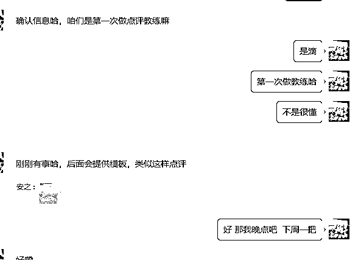
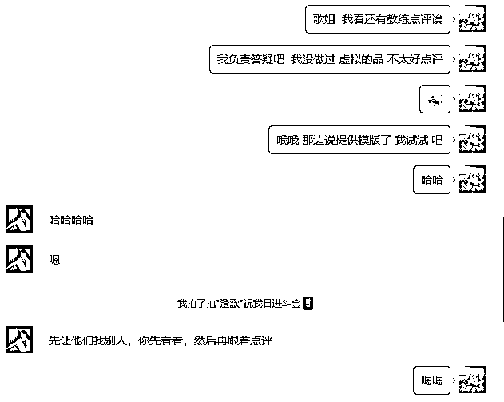
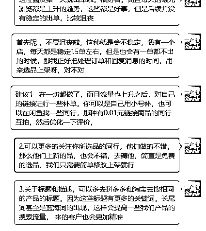
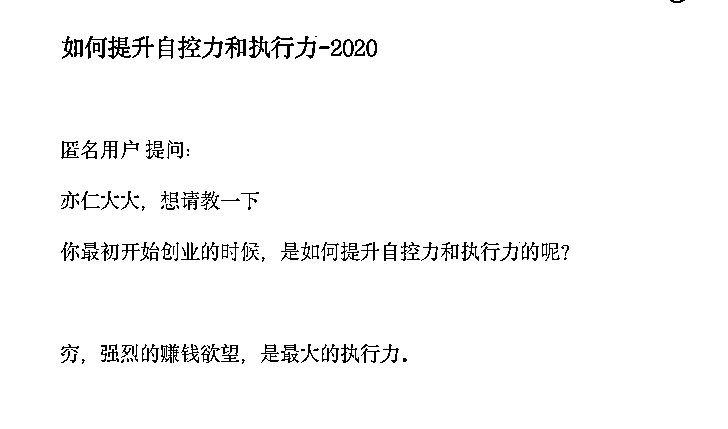
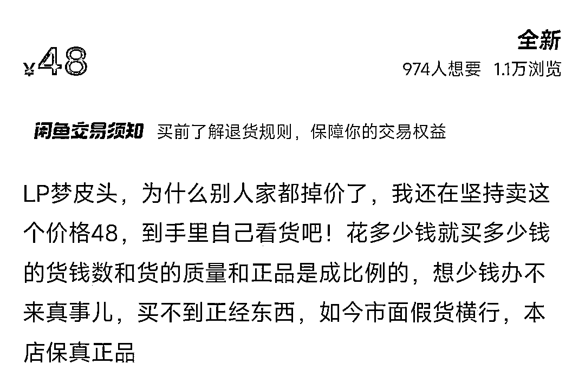
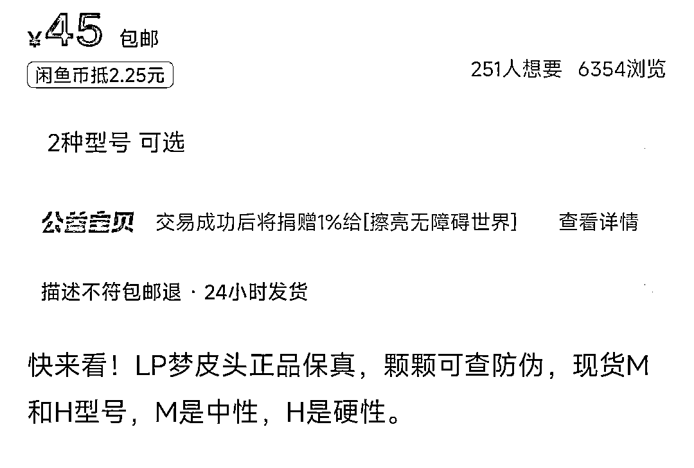

# 同样的赛道，为什么总有人先跑出来？
作者：龙哥

我已经跟了不少期的航海，过去一直站在船员位置上看操作。第一次被推上教练位，说实话手心全是汗。我担心自己讲错了，担心一次点评把圈友带偏。犹豫之余还是问了自己一句：人家能成，我为什么不行？

如果你已经摸到门路了，看完第四点就可以点赞走人继续干活。

# 一、缺的不是方法，是迈步的勇气

## 1. 新手最容易卡在恐惧里

翻日志、刷群记录，重复的问题几乎长一个样：

1. 我这个链接几点上新合适，看别人说要改吗
2. 刚被差评了，会不会掉流量，要不要先撤下
3. 别人都卖1块，我卖0.7，现在又冒出0.5的，怎么办
4. 昨天曝光5000，今天4000，是不是被限了

本质上都是想得多、动手少。不知道几点上新就狂点测试，收到差评就去夸自己产品好，看到别人价格低就跟着降。曝光今天1万明天2000后天2万，本来就是常态。

别怕，少去脑补。没被油烫过，你敢说你会过日子吗？没被砂糖橘吃酸过，你敢说你爱吃吗？没封过店，你有资格说自己做过电商吗？

《知否》里顾廷烨那句骂小公爷的话我记很牢：你往前怕三步，往后怕五步，那你干脆别想了。明兰都快嫁给顾廷烨了，他还在那反复权衡。很多学员被告知怎么做了，还会自己生出十几个假设，最后始终没动。提问应该是为了执行，不是为了验证自己的猜想是否正确。

怕违规、怕没流量、怕被举报，一天一个链接都上不齐，手抖得不行。我也曾是这样。

## 2. 我的真实感受

我们其实都一样。我怕当不好教练，学员怕店铺做不好。第一次要点评前，我心里是这样的

心里发怵是真的，但我想做这件事。于是我去补虚拟相关的规则，找虚拟品类上手，逛同行的课把能看的都看一遍。第一次正式点评前，我把要点评的每位学员日志都逐条过了一遍，操作思路和心理活动都尽量get到。

——走捷径版

我把每个人的操作习惯和心理卡点都写出来，还分享了我最常用的选品打法。没有高深技巧，就是把能想到的事一件件做扎实。结果是

有学员专门加我来一句谢谢。那一刻恐惧没了，反而有点小得意。说白了就是王婆卖瓜，但我想表达的是：该做的事做完，结果通常不会差。

闲鱼副业嘛，最差的结果也就是没做成，你依然是你，没有任何损失。放开干就行。

# 二、被学校训练出来的等答案习惯

从小被教育要确定性：老师这题考吗？有没有标准解法？考试范围几页？

到闲鱼上就变成：一天能上几个链接？这个会上单吗？能不能更快上架？这些问题本身就不该成为阻力。品多了自然试得更准，出单就放大，不出就换。做完基础事再来思考优化。

如果再来一次航海，我希望人少一点，50到100人，配老师加几个学习委员。每天布置任务，检查完成度，完不成的点名出来问，连续三次完不成直接下船。货卖什么、怎么卖都安排好，上船只管听话执行、出单赚钱。把0到1的闭环还原成上学模式。

# 三、不够信，执行力自然松

华严经里说：信为道源功德母，长养一切诸善根。做事也一样，先信。

0到1快的人，看完手册就开干了，遇到问题边走边解。慢的人，问题清单刷满屏：这个能吗？那个会不会违规？

再加上副业心态，可做可不做，根本没当回事。没时间选品、没时间上架。想想刚谈恋爱时，有没有“没时间聊天”这种说法？手机里刷短视频的时长，足够你把闲鱼日更打下来了。

心往哪放，时间就跟到哪。

# 四、不会用同行当数据库

选品最靠谱的老师从来不是教程，是同行。找到在卖的同行，就等于找到了上新密码，直接抄作业。

还要更细一点：爆品是什么时候起势的，时间节点能不能复刻到明年，同行一串上新的逻辑是什么，话术怎么说，标题和主图为什么能带来高曝光。这些才是你要研究的内容，而不是光看两眼感叹“想要好多”“曝光真高”。

举个我自己的例子。

我喜欢打台球，耗材比如皮头、巧克粉，官网贵得离谱，就去闲鱼找便宜的。我搜梦皮头，正品官网要100一块

对比想要数和评价后，感觉转化和口碑都不错，于是我也买了一块试试，材质手感完全一样，45包邮到手，利润至少25左右。联系了卖家批发，最初报价35，我拿来卖60走得很快，再进货砍到30。感觉还能再压，就问他还有多少，常理是会少报，实际估计有60左右。我直接要100个，让他从源头发。运气好，真的从源头发出，发货胶带上留了联系方式，我就加了源头。

万一没有留方式呢？我也遇到过。以前被闲鱼AB单骗过，靠快递单号查到揽收员，再找到发货人，最后把钱追回来了。那次我也跟闲鱼、平台反映过，没人理，热血被泼了凉水，扯远了。

现在我拿到了全网最低价的供货，可以和别人同价甚至更低。接着谈快递，没量也敢谈，了解到均重也能降价，包裹极轻这个点我占优势，谈到4元一单全国包邮，除西藏新疆。量再大还能再砍，谈不下来我还有自用的快递平台，5元多一单。

卖货的底层逻辑就这几步：

发现需求→找产品→看同行怎么做流量→找货源→对标抄作业→卖

把爆品和爆的时间点记下来，下一次复刻的概率很高。技巧都是虚的，数据才说话。

# 五、缺的是耐心

很多人上架三五个商品，就一天打开十几次去看曝光。曝光高不代表出单多。上了那么几个链接能高到哪去？

然后就开始质疑：别人几百个想要，我一个都没有，大环境不行了吧？

别总怪大环境，你就是要去改变它。闲鱼又不会因为你上架就给你无限推流，更不会因为你不出单就把目标买家踢出平台。

少刷点短视频，耐心会回来一点。让子弹飞一会儿。闲鱼还有挖坟现象，2月爆的链接，4月沉了，10月又突然一天几十单。谁也说不清原因。我们能做的就是持续上链接、持续选品、持续看同行，剩下的交给时间。

因上努力，果上随缘。

# 六、最后说两句

出来混就别老想着当老二，要么低头学，要么平常心。遇到人遇到事别过度玻璃心，相信我们早晚都是那个被点赞的人。

如果有点自卑，那就把自卑换成自负，别再委屈自己。敢先拿起的人，才能先享受世界。

我以前也觉得普通人和大佬差什么，后来明白了，差的是血性和那股狠劲。

我们从小被教做人要善良、差不多就行。父母也都是普通人。社会和生意场上，你可以降低道德绑架和情绪绑架，但守住自己的底线，不违法不害人，用合理方法赚钱没问题。别总觉得这个不太好那个不合适。

一定要付出不亚于任何人的努力，把时间和体力压到项目上，不会不赚钱。拿个计时器算算你一天真正工作几小时，然后打破它。

今天你认真工作时长有5小时了吗？