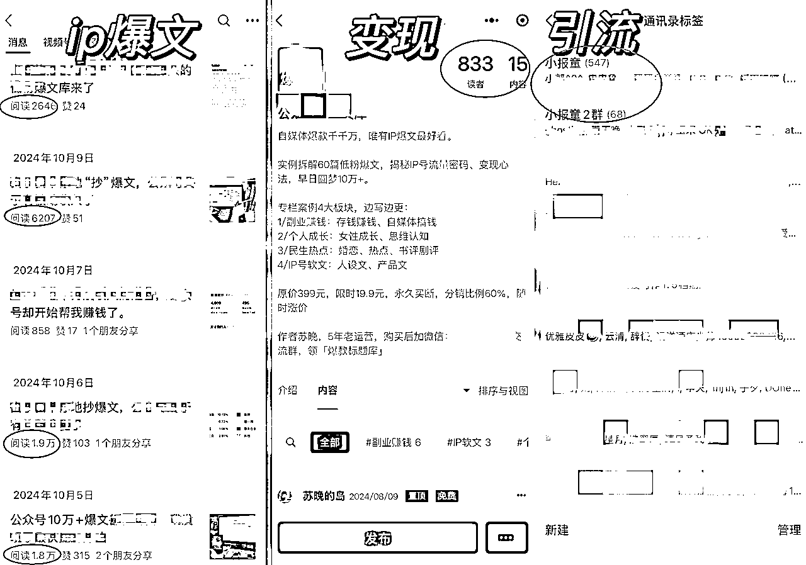
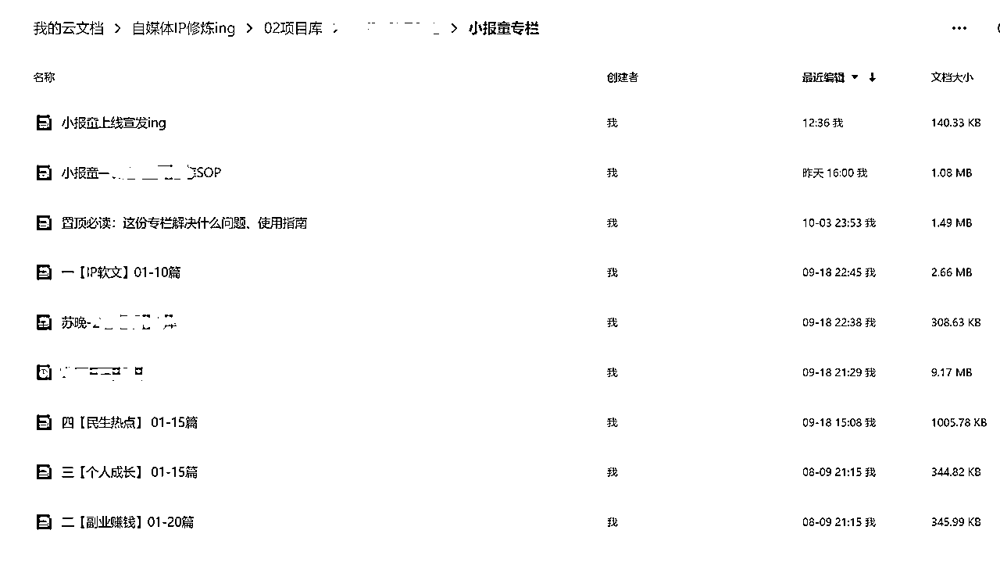

# 订阅号小IP的进阶之路：不搞发售不造势，靠几篇热文卖出上千份付费专栏

> 来源：[https://l762hez4ol.feishu.cn/docx/FemodH9yQoCl2txvAvuc4cJHn0g](https://l762hez4ol.feishu.cn/docx/FemodH9yQoCl2txvAvuc4cJHn0g)

各位好，我叫苏晚，在广州做了五年运营，一直在做IP类爆款内容的创作和导流。如今圈里都在说，付费专栏这东西已经泛滥成灾了，可偏偏在这种环境里，我硬是靠订阅号上的几篇文章，把一份小小的付费专栏卖出了一千多份。头条内容的平均阅读量从起初的两百涨到上千，关注者多了两千多人，站外好友也加了上千位。今天这篇分享，就是想聊聊一个小订阅号IP，怎样借着热文完成从零起步，卖出千份专栏、赚到五位数。

先说说我自己的情况。我的订阅号粉丝刚过九千，标准的小IP，之前一直没有什么能直接卖钱的产品。直到去年10月，我试着开了一个专门拆解热门文章的专栏，居然跑出两篇破万阅读的稿子，还配了几篇好几千阅读的内容。整个过程没有任何发售动作，没有预售、没有造势，纯粹靠文章自己传播，最终卖掉1100多份。也就是说，一次尝试把内容、阅读量、收入和关注增长全串了起来。

坦白讲，这成绩在大神眼里不值一提。但以一个几千粉小IP的身份来看，从“手里没有任何产品”到“有了一款被市场验证的爆品”，算是一个很重要的节点。下面我会把这个专栏怎么在两天里跑通启动、纯靠订阅号文章的自然流量卖掉1100多份的经验，以及这一路做付费内容踩过的坑，原原本本讲清楚。认真看完，收获不敢保证，但肯定比你一个人瞎折腾强。这里要特别感谢一位老师，当初帮我看帖、给了不少指点。

现在私域和课程都卷得不成样子了，与其在红海里互相消耗，不如去公域拼一把，靠订阅号的热文杀出一条自己的路。

# 分享框架

1、我做付费内容的三个时期复盘
2、敢卖敢吆喝，产品布局趁早铺好
3、付费专栏如何更快跑通启动期

ps.全文五千字左右，读完大约六分钟。

订阅号IP赚钱，翻来覆去就那么几种：接商务广告、拿平台流量分成、卖自己的内容产品。每一条路上都有人做到月入七位数，随手举几个例子：

1.某位大V一条广告报价30万，一个月接四条就有一百多万进账
2.某博主做矩阵账号，手上几十个号，每月流量分成收入十万以上
3.某作者发收费文章，每篇定价60元，一次能卖出几千到一万份，四篇就过百万

还有人办特训营、组织社群拼团、做直播卖货，年入千万的也不少见。

听着是不是挺心动？可订阅号再赚钱，跟普通人又有多大关系？我经常在想，一个几千粉的小号，想赚点钱真是太难了。找上门的商务翻来覆去就是那几类课程广告，很多大号接广都不稳定，更别提还在为生计发愁的小号主了。我越来越确信，单靠接广告，收入上限非常低。

所以从起号那天起，我就在琢磨产品布局的问题。这类付费专栏刚火起来的时候，我只懂得帮别人分销，白白错过了第一波红利。直到2024年8月，我又动了做专栏的念头，当时最头疼的就是怎么启动。有博主建议，先靠自己卖掉一百份，积累一千个经常看文章的读者，才算真正跑通。

做了一年，我最深的体会浓缩成一句：搞内容的终点，说到底就是卖货。

现在做订阅号，提前想清楚赚钱路径太关键了。如果你手里有实物货源，比如美食、水果、特产、日用品这些，就围绕货源写内容、做团购；如果没有货源，可以考虑做知识产品，但这赛道已经很挤，必须做出差异化明显、确实有人愿意付费的东西。

我去年刚开始写号的时候完全不懂这些，一路踩过“没有产品—盲目跟风—做出差异”三段路程，坑没少掉，教训都是真金白银换来的。今天一次讲完，希望能帮各位少走弯路。

# 一、做付费内容的三段路程复盘

## 第一段（2023.7-12）：两手空空，只会分销

我是2023年7月开始写订阅号的，头五个月几乎没收入。当时想法特别单纯：先写够一百篇再说，完全没有给自己做产品的意识。

后来刷到一个十块钱的付费专栏，买回来发现内容特别有用，就经常在文章里顺手推荐，没想到陆续卖掉几十份，赚了三百多块。这算是我写订阅号赚到的第一笔钱。

那之后，我还专门写了六七篇文章拆解这个账号，后来因为各种原因，没能继续更新。

## 第二段（2024.1-5）：产品有了，但市场反应平平

后来账号进了推荐池，数据慢慢好起来，我就发过一篇收费文章，同时开始做“打卡群”。打卡群是交押金的，全勤就退。说白了，这就是个费力不讨好的事。我之所以做，一是情怀——自己当初就是靠类似的小组才坚持写下来的，二是跟风——看别人做，我也想试试。

结果前两期只招到十几个人。到第三期我改了玩法，增加了点评和改稿环节，别的群都没有这个，那期招了36人。交付我做得挺用心，但问题是不赚钱，还要搭进去大量时间分享、改稿，实在撑不住，就停掉了。

跟我同期开的几家打卡群，现在基本也都招不动了。有位号主我印象很深，她也做写作群，同样提供一次改稿，但不是押金模式，而是直接收49元。这种形式才可能长久。

这里想劝各位一句：做产品之前，一定先把赚钱的路子想明白。只有持续有收入，你才有动力持续产出好内容、做好服务，不然再大的热情也会被耗光。

第一个项目结束后，我又做了“年度社群+星球社群”。说实话，这个多少也是跟风，看到每个号主都有自己的付费群，觉得自己也能做。

结果4月才开始招募，动作太慢了，别人去年11月、12月就动起来了。好在手里还攒了些流量，最后成功拉到70多人。

这个社群的节奏分三段：预热两周，宣发四周，交付一年。所有海报、文案都是自己做的，虽然不算精致，但整套流程算是跑通了，后面慢慢优化就好。

## 第三段（2024.8-至今）：做出差异化，上线付费专栏

两个项目推完，我陷入了一段迷茫。做知识产品的博主实在太多，很多是写了几年订阅号的老手，粉丝基础扎实，会互相抱团推广，学员案例也一个比一个漂亮。

拿我这种新号去比，根本打不过。而且我是兼职做内容，没精力去做特训营、一对一陪跑这种交付很重的项目，流量也有限，那段时间进退两难，一度想放弃。

中途我还跑去做了个小红书家居号，虚拟产品也卖了一千单左右，但没有可持续的模式，导流很困难。

瓶颈期我花钱找人请教，终于想明白：要做就做市场有需要、自己有差异化的产品。这时我想到了付费专栏。我搜了一圈，拆解热门文章的专栏有不少，但专门聚焦IP爆款这个细分赛道的人，居然没有——而这正是我的强项。

这次我学乖了，先调研再动手。在自己的社群里问了一圈，发现爆款选题几乎是人人需要的东西。我立刻做了一份完整的产品流程文档，申请开通了专栏，然后开始把自己收藏的高阅读选题整理出来，一篇篇拆解。

申请开通并不难：粉丝满三千，定好名字、头像、简介就行。建议选一次买断、永久阅读的模式，用户体验最好。最难的还是启动这一步，后面细说。

虽然知道爆款是刚需，我心里还是没底：怕卖不出去，怕面对失败，不敢用力宣传。这个心态很不好，大家别学我，我花了很长时间才调整过来。

准备过程比想象中漫长，8月开始筹备，10月才正式上线。当时的心态就是：拼了。哪怕卖得不好，也能拿来当订阅号的选题写，怎么都不亏。

文章发出去那天，我紧张得不行。结果转折来得特别快，那篇推文进了推荐池，又连着出了两篇破万阅读的热文，专栏销量直接被带飞——两天突破一百份，启动成功。这时候我才认真起来，开始全力推。截至3月20日，累计卖掉1132份。

有自己的产品，不用天天等广告主翻牌子，这种感觉太幸福了。前阵子出去玩，靠这个专栏每天都有几百块被动收入。而且它的上限比接广告高，先做的人还有先发优势，不容易被抄。缺点是低价到高价产品的转化链路还没打通，正在补。

下面说说，怎么做才能让付费专栏更快跑通启动，以及过程中要注意的问题。

# 二、敢卖敢吆喝，产品布局趁早铺好

回头复盘，我走了太多弯路，折腾一年才做出像样的产品，根源就是认知不够：胆子太小，不敢卖，不知道卖什么，也不知道怎么卖。

我认真数过，至少错失了六次机会：

①去年9月，我最早学到一位博主的爆款案例写法，开始模仿她做IP爆款拆解。但我只是帮别人分销，没想过做自己的，后来还断更了
②有一次和一位前辈聊天，他说我写带“爆款”字眼的文章阅读量特别高。我一想确实是，但也没敢往产品上靠
③做打卡群时，大家对点评、改稿的需求非常旺盛，我没有深挖这个机会去做新产品
④我付费进过一个小红书爆款拆解社群，学了很多，却没想过把这个思路延伸到自己擅长的订阅号领域
⑤做星球拆解头部账号时，发现拆一个账号要花一周时间，每次拆完都被掏空，开始怀疑自己适不适合干这个，也没有及时转去做单篇拆解
⑥最后一次，正式发售前约30天，我在社交平台发了三次预告，结果没人理。自我怀疑又涌上来，差点放弃。磨到10月，才重新鼓起勇气上架

但你看，哪怕前面六次机会全错过了，只要最后抓住一次，照样能成。所以你也没问题！

再分享几条用教训换来的心得：

## 2.1你做什么事，就会吸引什么人

别做太多免费的事，不然吸引来的都是想白嫖的。我曾经搞过不收费的社群，也义务帮人改稿，最后只是感动了自己。现在我把这句话记在心里：当我大大方方谈钱，钱就会向我流过来。

## 2.2盯住异常数据，产品方向自然浮现

暂时不知道做什么产品？那就把账号里阅读量最高的十篇内容拉出来，看看它们都写了什么方向。挑一个你喜欢的、擅长的、有长期复利价值的领域深耕，多问自己能“卖”什么，努力成为这个领域被记住的人，IP势能才能起来。

## 2.3卖产品要大大方方

没必要畏畏缩缩。你有好产品，对方正好有需要，这就是互相成全。有人说“不敢收费，本质上是IP不自信的表现”，我非常认同。既然做出了有需求、有流量的好产品，就要自信地亮出来。就像今天，我也是鼓了很大勇气才来分享的。

## 2.4做IP、卖货，本质都是在“卖”自己

现在产品同质化很严重，但IP不会。每个IP都是独一无二的。如果粉丝先认可你这个人，再认识你的产品，那你的市场里就没有同类竞品。说到底，卖货就是在“卖”自己。

当你靠坚持赚到了钱、收获了成长，自然会有人被打动，愿意支持你、追随你。举个例子，我以前连载广漂故事，有位读者连续打赏了我两次，每次188元。这件事给了我很大的触动，也让我更坚定把写作当作一生的事业。

还有付航在脱口秀夺冠时说的那句“只要你勇敢地做自己，总有人会爱你”，特别打动人。我们做IP，不也是这样吗？

# 三、付费专栏如何更快跑通启动

做付费专栏，启动是最关键的一关。前期至少自己卖掉一百份，也就是搞定一千个固定读者，才算真正跑通，然后再谈扩大宣传。

以我的经验，在自己的社交动态里发预告效果一般，可能我的好友画像不精准。真正起作用的是订阅号长文。当初我帮别人分销，也都是靠文章卖出去的。

这次专栏能快速跑通启动，就是因为10月5日发的那篇进了推荐池，接着又出了两篇破万阅读的热文，两天时间卖过一百份。这时候我才开始重视，全力去推。

后面我写的文章，只要带上“爆款”“热文”这类关键词，数据都不错。所以到12月13日，主要靠的就是订阅号的自然流量，中间我还出去玩十天、断了更新，照样有订单。

再后来，有朋友模仿我的热门选题，主动帮我推广，贡献了大约一百份销量。到2025年3月，累计卖出1100份。帮我带货排名前四的朋友，都是套用我的标题思路写自己的原创文章，进了推荐池，成功卖出去。

所以，哪怕很多人说付费专栏已经满大街都是，优质内容依然不缺买家。

这个专栏能跑出来，我总结四个原因：一是热门选题确实是刚需；二是定价低，10块钱用引流品的价格做出高价值感；三是附赠资料包和交流群，超值感直接拉满；第四点最关键——订阅号推荐带来的自然流量。

流量好了，商务合作也主动找上门，质量还很高，是我以前根本接触不到的那种。专栏还带动了我的“年度社群”，很多读者读完文章或专栏后，加过来直接转账，新增一百多人。后续还有20多个报名了我的订阅号陪跑课，这套模式可以继续复制放大。

最后汇总一下，截至2025年3月，这个专栏带来的总收益：

1、订阅1132份，直接收入1.6万+，间接收益5万+，合计6万+
2、站外新增好友接近1000人，其中买完专栏进交流群的有800多人
3、带动年度社群和陪跑课的转化，这部分进账5万多
4、账号权重提升，头条内容的阅读量从两百上下稳定到五百上下

说白了，一旦你做出了一款被市场认可的产品、跑通了一条赚钱的路，订阅号就会成为你最有力的助推器。来的全是精准读者，顺滑地转到好友池，转化效率相当惊人。

那些能稳定赚钱的订阅号，无一不是把订阅号、短视频、私域组合起来用，不管卖实物还是知识产品，持续迭代，慢慢建立起自己的竞争壁垒。

开头讲那些大V的故事，不是为了制造焦虑，而是想让大家先看见。先看见光，才可能相信光，才可能成为光。

我还相信，那些摔过的跟头，最后都会变成财富。做内容别怕踩坑，所有经历都不会白费，这是成长的必经路。

以上就是我今天的分享。觉得有用就点个赞，有问题欢迎在评论区聊！