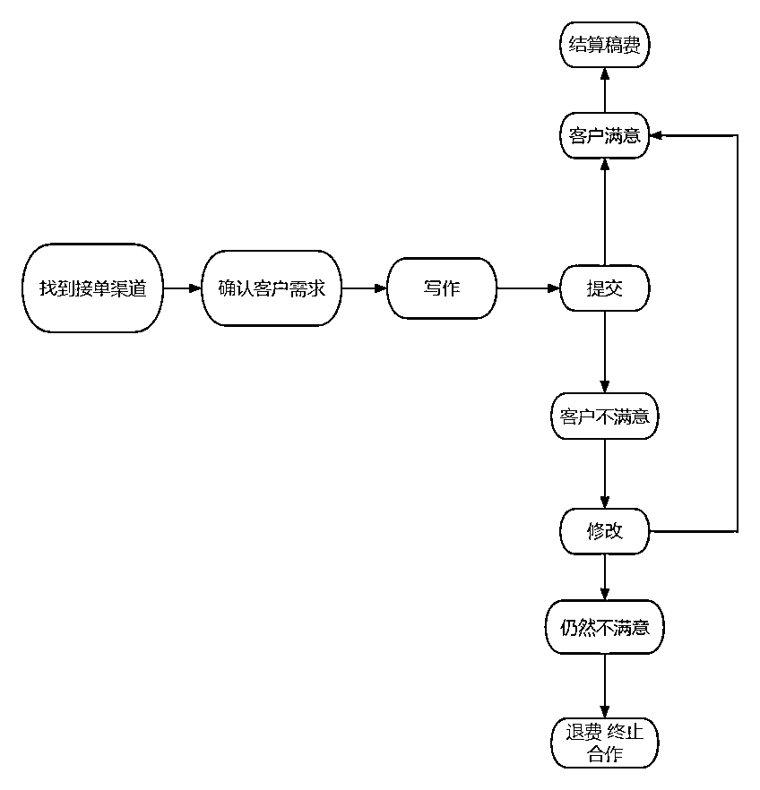
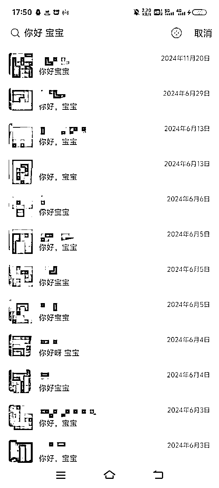
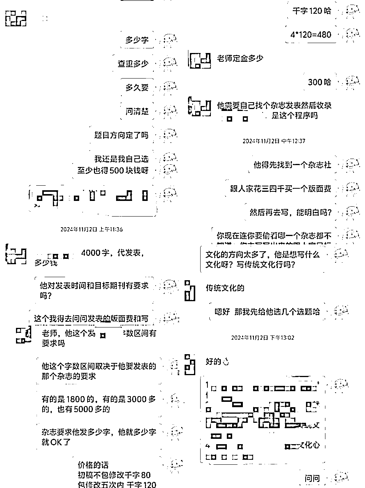
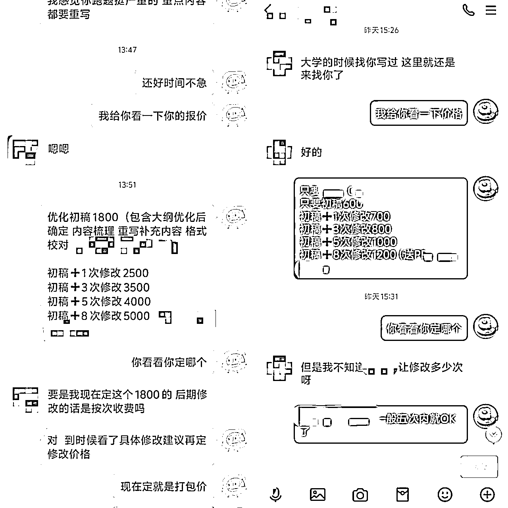
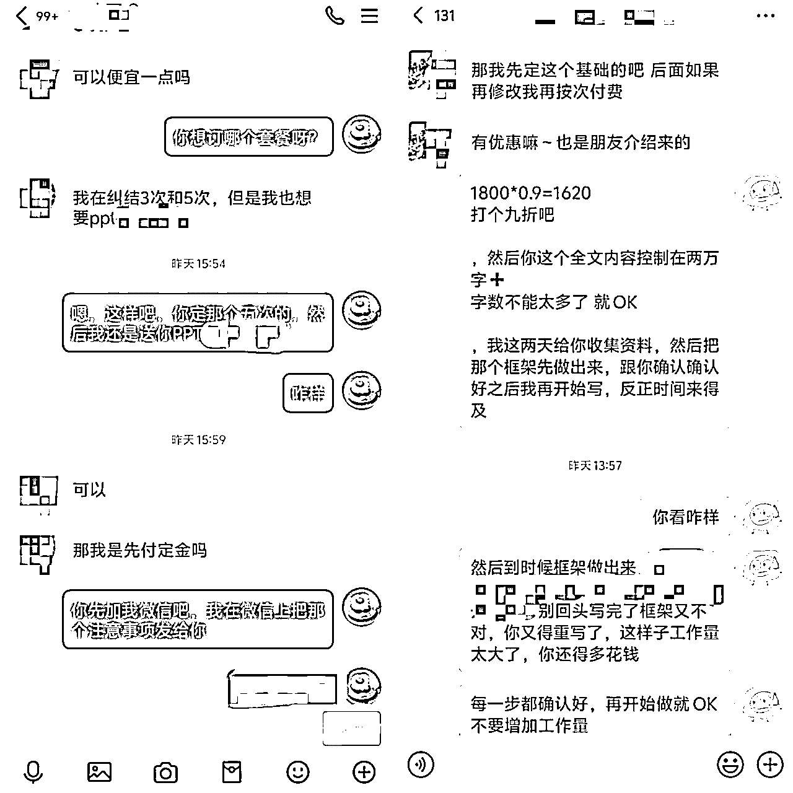
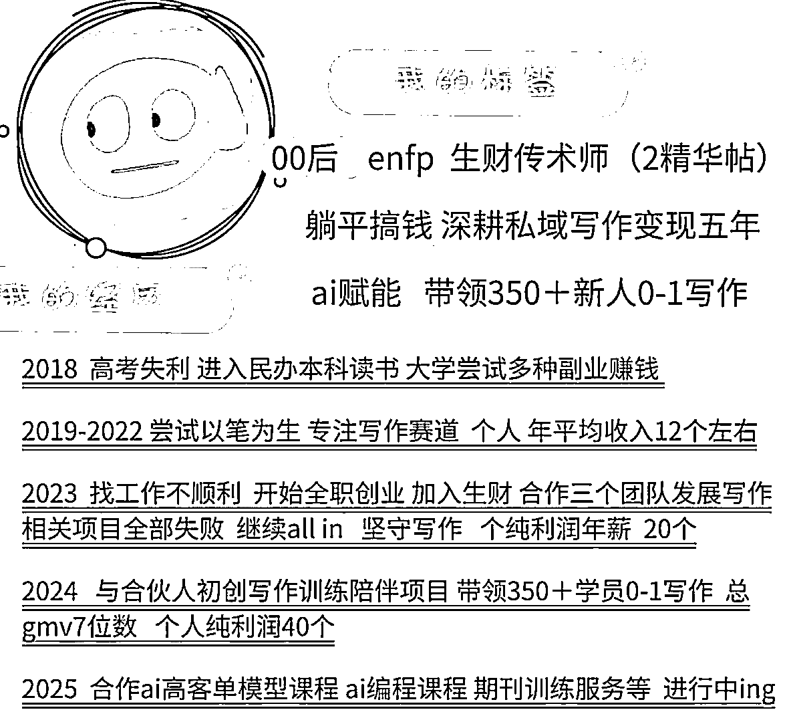

# 【AI写作】新手也能上手！私域谈单实战心法与成交案例拆解

荷包蛋深耕私域写作业务五年，把自己在私域拉单过程中总结的思路和真实成交案例整理出来了。希望对你有启发。

建议每一位做写作服务的人都重视私域搭建。私域打通后，流量焦虑会大幅降低，我们做的是具备复利效应和复购属性的业务与产品。

当私域运营跑通后，每年都不需要为新客源发愁。以下就是我的实操心得与案例解析。

# 一、底层逻辑与常见误区

## （一）AI写作变现路径拆解

找渠道接单 → 明确客户诉求 → AI辅助创作 → 提交交付 → 实现变现

先锁定合适的接单入口，再与客户对齐写作需求，用AI完成内容产出并交付，从而实现商业闭环。流程中，谈单与成交是最关键的环节，后续内容会重点拆解私域谈单方法论。

## （二）私域为什么是写作类服务的核心资产

私域的本质是人与人之间的信任与情感连接。

若只依靠平台引流或店铺导流，每年都要重新找客，留存率极低。私域的意义在于跳出这种低效循环，通过老带新、裂变传播、高频复购和复利积累，打造可持续的客户生态。对写作服务而言，私域价值尤为突出。

把私域做好，复购率自然提升，收入也更稳定。不必把所有精力都放在追逐新流量上，而是先稳住老客户的复购，再有节奏地拓新，这样收入曲线会更健康。

在私域链路中，谈单转化是第一道关口。新客户进来后，留存与购买的决定权很大程度上在首轮沟通。话术质量直接影响转化效率，这也是需要重点训练的能力，私域的重要性相信不用多说。

## （三）私域沟通里最容易踩的坑

沟通中最致命的问题是：情绪价值缺失、专业度不足、报价随意。这三点很容易让客户产生不信任，最终流失。

改善方法其实很清晰。

第一，先吃透服务难度和合理价位，不要在需求不明的情况下乱开价。乱报价会让客户反感，也为后续交付埋雷。

第二，学会用客户听得懂、愿意接受的方式去沟通和博弈，传递共情与真诚比硬推成交有效得多。

第三，砍价环节可以适度让步，但必须守住底线，并把价格的逻辑讲透，让客户理解钱花在哪。

错误示范参考：

#### 错误话术 1：强制推销
* “现在赶紧下单吧，再犹豫就没了！”
* “你再不决定优惠就结束了，快点下单！”
问题：语气强硬压迫，制造焦虑，反而拉开距离，难以建立信任。

#### 错误话术 2：忽视具体需求
* “我们写作服务全覆盖，什么类型都能写。”
* “直接买套餐吧，包含所有文章类型，很划算。”
问题：只强调覆盖面，不关心客户真实痛点，显得敷衍冷漠。

#### 错误话术 3：机械式应答
* 客户：“适合做企业宣传文案吗？” 销售：“可以，我们什么文案都写，套餐链接给你。”
问题：回答空洞，不展开说明，专业感不足。

#### 错误话术 4：唯价格论
* “最低只要XX元，试试吧。”
* “这么便宜快下单！”
问题：过度聚焦价格，忽略客户对质量和价值的关注。

#### 错误话术 5：售后模糊
* “保证质量，但不满意也不能退。”
* “改稿要加钱，不接受就别下单。”
问题：保障机制不清晰，客户会产生购买顾虑。

#### 错误话术 6：命令式表达
* “肯定适合你的需求，别纠结了！”
* “没必要考虑别的家了。”
问题：剥夺客户选择权，沟通姿态过于强势。

#### 错误话术 7：漠视心理
* “你都问这么多了，买了再说。”
* “我们服务就这样，合适就买，不合适算了。”
问题：显得不耐烦，忽略客户疑虑。

#### 错误话术 8：情绪价值缺失
* “这服务对你有用，买了就知道了。”
* “我们只负责写，其他不管。”
问题：冷硬无温度，难以建立情感连接。

掌握这些雷区后，下面用真实成交案例演示具体操作方法。

# 二、私域谈单高效打法与案例

## （一）需求挖掘的五步提问法

#### 1. 搞清楚客户来源
沟通前先判断信任起点：
* 朋友转介绍：信任基础好，可快速进入需求探讨，适当引导即可推进。
* 主动私信找来：更看重专业度与服务能力，需先建立信任再谈合作。

#### 2. 把写作需求问透
* 文稿类型：演讲稿、品牌文案、内部汇报？
* 使用场景：用途决定内容深度和定价。
  - 仅作内部应付，可基础达标。
  - 用于商业对外，需高质量创意，价格相应提升。
* 修改频次：是否需要多次返修，这也是报价核心变量。

#### 3. 参考过往作品
了解客户历史稿件的风格、逻辑和深度要求，有助于精准判断难度和定价。

#### 4. 快速画像客户
* 学生群体：预算有限，推荐基础版，沟通直接，成交快。
* 职场/企业客户：重质量与专业，适合推中高端方案，强调深度与逻辑。
可通过微信名、头像、朋友圈初步判断消费能力和需求层级。

#### 5. 针对性推荐服务
* 学生：快交付、简单润色。
* 职场：内容深度、结构优化、逻辑严谨。
明确告知不同用途的价差逻辑，帮助客户理解价值。

#### 6. 不要盲目报数
需求没对齐前不要轻易报价，否则易丢利润，也损专业形象。先明确类型、用途、修改需求，再给出合理区间。

## （二）私域沟通四步法与案例

### 1. 破冰开场：先给温度
关键点：开场用温暖真诚的语气拉近距离，先建立关系再谈业务。避免上来就卖。

通用破冰技巧（年轻人适用）

，男生统称宝子，女生统称宝宝。配上可爱表情，距离瞬间拉近。

不好意思开口就别怪成交慢

用昵称拉近关系后询问需求。除了宝子，还可以用哥哥姐姐美女等，保持自然亲切，别过于客套，也别学淘宝用“亲”。

也可以走稳重路线，先直接切入主题，后续再慢慢增进信任。

直入主题开场案例（不建议照搬，仅适合极度自信且专业度高的人，我这四单都成了）

实操建议

减少刻意热情：少用修饰词，直击客户心理，传递真诚与干脆。

加入调侃感：适度幽默，夸头像或微信名，自嘲一下，能快速破冰。

别拖沓：开场控制在一两句内，直接引出需求或提问。

### 2. 需求挖掘：抓住痛点
关键点：通过提问引导客户说清真实难点，确保方案匹配。

直接问清用途、字数、交稿时间、语言风格、是否需要修改。客户说不清时要逐步引导，复盘时还能体现专业性。

提问要点

* 用途：个人学习、汇报还是商业用途？
* 字数：期望区间？
* 时间：多紧急？
* 风格：简洁还是华丽？
* 修改：需几次调整？

引导话术示例

“这篇稿子准备用在什么场合？我可以根据场景推荐方向。”
“大概需要多少字？我好规划结构。”
“偏好通俗易懂还是偏专业？”

总结确认

“你的需求是商业汇报文案，约1000字以内，重逻辑与说服力，2天内完成。对吗？”

实战对话

初步提问
“您好，这份稿件是内部使用还是对外宣传？”
“公司内部用。”

逐步引导
“是汇报类还是项目总结？”
“项目总结。”
“字数有要求吗？大概几页PPT配套？”
“没定，2000字以内。”

“风格偏简洁还是要详细数据？”
“详细点，语言别太学术化，领导喜欢直观数据与结论。”

总结确认
“需求是公司内部项目总结，2000字内，简洁有逻辑，突出数据与结论。请问准确吗？”
“是的！”

报价沟通
“按需求估算费用是XX元，含一次修改，时间安排可以吗？”

价值点

展示专业：提问与总结体现掌控力。
降低返工：需求清晰，减少修改成本。
提升转化：精准匹配方案，成交更快。

### 3. 专业输出：用方案建立信任
关键点：针对痛点输出专业建议，展示能力与价值。

可分享同类型案例，深度讨论框架、内容侧重点、数据支撑点等。

案例：商业计划书深度沟通

客户背景：需写商业计划书，思路零散，对框架不确定。

沟通过程

审阅资料后开场
“我看过你的材料，背景和数据很丰富，但逻辑与结构需优化。我们可以先搭一个清晰框架。”

框架建议
引言：简洁点明项目背景与目标。
市场分析：结合数据讲竞争优势与趋势。
核心产品：用数据突出卖点。
财务预测：补充营收与成本说明。
团队介绍：强化专业度与执行力。

深度讨论
市场分析数据不全：建议补充竞品定价，整合后提升说服力。
财务预测缺细分：建议加入分阶段资金分配，更易让投资人理解。

确认方向
“我在市场分析加入竞品数据，财务部分补充细项拆解。这样更具说服力，可以吗？”
“完全可以，思路很清晰，交给你了。”

核心价值

体现专业：分析与优化建议增强信任。
解决痛点：不仅交付，还提供方法。
为复购铺路：深度沟通促成长期合作。

### 4. 多维报价：让客户自己选
关键点：根据预算设计梯度方案，用对比引导决策。

1. 分层报价
“宝子，我们服务分四档：
初级20元，原创保证；
中级30元，老师有教育媒体背景；
高级50元，速度快，适合加急；
金牌80元，专为领导级稿件定制。
都支持原创包改，主要区别是资历与速度，你更倾向哪种？”

2. 套餐报价
“修改次数可打包：
初稿600
初稿+1次改700
初稿+3次改800
初稿+5次改900
初稿+8次改1000”
“结合你的需求，初稿+3次改性价比最高。”

3. 单独修改
“已有初稿需要润色：
1次改500
2次改800
3次改1200
5次改1500”
“内容复杂建议选3次以上，确保质量。”

核心逻辑

梯度设计：覆盖不同预算，让客户有选择感。
组合打包：初稿+修改，提升成交率。
匹配预算：先探预算，再推荐对应档位。

案例

客户要商业计划书，专业要求高，预算未明。

说明工作量
“计划书结构复杂，涉及数据与竞争分析，投入时间较多。”

阶梯报价
中档3000元：初稿+1次调整
高档4000元：初稿+3次调整
顶级5000元：初稿+无限改

探预算
“哪个档位更符合你的预期？预算有限可调整模块。”

客户预算约3500
“那选高档服务，微调内容范围，既控预算又保质量。”

成交总结

多维报价要透明灵活，让客户感知价值与价格匹配。
用工作量说明提升高价方案的合理性。
沟通中强化价值感，把价格转化为解决方案。

### 5. 适度让利：促成成交
关键点：谈判收尾阶段可给予优惠，但要守住底线，并讲清价值。

经过前面的引导，来到询盘回盘阶段。适度让利如9折、88折，或赠送1-2次修改、附加服务。

老客介绍可放话：“看在朋友面子上给优惠价，成交后别忘了给推荐人红包，鼓励裂变。”

话术参考

优惠折扣
“宝子，这次看你这么信任，给你9折，原价XX，现XX。”
“朋友介绍来的，给你88折，感谢他推荐。”

增加附加值
“把修改次数从1次升到3次，保证满意。”
“服务期从1个月免费延到3个月。”

把一次成交打造成长期复购和裂变的起点，关键在于让客户感受到“被重视”的同时，你的专业价值也没有被稀释。以下这套私域谈单思路，帮你把优惠用在刀刃上。

**先立一个专业边界**
稿子交付后，如果客户有格式微调、排版整理等小需求，我一般会主动说一句：“这块我帮您免费处理一次，不收额外费用。”

小需求免费兜底，能让客户安心，也为后续加单埋下信任。

**老客户和介绍客户要区别对待**
老客户的维护，重在仪式感和持续关怀。

“您一直是我们的老客户，这次给您直接按88折走，再额外多送一次修改，让您更省心。”

被朋友介绍来的客户，重在把人情价值讲清楚。

“这次是朋友牵线，我一定给最实在的价格。按友情价给您算，同时附赠两次修改机会。成了之后我也会把情况反馈给推荐人，和他说声谢谢。”

推荐人反馈要及时闭环。

“您推荐的朋友已经确认合作了，特别感谢您的信任，我这儿给您发个小红包，后续有需要随时继续介绍。”

**优惠的核心原则**

把握底线：讨价还价时可以让步，但让步要有度。折扣幅度要经得起推敲，既体现诚意，也守住利润和专业度。

做加法不做减法：价格下不来，就用附加价值补。增加修改次数、延长配合周期、赠送后期优化，都是客户感知很强的“超值感”。

经营关系：老客户给人情式照顾，介绍客户给感恩式回馈，让信任成为复购和转介绍的燃料。

案例参考：有人选择加赠修改次数来锁单，有人选择直接折扣+服务升级，两条路都能走通。

**两个真实成交场景**

场景一：用加赠服务化解预算焦虑
客户要一篇商业文案，预算卡得紧，还担心领导反复提意见。
原方案：3000元，含1次修改。
客户说：价格有点超，还想多改几次。
我的话术：“第一次合作，我就把修改次数直接提到3次，价格不动，您看这样能不能开始？”
结果：客户觉得性价比上来了，当场确认。

场景二：折扣+回馈推动裂变
介绍客户，预算有限。
原方案：5000元。
客户说：朋友推荐的，但价格有点高。
我的话术：“朋友介绍的，我肯定给最优价格。这次88折，再额外送一次后期优化。成交后我也会马上感谢您的朋友，给他一个小回馈。”
结果：客户认可方案，推荐人收到反馈后更愿意继续带单。

一句话记住：让利是成交的助推器，策略性的让利既能让客户满意，也能守住你的价值，最终实现满意、复购和裂变。

# 三、客户高频咨询的标准回应

**Q1：为什么你们比别家贵？**
我们卖的不只是成稿，更是整个服务体验。
每篇都是原创定制，匹配你的具体场景；由资深写手团队操盘，逻辑和表达都经过打磨；修改直到你满意，还有后续跟进。便宜的稿子可能要返工，我们帮你一次性搞定，省时间省精力。

**Q2：我需求还不明确，你们能帮我梳理吗？**
完全可以。
先问三个关键点：这篇稿子用在哪，汇报还是宣传；大概字数和交稿时间；你偏好什么风格，正式严谨还是轻松生动。有了这三点，我就能给出匹配的方案。

**Q3：如果最后不满意怎么办？**
我们提供多次修改保障，直到你点头为止。
有意见随时提，我们快速调整。修改次数内全部免费。需求变更太大需要加项，我们会提前沟通确认。

**Q4：有没有优惠？**
有，分情况。
新客户首单9折；老客户享追加修改或更低折扣；推荐客户我们会给推荐人红包或额外服务作为感谢。

**Q5：多久能交稿？**
看难度和紧急程度。
常规是3-5天交付；加急24小时内完成，需加费；特别紧急的我们会优先排期，确保按时。

**快速成交的关键：信任+紧迫**

信任不足怎么办？
用案例说话。举一个和他情况相似的成功案例，降低决策风险。强调原创、多次修改、长期支持，消除不确定感。

抓不住痛点怎么办？
多提问，少推销。比如客户要汇报稿，就建议用数据化、结构清晰的写法更容易通过。需要赶时间，就主动提出加急保障。

缺少推动力怎么办？
制造合理紧迫。“今天下单享9折，明天恢复原价”“这个修改赠送只限今日”让客户有现在行动的理由。

**观望客户的跟进思路**

价格敏感：别只谈降价，谈价值对比。包含原创定制+多次修改+售后支持，基础套餐也能按预算灵活搭配。

结果不确定：先给小样或案例参考，让客户先看手感再决定。

信任感弱：展示流程透明和客户口碑。专属团队负责，全程沟通，可看历史评价。

没紧迫感：用限时赠品、名额稀缺推动。“现在下单送两次修改，活动结束就收回”“高级服务名额只剩两个，晚了要排期”。

**进阶促单话术**

限时优惠：“我们今天有专属9折+赠修改的组合，您看现在定下来吗？”

稀缺性提醒：“这个档期的高级名额快满了，晚一点可能要等下周。”

反向引导：“如果您暂时还不确定，也没关系，后续档期可能会更紧，我们会尽量帮您留位。”

总结下来，对想快速下单的人，用案例+紧迫感推一把；对犹豫的人，用需求引导+疑虑解除慢慢暖。对话要灵活，核心始终是理解客户心理，先成交，再维护关系，让关系自然裂变。

# 四、写在最后

以上就是一套可直接上手的私域谈单打法，新手掌握后基本能覆盖日常常见场景。如果觉得有用，不妨点个赞，有需要沟通的可以直接联系我，找不到我也可以通过鱼丸链接我。

布道传术 成人达己 ！！布道传术 成人达己 ！！布道传术 成人达己 ！！布道传术 成人达己 ！！