# 外卖骑手出了事，凭什么只能自认倒霉？这个小众副业，一年闷声赚25万+

大家好，我是加号。在即时配送这行摸爬滚打了9年，2015年入局外卖，算是赶上了行业从野蛮生长到逐步规范的全过程。

早年在头部外卖平台做过广州南区的骑手配送项目负责人，后来又在平台TOP10的配送服务商里辗转，从城市经理、运营总监、到人力资源、招聘项目，再到自己搞即配人资公司，基本把配送链条上的前中后端都趟了一遍。

这几年靠围绕“即时物流”的周边项目确实攒下了一些家底，也带着身边不少有想法、有精力、但缺门路的朋友一起赚到了钱。简单晒几组数据：

1. 骑手招聘（居家就能干，兼职团队也能轻松获利）：2023年招聘团队干了388万营收
2. 企业风控管理+法律咨询（含非诉/诉讼案件）：年利润40万
3. 线下面试点（吃租车提成）：单店年利润30万
4. 保险理赔服务：年利润20万
5. 骑手维权服务：团队年营收80万

说实话，比赚钱更让我有成就感的，是带了一帮朋友共同做成了点事，大家各展所长，一起分钱，一起把盘子做大。

今天这篇文章，重点拆解其中最不起眼、但利润相当可观的一条业务线——**骑手维权咨询**。

目前我们团队有3个人专职做骑手维权，按今年上半年的数据看，单人实际到手大约12万（应收近20万，部分还在赔付流程里）。换算一下，一个人一年稳稳当当25~30万。

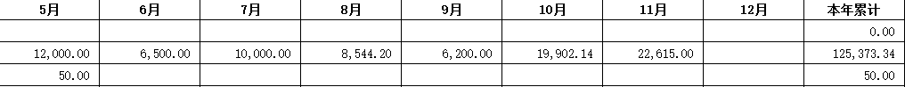

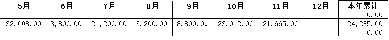

废话不多说，直接进入正题：这项目我是怎么找到的？又是怎么落地的？

# 一、为啥骑手这么需要“维权”？

## 1、干这一行，天天在刀尖上跑

骑手吃饭的家伙就是电动车。平台给的时间越来越紧，一单要求30到50分钟送到，扣掉商家出餐的时间，真正留给骑手路上跑的往往只剩15到20分钟。怎么办？闯红灯、逆行、超速，几乎是每天都在上演的戏码。

数据也很扎心：平均5000个在跑骑手，一年能整出2000多起事故，折合成“百万单事故率”的话是36.52，也就是每100万笔订单，大概会冒出37起交通事故。

拿广州来算账，每天250万单，平均一天就是100起骑手交通事故，一年下来少说3万起。

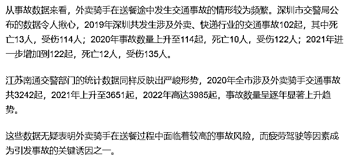

## 2、“众包”骑手，出了事真的孤立无援

骑手分两种，所谓“全职”和“兼职”。但那个“兼职”，行业里叫“众包”，其实占了整个骑手群体的70%以上。他们和滴滴司机一样，属于个体经营，没有公司兜底，没有团队撑腰。

一旦出了交通事故，所有破事都得自己扛。面对交警、保险公司、平台、医院、保单……一整套流程下来，一个没有任何经验的众包骑手，压根转不动。

## 3、一摔跤，七八方人马就围上来了

骑手出事之后，要面对的是什么？自己受伤，伤者家属，对方肇事司机，保险公司，医院账单，治疗恢复，保单细则，交警定责……少说5方，多则7、8方。人躺在病床上连行动都困难，还要去搞材料、对理赔、确认赔偿额，这简直是不可能完成的任务。

# 二、这生意怎么赚钱？

## 1、收费区间，看着就心动

我们的主流收费模式是按客户最终拿到的维权金额抽取10%~15%，具体比例看案件难度和客户情况。如果你以合伙人身份自己去开发业务，平均每个月结案3~5单，一单利润5000到2万不等，踏踏实实干，一年20万是常规操作。

但要干这事，你得具备四种能力：
- 会沟通
- 能共情
- 懂点交通事故处理
- 了解保险+法律常识

如果屏幕前的你有驾照，平时也经常开车，大概率已经沾过交通事故的边了——那恭喜你，这个业务你已经“半条腿迈进来”了。

当然，想赚更多钱，还得在“交通事故处理”和“保险法律知识”这两个模块深挖。这两块的储备越厚，做案子就越游刃有余。

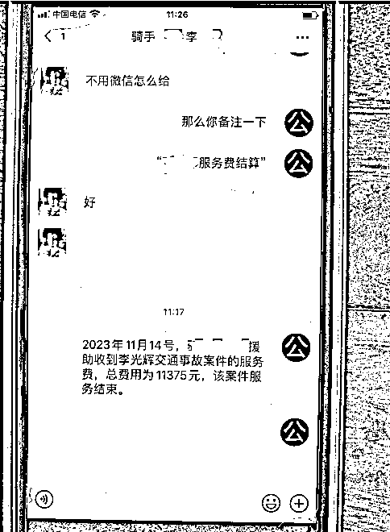

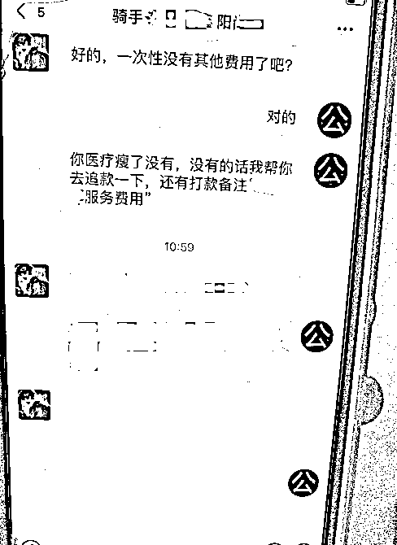

## 2、收款方式：先办事，后收钱

这一点我们很明确：**后收款**。除非是熟人转介绍且当事人有能力预付，否则一律先签合同，等客户的赔款到位后再按约定收取服务费。

这种模式当然有风险，所以合同必须签得清清楚楚。

# 三、具体怎么落地？

本质来说，这是一个“法律咨询+问题解决”的服务活，核心逻辑就是帮客户合法、合理、快速地拿到本属于他的赔偿——双赢。

律师是我们做这个项目的最佳拍档。你可以用“律所业务经理”或“律师助理”的身份去跑业务（前提是获得律所授权），这样信任度会高很多。而且一旦案件走不到私了、必须上法庭，你的案源就是律师渴求的庭审资源，完全可以拿去谈合作。

**特别提醒**：没有律师资质的朋友，千万别碰涉诉案件，这类案件一定要转给执业律师或律所处理，我们只做非诉部分。

## 1、客户从哪来？

目前我们的客户主要是通过抖音、视频号、小红书这类的公域平台引流——发骑手相关的内容，或者做视频剪辑，吸引精准人群。

原创内容虽然费时间，但胜在稳定持久；想省事就去截流，搜“骑手赔偿”、“骑手交通事故”等关键词，在热门内容底下截流。不过得提醒一句：账号是消耗品，被限流封号再正常不过，心态要摆正。

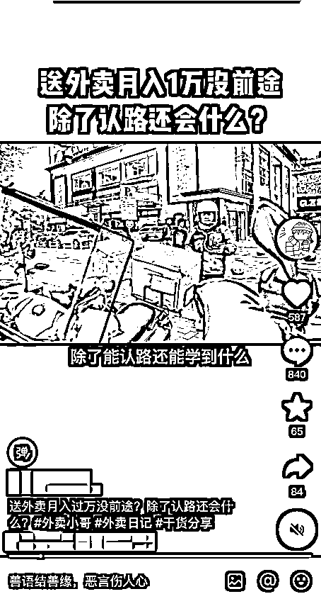

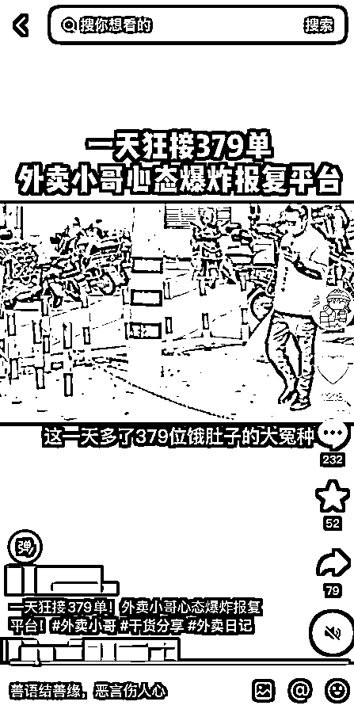

等你在行业里混熟了、资源攒够了，还可以拓展线下合作渠道——同行转介绍、老客户推荐、线下商户合作等等，靠口碑和圈子做二次转化。有案源过来，我们再协助完成维权闭环。

## 2、客户信任，是成交的命门

这事的本质是服务，而服务能不能卖出去，取决于客户信不信你。

我们的做法，主要靠四板斧：

① **律所背书**：跟律师/律所谈合作，输送涉诉案源，换一个“律师助理”的头衔或名片上的关联身份，瞬间拉高可信度。客户第一句话基本都是“你是律师吗？”——有这层关系，话就好说了。

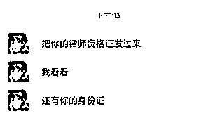

② **法律咨询公司背书**：效果比律所弱一些，但操作门槛更低。去某查查上找本地法律咨询机构谈挂靠，或注册一个自己的主体，也行。

③ **真诚，不乱吹牛**：这是最重要的原则。很多人一上来就“你这属于工伤，至少赔几十万”——那是市面上“黄牛律师”的话术。但我们一定要先把来龙去脉搞清楚：骑手和平台签的是什么合同？属于什么工作属性？保单保了什么？搞清楚了再开口。否则既害了客户，最后也害了自己，瞎承诺导致服务费收不到，活该。

④ **设身处地，搞清楚客户真正的难处**：绝大多数骑手维权卡在同一个地方——没钱治。人都躺医院了，哪来的钱跟你谈后续？这时候我们要想办法帮他先解决燃眉之急。

比如我们今年有一个case：骑手手上没钱治疗，连治都治不了，更别提谈赔偿，单子眼见就要黄了。我们硬是通过几路并进——肇事司机那边先出一笔、骑手的借呗花呗应急、司机交强险垫付、骑手自家保险预赔——愣是凑了4万块先让他把病治好。信任就是这么来的，单子最后也顺利签下来了。

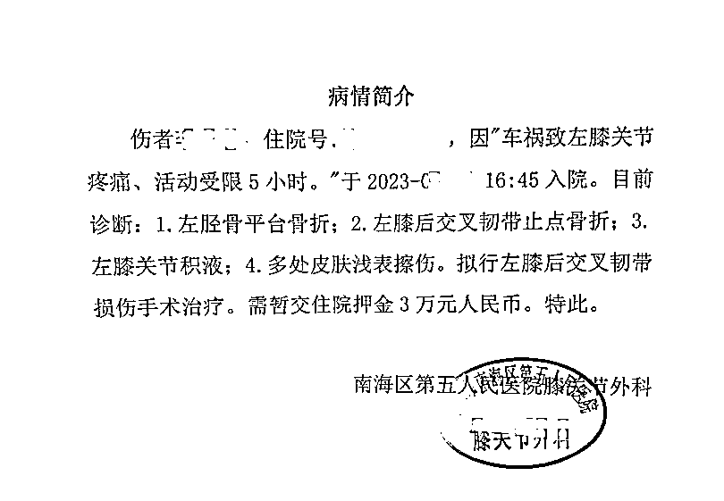

## 3、读懂保险规则，才能把别人玩不转的钱找出来

上面那个case之所以能成，关键在于对保险规则和监督机制的深度掌握。

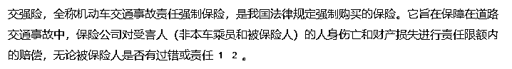

① **逐字研读保单**：大面都一样，差异全在细节。特别条款里“无责任比例”怎么写的？免责条款是什么？除医疗费外还有哪些其他赔偿项？这些细节直接决定最终能拿多少钱、需要备哪些材料。

② **专门挑对客户有利的条款**：比如交强险可以垫付、商业险有一些赔付规则，客户不知道，我们要主动帮着问、帮着争取。

③ **吃透监督和投诉机制**：保险公司偶尔会有推诿或争议，这时候监督投诉通道就是我们的武器。能通过监管解决的，绝不上法庭——因为一旦进入司法程序，结案周期直接拉到半年到一年，我们的回款时效被严重拖累，收益也跟着缩水。

## 4、理赔流程 + 谈判主导权

Ⅰ. **理赔环节，门儿清**：
- 所需材料要列清单：首诊证明、住院清单、费用清单、发票、交通事故责任认定书、建休单……每一份都不能少。我们后来因此自研了系统做登记，一开始用Excel也完全够用。
- 要清楚保险公司收齐材料后，多少天内必须打款。这个账，心里得有数。

Ⅱ. **谈判，必须站在主导位置**
- 跟客户定死一条规矩：**绝不允许与肇事方或任何赔偿方私下谈判**。否则很容易被不合理金额忽悠、被隐形条款坑了，甚至对方会用低额赔偿来规避责任。
- 提前和客户敲定底线金额，制定合理目标，不要漫天要价，也不要贱卖自己。要价太高会把案件拖进司法程序，太低则损害客户利益。

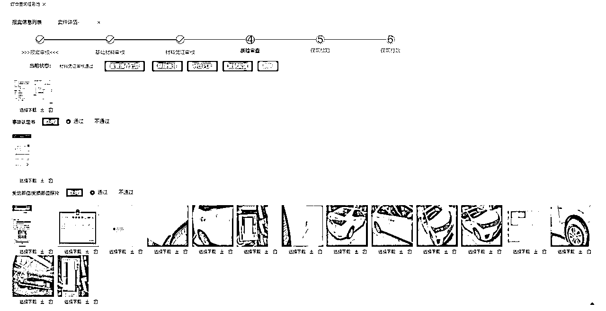

## 5、合同，先把保护网铺好

线下必须签好几份协议：

① **赔偿合同**：肇事方、责任方、赔偿方把钱给客户之前，必须签一份赔偿协议。它除了固化金额、锁定双方意愿之外，还是我们的护身符——有了这份协议，我们可以向赔偿方要求出示支付凭证和转账记录，防止客户回头瞒报金额，损害我们的收益。

② **服务合同**：我们和客户之间签一份委托服务协议。骑手早期基本都没钱付服务费，只能等赔偿款到了再付，这个时候合同就是唯一的安全绳。

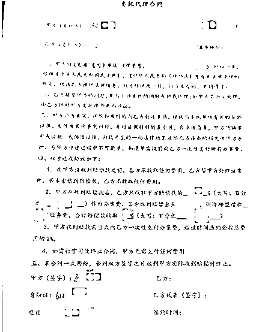

# 四、我们比律师“香”在哪？

## 1、立场不一样

我们的客户大多是底层骑手，说白了，都是“接地气”的人。比起律师，他们更愿意信我们，不是因为觉得我们更专业，而是因为我们真的站在他们角度想问题。

律师通常是拿法律条款、合同、司法程序来办事，但这类案件就算律师上阵也常常败诉。我们不一样，我们是多方下手去“薅”——保险公司、肇事方、用人单位、平台，一个都不放过。靠对行业的深度认知，跟对方协商、施压、投诉，让他们知道你懂行，自然不敢敷衍，只能乖乖照规矩赔钱。

有时候，为了“快”，我们会主动舍弃一些争议大的赔偿项，比如为了一千几百把案子拖一年的“较真”，对客户来说根本没有意义。

## 2、说人话、交真心

据我了解，很多律师在接这种案子时，习惯先给客户画个大饼：“放心，这个能赔多少多少万”。但实际上，很多律所在这类案件里有大量坏账——骑手收到钱后直接跑路，你想起诉他，赢了也得自己倒贴时间和金钱。

我们不一样。从一开始就告诉客户大实话：这种案件一般能赔多少、哪些项目是稳的、哪些是可争取也可能没有的。如果客户急着拿钱，那就告诉他可以舍弃哪些争议金额，同时帮他谈，把稳妥的那部分往上抬一抬。

更重要的一点：我们不是“高高在上地指挥客户”，而是像朋友、像家人一样陪着他跑，帮他整理、收集、沟通。甚至在外人面前扮演“家属”角色，让骑手在维权和治疗过程中少承受一些心理负担。线上线下交付都可以。

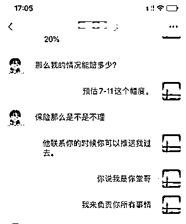

这样做下来，几年了，没有一单出现过“客户拿到钱不给服务费”的情况。每个签约的客户，最后都能拿到一笔相对满意的赔偿，回归正常生活。

# 五、市场还有多大？

1. **案件量是只增不减的**：外卖、即时零售越来越普及，从一日三餐到买菜买药买日用品，全都配送到家。骑手群体还在逐年扩张。虽说管控加严可能会让事故率下降，但总量依然在涨。只要配送不停，这个需求就会一直存在。而我们每帮一个人拿回赔偿，也是在给这个丛林世界里添一点公平。

2. **律师真看不上这块肉**：愿意接骑手人伤案件的律师特别少。一来，劳动关系+三者人伤的民事案件，来钱远不如商业案件快；二来，劳动关系纠纷还多一道仲裁程序，时间成本太高；三来，骑手根本付不起高昂的律师费。没人能保证官司一定赢，但对受伤的骑手来说，**快速、稳妥拿到钱**才是终极诉求。

所以这市场的缺口，会越来越大，完全可以成为一条稳定持久的业务线。

# 六、最后一个提醒

想入局的朋友，请记住这几点：

1. **提前做足准备**：资质和背书是门面，也是命门。
2. **先去练手**：身边如果发生过交通事故，或问问朋友的经验，再配合某音搜索学习，保险和事故处理的常识并不难获取。
3. **去挖掘身边的律师资源**：打开通讯录，谁还没个律师朋友？先建立联系，聊一聊合作的可能。实在没有，我们也可以给你推荐有偿资源，但有一定区域限制。
4. **这项目不是赚快钱**：回款有周期，急不得。但坚持下来，就有源源不断的转介绍客户找上门，越做越稳。

感谢你耐心看到这里。我做这件事的初衷很简单：让更多骑手、保险、法律相关行业的从业者，用这个项目作为主业或副业，既能自己赚到钱，又能顺手帮助交通事故里的受伤骑手和他们的家庭。也希望通过这篇分享，链接到更多人，在各条事业的链路中找到资源共享、合作共赢的可能。