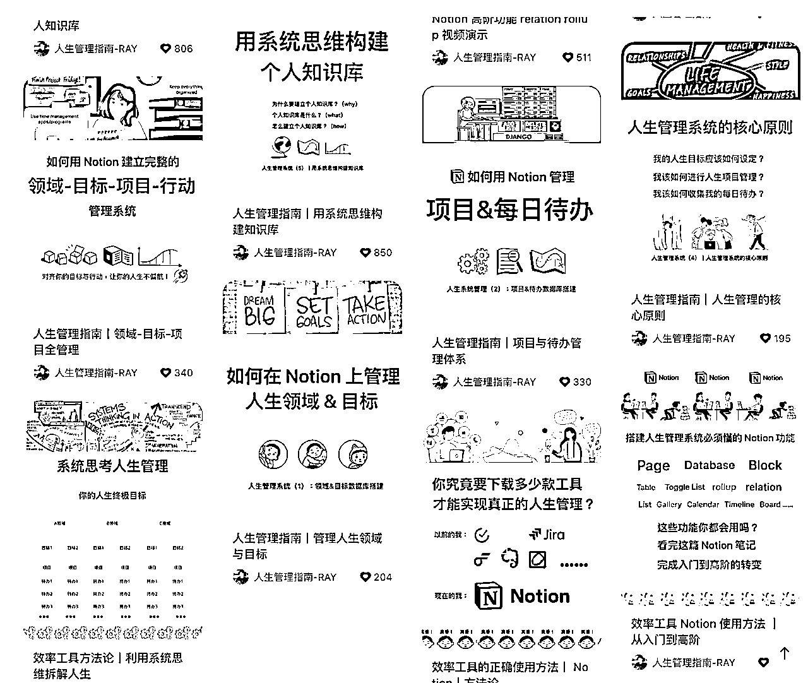
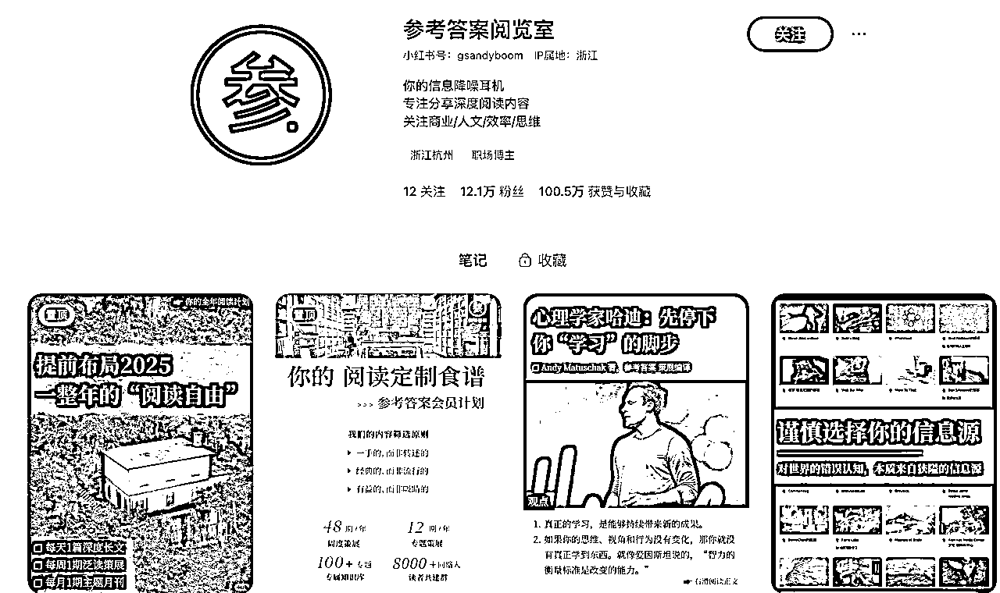
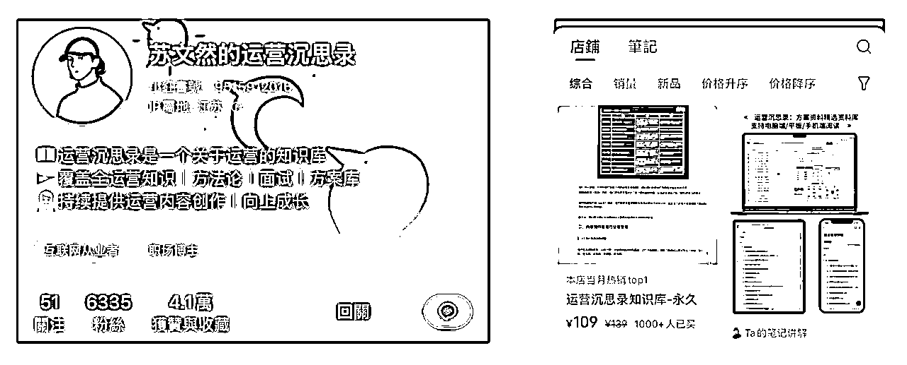
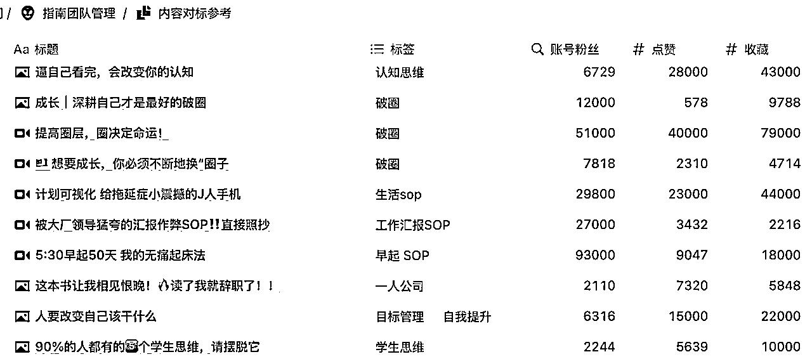

# 从被裁到年入七位数：一个90后靠Notion在📕逆袭的真实样本
作者：龙哥

你可能也正在经历这样的迷茫：刚毕业找不到方向，或者刚被裁不知道下一步该往哪走，又或者正处在35岁转型的十字路口。今天想分享一个真实的故事，一个95后年轻人，在被裁之后，用一年时间，靠一款工具成了“超级个体”，累计变现超过百万。

## 被裁员，反而成了人生的转折点

主人公叫RAY，2020年从厦门大学软件工程毕业，之后在互联网行业做了三年产品和运营。2023年下半年，他成了裁员大军中的一员。但回头看，这次被裁恰恰是他创业之路的起点。

其实早在2020年，RAY就接触了Notion，但一直停留在“会用但不精”的状态。直到裸辞后重新规划人生，他才真正深入研究这款工具。当时他花了大半个月工资买了一套国外课程，学习如何用Notion搭建生活管理系统——目标管理、日常待办、读书笔记、资料收集、灵感记录，几乎覆盖了个人成长的方方面面。也正是这套系统，成了他后来变现七位数的主力产品。

他开始把使用心得分享到📕上，2022年9月发了第一篇图文，每月只更新四五篇，三个月就涨了5000粉丝。为什么能涨这么快？一是内容有稀缺性，当时📕上讲Notion人生管理的人很少，大多泛泛而谈，而他是第一个讲逻辑、讲系统的人；二是他的审美和视觉设计有优势。

到了2023年中，他的粉丝突破一万，开始思考变现路径。恰巧那时少数派推出了一款Notion功能教学课程，图文版卖199元，一个月销量达60万。这个案例给了他启发：我也可以卖课。

但录课谈何容易？对还在上班的人来说，精力根本不够。结果就在这时，他收到了裁员通知。回头看，这反而成了他的第二次转折。如果一直纠结是否跳出舒适圈，热血可能早就耗尽了。既然命运替他做了选择，那就全力去做。

他开始一边做图文笔记引流，一边录制课程。2023年11月底，定价599元的课程上线，一年时间卖出了近2000份。这就是他靠Notion变现七位数的故事。

## 他的变现模式，适合你吗？

RAY过去一年的业务模式很简单：低转高。通过低价训练营或直播，把用户转化为599元课程学员，再推荐1999元的50天陪跑训练营。训练营每三个月开一期，每期招生50到80人。

但这个模式有两个难点，不太适合个人单干。

一是直播讲课能力。背后需要强大的知识储备，还要能随时回答用户的各种问题，比如时间管理、知识管理、效率工具等。如果你只想做个副业，其实没必要选最难的路，流量变现方式有很多。

二是交付能力。陪跑营涉及大量社群运营动作，一个人根本忙不过来。除非你有一个小团队，并且具备很强的逻辑思维和直播能力。

不过，Notion的变现方式远不止卖课这一种，还有几条更适合个体户的路径。

## 四种Notion变现路径，总有一种适合你

Notion全球有100多万创作者，变现模式大致分为四类：卖模板、卖课程、卖个性化定制与咨询、卖知识库。

**第一种：卖模板**

模板是边际成本为零的知识商品，特别适合Notion小白用户学习和参考。对新手来说，注册后面对一张白纸，不知道如何下手，模板就是最快的学习方式。这个市场会随着Notion用户增长而不断扩大，就像PPT模板，20年前就有人卖，至今依然火爆。

操作也很简单：做自媒体账号，在📕或B站挂商品链接，不需要做私域运营，非常适合个体户赚点零花钱。难点在于做出差异化，以及精准找到目标人群。个人场景的模板已经卖烂了，如果能结合专业知识做垂直领域，设置更高客单价，变现效率会更高。

**第二种：卖课程**

卖课是天花板最高的方式，但也是难度最大的。目前市面上的Notion课程大致分两类。

一类是纯功能教学，每个功能一节课，教你怎么操作。这种工具课卖不出高价，因为它隔了一层——用户遇到问题才会想用Notion，但功能教学离用户的实际痛点太远。少数派能卖爆，是因为它官网流量巨大，加上👸号推广，这是普通玩家难以复制的。

另一类是把Notion当作解决问题的工具，不仅教工具，更教方法。比如你是时间管理教练，开一门课，教各种管理方法，同时提供Notion时间管理系统，再带社群持续实践。这种课能卖高价，因为用户看到的是“解决拖延症”，而不是“学软件”。对大多数人来说，根本不需要学完Notion所有功能——需要什么，学什么，才是最高效的方式。

**第三种：卖个性化定制与咨询**

很多人以为Notion是笔记软件，但它的真正定位是无代码SaaS平台，主要服务于中小团队，用于搭建CRM客户管理、财务管理、项目任务推进、团队知识库等系统。个性化定制和咨询主要服务B端，需要你深入了解客户需求、理清业务流程，这对Notion的掌握程度要求极高，甚至高于卖课。

但这是一条更适合个人长期发展的路线。做Notion咨询，本质上就是做SaaS咨询，一旦掌握了底层能力，就算将来不用Notion，你依然可以从事数字化咨询工作。

**第四种：卖知识库**

这是最神奇的一种，你完全不需要懂Notion，只要你有知识，就能变现。RAY强烈建议每个自媒体小白都去尝试，因为它能逼迫你内化知识，提升学习能力。

有个叫“参考答案”的账号，在📕卖Notion知识库卖出了圈。客单价100多元，通过图文+投流的方式，一年营收做到了几百万。它是最早卖Notion知识库的账号，内容主要是国外文章的翻译，偏科技类和个人成长类，对不懂英文、不会🪜的人非常有吸引力。

这个账号的内容生产成本极低：把Notion文章截图，做成📕图文，文案直接用整理好的内容，再取个标题，一篇笔记就完成了。目前该账号发了799篇笔记，涨粉12.1万，变现超过500万，私域沉淀了几万名爱阅读的粉丝。

当然，这是头部案例，而且是最早做的。但有了跑通的大案例，就说明赛道成立。类似账号越来越多，只要内容有差异化，变现很容易。比如一个2024年做的运营类知识库账号，发了213篇笔记，涨粉6000多，变现达到13万。它的模式一模一样，截图+拍照知识库，只发运营相关内容，精准面向刚做运营的小白，垂直且基数够大。

为什么说人人都能卖知识库？因为整理信息的能力人人都有，不需要什么核心技术，内容制作成本几乎为零。找到好的定位，坚持发内容，变现自然会发生。

## 知识库怎么设计？

第一步是确定定位，抓住人群的核心需求。比如运营知识库对小白就很实用，里面有各种方案模板，就像很多新人刚上班时到处找资料，以前都是百度云打包，现在知识库体验好多了。

定位有两个思路：

一是从你最擅长的方向出发。适合在某个领域深耕多年的资深人士，把行业经验、踩过的坑整理成知识库。不会搭建怎么办？直接套用别人的模板，改成自己的内容就行。

二是直接去找需求。选你觉得最好做的内容方向，变现来得更快。比如情感赛道的知识库，就比个人成长类的变现效率更高，因为情感是刚需。但这条路需要你花更多心思研究，因为你可能不熟悉这个领域，无论做内容还是做流量，都得边学边输出。

两种定位各有利弊，根据自己的目标选择就好。

确定定位后，就是整理内容。这个过程本身也是学习过程，你不仅在做产品，还在锻炼学习能力。在未来的超级个体时代，AI越来越强大，学习能力会变得越来越重要。

## 📕的流量方法

卖知识库，一定要做📕。前期图文内容就足够了，方式可以直接照搬参考答案：截图Notion里的知识库做成图片，文案用知识库本身的文字。

唯一要注意的是，如何把内容结合好的选题，写出有流量的笔记。

一篇笔记分成两部分：选题和详细内容。选题就是封面+标题传达的信息；详细内容就是文案和图片信息。同一个内容，可以有很多选题角度。比如教大家减肥，可以这样切入：

- 情绪切入：“为什么减肥总是从明天开始？”——戳中拖延心态
- 对比切入：“3个月减10斤和20斤，背后的差距在哪？”——激发好奇心
- 故事切入：“我用5块钱瘦了20斤”——低成本吸引力
- 数字切入：“减肥中99%的人都忽略了这个关键点”——数字强化专业感

不同选题决定了算法推荐给谁。有时候同一篇内容，换个封面和标题，流量就大不一样。

如何发现大选题？一是主动搜索，观察类似选题的流量情况；二是多刷，遇到爆款就记录下来。RAY自己就会用Notion搭建一个对标库，为整个流量系统赋能。

但做📕，最重要的其实不是技法，而是坚持。在对的方法基础上，坚持发，持续发。前三个月根本不用管数据，围绕知识库主题就是一顿发。熬过开头三个月，你会发现流量、变现都会越来越好。

## Notion：超级个体时代的必备工具

如果你经常逛YouTube，会发现Notion已经成了各大博主的标配。一款软件，就能构建管理你生活和工作所有方面的系统，信息统一存储，用数据库做结构化分析。再加上AI小助理，可以直接分析你的数据，辅助决策。ChatGPT也已打通Notion，使用过程中可直接调用GPT回答。

在超级个体时代，无论是一个人公司还是小团队协作，掌握Notion都能极大提升业务效率和变现效率。

有朋友问飞书和Notion的区别。对大多数基础需求，比如写文档、开数据表，两者差别不大。但如果要构建各种管理系统，飞书的灵活性就远弱于Notion了。无论是表格联动还是工作流构建，一个做了11年的产品，性能优势非常明显。

RAY的故事，其实也是这个时代的一个缩影。从被裁到创业，从流量到商业化，再到重新定位升级，他的每一步都有迹可循。如果你也正在寻找方向，不妨从他的经历里，找到属于自己的那条路。