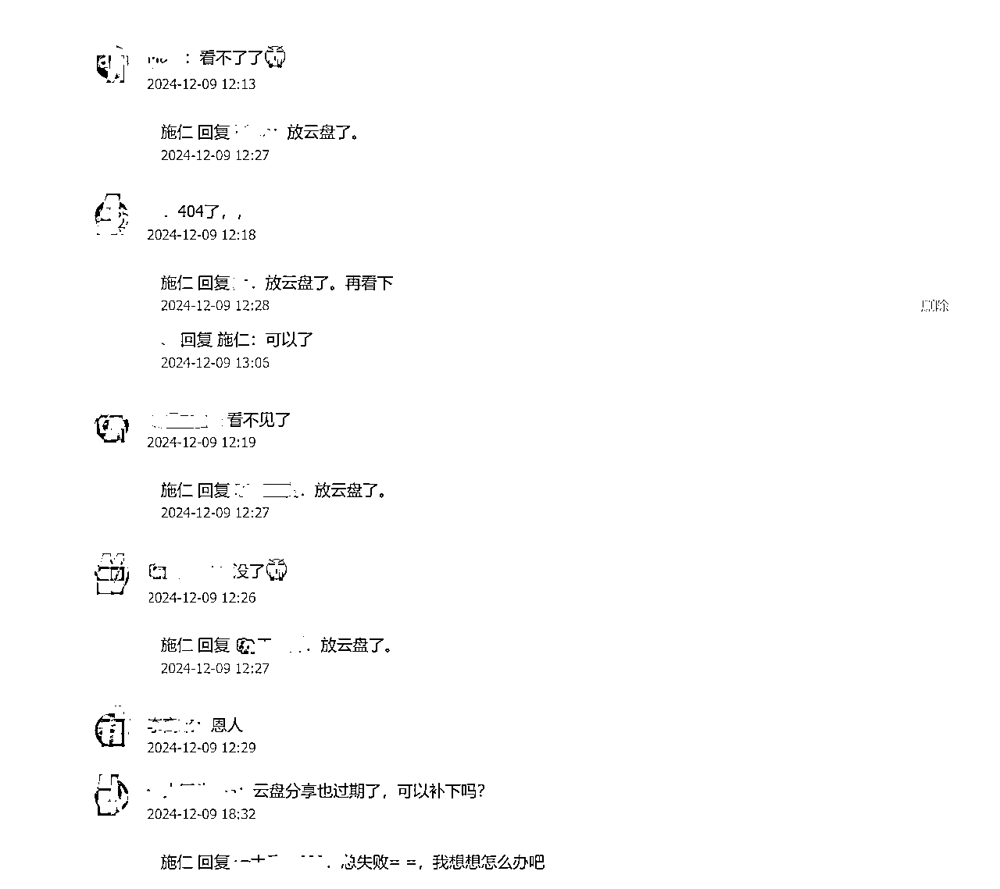
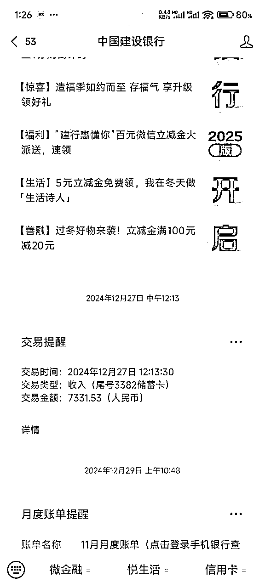
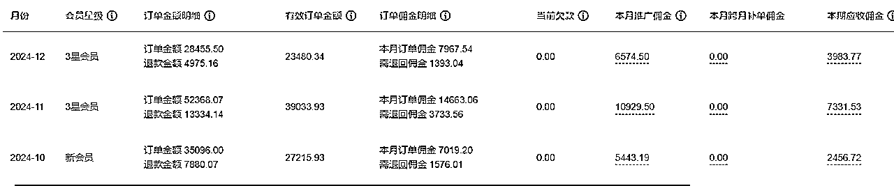

# 一篇本意只是自用的 Windows 节点搭建笔记，怎么就给我带来了腾讯云七千多的意外到账

说实话，在动笔之前我纠结了很久，生怕大家会误读当初写那篇教程的初衷。但这段经历太值得讲了，还是写下来吧。

说起来有些意外，第一次真正把赚钱里的分享变成一次完整的项目实操，居然就来自于这篇笔记。

2024 年 10 月中旬，我给自己买了一台 Windows 服务器，打算搭一个节点用。结果上手才发现资料非常稀缺，Windows 相关的教程少得可怜，找到也常常踩坑。折腾了好几天，终于找到一个能把流程简化下来的工具，节点才算搭起来。

问题解决了，我脑子里冒出一个念头：这个坑未必只有我一个人踩过。于是我花了一个多小时，把自己踩过的路和最终可用的办法整理成了一篇教程。

就在我把初稿收尾的时候，龙哥盟社群里出现了龙哥发起的“分享实用工具”龙珠悬赏，和我手上的内容简直撞上了。我就顺手投了进去。

文章发出后，给我反馈最多的就是“成功了”。但与此同时，问题也跟着来了。有人反映在连接某些站点时会出现短暂掉线，我自己测试后也发现初版方案确实不够稳。

为了完善它，我又去研究更优的搭建思路，还借助了 GPT 来加速方案筛选。最终锁定了一款更稳定的软件，把整套流程重写成了 2.0 版本。这次改进后，之前的兼容性问题基本都被抹平了，更新发布后互动明显更热烈。

后来因为飞书对这类内容不太友好，我只能把文章撤下来，改成本地文档放在网盘里分享。

在写教程时，我顺手放了一个自己一直用的腾讯云推广链接。原因是自己当年买服务器比较频繁，专门注册过一个推广账号，用自己的链接下单能抵一点成本。教程里放进去，只是觉得能帮读者直接跳到对应机型的购买页，顺带说不定能回点奶茶钱。

发完之后我基本就忘了这回事。直到 12 月底，我在微信公众号绑定的银行卡里看到一笔不小的入账。

点开一看，收款方是腾讯云。我顿时懵了。登录后台才发现，从 10 月份开始，这笔佣金就一直在默默累积，只是结算周期是次月月底到账，自己当时忙着搞得物项目，完全没留意。

回头一看，累计的收益已经过万了。更关键的是，这笔钱是完全被动的，来自于一次原本只为自救的分享。

# 分享这件事，给我的启发

我本来完全可以把这笔钱闷声收下不说。但我觉得，比起那几千块钱，这件事本身更有意思。

所以我更坚定了一个想法：把你觉得真正有用的东西，大胆放出去。

有用的人会感谢你。没用的人，也可能用更好的东西来回馈你。最重要的是，你会因此连接到更多志同道合的人。

把“自己”分享出去，你得到的回报，往往会以你想不到的形式回来。

赚钱里常说的一句话是“分享里藏着很多钱”。过去我只是当一句鸡汤看，现在才真正体会到那份重量。

