# 如何研究副业信息差？（分享两个过年可实操的信息差）
作者：龙哥

别人闷声赚差价的路子，我是如何一层层挖开的？两个年关可上手的样本，全拆解

我，Tilly，之前做过9年互联网产品经理，去年夏天辞了职，一边带娃一边琢磨收入来源。认真算下来，我在副业上花的功夫已有8年，其中有一个方向坚持了2000多天。具体经历我早前在社群里写过一篇长帖，链接放在这里：https://scys.com/articleDetail/xq_topic/8855485185228142

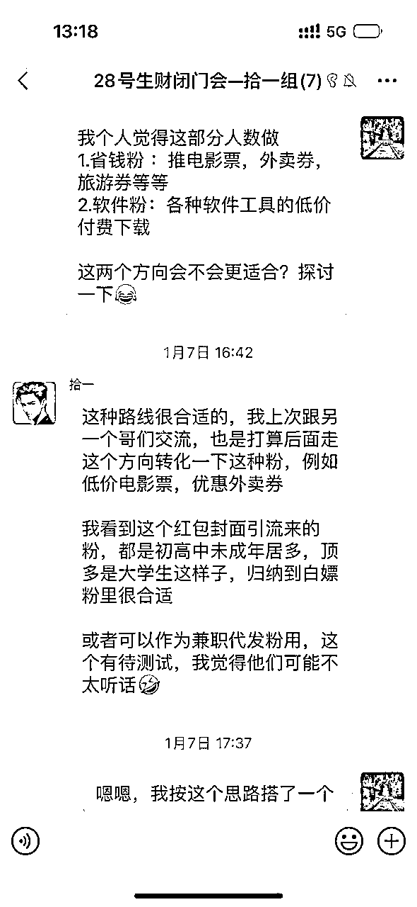

上个月我参加了一个红包皮肤的mini航海，顺手把两个年关附近很适合落地的玩法拆了个底朝天。这两套信息，在有些人眼里是要花好几千才能买到的东西，真挖出来你会发现，不过就是几层窗户纸的事。

我最早正经开始折腾副业是在2016年。那会儿才工作第二年，突然想明白一件事：产品经理这份工作改变不了世界，每天交付的不过是老板想法的延续。从那时起，我把工作只当成工作，把多余的精力投向了别的可能。这些年试过短信接码类的灰色玩法，利用它撸过一些平台的优惠再折价转手；也做过把录音整理成文字稿的付费生意；还在电商平台卖过翻录网课；17年还赶上过二手市场的一波蓝海。零零散散赚过小钱，但这些事要么有合规隐患，要么天花板太低，后来都没继续。真正留下来的是那套拆解机会的办法。

**先搞懂一件事：你盯上的机会到底靠什么运转**

网上的暴富故事看多了容易上头，什么影票躺赚、外卖红包月入过万、混剪视频号批量变现……在判断真假之前，先问自己一个最基础的问题：这些生意每天实际在做的事是什么？我拿自己踩过的路举个例子。

上个月，我为了给订阅号的底部功能区接一个内容入口，开始认真查“影票托管”是干什么的。之所以对这个好奇，是因为我已两年没进过影院，孩子太小走不开，直到去年12月庆祝结婚周年的那天，我和队友趁娃睡着溜出去看夜场，买票时在二手站刷到了低价影票，我才知道这个行业已经有全自动接单的模式了。

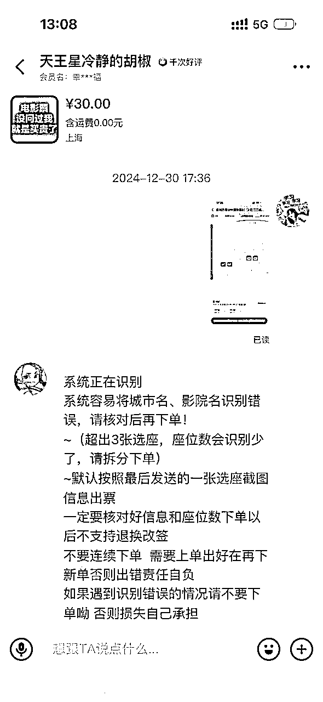

折扣影票的倒卖我早有所闻，二手站上一直有人靠打折券赚取差价，但“托管式全自动接单”确实是第一次遇到，而且用起来相当顺手。于是我想着给之前弄的红包皮肤承载号也配一套，就开始深挖这个玩法是怎么落地的。

如果你连“影票托管”这个叫法都没听过，没关系，先拿“二手站里的低价票哪来的”“影票代买怎么操作”这类宽泛的搜索词去检索，把搜出来的前30条链接大致扫一遍就够用了。

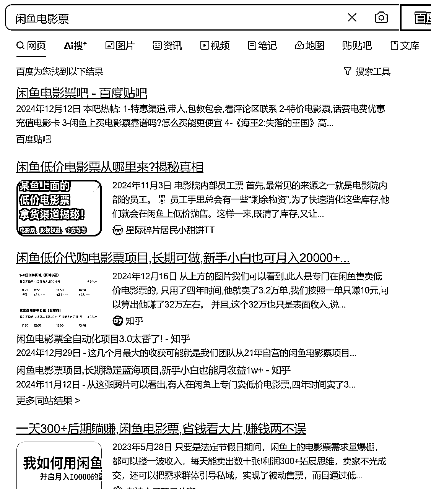

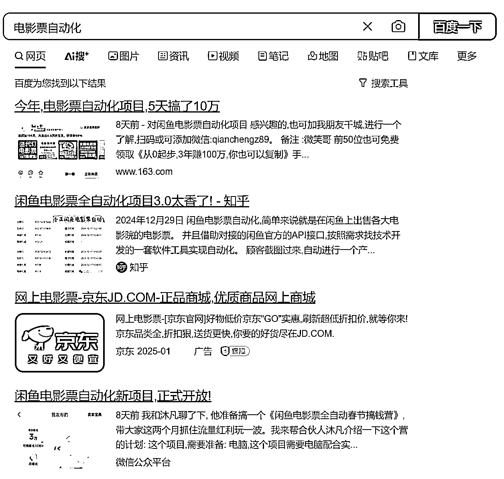

如果只盯着搜索引擎前排，你看到的会是清一色的招生广告——都挂着“带你做”的名头，课程费动辄几千。这至少说明两件事：一是这事确实有人做成，二是想学得先付一笔不小的入场费。就算不打算掏钱，你也可以加这些人聊上几句，问问他们的课程怎么安排、具体怎么执行。聊完以后，你手里的搜索词会精准很多。比如你之前不知道这行有个说法叫“影票托管”，对方无意间提了一嘴，你后面拿这个词去搜，信息密度完全不一样。

这里我更想强调一点：别只守着搜索引擎。二手站、电商平台、订阅号、AI问答助手，统统可以翻一遍。同样的词放进二手站或电商平台，你会发现一个让人哭笑不得的事实——搜索引擎前排卖大几千的课程，在那边10块钱就能买到一份说明文档。

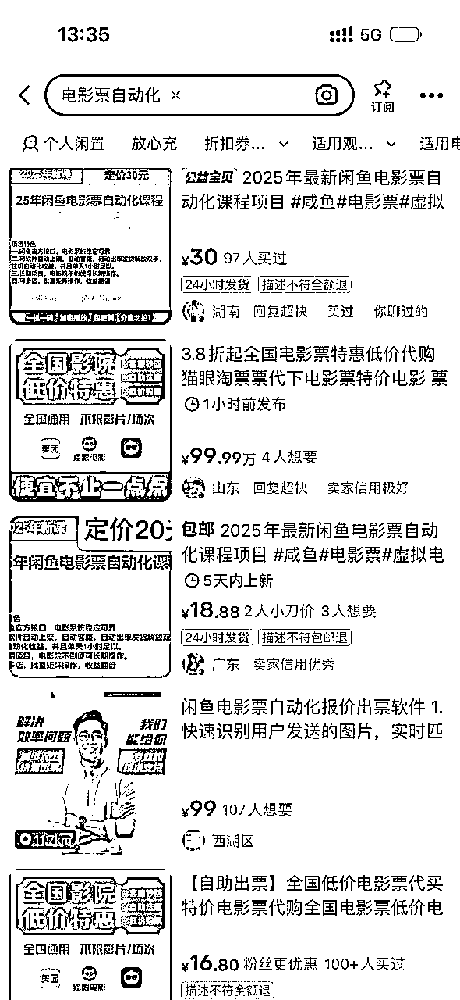

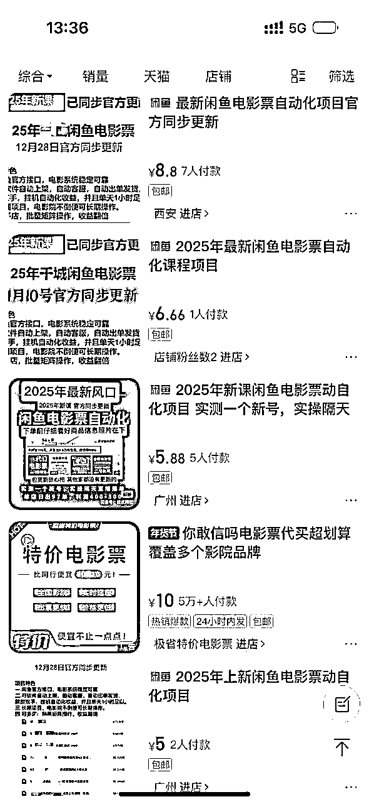

下单前也别急，再去订阅号平台里搜一圈，文章、文案、轻应用都点开看看，挑10到20个样本足够。很多运营者会在内容里直接写出他们用的工具名。你甚至可以打开AI助手问一句：目前主流的影票托管工具都有哪些？它们各自能解决什么问题？这个法子往往能直接把你带到答案面前。

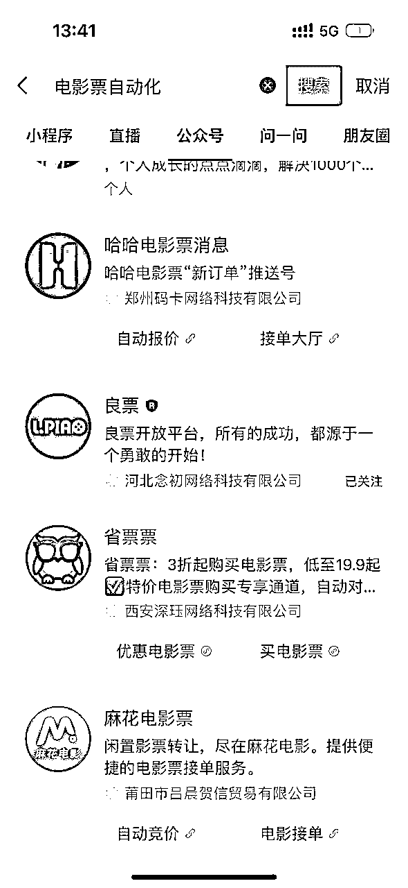

这套流程走完，我习惯把经验压成几句话：
一，好奇心是起点，但真正起作用的是动手去查、去问。
二，付费可以以后再说，免费咨询却要先用起来，聊着聊着就能套出更准确的行话。
三，大多数玩法在二手站或电商平台都有白菜价的说明书。
四，想确认某个工具靠不靠谱，去订阅号里找，工具商基本都有自己的内容据点。
五，AI普及之后，查信息的效率又被抬高了一截。

**第二个案例：外卖红包**

外卖红包的切入点也是给那个订阅号底部功能区加内容，所以我用同样一套方式去查它的底细。很快就查明白了：这是美团、饿了么开放出来的分销推广位，任何个体都能在商家后台直接开通。但问题在于各个平台要分开打理，有没有一个后台能统一管理？当我做到订阅号检索这一步时，发现做外卖红包的账号多到数不清，形态也五花八门。它们背后到底跑了什么程序？

这里有个非常省力的窍门：把同行账号的主页打开，看一下它关联的外部服务插件有哪些。极少数人会自研系统，绝大多数都是套用现成工具。把这些工具名挨个拿回订阅号里搜，就能找到答案。我调研了几个做得不错的外卖红包账号，关联的服务商里出现了“西皮士助手”“美赚CPS”“聚推客联盟”等名字，逐个比对后发现：聚推客联盟是免费聚合分发渠道，美赚要收年费，西皮士更像一个纯运营辅助面板，最后我锁定了聚推客联盟。

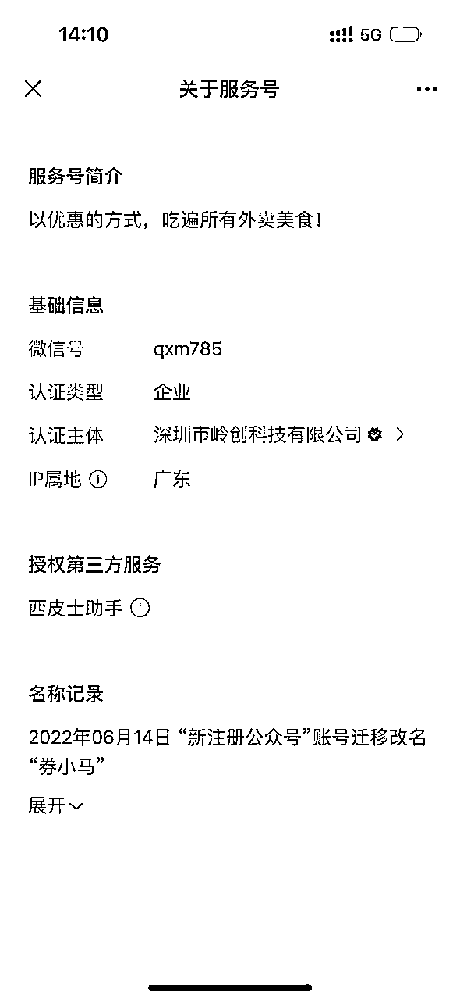

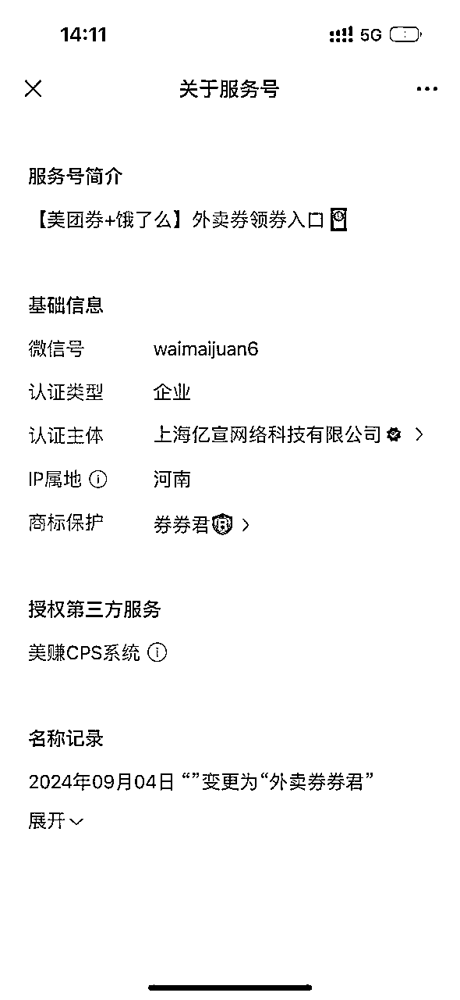

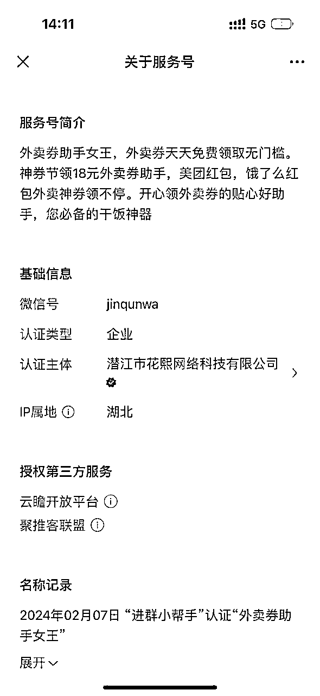

如果外部服务插件里查不到信息，那它大概率是内嵌的H5页面。你可以在🛰️里打开同行链接的瞬间留意一下页面标题下方的网址，比如看到某个子域名挂在jutuike.cn下，就能判断出它用的是哪套系统，再回去搜索这个域名，整个工具链就浮出水面了。

这一段同样可以收成三条心得：
一，拆解同行的重点，是看他用什么系统。
二，订阅号里的玩法，十有八九能通过“关联服务”列表找到工具名。
三，查询不到时，从网页域名反查是条快捷出路。

**再判断第二件事：这机会能不能让你赚到钱**

实事求是地说，每个方向都有人赚到钱，但那个人是不是你、能不能赚到大钱，得看时机、资源和运气。如果要把市场规模、同行数据全摆出来分析，篇幅太长。我说一个最直观的验证方法：反过来看那些卖课的人——如果生意真的百分百包赚，他们早自己开几十个账号放量跑去了，还费劲带学生干嘛？

所以，直接潜入这些工具的官方交流群。大多数所谓培训，本质都是“我知道某款工具、你不知道”的认知差距，再附赠一段时间的答疑服务。而工具本身都有自己的官方群组，混进去看大家在聊什么，比听销售吹嘘有用得多。

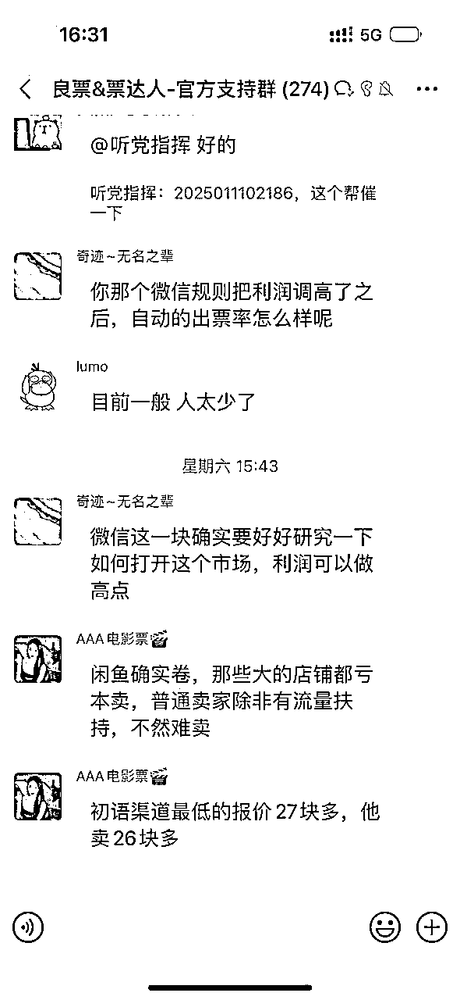

我曾在“票据达人”的官方群里蹲了10天，两百多人的群，明确说自己在赚钱的不到10个。把潜水的也算进去，基本符合金字塔分布——真正吃到肉的大概只有两成。二手市场的推荐机制也确实有运气成分，那么多人做影票托管，为什么你的链接会被分到客户面前？这中间的偶然因素很多。但这不代表这事完全不值得做，如果你真的有兴趣，也能坚持持续做下去，那就可以试。只是开始之前一定控制投入，把心理预期调低。最怕的是花了大几千进场费，结果一分没赚，心态直接崩掉。

那怎么把启动成本压下来？往下看。

**投入之前，先算清你的时间和钱哪个更稀缺**

动手省钱之前先问自己一个问题：你的精力值多少钱？如果你一小时能创造500块的收益，就完全没必要花4个小时去研究怎么省那500块。同理，为省几千块的课程费，让自己埋头折腾半个月，也要掂量掂量划不划算。拿我自己说，以前上班的时候有很多摸鱼时间可以慢慢研究；现在自己做事，每天都被排得很满，如果一个小时还没查出头绪，我会直接付费向有结果的人要答案。

在这个前提下，省钱才有意义。

先把机会分成两类：
一类是纯工具认知型，这类钱能省就省。影票托管、外卖红包都属于这种，它本质上是告诉你一个工具名，再配几段操作录屏。而这些内容在工具自带的使用指南和官方群里早就写得明明白白。辨别方法也很简单：你直接问对方工具是什么、能不能体验一下。如果对方支支吾吾不肯说，那他卖的就是信息差而已，工具可能都不是他开发的。
另一类是纯经验带练型，比如教你怎么起号、怎么买量、怎么进某个新领域。因为依赖的是个人经验，价值很难量化，水分也最大。说句不好听的，很多带练就是60分的人在教10分的人。

省钱的渠道也有几个：
先找到这条路的搜索词，再去二手站、电商平台、拼单平台搜同款内容，基本都能找到；
找到工具名以后，别在工具里直接充钱，去二手站和拼单平台找充值渠道。记住一句话：几乎所有工具都开放了分销额度。这意味着，官网标价永远不是最低价。比如那个“票据达人”工具，官方一年500多，我在二手站找到260元一年的渠道，还给了7天试用；
🛰️搜索也值得多用几次。同类型的带练服务，发的人很多，你多对比几家，那些定价低的反而不一定差；
你挖到的认知缝隙，别人不一定找得到。哪怕只是把信息梳理成一份说明文档挂到二手站上，也可能成为你的第一笔收入；
最后一点：别因为省钱而错过真正高效的学习机会，该花出去的投入还是要花。

**两个玩法的实操记录**

下面是我的实际操作过程。春节前这个时间点很适合拿影票托管来试手；导进来的人可以再引到外卖红包上，如果能和红包皮肤搭配着一起做，链路会更完整。

第一个：影票托管

我用的是“票据达人CRM”和“良票”这两个平台，它们是一家，直接在🛰️里搜订阅号就能找到。良票底部导航里有一个“解决方案”板块，里面有影票託管的具体操作指引和视频演示，照着一步步做就行，我这里不重复赘述。

底层原理大概是：把你的二手账号以模拟方式登录进系统，后台预设好自动回复话术和订单识别规则，当系统识别到有人来问影票时，会自动调取底层票价库的报价，把价格发给用户。

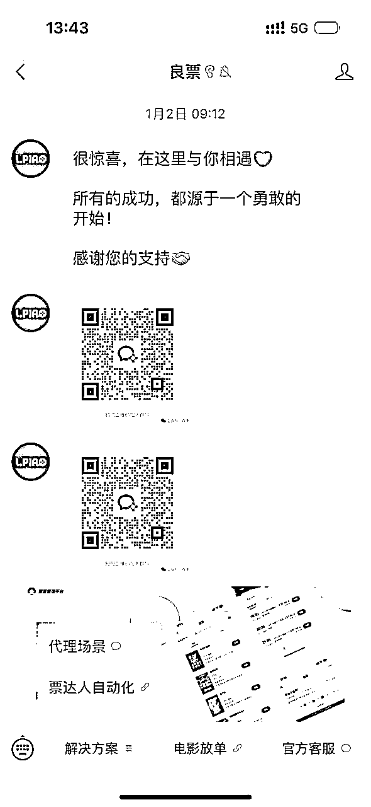

几个容易踩的坑想提醒你：
一，所谓的全自动，并不是真正无人值守，出现异常订单还是需要有人盯着；
二，充值之前一定要去二手站比价，我找到的渠道260元/年，比官网便宜了200多；
三，账号养护的套路，跟在二手站做常规电商的逻辑是一样的；
四，良票那边还提供手动放单选项，如果担心自动模式不稳定，可以联系客服开通手动权限，客户来询价时你手动下单再转给他；
五，务必加入他们的官方支持群，操作上遇到不明白的随时有人解答，还能和同行交流养号、流量经验；
六，想要票价更低，可以直接对接上游票源服务商，比如麻花、芒果、星驰这几家，搜索都能找到。聚合工具说到底会加一层价，直接和源头拿货能省一点。

第二个：外卖红包

我用的工具是聚推客，建议直接用电脑端后台，版式更清晰。

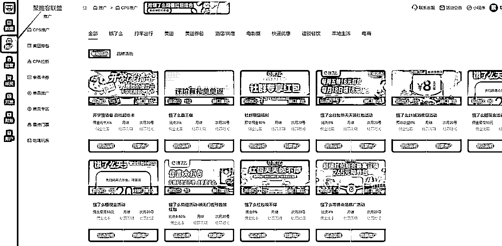

点开“推广”就能看到各种按成交计佣的分销入口，里面也包括影票类目——用户自己点链接购买，不需要经过二手站承接。我选聚推客的初衷很直白：免费。免费当然有所代价，它会在返佣比例上稍微做一点收窄，比如直接从美团或饿了么商家后台拿推广位可能返10个点，经它这里走大概是9.5个点，相差不大，但胜在所有渠道都汇聚在一个面板里，管理起来省事很多。

实操的入门动作很基础：点进某个活动，比如饿了么“天天领红包”，点“我要推广”：

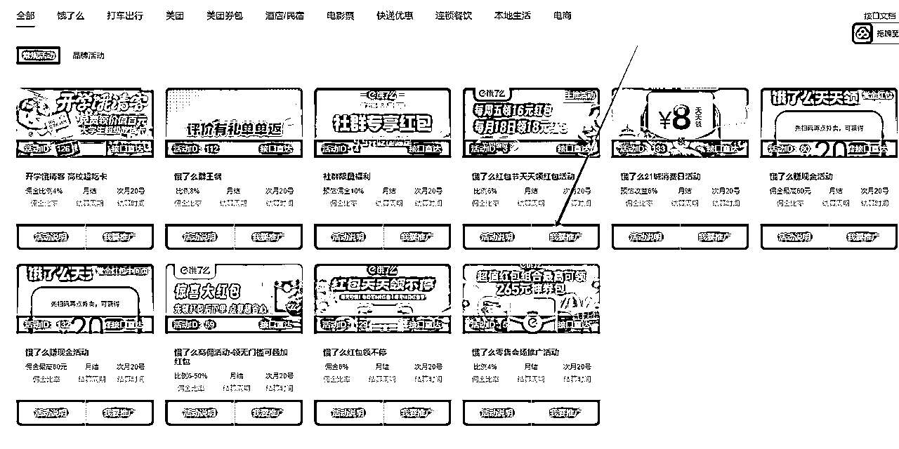

页面随后会生成一串专属推广链接。

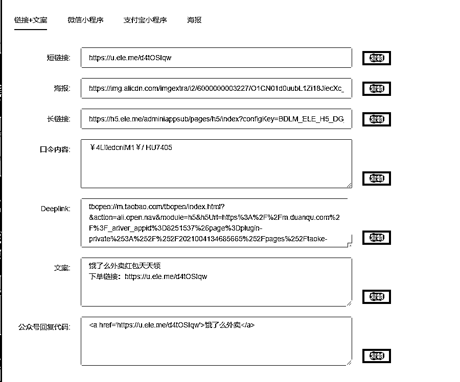

用户通过这条链接下单，你就能拿到返佣。哪怕不发给别人，自己日常点开下单，也能获得返现。

不过我得实话实说，外卖红包这条赛道如今已经没那么好跑。最大的问题是佣金比例在逐年缩水，早期能到十几个点，现在只剩5个点左右。前几年还有些团队跑去抖音、B站投流做这个，现在已经没多少人继续投了，投产比明显撑不住。

如果你想靠这两个玩法吃饭，最关键的门槛依然是客流。虽然仍有人收几千块教这套东西，但流量始终是绕不过去的难点。比较现实的做法是把它和别的内容放在一起运营——比如通过红包皮肤或免费工具把人引到订阅号，再在号里放影票优惠和外卖红包入口。这三个方向的用户画像重合度很高，组合起来，才更有可能跑出利润。

我，Tilly，如今正把心力放在考研培训上，算下来已经第7年。无论你想聊考研方向的事，还是想一起琢磨副业里那些值得抠的细节，都欢迎来找我。