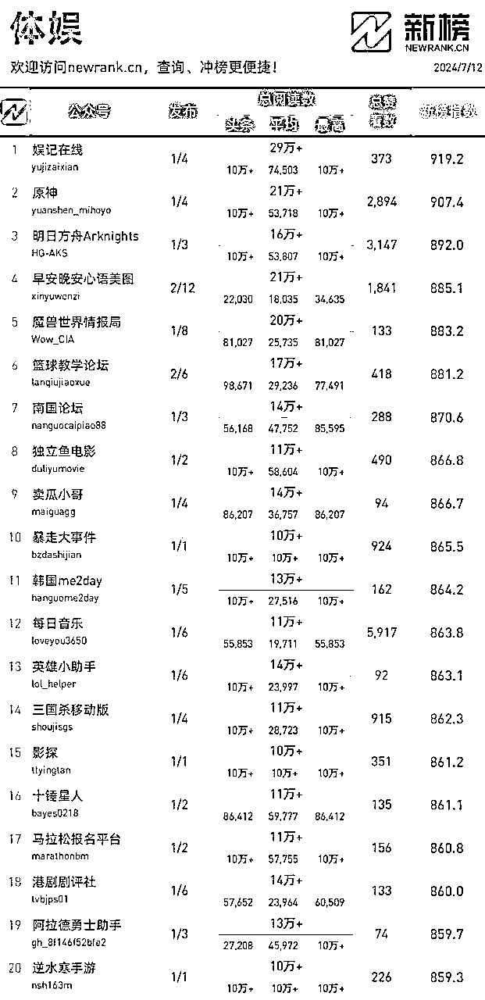
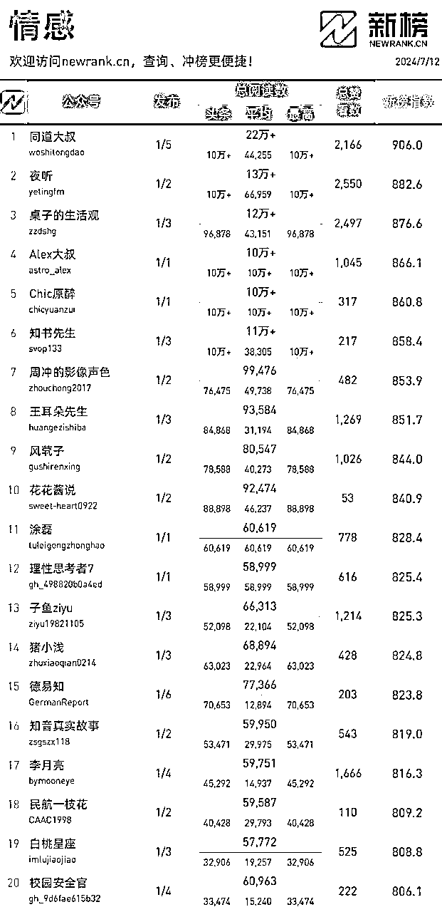
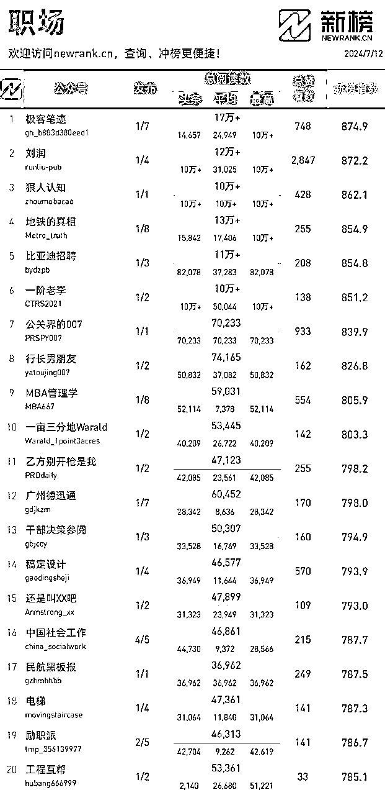
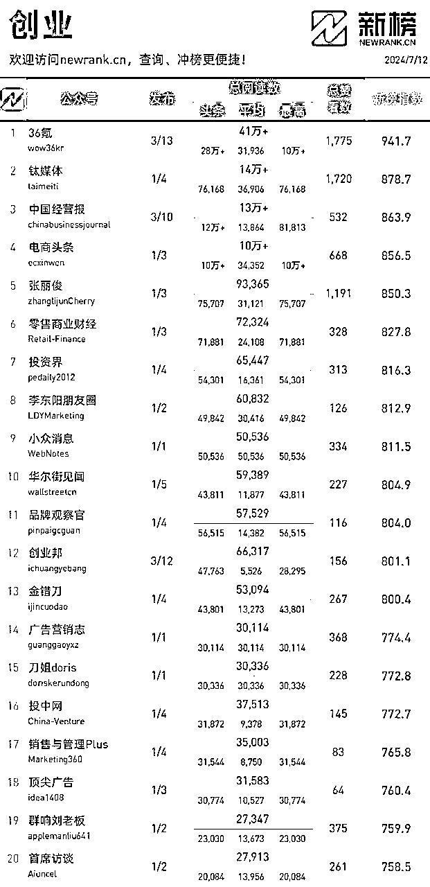
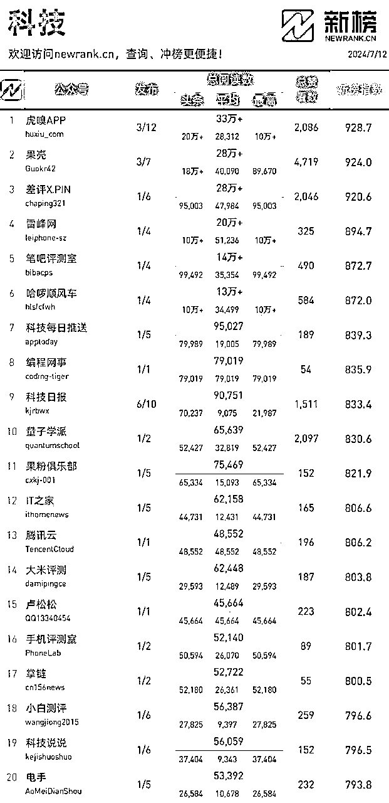
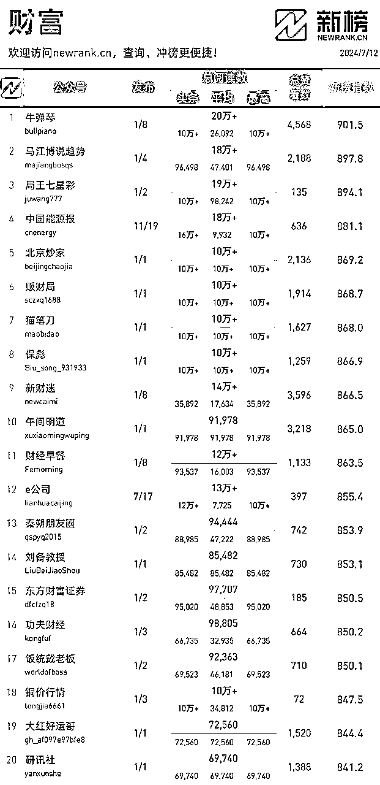
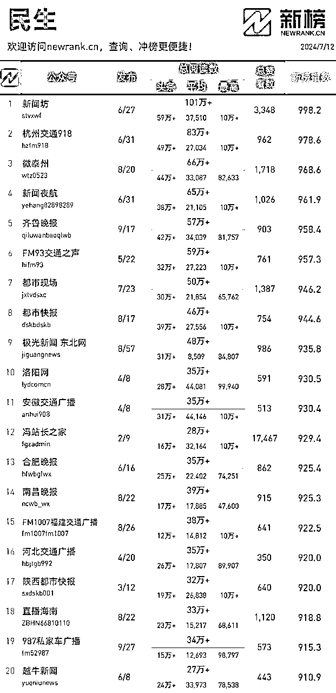
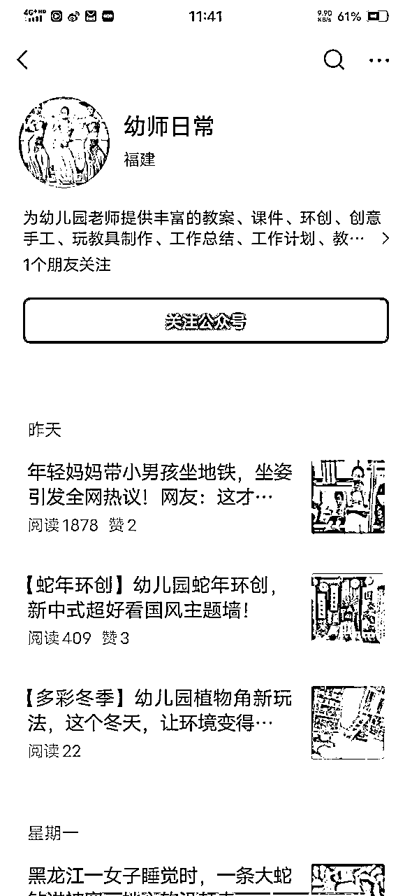
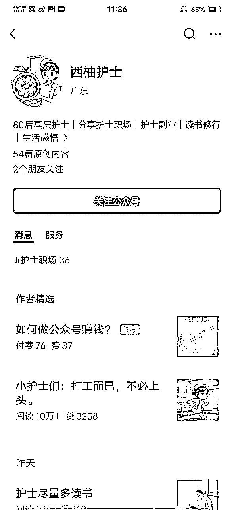

# 用6000字把公众号IP的选题问题讲透

> 来源：[https://gd7vhxq16l.feishu.cn/docx/HD8ZdR1Qpovuqlx5YetcW7mlnD3](https://gd7vhxq16l.feishu.cn/docx/HD8ZdR1Qpovuqlx5YetcW7mlnD3)

公众号航海我已经跑了两年，是存活时间最长的那艘船。我本人也经历了七期，1期带队，6期当教练。可航海手册也好，高手领航也罢，对选题的拆解一直都不够细。这期航海主题又回到IP，选题的重要性就更被放大了。

因为IP爆文和普通爆文有本质区别。普通爆文一旦出圈，账号注销重开就行，账号本身就是消耗品。IP爆文不行，人设、故事线、信任感都是长期堆起来的，出圈就等于前功尽弃，要推倒重来。

所以这篇文章，我想从9个维度系统地聊选题。做IP一旦定下来就要一条道走到黑。与其后期反复试错，不如前期多花点时间一次性把方向定准。有人说先完成再完美，我不反对，只要能出圈还能继续更新就行。

可以说，想把公众号IP做好，在项目启动当天，也就是发第一篇文章时，选题上投入的时间越久，后面走弯路就越少。

关于怎么选，我展开9个角度来讲。

我2023年12月更新过航海手册，里面提过前面四点，但讲得不透，这次希望能补上。

# 一、兴趣与擅长才是续航力

先问自己：你不感兴趣的事，能日更多久？

不一定非要专业级擅长，有兴趣也能边做边学。兴趣和擅长的交叉点，能让你有动力持续产出，哪怕暂时没收益也能坚持。坚持下来自然能甩开大部分人。从零开始比从无到有容易，日更的门槛也就低了。

怎么判断自己喜欢什么擅长什么？可以从四个感受切入：

自驱：做这件事时你会觉得自己很有力量，不怕失败也不怕被评价，短期挫败不影响心态，你坚信能做好。
比如每日500字日更，已成习惯，因为记录本身就是疗愈。

渴望：有什么事让你忍不住想做，不做就难受？
比如我对排版特别较真，不是追求完美主义，而是觉得阅读体验必须给读者安排好。

沉浸：什么事能让你忘记时间，宁愿牺牲休息也要做完？
比如吐槽hcy/zdd，一聊就是一个小时，晚上22点开工，23点半还在写。

满足：做完后有强烈的成就感和通透感？
比如从立项到策划营销，每个细节都按自己的理想执行；写这类文章时总有如释重负感，像攻克了一个课题。

如果还是没头绪，可以自问清单：

擅长类
（1）过去哪些经历让你觉得开心？
（2）身边亲近的人觉得你的长处是什么？
（3）如果明天辞职，之前的工作里你会留恋哪部分？
（4）你取得过哪些成果，是怎么达成的？
（5）什么工作会让你沉迷其中？
（6）从小到大你擅长什么？
（7）哪些事你天生就会，做起来毫不费力？
（8）最近最充实的一天是怎样的？

喜欢类
（1）即使要花钱，你也想学的技能是什么？
（2）书架上常年摆着什么类型的书？
（3）哪个领域或事物让你有“真是太好了，拯救了我”的感觉？
（4）抛开工作金钱限制，你真正喜欢什么？
（5）如果什么都能当工作，你最想做什么？
（6）你在哪件事上花的时间比别人多？
（7）你常搜什么？按高中、大学、现在分阶段写。
（8）你喜欢或曾喜欢的电视节目是什么？
（9）你常对什么产生“为什么”“怎么做”的疑问？

拿张纸写下来，喜欢和擅长的领域会慢慢浮现。

# 二、技能与职业经历是可复用的资产

兴趣是情绪驱动，技能是理性壁垒。如果你本身就是该领域的专业人士或头部玩家，就别浪费这个资源。

做IP号也好爆文号也罢，最终理想状态是把流量主收益变成副业的副业，真正的副业是引流做课卖服务，这才是长久之道。

你熟悉的赛道走下去就是深耕。深耕意味着可以搭建素材库、素材系统。说白了流量主项目就是素材拼积木。

有时候爆文号做成IP号，就是因为这个原因在起作用。

有一技之长的人完全可以一号双线：爆文号+IP号。两个号之间可以甲方乙方化，爆文号给IP号导流。素材库是同一个大盘，只是内容切口不同，收集素材时能一鱼多吃，效率更高。

比如你是护士，可以做健康护理IP；你是幼儿园老师，可以做亲子教育IP。

# 三、市场在要什么

市场=真实需求+国家政策偏好的方向。没市场的东西模仿出来也没有意义。

看真实市场，可以参考新榜周榜，也可以看国家GDP各行业分布。

再看未来政策倾向的市场。中国14亿人口大致集中在五个方向：

（1）银发经济：老年人市场
趋势：有钱、有闲、有保障，退休休闲、空巢陪伴。
延伸：老年医疗护理、养老机构、医陪、陪聊。

（2）单身经济：青年与大龄人群
趋势：重便捷，网购外卖为主，品质科技智能，宠物社交，精神陪伴，宅文化。
延伸：迷你家电、一人食、轻食，宠物寄养陪护，知识付费，悦己消费。

（3）旅游经济
国家调休、过境免签等政策就是在盘活旅游。

（4）宠物经济：独居老人+单身人群
趋势：情感寄托、陪伴。
延伸：宠物用品美容、寄养托管保险、行为矫正、社交与电子养宠。

（5）个人成长经济
成长是刚需，覆盖全年龄全职业。

这五个赛道既是当下刚需也是未来趋势。养生、老龄化、独居、压力、单身、离乡，这些现象注定长期存在。

一句话总结前三点：
喜欢的事×擅长的事×市场需要的事=能做长久的IP

# 四、你的输出习惯决定你的产出方式

输出习惯没有优劣之分，像兵器一样，看你用得顺不顺。主要是手写、AI辅助、口播三种，可以组合使用。

关键是选一个你最舒服的方式，也可以在此基础上拓展第二种习惯。习惯多了，日更会轻松很多。

输出习惯要培养，就像写作能力一样。补充一点关于AI：AI是放大镜，不是本体。它是工具，前提是你懂项目逻辑和爆款逻辑，才能用好。

这四点我在各平台都反复讲过，尤其是公众号航海里。没有这四点支撑，选的领域再大，后期收益不好时也很难坚持。我的观察是所有人都基于这四点中的一两点在选，只是排序不同，结果也就不同。

比如我选剧评，兴趣15分，不算狂热，但够用；擅长15分，从知道到熟练到精通在提升；市场需求20分，影视剧评是刚需；输出习惯15分。总分越高，胜算越大。

给自己打分模板：领域、细分方向、兴趣、擅长、市场需求、竞争度、输出习惯。总分超60分可考虑。

# 五、顺着广告、政策与内容需求走

AI时代下，AI商业广告很猛，你完全可以做AI普及、使用、落地的解读内容，这类账号很容易接到商业单。

代运营也是蓝海。比如幼儿园账号代运营，我之前接过旅游代运营。做一个垂直账号吸引甲方合作，模式多样。

# 六、用关键词搭建素材库

选领域前一定要细分。

以情感为例：
婚前：恋爱、相亲、单身、催婚、情侣日常
婚后：夫妻关系、婆媳关系、亲子关系
离婚：离婚心态、单亲带娃、二婚、晚婚

再细分，赛道就打通了。比如婚前里单身可拆出骗婚、婚闹、彩礼、相亲见面、大龄剩女与宠物、婚姻里的利他等。这些都能变成标题、内容和选题。

鸡汤也可细分：
功能鸡汤：好好学习努力上进
毒鸡汤：打性别对立的相亲话题
反向鸡汤：躺平、慢就业、全职儿女

不同赛道有固定关键词群：
SNS投放：小红书、微博、平台规则
短视频：抖音、B站、脚本
出海电商：shopify、引流、政策
微商：宝妈、自销、朋友圈营销
学龄前教育：早教、不听话、婆婆
中小企业管理：小团队、招聘、顾问、合伙人

关键词也可按人群来列，比如年轻人躺平、失业人群。

鸡汤细分就是个例子：
鸡高考家长：起跑线、兴趣班
鸡年轻人：失业、恋爱、房奴
鸡35+：三座大山
鸡老年人：怕死、生病

人群决定内容、写作习惯和发布时间。

关键词还有几类：
阅读时间：老人白天阅读多，年轻人晚上多。早晨6点养生、8点做操等。
情绪词：女性更情绪化，焦虑、抑郁、治愈、嫉妒更容易点开。
追星：明星名字本身就是流量，王一博、肖战等。
职业身份：法律、医生、教师、护士等专业身份词。

# 七、按多巴胺选题

人们会为快乐分泌多巴胺，排名靠前的行为有：
男欢女爱、还清债务、吸烟、工资到账、涨薪、对方还钱、打游戏胜利、饮酒、健身、吃到美食、朋友相聚、按摩、完成任务、看完一本书、追剧、听歌、洗热水澡、睡到自然醒、游泳、得到赞美。

补充两条：慢性病被治愈、逐渐对异性失去兴趣的三大爱好：爬山、钓鱼、摄影。

# 八、追常规热点而不是追大热点

大热点来得快去得快，不如做常规热点，有准备年年吃。

按时间顺序：
1月：元旦、红包封面、年终总结、年终奖、流感
2月：春节、返乡、堵车、情人节、春晚
3月：开学、植树节、315
4月：愚人节、张国荣忌日
5月：劳动节
6月：儿童节、高考、618、中考
7月：志愿填报、暑假、七夕
8月：暑期档
9月：开学、教师节、中秋
10月：国庆
11月：双11、光棍节
12月：双12、圣诞、跨年

按事件频率：
跳楼、交通事故、校园霸凌、裸辞、35岁被裁、让座、娱乐圈瓜、结婚生育率创新低、实体店关门、网红卖假货。

按季节网红：每年新网红的出现都会带起旧网红，如唐尚珺、三只羊等。

举例：春节宠物上门喂养服务。收费、服务内容、宣传方式、注意事项都可做成系列内容，既能引流私单，流量主收益也高。

# 九、人物领域有长尾效应

人物类内容，聚焦一个细分，切到就爆。
虚拟人物、动漫角色、影视剧角色、真人真事。
真人可分科技互联网、体育、网红、公益受益人等。

# 十、当前可细分赛道清单

历史、军事、民生、财经、科技、创业、汽车、楼市、职场、教育、学术、文化、健康、时尚、美食、乐活、旅行、摄影、幽默、情感、体育、娱乐、影视、美体、萌宠、鸡汤、游戏动漫、母婴育儿、爆款方法论。

每个大类都能继续细分，先用你的认知去拆。

以上9种选题思路，写给准备做公众号IP的同学。方法不限于公众号，任何平台通用。

当你读到这里，不妨停下来问问自己：真正适合你的选题到底是什么？哪个方向值得你长期深耕、不会半途而废？除了流量主带来的收入，你还能靠哪些方式持续变现？

这三个问题，就像直击灵魂的连环拷问，帮你一层层剥开迷雾，直到你找到那个让你发自内心满意、愿意全力以赴的领域。然后，别犹豫，把全部热情和精力都砸进去。

选对了方向，剩下的就只管All in。