# 适合新手的10个自媒体副业项目测评 1～5

刷到不少朋友问：普通人想搞副业，到底哪些项目真实靠谱？

先说下我自己的情况。我叫叁斤，目前的主业是小红书操盘手，平时也爱折腾各种副业项目，跑通之后就会交给我团队去运营。2025年给我自己定的目标是赚到100万，主副业一起上。

我也经常跟刚想入行的朋友讲一句话：一开始别急着问“这项目怎么玩”，先搞清楚“这项目适不适合你”。不然忙活俩月，发现方向压根不对，时间就是最大的成本。

为了帮大家少踩坑，我把自己做过的项目一个个拿来测评。原本想一口气写10个，但内容太多，怕拖更，就分上下两期。这期先聊几个我重点玩过的平台，主要集中在小红书和得物。

这期内容有点长，先给大家列个目录，感兴趣哪个可以直接跳。

一、小红书千粉商单
二、小红书达人商单
三、小红书虚拟资料
四、得物好物种草变现

先聊聊第一个。

## 一、小红书千粉商单

这个项目是咋来的？大家都知道，小红书现在管品牌种草管得挺严，商家想正常做推广，基本都得走蒲公英平台。如果平台外的水下笔记太多，品牌分会掉，严重的连品牌词都会被封。

于是很多商家就换了个思路：找一些粉丝不多的小博主，用直发的方式铺内容，成本低。需求自然就冒出来了。

对普通人来说，这是小红书上最容易摸到门槛的项目：注册个账号，发点涨粉内容，粉丝到1000就能开蒲公英接广告。商家把图文素材都准备好，你只管发。一条合作价格通常是100块起步，内容形式大概长这样：

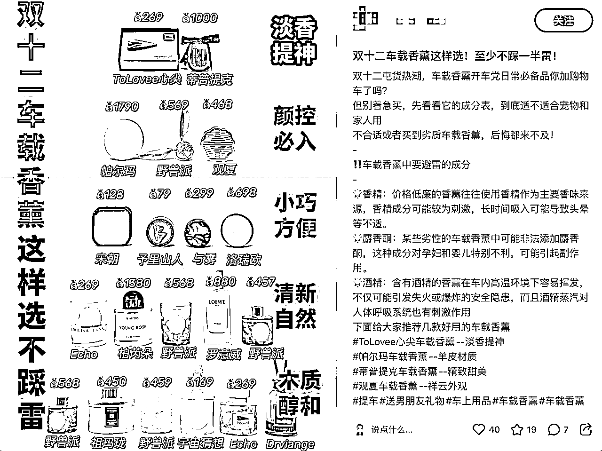

去年我自己也试过这个方向，逻辑其实和得物差不多——先涨粉再接单。但最后得物跑通了，小红书这边反倒没做起来。具体原因后面测评详说。

## 千粉商单具体怎么做？

大体可以拆成四步：起号准备、做爆款内容、开通蒲公英、签约MCN。

### 起号准备

建议准备两部手机、两张手机卡、俩实名认证。

为什么？因为每个账号的变现空间很有限，而且一个月不可能天天都是广告单，所以大家基本都会搞矩阵，至少备2个号。这类号接的是直发广告，平台层面来说是违规的，起号动作也比较粗暴，所以废号风险是存在的。尽量做到一卡一机一号，注册完把头像昵称简介随手改一改就行。

### 爆款内容制作

核心就一个字：涨粉。什么火就发什么，能涨粉就是好内容。如果吸引来的用户是25～35岁女性，后续变现价值会高不少。

我直接分享几个容易出爆款的选题方向：

1、影视综艺混剪：把热门明星、综艺、剧集素材拿来二次剪辑。

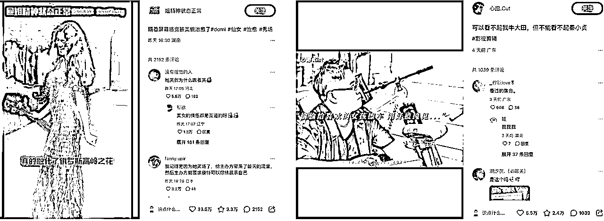

2、电影/书单合集推荐：做大盘点类内容，涨粉很快，素材可以从其他博主那边筛。

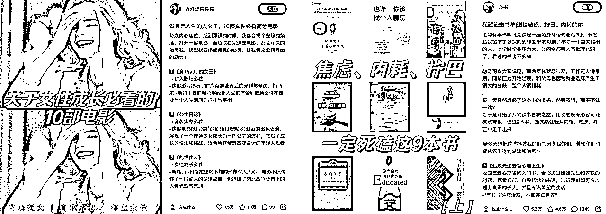

3、宠物+治愈语录：萌宠配文字，轻轻松松。

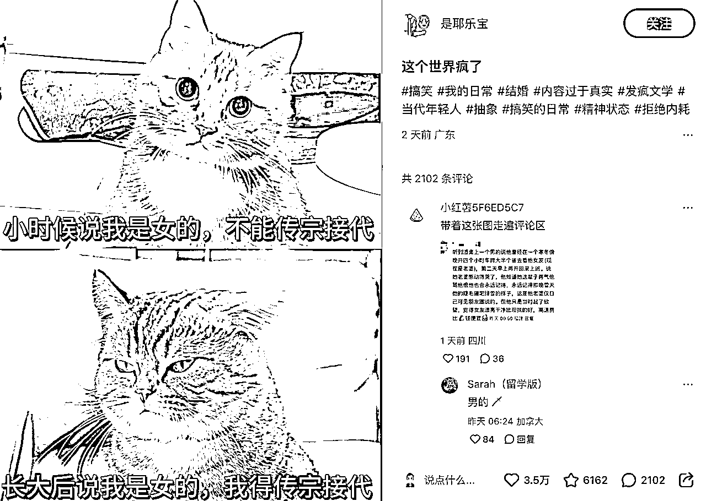

当然，能涨粉的远不止这几类。我自己的操作习惯是：看灰豚数据的涨粉榜和热门笔记榜，在榜里找适合自己模仿的爆款形式。上面说的3种内容，有2种就是我在实时热门榜里现找的。顺带提一句，我还在涨粉榜上看到一个做穿搭的账号，同样靠直发商单变现，这个类型新手也可以参考。

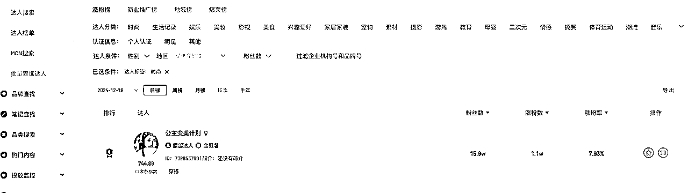

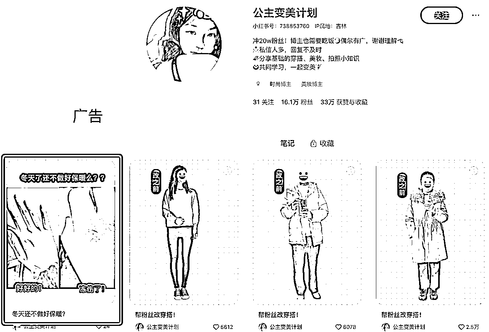

### 开通蒲公英与变现

粉丝到1000就可以开通了，两个硬性条件：

第一，实名认证且满18岁
第二，粉丝数超过1000

刚破千别急着认证，平台掉粉很常见，建议等粉丝到1100左右再操作。认证一通过，等着接单就行。

### MCN签约

说实话，素人账号曝光机会很少，没有大爆文很难被商家看到。商家其实有投放需求，只是找不到你，他们通常更喜欢通过MCN批量合作达人。

这也是为啥市面上很多培训班，都会要求学员绑定他们的MCN机构——确保你起号后能立刻有单接。对学员来说，这既是好事也是坑，后面详细拆。

## 千粉商单测评

### 项目优势

确实，这是小白在小红书上最快见到钱的方式。不用会电商运营，也不用像做IP那样慢慢熬，号养得顺利的话，半个月就能跑通变现闭环。而且操作难度低，每天花一两个小时在家就能做，商家需求量大，新人不太需要为没单发愁。

### 风险点

那我为啥不做这个了？几个理由，你们感受下：

1、平台不欢迎。

我做项目习惯选跟平台同向的，不喜欢顶风作案。直发这种模式，平台认定了是虚假种草，被盯上就降级，严重的直接封号。

2、项目寿命有限。

直发内容本身就会把社区生态搞乱，平台怎么可能一直放任？加上这项目门槛太低，谁都能上，等平台里的同质化内容一多，肯定重拳清理。实际上之前已经被打过一次了，只是力度不大，所以现在还苟着。

3、没有复利。

这是我选项目很看重的点。一个项目前期赚少点没关系，但必须越做越值钱，要么收益增长，要么个人能力增长。商单号显然做不到。收益基本钉死，能力没提升，还随时要防项目崩盘。

4、大坑：MCN抽成。

市面上很多知识付费都是同一个套路：先交学费，学完涨粉接单达到一定金额就退学费，条件是你必须绑定他们的MCN，机构保证供单，但要抽走50%的收益。

我给你们算一笔账：不算返点，一条100块的广告单，平台抽10块，MCN再拿走一半，到你手里就剩45块。

当然，我不能一棒子打死所有机构。靠谱的MCN确实会给你提供商单、后续指导和课程，抽成算合理商业行为，没他们你可能一个单都接不到。我说的大坑是那种黑心机构：前期流程一模一样，后面就直接不给你单了。你自己学完了、自己做内容、自己涨粉、自己接单，但有单照旧被抽走50%，他们提供的只有那几节入门课。

这样的人我见太多了，跑来问能不能解绑？很遗憾，不能单方面解绑，没辙。所以，如果你打算报班实操这个项目，一定一定一定要先确认老师靠不靠谱，多问几个人再交钱。

### 适合谁

如果你纯纯零基础，又碰到一个靠谱的老师（不是我啊，我没做这业务哈哈），那可以上手试试。虽然前面说每天1-2小时就行，但你要是啥都不懂又想快点看到收益，建议每天至少压缩4个小时出来干。

## 二、小红书达人商单

听到这名字可能会懵：跟千粉商单啥区别？

说实话，这俩名字都是我自己习惯叫的，本质上都是粉丝过千、开蒲公英、接广告，区别只在路径。

千粉商单，核心是“不择手段”涨粉接直发广告，天花板低、没有复利、容易违规，但胜在简单。

达人商单，则是正儿八经做账号、立人设，在内容里留出广告位，等品牌方来投。天花板更高、更持久，踩线风险也低得多。

先分享几个我最近观察到的变现高手账号，供大家找感觉：

1、妈的欧洲账本：单条图文报价3.3万，10月接了5条，11、12月更新少，每个月也有1条。风格就是随手拍加大字报，文案非常幽默。

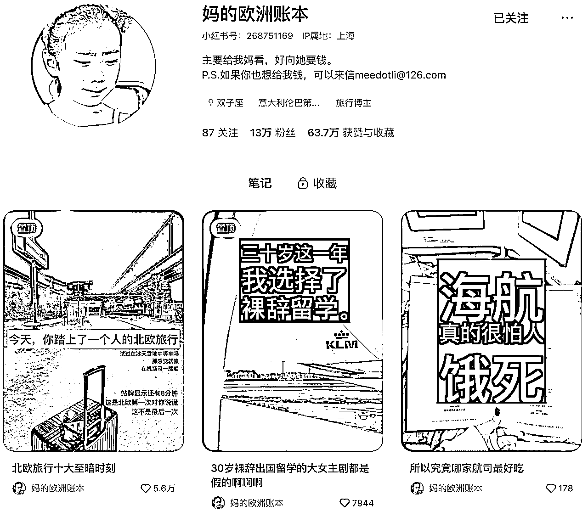

2、贫民窟女孩：单条图文报价1.7万，12月才过20天就接了4条广告。特点是聊天记录体讲故事，喜剧效果拉满。

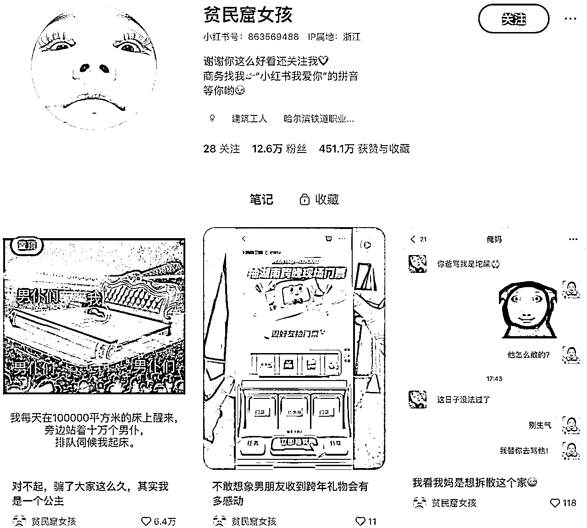

3、团子的小鱼干：单条图文报价2500，12月到20号已经发了22条广告，接单能力相当猛。常规plog风格，人设和气质都很统一。

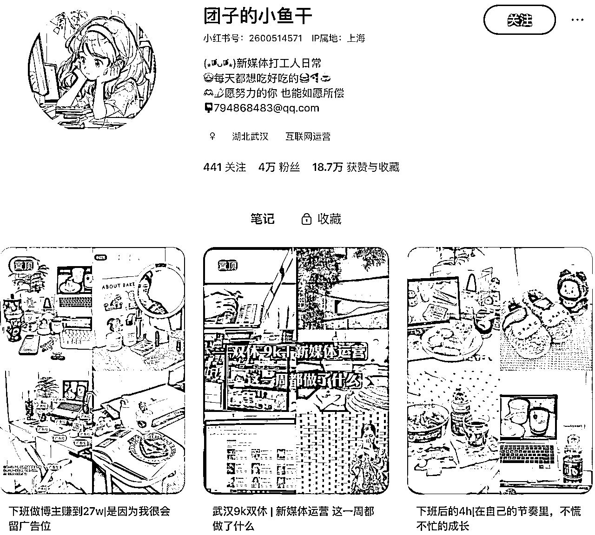

4、旺仔小哈哈（挖宝版）：单条图文报价7200，一个月接了21条广告，能力同样很强。内容就是随手拍护肤品，标题会借大V的流量。

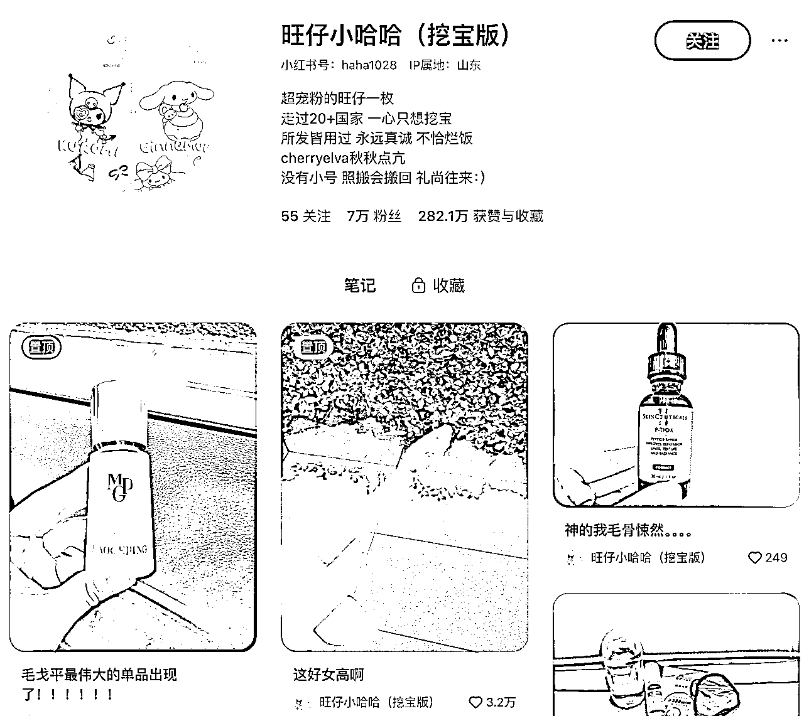

这几个账号的共同点是：接单能力强，而且内容很有个人辨识度。我最早做小红书时走的也是达人商单路线，后来把这套经验迁到了得物，反馈一直不错。下面详细拆：

## 达人商单怎么做？

之前写过一篇比较详细的教程：，这里不重复了，重点说说新手容易踩的误区。

### 起号准备

只要1部手机、1张卡、1个实名认证就行。

这个方向天花板高，内容难度也高，新手能把一个号做好就很优秀了。因为是正规运营，账号操作上没啥特别要求，正常连Wi-Fi、正常切换账号都OK，一个设备挂3个号也安全。

### 账号定位

一个公式：账号定位=赛道×用户×价值×人设×视觉。

其中，目标用户和人设是最关键的，另外三个都围着这两点转。

1、赛道定位：选自己感兴趣或擅长的，同时这个赛道要好变现、有前景。举个例子，玄学赛道好变现但前景不行，还容易违规。

2、用户与价值：做之前，必须想清楚你的目标用户是个什么样的“具体的人”，而不是笼统的“粉丝”。比如做减肥账号，想靠吃解决肥胖问题的人和想靠练解决肥胖问题的人，就是两类用户。选哪一类，取决于你能提供什么价值——前者需要减脂餐、食养产品和“不用运动减xx斤”的价值；后者需要运动方法、动作拆解，还能顺带推荐健身工具和相关商品。

3、人设定位：做完前面两步，人设自然就出来。关键是真实、简单，别整太复杂。不用一开始就想着什么视觉锤、声音锤，你只需要把性格、爱好这些个人特质自然展示出来就行。

4、视觉定位：入门阶段先确定图文还是视频、实拍还是非实拍。我建议小白先用图文做起，用控制变量法快速测试文案有没有问题，再考虑拍视频。一上来直接拍视频的话，出问题不好定位——是表达不行？拍摄不行？还是文案不行？很难分清楚。先把图文的文案问题排掉，再转成视频就顺手多了。

### 爆款内容制作

详细教程还是看上面那篇：，这里讲两个新手特别容易踩的坑：

坑一：太在意阅读量和涨粉数。什么火发什么，什么互动高发什么，比如那种语录类笔记：

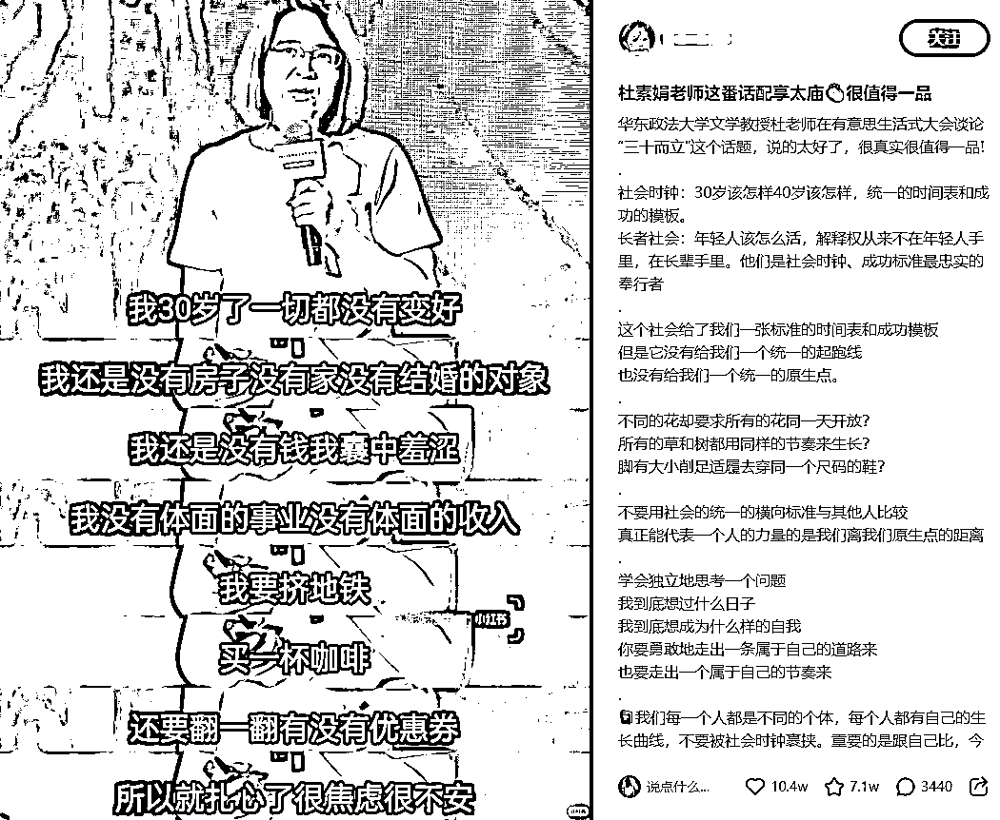

这类内容出爆文不难，但对达人商单的变现几乎没帮助，最后只能又走回千粉商单的老路，接直发广告，赚点小钱。

坑二：内容质量太差。看这两张图对比一下：

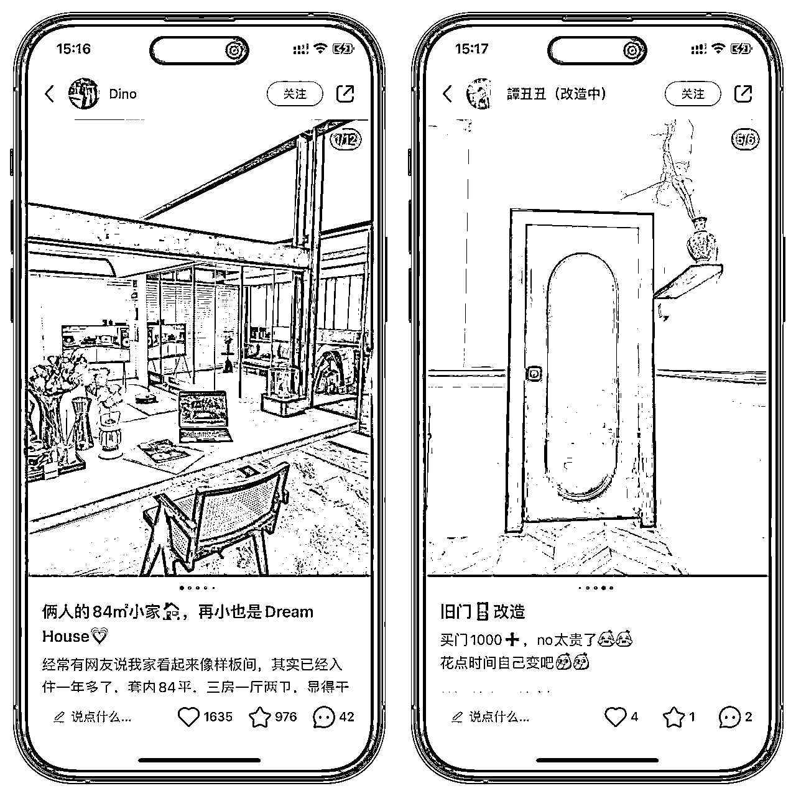

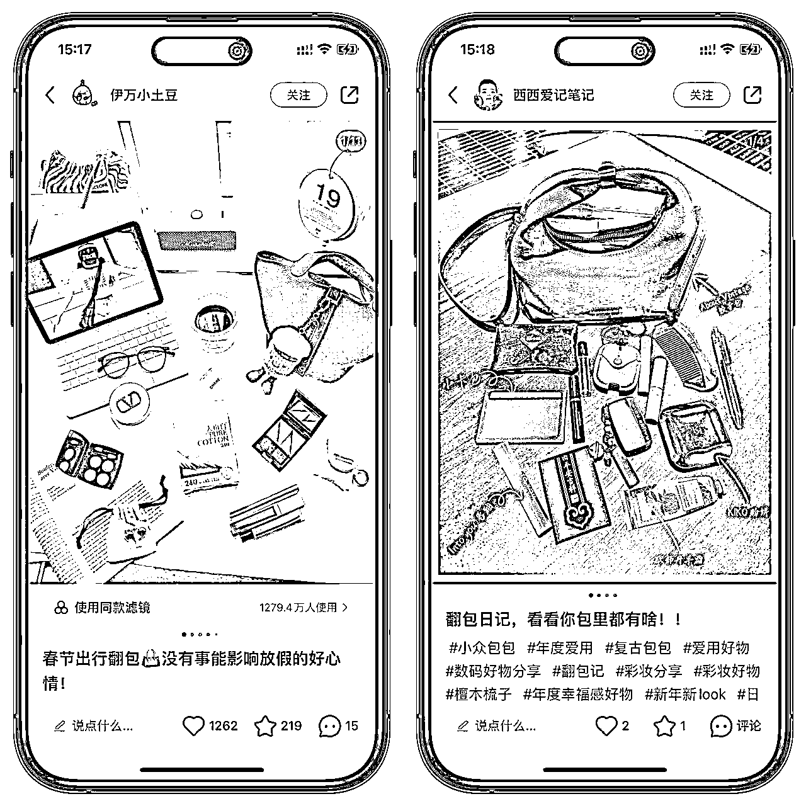

同样是家居博主，左边图片质量明显好过右边，能接到的广更高端、报价也更高。同样做翻包，左边的色调看着就舒服，还有明确的选题“春节出行”；右边拍摄随意、东西杂、没有主题。当用户的肯定会多看第一种一眼，品牌方选人时也一样。

### 广告能力提升

想提高报价，盯住这两点：

一是粉丝忠诚度。想让别人关注你，你得先成为值得被关注的人。自媒体的底层逻辑就是做自己，你发什么内容，就会吸引什么样的人。内容里深度思考越多，吸引来的用户质量越高，粘性也越强。这类内容有个特点：保质期长。我现在偶尔还会翻翻李叫兽的文章，都快十年前的了，还是好看。

二是账号商业属性。一篇笔记如果全是干货、不敢带货，用户只会觉得你是个免费分享的“好人”，不会为你付费。好的内容和种草要并存，既要给用户干货，又要在文案里自然地推荐产品。图片也要给产品留展示位，比如想接扫地机器人的广告，你至少得有一张好看的地板图吧。

## 达人商单测评

我从2020年就在小红书做这个方向，到现在依然有空间。虽然很多人说品牌预算收缩、博主接不到单，但看上面那几个案例就知道，每天依然有大量博主在稳定接单。而且你只要跟品牌方聊过就会明白，他们其实非常缺优质创作者。

### 项目优势

跟千粉商单最大的区别就一句话：一个能做长期，越做收益越厚；另一个只能做短期，随时有被平台管控的风险。

达人商单不但平台认可，天花板也更高。除了广告报价本身，还可以往买手带货方向发展。千粉商单根本做不到这一点，但达人商单可以开直播带货，直接把收益带上另一个台阶。

给你们看个真实案例：博主@几只灰，2000粉就在直播间带货，3个月做到月销售额百万的买手。

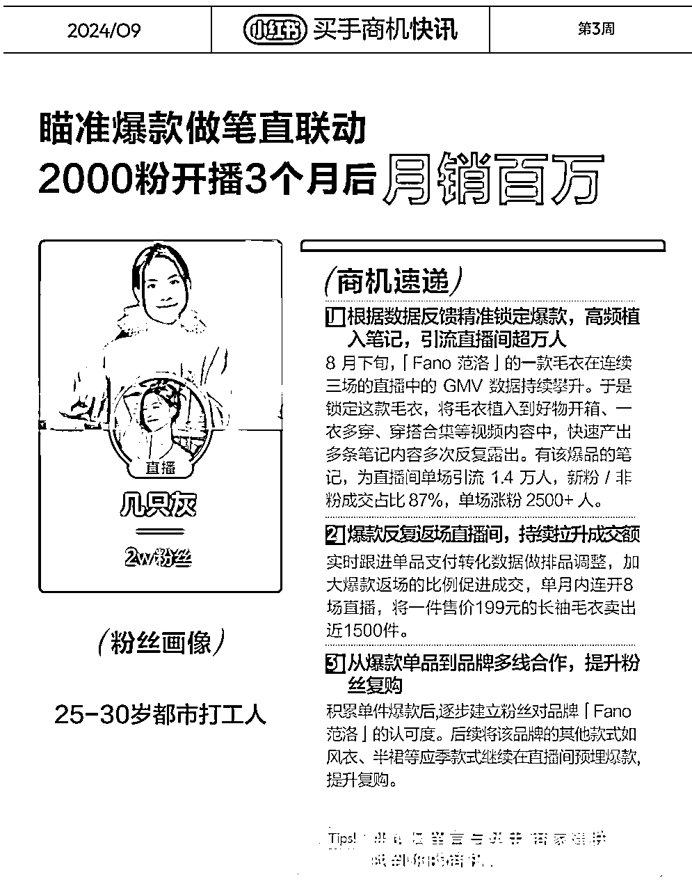

这种故事在千粉商单那里是完全不可能发生的。所以达人商单最大的优势就三句话：天花板更高、更可持续、有复利。

### 项目劣势

难度也明显更大。

正经做内容，涨粉速度肯定比不过千粉商单的搬运混剪。如果定位不准、网感不够，可能做好几个月都看不到结果。这个方向更考验综合素质，没下定决心长期耕耘小红书的话，可能还没跑通变现就已经放弃了。

### 适合谁

有自媒体经验的人，或者已经决心长期做IP、愿意放弃短期收益、想去积累复利的人，特别适合这个方向。还有一些特质鲜明的人：很幽默、共情能力强、有一技之长、表达欲爆棚……这类人走达人商单的胜率通常不低。

如果是纯小白，也没捷径，每天至少花3小时以上去执行，成功率才会比较高。

## 三、小红书虚拟资料

这算是我很早就在玩的赛道之一，去年测评副业时也推荐过。逻辑很简单：用小红书笔记吸引人，然后引导大家购买虚拟资料。

我自己后来写了小红书运营手册，也是当作虚拟资料在小红书开店卖的。我一般把项目拆成三个板块：资料、内容、交易路径。这里重点讲前两个。

## 资料：原创 vs 搬运

“资料”是整个项目的地基。

### 原创资料

适合对文档处理能力比较强的人。比如你能做出精致的PPT模板、简历模板、Excel模板，这些都是能直接卖的产品。信息收集能力强的人，也可以把各行业报告、运营SOP这类资源整理成大礼包来卖。

还有不少你可能压根没意识到是虚拟资料的东西——飞书模板、Notion模板、Excel、PPT、租房合同等等。像@揪只兔子，她的Notion模板卖了13万，飞书版本也卖了6万多。

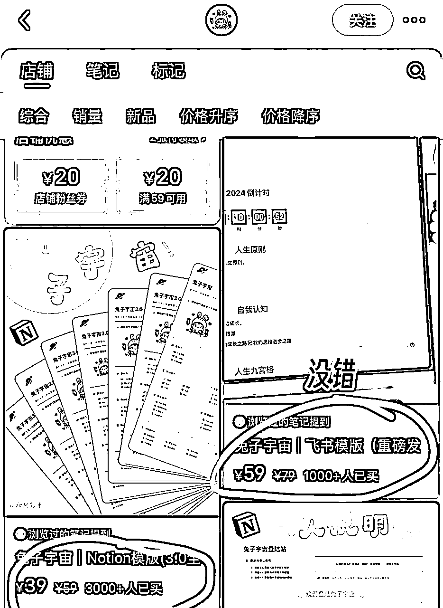

原创资料的核心竞争力，是你得有一双发现“什么能卖”的眼睛，并且能把它做出来。比如iPhone快捷指令，很多人看到有人卖出第一单之前，根本想不到这也是商品。

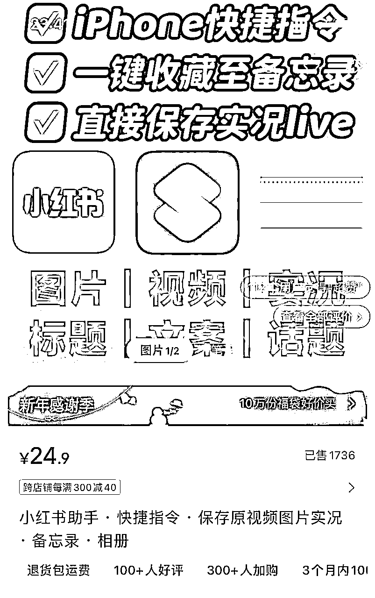

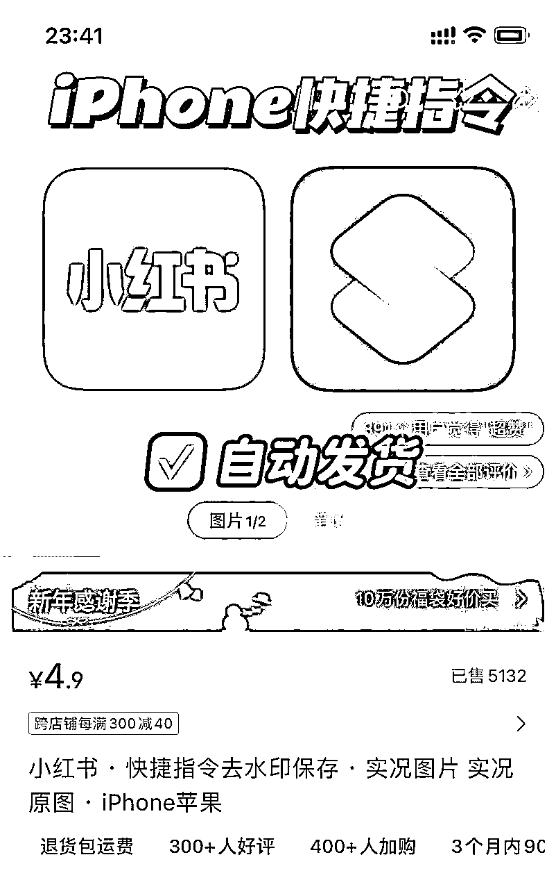

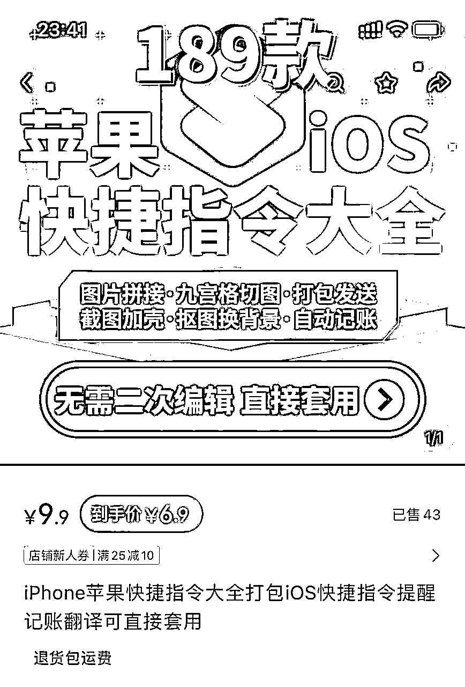

有开发能力的人，可以自己做快捷指令；没有开发能力，收集大量现成的快捷指令，汇总成一份资料也一样卖。

### 搬运资料

上面说的收集全网资源再打包整理出售，其实也有一点点搬运属性了，起码还得花心思整理。

但真正的纯搬运，指的是学科类资料、资格考试资料、TED文档这类——在小红书发笔记，有人想买，你就去同行那边买一份，再转手卖给客户。这是最低成本参与虚拟资料的方式：几乎零投入，不用花时间整理，什么火卖什么。教资考试前就卖教资资料，国考之前就卖国考题目，学科资料更是常年有需求——从小学一年级到高三，每个年级每门课都有家长在找。

常见的素材来源就三个：对标账号、拼多多、闲鱼。

## 内容：原创 vs 二创

资料可以分原创和搬运，内容也一样。注意，搬运资料也可以做原创内容，原创资料也可以做二创内容。

### 原创内容

最简单的做法：把资料打印出来拍摄，或者直接用资料截图发笔记。原创资料可以直接用截图，搬运来的资料就打印出来拍，效果更真实。

想进阶一点，就做口播介绍。像前面说的@揪只兔子，就是口播来介绍她的模板产品。

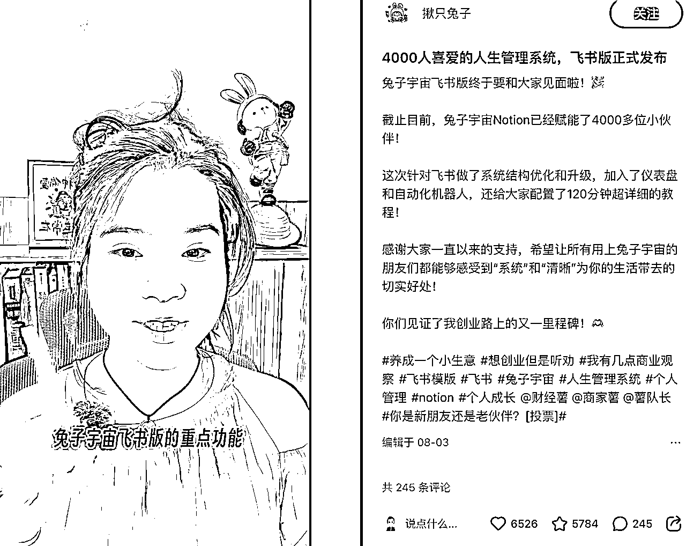

打印拍摄的方式适合笔记、题目这类资料，比如TED资料。

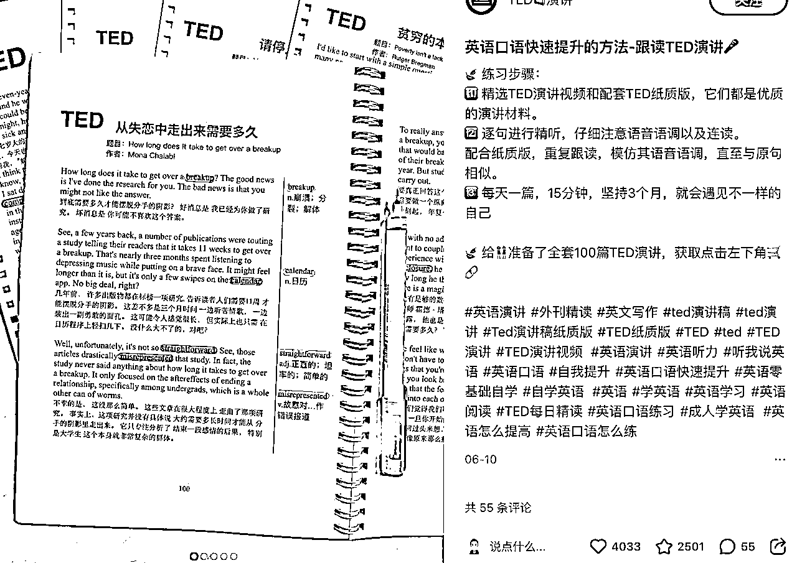

这篇内容会把三个我曾经实际操作过的站内变现方向重新盘一遍：一类是小红书上卖虚拟资料，一类是小红书的电商卖货，还有一类是得物社区的好物推荐。除了拆解各自的门路和收益水平，我还会交代一些自己的实践经历和踩过的坑，给正在纠结怎么选的人做个参考。

先区分一个常见的概念：资料本身存在两种生成方式。一种是完全靠自己从零写出来的；另一种是借别人的成品来改，比如直接截取别人笔记里的图，或者拿别人的版式套进自己的东西。很多教辅资料账号就是这么操作的，放几张示例图你就明白了：

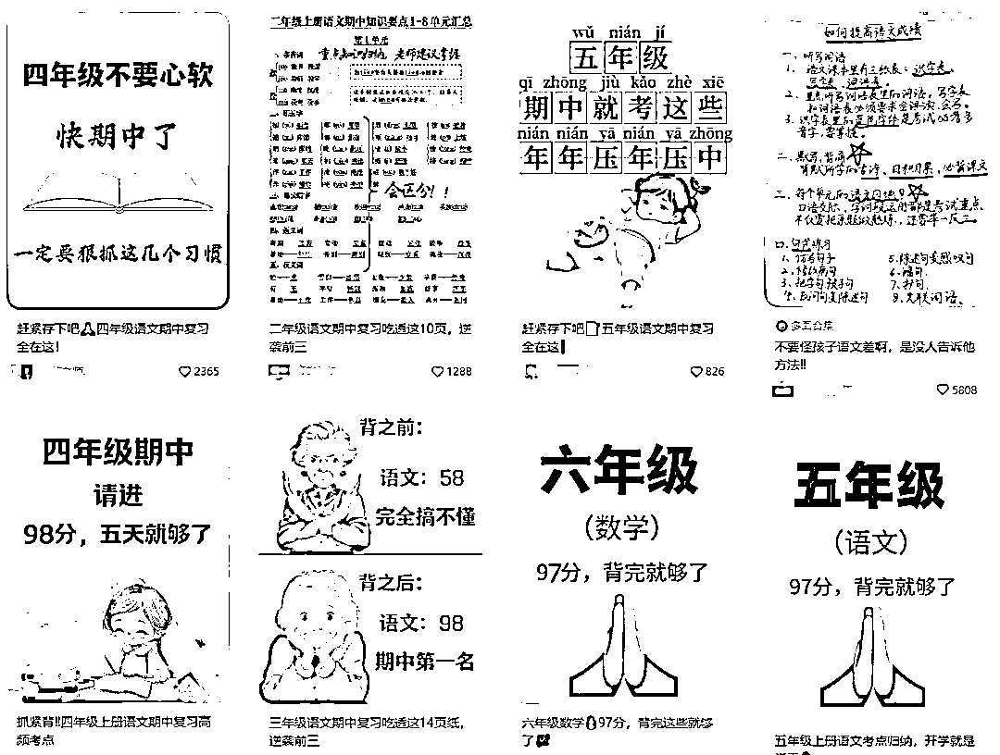

这样的页面你应该刷到过不少。它就是把虚拟资料最原始的做法摆在了你面前：要么搬运现成的截图，要么替换模板里的内容。

这类资料的商业化出口主要就两个：直接挂店售卖，以及往私域导流。前者是在小红书店铺里正式上架商品、等用户拍下；后者则是把人聚到自己的微信号上再做转化。

如果走店铺这条路，操作并不复杂。平台里有个“虚拟定制”分类，多数资料都能挂进去；但部分品类对资质有硬性要求，教辅这类个人基本满足不了。商品上架后，只要有人拍下，发货时选择“无物流发货”，随后把网盘地址发给买家即可；我的资料如果是放在飞书文档上，也可以在发货栏里直接填入链接。目前我自己在做的正是这种模式，它最大的好处是不必担心导流被限制，甚至可以付费买流量来扩大规模。

导流到私域这个方向，做的人其实更多，因为花钱少、也不需要太多准备。惯用的套路大致这样：先在站内拉起一个群；发笔记时只放出材料的一部分；再用另一个账号跑去留言区发问，装作路人求完整版；博主本人则把群入口或链接回过去；接下来那位小号又会在群里继续把联系方式铺出去。需要注意的是，这些免费引流的招数不停被官方收紧，谁也不敢保证能长期有效。下面三个方法是目前我仍在用的：

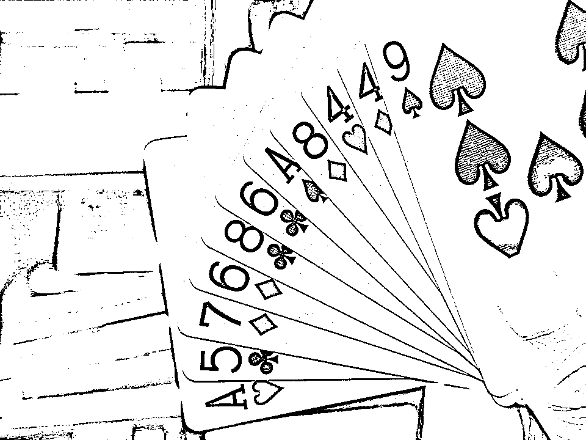

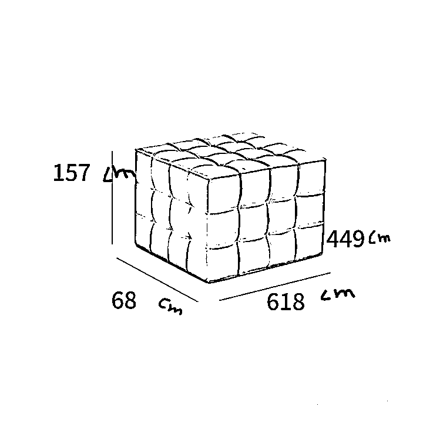

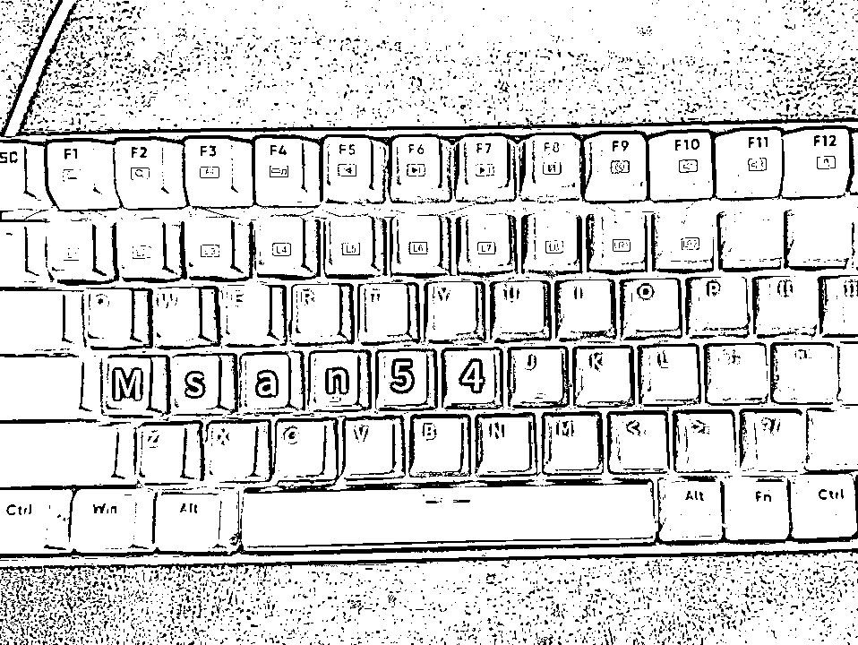

里面有一条忌讳必须讲清楚：引流素材切忌一成不变。无论哪一种套路，发出三五条笔记以后就要替换掉，所以至少要提前备出十个左右的变体，轮换着抛出去。

如果要把这几条路放在一起比较，且以“能不能长久做、天花板高不高”为尺度，我的判断是：自己产出的资料强过四处搬运的资料；自己撰写的内容强过拼接改编的内容；店铺正规售卖强过私域导流。而如果从新人下手的难度出发，排序则会反过来：搬运比原创省力，二创比纯原创省力，私域导流甚至比开店更容易起步。

早年间我先碰的是教辅类资料，问题在于缺乏可以持续交付的产品，越做越疲惫，收入也不理想。后来我干脆自己写了份《小红书运营手册》，把素材和文案都换成原创，同时选择在店铺里正式售卖，反馈比单纯搬运好出太多。正是这段经历让我相信：虚拟资料这个赛道是能长期做下去的。

但这里也埋着一个常见的坎：千万别在没开张前花上整月时间去打磨一套所谓完美的文档，等你满怀信心把号做起来，现实多半会浇上一盆冷水。真正玩得转的人，向来是先把订单接住，再去解决资料的问题。

就算做最省事的搬运，具体做法也不是预先囤好全部材料。先要做的反而是找到一批参照对象，弄清同行在推什么，你就跟着卖什么；等到有人付款，你临时去同行那里买上一份转寄给客户。循环几次，你的素材库存自然会丰满起来。

假如卖的是自己的东西，还有几个可行打法值得参考。一是做“长期订阅”：比如把行业报告这类内容放进知识星球或社群里，用户先付费入群，你在后面慢慢更新；二是“先收款后动笔”：把文案卖出去再开始写，我自己卖出的第一份小红书资料，就是对方先转了账，我当时答应一周内交付；三是“先聚人再创作”：像@揪只兔子那样，先把有需求的读者集中起来、确认已有足够多的人愿意买单，再沉下心把内容做出来上架。

我的首家小红书店铺开在2023年初，次日就来了第一单。但那之后货源屡出状况，我也反复关店重启过几次。平台近几年明显把电商摆到了战略位置上：几年前要满1000粉才能开店，现在已经降为0粉可开；玩法也从单纯的卖货扩展出主理人、买手、直播带货等多种形态。那现在这个电商还能不能切入？要怎么切入？下面展开讲。

先按货品来源分成两种情形。第一种是自持货源的店铺：商品、库存都在自己手里，开店上架后再发笔记引流成交。它的好处相当直接——发货时间和商品品质都能由自己把关，不会被上游牵制；定价权也握在自己手上，利润率更有保障；因为全链路可控，无论是投蒲公英、开直播还是买聚光广告，都可以放心加码。但局限也同样存在：产品种类被自己的供应链框死，很难超出既有资源去扩张；备货数量全凭感觉，估算不准就可能造成积压。

第二种是轻资产的无货源店铺：从1688、一手App或者线下批发市场找供应商谈代理或一件代发，把商品信息授权铺到小红书店铺中，再由笔记内容带流量成交。这样处理的好处很明显：不需要自建库存，出了订单再找上家发货；入驻成本低，0粉即可，多数类目只要求实名认证；账期上也不存在垫资压力，平台结算后再向供应商下单即可；品类可以随时更替，什么有热度就卖什么。真正的风险集中在供应商环节失控的时候：售后体验容易崩溃，多数上家不支持退换货，买家退回的商品只能寄回你手里；质量也更难监控，走量越大越容易出瑕疵；此外，还没做出量之前，你在供应商那边没有议价空间，利润偏薄；付费投流在这种模式下同样很危险，订单一旦放大，投诉和退款会跟着失控。官方现在明确打击无货源经营，不过实务里仍有一些防守手段：让供应商绑定电子面单；把发货地址和收货地址固定下来；把品类选择限定在某个范围内。其中绑定电子面单的防护效果最好。

内容层面上，“自己拍”和“改编别人的”属于两条路线。自己拍就是从实物出发做素材，以固定机位或固定版式进行流水线式生产；好处是账号安全性高、被判定违规的几率小，劣势是出片成本不低，能不能爆还得看素材本身的感染力。改编路线则是在全网找同类商品图频，再通过修图、剪辑做去重处理；这样内容生产成本极低，也有机会迅速模仿爆款，可一旦去重技术不过关，违规风险相当高。对没有专业去重工具的新手来说，我更建议踏实走上一条原创路线。

经营风格大体可以分为两类：一类像线上摆地摊，另一类是养买手IP。所谓线上摆地摊，就是直白地把货亮出来，高频发笔记去叫卖。这种模式的核心优势是起量快——尤其是开通店铺之后，密集铺产品笔记往往能在短时间内带来成交；单条笔记也不用精心打磨，套模板就能批量产出。代价则是它更像体力活：做多少内容、出多少单直接挂钩；账号本身几乎不沉淀任何资产，做了半年和刚起步的差别不大；流量断崖随时可能出现，停止更新或者数据下滑，销量马上就熄火，反过来一篇笔记运气好爆掉，则可能吃下可观的订单量。所以运营重点应该是扬长避短：别再把心思花在攒赞、涨粉上，每条笔记都冲着成交去设计，做成产品种草型内容；爆了的笔记要尽早复制跟进；同时用多个账号轮换发布来对冲不确定性，条件允许也可以掺入一些付费流量。

买手IP型则对应着另一套逻辑，常见的呈现形态有个人IP、主理人和专业买手。这种模式的内容选题几乎不受约束，不必死磕某个单品或细分类目，变现手段也更灵活；更重要的是粉丝信任度强，流量不会忽高忽低，未来换方向也相对容易。但代价是周期漫长，运气不好时大半年都见不到一毛钱，而且对创作者的综合素养要求相当高，文案、摄影、剪辑样样都要拿得出手。做这类账号时，别总想把自己的产品硬塞给用户，反而要先忘掉卖货这件事，把账号经营成一个能提供价值的社交阵地。能输出专业知识就讲专业，讲不了专业就展示自己的成长轨迹、性格和观点，让人先认可你这个人。

用矩阵做带货，有两条被验证过可行的路径。其一为企业号“1拖6”：一个企业主账号可额外关联三个企业号加三个主理人身份，合计六个辅助位，连初始账号一起，就相当于用七个账号同时往一个店铺导流；这样既能共用店铺，又能摊薄开设成本。其二是伪素人矩阵：虽然官方明面上禁止，但从我们试过的众多店铺来看，这种方式的转化率与投产比反而是最高的。操作本质很简单——雇人代发笔记，让内容看起来像是普通消费者下单后的真实体验，如果再配上晒单类笔记，说服力会更强。

我的电商经历正是从无货源开始的，中间开店关店反复数次，几乎每次刚把销量做上去，供应商那边就会掉链子。后来我改做半无货源：不再什么品都碰，转而锁定几家实力过硬的供货方长期协作，整体才终于稳了下来。基于这些教训，我认为新人不是不能从无货源切入，但一定不要撒网式选品，最好给自己划一个明确的类目和固定的选品池。内容方面，能独立拍摄就不要依赖搬运，毕竟违规风险更低。关于批量产内容，我有两个心法可以分享：第一，用固定模板做集中拍摄，再以这些原创素材做重新剪辑；第二，请兼职协助拍摄，按爆文一比一复刻场景，一组图成本大约20元，能支撑起两三篇笔记，既便宜又能跑出还不错的反馈。

综合来看，这个项目的吸引力在于：开店没有粉丝门槛；笔记发出去后，隔一天甚至当天就可能成交；收入上不封顶，单月冲到十万乃至百万级别的GMV并不是天方夜谭；打法也相当多元，自然流量、付费投放、素人矩阵全都有跑通的案例。但它的门槛同样不容回避：需要有把内容和选品两头都抓起来的能力；并且是实打实的体力活，从做素材到打包发货，一个人扛会非常疲累。有运营底子、有一定供应链资源的人会更合适，若能组一个小团队分担执行，整体会从容很多。

得物这个平台我从2022年就入场了。大众对它的印象基本还停留在卖潮鞋的电商平台，但这几年它着力经营内容社区，调性上与小红书有些接近，只是底层商业基因始终是交易。也正因如此，多数人并不清楚：在得物上单纯分享好东西同样能赚钱。这篇就先略过潮鞋搬砖那套玩法，只聚焦好物种草方向。

得物上的收入通道主要有四个。先说“种草赏金”：发笔记时顺手挂上商品标签，任何用户点了链接或者下单，佣金就会自动进账。这个功能的参与条件几乎为零，零粉丝、不实名认证都能挂出来，新手要靠它迈出第一步非常容易。不过它的收入规模很小：佣金与商品价格并不挂钩，即便单价很高的商品，到手也不过几毛到几块钱，一个月累计下来通常只有几百元，只适合当作起步阶段的零花钱。

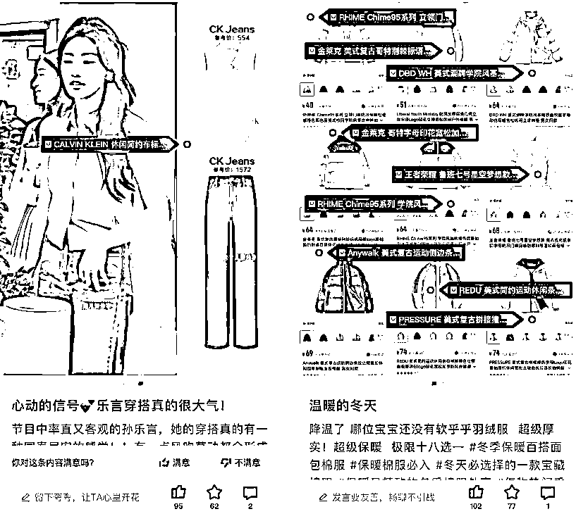

第二种叫“得物免单”，可理解成平台组织的大型抽奖。你先报名参与活动，中不中全看运气，但奖品大多是客单价不低的好东西。操作本身有固定步骤：在主页的“我的-免单”里把任务打开；随后发布一条动态；动态满足条件后就能获得一次抽奖资格；拿资格去报名想抽的产品；平台每周五开奖；中奖者领到产品，再按要求发一条体验动态收尾。整个链路至少要两条内容支撑：第一条用来取得抽奖资格，第二条用来兑现中奖任务。我报名的原则是优先挑大牌，原因是它们的流量属性强，中奖后的种草内容天然更容易获得数据；即便没中也不亏，还有商单可以赚，一旦抽中，大牌鞋子带来的流量收益远比奖品本身更值。

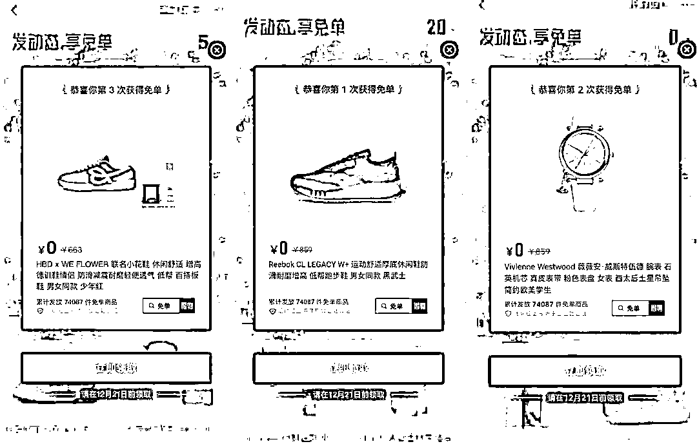

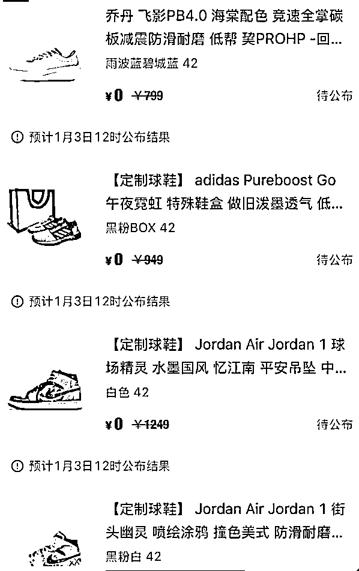

第三种收入来自视频播放激励，逻辑和抖音的中视频计划相近。我第一次尝试时，一条只有52个赞的视频，竟然换来了72元收益。

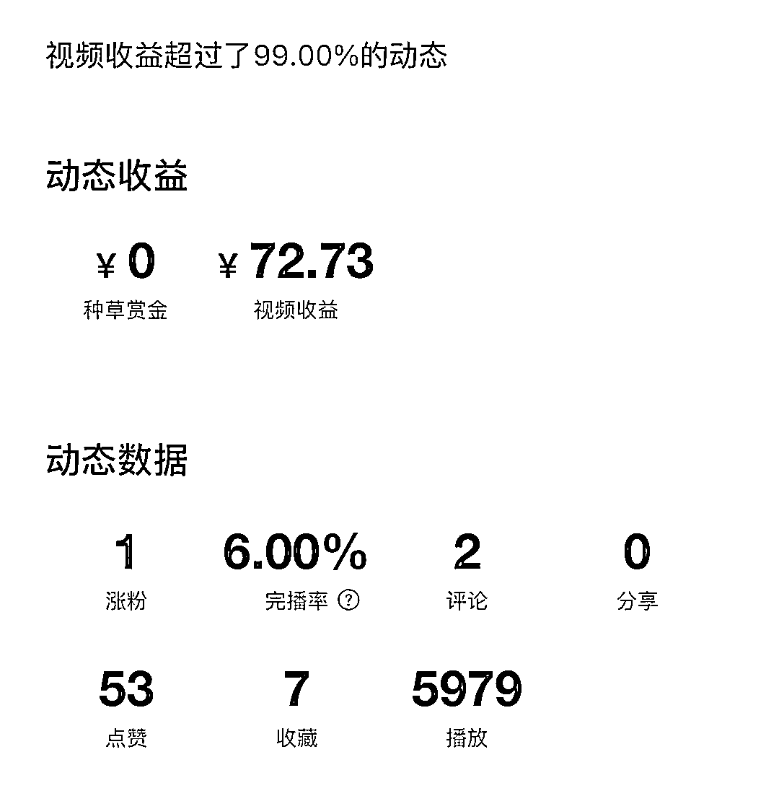

开通路径并不复杂：“我-创作中心-玩转收益-视频激励”，按页面提示发布视频，达到条件就能开通视频号。参报标准偶尔会有调整，以下是最新规则。

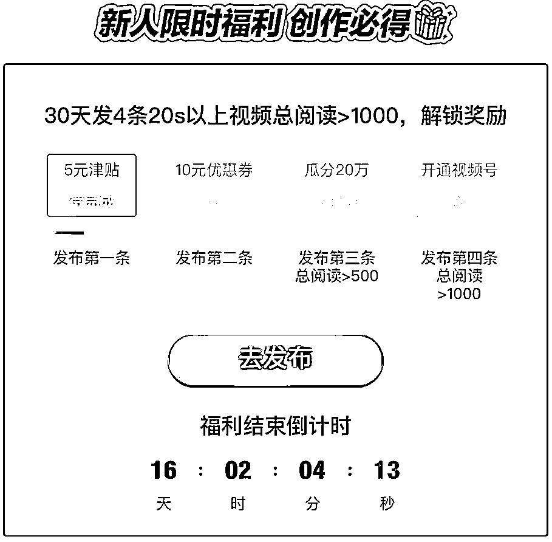

不过平台对视频内容相当宽容，影视解说、娱乐八卦、综艺切片、游戏录像、好物测评、穿搭展示，甚至连vlog日常都能纳入激励范围。换句话说，只要你愿意保持更新，赚到钱基本没有悬念。

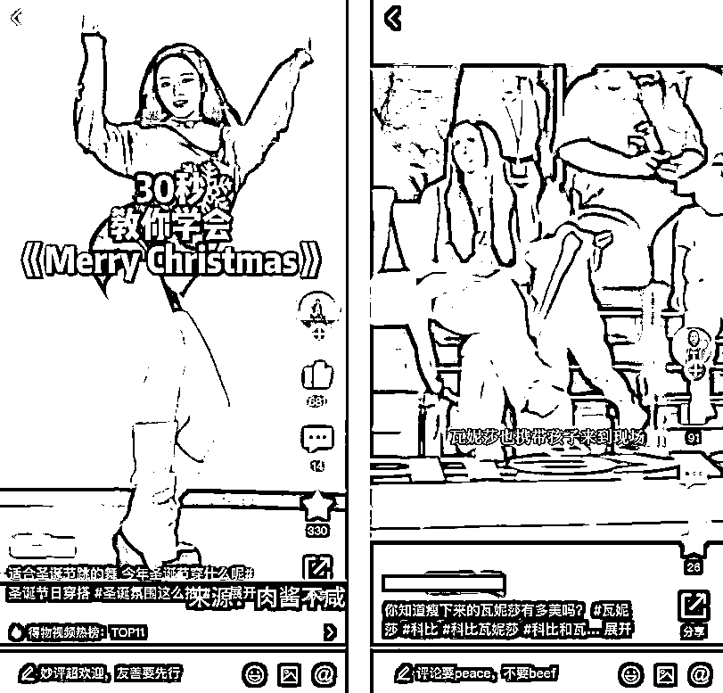

当然，它的收益计算没有公开公式，会因内容质量、题材、曝光和互动表现浮动。还需要提醒一句：用搬运的视频去薅这份收益现在已经行不通了，违规率极高。

第四种，也就是整个项目真正的核心变现场，是商单广告。它最大的诱惑在于门槛极低：小红书的接单门槛动辄要求千粉以上，而得物往往百粉就能解锁商单合作，个别账号连100粉的关口都不用过。

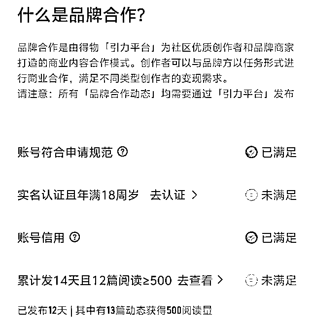

开通后，合作中心便会开放，商单信息按费用与要求一一陈列，创作者挑感兴趣的报名即可。

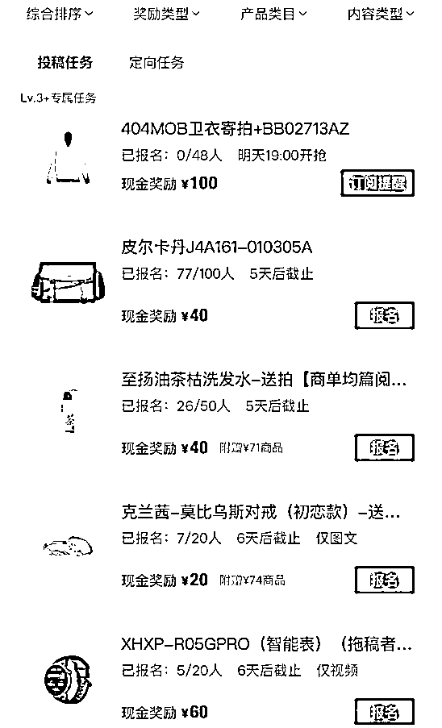

平台对商家侧的报价也有约束，单笔现金奖励的行情大约在20元到一百多元之间。当你把接单等级养到LV3以上，且账号数据保持得不错，还可以开启定向合作，这时候报价权就到了自己手上。

要把得物的收益拉高，运营细节上可以抓三个重点。其一是更新频率要保持高位。平台对内容质量并不苛刻，不需要长篇大论写干货，简单把产品讲明白即可。但商单单价本来就不高，假设你日更一条，哪怕每条都接了广告，月收入的上限也不过几千元。想顶破这个天花板，只有把输出密度提上去。其二是画面背景要克制。观察那些数据出色的得物账号，几乎都有一个共同点——背景极其单纯。新手如果审美积累不足，与其费心布置场景，不如准备一块纯色背景布，黑白灰都可以，把主体物衬出来，画面立刻显得干净利落。千万不要买上一堆仿真花、杂志、摆件来堆砌，最简单的一块布反而最稳妥。

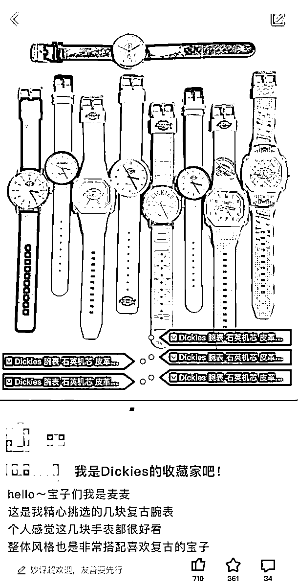

其三是养成做合集内容的习惯。这么做有两层好处：一方面它本身就是一个新的素材来源，平台在商单等级里考察“非商单活跃度”，不允许内容全是广告，把品牌方寄来的样品聚合成一个合集，既能解决活跃度问题，又容易获得不错的数据；另一方面，不少品牌方在合作时会主动要求做一个合集展示，如果你平时就在积累这类内容，接单时自然更有竞争力。所谓合集，就是把多件产品组合进一条笔记的画面，可能是同一品牌的多个单品，也可以是多个品牌混搭，它是早期快速起号的有效手段。

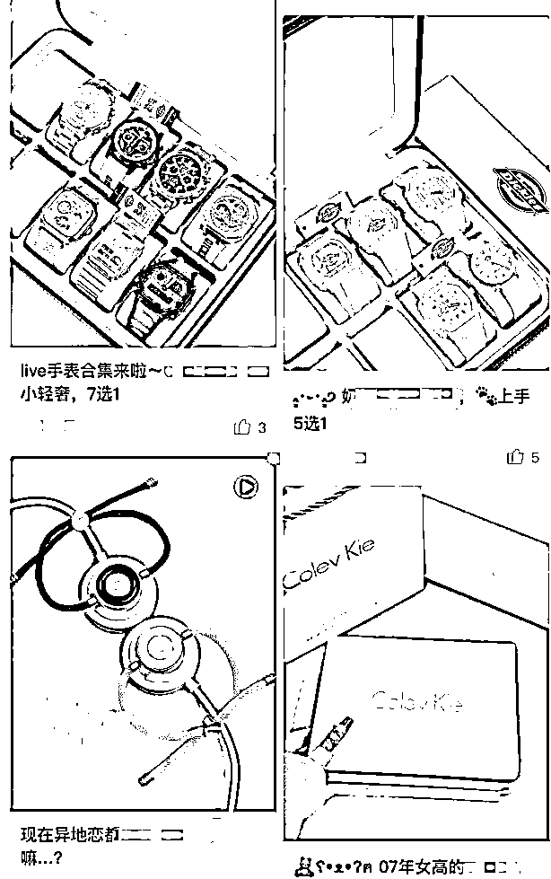

按照粉丝规模，我把自己统计到的常态收益切成了三个档位。第一档是从零到100粉左右：由于商单合作尚未解锁，主要靠种草赏金和视频激励，月入大概在几百元区间，表现突出者能做到2000至3000元。第二档是100到2000粉之间：此时商单功能通常已经打开，不过粉丝基数有限、数据浮动较大，主要收入来自商单广场的投稿任务，月收益多数落在1000到3000元之间；账号表现好的能突破这个区间，跑出万元月收入也不算离谱。第三档是超过2000粉之后：内容走向垂直细分，定向合作与投稿任务双线并行，月入至少3000元起步；保持稳定更新的话，单账号破万并不困难。

把这套玩法放到天平上称一称，长处在于：新手完成冷启动的速度惊人，种草赏金隔夜就能带来第一笔收入；平台的竞争气氛远没有小红书那么浓，创作者存量少，观众对画面质量的要求也宽容，拍得不够精致也有人愿意看；收入出口则覆盖了带货、视频和广告三条线。短处则集中在三点：一是提现规则比较死板，必须完成实名认证，且一人只能对应一个账号，钱款只能进入本人名下的支付宝；二是单一账号的上升空间有限，做到头也就是月入过万的层次；三是高收益依赖高强度更新，懒散下来收入会立刻缩水。这也是为什么我定义它为“小项目”：个人运作非常合适，但很难复制成团队生意。

什么人最适合来试水？我首推那些项目经验有限、在自媒体上也谈不上熟练的纯新手，特别是长期在副业尝试中得不到成就感的那类人。这个项目对时间宽裕度也很友好，上班族或带娃的家长每天挤出两三个小时来拍摄就完全够用。如果你平时对内容有些网感、照片也拍得不错，打通商单变现的速度会比别人快很多。

如果最后要把这几个项目摆进一张对比表，我会给出这样的排序。按收益上限由高到低：电商卖货排在首位，其次是虚拟资料，然后是达人商单和好物种草，最末尾是千粉商单。按启动难度从易到难则是另一张榜单：好物种草最好上手，千粉商单次之，虚拟资料居中，达人商单更进阶，而电商卖货难度最高。一句话总结：想要冲击更大的收入规模，往小红书电商方向走；想要快速建立信心、低成本试水，得物的好物种草无疑是更友好的第一站。希望以上这些亲历的观察，能帮你选出适合自己的那条路。