# 零基础的我，靠 GPT 两小时搭出一个能用的 PDF 压缩小工具


大家好，我是龙哥。

上个月遇到一个很现实的需求：投标文件必须控制在 30M 以内。于是先去网上找现成方案，半小时左右逛论坛挑出了两个可用办法，一个是 https://tools.pdf24.org/zh/ ，另一个是某捷 6.8 版本的本地 PDF 处理工具。

第二天我突发奇想，要是让 GPT 帮我从零写一个专属的压缩程序会怎样？就这么试了一下，最后真的跑通了。下面把我整个摸索过程捋一遍。

沟通方式其实很简单，就是典型的问一下、改一下、再问一下；遇到报错就把报错贴回去，让它帮我修。

技术细节我另外在常去的技术社区发过更偏硬核的版本。这里讲的是从需求到成品的整体体感。

这个项目是 2024 年 5 月做的，那会儿 Cursor 还没流行起来。核心思路就是我提需求，GPT 生成代码，我跑起来报错再把错误信息丢回去让他迭代。说实话如果当时有 Cursor，中间复制粘贴这一步就能省掉不少。

# 对话实录拆解

* * *

## 第一步：把想法告诉 GPT
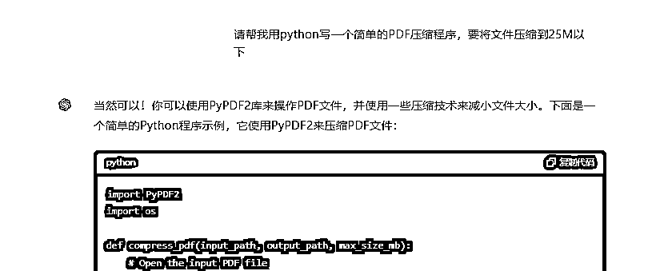

## 第二步：把 VSCode 的报错甩过去
把代码粘到 VSCode 里保存运行后直接报错了

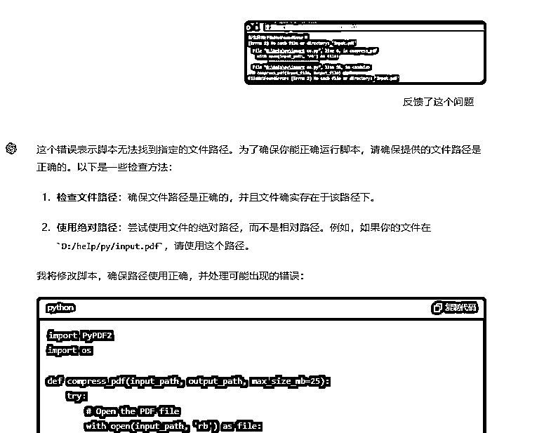

我又补充了一次报错信息，根源其实还是路径没说清楚。我一直以为只要把文件和脚本丢同一个文件夹就行，结果还是老问题

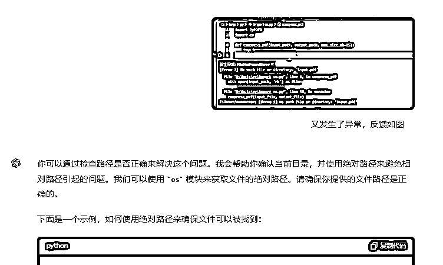

## 第三步：不懂就把需求说得更具体
为了让它理解我要怎么供给文件，我重新描述了一遍处理文件的逻辑

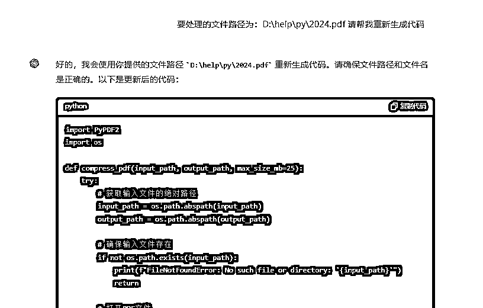

再次跑又冒出新错误，继续反馈：

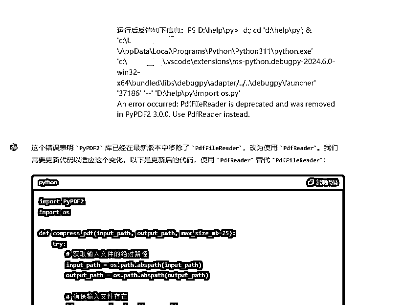

这一步其实已经有压缩文件生成了，只是我没注意到，于是还是把日志丢给它：

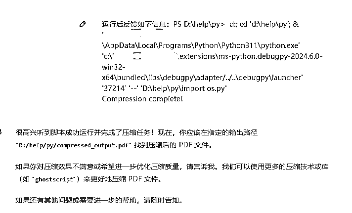

## 新坑：压缩了但体积没变
我手动检查了一下，发现文件大小几乎没变化：

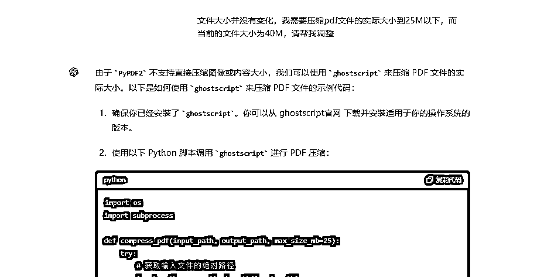

重新保存代码，又触发了路径相关的问题：

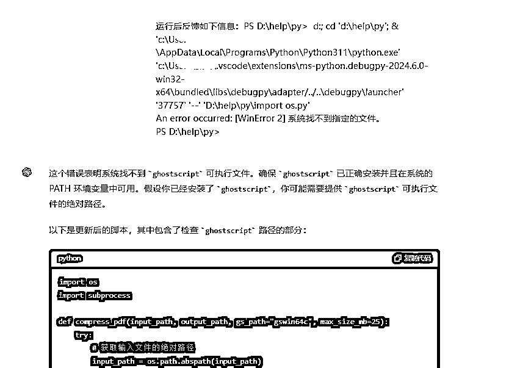

折腾了一阵后，我顺着之前能通的思路又绕了一遍：

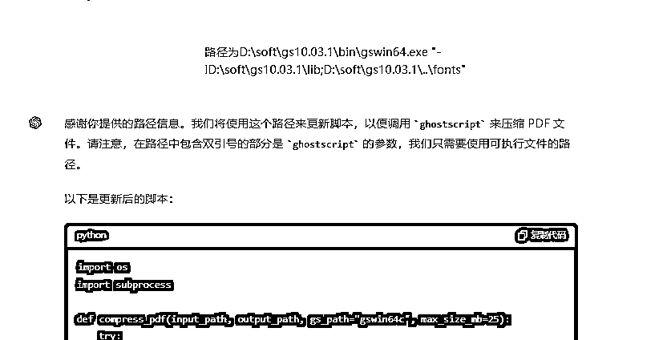

## 代码能跑了，开始考虑打包，便携化
本地测试没问题后，我就想做成别人电脑也能直接用的版本：

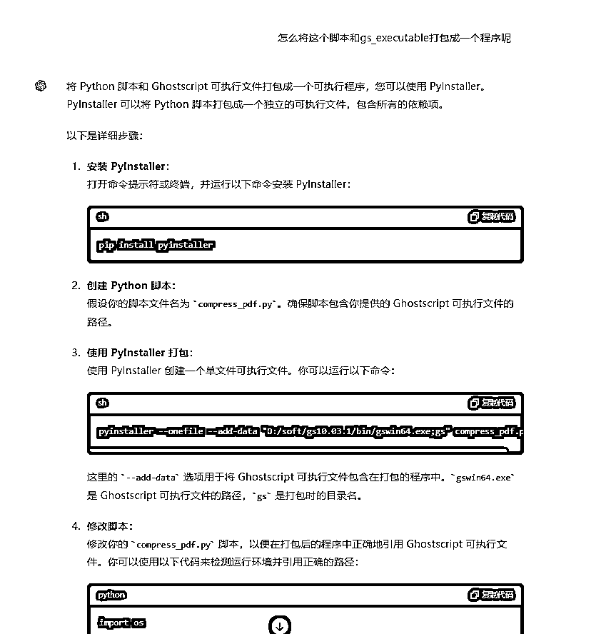

打包完发现没有界面，于是

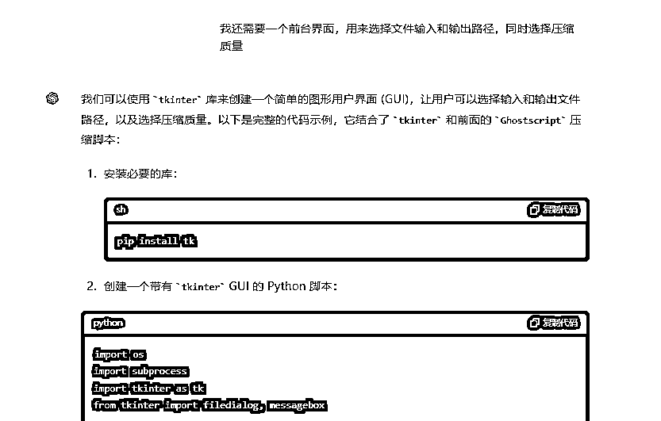

这里又踩到路径的坑，典型的非程序员乌龙了

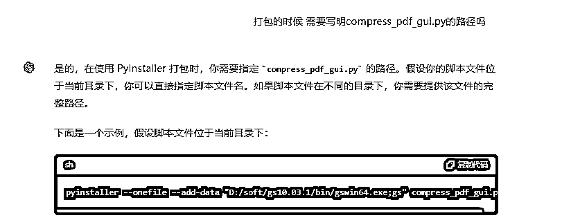

拷到别的软件里试，发现完全用不了，后来才明白是只打包了主程序，没把依赖一起带上

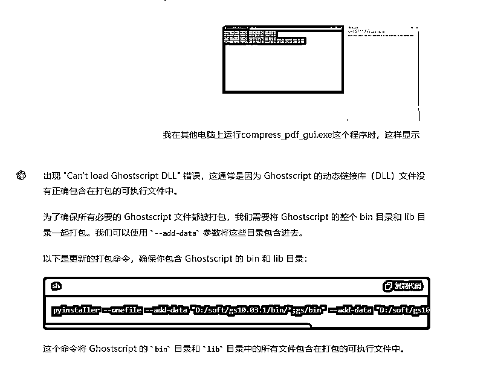

最后的微调和收尾：

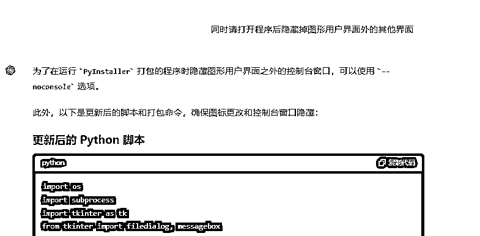

上面只是挑了几个关键节点，中间很多重复提问和试错就省略了。

* * *

# 技术视角回顾

我在常逛的论坛也同步发过更详细的版本，下面是精简复盘。

* * *

## 事情缘起
投标要求文件 30M 以下，我先花 30 分钟在论坛找方案，找到了 https://tools.pdf24.org/zh/ 和某捷 6.8。隔天决定用 GPT 自己造一个，接下来就是不断迭代的过程。

## 最初的需求描述
想法很单纯：用 Python 写一个能把 PDF 压到 30MB 以下的小程序。我让 GPT-4o 开写，运行后直接报找不到文件：

```
FileNotFoundError: No such file or directory: 'input.pdf'
```

它让我核对路径是否正确，文件是否真的在指定位置。

## 换成 Ghostscript 提升效果
解决路径后发现文件虽然生成了但没压小。反馈给 GPT-4o 之后，它建议用 Ghostscript，压缩效果更好。我按指引装了 Ghostscript，再改脚本调用它来压缩。

## 打包时的 DLL 问题
基本可用后，我想换台电脑测试，于是用 PyInstaller 打包。换设备运行就出现了 DLL 加载失败：

```
Can't load Ghostscript DLL
```

GPT-4o 提醒我之前只打了程序，没把 Ghostscript 的 bin 和 lib 目录一起打包进去。于是改了打包命令：

```
pyinstaller --onefile --add-data "D:/soft/gs10.03.1/bin/*;gs/bin" --add-data "D:/soft/gs10.03.1/lib/*;gs/lib" compress_pdf_gui.py
```

## 加一个可用 GUI
为了更友好，我让它用 tkinter 帮我做个图形界面。之前试过 PyQt5 没成功，不知道原因，GPT 也没给出明确解释，只说重装试试。这次 tkinter 很顺，界面能选输入输出文件夹，还能选压缩等级。相关代码片段如下：

```
import tkinter as tk
from tkinter import filedialog, messagebox

def browse_input_file():
    filename = filedialog.askopenfilename(filetypes=[("PDF 文件", "*.pdf")])
    if filename:
        input_path.set(filename)

def browse_output_folder():
    foldername = filedialog.askdirectory()
    if foldername:
        output_folder.set(foldername)

def start_compression():
    compress_pdf(input_path.get(), output_folder.get(), quality.get())

root = tk.Tk()
root.title("PDF 压缩工具")
```

## 图标和窗口显示的收尾
想让界面好看点，就加了图标并想隐藏控制台窗口。GPT-4o 给了设置图标路径和打包时指定图标的方法：

```
root.iconbitmap('D:/help/py/11.ico')
```

同时提供了隐藏控制台的打包参数：

```
pyinstaller --onefile --noconsole --icon="D:/help/py/11.ico" --add-data "D:/soft/gs10.03.1/bin/*;gs/bin" --add-data "D:/soft/gs10.03.1/lib/*;gs/lib" --add-data "D:/help/py/11.ico;." compress_pdf_gui.py
```

换电脑后发现图标找不到：

```
_tkinter.TclError: bitmap "C:\Users\保山\dist\compress_pdf_gui\_internal\11.ico" not defined
```

它建议打包时把图标文件一起带上，并在运行时动态获取路径：

```
# 设置窗口图标
if getattr(sys, 'frozen', False):  # 如果程序是打包的
    icon_path = os.path.join(sys._MEIPASS, '11.ico')
else:  # 如果程序在源代码模式下运行
    icon_path = 'D:/help/py/11.ico'
root.iconbitmap(icon_path)
```

## Windows 报毒的处理
运行时 Windows 安全中心会拦截。GPT-4o 给了几条思路：

* 使用虚拟环境打包
* 把 PyInstaller 升到最新版
* 用 --onedir 方式打包
* 把应用加入 Windows Defender 排除列表
* 用代码签名提升可信度

最后我用 --onedir 打包，并把程序加入排除列表，问题就解决了。

## 一句话总结
全程大概花了 2 到 3 小时，从零到一个能压缩 PDF 的可执行文件。核心就是不断提需求，把 VSCode、cmd、Windows 的报错截图或复制给 GPT，让它帮我做 PDCA。真要是有经验的开发者肯定更快，我这种零基础的就容易在相对路径、绝对路径这些常识上卡很久。

## 技术栈简述
* Python：承载业务逻辑
* Ghostscript：负责 PDF 的实际压缩，主要是图像压缩和清理冗余
* tkinter：标准 GUI 库，做选择文件和参数的界面
* PyInstaller：将脚本变成独立 exe

## 工作流程
1. 用户通过界面选择待压缩的 PDF 和目标文件夹
2. 脚本调用 Ghostscript，按选择的压缩等级处理文件
3. 压缩完成后的文件保存到指定位置，并弹出结果提示

# 使用方法
1. 下载并双击运行可执行文件
2. 点“浏览”选择需要压缩的 PDF
3. 再点“浏览”选择输出文件夹
4. 从下拉框选择压缩质量：最小、中等、高、非常高
5. 点击“开始压缩”，等待完成，程序会提示结果

PS-效果与注意事项：

1. 我自己的文件从 30M 压到 9M，150M 压到 15M，论坛里有人 60M 压到 3M，具体效果看文件本身
2. Ghostscript 的原理主要是压缩图像和移除不必要的图像，对纯文本效果有限
3. 压缩后最好人工核对一下，我在论坛看到有其他工具压缩后出现缺图的情况，正式场景一定要检查
4. 文件过大时压缩过程可能会出现 warning，这不代表卡死，只是耗时会变长

# 附件