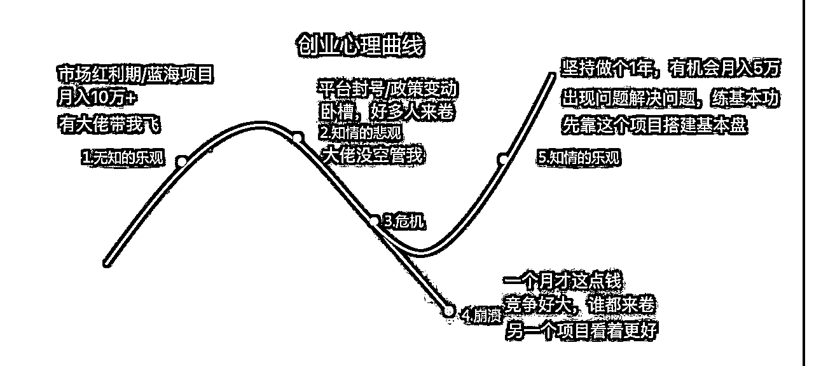
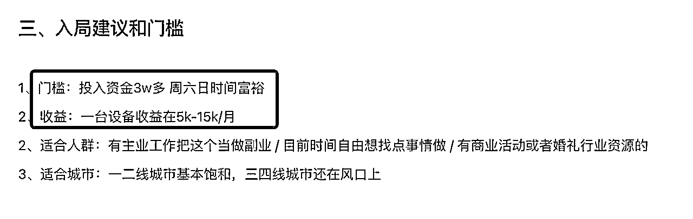
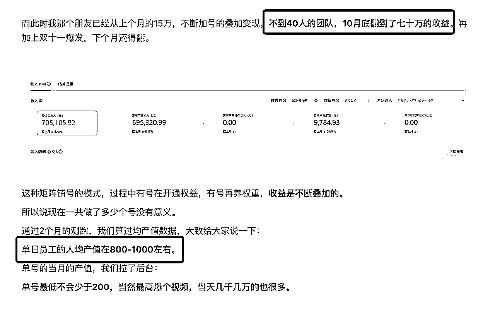
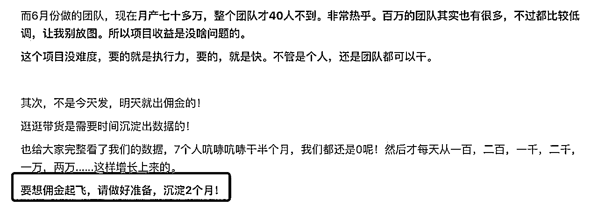
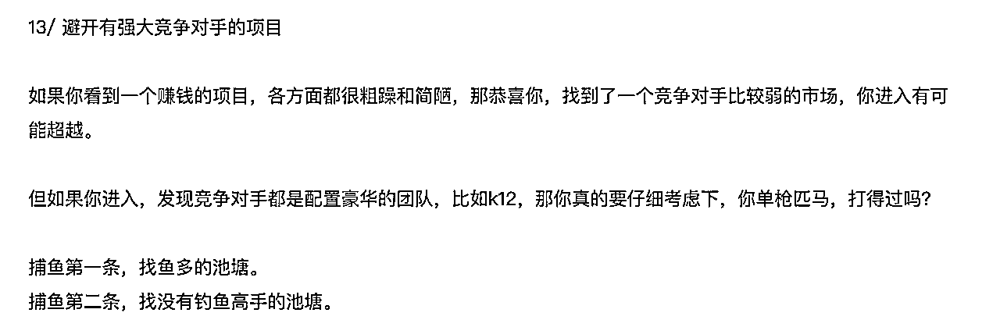

# 志愿者直播分享 —— 用3步筛出真的适合自己的项目

大家好，我是许老师。做了8年教培的模型和销转体系，24年7月后在赚钱负责投资孵化和高阶航海合作，日常工作就是看项目、聊项目。上周二晚上给赚钱志愿者们做了一场闭门直播《3步教你选出适合做的项目》，内容其实也很适合还在到处找项目、想搞钱的新手，今天整理成文字分享出来。

整场分享分成三块。第一块怎么定性初筛，面对精华帖、风向标、航海项目这么多信息，用几个维度快速过滤；第二块怎么定量去调研，拿到真实数据，算清楚营收、人效，看逻辑是否成立；第三块，项目就算能做，也要看它跟你当前阶段能不能匹配。

## 一、定性筛项目

先给自己一套基础的判断框架。新手最容易犯的错就是期待不切实际，就像我们常说的理想工作是“钱多事少离家近，位高权重责任轻”。选项目也一样，总想着收益高月入十万年入百万，正反馈又快当天就能有流量变现，门槛还要低什么都不用做。这三件事同时发生就是传说中的韭菜项目，只存在别人的嘴里。

在我看来，天花板高、正反馈快、投入低，这三者构成了“不可能三角”，很难被同时满足。

拿航海里常见的项目举例。抖音达人带货、天花板是高的，一个月佣金几万甚至十万，但反馈慢，需要练表现力、熟练度，拍出80分带货视频基本得坚持3个月以上才有起色。YouTube创作、📕做IP、出海工具站也都是这个类，跑通后上限高，但正反馈周期普遍在3个月以上。

反过来反馈快的项目，天花板就相对有限。比如同城夜校，发完视频第二天就能进粉，私域销转也快变现，但月入基本在一两万，很难冲到5万以上。之前的虚拟资料、最近的mini航海红包封面都是典型，见效快但指望做大就不现实。用这三个维度回头看之前的航海，规律基本都对得上。

下面拆开说这三个维度。

### 天花板怎么判断

好项目的信号其实很明显。做几道选择题就看得出来。

第一题：A项目客单价1万，B项目客单价100，你选哪个？
当然选高客单。高客单有三个好处：对流量需求小，同样流量营收更高；团队化扩张时人效高，一个人月销10单就10万，招人也更容易；也符合现在“赚有钱人的零花钱，不要赚穷人的生活费”的趋势。

举个例子，龙哥盟就是高客单知识付费，现在市面上大量出现10年合伙人产品，也是为了把客单价拉上去，1年的势能收几千块很难，那就改成10年。

高客单|龙哥盟
低客单|陪伴群 / 低客单小报童

高客单项目通常也伴随高毛利，比如知识付费毛利八九成，高端消费品茶叶、珠宝、燕窝毛利也很高。而且高客单一般是做非标品，不容易被比价，也就避开了低价竞争。简单说：高客单、高毛利、非标，是天花板高的关键特质。

第二题：有复购的项目和没有复购的你选哪个？
毫无疑问选有复购。第一单引流品利润往往趋近于零，靠续费、升单才能赚钱，典型如K12培训、知识付费，前端买量把利润让给平台，后端靠复购挣钱。第二，有复购就不那么焦虑流量，可以稳扎稳打做交付，而不是被流量绑架。

不过有复购不是标配。上面说的高客单里，只有少数带复购。比如10年合伙人客单价上去是好事，但接下来10年基本没有复购，必须持续有新流量进来。

高客单项目|是否有复购
龙哥盟|有

高客单+复购基本就是王者。低客单也有机会，比如我之前做私域卖水果，500个老客户就能稳定贡献一年100万销售额，有圈友叫它“年轮生意”，每年大一圈，靠复购和转介绍稳定增长。老钱的云洗衣、私域卖水晶、卖化妆品也是同理。

补充两点：有复购一定要做私域，私域就是资产，能持续贡献现金流；算清楚LTV后才可以配合付费投放做规模。

第三题：能做IP的项目和不能做IP的你选哪个？
优先选能做IP的。IP能同时提升流量效率和转化效率，还容易形成差异化和做高客单。龙哥老师那句公式就很到位：高客单+IP+私域+非标+投放=大机会。碰到这些属性，基本天花板不会低。

### 反馈周期怎么看

这点对新手尤其关键，要有正确的预期。

我看过一个“创业心理曲线”。接触新项目时通常会经历三段：

1）无知的乐观：刚开始很兴奋，觉得找到红利，恨不得马上月入十万。但这阶段很不理性，对坑完全不了解。
2）知情的悲观：开始实操后困难接踵而至，负反馈不断，容易怀疑项目、怀疑自己、怀疑带头人。很多人在反馈周期没概念的情况下在这里放弃，换下一个。
3）知情的乐观：踩坑后还在坚持，项目基本盘慢慢搭建起来，对能赚多少钱、需要多久有反馈有了清晰预期。虽然还会看机会，但不会轻易放弃。

现在回头看，我会尽量快点跳过“无知的乐观”，尽快调研进入“知情的悲观”，评估后直接开干。

对新手来说，先选反馈快的项目建立赚钱信心很重要。正反馈快的项目通常只聚焦流量-转化-产品里的一个环节，大多是搞流量。所以如果你也不知道做什么，先找个现成产品，选个平台，开始在公域搞流量。

### 投入怎么看

这个最直观。赚钱筛选后，高投入项目基本不会出现在航海和精华帖里。注意两点：

1）尽量别碰高投入实体项目。验证成本高，一旦亏损翻身难，天花板也常不高，一年赚几十万就到顶了。与其冒风险，不如在机会众多的赚钱里找更灵活的方向。
2）给自己算时薪。第一块钱可以暂时忽略时间成本，但后面要知道自己的时间价值。每天4小时投入一个月赚一千，对你划不划算？时间投入也是成本。

总结第一部分，天花板高、反馈快、投入低不可能同时满足。想做高天花板就去看高客单、有复购、有IP的项目；想要正反馈快就去搞流量；新手从投入低的项目起步更稳妥。定性筛完10个项目，能先过滤掉8个，剩下2个再去深度调研。

## 二、定量算项目

定性筛完要算账。龙哥老师说过一句话很重要：“默认数据是假的，默认项目是通的”。先怀疑数据，再去求证。

调研方法很简单：去📕、抖音、👸号把同行全扒一遍，拉进微信假装客户走一遍流程，把能拿到的信息尽量拿到。然后开始拆数据。做空瑞幸时人家派人蹲点数门店人头和出单量，越细算得越准。

算账主要有两种思路。

### 公式1：营收 = 客单价 × 单量 = 客单价 × 流量 × 转化率

以一个精华帖项目举例：可复制日入2000的副业——婚礼大头贴。

定性先看：高客单、没复购、没IP，满足高客单属性。

原帖数据：

初步看设备成本3万，每场2500，每月4-8场，回本1.5-3个月，看起来很香。

仔细拆后：
问题1：客单价能保住2500吗，有多少利润？
实际上2500包含1-2人现场服务，设备调试、引导拍照约4小时。人力成本按一场2人200-500估算。
问题2：一个月能接几单，成本多少？
接单取决于当地婚礼量和自己做流量的能力。流量方抽成20%，按500算；自己做流量，转化率10%，每月要40条精准加微，需要精细化销转。
问题3：有没有淡旺季？
跟着婚礼走，节假日旺，平时淡。

重新算账：
乐观：2500-200人力-500流量=1800利润/场，月接3单=5400，回本约6个月。
保守：2000-500人力-400流量=1100利润/场，月接2单=2200，回本约14个月。

结论是能不能做，核心看你有没有📕做流量的能力，或者本地有没有婚庆资源可以做增值服务。如果都没有，建议先0成本验证，发帖试卖，有咨询有成交再买设备也不迟。

这篇帖子的思路值得学，先看到项目做MVP跑通，发现纯出租天花板不高后，自己升级成卖机器+招分销商，每一步节奏都很清晰。

### 公式2：营收 = 员工人效 × 员工人数 = 单账号产出 × 账号数 × 员工人数

再看一个案例：淘宝逛逛带货。

原帖：https://t.zsxq.com/FxNSq
最新蓝海【逛逛带货】玩法教程：自营40人团队，亲测人均每月佣金3万+！

一出来评论区都很躁，很多圈友想直接入。定性看：客单很低，佣金薄，复购IP都没有，属于堆人效的卷玩法，可能有平台红利期。

原帖数据：单日员工产值800-1000，一个月可达3w；

问题1：人效3万能稳定吗？
我们默认数据是假的，常识判断如果搬运就能稳定3万，谁来都能做，完全没必要公开引竞争，所以要再验证。
问题2：一个账号产出多少，一个员工管多少号？
答案是单号产出六七百，一个人做20号以上。
新员工人效 600×20=1.2w；老员工人效 600×50=3w。所以新人进来有1-2个月爬坡期，这个阶段公司扣掉场地、人员、设备成本，利润一般。

问题3：多久爬坡？
反馈周期约3个月左右，1-2个月爬坡权重提升后才上来。

问题4：开号成本？
需要营业执照，一个员工50个号，一个月多100多元，还好。
问题5：MCN分成？
合作MCN抽佣30%，人效3万变成2万。

结合我聊过的常州做类似项目的航海家，员工人效一个月1.5w，员工薪资5000，前两个月亏本，第三个月才赚钱，前期至少铺20人测规律，初期投入小100万。

所以这个项目适合已有人力密集型工作室、有管理经验的去测。新人小白只做一二十号，大概率每月就几百块。如果要做大，就要算清开工作室的投入，招5人以上先熬两个月，第三个月开始赚钱，有这个预期再入场也合理。

第二部分的意义就是用数据把收益、反馈周期、投入算清楚，带着合理预期进场，才更容易熬过“知情的悲观”，而不是带着高预期进去浅尝辄止。

## 三、项目适不适合你

项目能做不代表适合你。要看收益天花板、反馈周期、投入这三点跟你当下能不能匹配。

1）要有阶段性目标。先赚到第一块钱，再是1万、10万，之后才想100万。能赚1000万的项目里竞争的都是能赚1000万的高手，小白上来就做年入百万不现实。先用月入1万以上的副业练能力更靠谱。

2）用项目练能力，借假修真。闲鱼虚拟资料虽然客单9.9赚不多，但能练出闲鱼流量和矩阵能力，后续切换到AI代写，交付搞定后客单提升，核心能力是可迁移的。之前在📕搞过流量的人，看到婚礼大头贴就能马上启动。
3）心力要匹配反馈周期。新手建立信心，先做一个月内出反馈的项目，比如虚拟资料、AI代写写手，能马上拿到第一块钱。赚到第一个10万后，可以接受3个月反馈周期的项目，比如YouTube，前期研究赛道和内容，账号起来后收益长久。

最后的选项目注意点：多看少动。每个想做的项目都要充分调研，带着定性+定量的双层过滤去做决策。

做项目这件事，最怕的不是没资源、没天赋，而是什么都没想清楚就闷头冲进去。很多人忙活一整年，项目换了好几个，最后账户余额还是原地踏步。问题出在哪？不是不够拼，而是缺一套靠谱的选项目方法。

今天不聊虚的，把我反复验证过的几条选项目心得拿出来说说，希望能给你一点参考。

第一，动手之前，先解决“调研”这件事。真正的调研不是走流程、做样子，而是把一个问题彻底想明白。项目启动之前，先用自己的分析框架把它拆透，哪些假设成立、哪些坑可以绕开，心里要有数。不要急着All in，而是边做边校验，时间久了，你对项目的嗅觉和判断力，自然就练出来了。

第二，别总想着从0到1。这个阶段投入和产出往往严重失衡——你付出大量心力，收获却少得可怜。如果好不容易跑通了0到1，接下来想的应该是怎么把1放大到10，把战果做大，而不是再开一个新盘子从头折腾。到了1到10的阶段，一定要学会借力：用团队的杠杆，用资金的杠杆（比如投流），用矩阵的杠杆，让增长不再只靠你一个人死磕。

第三，挑赛道，要看趋势。存量市场里硬挤，存活率真的不高；要去那些正在向上走的行业里找位置。如果让我反复推荐，我长期看好的方向有四个：一是AI相关的机会，包括AI产品、AI生成内容、AI培训、AI服务，以及AI加个人IP；二是出海，比如YouTube、海外私域、跨境电商；三是同城生意，聚焦高客单服务和同城流量；四是IP，尤其2025年，视频号IP值得重点押注。

反过来，有几种项目我一般不碰：电商、人效特别低的项目，还有前期投入超过10万的重资产实体，比如餐饮。

最后，希望每个人都能找到值得自己长期深耕的方向。如果你在选项目这件事上还有拿不准的地方，也欢迎随时来找我聊，我们慢慢理。

简单交代下我的背景：过去八年，我一直泡在少儿编程教育领域，深度参与过两家创业公司的从0到1，对教培行业的流量获取和销售转化模型还算熟悉。现在的身份是赚钱的投资孵化业务负责人，主要管高阶航海合作、赚钱联合办公空间，以及SCAI实验室。之前也整理过几篇行业思考，感兴趣的朋友可以翻出来看看：

《借鉴在线教育公司的扩张路径和组织模式，做一个赚钱商学院，会是个 10X战略吗？》
《摆脱小作坊状态，核桃编程从月营收50万到1000万的几点启发》
《怎么从零搭建和管理一个“正规军”的销售团队》