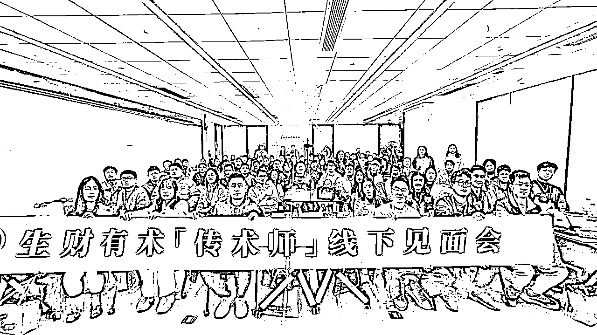
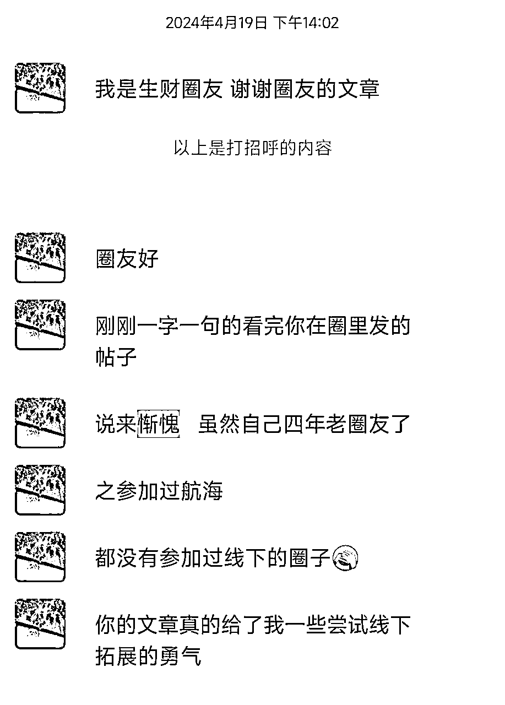
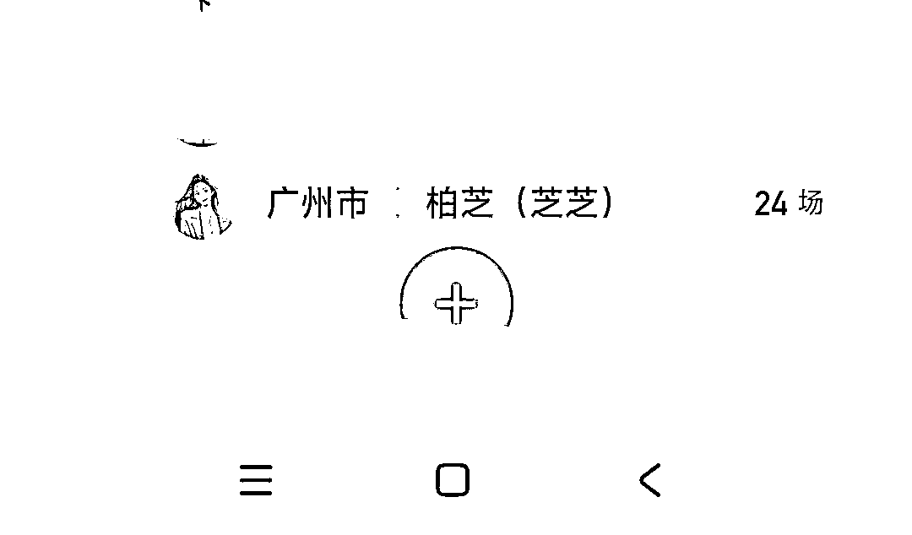
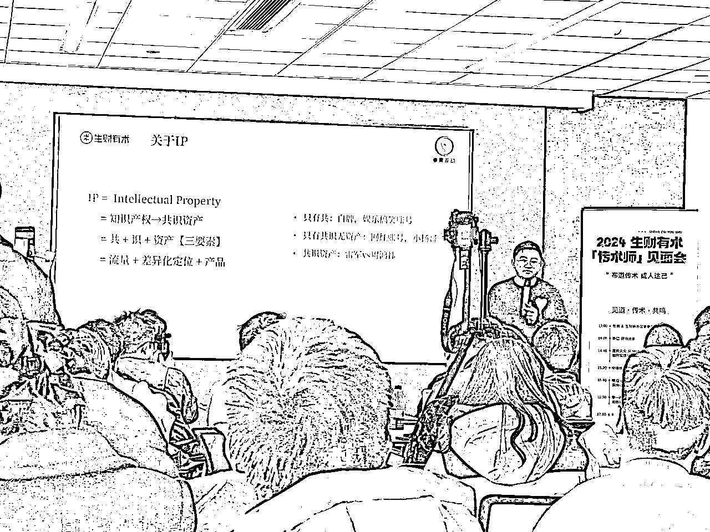
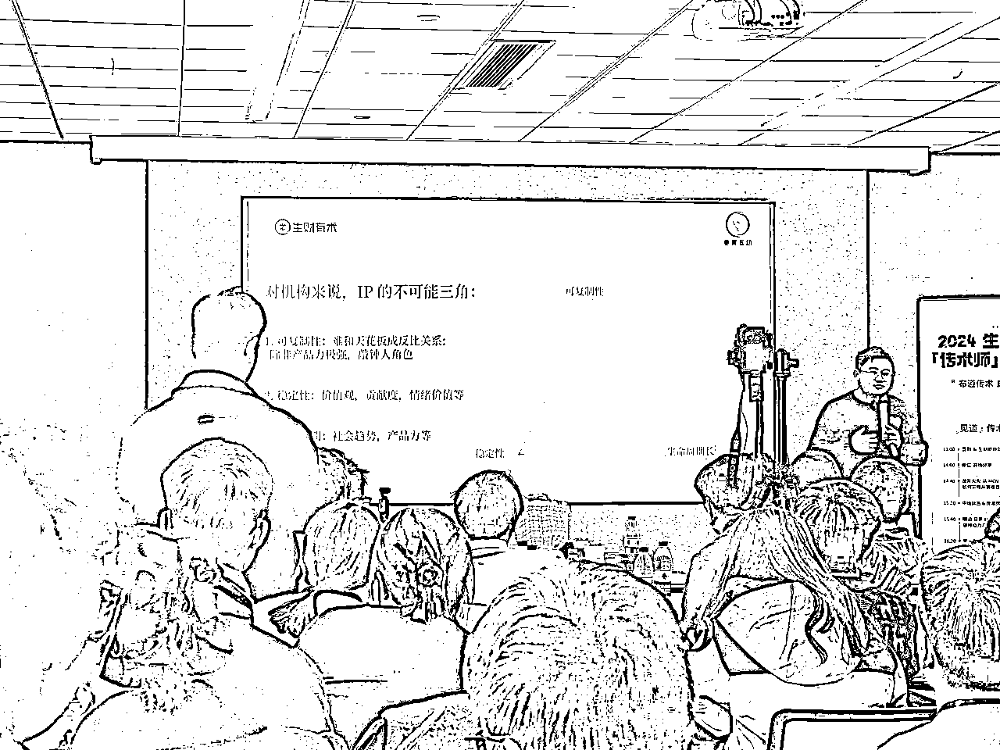

# 越分享，越幸运：一个赚钱女孩的成长记录

2024年岁末，70多位传术师相聚赚钱新办公室，共同参加“见道，传术，共鸣”——赚钱传术师第一次线下见面会，也成为新办公室迎来的首场活动。

那几天，我认识了很多新朋友，也鼓起勇气认识了一些前辈，收获远超预期。

整场活动始终围绕着一个主题展开：越分享，越幸运。

今天，我想聊聊自己对这句话的理解，也借此复盘加入赚钱一年半以来，我是如何一步步实践它的。

* * *

全文约7,630字，阅读时间5-10分钟

# 一、他们如何理解“越分享越幸运”

## 龙哥：分享，是让自己被世界看见

分享的价值，不只是把经验告诉别人，更重要的是，它会让你从封闭状态走向真实世界。

当你愿意公开表达，别人才能知道你是谁、擅长什么、正在做什么。你也会因此获得反馈、连接和新的机会。

龙哥曾经分享过自己通过油管做副业赚钱的经历。加入曹大的圈子后，他当然希望被看见，但单纯发消息并没有得到回应。

后来，他持续输出有价值的内容，甚至被曹大转发到👸号。正是因为这次公开表达，他被更多人认识，也逐渐和自己欣赏的大佬建立了更深的联系。

所以，分享不是一个抽象概念，而是他亲身受益过的路径。

你曾经靠什么走出困境，就把它分享给更多人。你找到的方法，也许正是另一个人的出口。

表面上，这是在帮助别人；但从更长的时间尺度来看，别人也会在未来某个时刻反过来帮助你。利他与利己，并不是两件互相矛盾的事，而是一种长期主义的世界观。

## 明白老师：持续表达，才更容易遇到贵人

一个人如果持续做正确的事，并且不断让外界知道自己在做什么，就更容易遇到关键人物，从而获得跳跃式成长。

普通人的进步通常是线性的：今天前进一点，明天积累一点。但贵人的一次推荐，可能让你一天获得过去几个月甚至几年的结果。

明白老师曾经分享过自己的经历。平时他每天涨粉十几到二十人，但被贵人推荐后，一天增加了5000粉丝，增长幅度接近500倍。

2019年，他花了一年时间制作一门课程，也邀请朋友帮忙转发。原本以为这么多人助推，至少可以卖出2000份，最终却只卖了300份。

他开始思考：问题到底出在哪里？

当时，他已经意识到持续更新的重要性，只是还没有真正开始执行。后来，他给自己定下一个信念：

> 现在开始日更，未来赚钱会越来越容易；现在不日更，以后赚钱只会越来越难。

为了坚定这个选择，他专门研究了两位长期日更的人，花三个月看完他们👸号里所有与日更有关的文章，也读完了他们的书。

之后，他更加确信，自己必须持续输出。

在互联网上把一个产品卖出去，通常离不开两个基础条件：

第一，是信任。用户要相信你靠谱、认真，愿意把事情做好。

第二，是专业。你的产品必须真正满足需求，切实解决问题。

专业可以通过结果和能力建立，但信任往往需要时间。

用户需要长期看到你的成长、思考和行动，才能逐渐确认你是一个怎样的人。持续输出，正是在不断累积这种信任。

很多人以为“写作变现”意味着文章本身能直接换钱，但真正能够变现的，从来不是文字，而是文字背后的你。

写作的目的，是让自己越来越专业、越来越强大。文章只是载体，成长才是核心资产。

当然，日更一开始一定很痛苦，也一定写得不够好。因为训练量还不够，写得少，自然不会写得好。

可以先接受一个事实：前100天的内容，很可能都不成熟。只要持续写下去，写够30万字，你就已经完成了一次重要升级。

明白老师还分享过一个非常直观的数字：

2021年4月18日赚钱拉新时，他的账户里大约有20万元收入。假设每篇文章平均2000字，那相当于写了20万字。

换句话说，一个字对应一块钱。

如果每天写1000字，就能赚1000元，你愿不愿意？

答案当然是愿意。

所以，很多事情都要先相信，才有机会看见结果。

“心想事成”的前提，不是空想，而是你真的相信自己可以做到。如果连自己都不相信，外界更不会相信你。

希望的本质，是相信今天的努力会让明天变得更好。

因此，不要轻易否定自己的可能性。积极寻找办法，持续行动，结果往往会比想象中更好。

## 龙共火火：所谓流量红利，本质是内容与平台的变化

很多所谓的新内容，其实只是旧内容换了包装。

📕上有不少内容来自🧣、知乎；B站会吸收📕和抖音的表达；抖音也会出现来自📕、油管的内容。

平台、流量和内容始终处在变化中。通过内容生态，我们可以判断一个平台大概处于什么阶段，而不同阶段对应的运营策略也完全不同。

大致可以分为三个时期：

- **早期**：规则相对宽松，黑灰产、娱乐内容以及批量化内容更容易出现；
- **中期**：平台开始加强管理，但仍处于半开放、半规范状态；
- **后期**：平台更加重视优质内容、规模化投放与合规经营。

不同阶段，决定了我们应该采取不同动作。

流量红利也可以分为两种状态：

**共识阶段**：大家都已经知道这个方向能赚钱，于是大量人涌入。此时比拼的是组织能力、执行体系和长期经营。

**非共识阶段**：大多数人还没有意识到机会，信息差和认知差更加明显。谁先发现、谁先行动，谁就更容易获得结果。

非共识阶段，靠的是行动速度；共识阶段，靠的是组织与深耕能力。

# 二、一年半以来，我如何践行“越分享越幸运”

我大四时加入赚钱。

那时的我对商业几乎没有概念，也不了解网络项目，更没有什么项目经验。如今加入赚钱已经一年半，这段时间里，我的能力、视野和思考方式都发生了很大变化。

我越来越相信，分享不只是表达方式，也是一种成长机制。

因为愿意分享，我获得了更多反馈；因为持续输出，我开始重新认识自己；因为不断连接别人，我看到了更多可能。

## 2.1 分享帖子越多，机会越容易发生

回头看这一年半，我很多重要节点，都和“主动分享”有关。

我会尽量把自己经历过的、观察到的、思考过的内容整理出来，尽可能真实、具体地分享给大家。

其中一篇精华帖，记录了我参加赚钱线下聚会、从零开始到第三个月做到10万元的过程：

【精华帖】02年女大如何通过参加[赚钱线下聚会]，实现从0到第三个月10万？

https://t.zsxq.com/19xmqFHiF

一年后重新回看这篇内容，我依然觉得它足够详细，也足够真实。

我的很多关键机会，都是从主动分享链接开始的。龙哥在活动中提到，分享会让我们与世界产生碰撞，也会让我们越来越清楚自己到底是什么样的人。

我对此深有体会。

帖子发布后，我收到过很多圈友的鼓励。其中有一位圈友让我印象特别深刻，他专门加我说：正是因为看到了我的分享，他才鼓起勇气参加线下活动。

他加入赚钱快3年，却一直没有真正和圈友进行线下交流。我的那篇帖子，帮助他跨过了心里的障碍。

那一刻我意识到，一篇内容的价值，不一定体现在数据上，也可能体现在它让某个人迈出了关键的一步。

这是我发布的第一篇帖子，也是第一篇精华帖。

它让我第一次感受到，表达真的可以产生力量。分享不仅是传递信息，也是在给别人勇气和希望。即使隔着屏幕，文字依然可能抵达另一个人的内心。

更重要的是，我发现自己并不需要等到“足够厉害”之后才有资格输出。

哪怕我是新手，哪怕我还是大学生，只要我经历过一件事，并且认真总结，就可能为别人提供帮助。

帮助别人打破心理障碍的同时，我也在突破自己的限制。从那之后，我不再那么害怕表达，也不再总是担心自己是否足够好。

另一篇精华帖，记录的是我经营门店时的运营经验：

【精华帖】《00后单店探索：实体小白线上运营的八个避坑点》

https://t.zsxq.com/S07Z3

为了写这篇内容，我重新梳理了4个月做同城流量的经历。原本分散在脑中的经验，被重新串联起来，逐渐形成了更加完整的体系。

这让我意识到，写作不只是输出，也是一种高质量输入。它会逼着你整理过去的经历，把零散的认知变成结构化的理解。

同时，这些经验也能被其他店长直接借鉴，帮助他们少走一些弯路。

在这次传术师线下活动中，我担任小组长，发起了同城流量主题的交流。也因此，我认识了一些做实体生意的老板。

其中有一位从事少儿培训的圈友，正在考虑从私域转介绍扩展到美团公域流量，对美团运营有不少困惑。我结合自己的经验，和他分享了如何与平台相关人员沟通，以及一些运营上的注意事项，希望能给他带来帮助。

## 2.2 主动组局，连接就会越来越多

2024年，我做了很多分享型的事情，其中很重要的一类，就是组局。

我会尽量帮助身边能够帮助的人，也会主动担任组局官，把自己知道的经验和资源带给更多圈友。

最开始，我从线下聚会志愿者做起，先熟悉活动流程与角色分工；后来参加更多线下活动，慢慢打开自己；再往后，我开始尝试独立组局，从0到1，再从1做到10。

每一次身份变化，都是一次新的挑战。

做志愿者时，需要思考怎样高效完成重复性工作；

参加聚会时，需要学习如何倾听、如何交流、如何建立连接；

成为组局官后，则要考虑怎样调动氛围，让参与者真正有所收获。

这些事情看起来只是几句话，但每一个环节想要做好，都需要投入大量时间和精力。

2024年，我累计组局24场，参加了很多场活动，自封“金牌组局官”哈哈。每场活动的满意度平均接近100%。

组局的过程，让我看到了许多不同的人生样本。

有人选择稳定，有人持续创业；有人正在转型，有人已经获得结果。通过不断见人，我开始思考：

别人正在怎样生活？
我以后想成为怎样的人？
我想过什么样的生活？

很多答案，并不是独处时想出来的，而是在一次次见人、交流和碰撞中慢慢浮现。

我也把自己的组局经验整理成了帖子：

新人入门局·线下聚会筹办流程分享  
https://t.zsxq.com/t1QLs

新手组局必看：户外运动组局的保姆级复盘指南  
https://t.zsxq.com/OVuvk

之所以写这两篇，是因为我组织最多的两类活动，正是新人入门局和户外运动局。

其中，新人局给我的触动尤其深。

很多刚加入赚钱的圈友，和一年前的我一样，迷茫、焦虑，不知道从哪里开始。

但当有人愿意站出来分享自己的经历，他们就有机会提前看到一种可能。那种“先看见，后相信”的力量，往往会促成一个人的第一次行动。

后来，我还和梦吟姐姐以及其他圈友一起参与了组局官手册的共创；在木木哥同意后，我也组建了广州新手组局官陪伴群，帮助更多新人完成组局从0到1的突破。

## 2.3 坚持日更和复盘，表达会反过来塑造你

我坚持更新👸号，累计接近300天。

只要时间允许，我就会参加活动、记录复盘、认识新朋友、了解新事情，尽量让自己的视野保持打开。

表达红利并不只属于少数人，它属于那些愿意持续发出声音，并且逐渐形成自己表达领域的人。

你可以发朋友圈、写👸号、拍短视频、做口播，也可以选择任何一种自己成本最低、最愿意坚持的方式。

关键不在于形式，而在于是否能够持续。

很多时候，表达本身就是思考过程。你把一件事说出来、写下来，就会更清楚地知道自己到底在想什么。

刚开始输出时，很多人最大的障碍不是不会写，而是太在意别人怎么看。

其实，幼稚并不可怕。那些内容只是你在当下阶段的真实思考。多年后，如果你觉得过去的观点很不成熟，恰恰说明你已经成长了。

还有一点非常重要：降低自我关注。

真正关注你的人，没有想象中那么多。不要把太多精力消耗在“别人会不会评价我”上，尽量放松下来，做真实的自己。

# 三、在杭州，我再次感受到表达的稀缺

这次去杭州，我有一个很强烈的感受：

真正愿意分享、懂得分享，并且敢于主动发出声音的人，其实并不多。

更多人习惯做安静的倾听者。

所以，表达红利并没有消失，它依然长期存在。即使很多人知道“分享很重要”，也不代表他们真的愿意做，更不代表他们能够持续做好。

真正的表达，包含很多能力：

你如何介绍自己；
你如何倾听别人；
你如何提出问题；
你如何让对方愿意继续说下去。

这些看似简单的事情，其实都是需要长期练习的功课。

# 四、传术师活动中的几个重要分享

## 1. 如何在不断做0到1时，保护自己的心力？

### 提问

过去我一直在做流量相关的项目，一个项目做到0到1后，又迅速投入下一个项目，却很难真正从1做到10。

长期处在不断向前冲的状态里，很难保持稳定的心力。创业者在选择项目、推进项目的同时，怎样避免自己的精力被过度分散？

### 龙哥：让自己感到舒服，才有可能长期坚持

许多心力问题，本质上来自于选择太多、需要解决的问题太多。

想要长期坚持，首先要找到让自己舒服的方式。

如果做一件事的过程始终让你感到痛苦和消耗，就很难持续。比如龙哥是偏内向的人，不喜欢直播，直播对他来说是一种明显的能量消耗，所以即使团队推动，他也不会强迫自己去做。

创业不能只看外界认为正确的动作，也要考虑这种方式是否适合你。

当你能找到适合自己的节奏，让创业变成一件能够获得满足感的事，心力才有机会稳定下来。

## 2. 怎样判断别人给出的建议是否值得采纳？

### 提问

在做项目时，状态好的时候容易过度自信，觉得自己什么都对；遇到低谷时，又容易自我怀疑，甚至否定自己的团队。

身边有很多声音，有些人拿到过结果，有些人是自己信任的人，但他们的观点可能并不一致。面对这些建议，到底应该如何判断？

另外，过去曾经错过👸号、抖音等机会，即使后来遇到视频号，也很难简单从历史经验中得出答案。如何避免再次错过？

### 龙哥：用“极推法”找到最重要的事

首先，你需要建立自己的判断体系，对事情形成基本判断。

外界的声音一定很多，无论正面还是负面，都可以主动收集反馈。可以去询问身边的人：

“我准备做这件事，你觉得哪里可能有问题？”

但收集建议之后，不能全部照单全收，而要判断什么对自己最关键。

这时可以使用“极推法”：

如果现在只能做一件事，最重要的那件事是什么？

正常情况下，我们可能会从多个维度权衡；但极推法会把问题推到最核心的位置，迫使你找到真正的优先级。

其次，要认真听取那些已经取得更大结果的人的意见。

这里的“有结果”，可以简单理解为：对方在相关领域赚到的钱比你多，或者已经走得比你远。

如果一个比你更有结果的人，提出了与你不同的观点，不要第一时间否定，而要把它当作一个重要的异常信号，去寻找背后的逻辑和证据。

龙哥曾经在王川老师的社群里，收到过一个建议：社群用户应该进一步向上拓展。

当时他并不认同，但并没有直接忽略，而是把这个观点记下来，继续思考对方为什么这样判断。

最终，你还是要自己做决定、持续复盘，在行动中慢慢建立判断力。

没有任何决策能够做到百分之百完美，所以必须给自己设定截止时间。到了时间，就先做选择、拿结果，再根据反馈调整。

### 龙共火火：分清机会信号和无效噪音

创业往往不是连续爬坡，而是由几个关键选择决定走向。

要分辨哪些是信号、哪些是噪音，首先要减少恐惧，建立自己的底层自信。

很多聪明人的问题是：选择太多，却不愿意真正做决定。

只有聪明还不够，还需要智慧。

可以尝试几种方法：

1. **进入高质量圈子**，远离无效信息，接近真正有价值的信号。比如赚钱聚集了许多关注项目、市场和搞钱的人，至少在基础认知上有一定共识；
2. **多参加线下活动**，保持开放，通过面对面交流了解新的思路和玩法；
3. **理解圈子的筛选价值**。很多圈子本身已经通过时间、金钱和行动筛选了成员；
4. **建立自己的思考系统**。像电脑程序一样，拥有一套稳定的判断规则，才能在面对大量信息时保持清醒。

## 3. 如何选择合伙人？

### 提问

龙哥为什么会选择坤汀作为合伙人？除了颜值之外，还有哪些重要原因？

### 龙哥：创业首先要确认，合伙人是否真正认同你

龙哥分享过自己第一次创业的经历。

当时有6位合伙人平均分配股份，表面上有CEO、COO等职位，但实际上没有一个人拥有明确且绝对的决策权。

遇到关键问题时，大家难以形成统一判断。即使某个负责人认为自己的方向是对的，也可能因为股权平均、权力不清，而不愿意坚持。

最终，组织就容易陷入内耗。

现在和坤汀合作时，双方在规则、权责和决策机制上都更加明确。

日常工作可以充分讨论，但到了关键节点，如果负责的人决定向某个方向前进，其他人就要共同执行。

如果成功，就共同享受结果；如果失败，就共同承担责任。

真正重要的，不是表面上的职位，而是权、责、利是否匹配，以及关键时刻是否有人能够做出最终判断。

所以，创业前首先要想清楚：

**你的合伙人，究竟是否真正认同你？**

这种认同，最终也会通过股权和权责结构体现出来。谁是核心、谁承担决策、谁享受收益、谁承担风险，都必须在一开始讲清楚。

# 结语：分享不是展示，而是成长的开始

回看这一年半，我越来越相信“越分享越幸运”并不是一句口号。

分享让别人看见你，也让你看见自己；

分享帮助别人，也会反过来拓宽自己的道路；

分享是输出，但同时也是整理、复盘和成长；

分享看似是利他，最终却常常在未来的某个时刻回到自己身上。

不必等到足够厉害才开始表达。

你今天经历过的事情、踩过的坑、想明白的道理，或许已经足够帮助另一个人。

先分享，先行动，先让世界看到你。

很多幸运，都是从这一步开始的。

第二点归纳起来就是一句话：当你处在非核心的位置时，心态一定要放对。大哥定方向，你就跟着执行，这里面的分寸感就是成事的关键。

四、MCN负责人该怎么理解IP？

这里引用 龙共火火 的拆解逻辑：IP = 共 + 识 + 资产，三个维度缺一不可。

先说IP的本质构成。
它由共识、认知资产，以及流量加差异化定位再到产品闭环组成。
三个要素的组合，会决定IP的不同层级。

如果只有“共”这个层面，那就是白牌式的娱乐搞笑号，吸粉快、点赞高，但没有沉淀。
如果只有共识而没有资产沉淀，那就是典型的网红号，比如小杨哥，有巨大流量，却缺少真正属于自己的硬核产品。
只有共识和资产同时具备，才算完整。雷军和周鸿祎就是最好的对照，雷军手里有小米汽车这样的实体产品，周鸿祎更多是以投资人的角色出现，市场对两者的评价和信任度自然不同。

IP模型其实是随着环境在进化的。

0.1版的IP模型
这是流量的原始期，玩法很粗暴，有人、有时长就能变现。没有差异化、没有产品，甚至随便找个素人就能24小时开播完成转化。能赚到钱，靠的是平台、流量和产品的集体红利，而不是IP本身。

0.3版的IP模型
进入到有流量、有轻微差异化、但仍无产品的阶段，短视频和直播开始分家。典型做法是用换人策略，比如让老奶奶出镜讲家庭教育、孩子学习等内容。本质上还是为大教育机构导流，属于流量中介公司。

0.5版的IP模型
这一步才开始成型，有流量、有差异化定位、并且有了初步的产品。做法是签约有流量的老师，前端直播转化，后端用自己的产品承接，让流量和产品都留在体系内。

但对一家机构来说，IP运营始终卡在不可能三角上。

可复制性：产品力不够强的话，IP很容易被快速替代。
稳定性：公司需要持续为IP提供产品支持、价值观对齐以及足够的情绪价值。
生命周期：社会趋势和产品力都在变化，下一个爆点是谁，始终不确定。

正因为这三点很难同时满足，所以MCN与IP之间的矛盾一直存在。IP会觉得自己贡献很大，但分成的钱和预期差距大，最后选择离开，这也是行业里最难调和的点之一。

五、结尾

非常感谢赚钱提供这么优质的学习平台，也感谢七天姐对本次活动如此用心的策划！
祝愿在2025年，我们都能成为自己想成为的那种IP，输出方法论、帮助他人成长，成为一盏小灯塔，用自己的经验照亮更多圈友。
也祝愿所有圈友都能在2025年实现“越分享越幸运”。