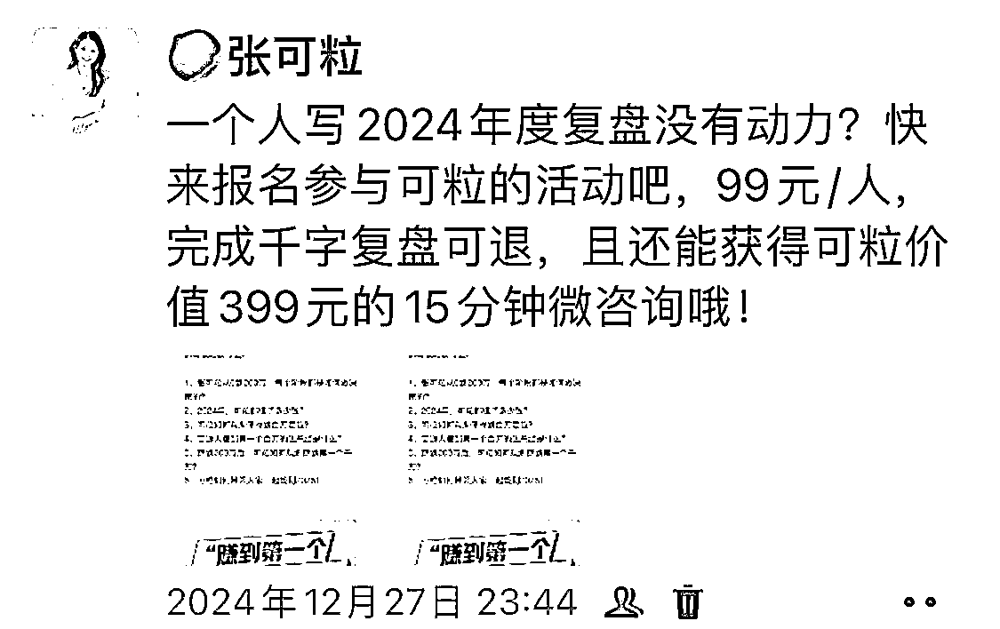
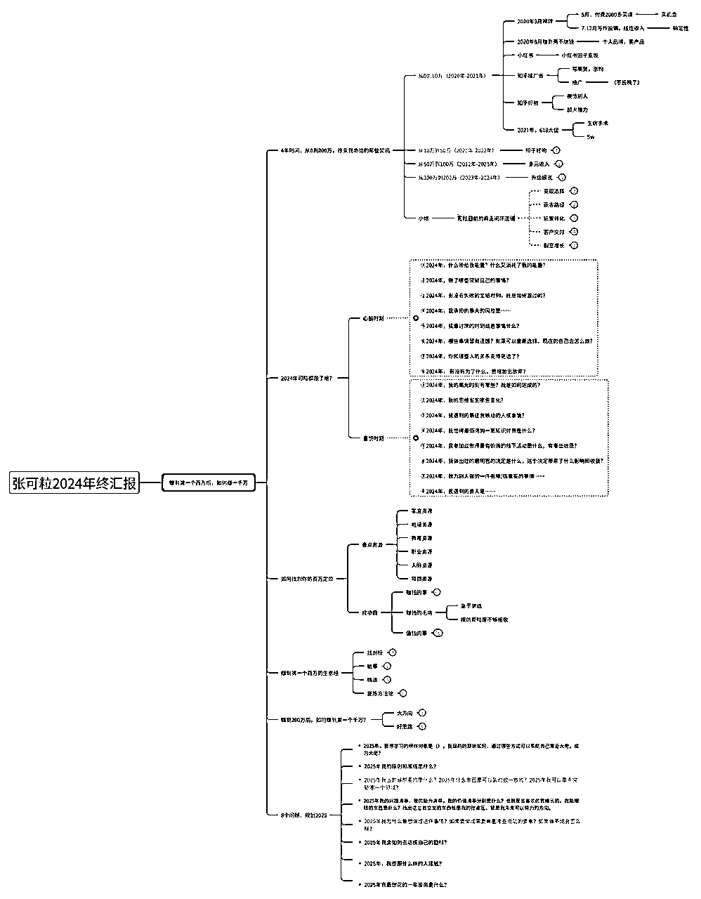
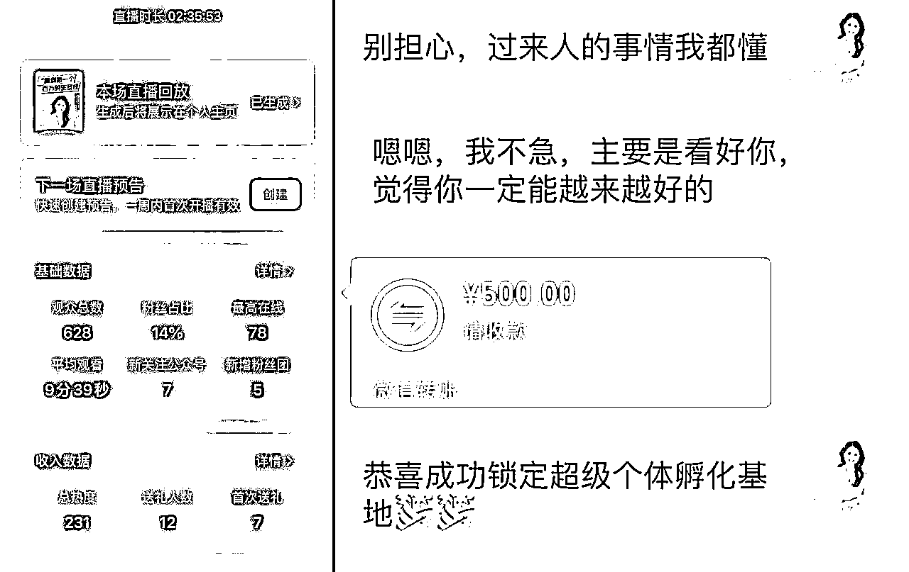
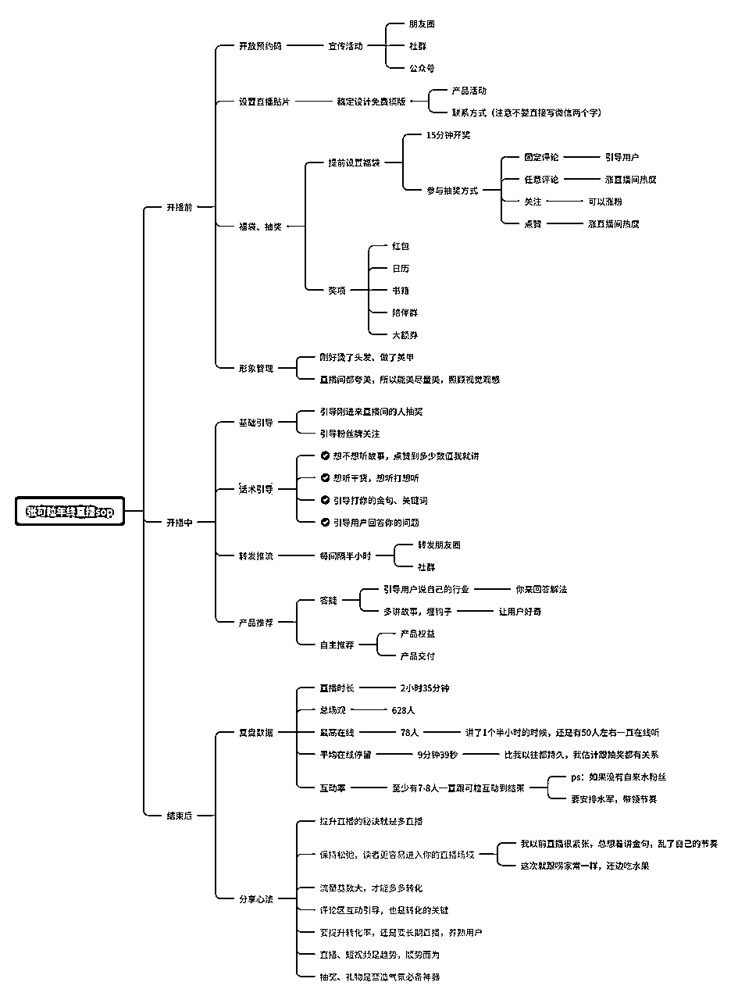
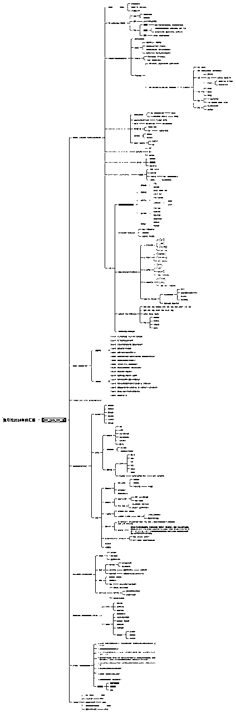

# 临时起意搞一场年终直播，三天变现1.2万，我踩过的坑和复盘
作者：龙哥

大家好，见字如面，见我发财。我是做自媒体IP孵化与新个体创业的张可粒，连续两年年入百万。

今天复盘一件事：2024年12月最后几天，我临时决定做一场年终汇报直播，最后到手1.2万的成交。整个从拍板到开播只用了4天。

# 一、整场活动的执行拆解

决定时间是2024年12月27日。只用10分钟就拍板了要做一场年终复盘演讲。下午集中3个小时，把活动方案、直播封面、直播流程、👸号文章和朋友圈文案全部闭环。方案出来后立刻开始预热，每天朋友圈固定更新一条，配上活动玩法截图。这样既省了解释成本，也让想参与的人一眼看到付费入口。

# 活动机制是怎么设计的

票价定在99元。报名后参加【可粒2024年终汇报&超级个体复盘会】，写完1000字复盘可全额退票，同时额外送我价值399元的15分钟1对1微咨询。

# 👸号推文的核心话术

亲爱的精神股东们：

见字如面，见我发财。2024尾声到了，这一年既有挑战也有收获。

我张可粒想借这场直播，把一整年的实操路径和2025的规划，直接摊开给你们看。这是第一次以直播形式做年终总结。

🔥【活动预告】🔥张可粒2024年终汇报暨超级个体2024复盘会

🌟 适合人群：想在互联网上实现变现的任何人🌟 参与门槛：99元/人，提交1000字复盘即退全款

🎁【权益清单】🎁

*   直播当晚专属思维导图，帮你快速抓重点
*   完成千字复盘获价值399元15分钟微咨询
*   最新版个人IP定位表
*   现场抽奖，奖品到手
*   高频互动用户有机会抽神秘盲盒

🚀【直播内容】🚀

1.  从0到200万的决策节点复盘
2.  2024营收拆解，我是怎么做到的
3.  如何锁定百万级市场，找到你的财富蓝海
4.  普通人可复制的赚钱打法
5.  200万迈向千万的财富布局思路
6.  2025年的共同规划

📢 这不只是汇报，更是一次思维碰撞和实战拆解。直播间见，一起解码2025的财富密码！

【直播大纲简览】

（点击查看大图）

【参与方式】

围观：扫码视频号，12月31日晚19点提醒开播

深度参与：加🛰️付99元进复盘群，席位有限

这篇推文就是当天发的版本。

# 当天直播流程我是怎么排的

对我来说，直播中最关键的是流程颗粒度，我把它拆成播前、播中、播后。

播前：建预约码引导到场，朋友圈+社群+👸号同步吆喝，准备好抽奖物料，把形象收拾干净。

播中：围绕核心主题输出，中间埋转化钩子，用留存技巧和抽奖维持在线人数。话术细节需要单聊领取。

播后：立刻复盘数据并交付付费用户。12月31日晚直播结束后，当天就成交了两笔5999元的超级个体孵化基地10年会员，一笔定金一笔全款。

复盘成文档，既方便自己迭代，也能把方法公开出去，形成更大势能。

图：直播后当晚成交记录

附上「年终演讲」策划思维导图：

# 二、做完之后最大的体会

过去的我是个拖延者，也是个怕输的人。

很多想法只停留在脑子里，执行为零。害怕失败，总想做个完美方案，或者拿更厉害的人做参照，于是忽略了自己当下的基本盘，这本质是自卑。

不敢承认没成绩，不敢面对别人眼里的评价，总担心不够优秀。所以一直不敢迈步。

现在回头看很荒谬，想赚钱，首先要过心理关，别把情绪价值和人际评价放在第一位。你以为别人会一直盯着你看吗？事实是没人那么闲。

撕掉自卑这层遮羞布后，这场直播直接带来2个10年会员，GMV 1.2万，足够自洽。

# 先做了再说

合伙人12月27日甩给我一张海报草图，提议做年度复盘。我第一反应是万一没人买怎么办。很快我否掉了这个念头。

10分钟决定，2-3小时把玩法、海报、推文做完。宣发只剩3-4天，但我已经开始发圈。

其实这场汇报不只是给精神股东看，更是给过去的自己看。

（插入2020-2023年的年度复盘对比）

“看，2024年的你进步了。”

“你真的很棒。”

# 粗糙启动即是胜利

我现在的状态是想做就动手，不怕不完美，不怕错。

 partly因为我对所谓的厉害人物已经祛魅，明白成长靠的只有自我接纳。

我从小缺挫折教育和金钱教育，这不是我一个人的问题。很多底层家庭长大的孩子，父母给的人生脚本就是：好好学习、好大学、好工作、好姻缘，然后循环。

谁定义了好？谁定义了人生？别向外找答案，向内探索。见识浅薄才会被别人带节奏。

所以我要去试，去体验过程，而不是死磕结果。没有开始，就没有好结果。

# 每一次开口，都是为万人演讲练级

我有一个目标：万人演讲。

线下线上都行。100万粉丝时聚起一万人并不过分。

但我的口头表达还需要大量实操。我不想上台紧张到说不出话，我要做一个好看又有料、会演讲的宝藏。

写作和演讲，都是成名路径。

提前约你一下，未来可粒万人演讲那天，希望你能来现场。

祝你2025比2024更顺，万事如意。

2024年12月31日直播3小时精华思维导图汇总