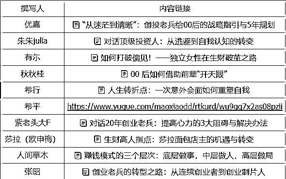
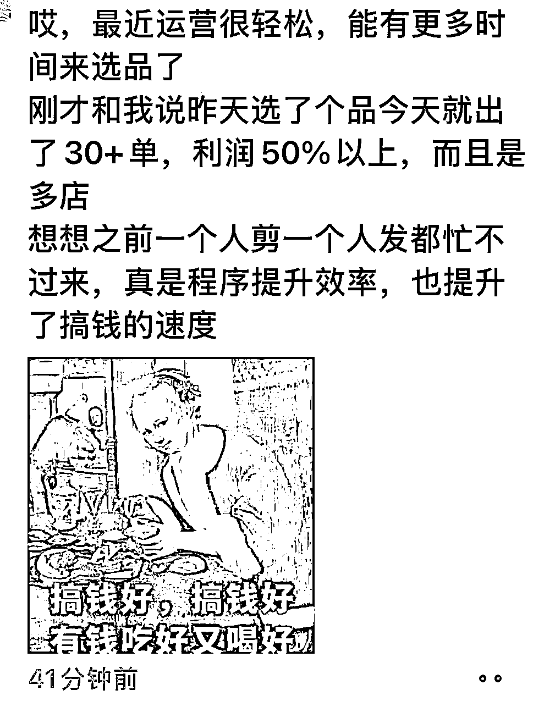
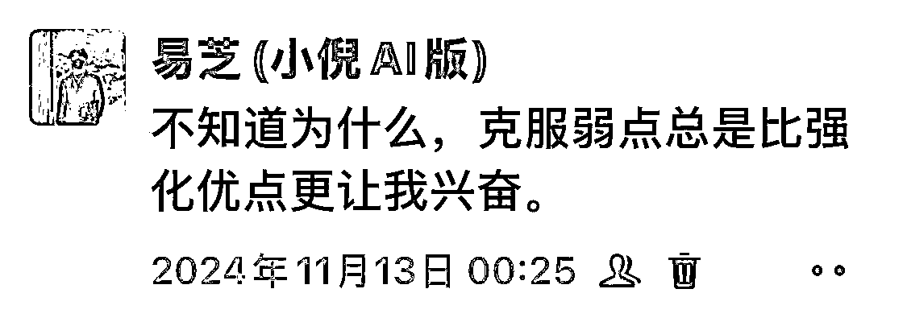
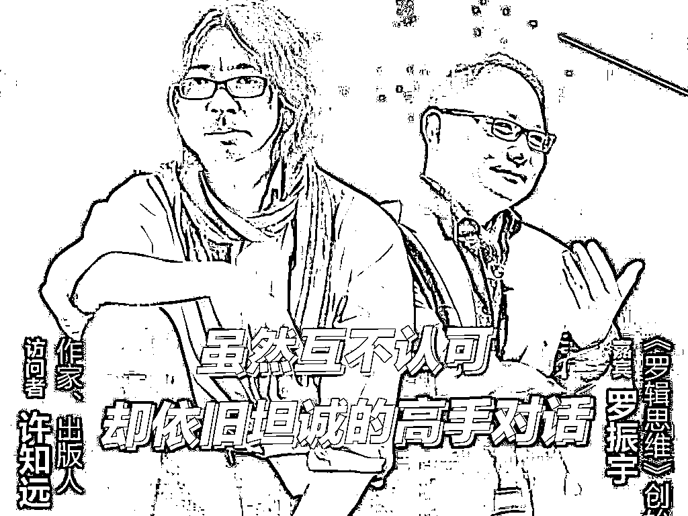
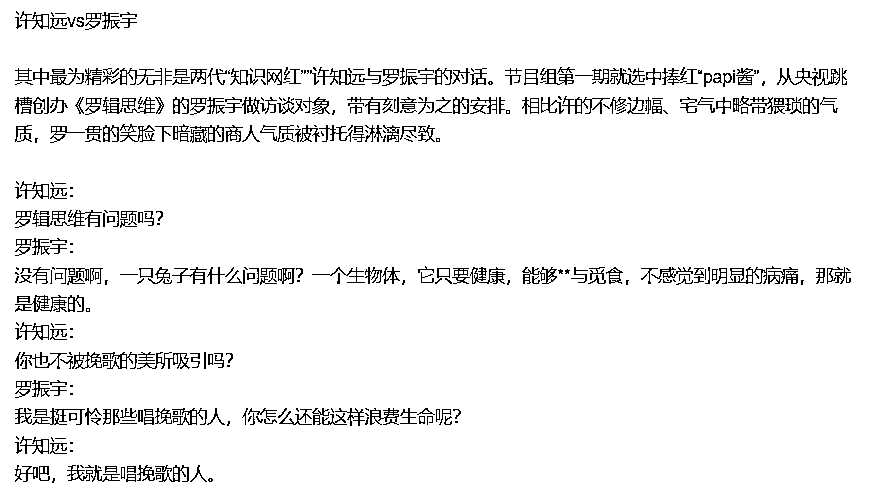

# 读完张昭老师的内容，我做了一次系统性复盘

## 我是谁

【微信昵称】易芝，99年生，INFJ，爱看书
【坐标】杭州、嘉兴

【赚钱标签】
2020年起关注龙哥、小鱼姐
赚钱学习委员，2025年组局20场

【经历】做过知乎好物与📕电商；第一次创业亏损，换模式再出发：IP+AI+RPA

【盖洛普优势】回顾、责任、和谐、思维、学习

【赚钱相关文章】
https://scys.com/articleDetail/xq_topic/8858448228258842
https://scys.com/articleDetail/xq_topic/8858422411441822
https://scys.com/articleDetail/xq_topic/8858428425122252

## 开篇：链接老师之前，先交一份作业

首先要谢谢张昭老师愿意给一次链接的机会，而链接前要完成一份读后感。我最初只是翻完老师的精华帖，加上两三位圈友与老师问答的帖子，就急着去加好友。直到真正动笔，再回看最初打算聊的话题，才发现自己无论是认知层次，还是对老师的理解，都太薄了。幸好有这样一个写作步骤，哪怕最终没能见到老师，这轮输入和输出也足以让我装下老师的一部分思想。

我的长文习惯是：先大量收集信息，把每篇里能吸收的东西拎出来，再看看结构有什么值得学，最后按自己的认知再拼一次。目标是在我现阶段的水平上，写出一篇尽量整全、尽量有内在逻辑的文章。

【温馨提示】全文约八千字，时间紧张就跟着左侧目录挑章节看。

## 一、我为什么想链接张昭老师

梁宁讲：草莽者只盯着眼前的问题，找技巧和方法；大佬看的是趋势和周期。小成靠机会，大成靠周期。

我把创业分成三个层级。

第一层是流量生意：先把流量做起来，再想办法放大，靠量换钱。
第二层是产品生意：做出一个有壁垒的产品，让产品自己获客、自己变现，向上能吸引人才，向下能兼容求职者。
第三层是赛道生意：成为大赛道里的头部，赚整个类目的钱。公式可以写成——付费投放+私域+高客单+复购。

赚钱还给了普通人三个机会方向：AI、出海、同城。

我自己锁定的路径是IP+AI+RPA。

AI这一环，承接的是写作力。写作力的底层是认知高度和结构化思维，而认知高度决定AI使用的上限。学完AI之后，同样一篇文章，以前从整理资料到成稿需要一个半到两小时，现在只需要半小时到一小时。知乎这套框架我很顺，但最近帮女朋友写论文，AI给出来的东西明知不够好，却不知道怎么改，因为论文的语言体系我还不熟。这也让我更确定：用“收集素材+搭框架+填内容”这套结构化打法去指挥AI，创作确实高效很多，但专业感觉仍要靠时间去泡。

出海这一环，考验的是技术力。技术力说白了是一种探索的胆量——比如自己独立搭出一套干净的账号体系：不管国内还是国外，账号、设备、网络都要干干净净。

📕电商这边，我写了套自动剪辑和自动发布的脚本。程序跑通以后，个人效率和项目赚钱效率一起往上走。现在运营只负责一件事：在平台上找热门的品、找对标。素材的部分，全丢给机器人。（碳基生物控制硅基生物）

同城这一环，拼的是表达力。对上要谈商家，对下要谈用户，得会左右逢源，在小圈子里把情绪价值给到位。这活儿AI替代不了。

做C还是做B，归根到底是在拼对人性理解的深度。业务老人的口诀是：电脑出问题，九成九靠重启；人出问题，九成九靠话术。

张昭老师也提醒过，年轻人不要碰线下，跟那帮人打交道，规则太深。我认可这个判断，虽然自己是和谐型人格，总觉得可以近朱者赤。但如果有得选，我更想趁30岁之前精力充沛这五年，把AI这条路走到黑、走出一条明路；30岁以后脑子转不动了，再考虑深入线下。

眼前这些认知合在一起，再盘了盘自己手里的牌，我心里那把尺子就清楚了：如果看到一个产品符合“付费投放+私域+高客单+有复购”的模型，那就是值得深挖五年到十年的事。但如果一直看不到这种产品，我也不想像过去三年那样光做白日梦——先把IP+AI+RPA全力做起来，边做边想，等那个产品自己浮出来。

这也是我链接张昭老师的核心诉求：以我现在的能力和认知，有没有可能打包出一个产品？产品创业的出牌顺序，又该怎么排？

写这篇文章，一方面是把我的信息铺开，方便老师判断我的价值。能有人帮忙指一个大方向，人生也许就完全不一样；另一方面，阅读同龄人的帖子时总能看到自己的问题，2024年要翻篇了，就当把旧问题列成清单，给明年立一个校正坐标。

## 二、我给自己挑出的问题

### 问题1：人生过得太顺

优嘉的帖子像一根针。张昭老师问她：如果一下子想不起人生最大的困难，那说明你的人生比较平坦。吃的亏不够多，受的磨砺太少。人天生趋利避害、好吃懒做，没有外界压力，很难有人主动玩命折腾自己。

我最大的一块隐痛，来自父亲：二十岁到四十岁基本啃老躺平，奶奶七十五岁还在为家里奔波；母亲在我八岁那年离开，爷爷奶奶和父亲都住在田间，而我八岁到十岁是一个人守在家里。所以我干脆把“悲伤”这个情绪自我阉割了。

但也正因为如此，家里从不给我压力，我也就没有那种“这一关必须闯过去”的自觉。现在回头用“回顾”才干去复盘，才意识到：这就是我毕业时没在红利项目上拿到结果的深层原因。

我的解法：
1. 做得好的板块继续做，做不好的加倍改正。
2. 给自己安排一个对手。

张昭老师给过一个“假想敌”思路：想象那个完美的自己，跟你遇上同一个困局。你第一反应是逃，那他呢？他大概率会迎难而上——否则他也成为不了那个完美的版本。

现实这两年也不停地用结果教育我：拿现金说话。我遭遇过一次很重的价值观冲击——“是不是只有变坏才能赚钱？”张昭老师讲到类似的认知差距，虽然成因不同，但冲击力相近。

今年我干脆和朋友立了个flag。前两年我收入一直比他低，他又爱调侃人。所以我25年不想再跟他聊项目了——不在同一条赛道，对错很难说清，嘴上争不出输赢。那就直接比：每个月谁的净利润高，谁手头可调动的钱厚。一年结束，拿数据见真章。

### 问题2：敏感度不够

张昭老师一针见血：你对很多事物敏感度不够。敏感度不够，创新力就起不来。信息源就那么多，拿什么去创新？

我的另一个毛病是：思维和学习两个才干靠前，学东西快，但学会后很快就丢给别人做，后续实践不足，导致指令越来越不准，慢慢被追上。不过我不认为敏感是我的绝对短板——至少我的搜商还不错。

解法想明白了：重复性工作交出去，不管是交给人还是机器人，本身没错；错在交出去后就成了“甩手掌柜”。敏感度这件事，得一直放在心上养，而不是交付后就两耳不闻。

### 问题3：总想补短板

朱朱的帖子确实扎到我。我也享受“克服弱点”带来的兴奋感，可这并不符合《孙子兵法》说的“以己之长攻敌之短”。我们就是个普通人，不是全才，凭什么靠短板去赚大钱呢？

其实很多矛盾，放到主观和客观两个维度里就顺了。

主观上说，补短板让自己更完整，这是好事，但不该指望短板来赚大钱。客观上说，事情本身已经够难了，再加一层竞争，把天赋拉到极致才是更优的赚钱路径。

### 问题4：精力不够集中

有尓的分享我很认同：想变得优秀，就要把精力聚焦到一个点上。能量是守恒的，事业、感情、健康总要做取舍。

精力给到一段感情，那是专一，能经营好关系；给到一份工作，那是专注，能做出成绩；给到一个生意，那是聚焦，能撬动更多利润。但如果什么都想要，大概率什么都留不住。选一个吧。

我的解法来自Flipped的一句话：主动选最难的选项。

最难的选项做多了，也会熟。你会发现它其实没那么难。倒油的老头能把油穿过铜钱孔，不也就是练出来的吗？等一连串“最难的题”都被你解掉，信心就站住了。哪怕到了人生低谷，你也能想：当年那么难都啃下来了，眼前这个算什么？

最近看《完美世界》，柳神指导石昊的“真一”很戳中我：专注于一途，行于一道；体悟生死，明悟自身的妙处。

先说“专注一途，行于一道”。赚钱的根本，是表达力、技术力、写作力这三项里至少有一样练到优秀以上，就能拿到溢价。日子一滋润，人就容易贪心，想多开几条线，结果反而把核心的那条线稀释了。专注的含义，就是认自己的道，学会该掌握的法，在自己能力范围内做到最好。

再说“体悟生死，明悟自身的妙处”。人都有“差不多得了”的毛病，我更是“六十分万岁”的典型。但在自己的道上，九十分都不算好。石昊为什么能从天骄里走出来？因为他每一步都没放过超越极限的机会。

突破极限的当下，痛是真的痛，风险也是真的风险，可熬过去之后，回报同样不缺席。我健身深蹲到八十公斤，教练直接加了二十公斤上去。心里确实怕，但扛过一次之后，下一回独立上一百也稳了。中学跑步也一样：为了比赛时轻松一点，我先跑一个一千米，把第一个喘点硬熬过去，真到比赛，第二个极点就没那么早来。

突破极限这件事，有天赋的会越做越强；没天赋的，砸再多力也可能不见涨。看清天赋和宿命之后，我们能做的其实不多：专注把擅长的事做到极致，大概率不会后悔。

### 问题5：向上链接的姿势不对

向上链接，得先想清楚自己能交换什么，或者先当那个付出的人。如果暂时没有明显价值，情绪价值也算一种入场券——怎么都比空手开口强。

你得让对方看见你的价值，看见你的可能性，甚至直白一点，看见你有“被利用”的地方。实在不行，情绪价值也可以给对方。虽然情绪价值在很多人眼里并不值钱。

我的转变：以前想认识很多大哥，去很多地方，成为人群里发光的那个。后来读到“见自我，见天地，见众生”这句话，一下就平静了。假设我活到六十五岁，还剩四十年，睡眠占掉三分之一，吃饭生病休息再占三分之一，真正能自由支配的时间少得可怜。所以我现在更冷漠，也更热情。冷漠在于：虚名实名，凡是消耗精力的局，能不去就不去；热情在于：有智慧的大哥或乐观阳光的普通人，只要出现在那样的局里，不管是分享能量还是吸收能量，我都愿意。

自己热爱的事也是。以前我只是隐约觉得自己爱读书。AI用得越多，我越清楚：基础的文字可以交给AI去铺，它提高了内容下限，但上限还得靠思维，而思维的养分正是读过的书。我很容易断更，说到底还是读得太少。所以接下来的目标很简单：赚钱别停，读书也别停。

心境到了这一步，不如意就不如意吧，我只求内心平稳。用《了凡四训·立命之学》来收束：从前种种，譬如昨日死；从后种种，譬如今日生。

## 三、尊重常识、尊重经营、尊重时间

段永平最核心的观点就一句：做对的事情，把事情做对。什么是对？不错的事情就是对。什么是错？知错不改，才是真正的错。

### 常识1：顺人性做事，逆人性思考

这轮阅读里，我共鸣最深的一条。

拿“日日更新”来说。如果航线没有硬性要求，我会更一天歇一天，因为日更这件事反人性，没有存货还要硬写就是注水。日更真正的意义是“每日三省吾身”：有问题、有复盘，写出来才有价值。我歇下来的那天不会完全停，而是去收集之后两天要用的素材。

### 常识2：保护稀缺的心力

张昭老师讲过：很多人能跑出来，或者能实现更大的梦想，关键就是他们能放下很多肤浅的享受。

我觉得这个时代的宽容度在变大，但经济环境太差了，大家戾气都很重。以前总被教育“少说气话”，现在更愿意把不开心的直接讲出去。保持那口气，守住那点心力，别乱烧。

### 经营1：动力到底从哪来

盖洛普里我第一是回顾，第三是思维。过去的我，思维模式多少带着许知远那种“唱挽歌”的味道。坏处是创业时不够狠，老往回看，自由职业期间大量时间都耗在阅读认知半径以内的👸号里。

好处是许知远说的：每个人都是带着成见看世界的，如果你不带着成见，就没有看待世界的方式。我就要带着顽固的偏见去撞这个时代，等着被打破，或者再次被印证。

好处在于：我拿着不成熟的认知，在商业里拿到正反馈，然后再不断修正自己。反思的过程，也是我快乐的重要来源。一次次抽离、破碎，直到某些判断变成肌肉记忆。两年创业下来，我的思想已经变成：守住底线，道德感和慈悲心少一些，赚钱至上。

### 时间观：倒过来想问题

“以终为始”去思考，先把资料收集够，再倒推出五年计划，你会发现：看上去选择很多，其实没有选择。

因为只要套两个条件，大部分选项都会被滤掉。

1、利润目标：一千万。
赚十万，选择遍地都是。
赚一百万，选择已经不多。
赚一千万，选择屈指可数。

2、能力匹配：以你的能力，做得了什么？
项目机会再多，也要问问哪一份真正属于你。

张昭老师也强调：目标定了，就要“以终为始”去拆。先站到未来第五年，看自己想成为什么样、达到什么状态，再拆到年、月、周、今天。这么做，你就很清楚现在该做什么、不该做什么，然后把所有资源和精力集中到关键动作上。如果落地的路都没想过，目标就不可能实现。

这中间有两个思维误区：
1、用你目前的资源和能力，去设计商业。
2、用现在的眼光，去定义未来的世界。

都不对。

假设目标是2025年起步：
第一年，花一整年摸业务方向。
第二到第五年，依次完成100万、200万、300万、400万的净利润。

有了阶段数字，下一步就是预想：这个过程中会撞上哪些难关，提前准备。

我目前五年计划的具体化，在龙哥盟找到了👸号爆文教练张波老师。结合他的方法论，以及我对王阳明“知行合一”的一点理解，这个方案还在完善中，进度15%。

## 四、定方向

### 4.1 赚钱方式的判断

莎拉（欧申梅）的观点我很认同：普通个体，立足靠做事能力；长期积累之后，靠“做人”放大——打造个人品牌、提升知名度与影响力；如果还想再跨一步，就要洞察人性和各方利益需求，设计一套商业模式，让更多人进局，从“做人”进化到“做局”。

前面说过，如果暂时看不到值得深耕的产品，我会先把IP+AI+RPA这条路跑起来，边走边碰。

2025年的排期大概是：👸号保底300篇，其中200篇短内容（用来日更，也当作长文的素材），100篇长内容（项目过程中提炼的方法和思考，每篇三千字上下）。同时项目要推进，AI和RPA的理解要加深，表达力也要练——线下做销售，线上开短视频。

计划永远赶不上变化，只能排满。

产品还需要等。等待过程中，我会去别的优秀团队取经，重点看一件事：大佬团队的组织架构、人员流动性、团队氛围、上升通道、分钱方式。因为项目一旦跑起来，最终靠的还是人，而人之间的事，到最后全是人性。

### 4.2 赛道逐个看

#### 📕 or 小绿书？

张昭前辈说：我们是最早做小绿书的那批，这次赚钱小绿书航海，五个教练里有两位是他投的。

他对小绿书的判断是：绝大多数人没机会。要做好它，必须有两块能力：一个是获取流量，一个是选品。

1、流量获取：底层是内容能力，图文或视频必须很能打。
2、选品：一开始可以挂精选联盟，但最终一定是拼供应链。拼供应链，又等于拼线下的货盘和资源，太重了，不适合00后玩。

所以综合看，小绿书的机会只在流量侧。但流量做到后期，照样会被供应链卡住。没有供应链，赚钱效率很难提上去。

线下疗愈赛道呢？客单价不低，但同样没00后的位置。它需要对人性有很深的理解，自己掌控不了。我对00后的建议很直接：放下所有幻想，专攻AI。别的方向想再多，意义也不大。

#### 专攻AI

尝试窗口：20到30岁。

这代人恰好踩在了转折点上。

95后、00后正处在同一片战场。他们赶上了AI带来的史无前例的红利窗口，却又出生在职位数空前的紧缩期。矛盾之下，最有意思的现象出现了——一批敢想敢做的00后，即便手头并不宽裕，也愿意拿出几千块钱硬是挤进“赚钱”的赛道。这种魄力，让人很难不把未来的希望押在他们身上。

我常跟身边的朋友说一句话：未来十年，谁不跟年轻人同频，谁就注定被甩下。想清楚自己要成为什么样的人，然后围绕这个信念做极致的改变、极致的相信，圈层才会松动。

现在席卷而来的科技浪潮，无人能挡。今天AI的普及，就像当年智能手机和互联网的爆发一样。AI不是要取代我们，它在赋能业务、放大效率。历史从不淘汰AI，只淘汰拒绝使用AI的人。

对00后而言，这或许是最好的解法：顺着AI的主趋势走进去，用十年去深耕，把它真正变成自己的基本盘。实在走不通，再去看第二条路。

那么普通人到底怎么切入AI？

张昭老师把路径拆成了三层：

第一，用AI提效；
第二，用工具做轻量开发，比如cursor、coze之类做出APP、网站甚至小游戏来变现；
第三，主攻大模型。

对大多数人来说，最稳的入口仍是第一层——用AI把手里的事做得更快更好。按成熟度来看，文字 > 图片 > 音频 > 视频。AI写作这块，框架已经相当稳定了，微调即可马上上手，性价比极高。我个人更看好以👸号为基本盘的内容写作。五年前我连及格线都摸不到，重回写作这件事时才发现，这是我真正能持续做的事，也是我想象中五年后依然愿意投入的事。所以从2024年12月28日起，我会持续输出👸号内容，并把写作力当成核心训练。

至于工具开发这条线，用cursor、coze等做轻量级开发，门槛已经大幅降低。但这条线有两个前提：其一，你得懂用户场景，能做出让人愿意用的体感；其二，技术实现上要有基本功。我给自己的阶段性目标是先精通RPA，用来解决项目中的真实问题，同时锻炼产品思维。这条线不适合作为创业的第一步，更适合在有了一定现金流之后再去展开。

说到起步，第一年的核心任务只有一个：活下去。进入新领域往往意味着零收入，生存压力会直接考验一个人的战略定力。你会不会为了眼前的一口饭，放弃未来五年的目标？太多人就是被现实诱惑带偏了，出发时信心满满，后来被各种赚钱机会拉走。

所以我的建议是：12月什么都别做，先停下来。少即是多。停下来的时候去读书、去思考、带着问题去找对的人交流，往往会撞见贵人。像我这次链接上张昭老师，就是在查资料、思考后再带着具体问题去请教得到的反馈。我需要一个能给我足够压力的老师，让方向既理性又贴合天赋。

创业常见的坑，我见过两个最致命的。

其一，对战略方向的动摇。张昭老师用黄焖鸡米饭举例过：餐饮是典型的苦行，起早贪黑、重复劳动、前期投入大，2023年竞争极其激烈，小白几乎没机会盈利。相比之下，👸号爆文项目零前期投入、见效快，且我本身在文字和私域上有积累，变现路径清晰，符合下行风险小、上行收益大的选择逻辑。事后数据也印证了：2023-2024年黄焖鸡类目门店闭店率26.3%。若当时投入，时间成本加亏损，至少是40万级别的打击，对一个没毕业的学生是毁灭性的。方向错了，越努力越惨。

我20到23年也靠小聪明赚过点小钱，等潮水退去，全都留在沙滩上。于是我学会承认自己的无知，用一颗无分别心去学习，而不是硬刚、硬证。听劝，真的能省下很多学费。方向一旦认定，就要全力以赴，不死不休。

其二，因不自信而扭曲执行。创业小白最大的误区是完美主义：产品还没完美不敢卖，要等经得起考验再上市场。产品永远没有完美的时刻，用户的认知和内在优化才是持续进行的。不怕犯错，怕的是犯毁灭性错误，比如伤了身体、亏光资金、毁掉人脉。世界就是靠不断试错找到解法的，所以要大胆犯错，但把成本控制住。

最后说几个我的常识。

我很喜欢《教父》里那句“一个人只有一种命运”。圈子对了，事就对了。要刻意进入一个平均水平都超过自己的圈子，因为视野、信息密度、认知格局，都是靠环境潜移默化塑造的。一个人很难靠自己左脚蹬右脚成长。

创业是厮杀，不允许感性。热爱，可以抵过专业。