# 《单篇笔记涨粉2万的实操拆解》

大家好，我是徐柒七，自媒体运营17万关注的博主，现做📕爆款引流陪跑，百万级爆款创作者。靠内容变现28岁实现独立购房，学员借助📕完成10万+变现。

今年已是裸辞的第三年，身边人还在考量一份稳定工作时，我早已通过📕拿到有房有车不用上班的生活状态。

今天就把我那篇播放165万、点赞7万、收藏10万的爆款笔记怎么来的，完整复盘给大家。

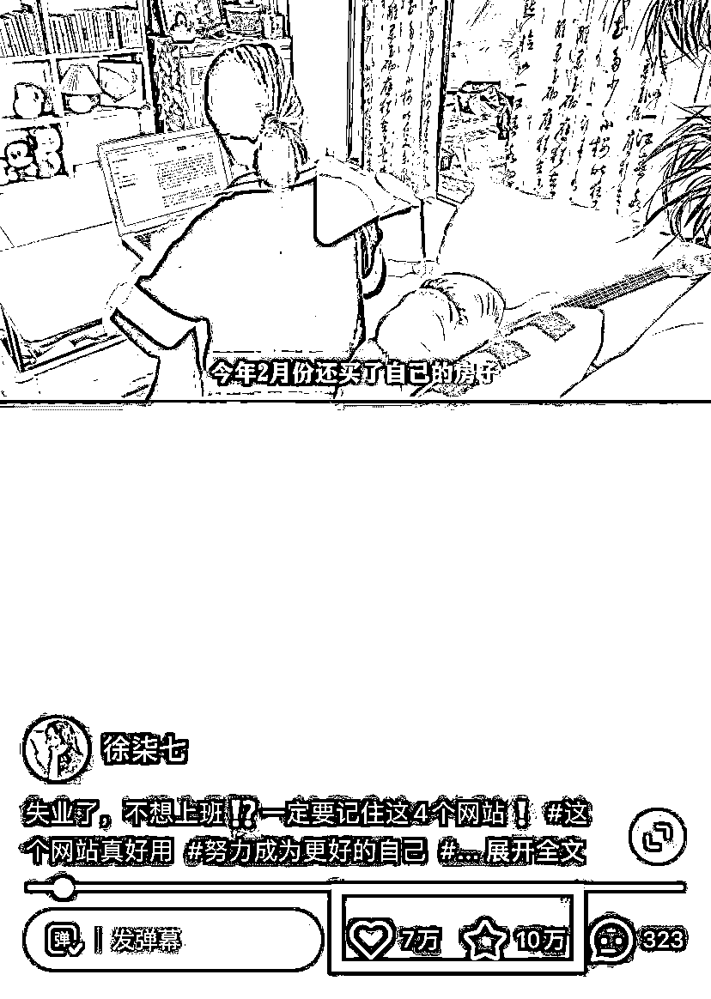

先说结论，我做爆款用的是同一套方法论：

一、练网感，锁定可复制的对标爆款

二、用关键词检索，判断选题是否具备持续爆的能力

三、像素级拆解后模仿+微创新

四、在文案里埋钩子，撬动评论区互动

下面细说每一步怎么落地。

# 一、练网感，锁定对标爆款选题

前段时间刷到一位博主在做学习网站类内容，几篇笔记封面风格、标题写法、内容结构几乎一样，数据都很炸，千赞万赞很多，发布时间集中在近一年内，且每隔两三个月就会再出一波同类爆款。

# 二、用关键词检索，验证选题热度

我把笔记里核心词拿去检索，马上就能看到一堆同题材笔记，万赞、千赞遍地都是。

数据表现说明选题本身有强需求，入局成功率很高。

我总结了具备持续爆潜力的选题三要素：

1/选题热度：已有大量千赞万赞笔记做过市场验证
2/可复用性：封面样式、核心词、标题套路、文案骨架高度相似，便于对标
3/时效性：近一年内持续出现，且每隔1-2个月就有新爆款诞生

确认选题后，我挑了3篇数据最好且能模仿的笔记做深度拆解。

# 三、像素级拆解，模仿+微创新

这是整套打法的核心环节。

## 1、拆标题：封面标题≠正文标题

先把爆款标题里的高转化词抽出来重组。

这3篇是我当时的对标样本。

高频词提取：

失业了、记住这几个网站、可以不上班、自由职业必备、副业增收

我最终定的版本：

封面标题：如果你失业了 记住这4个网站 你可以不用上班
封面副标题：免费 靠谱 好用
正文标题：失业了，不想上班❓❗️一定要记住这4个网站❗️

## 2、拆封面：文字、排版、构图都要抄

文字部分上面已提取，重点是排版逻辑：

人像居中
上半区1行字+下半区2行字，或上下各两行
副标题放在居中偏左/偏右
口播类封面常用这个结构

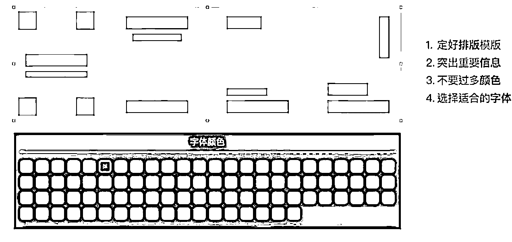

参考后我做的封面是这样：

爆款封面制作四点经验：

01.先定模板：直接沿用对标爆款的排版框架
02.信息分层：想让用户第一眼看到什么就放大什么。我把“如果你失业了”用红字，“你可以不用上班”用黄字。失业焦虑是痛点，不上班是痒点，两点直接戳中情绪。
03.颜色克制：封面用色不超过3种
04.字体简洁：清晰易读比花哨更重要

## 3、拆文案：先取骨架再填血肉

拆文案分三步：

01.用轻抖、飞书妙记等工具把原视频文案完整转出来
02.梳理出开头-分论点-结尾的整体结构
03.提炼爆款元素，结合自身经历重写

我直接把我的成稿放出来：

开头：
我裸辞1年，现在只工作不上班，每月稳定月入5位数，今年2月刚买房。如果有一天你失业了，请一定要记住这4个网站。

开头埋了裸辞、不上班、月入5位数、买房等多个爆点，承接完播。

中间：
第一个，oeasy，培训机构很少讲的宝藏自学站，涵盖Office三件套、平面设计、影视后期、动画、音频制作等，全免费可在线看可下载。
第二个，do you do，视频教程非常扎实，通俗易懂且免费，PS/PR/AE等主流软件都有详细教程，素材还能免费下载。
第三个，我要自学网，影视动画、电脑办公、程序开发、网页设计等课程，从入门到进阶全免费。
第四个，国家开放大学中心教育平台，汇聚338所高校、50万门特色课程全部免费。想学技能做副业找工作必收藏。课程覆盖生活、兴趣、职场技能，新媒体文案、短视频剪辑、编程都有，学完即可上岗。

我在结尾加了一句“学完就可以像我一样直接上岗”。这就是一个钩子，会有人追问我学啥、做什么。评论产生互动，笔记就更容易进下一个流量池，我也能在评论区做引流变现。

爆款文案写法总结：

01.用金字塔结构，结构清晰：总论点-分论点-收尾
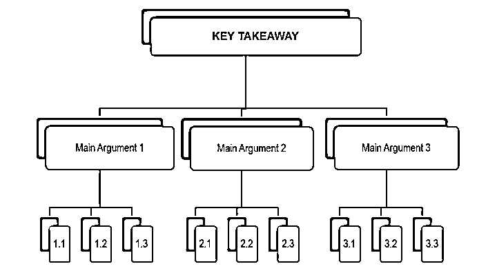
02.开头放爆点
短视频开头决定生死，高光前置。别上来自我介绍“我是谁”，用户只关心你能给他什么价值。
03.全程埋钩子
有产品、有课程的内容更适合软植入。比如我一个做母婴团购的学员，经过文案优化后一篇笔记就成交了4888的高客单，直接私信转化。

我把她原来的文案拿来对比，思路一目了然：

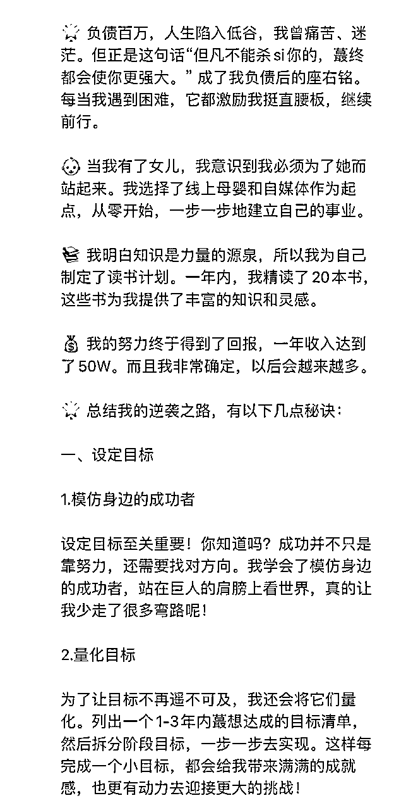

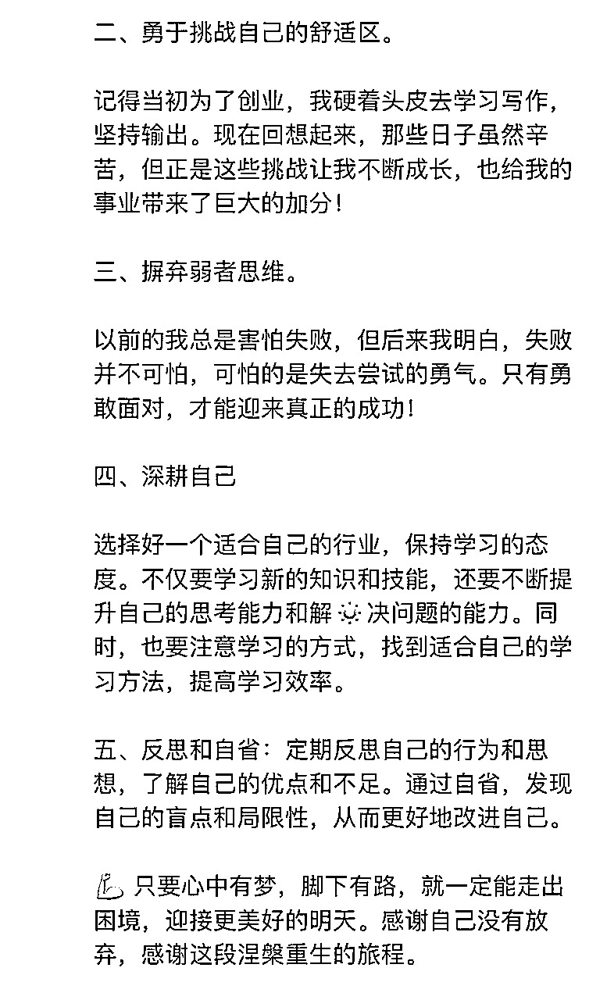

整体框架没问题，但缺少个人印记。

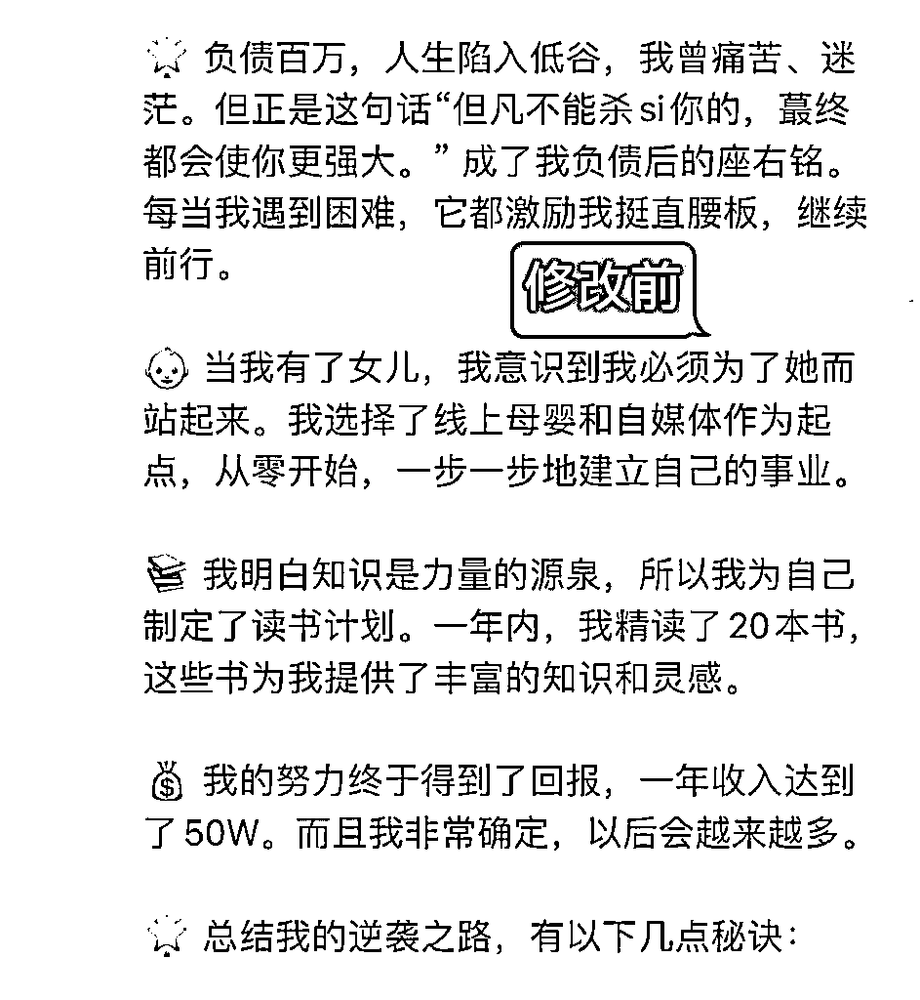

第一段保留困境+座右铭的衔接，删掉啰嗦的收尾，直接切入线上母婴+自媒体事业。读书部分一笔带过即可，本质是为了呈现迷茫期寻找力量。

创业成果要写具体，用时长+结果量化。

修改后开头：
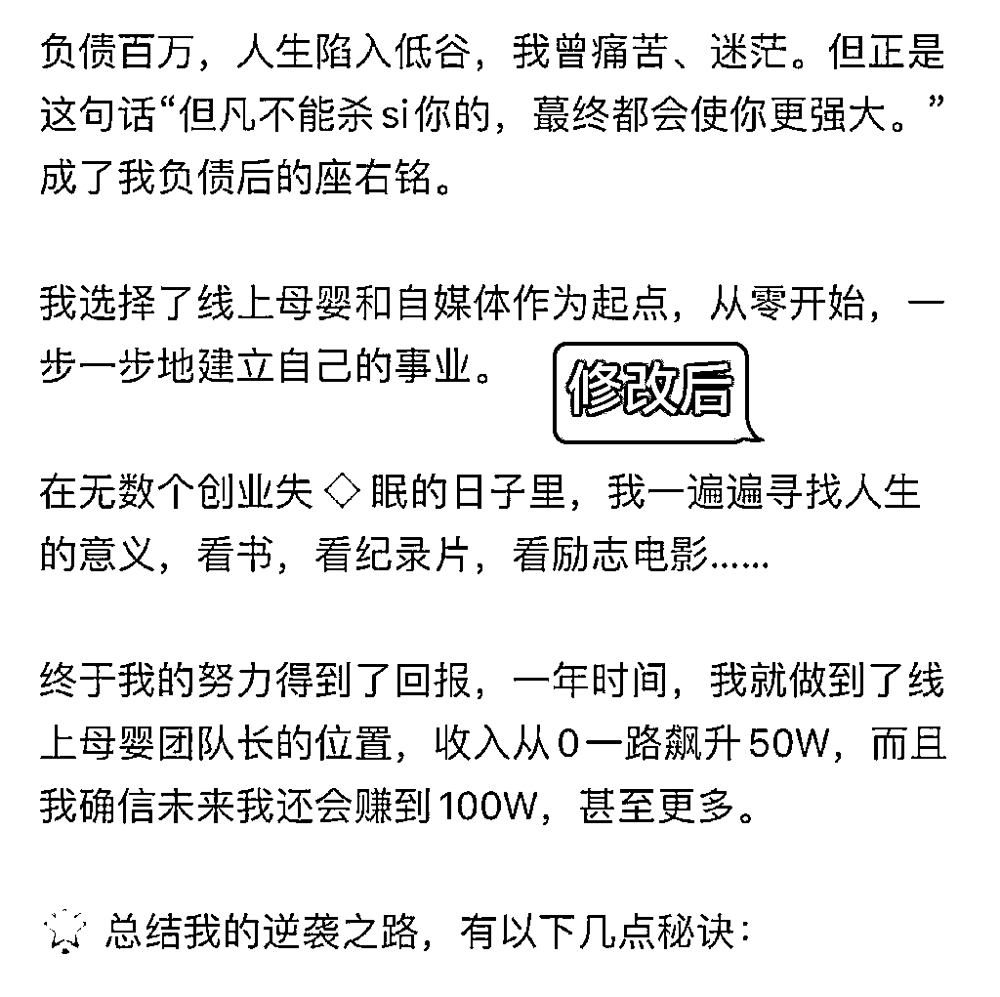

中间板块一：
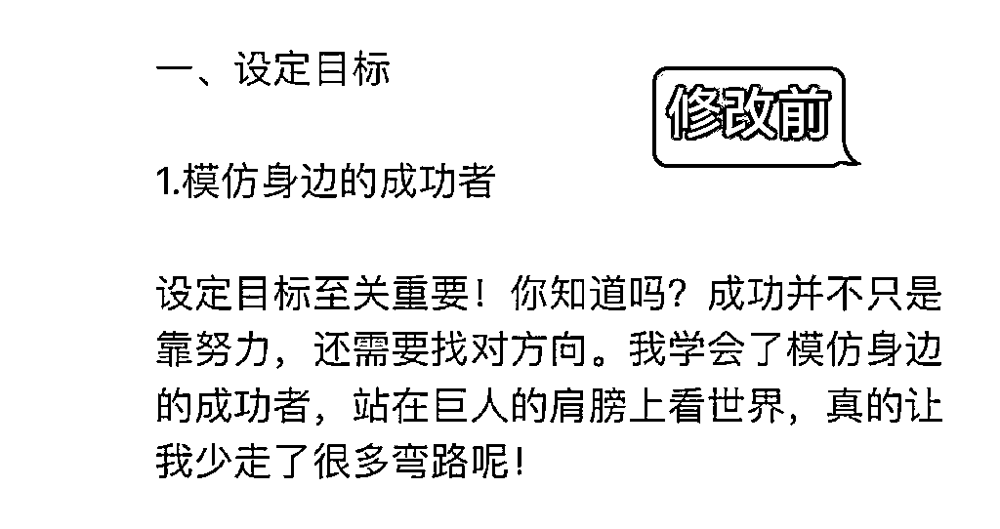

原写法太空泛，可替代性强。要把成功对象具体化，用当初吸引自己的那个人，去吸引现在的学员。

修改后：
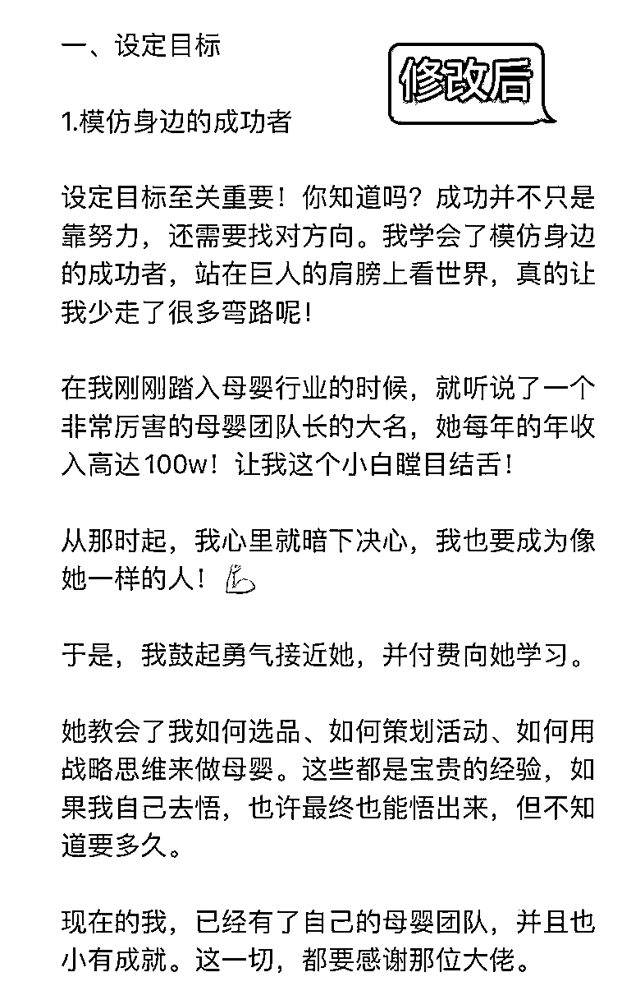

中间板块二：量化目标
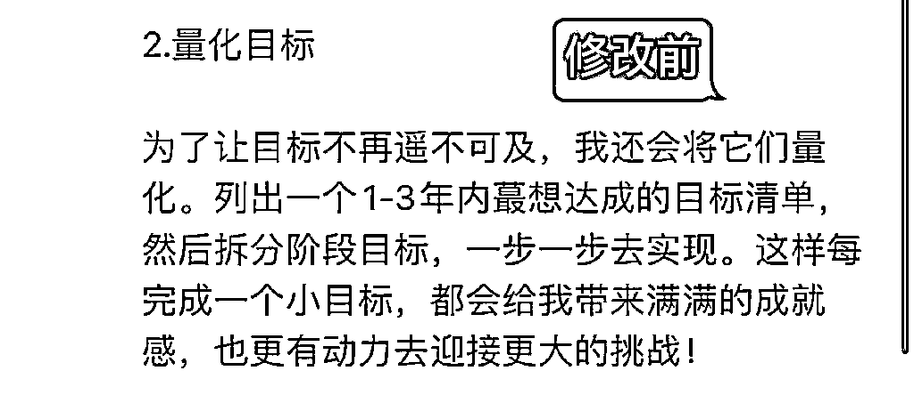

同样的问题是笼统。结合自身经历用案例呈现。

修改后：
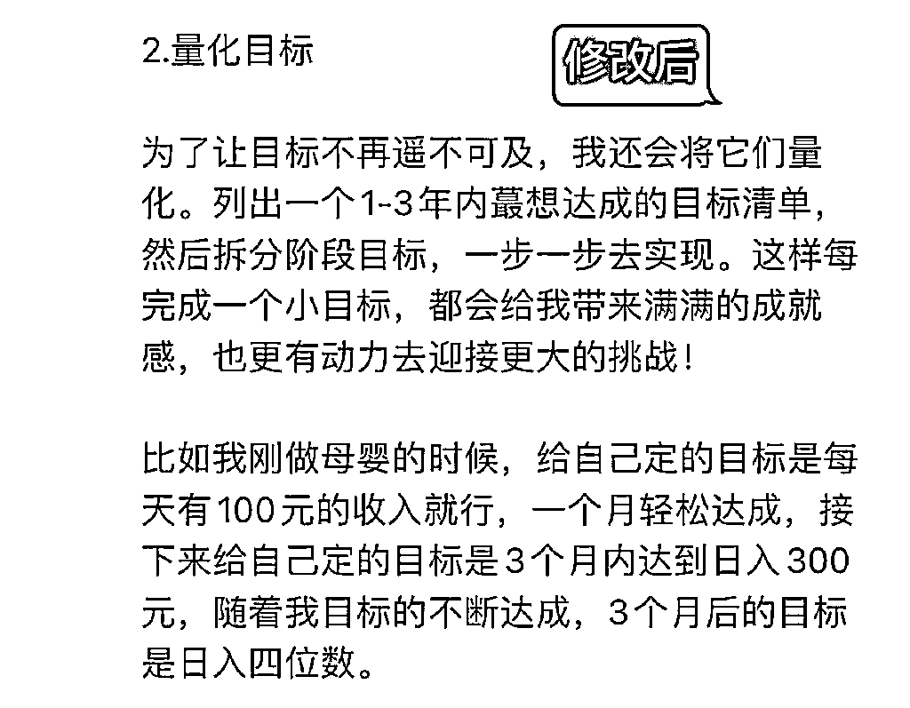

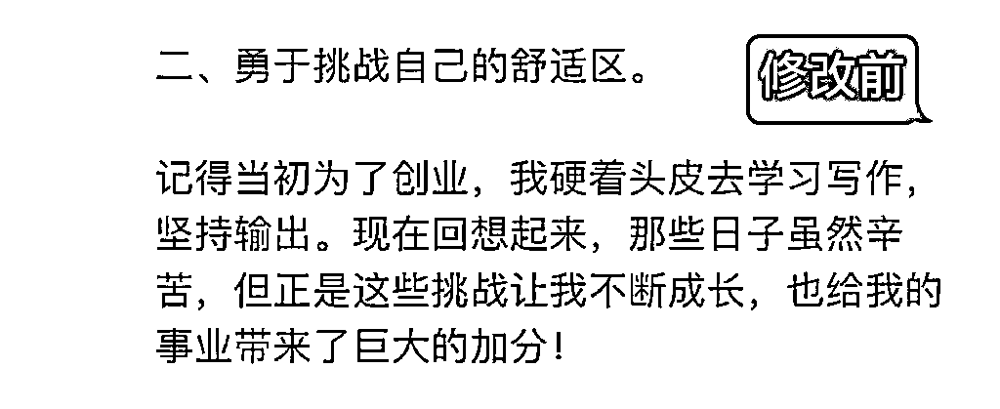

另外注意方向控制，比如她的主营不是写作课，写太多写作会把流量带偏。写作只能作为创业技能之一，还要提到拍照、修图、短视频获客、营销成交等，才能匹配她的业务。

修改后文案：
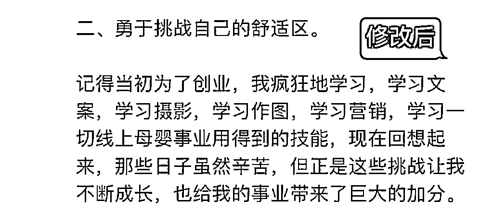

后面内容保持同样的改法，对比图如下：

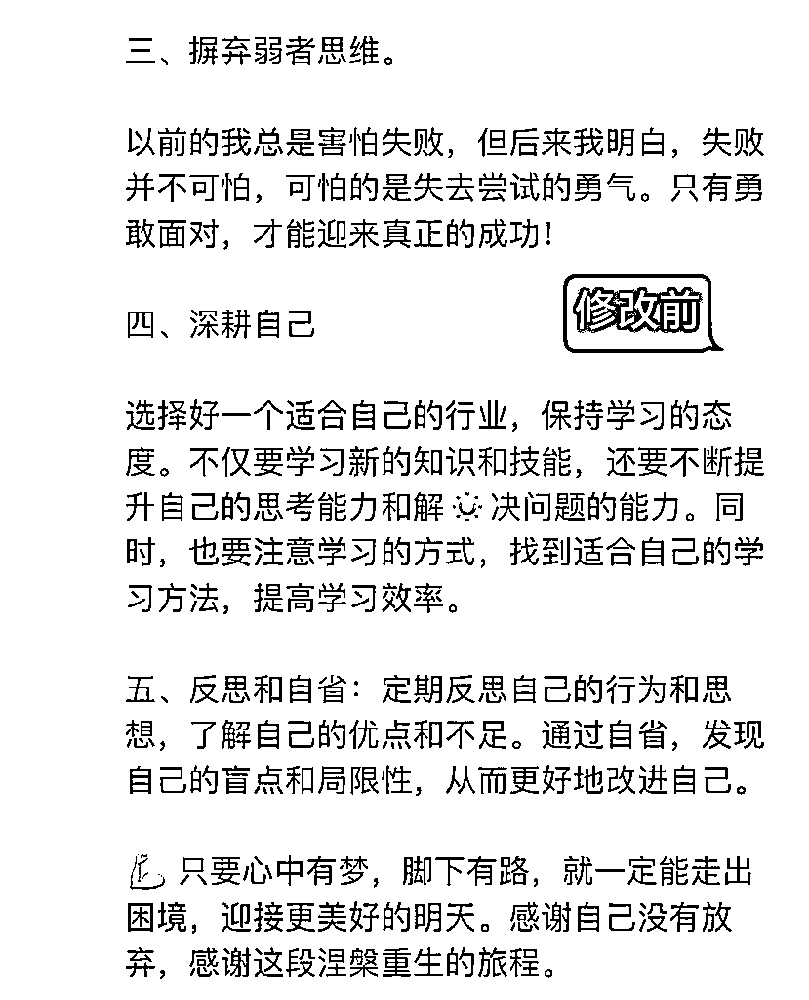

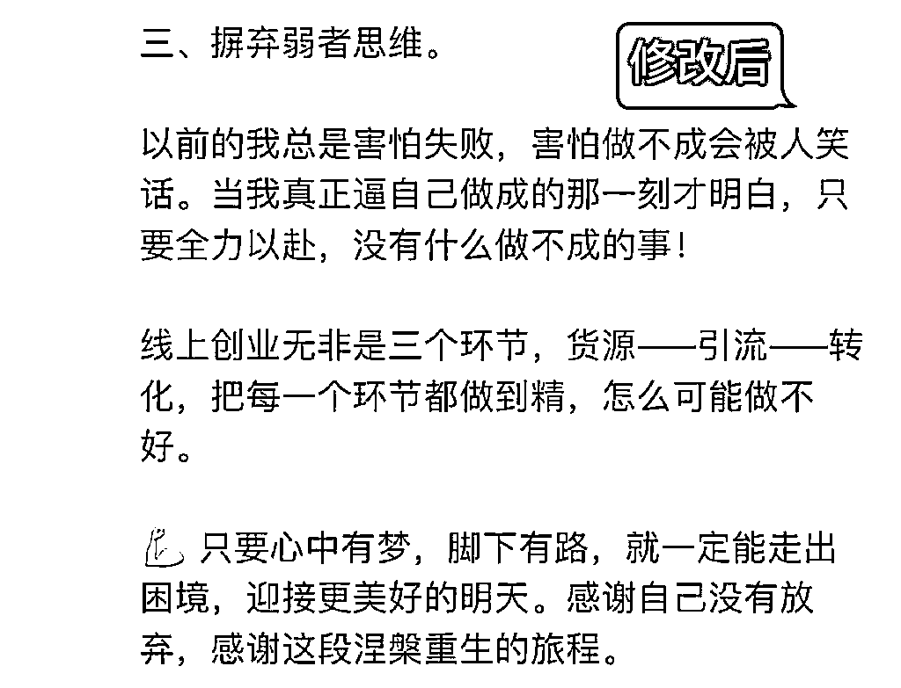

图文笔记正文约1000字，篇幅有限，前后两则详写，后面简写，详略得当更利于阅读。用户现在很浮躁，长篇大论难以沉下心来。

写作时不要搬运AI或知乎里搜得到的大道理。用户不爱听空话，爱听故事。

分论点只是骨架，要填进你独一无二的经历、故事、创业孤勇、压力下的失眠。

这个时代不缺产品和课程，用户买的是情绪和信任。把经历和产品柔和植入，每一次曝光都在心里种一颗锚点，需求出现时自然会来找你。

# 四、文案里埋钩子，撬动评论区互动

按照上面的方式写完，评论区自然会有人问怎么学、怎么做。意向用户就来了，合理承接评论区流量即可变现。

这是我和团队部分笔记的评论区实拍：

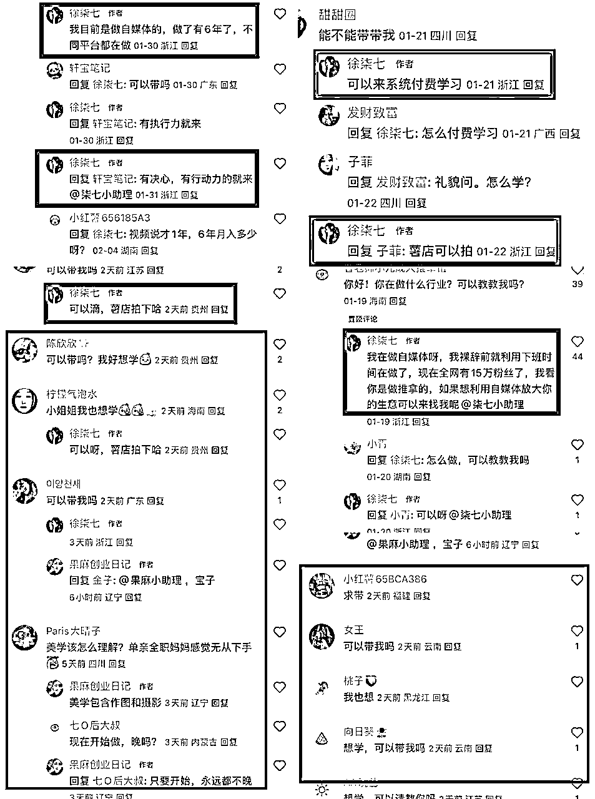

以上就是我这条涨粉2万爆款笔记的全流程拆解，也是我团队反复验证有效的打法。

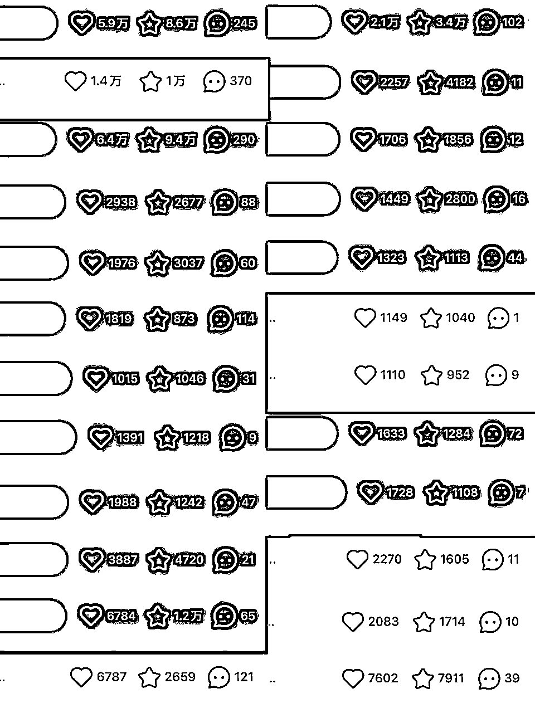

实操一遍，你也能拿到自己的爆款。希望对你有帮助，谢谢收看。