# 【麦洛实操拆解】视频号🛰️豆小额投放撬动免费自然流

大家好，我是长期做视频号带货的麦洛。上半年几乎没有对外做过系统性的视频号分享，全力在忙自营业务和培训。随着年底临近，平台上冒出了新的操作空间，今天就把我的观察和做法摊开聊聊。

先帮大家复盘一下，过去几年里普通人能在视频号里切入的机会：

视频号搬运带货 → 视频号无人直播 → 视频号店群矩阵 → 视频号混剪挂车 → 视频号口播自然流 → 视频号自然流垂类 IP 账号 → 视频号🛰️豆微付费

有过带货经历的朋友基本都踩过其中几站。被平台反复洗牌后会看清一个规律，普通人能做的方向正从搬运转向原创，从纯自然流转向投放配合。平台本身也在从粗放走向规范，成熟后的平台只会留住三类玩家：做原创的、做投放的、原创+投放兼顾的。

先思考一个问题，为什么每次视频号看起来有红利，实际入局却总晚一步，最后算账还亏？一个新玩法，我们花一个月打通流程，花一个月赚钱，等衰退再花一个月补救，周而复始，团队被耗干，公司没赚到钱。

根源在于我们一直在追打法。平台一改规则，你研究一个月的路数就被拍散，你如何对抗？

肯定有人会反驳，大佬团队也在追玩法，为什么他们能赚钱？麦洛你这是站着说话不腰疼。

答案是，新人和规模化团队不在同一个赛道。

* 他们有稳定造血的基本盘，你有吗？
* 他们能快速切入并短时间跑通，你能吗？
* 他们跑通后能立刻抽调基本盘人力放大，你能吗？
* 他们项目不挣钱能迅速撤离，人力回盘继续运转，你能吗？

我想表达的不是别追玩法，而是想告诉你，业务要健康必须先有基本盘。在日常运营里沉淀几项稀缺能力，靠时间和窗口自然生长出来。这篇文章的初衷也是如此，我认为【视频号短引微付费】既能锻炼素材制作能力，又能快速拿到现金回流。有钱才能做更多事，才能拥有更密集的创业体验，别排斥赚钱，也别用“长期价值”来搪塞。早期我们往往高估长期价值，先赚钱，先把能力打磨出来。

最后啰嗦一句，别觉得我在危言耸听。微付费短引会把一批玩家挤出局。未来想继续玩视频号，必须具备素材制作能力和付费投放能力。跑通闭环、跨过门槛，会越走越顺。只会搬运混剪的朋友，这次机会一定要重视，否则留给你的空间只会越来越小。

下面正式进入实操干货。

免责声明

1. 尚未跑通任何项目闭环的朋友，建议不要贸然入场
2. 有视频号带货经历但无投放经验的朋友，预期要调低，多准备试错成本和时间
3. 正在操作的团队，本文的价值在于帮你压缩试错周期，请每天复盘，沉淀成败经验
4. 跑通闭环前单场直播试错成本约 2k，请资金不足或想一夜暴富的朋友尽快远离，利润再高也不适合你

# 视频号微付费短引项目介绍

大家在视频号广场肯定见过这类账号：

1. 主页发布 3 条以上带货短视频，不挂车。形式多样，硬广、口播、科普、剧情、测评都有
2. 正在开播，直播间在线 3千到数万，场景简陋，主播不专业
3. 直播间商品客单价极低，基本在 9.9 元左右，销量几千到上万单

如下图示例：

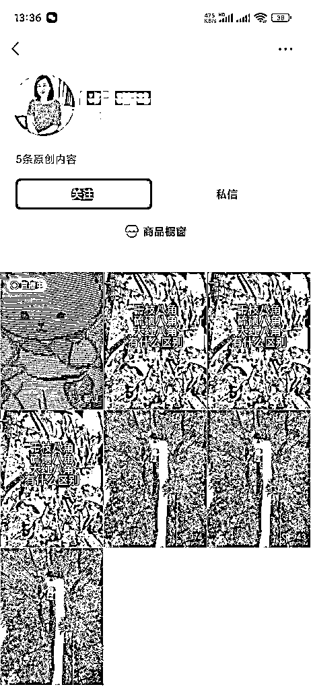

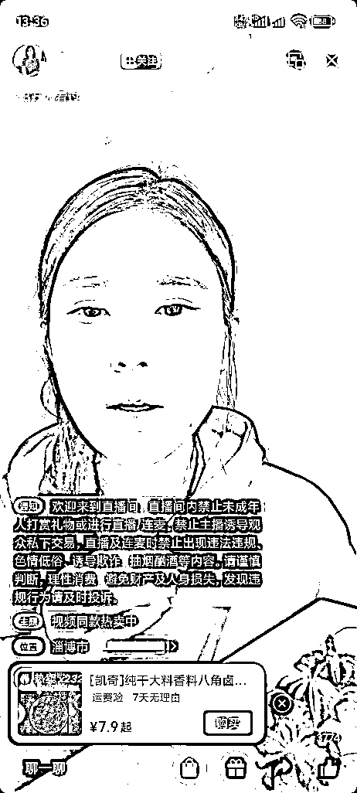

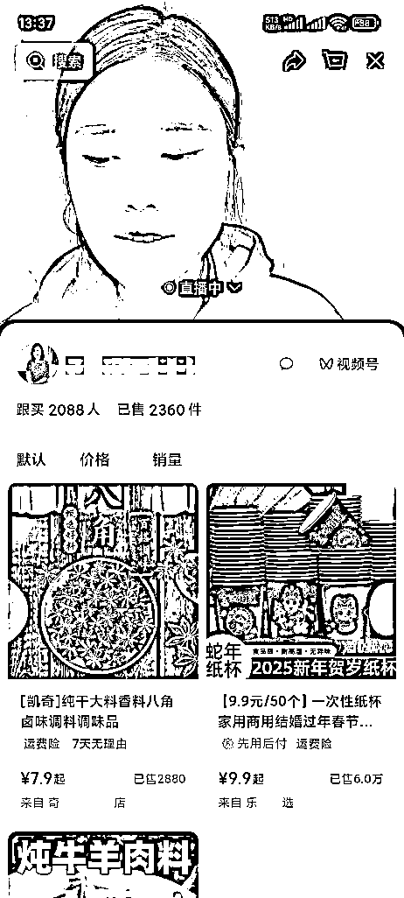

这就是本期要讲的微付费短引模式。核心逻辑是：为优质带货素材做付费加热，带动自然流从短视频进入直播间，直播间低客单商品集中成交，反哺刺激短视频自然流。

观察我们最近一场直播的加热量和自然量分布。起号成功的直播间里，免费短视频引流占比超过 95%，付费部分只占 5%左右。因为少量付费能撬动大体量 GMV，所以叫【微付费】，因为自然流量主要来自短视频导流直播，所以全称是【微付费短引】。

投放的目的是撬自然流，利润大头来自免费的短引自然流，能否撬动自然流就是判断一场地是否赚钱的关键。

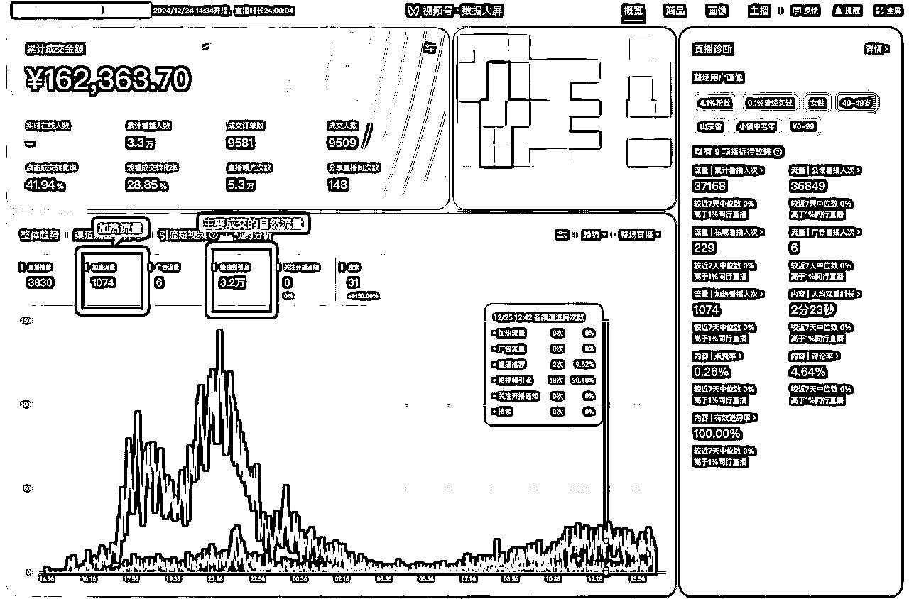

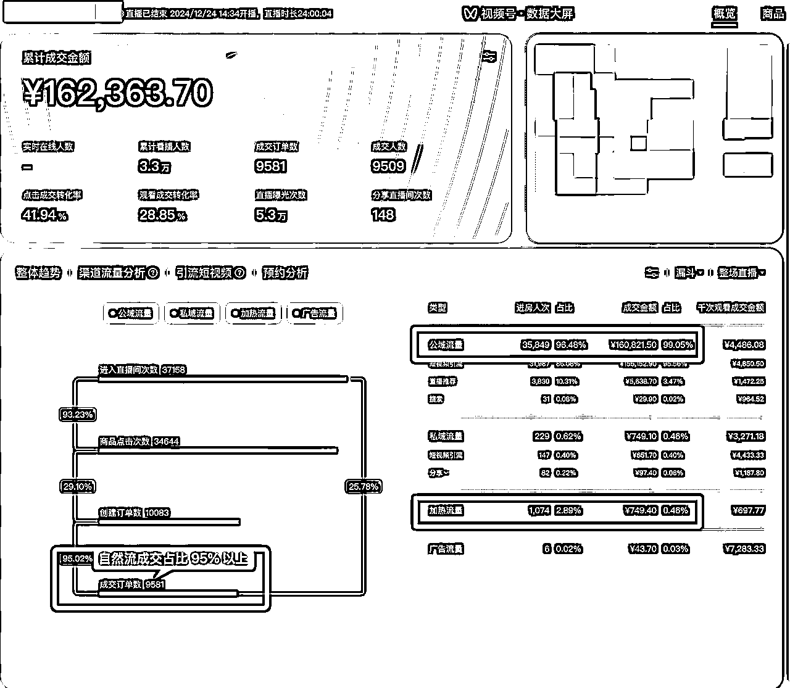

先有个整体认知，接下来汇报一下我们的实操，先泼冷水。

9 月底 10 月初正式切入，第一天投放 500 元，直播销售额 12w+，毛利大概 5w。这种数据让人放松警惕，甚至觉得“我们从没见过这么简单的事情”。带着傲慢操作几天后，连着亏损，团队作息被打乱，偏见被磨掉后才重新开始。

最后花了 1 个多月试错，消耗上百个账号，亏损 20w+ 才总结出一些方法论。所以没入场或正在尝试的朋友，别羡慕广场上日爆的账号，后台付出的时间精力成本极大。11 月 27 日我开场直播分享了全套方法论，从 100 多人里筛选了 10 个团队共测。再折腾 20 多天后，才确认方法论可复制，也更深刻感受到新手会怎样花式犯错😂

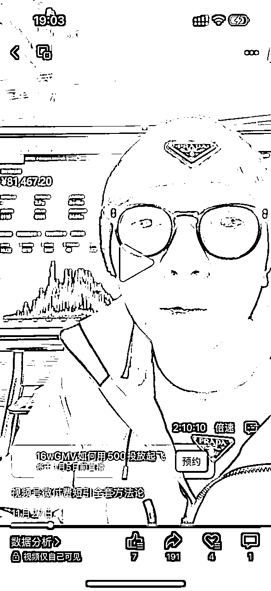

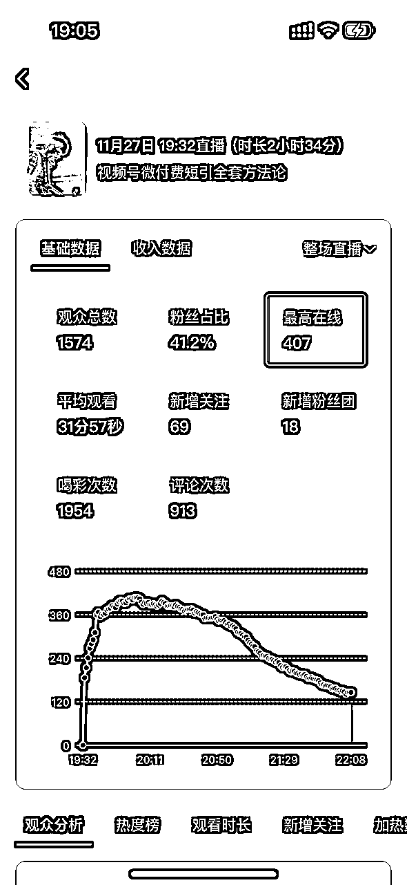

目前几个关键参考数据：

* 直播能出自然流的概率 60%，跑通闭环且操作不出错时，10 场能起来 6 场
* 一场能出自然流的投放成本约 1200 元
* 投放 2-3 小时后，通常能出自然流
* 综合毛利润约 GMV 的 20%-25%，扣除投放账号等成本后仍算高毛利，远高于常规电商 10%

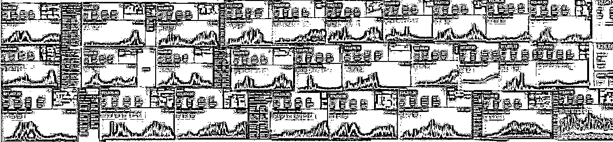

看到这里是不是开始算账了？一天 10w 销售额，毛利 2.5w，一个月 75w，一年奔着宾利去…

先冷静，别动不动算年利润，要考虑稳定性、风险和扩张后的人力场地等隐性开支。降低预期，先把能力攒起来，有点利润能覆盖 3 人小团队半年开支去探索新项目，就已经很成功了。

为什么看起来能赚钱，却有人说自己亏了？

* 因为忽略了探索期的试错成本，单场直播投放+账号+粉丝+代播+鱼塘成本接近 2k+，激进玩法更高，5 场不成功就是 1w+
* 一场成功能赚回 1w+，但多久成功一场？我连麦见过打了 40 场没成的，也见过 2-3 场就见效的
* 成功一场后能否持续？操作无章法、靠运气的选手，放大时会把利润全亏回去

所以要从文章和实操里找到三件事：

* 如何降低试错成本，加速跑通闭环
* 如何提高成功率
* 如何建立自己的方法论，稳定操作节奏和利润率

纸上得来终觉浅，绝知此事要躬行。下面进入实操。

# 项目实操

## 2.1 账号准备

建议用全新视频号来做，避免老号因历史问题导致直播无自然流，进而造成广告亏损。

一人只能实名 2 个号，单个号生命周期大约 1-2 场直播，所以要长期做，绕不开号商批量采购。采购注意点：

* 最好用自己的手机登录，不要网页版
* 先买 3 天试用，够用再续费
* 到手后检查是否全新，有无发视频或开过直播卖货，无则换号
* 检查私信和健康度，在创作者中心-账号诊断查看短视频、直播是否健康，直播中也要持续观察，出问题及时申诉
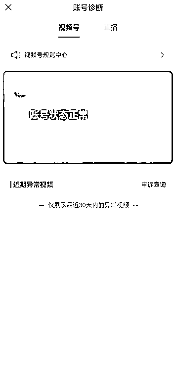

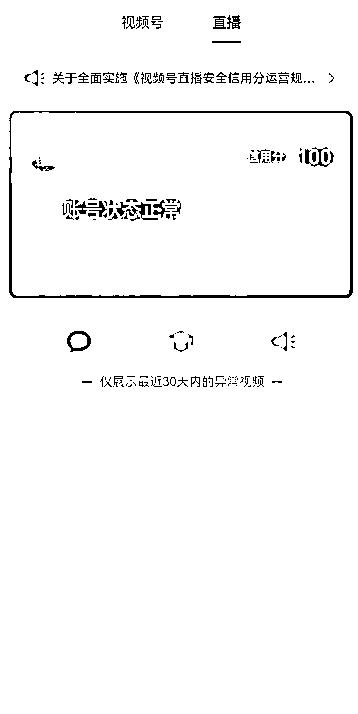

* 点进直播按钮，看是否需要人脸验证，能直接进直播页就不用，弹窗需找号商解决
* 电脑端开播需要 200 粉丝，可找专业团队处理

提前建个表格记录所有账号信息，方便调用。

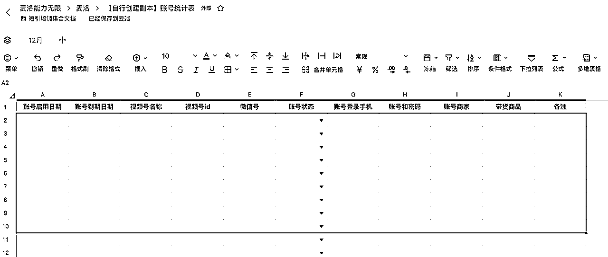

## 2.2 选品

选品是难以标准化的环节，也是分水岭。场子打不起来时，会怀疑选品、素材、主播、投放、时间等多个变量，新手往往知道有问题却找不出在哪，建议多刷广场爆品，思考选品→素材→需求→人群的关联。

两种选品方式：

* 跟品：平台有爆款商品，快速跟进。素材做差异化也能吃到流量
* 开品：结合第三方数据、平台人群和经验，选出潜力品，制作素材试错

跟品

场观 1w+ 且直播间转化率 20%+ 的可称爆品。快速找爆品的小技巧：

1. 广场找到一条短引视频
2. 转发到小号对话框
3. 对话框点进视频
4. 看完后上滑下一条
5. 重复操作

这样能批量刷到大量短引爆款。这些商品需求已验证，素材已证明能引流。跟品时不用纠结商品逻辑，直接跟进是拿到结果的关键。可以直接用数字人或自己口播翻拍爆款素材。

开品

大量爆款素材其实来自抖音。抖音是爆品晴雨表，爆过的商品只要不是太小众或过于年轻化，都会在视频号再爆发。以前时间差几周，现在随着平台发展，时间差越来越短。今天抖音爆的商品，2-3 天后可能就在视频号爆发。

用第三方工具找各类目潜力品，无论搬运还是原创拍摄，都大概率能在视频号再爆发一次。

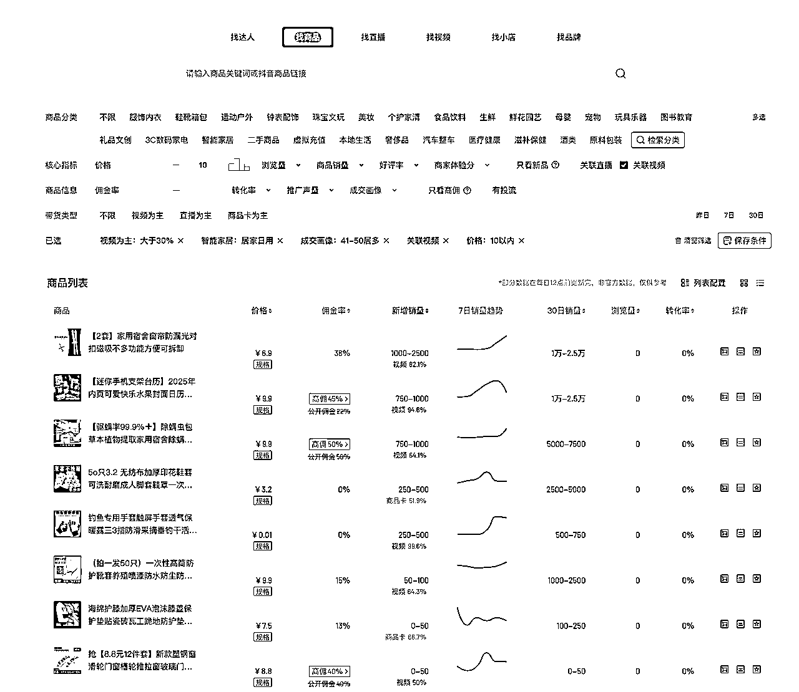

这是我 2024 年 12 月 31 日随手截的图，可以去视频号搜索验证。

PS：视频号人群和算法在 2024 年已大幅进化。

过去认为视频号是 30+ 中老年聚集地，卖他们需要的产品。这个观点已被推翻。视频号上时尚小玩具能爆，年轻化的发饰化妆品也能卖得不错。算法精准度很高，能在短时间内推给大量精准人群。

我们用的是考古加，选品记住一个原则：视频号竞争低、有爆单趋势的商品。

具体平台操作不演示，大家按经验摸索。放一个我们 SOP 里的选品思路。

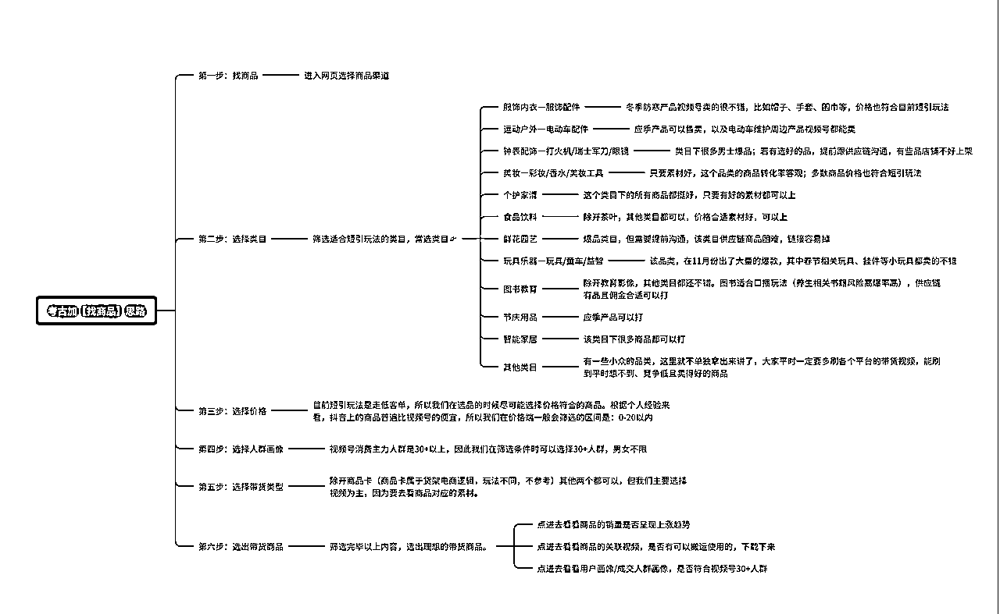

## 2.3 素材制作

素材是核心，做不起来先查素材。

目前短引素材大致分硬广、口播、剧情、科普、解说等。实战来看，每类都有优劣。硬广难出自然流，但一旦起来单场 GMV 很高；口播容易出自然流，容易破 10w 播放，但成交率低于硬广，同场观下 GMV 偏低。

如果你一直没结果，试试换风格，口播和科普解说上手更快。之前做口播自然流厉害的朋友，可联系我们分发素材。

无论什么类型，先判断：品值不值得做、素材是否优秀、爆的概率如何。我们一般从三方面评估：

1. 脚本：文案内容。吸引用户→给出方案→给购买理由→打消疑虑
2. 画面：镜头呈现。产品外观→解决方案→合理性→直接展示用户疑问的答案
3. 商品：售卖点。什么内容、在什么时间、击中什么人群、怎么卖出去

三者优秀，用户看完会立刻产生购买冲动。

制作时围绕一个逻辑：什么脚本、画面、商品组合更易获得自然流推荐。

本想放爆款视频，但微付费里几乎没不能爆的类型，做了 1-2 个月的人都会认同。更难的是系统化管理素材、标准化剪辑、手机登录管理、分发、复用。没做到一定程度没感知，先试错建立体感。

确定素材后，还有一道工序：让视频更容易通过加热审核。可直接下载原视频，用剪映加水印、换部分画面等，增大过审概率。

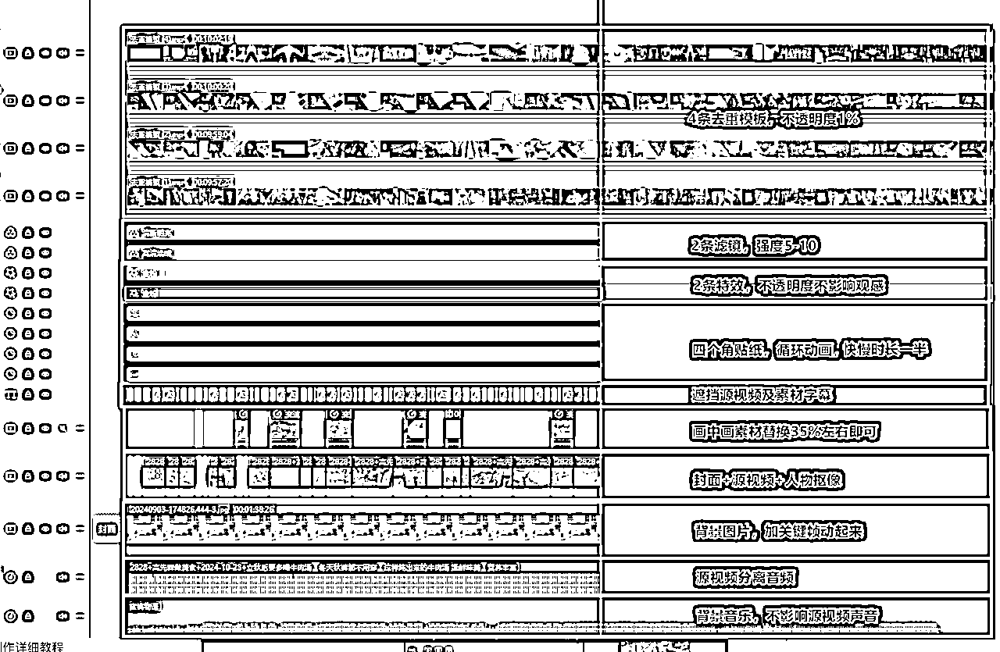

同一支视频，通过剪辑手法重做 5-10 条，后续发布加热测试。

## 2.5 添加商品橱窗

联系视频号团长或供应链上品，商品价格一般 9.9 元左右，佣金 40-50%。上品后拿链接，到视频号助手 https://channels.weixin.qq.com/login.html 添加到商品橱窗。

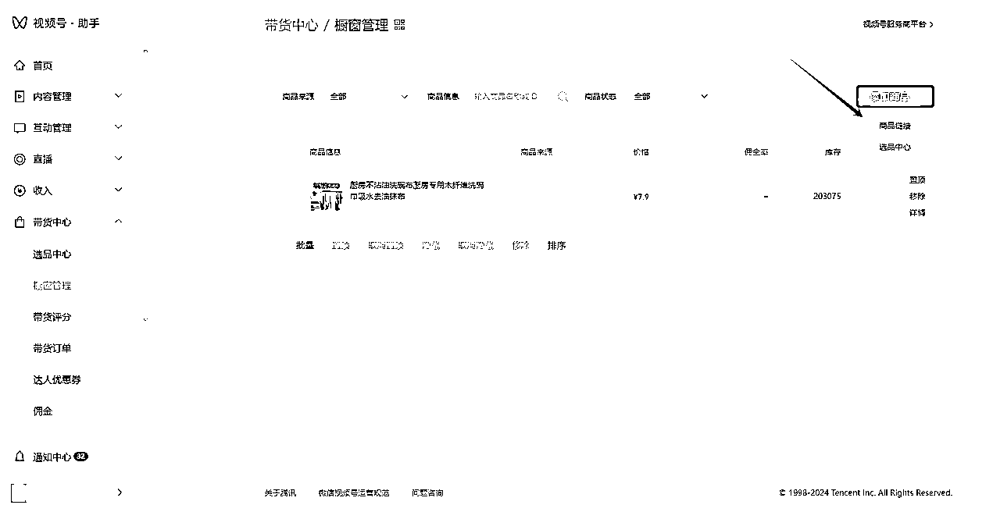

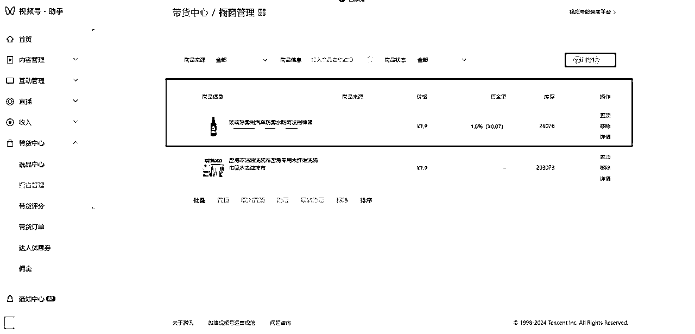

开播前在「直播-直播商品管理」页面把商品加进直播间，否则无法开启购物直播。

## 2.6 测试过审

准备好后，在视频号助手后台 https://channels.weixin.qq.com/login.html 发布视频。目前有 4 种发布方式，都是摸索出来的。新手别搞复杂，直接发剪辑好的 5-10 条即可，不用点原创也不用间隔。

发布约 20 分钟后播放量会破 0，这时若提示违规，大概率去重没处理干净，删除即可。后续我会放视频版剪辑教程，去重确实麻烦，📕也有参考方法。

接着测试过审，过审后找代播正式开播。投放过审没太多技巧，注意点：

* 手机自播，对着正脸说话，不用念话术，不用不好意思
* 投放计划必须选【短视频-直播间】的深层计划，别投浅层，否则起不到测试效果

在视频号加热平台按此创建计划：https://channels.weixin.qq.com/login.html?from=promote

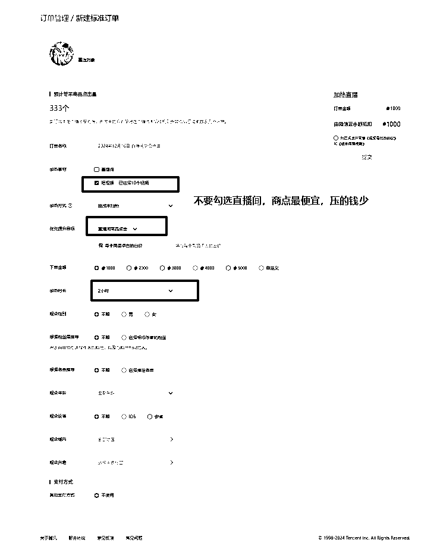

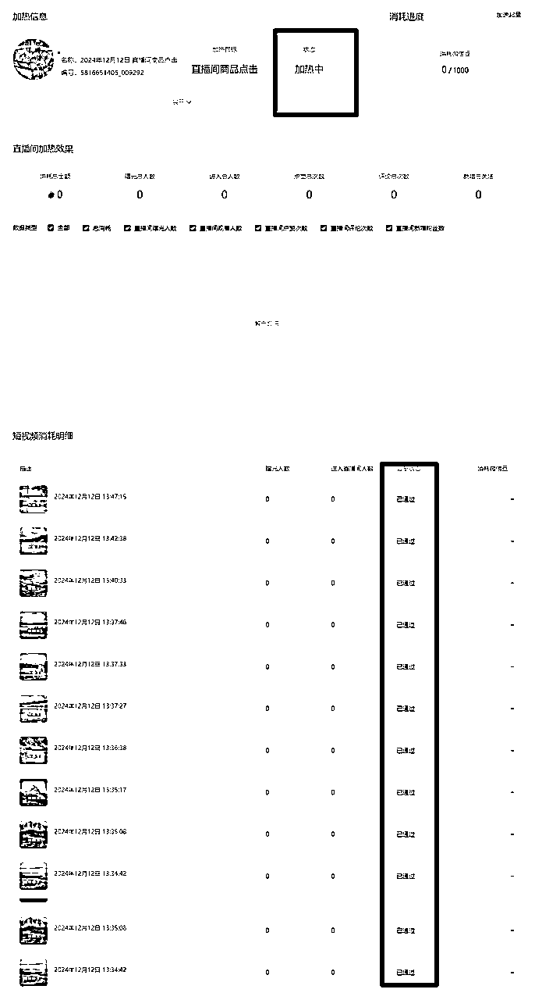

一般开播后投放，5 分钟能看到审核结果。图二为通过，可下播进入下一步。若未通过，看原因修改后重试。

## 2.7 寻找代播

短视频已完成种草，直播间只是收银台。所以短引项目只需代播，无需自建直播间。除非长期直播或高客单才需要专业主播提升转化。

代播价格约 40 元/小时，视频号最强团队是【六月代播团队】。合作流程代播团队会给更详细的指引，心里先有个概念即可。

在代播的配合流程里，起步就是把要上链接的商品图或者商品名直接丢到代播群里。

这边会帮你匹配合适的主播，人进入群后会关注你的视频号，并完成与视频号运营体的绑定操作。

等绑定走通，就去视频号助手后台把直播商品挂上，这一步完成才算真正具备开播条件。

代播上了播后，先让自己冷静盯直播间三五分钟，确认场景合理、主播状态在线、样品没有明显问题，再进入付费放量阶段。

## 2.8 🛰️豆的投放

🛰️豆的投放可以说是整套玩法里最致命的一环，策略和手感把握不好，亏本基本就从这里开始。早期我们也在不停试错，听见一个说法就用两三场去做验证，单次测试成本就五六千往上，走过很多条弯路才偶尔撞到一次正反馈，慢慢把每一步都打磨顺了。

直播时我也和不少人拆解过自己的投放思路，后来有朋友连麦告诉我，按我说的思路调整后很快就起量了。也有人私信说照着做还是不行。差别就在于投放体感。同样一套参数，有经验的人能凭消耗节奏和大屏曲线判断是否在预期轨道上，而只会点开创建计划、看不懂数据也不复盘的人，很难有好结果。前期多上场实操、积累手感是必修课。

先把投放工具和选项的意思讲清楚。

我们用的是第三方投放系统：海豚智投，可免费试用。比官方后台更顺手，能看到更细的数据，便于快速判断趋势。

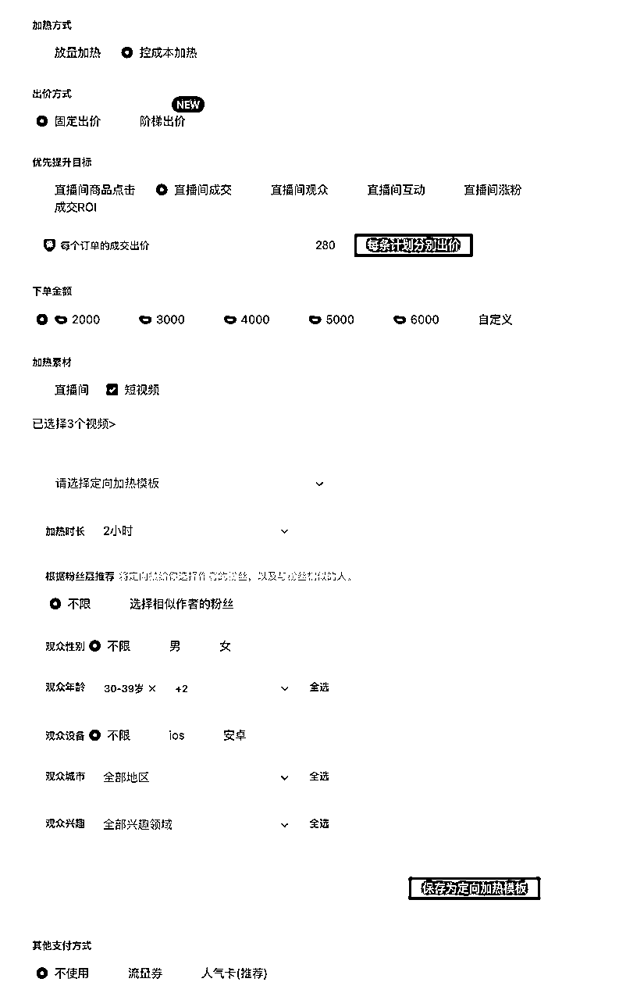

加热方式

放量加热：不设出价上限，在预算范围内追求最大化触达

控成本出价：设定出价上限，在这个范围内去达成目标

出价方式

固定出价：就是计划里设定的单次出价

优先提升目标

直播间商品点击：浅层目标。只追求商品卡被点，不保证成交

直播间成交：深层目标。追求下单成交，例如设定每成交一单出价1000🛰️豆，系统会在这个成本范围内找买家

成交 ROI：深层目标。追求成交，但考核方式不同，例如出价5 ROI，系统会在100元花费里去争取500元成交额

加热素材

直播间：直接加热直播间，对人货场的综合要求很高，短引玩法基本不用

短视频：加热短视频，对直播间依赖度低，我们全部走短视频加热

弄懂这些选项的含义后，再说短引投放的底层思路，让大家明白我们到底在干什么。

核心是用短视频加热把视频流速稳定在100到500之间，并让进入直播间的用户达到每5分钟10人以上的节奏，直播间始终保持5人以上的真实在线。用第一波流量制造成交、点赞、评论等互动，借助羊群效应带动真实下单，再让系统基于标签推来更多相似用户，从而把直播间带起来。

短引微付费的逻辑，归根结底是靠流量设计和付费节奏提升互动与转化：

1. 峰值切入人群：直播间进线人数陡增到高峰时，是最适合放量的时候。这个阶段进来的人群跟随购买的概率更高，能抬高热度和转化
2. 羊群效应：尤其是中老年用户，对从众信号很敏感。引导他们先下单，就能形成下单氛围，系统也会基于这些标签继续推送同类人群
3. 数据清洗：把进来的流量做区分，筛选出有购买意愿的信号，让系统更精准地分配流量
4. 放量策略：当流量层级打开后，用放量计划配合直播时长去触发短引。稳定后可暂停新增付费，让现有数据自然滚动
5. 止损策略：在用付费撬动自然流的过程中，止损点很难绝对判断。除非账号违规或结算异常，否则很难给出清晰的停止时机

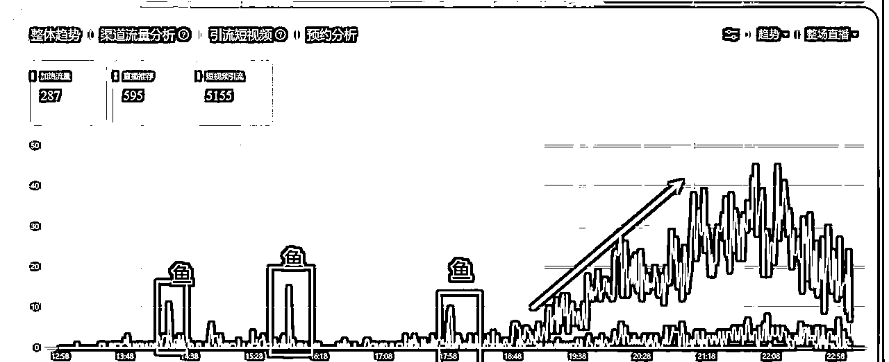

投放过程中数据变化极快，必须根据实时情况快速调整。

我们内部试过不少激进打法，不太适合零基础新手。下面这套是相对通用、容错率较高的参考方案，具体还是要结合项目和阶段迭代。

第一步打法：先上3条已过审视频，用数据筛出一枝独秀的那条继续养

1条商点计划，出价区间30-50

2条ROI计划，出价区间0.3-0.5

1条成交计划，出价260起步

1条放量计划，预算200，跑2小时

第二步打法：集中投放被筛选出的那1条视频

3条ROI计划，出价0.3-0.5

1条放量计划做托底，预算200，时长2小时

当1-2步进入波峰期，用10-20条鱼去做转化承接

若计划不消耗或跑飞，要立刻补量或调整参数

以上只是逻辑框架。市面上能出结果的打法很多，但核心目的和底层原理是一致的。

项目里真正难的，不是选了什么品、用了什么素材、怎么建计划，而是能否快速试错、快速拿到正反馈，并在无数次实战中读懂趋势、顺势演化，抓住属于自己的那条机会。

# 写在最后

很多朋友见证了我的变化，从20年的淘宝、知乎好物，到现在的视频号短带、短引、ADQ、自然流、付费投放，团队在每个赛道都拿到了不错的成绩。有些人三个月前还在问我项目怎么玩，三个月后我们已经在行业里成为头部。

我也在想为什么。抛开努力和运气，可能在于我始终相信，大部分人做不成，是因为不敢赢、怕输。很多事就差临门一脚，内心的恐惧让我们后退一步，用各种“可是”“万一”说服自己。迈出去的人，往往轻松拿下。勇敢的人先享受世界，享受我们从未见过的新世界。

一位前辈跟我说：麦洛相信我，赚钱其实很简单，把一件事做到极致，机会自然会长出来。这句话在每次决策时都会浮现。我会问自己，这个项目最重要的事是什么？我做到极致了吗？机会出现了吗？把这份思考也送给大家。

回到短引本身，我能看到很多机会正在生长。大家加油，争取早点跑通闭环，找到属于自己的那份确定性。

2024年一直被一句话鼓励着，也把这句话留在这里送给大家：一定可以的