# ('关于绕开个人5万美元便利结汇额度的方案', (2, 21))

标题：个人5万美元结汇额度不够用？谷歌、苹果收款人请看这里

常年跟谷歌、苹果平台打交道的博主、开发者和站长，多少都有过这种体验：钱赚到了，外币也到账了，但个人便利化结汇额度只有5万美元，用完就没了。想找新办法，又怕渠道不正规。其实，正规路子是存在的，而且可以做到不限额度。当然，任何通道都有成本，这一点要先理性看待。

我们目前与银行合作，共建了一个面向谷歌、苹果生态的服务贸易真实性审核与结汇平台。依据《服务贸易结汇指引（V.20240217）》以及银行直连谷歌结汇指引手册，平台可以为用户完成贸易真实性认证。通过认证后，结汇不再被5万美元封顶，单笔无上限、总额无上限，合法合规。

哪些人可以参与？主要就是通过谷歌、苹果平台获得收入的个人或公司，比如YouTube博主、App开发者、网站站长等。

接下来看看开户和日常操作。

个人开户：先做风控审核，提交业务类型和主营服务等信息；然后填写开户信息表、递交资料，我们会把服务贸易代理服务协议书一式三份寄给你。之后你有两种开卡方式：一是用银行二维码线上开户；二是让我们拿身份证复印件在重庆合作网点开实体一类卡，或者你本人到重庆网点办理。银行卡会通过顺丰寄到你手上，你持身份证去当地银行网点激活，才能正常收外汇。最后，把这张卡绑定到平台的提现银行卡列表里。

企业开户：先提交营业执照照片和开户信息表，我们帮你预约公司开户时间，你把盖章后的服务贸易代理服务协议书寄回。开户当天，企业法人带上全套材料和相关印章到重庆网点办理。资料包括：营业执照正副本、组织机构代码证正本、税务登记证正本（已三证合一的提供营业执照正本即可）、开户许可证、人民银行机构信用代码证、法人身份证，以及公章、财务章、法人预留印鉴章。账户开好后，同样添加到平台提现银行卡。

日常结汇流程也不复杂。第一步，在平台后台把结算相关页面截图，压缩打包发给工作人员，用于额度申报。第二步，平台定期打款到你的指定银行卡。第三步，外汇进入国内银行后，只要额度足够、信息无误，当天即可入账，遇到节假日顺延到最近工作日。第四步，你在银行App的“寰宇结汇”栏目自助结汇，不限额，也不占用5万美元便利结汇额度。如果入账有疑问或资金没到，凭谷歌汇款单联系客户经理，由银行协助查询。

最后提醒一句：开户信息表要直接发给客户经理，服务贸易代理服务协议书需邮寄三份纸质件。

以下是图片说明：

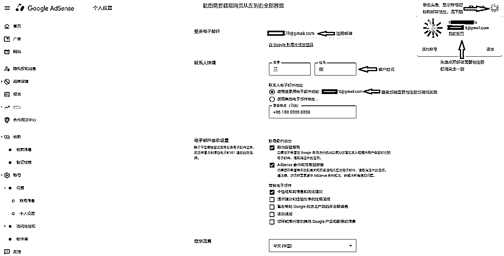
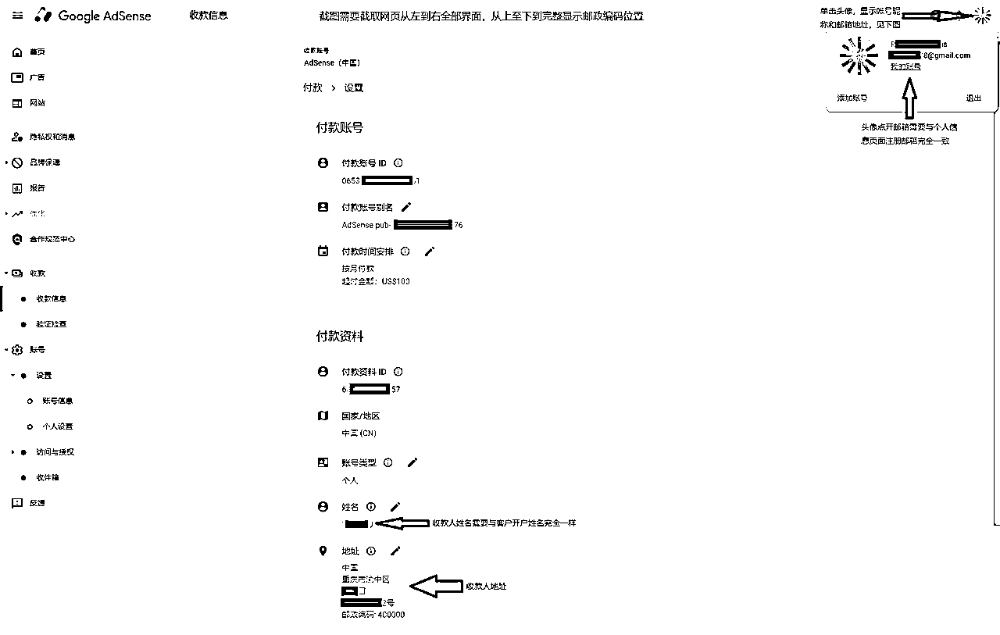
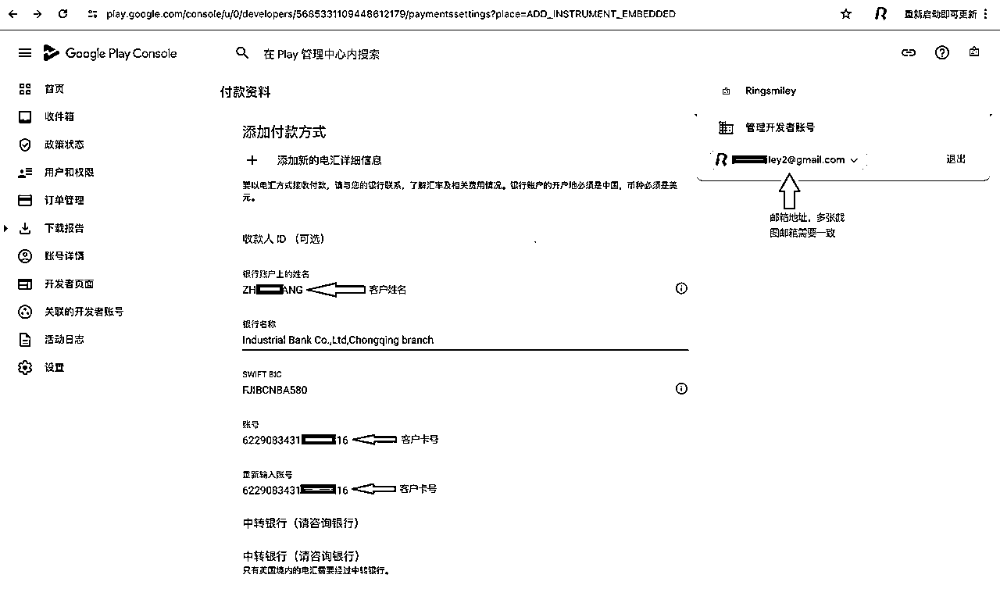
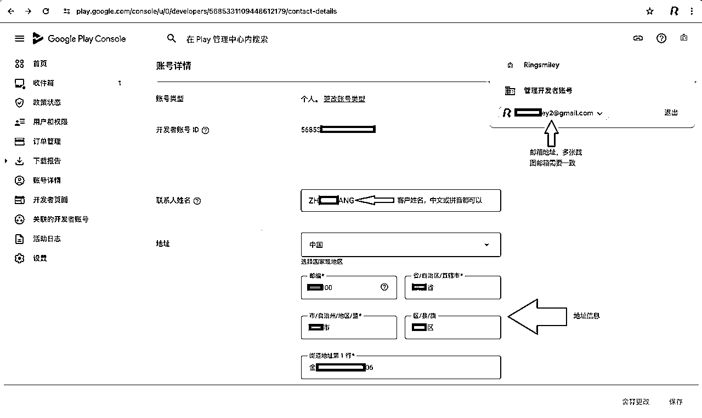
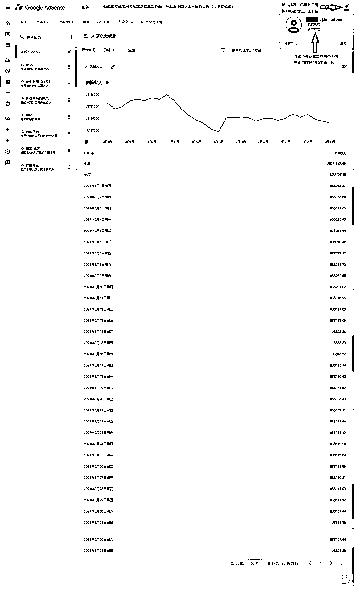
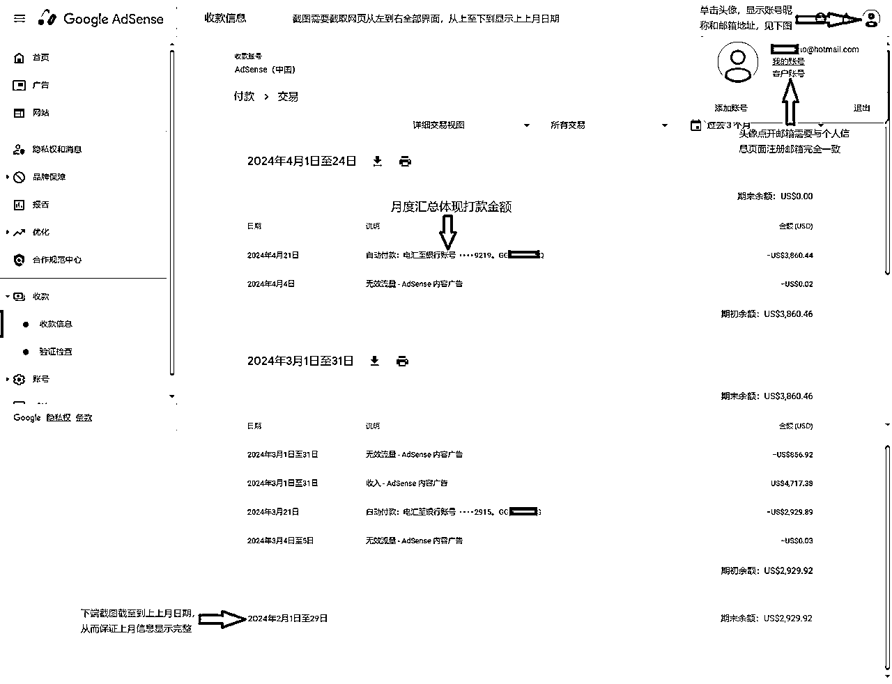
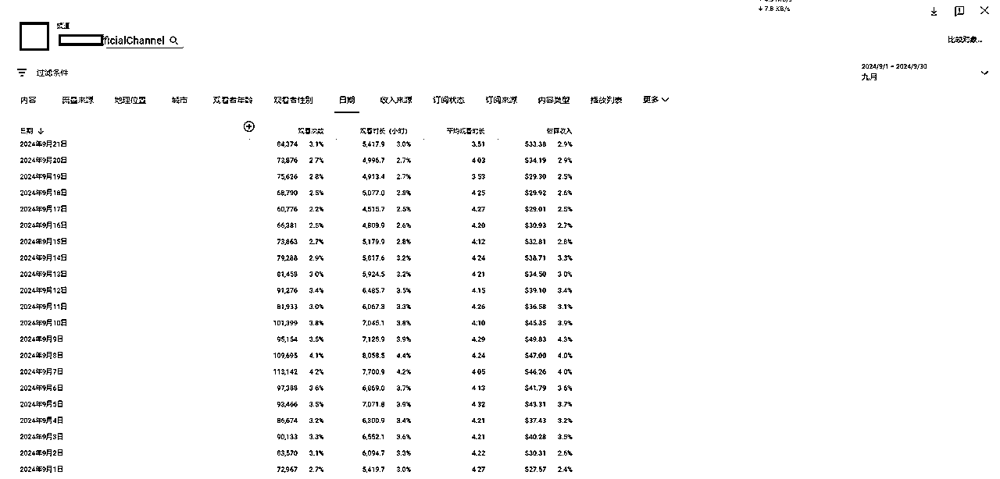
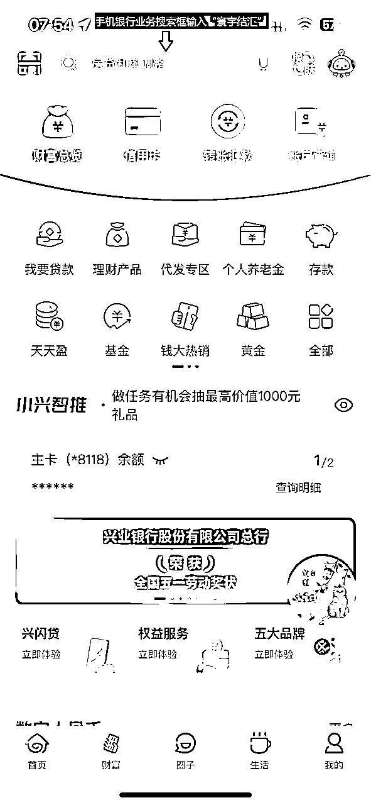
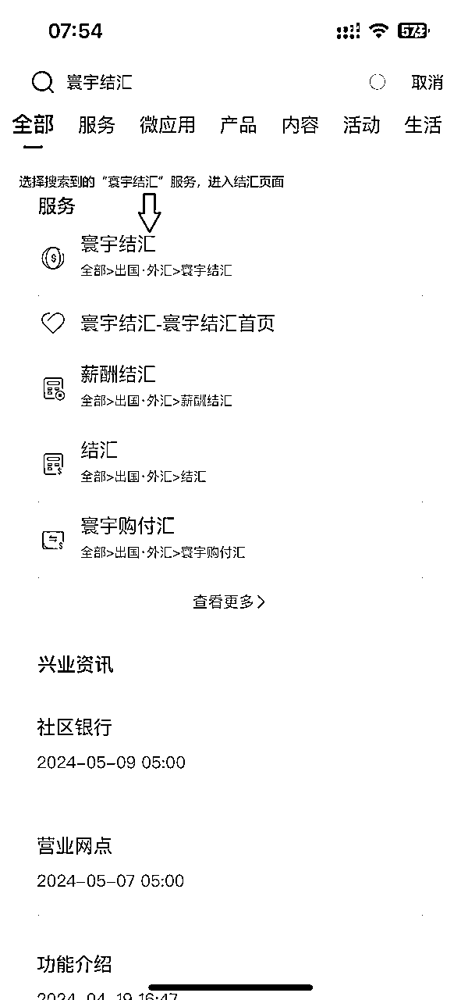
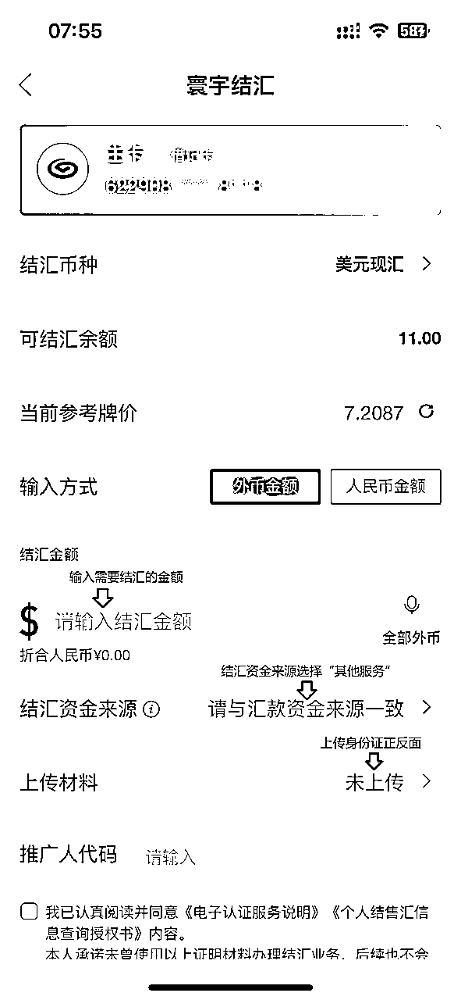
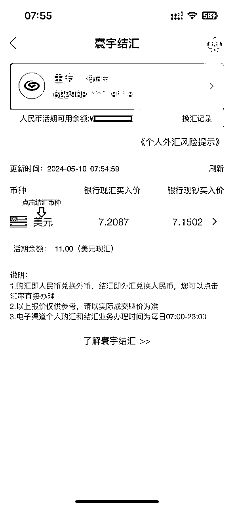