# ComfyUI 可视化工作流入门：三步建立实操思维
作者：龙哥

# 一、认知篇

## 开场

2024 年 12 月我加入了 comfyui 航海活动，这才体会到：无论是初学 ComfyUI，还是想把它用熟，门槛都比想象中高，大部分时间都在面对一堆问号。

怎么才能更快上手？

我把自己的学习经历总结为 3 个阶段，帮助你快速建立全局观，为后续深入使用打下基础，这也是本文的重点：

我本身是产品背景，写作时尽量做到通俗易懂。但我也是新手，很多知识点理解是否到位没有把握。

若有欠缺之处，欢迎指正。

另外，文内不少内容来自我向 AI 请教或汇总他人文档，难以做到完全原创，特此说明。

hi，很高兴认识你，i am 望月

## 先搞清楚 ComfyUI 能干什么

### 核心能力：由文字生成图像

一句话概括：Text-to-Image 文生图。

这是 ComfyUI 最核心也最常用的能力，用户通过自然语言描述就能得到较为复杂的艺术画面。

AI 工具迭代很快，ComfyUI 的应用边界并不局限于此，还覆盖 AI 图像、AI 影片、AI 声音、AI 三维、AI 文本等多个方向。

知识点：文生图的工作原理

第 1、提交描述：使用者输入一段文字，通常包含画面主体、风格走向、色彩倾向、氛围感受等信息。

比如：“一只身穿西装的猫，立在城市街道，夕阳余晖做背景”。

第 2、模型解析：AI 模型会拆解输入的句子，提取关键词与语境，并据此构建图像。

例如，系统会识别到“西装”、“猫”、“街道”、“傍晚”这些要素，并按它们之间的关系生成对应的画面。

第 3、产出图像：模型基于解析结果，通过卷积神经网络、扩散模型等技术进行计算，最终呈现图像。用户可自行再编辑或优化。

### 先体验 ComfyUI

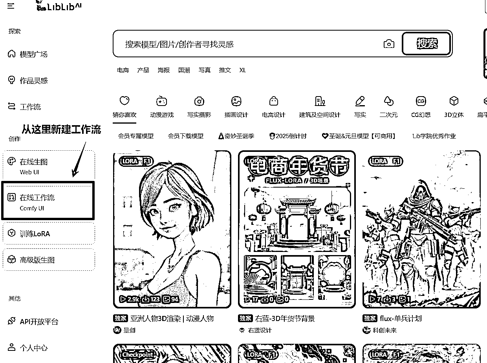

新人建议先用云端版本，跑通流程感受交互，熟练后再考虑本地部署。

推荐：https://www.liblib.art/

本地安装涉及硬件配置、模型下载、插件配置等一整套流程，耗时较长。新手不建议上来就直接本地化。

## 建立 ComfyUI 的基础认知

### 工作流 workflow 的概念

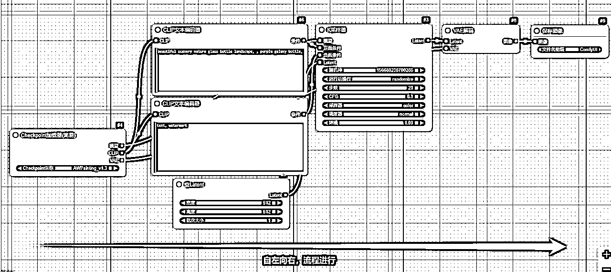

界面上那些一个个黑色方块即为节点 node，按一定顺序用连线 connections 或 links 串联起来，完成某一具体任务的组织方式即是工作流。

通俗理解：工作流就是按步骤、有序执行以达成特定目标。

说明：工作流并非新概念，历史已久，很多行业都在用，例如 2B 场景里的业务流、操作流等。

为什么要采用工作流？

第1、按需定制：可以自由搭建符合自己习惯的流程，而不是被固定模板限制。正因如此，学习成本也随之提高。

第2、灵活扩展：既能复用他人的流程，也能改造或自建节点，快速应对新问题。

工作流要点：

* 有序排列的节点与连线
* 完整的数据处理链路
* 可重复调用的任务模板
* 类似编程中的执行序列

工作流优势：

* 可视化直观
* 修改便捷
* 调试方便
* 可保存复用

### 节点 node 的概念

工作流中每个黑色方块都叫做节点，每个节点负责一个具体功能，体现的是程序设计的模块化思想

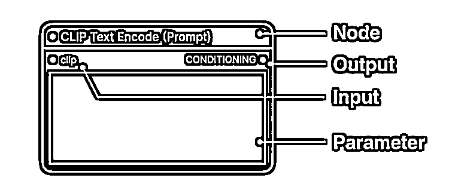

在 ComfyUI 里每个方块都称为 Node。

左侧端口为 Input 输入，右侧为 Output 输出，每个节点内部都设有可调参数 Parameter。

节点特征：

* 每个矩形代表一个功能模块
* 单一职责，聚焦特定功能
* 可独立配置与调试
* 类似函数或类

典型节点类型：

* 模型载入节点
* 文本编码节点
* K 采样节点
* VAE 解码节点

### 连线 Connections 的概念

连线将分散的节点串联成完整的工作流。

连线功能：

* 明确数据流向
* 连接各功能单元
* 传递中间结果
* 类似代码中的数据传递

连线特征：

* 具备明确的输入输出端口
* 要求数据类型匹配
* 支持多进多出

#### 知识点：连线规则？

##### 同类相连

只能把同类数据相连，不同格式无法连接。记忆口诀：同色即能连

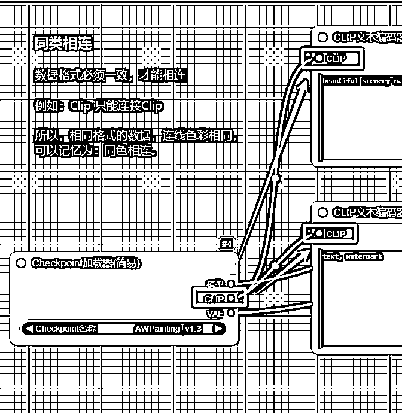

##### 左进右出

节点左边接收数据，右边输出结果。也就是把前一个节点的输出作为下一个节点的输入。

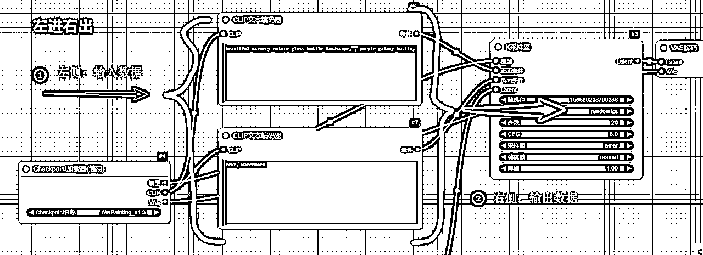

##### 一进多出

输入端口只能接入一条连线，输出端口可以分出多条连线。

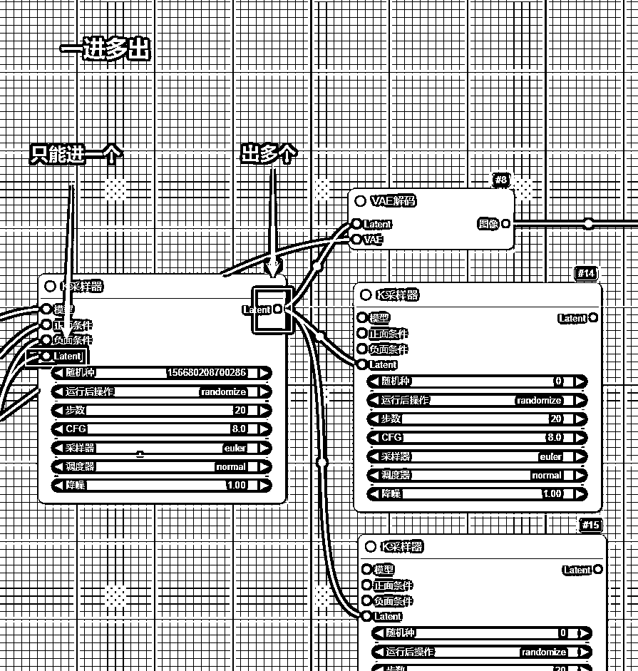

## 文生图理解：从节点切入

学习完核心概念，接下来要理解 ComfyUI 的核心功能。

本部分先从节点讲起，再到工作流，弄懂两者关系就等于掌握文生图，也就抓住了 ComfyUI 的精髓。

文生图官方默认会提供一个最基础的工作流，关键节点如下：

### Checkpoint 载入器 Load Checkpoint

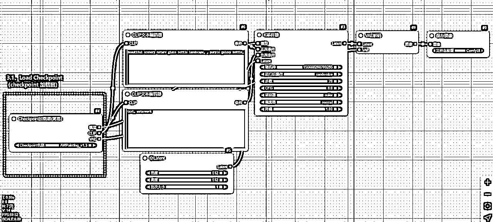

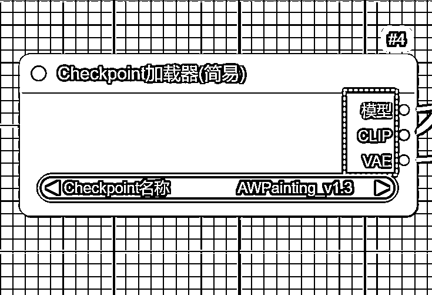

Checkpoint 载入器是所有工作流的起点，必须先载入 Checkpoint 才能进行后续配置与运行。

Checkpoint 是 Stable Diffusion 模型的核心，包含 MODEL UNet、CLIP 与 VAE 三部分，分别负责去噪、文本理解和图像解码，一起完成从文本到图像的生成。

### CLIP 文本编码器 CLIP Text Encode

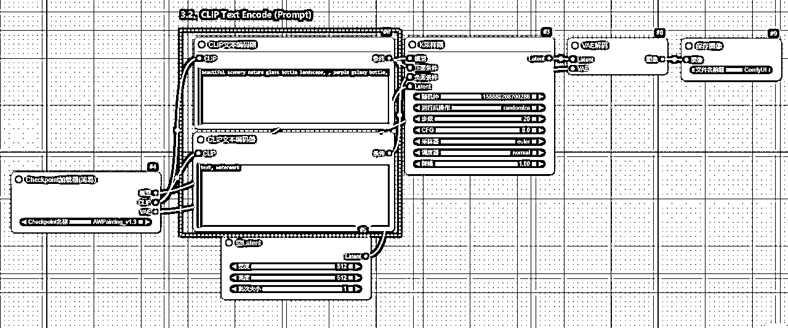

CLIP 全称是 Contrastive Language-Image Pre-training，即对比文本图像预训练。

该节点主要用于输入 Prompt：

一般会放两个节点，一个正向 Prompt 写你想出现的元素，一个负向 Prompt 写你不想出现的元素。

1、Prompt 不是越长越好，建议控制在 75 token 左右，约 60 字以内。
2、用逗号分隔，StableDiffusion 不懂语法，只需罗列关键词即可。
3、越重要的词越靠前。例如想生成美丽风景，可把 beautiful scenery nature 放在前面。

### 空潜空间图像 Empty Latent Image

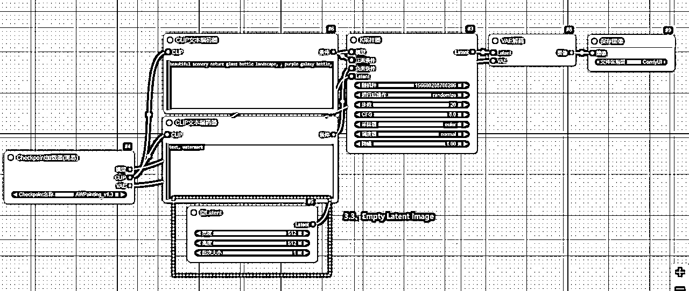

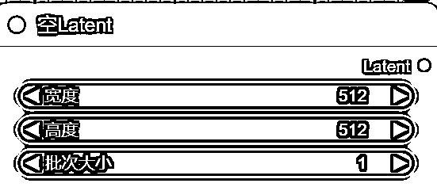

空潜空间图像节点用于设定输出尺寸，通过 width、height 调整。

batch_size 批次表示每次运行生成图片的数量，设为 6 则每次产出 6 张。

比例要求：宽高需是 8 的倍数。

### K 采样器 KSampler

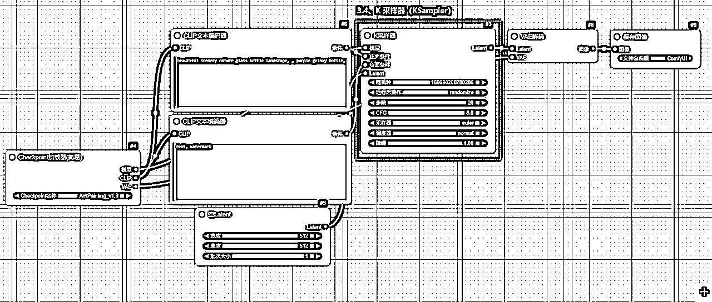

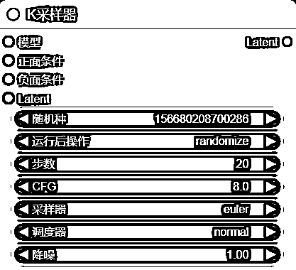

KSampler 是 ComfyUI 的核心模块，负责图像生成的关键过程。

它像一位画师，从噪声图像开始逐步去噪，最终将文字描述转化为画面。

### VAE 解码

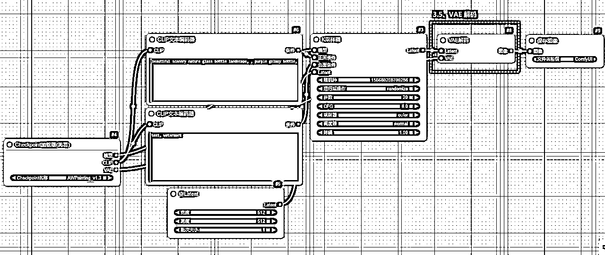

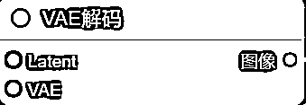

VAE 解码全称 Variational Autoencoder Decode，变分自编码器解码。

VAE 解码器负责把潜空间信息还原为可见图像。

### 保存图像 Save Image

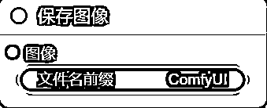

该节点职责明确：

* 处理图像格式
* 设定保存路径
* 控制文件名
* 选择压缩方式

## 文生图理解：工作流层面

节点通过连线串联即形成工作流，ComfyUI 的文生图功能正是依赖工作流实现。

把上述节点纳入流程，你就能大致明白工作流的运行方式。下一步是深入掌握基础节点。

## 基础节点详解一：载入器 Loader

### 一点吐槽

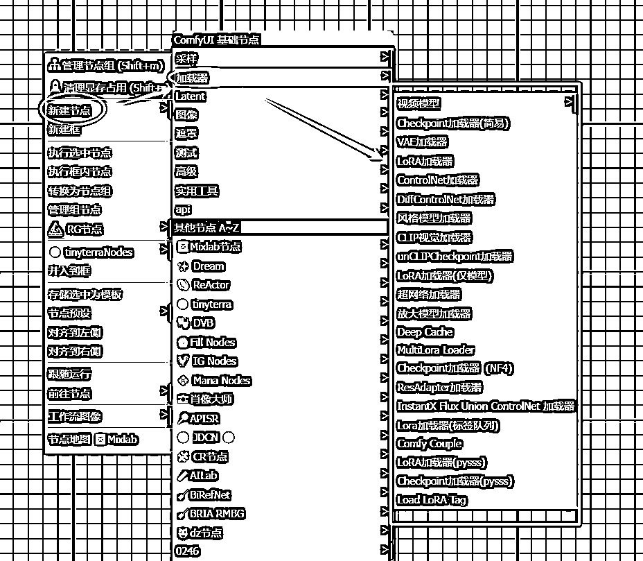

作为产品人，我对 AI 类产品的 UI 设计又爱又恨。功能很强，UI 却普遍不友好，各有各的奇怪。

新手第一次面对大量载入器，很难分辨各自用途，还把大量功能塞进鼠标操作，这设计确实不顺手。

吐槽归吐槽，还是得学。

### 载入器的核心作用

第1、基础模型载入
Checkpoint 载入器：
* 载入绘画核心模型
* 初始化生成能力
* 决定基础风格

第2、特殊功能载入
专业载入器：
* ControlNet 载入控制模型
* 放大模型载入超分辨率模型
* 影片模型载入动态处理模型

第3、风格微调载入
风格载入器：
* LoRA 载入风格微调模型
* 超网络载入网络增强
* 风格模型载入特定风格

比喻：载入器就像画画前的准备，挑选画笔、准备颜料、调配材料、布置画板。

### 载入器分层理解

#### 基础层 必学
* Checkpoint 载入器 简易版 - 基础模型载入
* VAE 载入器 - 编解码
* LoRA 载入器 - 基础风格微调

目标：跑通基础文生图，理解核心流程。

#### 进阶层 常用
图像控制：
* ControlNet 载入器
* DiffControlNet 载入器
* InstantXFluxUnionControlNet 载入器

风格调整：
* 风格模型载入器
* LoRA 载入器 仅模型
* MultiLora Loader
* Load LoRA Tag

图像优化：
* 放大模型载入器

#### 专业层 特殊需求
视觉处理：
* CLIP 视觉载入器
* unCLIPCheckpoint 载入器
* Deep Cache

高级功能：
* 超网络载入器
* Checkpoint 载入器 NF4
* ResAdapter 载入器

特殊应用：
* 影片模型
* Comfy Couple
* Lora 载入器 标签队列

#### 定制层 扩展
* LoRA 载入器 pysss
* Checkpoint 载入器 pysss

## 基础节点详解二：条件 Conditioning

条件节点的核心作用是引导与控制生成过程。

注意：前面提到的 CLIP 文本编码器本质上就是一种条件节点。

### 条件节点概览

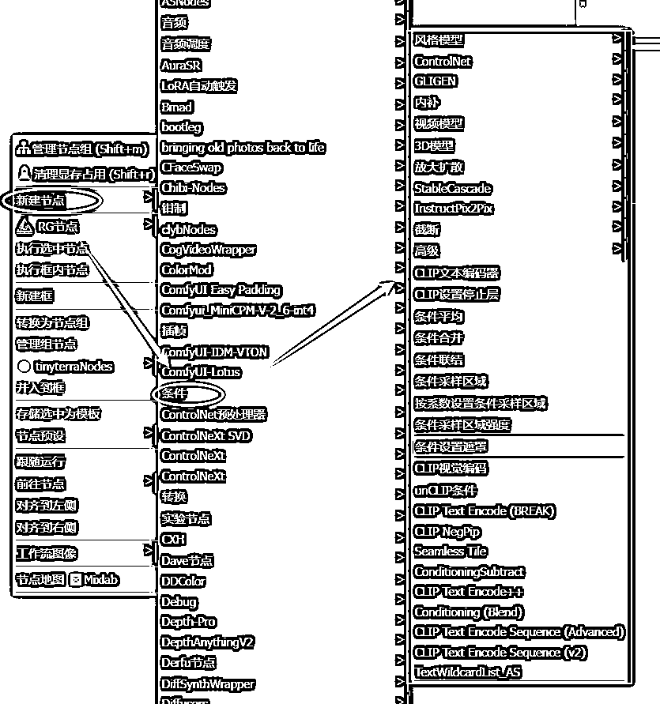

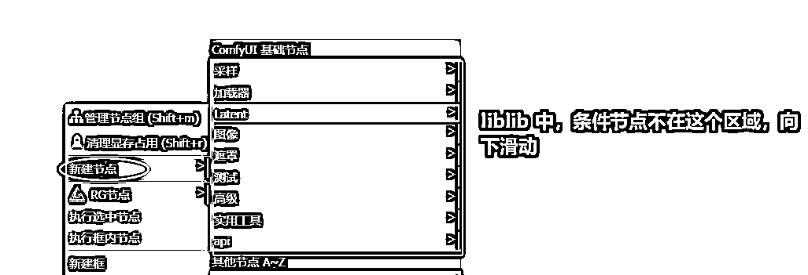

### 条件节点作用

第1、引导方向
像画画：
* 提示词 告诉 AI 画什么
* 参考图 告诉 AI 怎么画
* 控制条件 告诉 AI 画得更准

第2、控制细节
* 构图布局
* 风格特征
* 细节表现
* 区域生成

### 应用场景

文本引导
CLIP 文本编码器：
* 把文字转成 AI 可理解特征
* 指导生成符合描述的图像
* 控制内容与风格

图像引导
ControlNet：
* 用参考图控制生成
* 保持构图姿势线条
* 提供视觉引导

条件采样区域：
* 控制局部区域生成
* 调整区域生成强度
* 实现局部精细控制

比喻：载入器准备画笔颜料，条件节点相当于参考资料、构图线、色彩样本、细节示范。

### 条件节点分层

基础层 必学
文本条件：
* CLIP 文本编码器
* CLIP Text Encode++
* CLIP NegPip

视觉条件：
* CLIP 视觉编码

控制层 常用
精确控制：
* ControlNet
* GLIGEN
* 内补

增强控制：
* 放大扩散
* StableCascade

条件处理层 进阶
条件组合：
* 条件平均
* 条件合并
* 条件联结
* Conditioning Blend

条件区域：
* 条件采样区域
* 按系数设置条件采样区域
* 条件采样区域强度

特殊应用层 专业
特殊处理：
* 截断
* CLIP 设置停止层
* Seamless Tile

高级功能：
* unCLIP 条件
* InstructPix2Pix
* 3D 模型

序列和通配符 扩展
* CLIP Text Encode Sequence Advanced
* CLIP Text Encode Sequence v2
* TextWildcardList_AS

## 基础节点详解三：Latent

### Latent 节点概览

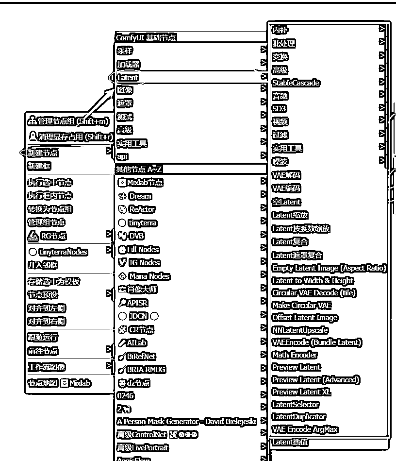

### Latent 核心作用

第1、潜空间操作管理
像画布：
* 创建画布 空 Latent
* 调整画布 缩放
* 合并画布 复合
* 预览效果 潜空间预览

第2、数据转换处理
* 图像到潜空间 VAE 编码
* 潜空间到图像 VAE 解码
* 尺寸变换
* 特效处理

### 应用场景
潜空间准备、中间处理、转换控制

比喻：Latent 就是画布操作，准备、调整大小、拼接、编解码展示。

### Latent 分层

基础层 必学
* 空 Latent
* VAE 编码
* VAE 解码
* Latent 缩放

预览：
* Preview Latent
* Preview Latent XL

变换层 常用
尺寸处理：
* Latent 按系数缩放
* NNLatentUpscale

玩过 ComfyUI 的朋友应该都有感触：节点虽多，但真正决定出图质量的，无非是几个关键模块。今天这篇文章，我想帮你把这些核心知识梳理成一条清晰的线，从 Latent、采样器到图像处理，再到几种常见的生图方式，让你少走弯路。

## 先从 Latent 说起：尺寸、组合与进阶操作

在 ComfyUI 里，Latent 可以理解为“潜空间”中的图像载体。想要精确控制尺寸，同样离不开节点的配合。

- **精确尺寸**：通过 Latent 相关节点直接设定宽度和高度，输出尺寸完全掌控。
- **组合处理**：最基础的是 Latent 复合，它可以把多个 Latent 合并起来；在此基础上还有带遮罩的复合方式，适用于局部合成；如果需要偏移，则用到 Offset Latent Image，做位置微调。

进入进阶层面，Latent 的处理会更灵活：

- **特殊操作**：内补节点用于图像修复，StableCascade 适合级联生成流程，Latent 插值则能在两个状态之间做渐变过渡。
- **批量操作**：批处理节点支持一次生成多张；LatentSelector 负责从批量结果中挑选，LatentDuplicator 则用来复制指定 Latent。

对于专业需求，还有几类针对性功能：

- **圆形编码/解码**：Circular VAE Decode 和 Make Circular VAE 配合使用，解决无缝纹理等场景。
- **VAE Encode ArgMax**：采用最大值编码，追求更精确的映射。
- **媒体相关**：音频、SD3 特性、视频处理等都有专属 Latent 节点，满足不同模态需求。

辅助工具方面，也不要忽略它们：

- **Math Encoder**：用数学方式编码，适合参数化控制。
- **VAEEncode (Bundle)**：支持批量编码，效率更高。
- **Empty Latent (Aspect Ratio)**：按预设宽高比直接创建空 Latent，省去手动算尺寸。

## 掌握 5 大基础节点：采样器

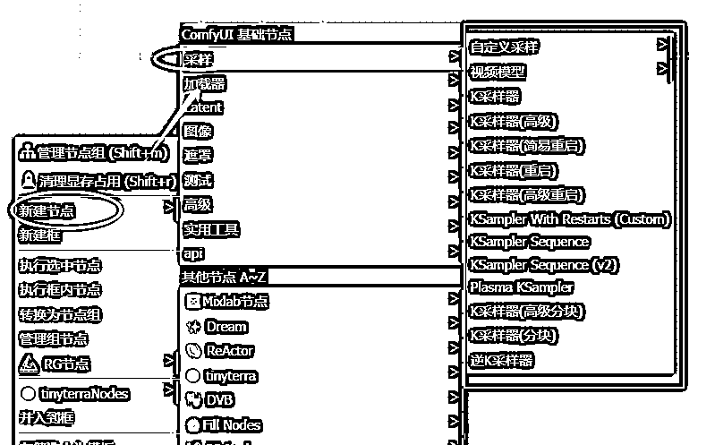

采样器是整个生成流程中的“画笔”，它的核心作用可以分成两方面。

**一是噪声处理与图像生成。** 想象一下画家作画：

- 从模糊到清晰，对应去噪过程；
- 控制细节程度，对应采样步数；
- 把握整体风格，靠 CFG 指引；
- 调整绘制方式，就是换用不同采样算法。

**二是生成过程控制。** 精确控制体现在：

- 步数设置决定生成速度；
- 采样算法影响生成质量；
- 去噪强度关系细节保真；
- CFG 值控制提示词匹配度。

应用到具体场景，你会有不同选择：

- **基础生成控制**：标准采样，平衡速度与质量，确保稳定性。
- **质量优化**：高级采样，提升细节和整体效果。
- **特殊需求**：专业采样，应对大尺寸、连续生成或特殊场景。

如果你还是觉得抽象，就想象一位画家创作的过程：

- 采样算法 = 画家的手法
- 步数 = 绘画的节奏
- 去噪强度 = 修改的力度
- CFG = 参考图的对照程度

接下来，按难度把采样器节点分层理解：

- **基础层（必学）**：K采样器、K采样器(高级)、K采样器(简易重启)，先掌握这三兄弟。
- **重启增强层（进阶）**：K采样器(重启)、K采样器(高级重启)，以及支持自定义的 KSampler With Restarts (Custom)。
- **序列处理层（专业）**：KSampler Sequence 及其 v2 版本，还有 Plasma KSampler 可以制造特殊效果。
- **特殊应用层（高级）**：K采样器(高级分块)、K采样器(分块)、逆K采样器，分别对应分块控制和反向采样。
- **专业模型层**：自定义采样器以及为视频模型定制的采样节点。

## 掌握 5 大基础节点：图像

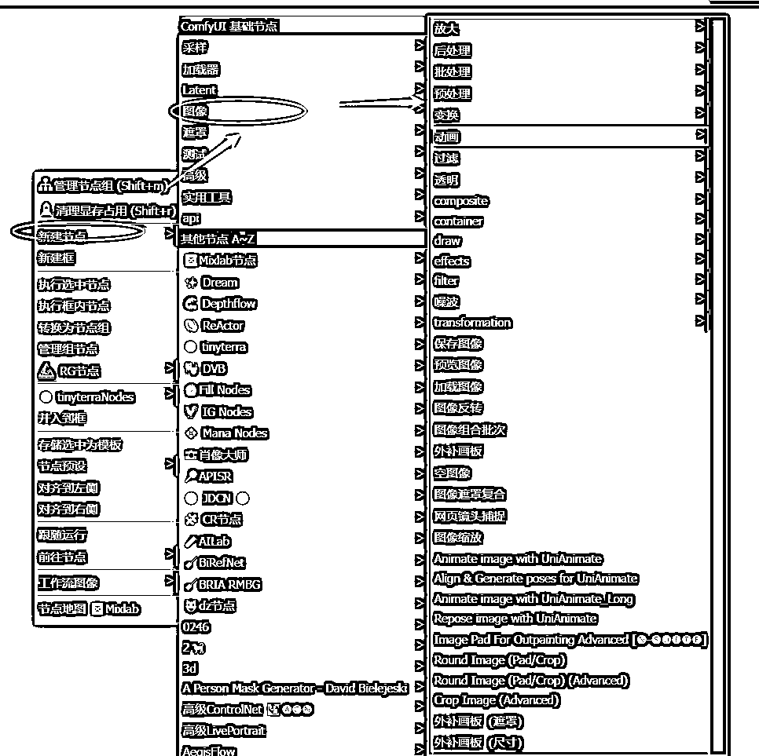

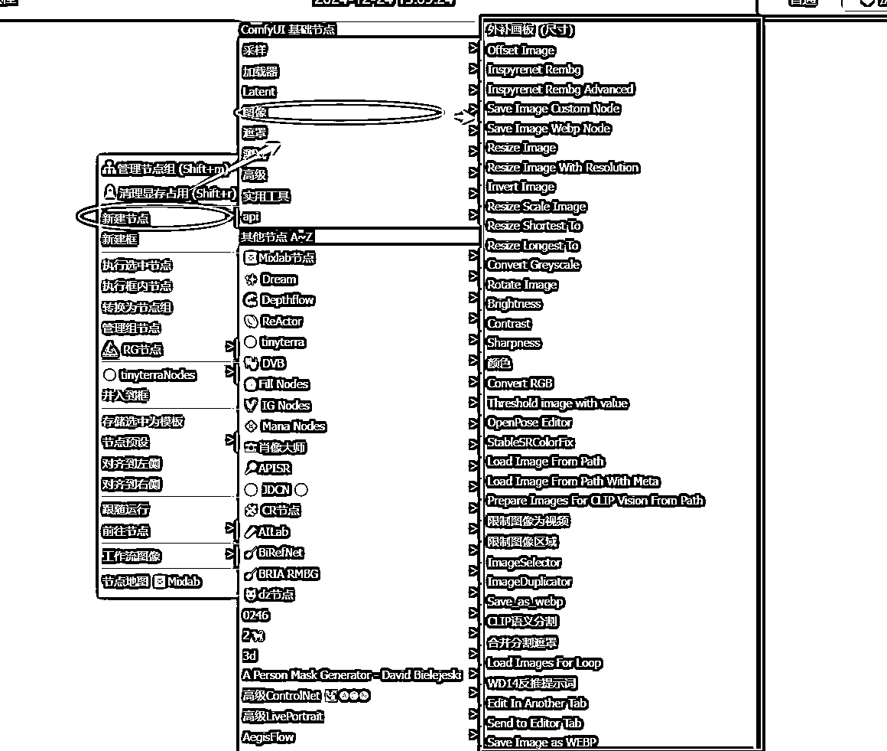

图像节点就像你的后期工作台，核心作用同样是两块。

**一是图像处理与转换。** 流程上对应：

- 图像加载（输入）
- 图像编辑（修改）
- 效果处理（滤镜与特效）
- 图像导出（保存）

**二是质量控制与优化。** 包括：

- 尺寸调整：放大缩小
- 清晰度提升：超分辨率
- 颜色处理：色彩调整
- 细节增强：锐化

常见应用场景也很明确：

- **基础操作**：加载参考图、保存生成结果、预览中间效果。
- **编辑增强**：裁剪缩放、颜色调整、图像合成。
- **专业效果**：风格迁移、修复、特效添加。

你可以想象成照片后期处理：

- 输入 = 照片导入
- 编辑 = PS 处理
- 效果 = 滤镜应用
- 输出 = 成片导出

图像节点同样分层掌握：

- **基础层**：加载图像分为普通加载、从路径加载、带元数据加载；保存图像也有标准版、自定义版、Webp 版；预览节点单列。
- **图像处理层**：缩放家族有 Resize Image、Resize Scale Image、Resize Shortest To、Resize Longest To；基础编辑包含反转、旋转、亮度、对比度、锐度；颜色处理包括调整、RGB转换、灰度转换、StableSRColorFix。
- **高级处理层**：合成与遮罩有图像遮罩复合、composite、组合批次；外扩有外补画板、带遮罩外补画板、按尺寸外补；特殊效果则通过 effects、filter、transformation 实现。
- **专业工具层**：AI 增强包括 OpenPose Editor、CLIP 语义分割、WD14 反推提示词；抠图用 Inspyrenet Rembg 及高级版；圆形处理有 Round Image 的两个变体。
- **批处理工具层**：可用 Load Images For Loop 循环加载，配合 ImageSelector 和 ImageDuplicator 做选取与复制；限制处理则针对视频和区域约束。

## 值得下载的 10 个模型

从上文就能看出，模型质量极大程度影响最终成图效果。选对模型，再针对性练习，比盲目堆节点重要得多。

这里推荐一份好用的模型清单，你可以直接打开：
https://www.comflowy.com/zh-CN/blog/ten-models-worth-downloading

在 Liblib 里搜对应名字即可找到。

# 实践篇：用 ComfyUI 生图的多种方式

虽然 ComfyUI 以生成图片见长，但如今生图方式已经非常多样。我本人也还在练习中，这里先做个简单整理，后续慢慢补充细节。

**文生图（text to image）**
通过文字提示直接生成图片。比如输入“夏日沙滩上的日落”，模型就会输出一幅海滩日落画面。

**图生图（image to image）**
用一张已有图片加上文字描述，共同生成新图。比如给一张草地照片，加上提示词“加上一个在草地上打高尔夫的人”，模型就会在原图基础上补上人物并调整场景。

**提升分辨率（Upscale）**
把低分辨率图变得更清晰、细节更丰富。比如一张模糊风景照，经过 Upscale 后边缘更锐利，细节立刻立体起来。

**局部重绘（Inpainting）**
指定区域修改或补充，常用于修复缺失、损坏或增加新细节。比如在一张人物画像中，用 Inpainting 替换衣服、背景等局部。

**扩展外部（outpainting）**
沿图像边缘向外生成更多内容，相当于扩展画布。比如给城市街景增加更多街道、建筑或天空。

**风格迁移（ControlNet）**
通过输入结构信息（简笔画、轮廓、边缘等）控制风格与内容。例如给一张轮廓图，模型能生成详细的艺术画；或者给真实照片，再控制成油画、素描风格。

---

本文先写到这里。实践篇的更多心得，后续会陆续更新。希望这些整理对你在 ComfyUI 的学习路上有所帮助。