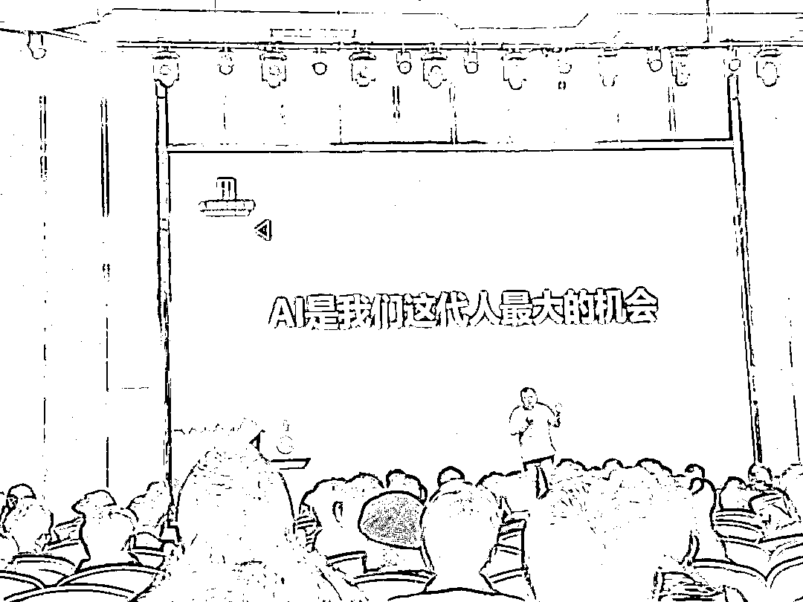

# 这可能是我们这一代最值得押注的机会

大家好，我是小乐。做程序员七年，2016年起玩👸号，2017年底辞职转做自由职业，现在操盘50多个👸号矩阵，全网粉丝40万左右，一直在做公域流量。2021年4月入驻赚钱。

2024年的AI热潮，已经悄悄改写了我们日常的工作和生活方式。有人靠AI写稿、做视频、写代码来做副业，有人借助AI能力创业，还有人用AI视频、AI绘画、AI科普等内容把个人IP做起来。

作为一名一路创业的人，我能真切感受到这波浪潮的推力。它像一条向前奔流的江河，把每个人都带向更宽的海面。变革来得又快又猛，更多的是让人对未来充满期待。

站在2024年的节点回看，我越来越笃定：AI不只是技术上的突破，更是在重塑整个生产方式。

过去一年里，太多普通人的逆袭故事让充电更清晰。有位做平面设计的阿姨，三个月上手AI绘画，月收入从5000元涨到2万元。刚毕业的大学生靠AI编程接单，半年内在北上广买了房。还有个跑外卖的小哥，经营AI视频号，粉丝已破50万。

今天想和大家聊聊，为什么我会认为当下的AI是属于我们的黄金窗口，尤其在AI写作、AI视频这些创作赛道上。无论你是应届毕业生，还是已在职场深耕多年，只要迈出尝试这一步，2025年很可能成为你人生的转折点。

# 一、AI本质上是一台放大器

很多人会问：AI这么深的技术，普通人能碰吗？

我想到二十年前的互联网。当时不少人觉得互联网是程序员的天下，但真正吃到红利的，反而是开淘宝店、做自媒体的普通人。

AI也一样。它像一台神奇的放大器，能把个人的能力成倍放大。过去一个人花8小时才能完成的内容，现在用AI可能1小时就搞定。这不是在贬低人的价值，而是把我们从重复劳动中解放出来，去做更有创造性的事。

你有没有留意，刷短视频、看新闻、听播客时，AI这个词几乎无处不在。有人说它是革命，有人说只是技术人员的狂欢，我的看法是：AI已经超越技术本身，它是这代人实现弯道超车的支点。

支点的意义在于，用小投入撬动大结果。而AI恰好给了普通人这种撬动的能力。它不是高不可攀的实验室产物，而是人人可学、人人可用的机会。如果你觉得AI离自己很远，这篇文章或许会改变你的认知。

# 二、AI视频：门槛最低的参与赛道

在各种AI落地场景里，视频创作可能是最容易上手、受众最广的一块。

你最近刷到的那些“用AI生成自己未来十年的样子”，或者小商家用AI做的商品广告短片，几乎看不出与专业团队的区别。制作成本可能只要几十块钱。

工具门槛在迅速下探。以前做一条短视频要学剪辑、配音、请演员。现在一台普通电脑配上MidJourney、Runway这类主流工具，哪怕不懂设计，也能点点鼠标做出电影质感的内容。

我认识一个开奶茶店的朋友。以前他只会拍产品照，后来用AI给每款新品做了宣传片。视频里冰块晶莹剔透，背景是虚拟星空，每一帧都能截图标配。发到📕后，播放量翻了十倍，门店络绎不绝。

去年我刚接触这个领域，做一条5分钟短视频至少要3天：写脚本一天、拍摄一天、剪辑一天。现在借助AI，2小时就能完成：

* AI生成文案框架
* AI合成虚拟主播
* AI自动剪辑素材
* AI完成配音配乐

成本从上千元降到几十元，效率提升十倍以上，而成片质量却更高，因为AI帮我们规避了很多手工操作容易出的纰漏。

可以说，AI正在把原本高成本、专业化的创作平民化。资源和技术不再是限制，有想法就能通过AI变成现实。

# 三、为什么我说这是“最大”的机会

历史上，每一次巨大的机会都伴随着生产工具的升级：

* 蒸汽机解放了体力
* 电力提升了工业效率
* 互联网打破了信息壁垒
* AI则首次让脑力劳动实现了规模化

当普通人能轻松完成过去需要一支团队才能干的事，意味着什么？创业门槛在下降，个人价值在指数级放大。

AI的独特性，可以从三个方面看。

1. 门槛低，回报考高

前几轮技术浪潮，比如工业、互联网，往往需要资本或技术积累。AI更像工具型赋能，学习成本低，但回报可能很高。哪怕你不是程序员，也有可能借AI实现职业突破。

我认识的自由插画师，过去接单少收入一般。用AI辅助后，效率提升三倍，还顺带开了个AI绘画教学课，一个月收益超过以前半年。

2. 应用面广，覆盖全职业

AI的魅力在于连接一切。做设计的、卖货的、写文章的，都能找到切入点。朋友做短租民宿，用AI分析房源照片并优化装修建议，好评率明显提升。

工具覆盖的范围极广，这正是它“最大机会”的底层逻辑。我们正处在技术够成熟、竞争还不算激烈的窗口期，就像2012年的短视频、2016年的直播带货。

3. 资源分配在重排

最让我兴奋的是，AI在打破不平等。过去常说起点决定命运，现在资源匮乏的人有了更多逆袭的可能。只要愿意学、愿意干，AI就能成为你的加速器。

# 四、把握浪潮，我归纳了三件事

怎么抓住这波浪潮？我总结为学习、实操、创新。

1、学习：先掌握工具再谈远虑

有人觉得AI复杂，其实入门并不难。市面上有大量零基础教程，B站也有很多免费视频。图像生成、文本处理、数据分析，都能用几天时间快速上手。

我自己第一次接触AI绘图时也是零基础，研究几天后就能生成各种风格插图，还能用来优化PPT，效率直接翻倍。

工具更新快，与其死记硬背某个软件，不如培养持续学习的能力，搭好知识框架，才能在迭代中保持竞争力。

2、实践：从小项目开始打磨

光学不练没用。只有把工具用在真实项目里，才能体会它的威力。可以从优化一张照片、生成一段短文、给朋友设计贺卡做起。每一次实操都在提升手感。

奶茶店那个朋友，第一条AI视频很普通，几次迭代后水平远超预期。

别担心AI会取代人，真正值钱的是人机协作。会用AI当助手，比单纯依赖AI更重要。

3、创新：做出别人没做过的事

AI的价值不在于重复过去，而在于创造未来。用AI做简单辅助当然有用，更重要的是思考怎么用它做差异化内容。

那位插画师朋友没有只用AI替代手工，而是结合专业技能，发展出独特的艺术风格，从而在竞争中脱颖而出。

工具再强也只是工具，决定作品高度的始终是人的创造力。未来比拼的是谁能用AI产出更有价值的内容。

# 五、属于普通人的机会革命

AI不只是技术革命，更是一场面向普通人的机会革命。它让我们有机会突破阶层限制，用最小的资源撬动最大的可能。正如那句老话：风口上的猪也能飞。而AI，就是当下最大的风口。

展望2025年，会有更多借助AI圆梦的故事。机会就在眼前，关键是愿不愿意迈出第一步。正如一位智者所说：在剧变时代，不学习才是最大的风险。

最后想问一句：在你的领域里，AI能带来怎样的改变？如果你有想法，欢迎在评论区交流。我相信在对话里，我们会挖掘出更多AI的可能性。