# 在职者如何用小红书单篇破万播放、破千赞实现6000元收益？Lucia完整复盘

嗨各位，我是Lucia。今天带来的主题是：小红书单篇阅读上万、点赞上千，赚到6k，在职人群是怎么操作的？这次复盘主要包含四个部分：案例发现、案例拆解、触达被限时的应对、效率工具。

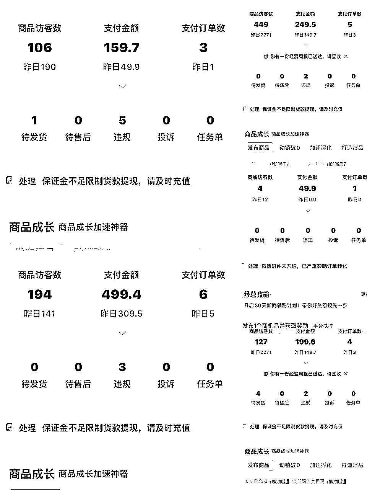

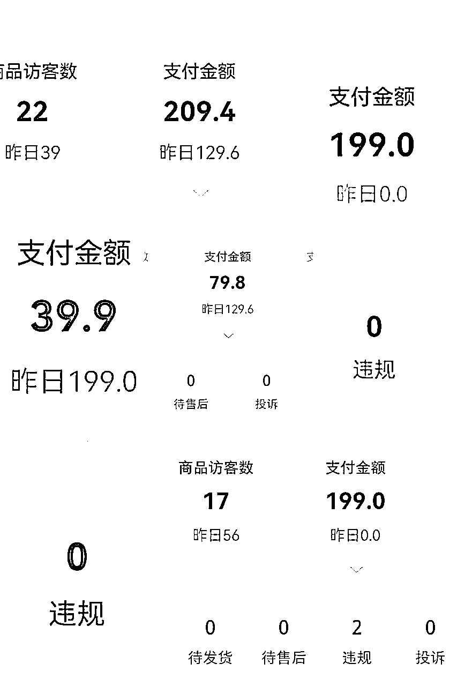

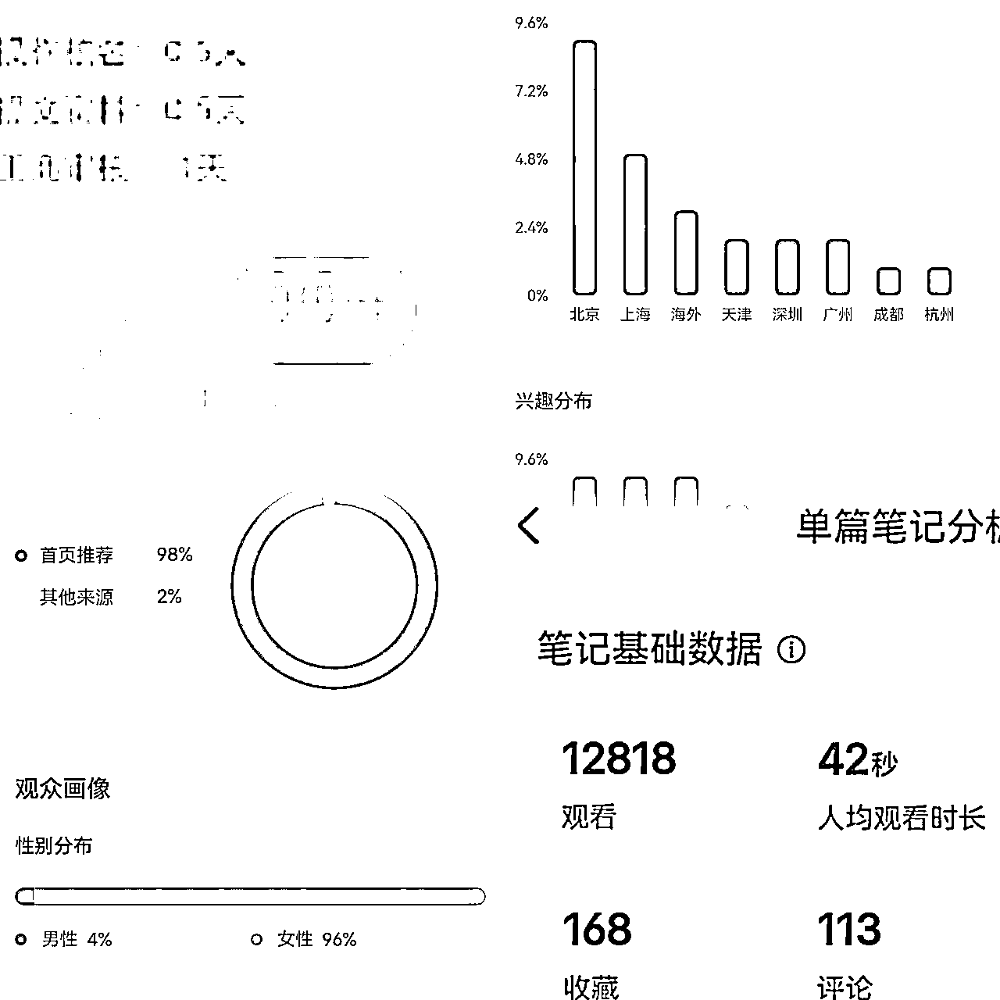

## 一、案例发现：偶然刷到账号一夜涨粉上万

很多同行常问我，起步做虚拟资料类目时怎么选赛道。对我来说更多是机缘巧合。那段时间在看生财风向标，看到一个小红书账号几乎在一晚上涨粉1万，被吸引去研究了。这是我当时做的拆解笔记：

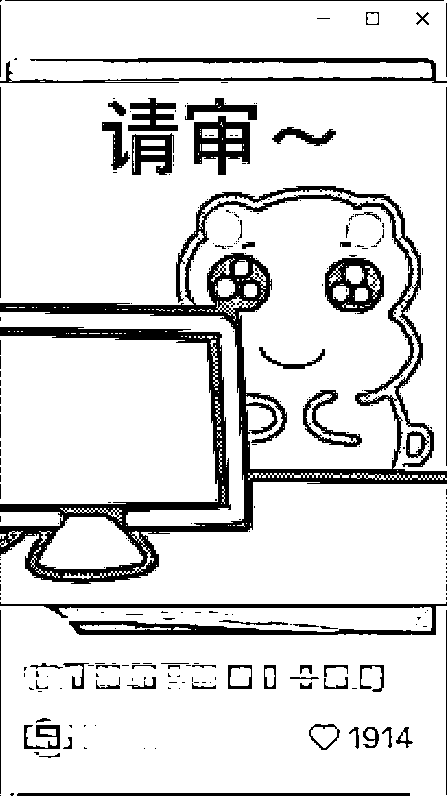

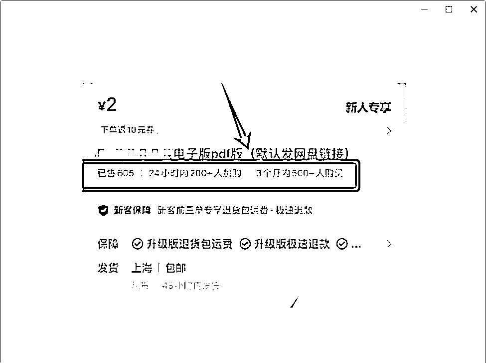

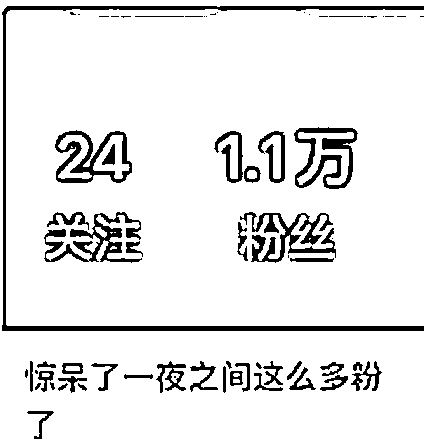

该账号初期并没有清晰的垂直标签，前几天只做了一件事：晒图发资料。结果单日涨粉破万。这说明什么？低粉丝量账号跑出爆款，就值得立刻学习复刻。

## 二、案例拆解：变现路径到底是怎样的

她的打法很直接：把资料拍成图，每天稳定发5条图文笔记，用爆款内容吸粉引流，再承接成交。

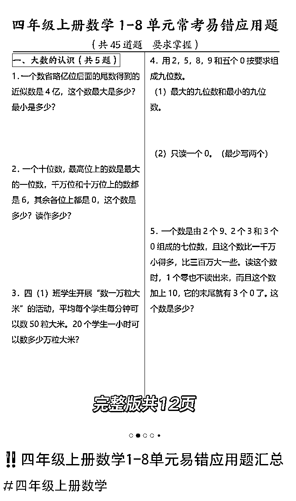

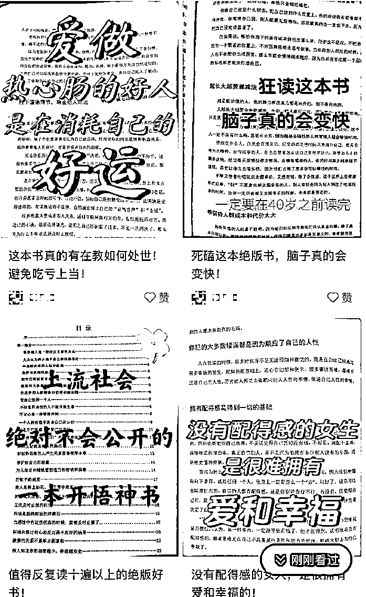

变现主要有三条线：
1. 主号评论区引导粉丝去副号，副号店铺里卖PDF，已累计售出605份。
2. 拉群做私域，群内直接成交。
3. 私信沟通，同样导入私域成交。

她的爆款选题都聚焦女性刚需：如何淡化黑眼圈、恋爱期可以同居吗、西施沐浴秘术这类话题。这些选题在别的平台本来就火，搬到小红书依然能被推。

私域话术她是这样设置：
“麻烦先关注我小红书，并在首页第一条笔记留言，然后私信我，联系方式会放图片里，看不到图就表示被折叠了，继续私信我说没看到图，感谢配合。”

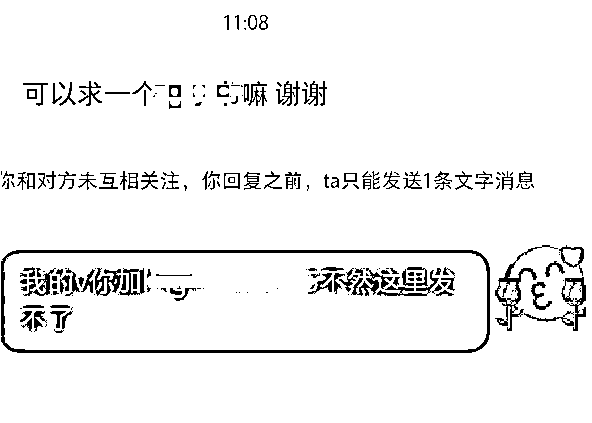

简介也很朴实：
“会持续更新xxx方向的内容，谢谢大家关注🙏受宠若惊中…”

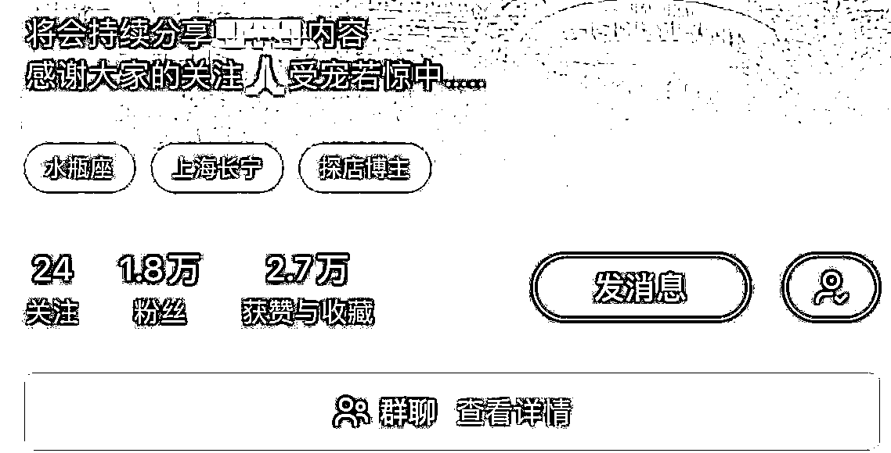

这个号的走红算是意外也算合理。意外在于账号包装很素，内容也没提前规划；合理在于博主在内容爆了后懂得及时承接流量变现。我顺着爆款跟她的引流链路看，发现她已经开了小店。心里想我也能照着做，赚钱靠的就是速度，当天我就开始发第一条。

她也很会做互动：爆款笔记会把完整目录拍出来，配文“目录已上，想看哪部分留言告诉我”。既征求意见，又让粉丝帮忙选题，还能拉升互动。随后该条笔记点赞冲过7000。

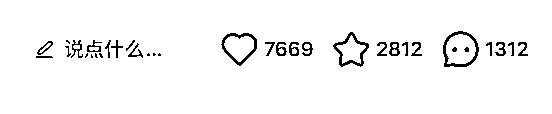

整个账号给人的感觉就是素人，在全网精修的博主里显得特别真实。拆解完我立刻照做，同时思考哪里可以做得更好。我发的那套资料没起来，但换成同类资料，咬牙做了几天，补充了更多SEO关键词后，就迎来1万播放、千赞、引流182人、成交54单。参考她的价格我做了上调，后来阅读过万时系统提示敏感，便停止了投放。

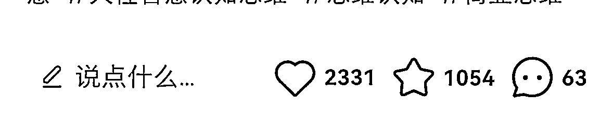

## 三、实操细节：被限流后怎么继续触达

刚开始我没预料到评论和私信会这么多，直接用大号回了微信号，没开副号。回了半天就被系统提示“禁止评论7天”。当时挺懊悔，没先去星球里查注意事项就盲目操作。出了问题就找解法，我立刻请教圈内朋友郑老师，建议启用副号并重点用建群承接，这才没浪费来流。

一旦被禁评7天无法正常引流，可以试这三种替代方案：
1. 笔记里挂【投票】组件，借投票引导进群。
2. 用互关粉丝拉群。
3. 发语音留言给粉丝，高价值客户甚至可直接电话沟通。

投票功能只能手机操作，呈现效果如下：

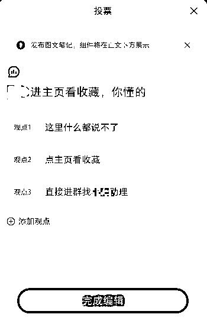

操作路径：小红书笔记编辑界面——投票——投票组件——编辑文案即可。

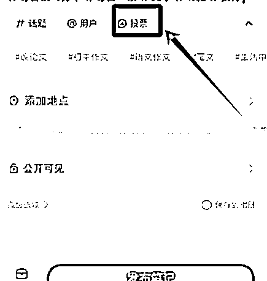

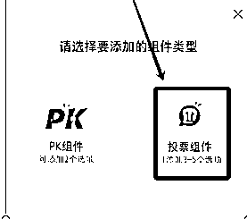

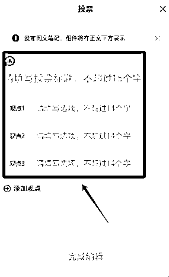

互关拉群路径：小红书主页——右上角发现群聊——新建群聊——添加——挑选互关好友，每次可选20人，分批操作。

语音留言话术示例：
“你好呀小红书这边不让说太多，我的地球号你懂的，请加xxxx，你明白，我可以给你一份免费的xxx”
“你好请加……阿拉伯数字领取”

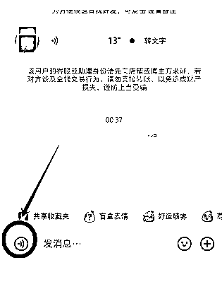

接待流程我也梳理下：
1. 微信开启免验证自动通过。
2. 把高频咨询记录到收藏夹，提升回复速度。
3. 好好打标签。加进来备注【小红书引流】，付费后备注【xxx项目已成交】，方便后续群发。

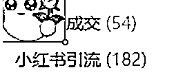

成交思路我采用组合拳来最大化收益。
新来的人先送一份见面礼，礼多人不怪，先给价值客户也不会为难。随后发一条话术+商品图+价格，有需求的会直接下单，没需求的自然不回。最后用朋友圈养护，温和不打扰。有客户犹豫几天，看朋友圈后会回来下单。
价格也可以做成单品价+打包价组合，加速决策。

遇到议价我通常会松口，适当让利容易破冰。举个例子：有女孩问我39.9的单品能不能便宜点，我直接说可以，话术是：
“朋友圈老客户我都偏心，当然可以，优惠5元。另外建议多逛逛我主页朋友圈和店铺，有需要一起带走更划算，一年会员399元更值，一周内可补差价”
她觉得很爽快就下单了，我额外送了几份资料。第五天她主动补差价付了399元会员。

所以卖东西遇到砍价别急，先答应，再引导她看看其他商品一起打包。这样能拉长沟通链，长期看不吃亏。只要有来有回的交流，关系就不会差。线上做生意热情待客是基本功，哪怕现实里是社恐，线上也要练成E人，做好情绪价值。照顾对面屏幕人的感受，让对话愉悦，才能卖得动。

不打扰成交法具体做法：
每天发3条以上朋友圈，分享干货和工具；
发完后去点赞评论老客户，刷存在感；
记录客户需求，主动服务。
对于买单前问太多问题的潜在客户，通常转化成本高，反而不建议强推。

数据价值也要最大化。小红书用户质量普遍不错，退款很少。真遇到退款，我会在微信里处理，同时请对方帮忙做口碑：确认收货后点个好评，我提供10条好评话术供挑选。做每件事都想想对别人有没有好处，和气生财才能利益最大化。

## 四、经验分享：善用工具省心省力

我的原则是：重复操作超过3次就建SOP或找工具，别重复造轮子。自己觉得痛苦的事，前人肯定也遇到过，去问总有人有更聪明的办法。

分享一个提升回复效率的工具：搜狗输入法的闪光语录。
手机端：搜狗输入法羽毛光标就是闪光语录，把常用话术、爆款标题、售前话术都存进去，回复不用现想，效率很高。

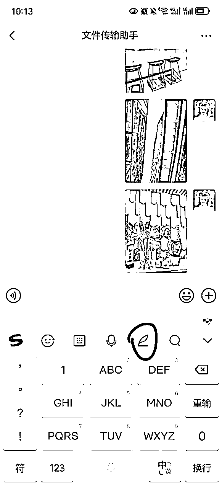

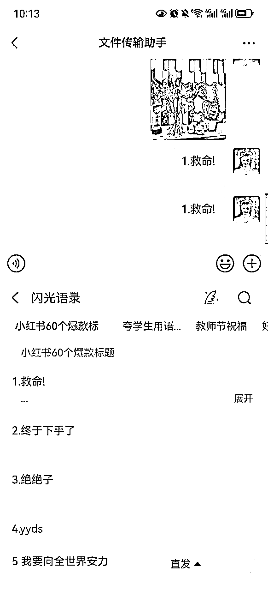

电脑端：搜狗输入法【自定义短语】也很实用，输入字母缩写就能弹出话术。

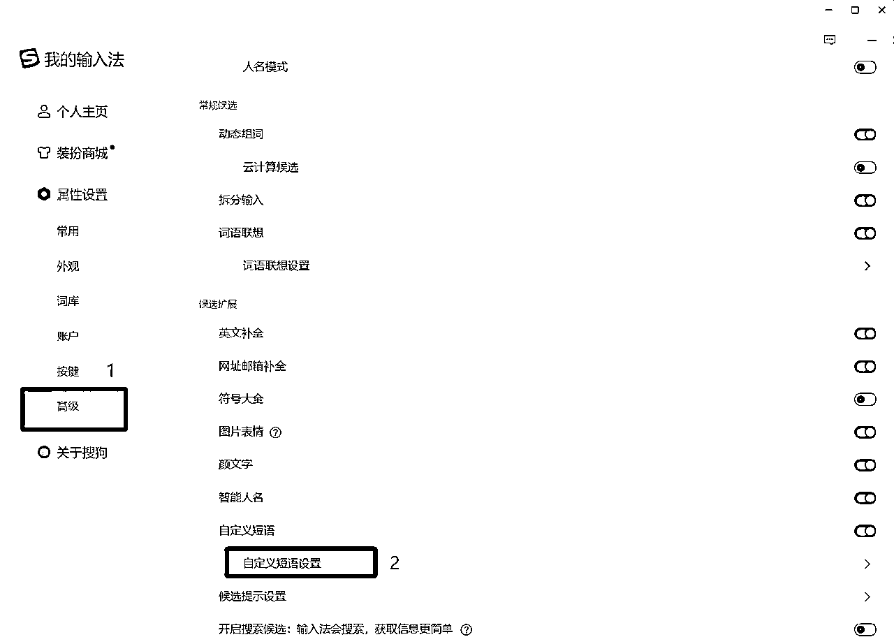

## 【Lucia碎碎念】没空可跳过

有朋友问我，怎么平衡赚钱和长期成长？
目前还没平衡好哈哈。我也想做个人IP那种高级感账号，但说到底还是个务实的人，先把钱赚到，再慢慢调整。

第一，持续变现才算长期主义。别迷信花里胡哨，为爱发电很难持久。早期我把流量导入私域变现，单条过万阅读时，每次打开消息都是99+，我给小红书当了一整天无感情回复机器人，累到想罢工。那段时间就想怎么解放双手，客服和发资料太重复，一忙起来没空看手机，流量就白丢了。

第二，用店铺承接，用私域做复购。后来开了小红书店铺，和引流结合。组合起来流量损耗小，很适合副业操作。副业要低调，打造一条小而美的第二收入曲线。我把小红书店铺的自动客服、自动发货、自动售后跑通了，有类似问题的姐妹可以交流。每次打开看到进账就很安心，重复工作交给自动化，自己腾出时间做内容。只要产品组合设计好，敢卖就有买。流量永远不够，营销永远不会过分，只会不够。

第三，对原创成果申请保护。想做久一点，最好和职业或擅长的资料绑定。我把自己整理的原创资料申请了著作权证书，更具权威，账号可信度提升，客户下单也更放心。

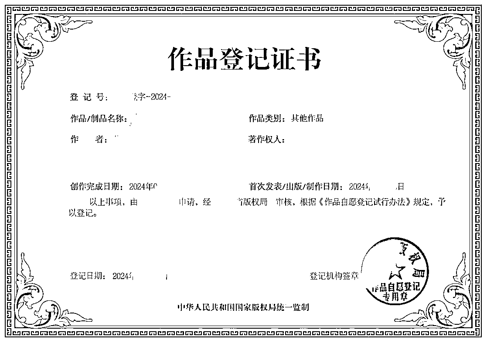

你看到的都是美好吗？其实不是。我不想用美化过的现实去伤害别人。搞钱路上安全是相对的。
有过日进斗金的激动，更多的是孤独、笔记不爆、爆了不出单、违规、封号……有时推荐直接断崖，我现在也不知道怎么破。
普通人千万别幻想轻松赚钱。
每次都觉得快撑不住，只能硬扛一口气；每次都觉得自己像个小丑，别人赚几万十万，自己只是零头；每次连轴转的空档累到两眼发黑还是想再坚持一会。

赚钱本质上是个概率游戏。不怕犯错不怕失败，量越大错越多，得越多。
感谢生财圈友的无私分享，对我启发很大。相比大佬们动辄几十万上百万的成交，我的成绩微不足道，但我会继续努力，2025年做得更好。
我的成长离不开伙伴们的支持，满怀感恩。希望能给和我一样的普通人一些参考。
以上就是我的分享，谢谢大家！
欢迎交流，一起进步。