# 2025年视频号大场直播怎么做？公私域联动全复盘（附真实操盘经验）

## 先聊聊我是谁

赚钱的各位朋友好，我是河林，入圈三年，这回是头一回发帖，算是个“老潜水员”了。

简单交代下背景：98年生人，常驻杭州，在视频号达人运营这条路上深耕了三年。现在的身份有两个——视频号直播运营操盘手，外加一个互联网营销领域的自媒体作者（👸号：河林成长说）。

2022年入行，先后辗转于头部母婴新媒体公司和视频号头部女装达人团队，一直在做直播带货相关的运营工作。

从那时候到现在，我自己既当项目经理、又做运营执行、还兼顾中控跟播，经手的专场直播已经接近300场了。全品类几乎碰了个遍，其中也打出了好几个百万GMV的大场子。

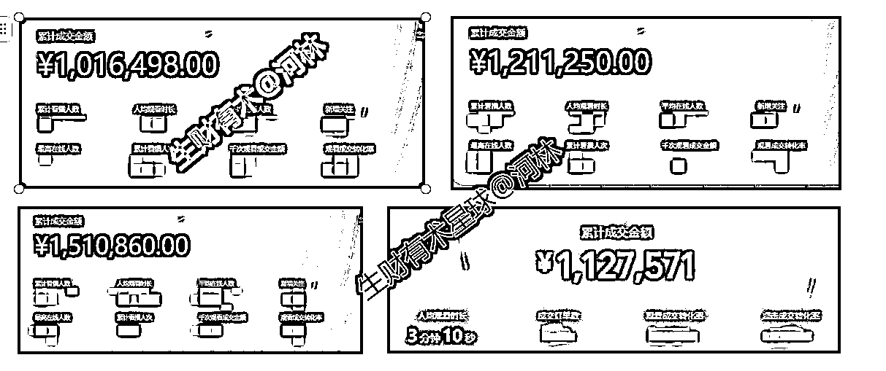

平时我挺爱写东西的，尤其喜欢拆解各类营销案例，长期为零一裂变、鸟哥笔记这些互联网营销资讯平台供稿。也写过几篇关于视频号直播的分析文章，运气不错，出了几篇小爆款。

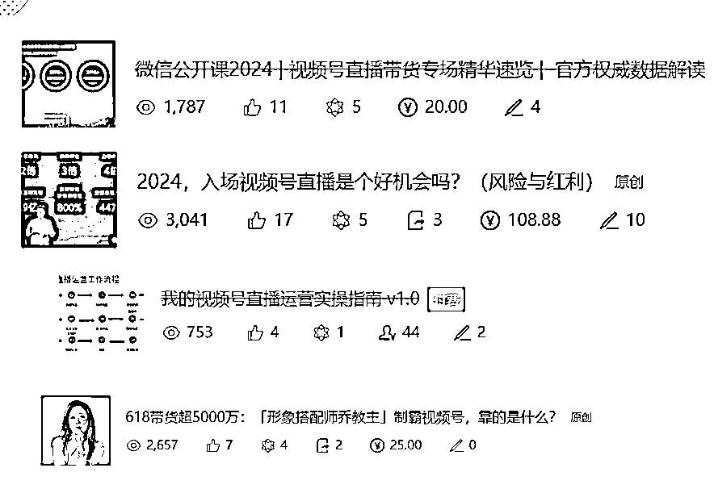

2024年就这么翻篇了，我想趁着这个时间节点，把这两年多在视频号直播赛道上摸爬滚打的观察和实操经验做一次系统的梳理，就当是给赚钱的各位交一份作业。

今天这篇内容，我打算围绕下面几个话题展开：

*   视频号直播电商这个生态究竟有什么不一样
*   公私域联动的核心打法和底层逻辑
*   百万GMV直播专场是怎么拆解和执行的
*   现在入局视频号，有什么实在的建议

先声明一下，这篇内容主要面向有完整配置、5人以上规模的正规团队做视频号达人带货直播。如果你是个人创业者、想看野路子玩法，比如无人半无人直播、口播带货、混剪短视频之类的，那可以去翻翻赚钱的其他精华帖，有不少大佬已经讲得很透了。

另外，大家看视频号的视角不一样、需求不同、所处阶段也不同，我的分享难免有侧重点和盲区。看完有疑问欢迎随时抛出来，能答的我一定尽力答。

文末我还会附上一个自己整理的视频号运营知识库文档，想要的直接点链接就行。

希望能帮到大家。

## 一、视频号电商的三大特征

视频号这两年的调性，相信大家多少都有感知了，我这边挑几个重点快速过一遍。

我把它归结为3个特点，而这恰恰也是视频号直播带货最核心的红利来源——

### 用户质量高 + 品类存在红利

按照视频号官方在2024🛰️公开课上公布的数据，下面4个类目是2023年视频号电商里表现最强势的赛道，也是我个人判断在2024和2025年仍值得优先切入的方向：

服饰家居（份额36%，平均客单价172元）
食品生鲜（份额21%，平均客单价160元）
家清日用（份额9%，平均客单价152元）
个护美妆（份额8%，平均客单价100元）

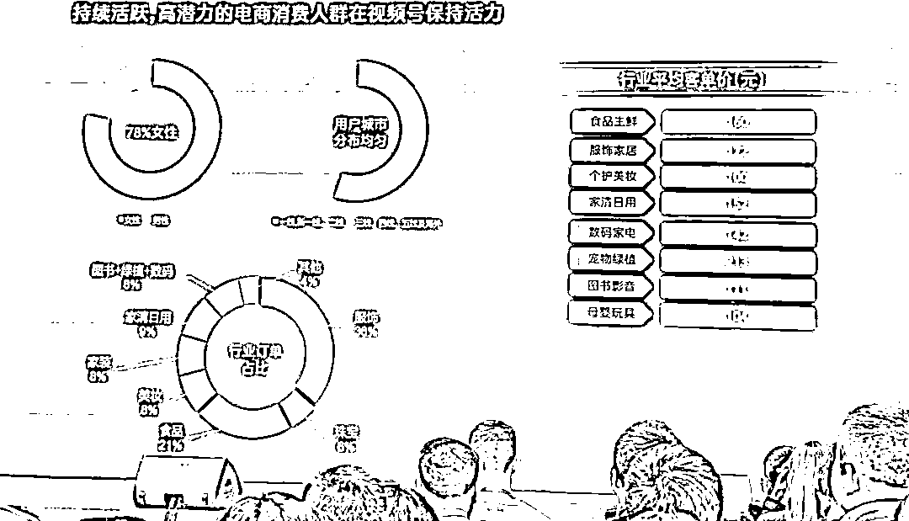

再往细了看，围绕中老年群体对“变美”“健康长寿”“生活品质升级”这几类诉求展开的非标品，在2023和2024年跑出了大量标杆案例。这就是视频号现阶段的品类红利所在。

除了品类之外，用户端的优势也很明显。视频号电商目前的活跃用户，对比其他平台，表现出更高的电商行为质量，整体呈“三高一低”：粘性高、复购高、客单高、退货率低。

官方给出的说法是：“高潜力的电商消费人群正在视频号持续活跃”。具体画像来看：

*   女性用户占了78%，一线、新一线、二线城市加起来超过六成；
*   30到50岁这个年龄段贡献了视频号40%的增量，官方给这类人群的定位是“有钱有闲”，也就是我们常说的“新中老年人群”和“熟龄姐姐”；
*   叠加视频号特有的成交机制——在私域流量的加持下，忠实粉丝的付费行为质量会更高，高粘性、高复购、高客单、低退货这几个特征会更加突出。

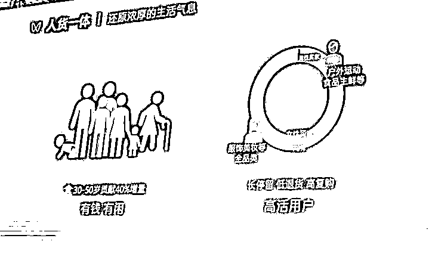

所以，从用户质量的角度来评估，视频号上确实盘踞着规模极其可观的高潜优质电商人群。

官方给过一个特别有代表性的例子——2023年，在视频号下单车厘子的用户里，75%的人买的是3J以上等级的高端货。

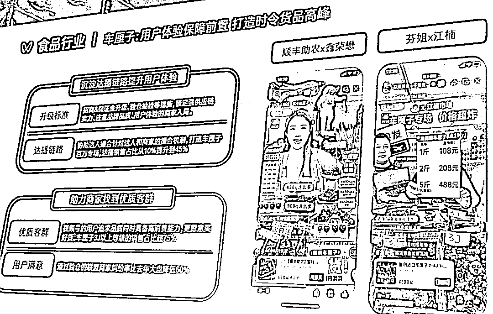

京润珍珠也分享过一组数据：他们品牌在其他平台的直播客单价一般在600到800元，但到了视频号上，直接干到了1000到1200元甚至更高——而且用户还在主动要求他们出更贵的商品。

这已经很能说明问题了：视频号的用户对产品品质和生活方式是有明确追求的。这给我的启发也很大——如果有条件，在视频号上一定要试着去卖高客单价的东西。

### 背靠🛰️生态的流量分发机制

视频号跟其他电商平台相比，最大的差异在哪里？

很简单，它长在🛰️这个超级社交生态里，天生就站在高频社交流量的中心，同时无缝连接着🛰️的公域和私域。

因为扎根🛰️，视频号的内容天然带有熟人社交的传播属性，情感价值和社交属性都比其他平台要重得多。

🛰️里能触达用户的路径太多了——私聊、朋友圈、🛰️群聊、好友分享、看一看、直播广场……各种入口都能成为直播间的引流通道。用户在🛰️生态里的停留时间很长，品牌触达用户的成本很低、路径多、频次也高。

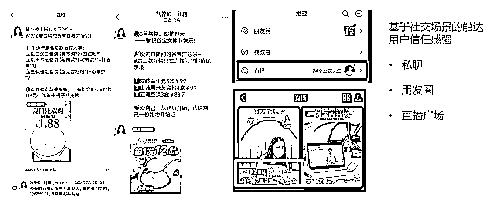

熟人社交关系对电商的意义更值得一提：当一个用户是通过私域属性的社交推荐渠道——而不是平台的算法推荐、信息流推送这类强营销场景——点进你的直播间或短视频主页时，这层推荐关系本身就自带社交信任的成分，能让用户更快建立对你的信任感，随之而来的就是更高的转化率。

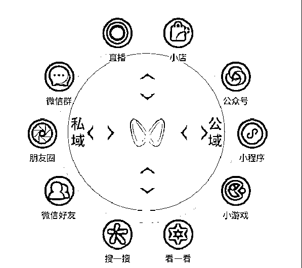

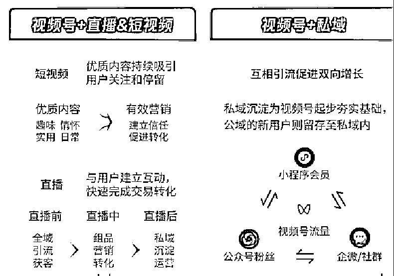

这也是为什么视频号直播正在迎来一波达人红利——粉丝对流量主的信任度极强，流量主也愿意拼尽全力去回馈粉丝，最终表现为高活跃、高转化、高客单、低退货。

下面这张图特别形象，它把🛰️和抖音这两种平台的成交链路差异展示得很清楚：

🛰️的特点是转化链路可以拉得很长，但它能做到见缝插针、无孔不入——各个空间、各种场景都有组件可以触达用户、提醒用户来看直播或视频。

链路更长，意味着说服更充分，信任沉淀得更深，自然更容易卖出高客单、带来高复购和高利润。

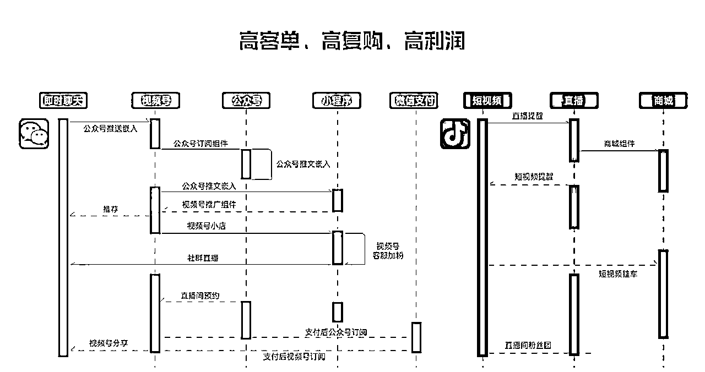

### 竞争烈度相对温和

视频号目前的平台策略有几个明显的风格倾向：运营团队作风保守、电商推进节奏偏慢、算法推荐高度去中心化、不对外公开数据榜单。

*   去中心化的流量分发：别的平台大体遵循“二八法则”，头部通吃、马太效应明显；视频号则是反向操作——你是新人的时候反而给你更多推荐，等你做到头部了，推荐力度反而不会无限倾斜。

*   不公开数据榜单：这意味着平台不鼓励冲榜，你做出成绩了也不会马上被同行盯上、被抄袭、被打压。所有人都能在相对安静的环境里闷声赚钱。

以上这些因素里，最重要的就是去中心化的流量分发和不公开榜单这两点。它们共同决定了视频号现在的竞争格局并不激烈——无论是新进来的品牌还是达人，都能拥有一段相对平缓的窗口期、试错期，不用一上来就跟同行刺刀见红、卷生卷死。

我线下跟不少做视频号的品牌和工厂聊过，很多品牌其实是在抖音拿不到结果才转向视频号的。抖音的竞争已经到了白热化阶段，想在那边出成绩，要么得是六边形战士配一个超强团队，要么就得往死里砸投流成本。

结果跑来视频号一试，发现这边竞争压力小很多，投进去的钱能看到反馈，更关键的是投放成本不高、投产比还更好——生意就这么慢慢做起来了。

## 二、公私域联动：视频号直播的核心打法

平台特点搞清楚了，接下来是重头戏——视频号直播带货到底该怎么做？流量从哪来？转化怎么做？跟抖音的打法有什么本质区别？

这一part，我重点聊一个方法论：公私域联动。

### 先搞清楚视频号的流量结构

视频号直播的流量，目前分成三个板块：公域流量、私域流量、付费流量。

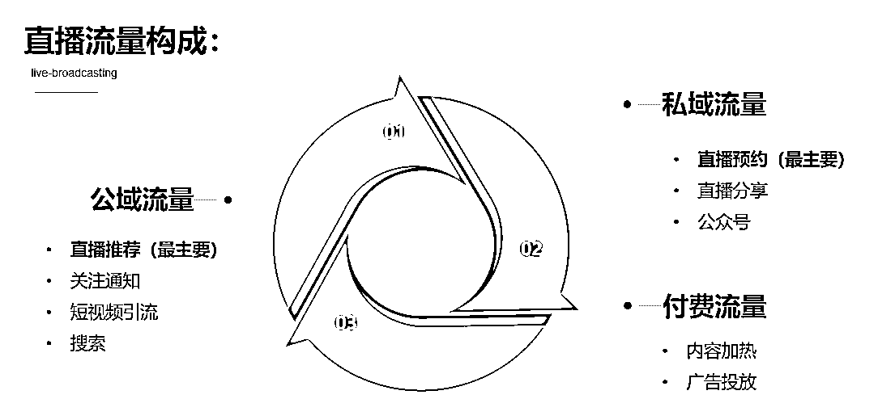

直播数据大屏的后台也是按照这个框架来呈现的。一场直播做好做坏，本质上就是看你把这三块流量各自做好了多少。

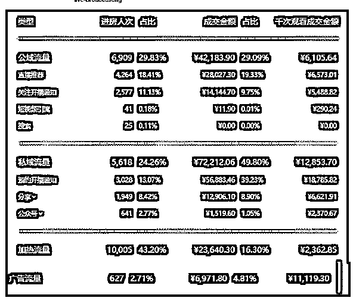

### 公域流量：理解再透彻不过的推流公式

视频号公域流量的推荐机制，官方在《视频号商家起量教程》里已经讲得明明白白了。

所有做视频号的人，都应该把这个流量公式刻在脑子里。

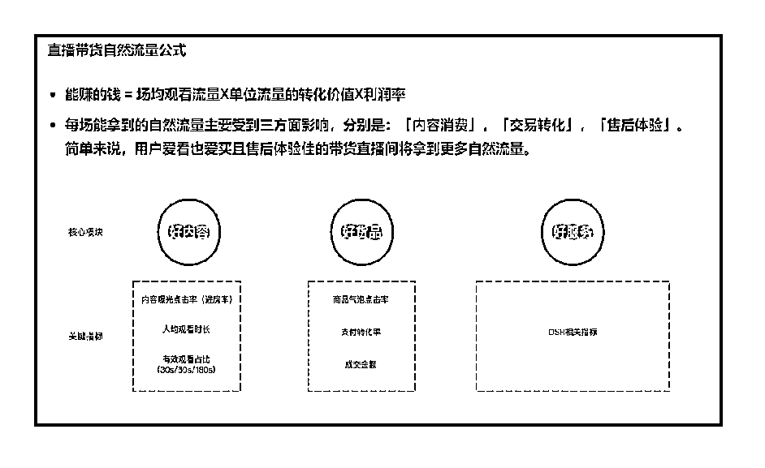

视频号带货直播间的流量核心逻辑一句话可以讲清：好内容×好货品×好服务=更多自然流量推荐。

官方归纳的逻辑就是，把直播间的人货场做扎实，在同时段里跑出优势：

*   好内容（内容消费）×好货品（交易转化）×好服务（售后体验）=更多的自然流量推荐

前面提到视频号流量算法是去中心化的，具体体现为：

*   带货直播这里不存在严格意义上分层的流量池，每个直播间都是根据当场的内容消费和交易转化数据、加上主播历史开播表现和售后服务体验，共同决定系统给多少推荐流量。

*   推荐机制看的是“同时段的相对表现”：系统重点关注的是你这些核心指标在大盘同期的相对水位——同期转化效率更高、数据表现更好的直播间，流量就会往那边涌。

后台的大屏数据上，对应的是这两个维度：

*   内容力：曝光进入率、平均观看时长、互动数、转粉率；
*   转化力：曝光点击率、成交转化率、千次观看成交金额（GPM）。

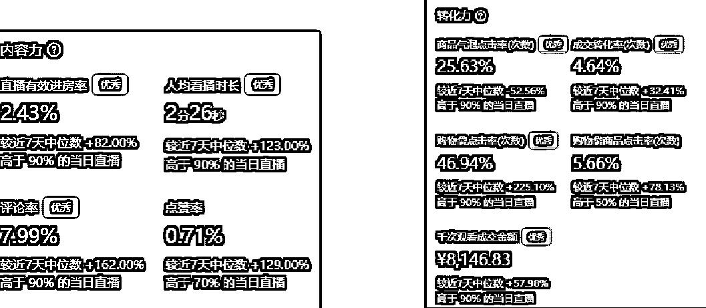

实际操作中会呈现一个很明显的规律：直播间成交出现一个波峰，大概率会带动下一个流量推荐周期里直播间流量推荐迎来一波波峰。

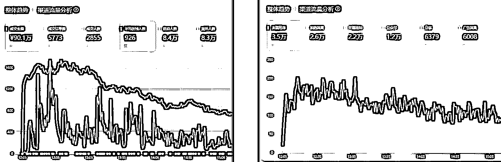

顺着这个推流逻辑来思考，直播中只要把这3个数据指标做扎实，直播间大概率能获得持续稳定的推流：

*   5分钟密集互动数
*   5分钟密集成交金额
*   直播间平均观看时长

公域流量的核心打法总结下来就是：

*   把人货场模型做精，把货盘排序和爆品转化做透；
*   人为制造直播间成交波峰，借此撬动推荐流量的波峰。

### 私域流量：攻守兼备的放大器

私域流量对直播的意义，主要体现在两个层面上：

*   预约流量：通过前期的私域种草，把私域里已经沉淀下来的忠实用户导入直播间，制造开播极速流，撬动公域推荐流量，快速突破冷启动。

*   分享流量：直播过程中把直播间转回私域，引导私域用户成交、继续分享扩散。

你要做的事情，就是调动一切你能调动的私域入口，想办法触达更多用户，把直播预约数据做上去。

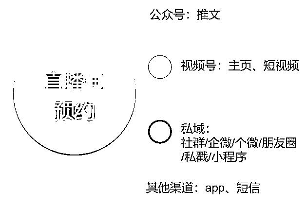

具体做法比如：

*   短视频✖️直播联动：用种草、剧情、人设类短视频，反复触达私域粉丝和公域品类人群，为直播间攒预约流量。

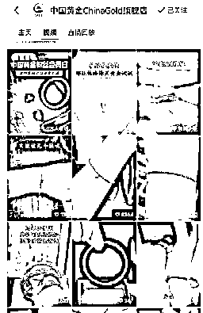

*   社群✖️直播联动：在🛰️群里分发直播预约海报，或者直接转发直播间链接。

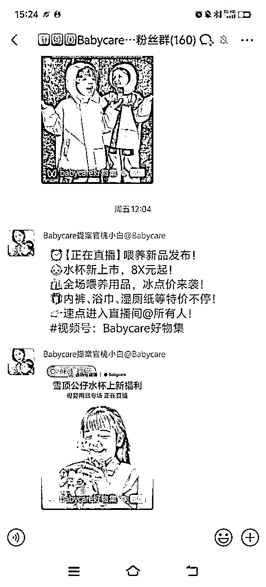

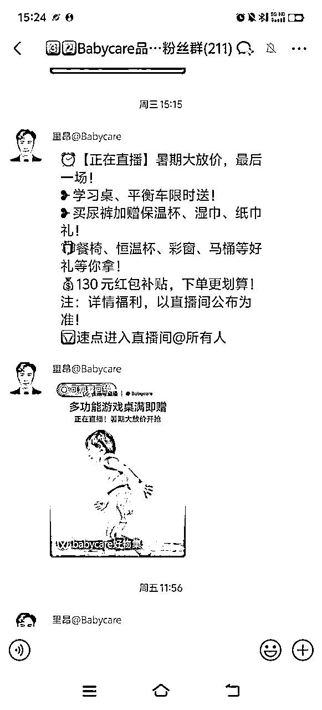

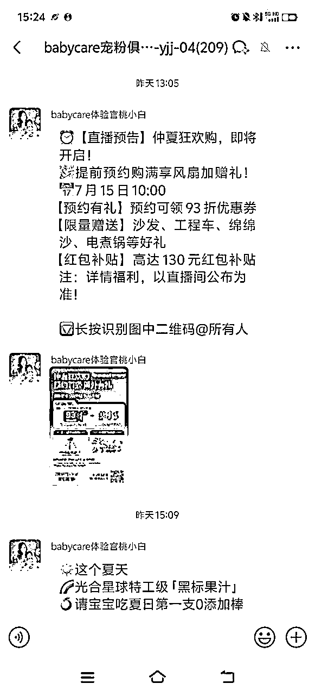

*   👸号✖️直播联动：👸号发文章，把直播间利益点在前端亮出来，提前种好草，文内直接引导预约直播。

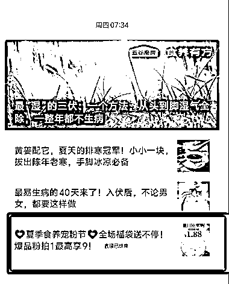

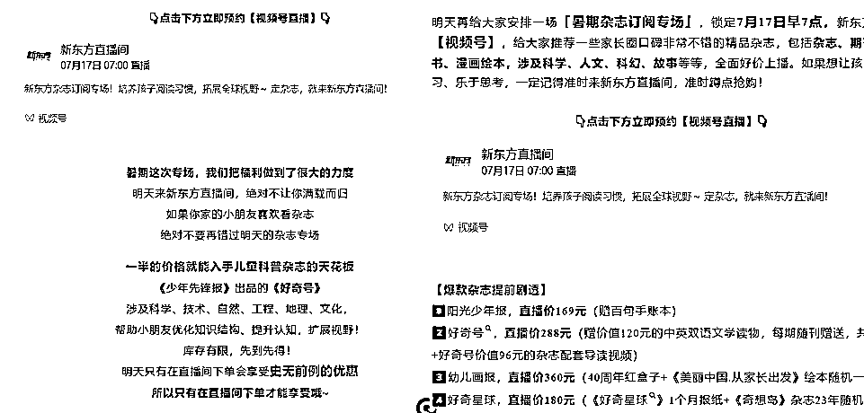

在这里我要强调一句：视频号的直播预约功能，重要性远超其他任何一个平台。

一场预热做得足够充分的直播，私域预约带来的产出占比会非常惊人。因为私域用户天然跟你之间有一层信任关系，他们用户质量更高、下单更果断、互动更积极、售后问题更少，能给品牌带来更高的利润。说白了，这些人就是你的VIP用户。

私域流量的承接还有一个附加价值——它会带来更多的公域推荐流量。在视频号的公私域联动推荐机制下，整个链路是这样的：直播预约=商品种草=开播急速流=密集成交=撬动公域流量推荐。

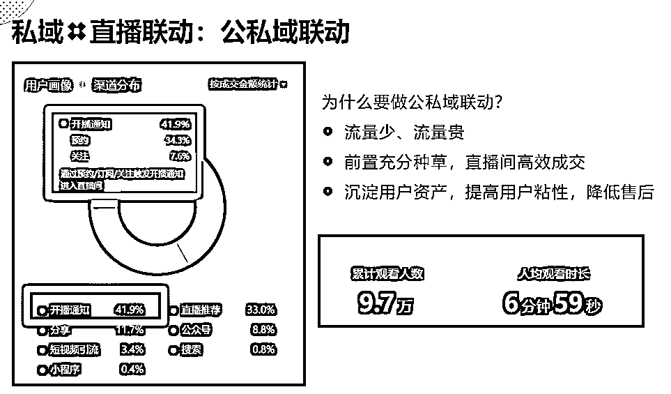

所以，直播前把种草做满，直播中全力承接、高效成交，直播后做好售后、沉淀用户的信任资产——这才是视频号做私域和直播的长期主义。

### 付费流量：ADQ+内容加热

付费流量这边，视频号直播有两种主流投法：一种是🛰️豆的内容加热，另一种是🛰️广告的ADQ投放。

我把两种工具的主要区别整理了一下：

一句话总结：两者各有优缺点，适用的场景也不太一样。对绝大多数商家来说，🛰️豆的内容加热更顺手、更简单，能发挥的作用也已经足够了。

但不管工具怎么变，付费投放的核心逻辑永远不变：优质的内容素材、有竞争力的爆品、合理的出价——三者缺一，投放效果都很难起来。

## 打法总结

公私域联动的完整心法浓缩成一句话：

先把私域流量池蓄好，把私域用户导进直播间；然后在直播间里把「人货场」模型打磨好，制造持续的成交转化；以此来撬动公域推荐流量的稳定输入；最后再用付费工具把整个盘子放大。

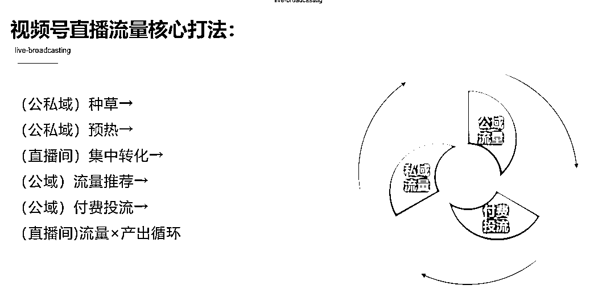

## 三、实操：一场直播的策略拆解

这一趴，我会拿一场直播的实际操盘过程来举例，讲明白一件事——一个优秀的操盘手或者运营型主播，应该具备什么样的能力；以及，作为视频号团队的管理者，应该按什么标准去筛选和培养人才。

以下全是我自己做项目用过的真实方法，篇幅有限不一定面面俱到，但绝对落地可执行。也欢迎有同感的朋友来补充。

截图部分来自我自己的实战操作，部分用其他案例做参考说明。

### 货盘准备

**（1）押注爆款**

从货盘里挑出最想打爆的几款——建议控制在5个以内，然后围绕这5个款做种草内容，用它们去拉直播预约。

视频号直播的爆款，通常要满足这么几个条件，满足得越多越容易爆：

*   应季刚需品+高性价比，这个组合在任何平台都是爆款密码。
*   库存和货值够顶，能接得住用户的购买热情。
*   视觉呈现效果好，适合在直播间里做展示。
*   有真实数据验证过——其他平台的数据、同行的数据都算。
*   受众需求明确，或者具备独特卖点/噱头：比如珍稀材质、高端品质、独特款式、进口来源等等——能打动视频号这批愿意为品质付高价的用户。
*   定价处于中高客单价区间、利润空间足够。

几乎每个品类都存在这样的爆品苗子，大家根据自己的赛道去筛选就好，建议优先参考其他渠道的数据验证，或者对标同行的跑量款。

不管什么类目，爆款押注都是整个直播里最重要的一环——因为爆款决定了后面的种草预热、货盘搭建、过款转款这一整条线。爆款选错了，后面所有动作都白搭。

**（2）组货盘**

我的习惯是：先把爆款定下来，再围绕爆款去组整个货盘。

具体怎么排，要看类目来定。这里分享几个经验和思路：

*   底层逻辑：货盘的核心工作，是处理好品类、价格梯度、客单价、库存、顺序这五件事。
*   框架结构：一个完整的货盘，要以爆品为核心，按照「福利款——次推款/承接款——主推款」的节奏来排。次推款用来补充主推款覆盖不到的品类、风格、款式和场景；主推款则要在整场直播里反复返场。
*   福利款和赠品设计：价值感要做得强一些，跟华而不实的周边礼品相比，用户明显更吃“能跟主品搭配使用”的赠品。
*   规格设计：主要针对美妆护肤类目——如果整场款式不多，可以试着组高客单的套组规格。与其让用户单买每一个单品、囤一堆货，不如设计一个“一次买齐”的组合套装，出GMV的效果会好很多。
*   库存准备：爆款的库存和货值一定要给足。部分SKU复杂的品类（比如服装、家纺），备货甚至要精确到每一个SKU。

### 直播种草

**（1）公域种草**

视频拍好之后，建议在开播前1-2天发出去，给视频留出充分的时间自然跑量。这也意味着，一旦直播档期定下来，整个制作周期就要开始倒推——从拍摄、剪辑到发布，每一步都得卡着时间点来。

预约视频对直播的作用，有几个维度：

*   视频流量越大，带来的直播预约就越多，但如果视频主题和直播带货品类关系不大，来的可能是泛粉、不够精准；
*   视频内容和直播主题关联度越高，预约来的用户就越精准；
*   视频流量又大、内容关联度又高——这是最理想的状态，但对视频制作能力的要求也最高。

视频发布期间，记得去后台把“直播预约”设为置顶。这样用户刷到你的视频时，才有最大概率看到预约按钮，不然很多人压根不知道你这场直播的存在。

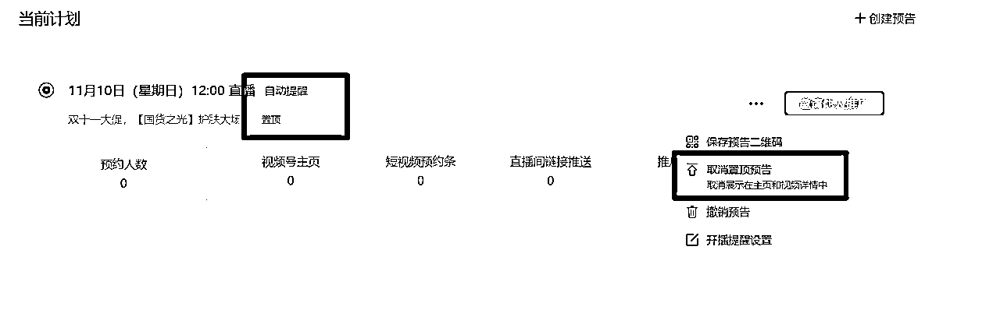

公域种草除了视频，👸号也是一个重要阵地——在文章里直接插入直播预约按钮就行，预约的逻辑和视频是一样的。

👸号相比视频还有一个额外的优势：除了直接引导预约直播，你还可以把用户往社群里引——把意向强、愿意留下来的用户筛出来，拉进直播专属群做二次触达，效果会更精准。

**（2）私域种草**

公域种草靠视频，私域种草靠图文。

公域做的是流量和广度，私域做的是深度和垂直。

私域内容跟视频内容相比，最大的优势就是：可以避开公域不让说的极限词、敏感词、利益点，可以放开手脚展示更丰富的素材、细节、真实使用效果、品牌背书、直播机制提前露出、营销利益点等等。这就是私域种草不可替代的价值所在。

所以，公域不敢说的话、不能给的利益点，在私域里一定要大胆说、反复说——当然，别去挑战平台允许的边界。

举个例子：这个款是给某大牌代工的同源工厂货，但我们的价格连3折都不到；或者这款滋补品有某某功效……

在私域里先把直播海报丢出去，告诉铁粉们：xx号xx点准时开播，这场会集中上架xx、xxx等重磅单品，并且我们已经为预约人群争取到专属的限时优惠机制/福利，名额有限，仅限前xxx名，先约先得。

可以参考头部成熟达人目前在私域做的预约玩法——

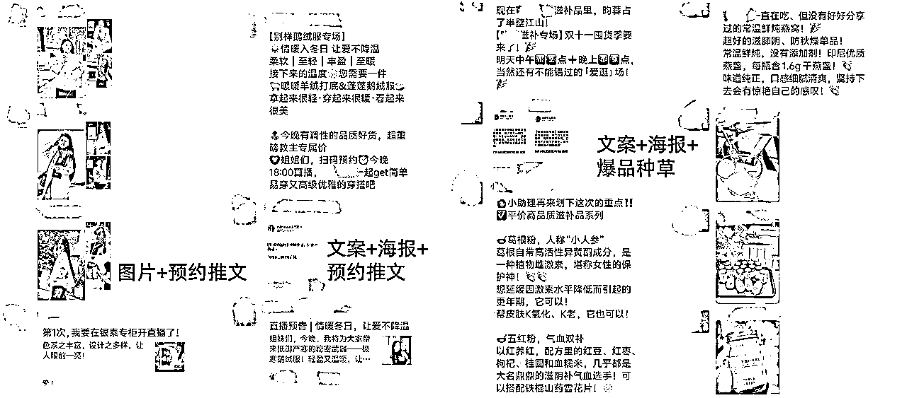

种草期千万别掉链子，要时不时去看直播预约的跑量情况。账号数据跑稳了、品类也稳定了之后，直播最终的产出基本是跟着预约量走的，只是不同账号的转化系数会有差异。

换句话说，预约总数基本就能提前判断这场播的盘子有多大。预约这块花的功夫，基本都能在直播结果上兑现。

## 目标测算

### （1）目标预估

爆款押对、货盘搭好之后，就可以根据当场的商品清单去推算坑位产出，用这个数来定一场播的目标，并拆解达成概率。

预估路径大致有两条：坑产推演和预约推演。

*   用预约数反推：

预约量是前期种草是否到位的最直观体现，也直接决定了直播当天的流量天花板。所以数据比较稳的账号，通常都能凭过往经验，用预约数来判断大概的产出区间。

*   用坑产推演：

货盘结构确定后，可以按这个模版来做测算：

| 商品 | 直播价 | 预计下单量 | 预计GMV |

| 主推品1 | 999 | 100 | 99900 |

| 主推品2 | 599 | 150 | 89850 |

| 次推品1 | 399 | 80 | 31920 |

| 次推品2 | 199 | 70 | 13930 |

| 其他 | …… | …… | …… |

| 总计 |  |  | 300000 |

| 直播目标 |  |  | 500000 |

| 目标与预估坑产差额 |  |  | 200000 |

做完坑产预估后，看和目标的缺口，再去动态调整打法，比如：

——扩坑位：要不要再加几个品，提升整体坑位数量来补量？

——提单品产出：能不能把核心爆款的成交单量拉升，以点带面拉高整体GMV？

——加时长：是直接延播2小时把它吃满？

——加预算：把付费投放再补一补，把差额补回来？

……

预估目标的意义，是先对整场结果有个心理预期，再据此做针对性的策略修正。

### （2）投放ROI测算

直播成本里，除了人力和营销费用，最重头的就是投放预算。

付费投放的底线是保本甚至赚钱，必须确保投放带来的实际利润大于等于投放花费，找到一个保本ROI，只要实际ROI高于这个值，就是安全区。

ROI的计算思路大家都熟，关键在于准确预估品类的签收率和毛利率。

举个例子：

如果实际签收是80%、毛利30%，投放ROI做到1，意味着花100元投放换来100元GMV，实际到手毛利只有24元，还没算投放成本本身。

所以目标是把ROI做上去，到一个不亏的阈值之上，越往上越好。

比如ROI做到5时，花100元投放带来500元GMV，毛利150元，刨去100元投放成本还净赚50元。这时候就可以持续加码。

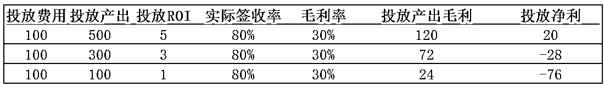

把这个临界值拆解清楚后，就能直接给投手一个明确的ROI目标，让投手按直播目标来搭建投放策略。

## 场控运营

### （1）转化侧：盯数据、调节奏

直播中要紧盯每个品的转化表现：

*   点击量和曝光点击率，反映用户对该品的兴趣度；

*   成交转化率，反映用户的真实购买意愿和支付能力；

*   未支付订单数，是做逼单、控库存、做踢单节奏的核心依据，整场的转款节奏基本围绕这个数走。

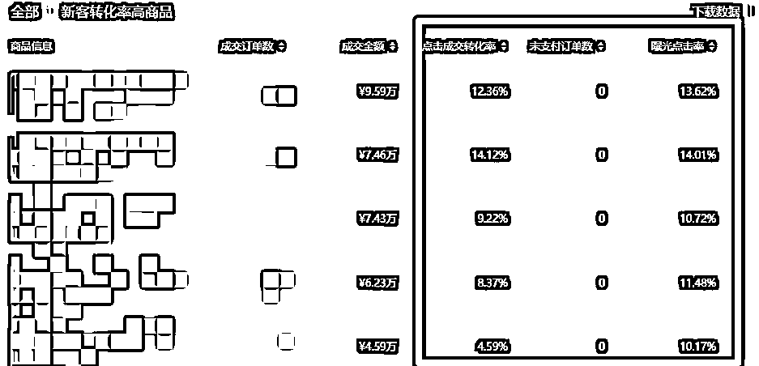

当转化数据持续走高，说明品在上扬，这正是做后台成交密度峰值的窗口期。密度峰值打上去，下一个流量推荐周期会更友好。

如果转化数据持平或下滑，就要考虑转款过款了。因为一旦成交密度掉下去，流量也会跟着掉，且掉下去很难快速拉回来。

### （2）流量侧：引入与承接

视频号的直播流量本质上是三股合力：公域、私域、付费。

要让直播间长时间保持涌流，就要为不同流量设计不同的引入策略，并做好承接。

*   公域流量：

对应后台的直播推荐流量，受成交数据、互动、停留等正向反馈影响。

想吃到公域，就要把爆品的转化和互动做起来。

针对爆品，可以用扣互动、晒单抽奖、抽免单等手段把用户参与欲拉满，同时配合憋单、卡单、踢单把转化节奏拉紧。公域流量上来后，直播间的转化空间会进一步打开，可以再起一波转化。

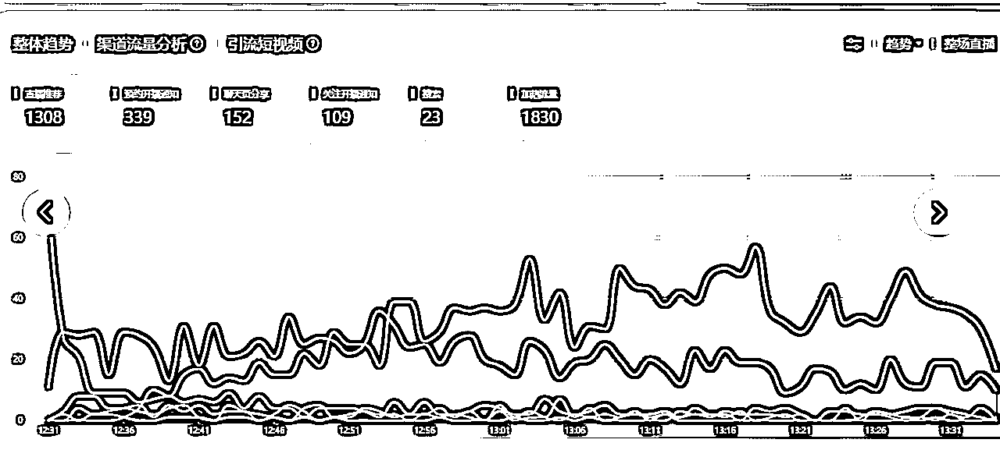

*   私域流量：

私域引入主要有两件事：

-在爆品成交的关键节点，把经历过私域种草的核心粉丝拉进来集中火力带爆单；
-在直播间自然流量下滑时，用私域粉丝来托盘，稳住在线。

其中带动爆品成交更为关键。私域粉丝信任度高、种草深度足、下单率也更高。所以无论前期种草还是直播中，对爆品的持续预热和提前告知都不能断。

比如种草期就以爆品为核心去做内容；开播后提前官宣当天爆品清单、上新时间，临近上新时再抛一次种草素材预告……

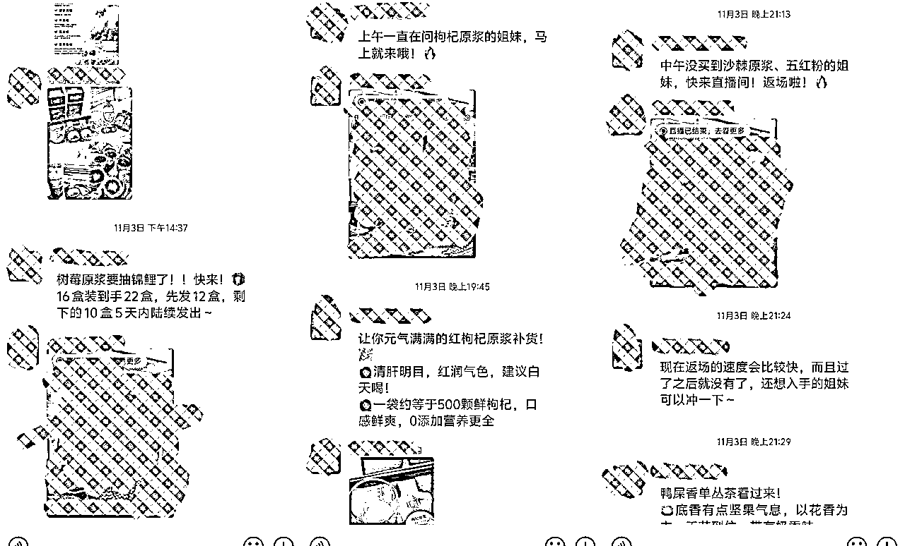

*   付费流量：

付费的核心是和投手紧密协同，用爆款去承接流量做成交转化。

主推品的上播时间确定后，就要让投手在黄金时段把流量推进来。爆款上架阶段，运营要盯投放流量趋势，投手要盯投放产出反馈，优秀的投手还会给直播节奏提供建议，主播和场控则要具备接住流量的能力。

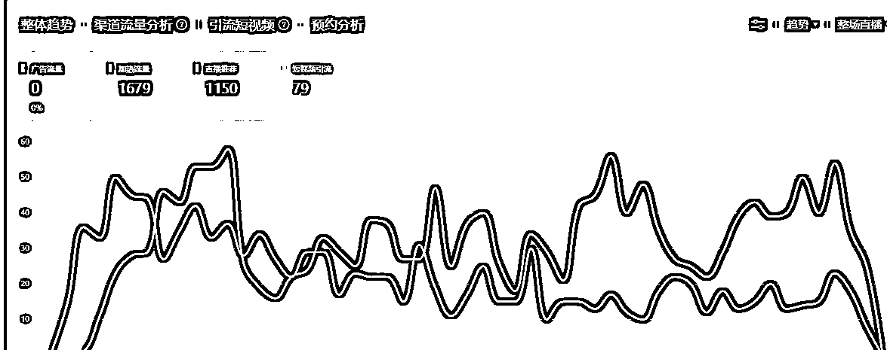

实际开播中，三种流量永远是混合共存的，无法完全剥离。所以流量引入和承接的重点，是在关键节点做针对性动作。

整场下来，以爆品为锚点，保持稳健的转化节奏是最稳的打法，非必要不必过度微操。运营和主播对直播间流量的体感，就显得尤为重要。

## 数据复盘

播完就要复盘，重点看几类维度：

*   流量维度：整场场观多少？预约来了多少？直播间流量构成如何？付费占比多少？平均在线和人均观看时长是否达标？

*   转化维度：整场转化率是否达预期？主推品订单量是否完成目标？转化受阻是货的问题还是运营的问题？

*   人群画像维度：本场拉新怎么样？新客老客成交占比如何？比例是否健康？账号现在主要靠谁成交？新客和老客的购买习惯有何差异？

把各维度问题盘清楚，再给出具体的优化方向，这才是复盘的价值所在。

# 四、入局建议

## 个体如何入局视频号带货？

新手和个体户建议循序渐进，按自身能力选打法。

起步可以先搬运混剪挂车试水，再到真人出镜口播；随后把视频带货和真人直播结合起来，甚至直接开播暴力起号。能力允许的话，再逐步经营IP，培养成一个达人，长期卡位视频号直播赛道。

视频号的电商玩法很多，找到适合自己的路径，边做边升级赚钱能力才是核心。几乎每种打法在赚钱里都能找到经验可参考，遇到卡点直接去搜就行。

## 选品为王。

我自己的经验是，视频号达播，选品决定80%的结果。

选品和优质供应链抓住了，就抓住了主动权。塑品能力、拉流互动技巧这些都很重要，但层级上是排在选品之后的。所以无论处于哪个阶段，都要把最大精力放在选品研究和货源挖掘上。

## 品牌要不要入局视频号？

如果是商家或品牌，是否入局，建议先评估这几个点。

## （1）类目与人群是否匹配

我的品类和视频号核心人群是否契合？类目是否准入合规？

同品类是否有竞品在视频号上跑通了？如果跑通了，我就可以跟进。

## （2）盘点资源禀赋

我有私域资源吗？比如👸号、社群、🛰️好友？

团队能否持续稳定输出短视频？

直播能力如何？是否有其他平台直播经验？主播带货力怎样？

品类利润和预算能否支撑投流成本？

把这些问题梳理清楚，匹配度高、有优势、同行已有正向案例，就可先小规模试水；否则可能要重新评估平台适配性。

# 五、欢迎交流

以上就是我在赚钱的这期分享，希望对星友们有启发，欢迎交流指正；

2025开年，一起红红火火、快乐搞钱！

视频号运营的好项目，以及任何搞钱心得，都欢迎交流，也希望赚钱的前辈大佬多多指导、不吝赐教，