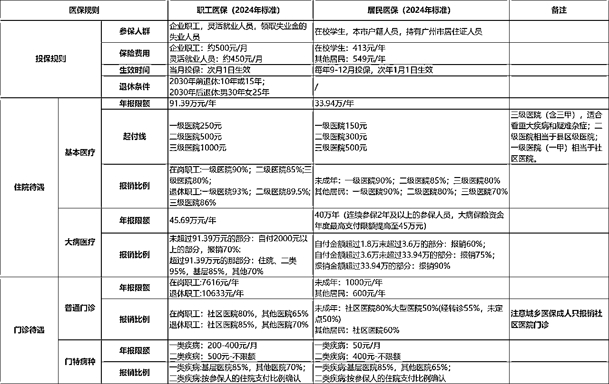
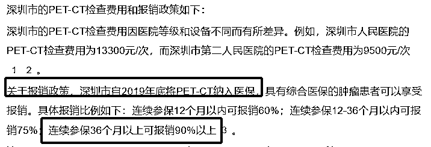
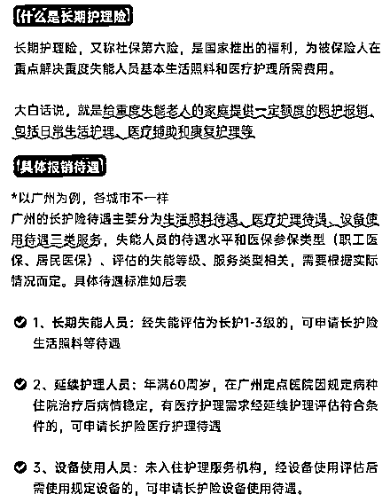
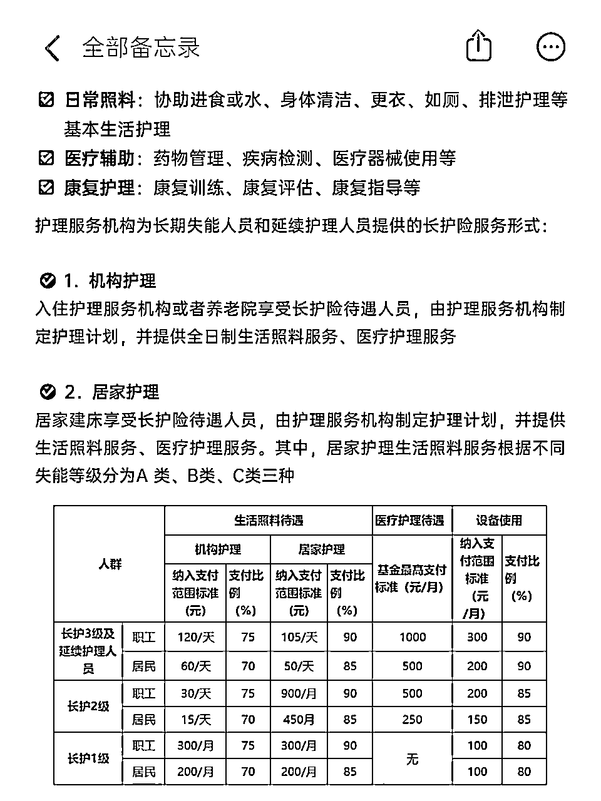

# 病了也能更省钱：医保与就医的实操避坑笔记

> 来源：[https://yapsq9774vc.feishu.cn/docx/SkXedKBzPokQUSxqJ6ncRDhNnJh](https://yapsq9774vc.feishu.cn/docx/SkXedKBzPokQUSxqJ6ncRDhNnJh)

大家好，我是佳佳。

白天在三甲医院做医疗运营，帮医生写科普，经常泡在门诊里；晚上做保险经纪人，研究医保政策，家里正好有个癌症患者，所以算是一边学一边实操，怎么让报销更到位。

去年在生财看到几篇省钱干货，被点醒了：把专业知识用在生病报费用上，信息差就是真金白银。于是整理出这篇。

全文分三块：

一、医保目录内能省的钱

二、确诊大病后怎么多报一点

三、怎么提前把风险降下来

## 一、医保范围内能省钱的信息差

各地医保比例和目录不同，下面说的是共性逻辑，以广州举例更好理解。

### 1、职工医保报销力度普遍更高，累计缴纳满年限后退休基本就能白嫖

### 2、大城市的新农合待遇往往比小地方更厚，尤其在大病和住院自费部分

比如 PET-CT 全身肿瘤显像，一次近万元，多数城市要自费，但深圳可以进目录报销，比例能到90%。

知道这个差别能做什么？

长期在大城市生活却没有职工医保的，可以考虑办大城市的新农合，部分地区需要先办居住证。今年我就帮家里老人把关系转到广州医保，大病报销比例直接提升了10个点。

### 3、异地就医一定要提前备案，报不报、报多少差别很大

一般备案后住院报销能多10%左右，甚至决定能不能报。职工医保的门诊不备案基本就是自费。

备案入口：国家异地就医备案小程序

### 4、异地报销是“就医地定目录，参保地定比例”

举个例子，湖南医保的人在广州看病，能不能报某项检查或药品，看广州医保目录；报多少、封顶线怎么算，看湖南的政策。

像升白针这种贵药，一针两千多，不同城市报销条件完全不一样。

怎么查药能不能报：支付宝搜索“医保目录”-国家医保药品目录查询-输入药品名即可。

### 5、有些项目回参保地手工报销更划算

就医地决定能不能报是一回事，事后怎么报销又是另一回事。跨市、跨省的费用，如果不走即时结算，可以拿回参保地人工报销。

正颌手术就是典型例子，在上海、广州基本不报，但在汕尾、汕头、湛江等部分城市可报。如果知道这个差异，在异地治疗时不走联网结算，带回老家报销就能省下一大笔。

### 6、部分地区医保买了就能用

以前广州职工医保就是即买即生效，所以有人在查出问题后抓紧下月买入，次月就医能报六七成。现在规则在收紧，对持续缴费的人不公平，后续可能取消。

### 7、大病二次报销很多人不知道

这是医保自带的，不用申请。住院自费部分累计到一定金额，比如一万多，就会自动触发二次报销。

对治疗周期长的病，比如癌症、透析，年底时间点就很关键。病友群里不少人会在年底集中结算，把费用放到同一医保年度内触发二次报销，一次能省几百到上千。反之没到线的，会和医生商量把住院单推到明年。

### 8、门特门慢能把门诊变住院待遇

很多病不用住院但要长期吃药、门诊化疗、透析。新农合或异地就医时，门诊报销少甚至不报，比如广州新农合成年人在三甲门诊不报，只能在社区报药，每年额度才600。

但符合条件的病可以申请门特或门慢，获批后门诊也能享受住院级报销。适用病种很多：恶性肿瘤、帕金森、透析、高血压、糖尿病、双相等。

申请门特门慢大致流程：

1、有相关检查报告或鉴定表
2、由三级以上医生开具申请单
3、在医保局或医院窗口提交
跨省建议直接问当地医保局。

### 9、挂床检查把检查费变成住院费

挂床就是办住院来做检查。对新农合患者尤其重要，因为新农合门诊检查基本不报，尤其是三甲，住院则可以报。普通床位费很便宜。

我家之前门诊自费四千多做检查，后来改住院，七千多费用自付只剩两千六。挂床还能让百万医疗险把检查费计入住院费用报销，因为很多医疗险不报门诊或只报住院前后7天检查。

大医院床位紧张，DRG改革后医生也不爱批，尽量提前沟通。非急诊也可先在二甲做基础检查带报告去上级医院，减少重复。

### 10、留意有没有护理险

长期护理险是社会保险里的“第六险”，目前试点城市。重度失能老人经评估后可领取护理补贴，自动缴费无需另参保。查一下当地有没有。

申请大概流程：

1、病历显示失能状态稳定6个月后申请
2、评估机构上门评估
3、按等级发放待遇

### 11、医保定点别忘了年初操作

定点后才能报。各地规则不同，广州职工医保是1家三甲+1家社区+1家中医院+专科医院不限。

我让人定点省中医做睡眠监测，原医院没有设备去别的三甲要自费，定点后一千多元检查报销后只剩三百多，病床条件还不错。

## 二、大病发生时怎么报更多

上部分其实已经讲了大半，这部分补充实战经验。

### 1、非紧急手术，多听几个医生意见

不同医生方案差异很大，甚至决定要不要开刀。我对接的医生认为大部分腰突不必手术，靠康复即可，但外院不少患者被建议手术，后来运动康复好了。

多听病友口碑，多看几家，避免走弯路花冤枉钱。

### 2、家里最好有一个会查资料的人

医生运营+癌症家属的经验是：会做功课的人，能省钱也能争取最佳治疗。我家人一开始医生没安排检查，我坚持后查出问题；后来被误诊为淋巴上皮癌，说不能手术，果断转中山肿瘤才确诊鼻咽癌。

医生没开检查可能是设备限制，保守建议是怕患者觉得贵，但信息不对称会让人困惑。

高效查资料方法：
1、只看三甲医生本人出镜的科普，MCN代运营的谨慎看
2、公众号找医学专业内容，术语多、数据多、图表多的更靠谱
3、腾讯医典、丁香医生找三甲医生问答

### 3、尽量不在小医院做手术

见过术后感染、二次手术、下肢无力的案例。13岁孩子半月板两次手术，第一次没做好导致二次损害。筛选成本太高，别用身体试错。

### 4、异地或上班族就医，用好互联网医院

先在医院公众号挂互联网号，让医生开检查单、预约检查，报告出来再线上问诊，能省几趟路。部分情况医生仍要求查体。

我一般先挂普通号了解流程再操作。

### 5、异地长期就医的住宿问题

房子是笔大开销。好房子不短租、贵、房东忌讳病人、酒店做饭不方便、中介要半个月佣金。我最后选定区域一天线下挨家问，十家找到合适的。线上小红书大多是二房东或转租，线下才有真实源头。

### 6、惠民保

政府+保险公司产品，一两百一年，年底投保。报销门槛高，既往症比例可能打折，要有合理预期。

### 7、重大疾病的额外补助

肿瘤高发且烧钱，部分地区有额外补贴，需低保或特殊身份，具体不展开。包括两癌补助、居民低保二次报销、大病救助金、村委会一次性救助、退役军人应急救助、参与医院科研组免费用药等。

## 三、提前预防怎么做好

### 1、体检必须做

早期发现花费少痛苦小。国家有免费两癌、五癌筛查，给舍不得花钱的父母申请。

### 2、别讳疾忌医

我自己就是典型。家里一年前淋巴无痛性肿大，我没在意，确诊时已晚期伴骨转移，费用和痛苦都翻倍。我写过科普提醒无痛淋巴结肿大要警惕，结果自己没注意到家人。

门诊里常见老人膝盖疼当成老年病拖，到最后要换膝盖十万。还有长期吃中药伤胃、抑郁丧志。理性做法是早检查，家人定期关怀。

### 3、记住常见疾病征兆，做好预防

心梗、脑梗前常有征兆，高血压高血脂人群要留意。家里备好急救药，抖音有关老人必备四药的科普可参考。

### 4、看重公司的医疗险福利

确诊后很难买到商业险。惠民保和公司团体医疗险是两个相对可行的方向。有些团体医疗可报既往症，一位朋友糖耐受损就在求职时选了含团体医疗的公司，报销了一部分。

### 5、买商业保险

团体险不保证续保，一般只报社保内，社保内医保已报大头，社保外才是真花钱。重疾花费动辄几十万，商保相对便宜。

有条件的可给自己买保证续保的医疗险+终身重疾险。医疗险覆盖住院前后门急诊、特殊门诊、住院、门诊手术；重疾险补偿劳动损失和护理营养费用。

### 6、投保时注意病历和健康告知

拒赔多因告知不清或病历问题。常见坑：
1、病历发病时间早于投保时间
2、医生好心写诊断方便报销，导致后续核保问题
3、既往体检异常未告知
4、意外险病历原因不符
5、投保前突击体检
6、医保卡外借给家人报销，涉及骗保影响后续投保

投保前多问代理人，做点功课。

### 7、健康=充足睡眠+均衡饮食+适度运动+好心情+必要药物

这是我接触无数病人后的共识。很多病源于某个环节失衡，养生是最省钱的预防。

身体是赚钱的本钱，先健康后有钱。

以上分享，希望大家身体健康，生财有术，省钱有术。