# AI写作12月航海复盘：我如何用21天“榨干”自己，挣到1.45万？

> 来源：一位4年老圈友的实战心得

先自我介绍一下，我是五四青年，赚钱编号8826。加入圈子4年，大小项目摸爬滚打了不少：知乎好物、撸货、小说CPS、📕虚拟资料、短视频带货，全都试过。前前后后参加了18次航海，走了不少弯路。直到今年9月和12月的AI写作航海，我才算真正找到了航海的“正确打开方式”。12月这期，靠着每天极致投入的打卡，航海期间收入达到1.45万，还拿到了在4个AI写作群里做高手分享的机会，认识了50多位主动来链接的圈友。

这篇文章整理自12月AI写作航海21天“榨干自己卷打卡”的实战记录，主要聊四件事：

1. 经常换项目、迟迟拿不到结果，到底该怎么办？
2. 新手做项目，应该具备哪些正确认知？
3. 同是参加航海，为什么有人收获巨大、有人觉得没用？
4. AI代写的全链条干货：流量、转化与交付，共21个知识点（月收益1.5万以下的圈友建议仔细看）。

---

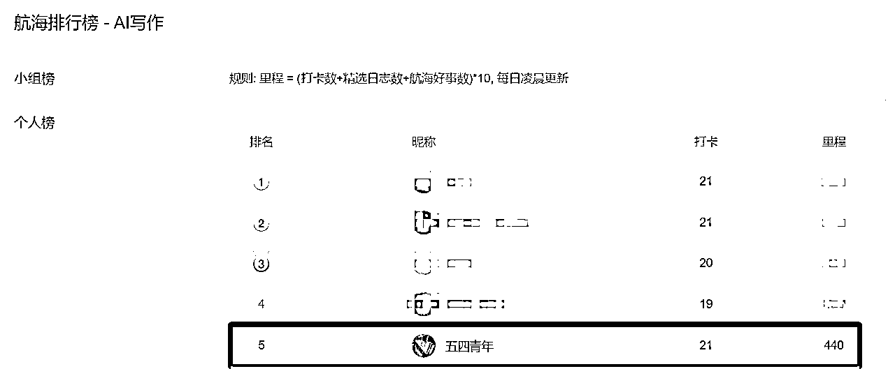

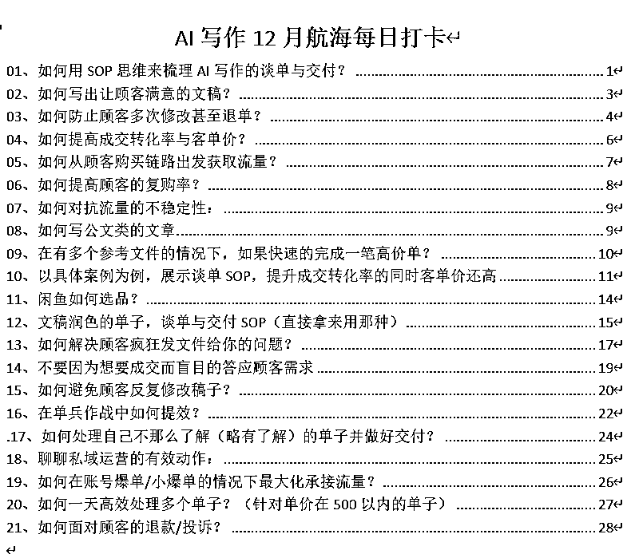

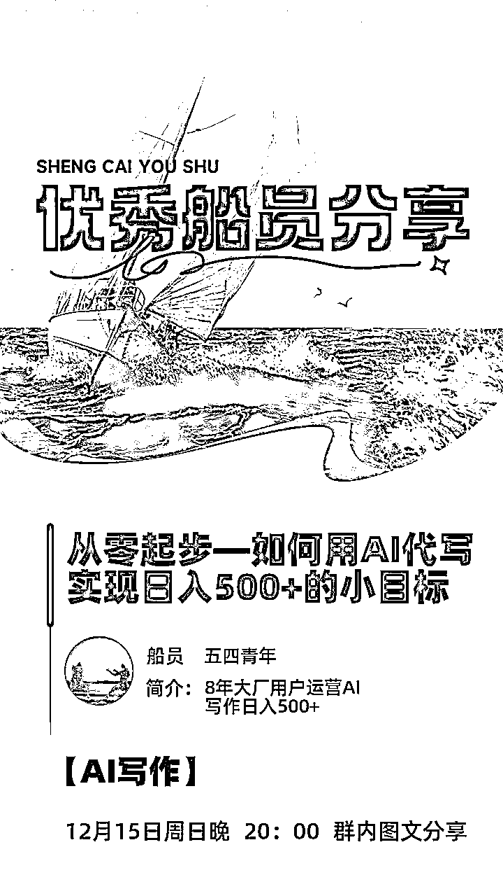

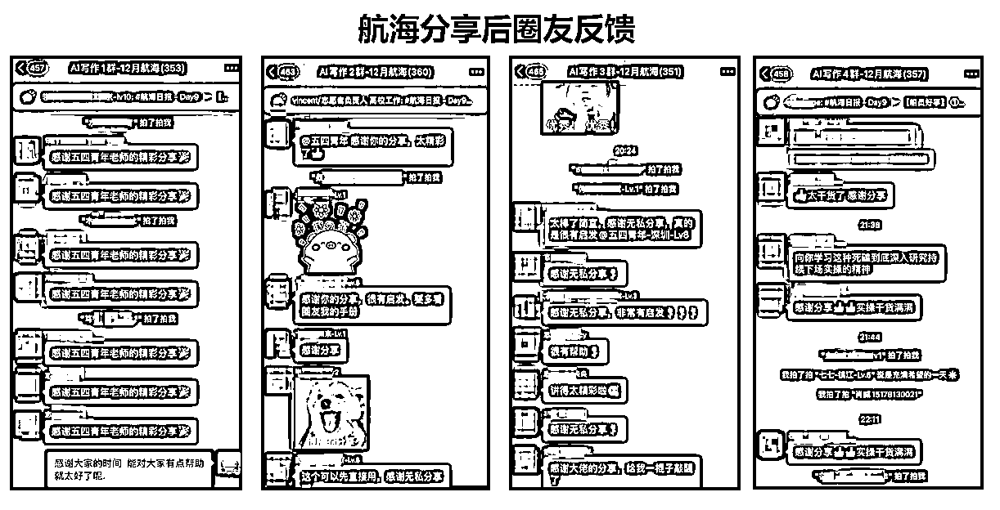

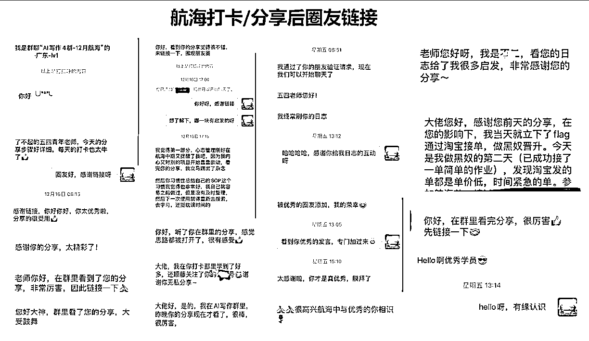

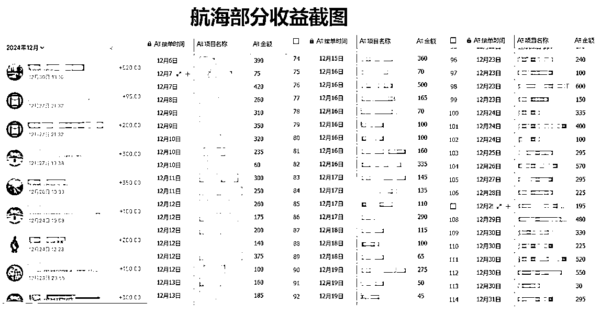

## 第一部分：做项目的正确心态

### 一、选定一个方向，先扎进去干

**这节写给：辗转好几个项目却始终没拿到结果的朋友。**

#### 1、别贪多，一次就押注一个

在赚钱的4年里，我折腾过很多方向，累计参加了18次航海。最疯狂的时候，一期同时报了4个航海。结果呢？顾此失彼，什么都想要，最后什么都没捞着。

这次12月航海，我其实报名了2个项目。但说实话，AI写作虽然9月那次已经跑通了闭环，可真要扎扎实实把航海走完，根本没有余力再跟上另一个的节奏。

所以，如果你还是一个新手，或者还没在任何一个项目里拿到过像样的结果，最好的选择就是——一次只报一个航海，只干一件事。

#### 2、先选一个方向，干起来再说

这句话来自龙哥老大分享的7条原则里的第五条：

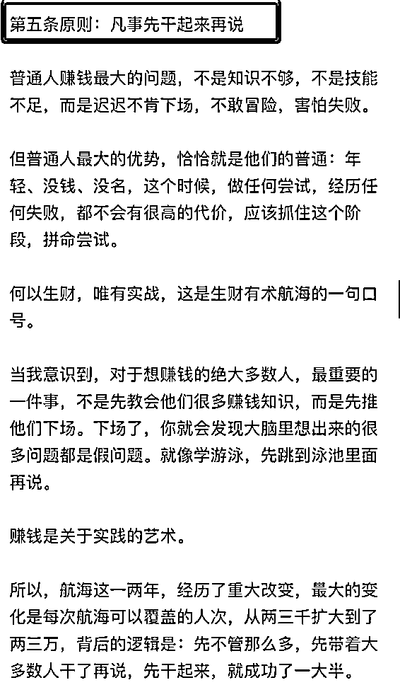

我们总想一击即中，总在等待一个“最合适”的项目出现。结果是，要么犹犹豫豫不敢下场，要么下场了也没把自己全部押进去，眼睛还在瞟别的方向。

做了这么多项目，我自己最大的感受是：所谓“好项目”，不是选出来的，而是在一次次实战中“试”出来、迭代出来的。过程中你会更懂怎么做项目，也更懂自己擅长什么。别指望一上来就选对，先下场，先动起来。

华与华的华杉老师说过：“所有的事都是一件事。”当你有一个项目真正跑通了、拿到了结果，哪怕再切到别的项目，你的手感也在。毕竟项目千千万万，剥开表象看本质，绝大多数底层逻辑都逃不出明白老师20年写的那张赚钱清单：需求、流量、营销、变现。

实在不知道干什么，就随便捡起一个项目，专注干他个100天，发100个作品，做100次反馈。用龙哥老大的话说：“试试看，反正成本不大。”不然你总在原地观望，回头看过去100天，好像啥也没干。

### 二、找到属于自己的节奏

**这节写给：刚入手做项目的新手朋友。**

项目做多了，越来越认同一个道理：“心态比能力更重要。”你能不能掌控好自己的节奏，往往决定了你能不能拿到结果。

12月AI写作航海期间，因为我在打卡里比较真诚地分享了实战经验，有好几位圈友来加我，好奇我在闲鱼开了几个号、每天怎么发品、运营节奏如何。仔细聊下来才发现，有些人连第一步都还没迈出去。

刚开始做项目，很容易看到别人晒单、看别人进度快就开始焦虑，动作一乱，节奏全没了。明明淘宝接单还没多少，就急着猛做流量。

其实每个人基础不同、阶段不同，关键不是和别人比，而是今天的自己有没有比昨天往前走得更扎实一点。

核心还是要搞明白自己的目标、路径和策略。AI写作是一门需要反复练的手艺，一上来就想接复杂大单，很容易力不从心。不如先把基础打牢，小单子练熟，再一步步往上挑战。

### 三、参加航海的正确姿势

**这节写给：觉得参加航海没收获的圈友。**

4年18次航海，对我来说收获最大的，恰恰是最近两次AI写作。回头看才明白，之前觉得“没收获”“没跑通闭环”，都是踩了同一个坑：一次报太多项目，每个都没投入足够精力。

航海手册加整个运营交付体系，说实话碾压市面上3000块以下的课程。你觉得没收获，大概率是没有真正用对方法。

正确的姿势是什么？四步走：

**1、理解项目——把手册吃透**

每一期航海手册都倾注了大量心血，而且每期都在迭代。比如AI写作12月这期相比9月那期，内容完善度提升了差不多50%。别到处东看西看，这就是宝藏，是项目的最佳实践路径，好好吸收。

**2、实操项目——下场干，并认真打卡**

读手册的同时一定要下场做。做的过程，就是你和手册、和项目互相加深理解的过程。同时每天把行动、思考记录下来，别觉得这是浪费时间，有时候慢就是快。我本来AI写作已经跑通闭环了，12月航海想说进来看看信息就好，结果因为每天拼命卷打卡，对整个项目的理解一下子全打通了，收获巨大。

**3、打破卡点——高手领航、举手提问、教练点评**

高手领航就像武侠小说里高手手把手带你练功。不懂这个价值？去看看市面上这类服务怎么收费就明白了。遇到卡点就“举手”，教练们都很负责；每次教练点评，你能看到拿到结果的人是怎么面对实际问题的。这三件事配合起来，卡点自然一个个破掉。

**4、链接交流——在群里分享价值，链接同频圈友**

在群里分享自己实战中有价值的经验，也解答别人的问题。用价值吸引同频的人一起交流，你能从不同视角看到新机会，也能发现项目中更多的可能性。

---

## 第二部分：AI代写的21个面包屑——附提示词

**这节写给：AI代写月收益1.5万以下的圈友。**

### 一、搞流量（重点以闲鱼平台为例）

**01、选品：闲鱼平台该怎么选？**

**第一阶段：选通品。**

刚进一个新平台，第一目标永远是跑通闭环。通品的特点是门槛低、风险可控、成交率更有保障。

什么是通品？直接在闲鱼搜：写作、撰写、高质量写作这类关键词，出来的那一批就是通品。

**第二阶段：选应季品。**

运营闲鱼的底层逻辑，其实和我做的第一个项目知乎好物一样，核心都是怼关键词权重，同时跟着热点和季节走。

比如现在是年底，主持稿、年会节目策划、述职报告这些热度正高；毕业季和金九银十的时候，简历就是大热门。在对应的时间集中打这几个品，更容易出结果。而且你单子做得越多，谈单和交付的SOP就越顺，单笔订单的时间投产比自然更高。

**第三阶段：壁垒品。**

通品走通了，季节品也打过了，这时候你手里已经攒了不少客户反馈，也清楚自己更擅长什么方向。这些方向，就是别人用简单的AI提示词短期超越不了的东西。

比如你本来就有数据分析的行业背景，那SPSS分析就是一个壁垒品。持续打，月入五位数不是难事。

注意：很多人一上来就想打壁垒品，想法没错。但教员说得好，道路是曲折的，前途是光明的。我们还是得一步一步来：见天地，了解平台规则；见众生，理解顾客和他们的需求；见自己，找到自己最擅长的品类。

**02、顾客端：从顾客购买链路出发找流量**

想搞流量，先搞清楚顾客是怎么一步步找到你、加上你🛰️的。

公式：GMV = 流量（曝光-浏览/想要）× 转化率 × 客单价 × 复购率。

闲鱼的流量分三个层级，对应漏斗的三端：曝光量、浏览量、想要数，再加上询单数和加🛰️数。

**① 提高曝光概率：**
多号 + 多发品——顾客搜关键词时，你出现在他眼前的机会才会更大。

**② 提高浏览概率：**
主图要足够吸引人，主图下方那20个字标题要有让人点进去的欲望。想想顾客搜索时一眼看到的内容是什么？那里必须给他一个点击理由。

这个理由怎么找？前期去翻淘宝和闲鱼的评价；中期交付时直接问顾客怎么找到你的；后期单子多了、聊得多了，顾客的痛点和需求你自然门儿清。

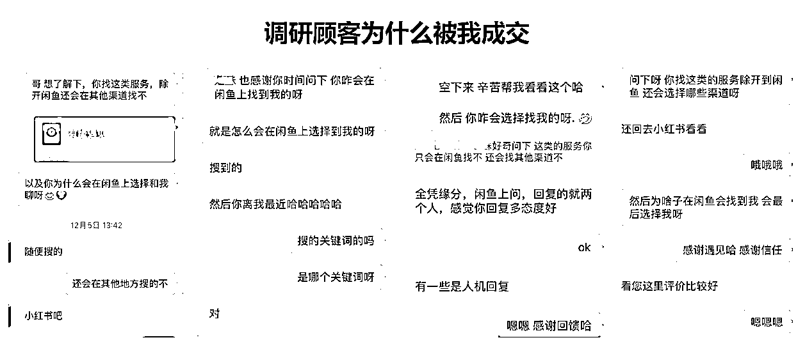

**③ 想要：**
从点进来到点击想要，中间起作用的因素是什么？描述、配图，以及行动引导。比如引导“点击有惊喜”。

点下“想要”之后，下一步就是往🛰️里引导了。

**03、平台端：怎么对抗流量的不稳定性？**

做过多个平台就会发现，自然流量的波动是常态，闲鱼也一样。我们控制不了流量，但可以多做几件增加流量概率的事。

思路反过来想：平台凭什么给你更多流量？——要么你能让平台获利，要么你能帮平台留住用户。

所以方法就很清晰了：

① 保持账号活跃：每天用，时不时产生交易。

② 加号：多几个号一起跑。

③ 多发品：在开通鱼小铺之前，可以发50个品，尽快发满，然后不断淘汰流量差的，更新迭代。

④ 每天做运营动作：擦亮、推广、降价，都安排上。

⑤ 尽量平台内成交：小单在平台上走，而不是引导私下转账。

⑥ 引导顾客好评：好评既是给你的账号加分，也是在强化顾客对你的好感。

**04、私域运营：怎么提高复购率？**

公式再拿出来：GMV = 流量 × 转化率 × 客单价 × 复购率。

这段时间陆续有老客户来复购，真真切切感受到了私域的价值。关于复购率，核心指标不是单纯的“复购率”，而是“复购用户数”。它跟几个因素有关：私域规模、首单信任与满意度、持续触达、定期回访、复购金额。

具体怎么做？

① 私域规模：没有规模免谈复购率。只要私域上了量，哪怕复购率一般，复购的总数也相当可观。

② 首单信任与交付满意：复购的地基是第一单的信任和交付质量。所以每个加了🛰️的客户，先建立信任再谈成交，该发案例发案例，该展示专业度展示专业度。

③ 持续触达与定期回访：首单满意的前提下，朋友圈营销要有针对性，定期回访不能断，让他们在有需求时第一个想到你。要在他们心里打上一个标签：代写这件事，你最专业，找你就对了。

④ 复购金额：复购时的价格，大概率受第一次订单影响。如果第一次报得太低，后面很难涨回来。所以第一次成交别把价格压太低，为的是给后面留空间。

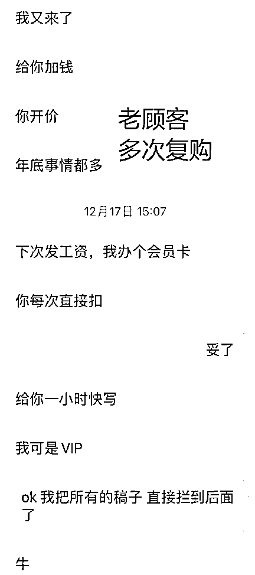

**05、私域运营的有效动作**

中心思想：私域运营，是在更有消费机会的池塘里捞鱼，投产比更高，值得重视。

具体动作：

**① 扩大私域盘子——尽量加到🛰️（目标1000+）。**

凡是闲鱼来询单的，都尽量引导到🛰️。三个话术轮着用：

a. “我们加🛰️进一步聊，发资料方便具体评估。”

b. “借一步，我发两个案例给您看看。”

c. “这块在这边聊不太方便，我们换个地方说。”

这三个话术换着来，配合及时回复，引流成功率能到90%以上。还有其他话术的话，欢迎评论区补充。

**② 避免首次没成交就被人删掉🛰️。**

要有长线思维，私域的本质是复购逻辑，别指望第一次就必须成交。有时候顾客确实因为时间、需求不匹配，第一次没谈拢，这很正常。但有一件事必须做：告诉他你能服务的范围，同时建立信任。我自己就有过第一次没成交、后面那位客户陆续给我推了5个新客户的经历。

**③ 打好标签。**

标签极其重要。粗分可以是职场、学生；职场里再分机关、国企、学校、私企；学生里面有毕业的、在读的……标签越细分，后面营销越精准。

命名上，可以记录价格敏感度、上次订单类型、顾客特点。比如：“大明 | 国企办公室 | 要质量 | 公文”。

**④ 朋友圈节奏。**

定期发，内容里至少三分之一是生活相关。实操中的一个小技巧：针对某一类标签的人，发针对性的朋友圈，做定向营销。

**⑤ 定期跟进。**

一种是节假日维护：加了🛰️都是潜在客户，节假日问候是维系关系的最好时机，也让他们想起你。

另一种是定期的消息跟进。你越了解客户，越能判断哪类客户在哪个时间节点会有需求。你适时出现，订单很可能就这么产生了。因为很多客户本来就在犹豫要不要找代写，刚好你来了，单子就成了。

**⑥ 对标与迭代。**

专门拿一个🛰️号去加同行，至少加100个。然后定期去刷、去研究，持续迭代优化自己的动作。

### 二、谈单转化

**01、怎么提高成交转化率和客单价？**

又一次用到公式：GMV = 流量 × 转化率 × 客单价 × 复购率。

和圈友交流时，大家会对比同一类单子的成交情况。我的转化率和客单价整体偏高一些，虽然还有提升空间，但也有一些经验可以分享。

核心思路：顾客为什么愿意为你的服务买单？无非三点——他理解并认同你能解决他的需求、他信任你、价格在可接受范围内。也就是：有意愿、有能力、有信任。

具体操作，当客户加到🛰️后：

**① 先解决信任问题。**

发过往成交案例、老顾客的认可截图，引导他看朋友圈——让他相信：把需求交给你是放心的，你是有能力完成的。

**② 详细了解顾客需求。**

做完第一步，根据单子类型，尽可能把所需信息问清楚。没搞清楚就报价，要么顾客觉得你不专业，要么报了低价自己交付到心累。交付过程中反复追问本该一开始就确认清楚的问题，也非常掉价。

遇到没做过的单子怎么办？一句话：万事不决问AI。直接问AI你该怎么提问，才能更好地完成这个单子的交付。

**③ 报价，并且给对方一个理由。**

报价要有依据。常见依据是工作量、质量要求、时间紧急度。给顾客一个有理有据的解释，而不是让他觉得你是随口报的，这样报价就很实在。

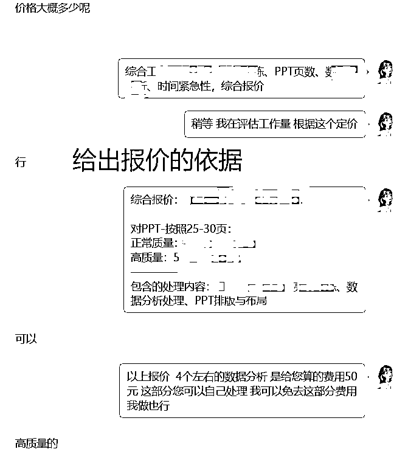

如果你对需求足够清晰，这一步的核心就是强化顾客的意愿度。先想明白：顾客为什么找你？是懒得写、不好写、不会写，还是哪种情况？挖掘出深层需求，才能针对性地报价。

同时，了解需求的过程中，尽量引导顾客多聊几轮。这既是更清楚需求的方式，也是一种沉没成本策略——顾客在你身上投入的沟通时间越多，最后选你的概率越大。

另外一个小技巧：顾客成交后，可以侧面问问他是怎么找到你的、为什么选你。这里经常会有惊喜。

**02、谈单SOP——成交率提升的同时，客单价还高（案例拆解）**

很多圈友反馈的普遍痛点：要么谈不下来，要么价格太低。

刚好年底各类总结需求大量爆发，大家应该都有感知，毕竟年底做述职的人特别多。就拿述职报告来拆解一次谈单SOP。

**A：拆解关键步骤——谈单前、谈单中、谈单后。**

**B：梳理每个步骤的具体123动作。**

**第一步：谈单前。**

一切谈单的前提，是客户已经加了你的🛰️。一个连🛰️都不愿意加的客户，需求真实性本身就值得怀疑。

加过来之后，客户第一件事就是翻你朋友圈。所以朋友圈、头像、签名这些“门面”必须打磨好，让他加进来的第一时间对你产生初步信任。想想你自己被引流到别人私域时，是不是第一件事就是翻对方朋友圈？

**第二步：谈单中。**

**① 建立信任。**

刚开场，先解决信任问题。核心三问：我能做吗？为什么是我？凭什么证明？

综合来看，述职报告的需求有两大类：职场述职、党政相关述职。

**职场类：**
顾客最关心的是——你有没有那个高度，尤其是总监及以上级别。这时候需要亮出你的职场背景，比如我会说“8年大厂高级经理”，顺手发工牌照。

再给近期的案例和好评图。

如果是中层以下岗位，一击必中的点在于你对这个岗位的了解。可以提“工作中接触过”“有朋友就是做这类的”，写你这个完全没问题。

**党政/国企类：**
顾客最关心你能不能做到虚实结合、措辞到位、表达贴合。这是公文类写作的核心。你只需要给出对应的服务案例和好评图。

ps：从我陌拜聊同行的经验看，这一步很多人根本不做。但我觉得非常关键。把这一步做成SOP和模板，分类直接发。就算这单不成交，客户也会觉得你很专业，下次还会来找你。

**② 了解需求。**

这一步的核心是清晰、准确地摸清客户需求，既方便定价，也方便交付。同时，精准的提问会让顾客觉得你专业、细致，也在无形中增加沉没成本，提高成交概率。

以述职报告为例，需求询问SOP如下：

A：公司类型、名称、岗位名称。

B：主要工作内容、亮点、未来规划（没有的话我可以自己查资料补充）。

C：输出模板和写作风格。拿到模板后，要确认大纲是用一样的还是换个说法——这是我踩过坑的地方，务必问清楚。

D：字数要求、时间要求。

**③ 给顾客报价。**

报价一定要给一个实实在在、越细节越好的理由，让对方觉得这价格配得上工作量。举个例子，我的话术是：

“结合岗位级别、需求梳理与重点提炼、字数与时间紧急性，综合报价如下。”

发完这句先停30秒，相当于先把价格锚定住，让顾客心里有数——这个需求，价格恐怕不会低。

然后再发报价表：

“综合报价如下：
应付价格：XXX（几次修改）
正常价格：XXX（几次修改）
高质量价格：XXX（包修改）”

解释一下我的定价逻辑：

**应付价格**：接这个单，不让我交付时发自内心觉得心累的价格。

**高质量价格**：接这个单，会让我感到惊喜的价格。比如之前接过一个2000字的述职报告，客户比较急，我报了375块，对方成交了，我就觉得非常开心。

在 AI 内容这条赛道里，光靠写得快是做不大营收的，核心差序在于把报价、成交和交付串成可复制的闭环。下面的盘点可以当作从拿单到放大流量的实操清单直接套用。

先说价格的取舍。不要上来就报一个中庸数，先厘清客户心理能接受的底线，以及你能稳定交付的高质方案的对标价。最终对外报出的数字最好落在两者之间，并且向高质量端靠拢。例如心中盘算有 100 和 265 两个锚点，外放时报 300 就很合理。这其实是心理锚定的用法，让挑剔的内容需求客户主动把自己归到高质价格区间。

单子确认以后，第一件事是把交付边界和节奏说清楚，保证自己始终握有主导权。我习惯这样同步客户：

“先把我的交付节奏同步给你：①在**时间前把提纲给你确认，确认后在***时间把成稿给你。口径上我说的是稿件而不是初稿，因为初稿天然带有‘要改’的暗示，稿件则默认是一稿过。②在提纲确认的前提下，支持**次在框架内的微调，提纲一旦锁定就不再变动。”

规则说透有两个好处：一是划定修改边界，保障双方权益；二是让节奏透明，客户不会反复追问进度。

文稿润色的谈单更需要先纠偏认知。很多客户觉得润色就是遣词造句，这种想法会让你陷入被动修改、无价可谈的局面。要把服务定义成对整体架构和表达的升级，涵盖思路层次、用词严谨度和视角提升，这不是简单的文字打磨能完成的。同时要站在客户立场说明：原稿并非白写，对比润色后的版本可以反向提升个人写作水平。这样润色的定价逻辑就能对齐全新创作的价格体系。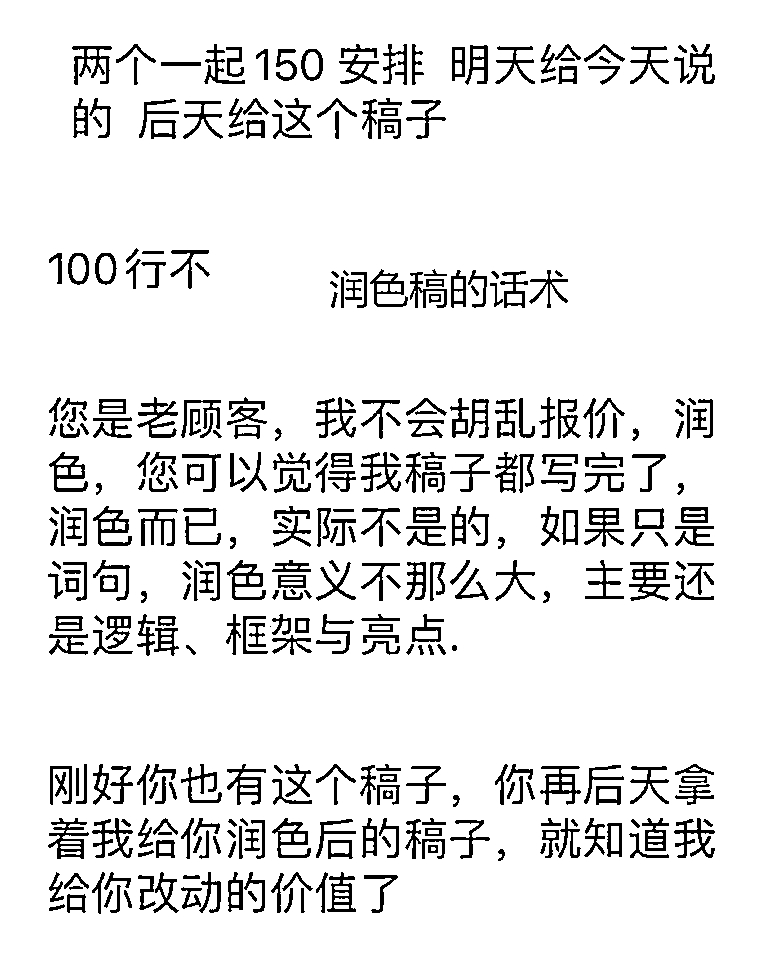

润色交付的具体操作，我的思路是用客户稿提炼骨架，再用提示词让模型重写一遍。步骤是：先让模型以资深国企笔杆子的身份拆解原文、汇总要点；再基于骨架分段生成，客户有新增点就直接塞进要求里；随后参照客户原稿各章节的篇幅，确定新提纲的字数配比，让模型严格按配额输出；最后按章节逐段推进直到成稿。

流量波动时最考验承接能力。账号有爆发或小爆，是短暂的变现窗口，这时候的优先级不是埋头写，而是尽力承接并学会分单。流量不稳定，爆单期就不要纠结交付细节，先把注意力撤到咨询侧。盯住异常询盘，及时响应，手上能延期的单子延期，能分包的就分包。遇到不擅长或时间冲突的项目，拉熟人一起谈，把佣金让出去更划算。交付时点要主意错峰，用加急费把可延后的客户柔性后移，避免单子堆成山。别试图把所有订单都自己消化，容易整体崩盘，挑投入产出比最高的留下，其余外放。单日承接不过来的，也不要因为流失就把联系人删掉，留下一段后续触达的可能性。第二天给爆单来的客户贴标签，发一条侧面介绍自己的朋友圈，为复购埋点。

交付满意的风格，尤其是公文类，核心是投喂+角色定位。先找客户要几篇范文，让模型学习语言习惯和措辞；再在自己不确定如何设参时，直接问模型：“我要出一篇公文，应该让它扮演什么角色、怎么设提示词？”模型会给出方向。参考用法是：背景说明要写哪种材料，角色设定为多年党政写作经验的笔杆子，任务是结合提供的风格示例写指定篇幅，先出提纲确认再出正文，列出具体要求并附上风格样例。

客户反复改稿甚至要求退款，多半是流程缺陷：需求没对齐、交付链条缺少提纲确认、修改次数与范围没前置约定。解法是三点：接单后把客户需求完整罗列出来，并让客户书面确认；把提纲确认作为交付必经节点，相当于开车前核对路线，后续微调成本远低于返工；把修改次数、提纲锁定后的边界写明白，体现专业度，也让客服与你站在同一战线，更容易支撑高价单。

我曾 45 分钟内完成一个 380 元的单子，客户一次通过。做法是先梳理思路再动手。接单时就要客户提供两类素材：一是过往模板，用于对齐风格和框架；二是写作素材。先让模型分析模板锁定骨架和语气，再让它把多个素材文档整合为结构化资料库，之后把风格与资料结合生成提纲。提纲确认后再写正文，长于 2000 字的文章尤其不能跳过确认环节，否则返工极大。单子结束后要做复盘记录：类型、解决路径、难点、使用的提示词，沉淀到订单表里，下次同类型可直接复用，避免重复思考问题。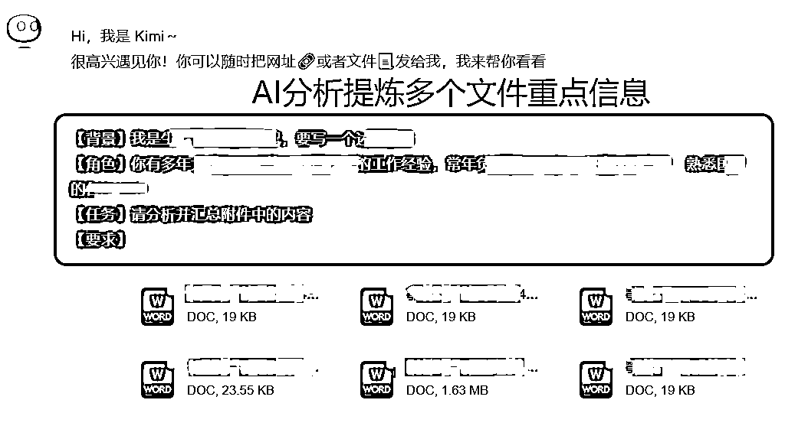

关于客户开工后猛发文件的烦恼，分两种情况。需求初期模糊、报价后才补资料的，等需求明细清晰后再报价，并说明文件量大需评估计费，为自己留余地。另一种是初稿后才批量甩文件，如果改动小则顺手调整，若涉及大范围改写，说明谈单阶段的修改规则没说清，必须在下次谈单时把改动范围和次数前置约定。

碰到不熟悉的领域，用项目管理的思路走三步。先把交付物标准想清楚，和客户确认“做到什么程度算合格”，必要时让模型辅助梳理标准。第二步，让模型扮演一个懂行的人，喂入客户资料和目标，让它规划提示词和角色分配后产出初稿。核心难点是角色设定，不懂就反向提问模型“要完成这个任务该怎么设角色和提示词”。第三步，大胆提交初稿，收集反馈做针对性迭代。说到底就是把自己定位成项目负责人，协调多个模型角色完成目标，而非事事亲自撰写。

避免反复修改的本质是需求对齐。客户需求清晰时，问题出在你没问全、没确认、没分段确认。建立特定单类型的询单 SOP，问完后把理解整理成文档发客户回执；交付拆成提纲确认和正文确认，别等到初稿才第一次见面。若客户自己也不清楚要什么，让他提供范例，或你提供参考稿让他拍板。确认范例时要细化到是文风、格式还是框架，否则仍会触发重写。另外要树立专家定位，初期用案例建立信任，主动主导修改决策。交付时间上不要过早交稿，防止客户有闲工夫折腾；交付时不要用“初稿”这个词，直接说“稿件”；谈单时就把修改频次和范围定死。

一天处理多单，建议按紧急度排序，用流水线作业。把动作拆解为：梳理需求、补充信息、提纲确认、统一改稿、收尾。先集中梳理所有单子的需求清单，再批量去找客户确认细节，随后统一出提纲并收集反馈，最后集中写作和修改。同一时段只做同类动作，避免被客户牵着走，除非客户愿意付高价独占你的时间。

公文类目前单价较高且满意度稳定。谈单时拿出过往案例证明经验，并点出公文难点在于虚实结合与措辞精准。交付时先拿到参考稿让模型总结风格，再用提示词驱动。背景说明材料用途，角色设为资深党政笔杆子，任务是按要求写指定字数，先出提纲再出正文；要求中可写贴合主题、符合公文特性、每段控制字数、党建内容用最新表述。

最后说提效。任何重复两次以上的工作都值得做成 SOP，目标是新手照着做也能复现相似结果。梳理时先拆解动作：需求梳理、提示词输入、成稿形成与格式调整、交付、复盘。拿演讲稿举例，需求包括身份、场合、主题、时长；提示词固定背景、角色、任务、风格要求与素材区，后续持续迭代。单兵作战时，流量、谈单、交付每个环节都可标准化，比如固定的养号动作，流程跑通后时间才真正变成收益。

把流程理顺，AI 写作就能从手艺变成可规模化的生意。

关于闲鱼卖货，很多人纠结“要不要养号”。说实话，效果没人能打包票，但我一直觉得养号该做——每天保持活跃，对账号权重和抗风险能力只有加分项。不过没必要专门腾时间，利用碎片时间就行：排队、等位、蹲厕所时，几个手机轮流刷；或者走路慢一点，边看边刷（注意安全）。

接着说主图。顾客搜关键词第一眼看到的就是主图，视觉冲击力直接决定点不点进来。刚开始别自己瞎琢磨，直接拿数据好的链接的图来改，剪一下、贴个贴纸就行。等你运营做熟了，对作图有自己的理解，再自己设计，平台也更偏爱原创。

至于提效，我最近一直用可画——还是看领队依琳分享后试的，真香，模板超简单，一次能批量出好多张图。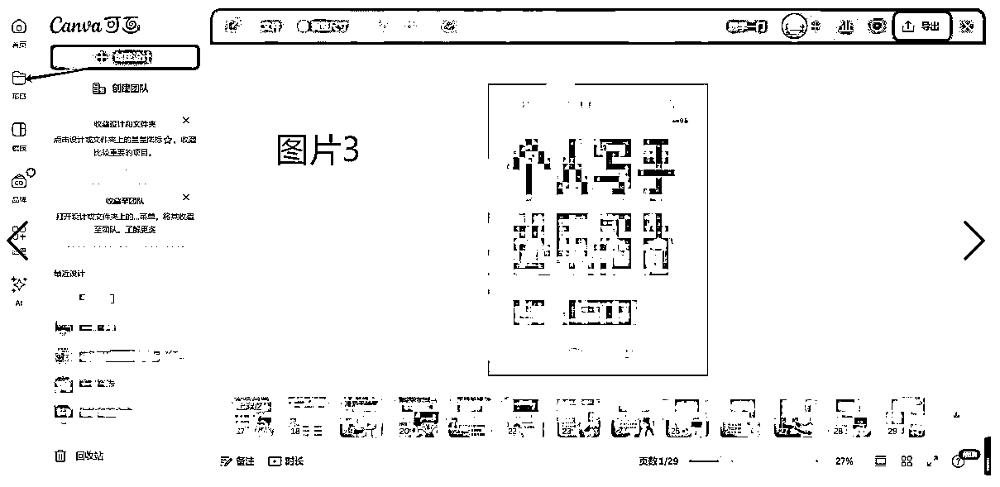

发品环节，很多人是不是每天都专门安排时间，一遍遍创建商品、选图选文案？其实超低效。这里可优化的点很多：

首先，把链接的文字框架固定下来。顾客点进主图后看到的文字，最好形成自己的SOP模板，比如按“你能提供什么—为什么选你—凭什么相信—现在就下单”的逻辑来写。

第二，固定图片框架和顺序。比如先放主图（包含写什么、核心卖点、行动指引），再放信任状（好评截图之类），最后放你擅长的类目展示。当然有人只放一张图也有数据，但我们聊的是怎么提高好数据的概率。

第三，一次性备好3天左右的发品量。把分散的重复动作集中做完，这样每天都能稳定上新，也不会因为忙而断更。

第四，下架品千万别闲置，它们就是现成的草稿箱，重新编辑上图再发，效率超高，谁用谁知道。

运营闲鱼这块，发货和好评引导推荐一个工具：闲管家。它可以一次管理多个账号、多个订单，批量发货和发好评，彻底告别手机一个个戳，最近用下来非常省事。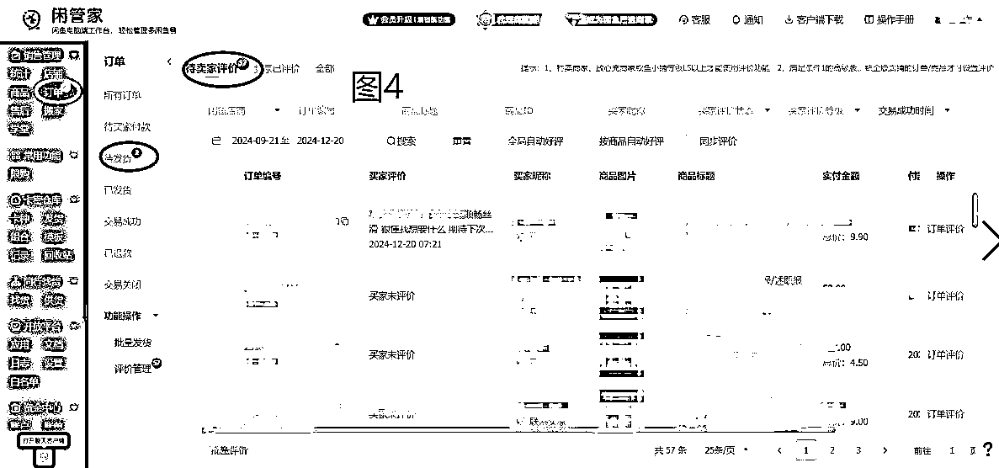

再谈谈单。

第一，平时要有意识收集好评图。顾客犹豫时，你直接甩几张真实好评比说一万句都有用。收集或“创造”好评图后，在🛰️里收藏打包，方便随时发。

第二，积累各种场景下的应对话术。比如之前一单，顾客老是不回消息，我用了一个话术就成交了。还有嫌贵、怕质量不好、说要考虑考虑……每种情况都要有准备。另外，强化个人身份、角色、抬高单价的话术也很重要。这些不一定要自己遇到才去记，同行或其他项目里好的说法都能借鉴。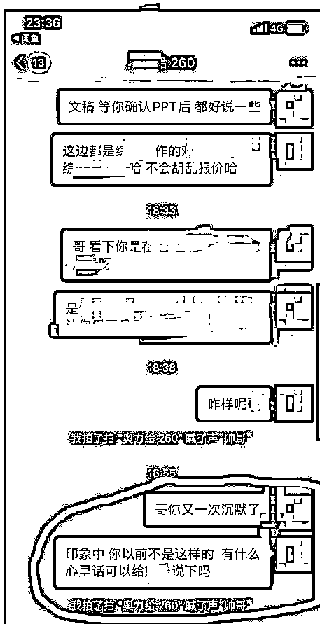

至于谈单前问清需求、谈单中报价谈判、谈单后明确规则，前面已经说过，不重复了。

交付部分：

第一，每类单子做一份专属汇总，包含前面说的SOP。比如演讲稿，你要记录不同客户在意的点、让你返工的地方、被表扬过的地方……避免返工就是最大的提效，而且经验多了，一出手客户就觉得你专业，单价自然不会低。

第二，为不同稿件定制专属提示词。

第三，同时打开多个AI网址，分工干活。

避坑心得：

① 别为了成交就盲目答应顾客任何要求。我遇到过售前没明确规则的客户，交付后反复要改，我没及时回复，对方直接投诉我欺诈，最后只能硬着头皮改。因为真闹到平台介入，判我问题更麻烦。所以重点不是跟这个客户较劲，而是迭代谈单SOP。

事情经过是这样的：某周一个之前加过的大学生客户又来找我，他之前嫌贵没合作。那天我还没开单，就想着报个低价、满足他要求，先把单子接下来。结果交稿几天后，他提出一个相当于重做的修改需求，我手上正好忙，但之前答应过任意改，就没及时处理。人家转身投诉欺诈。没办法，只能改，毕竟硬碰硬吃亏的是自己。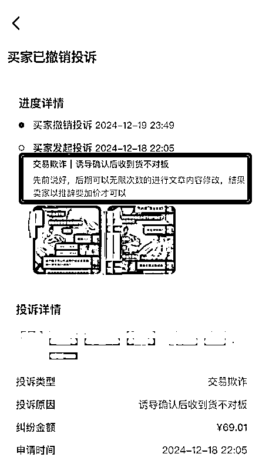

优化后的谈单SOP：

1. 不要无条件答应需求，尤其“随便改”这种话，开口要谨慎。
2. 事前把规则对每个客户讲清楚，避免风险。
3. 赚能出得起价的人的钱。大学生的单，尤其是小单，别盲目低价，你以为是便宜，对方不一定领情，反而挑出一堆问题。

② 怎么应对退款/投诉？

先摆心态：遇到退款不丢人，没遇到可能只是单子还不够多。

核心思想：前置规则做好约束，整个交付过程对得起对方付的钱。

为什么会退款？按原因拆解：

1. 接了能力外的单。解法：不能接就不接，或推荐给更合适的人，同时展示自己能服务的类型和信任感。
2. 前期规则不明。比如答应包修改，结果稿子出来对方直接换需求。解法：确认合作后，明确交付节点、交付物、修改范围和次数。别过度承诺，那是拿后面的运气赌现在的订单。
3. 需求没理解清楚就开工。解法：动工前先确认需求。
4. 交付不用心。AI生成后没加自己判断，或者没认真看客户要求。解法：对稿件质量负责，别拿AI当挡箭牌；开工前梳理需求，交付前再核对。
5. 没按时交稿。原因可能是忘了——接到订单第一时间记录时间和节点；也可能是根本完不成——提前评估，协商延期或干脆退单，底线是不能耽误顾客的事。
6. 碰上想白嫖的。解法：每一步交付都留好记录，引导顾客确认回复。尤其平台交易，平台通常偏向买家，有记录就不怕。

写在最后：

持续做有价值的实操和分享，一定能在路上遇见更好的自己。做项目这几年，就是见天地（市场规律）、见众生（用户同行）、见自己（能力边界）的过程。2020年4月18日，无意翻到赚钱的海报加入进来，从此打开新世界，开始做项目，也拥有了更多自主感和掌控感。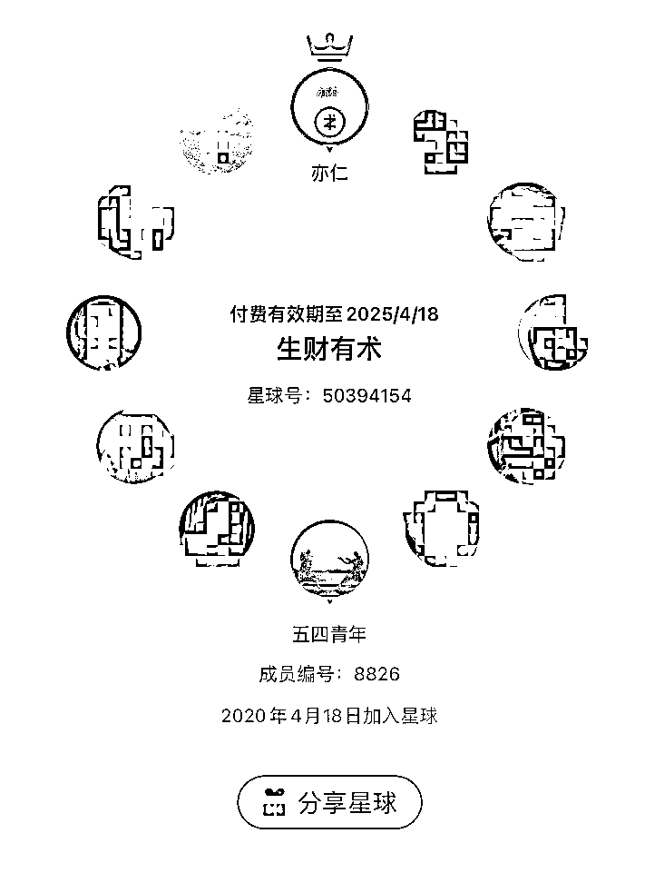

感谢龙哥老大搭了这么真诚有价值的圈子，感谢晓文老师、超鹏老师在短视频项目上的分享帮助，感谢光景、砖先生、郭东超的信息支持，感谢海盐老师的帖子让我在低迷时转入AI代写赛道稳住军心，感谢bu懂在AI代写上的指点让我突破收入层级，感谢AI写作12月航海3群领队依琳的建议促成了这次复盘。也谢谢每一位分享的圈友，与有荣焉。

一直记得龙哥老大说过：都来赚钱了，还怕什么。接下来要更积极地实操、总结、分享、链接，争取拿到更大的结果。

就用这篇帖子为AI写作12月航海画个句号，也为自己过去四年做项目的经历做个总结，同时迎接全新的2025年。祝龙哥盟越来越好，各位圈友在2025年都能实现自己的理想目标！