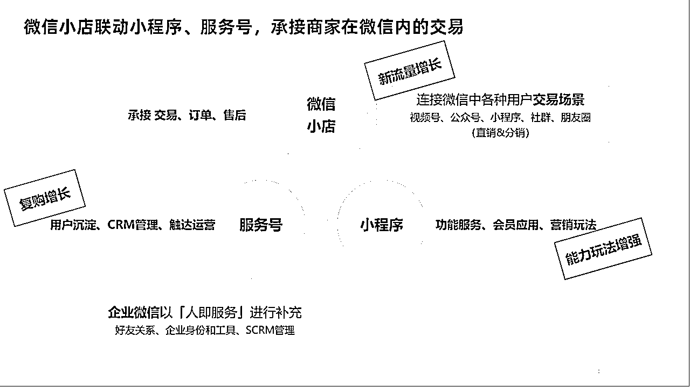
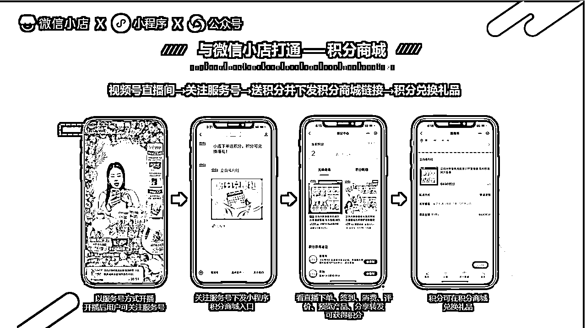
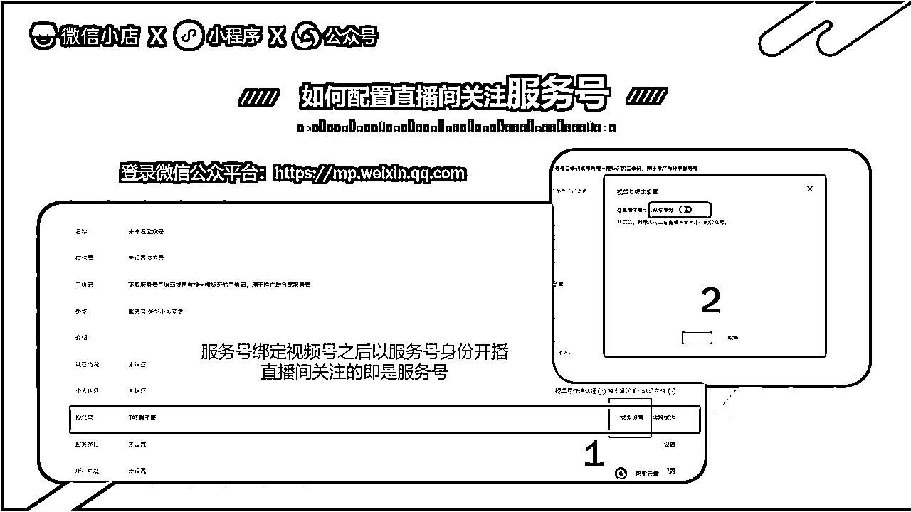
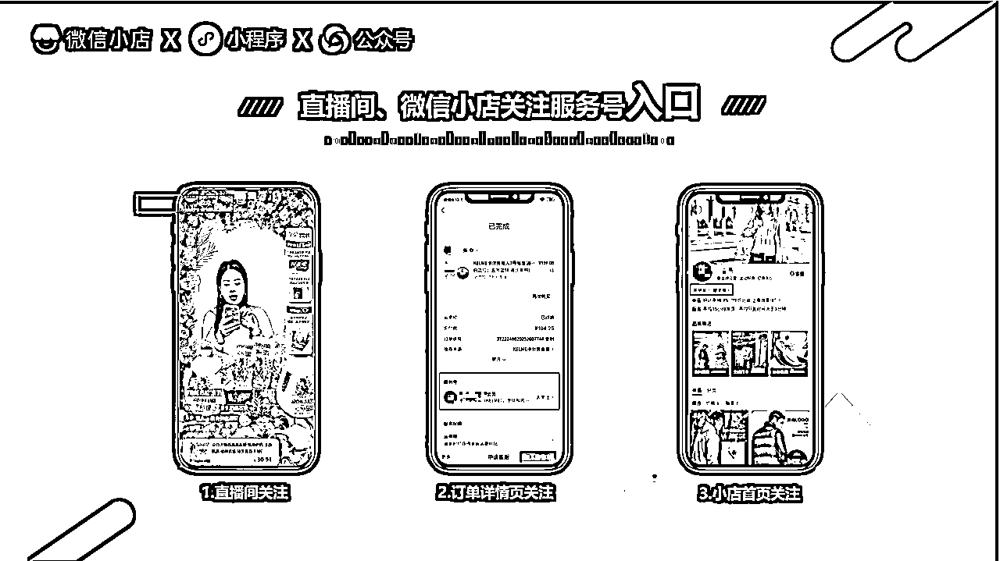
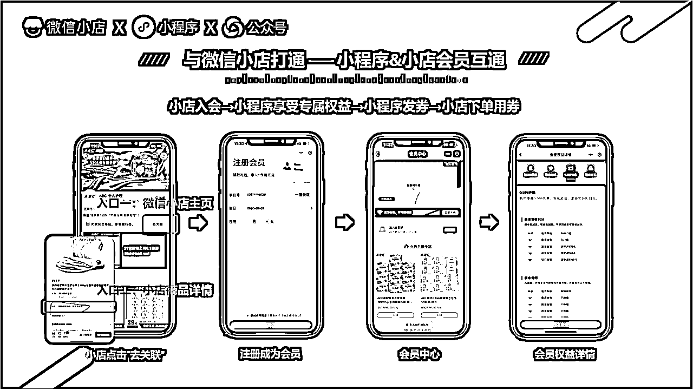
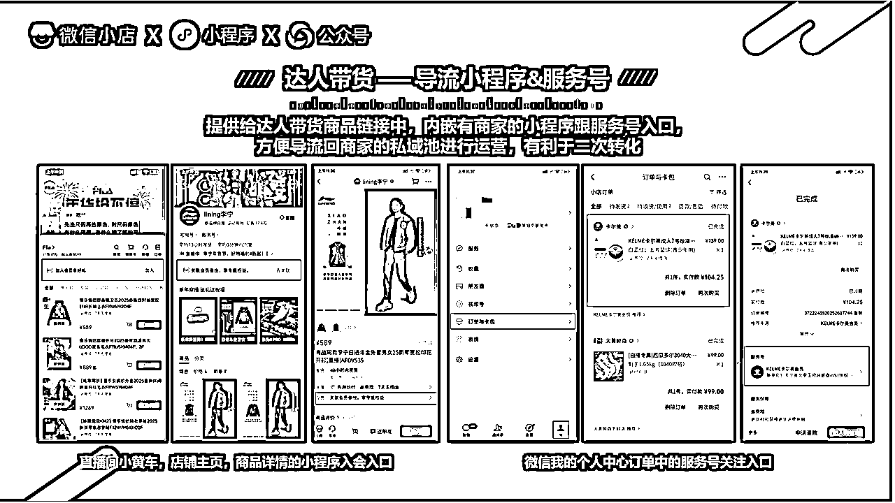
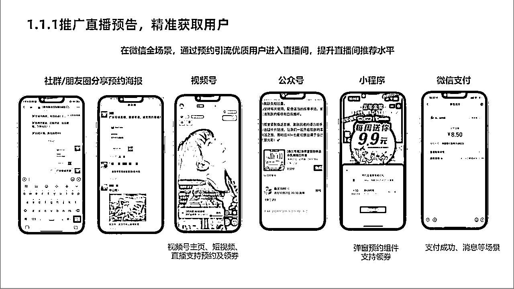
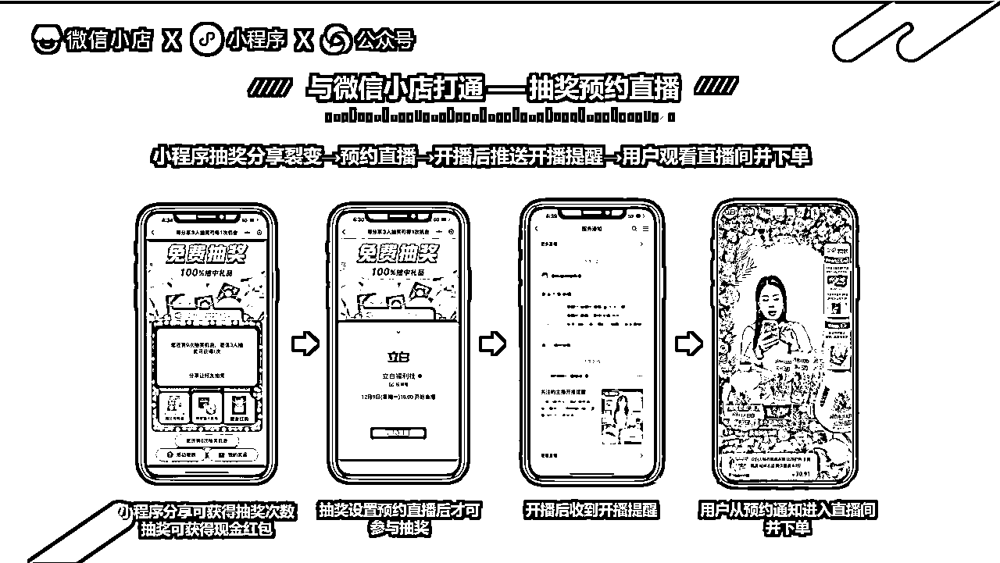
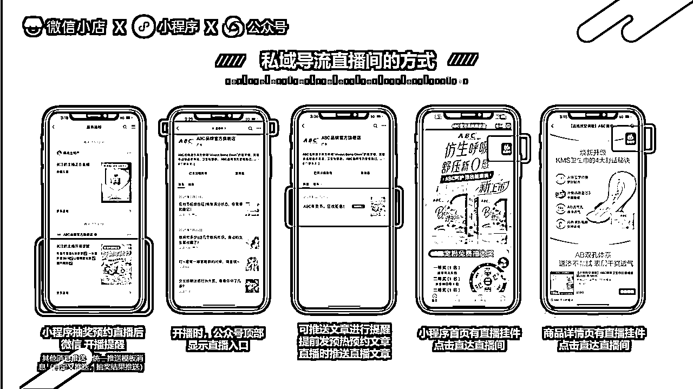
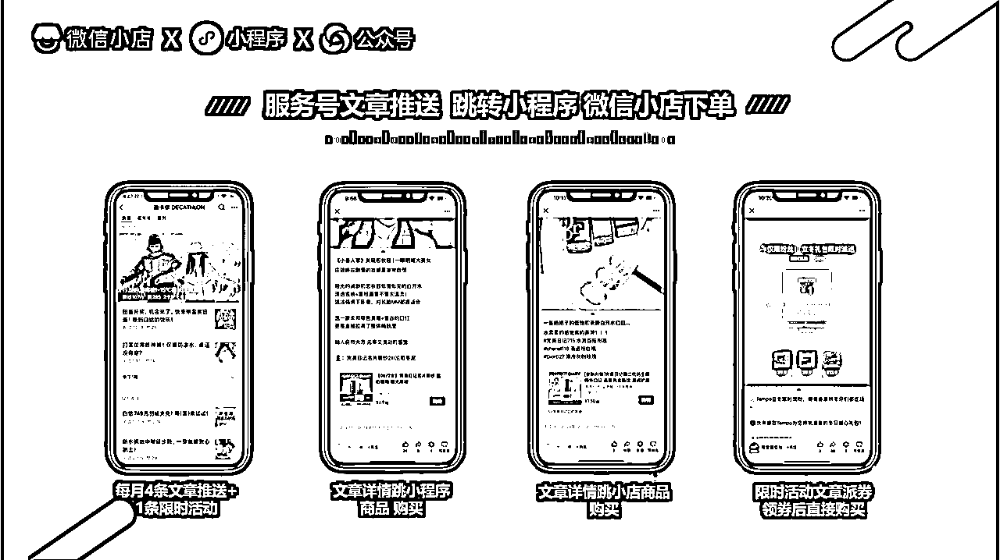

# 🛰️电商又松口了，私域的路子被重新打开了！

## 🛰️电商体系完成了一次系统性打通，小店、小程序、👸号、视频号开始协同运转

在最近的🛰️公开课上，官方正式上线了小程序与🛰️小店互通的功能。通俗讲就是，小程序里可以直接嵌入🛰️小店的商品模块，用户看货、下单的动作都在小店内闭环完成。商品展示和支付结算由小店承接，小程序则可以彻底把精力放在玩法设计、活动引爆和裂变上。

到这里，🛰️内部各产品的分工已经被重新厘清。🛰️小店是交易的底座，负责商品、订单和售后；小程序偏向营销工具、会员体系和功能服务；服务号用来做用户沉淀、CRM和触达运营，也就是私域的核心；视频号则承担公域获客和促单转化的重任。四者配合，🛰️小店承接全链路交易，小程序做玩法拉新，服务号做留存运营，视频号做流量入口，共同覆盖十几亿🛰️用户，合力撬动增量生意。

## 小店、小程序、服务号、视频号联动起来，对商家到底有什么用？

### 当下🛰️电商商家普遍卡在哪

*   视频号直播间自然流量稀缺，投放成本居高不下且难以沉淀。平台推流有限，付费流量一次消耗即走，观众看完即散，无法沉淀为商家可复用的用户资产。
*   规则还在迭代中，封店封号风险高。多数商家被迫多店运营，不同小店的用户分散，无法统一管理，营销投入重复浪费。
*   小店用户信息被加密，手机号等关键标签拿不到，做不了精细化CRM，私域运营受限。
*   依赖达人带货只能一次性成交，购买用户无法回流到商家自有池，复购难以驱动，获客成本被摊薄。
*   私域用户粗暴群发直播链接，导致进间用户不精准，转化率拉低，直播数据受损，进而影响公域推荐。
*   小店和小程序各自为战，需要两支运营团队，人工成本叠加浪费。

### 打通后的打法与价值

#### 把公域流量沉淀到私域，实现长期的精细化复购

🛰️小店和视频号联动后，给商家导流到小程序和服务号的入口明显变多。

*   视频号联动服务号，直接把直播间观众沉淀下来。商家可在直播设置中开启视频号展示服务号身份的功能，观众关注视频号的同时自动关注服务号。服务号可自动推送图文或小程序卡片，通过免费抽奖、百中奖优惠券、小额红包、入会领12张月度优惠券、积分兑换礼品等钩子，把用户一步步引到服务号和小程序私域池里，后续做精准运营。

*   小店内嵌导流入口。包括小店主页的服务号入口、订单详情页的关注入口、小店首页和商品详情页的小程序入会入口，都能把已成交用户导回服务号和小程序，进行持续经营，带动二次购买和复购。

*   达人带货也能沉淀私域。以往请达人只能花坑位费、佣金做单次带货，用户丢给达人。现在借助订单详情页和商品详情页的服务号/入会入口，购买用户可以被引导关注商家服务号或进入小程序，后续即可反复触达、做转化。

#### 用私域反哺公域，撬动更多平台流量推荐

*   先用私域裂变扩量，再导回直播间。视频号的自然流不足，付费流不能沉淀，私域复用成为刚需。商家可利用小程序的营销能力做抽奖、集赞、发券等裂变活动扩充私域池。直播时再把私域用户召回直播间，比如预约直播送权益、观看点赞分享攒积分、积分换礼品等。回流用户更精准，成交率提升，直播数据好看，平台就会给予更多公域推荐。现阶段平台对小程序引流至直播间的行为有扶持，从小程序导流回来的量可获得流量券补贴，用于直播投放。

*   服务号和小程序成为直播的常驻入口。直播进行时，服务号顶部会出现直播状态入口，并可推送开播通知；服务号文章里可嵌入直播组件，方便预约或直达。小程序首页会挂直播挂件，商品详情页也有直播入口，还能通过模板消息提醒用户开播了。

*   用服务号的推送能力做直播唤醒。服务号每月有4次图文推送和1次限时活动推送。内容触达效率高，特别是限时活动可直接派发优惠券，用户领取后即刻下单。

从公开课的整体信号看，🛰️在有意推动小店、小程序、服务号、视频号的联运新模式，帮助商家摆脱单一直播和纯广告投放的流量焦虑。过往🛰️尝试过直播间直推企业🛰️卡片和二维码的做法，但因部分商家过度骚扰甚至引发诈骗问题被下架。这次推出的新方案则更克制、更产品化：既避免了商家对用户无休止的主动打扰，又保留了触达私域做精细化运营的窗口。典型的🛰️思路，用产品设计平衡效率与体验，既管住了边界，也重新打开了私域的操作空间。